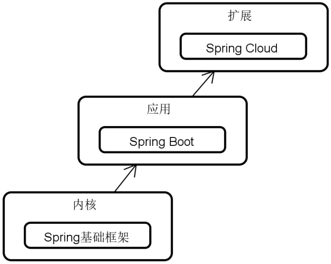

# 单体系统和Spring Boot课程导言

## 三个问题

1. 为什么要学Spring Boot？
2. 如何学习Spring Boot？
3. 学完Spring Boot你能做什么？

## 为什么要学Spring Boot？

Spring Boot 的核心优势：**化繁为简**。

自2014年4月发布1.0.0版本以来到现在，Spring Boot俨然已经发展为Java EE领域开发Web应用程序的首选框架。

Spring Boot 是现代 Java 开发的基石：

- **微服务架构的基石**：Spring Boot 是构建微服务的首选技术。它是更高级的微服务框架 **Spring Cloud**（下一个课程） 的基础，学习 Spring Boot 是通往微服务、云原生开发的必经之路。
- **就业市场的必备技能**：Spring Boot 已是 **Java 开发岗位招聘中的一项核心要求**。掌握它，能显著提升求职竞争力。

## 如何学习Spring Boot？

### 学习内容

围绕整个课程，你将学习**十二大**模块：

1. **Spring Boot基础**：理解Spring Boot的设计哲学，掌握其自动配置原理和Starter机制。
2. **依赖注入**：深入理解Spring IoC容器和依赖注入的多种方式，掌握循环依赖的成因及解决方案。
3. **AOP**：掌握Spring AOP的核心概念、动态代理机制（JDK vs CGLIB），并能运用于日志、监控、权限、事务等横切关注点。
4. **Web服务**：掌握基于Spring MVC构建RESTful API的完整流程，理解Servlet容器、HTTP协议及响应式编程基础
5. **Spring JDBC**：掌握JdbcTemplate和SimpleJdbcInsert的使用，深入理解Spring声明式事务（@Transactional）的传播行为、隔离级别及回滚规则。
6. **Spring ORM**：掌握Spring Data JPA和MyBatis两种主流ORM框架的集成与使用，理解ORM原理和Spring Data架构。
7. **系统缓存**：掌握Spring Cache抽象、常用注解（@Cacheable、@CacheEvict等）及缓存键管理，理解缓存穿透、雪崩的应对策略。
8. **Spring Async**：掌握@Async异步执行模型，理解其代理原理和线程池配置，以及Web层异步处理
9. **任务执行器和调度器**：掌握Spring TaskExecutor和TaskScheduler，实现定时任务和并发任务执行。
10. **Spring Batch**：掌握Spring Batch的核心架构与设计原理，能够为批处理应用构建完整的作业执行体系，支持海量数据的高效读取、处理与写入，并具备重启、跳过、重试与监控能力。
11. **系统监控**：掌握Actuator端点使用，能自定义健康检查、指标信息，并搭建Admin Server实现集中监控。
12. **系统测试**：掌握单元测试、集成测试、Mock技术（Mockito），并能分层测试（数据层、业务层、Web层）。

### 学习路径

围绕整个课程，你将通过**六个阶段**完整掌握Spring Boot的方方面面：

#### 阶段一：基础认知与快速上手

打破陌生感，建立整体认知，能够“跑起来”第一个应用。

#### 阶段二：Web服务开发

掌握应用对外暴露能力的方式——即构建RESTful API。

#### 阶段三：数据访问层

掌握与数据库交互的规范方案，这是企业级应用最核心的部分。

#### 阶段四：系统扩展能力

为应用增加缓存、异步、任务调度等企业级必备的横向能力。

#### 阶段五：应用批处理

企业级应用规模化数据处理的基石，为应用构建高效、可靠的批量处理能力。

#### 阶段六：生产就绪

让应用具备可观测、可测试、可部署的生产级品质。

### 项目实战

从零构建一个完整的**“图书管理系统”**，贯穿整个课程，包含所有十二大模块内容和六大学习阶段。

## 学完Spring Boot你能做什么？

课程结束后，你将能够：

1. **独立开发一个完整的单体后端服务**，涵盖配置、数据持久化、业务逻辑、API暴露、缓存、异步任务、定时调度、系统安全、监控和测试等企业级必需功能。
2. **熟练运用Spring家族核心生态**，具备快速上手其他Spring子项目（如Spring Cloud）的基础。
3. **具备排查和优化生产问题的能力**，如分析启动故障、循环依赖、事务失效、缓存击穿、接口性能瓶颈等。
4. **遵循企业级代码规范和架构设计原则**，如分层设计、接口契约、异常处理、日志规范等。
5. **通过课程中的“专项练习”和“面试题精讲”**，巩固理论知识，提升面试和职场实战竞争力。

## 常见学习问题

### 关于企业级应用

- 企业级架构设计与规范：如分层架构与模块化、包结构与命名规范等
- 真实开发中的最佳实践：如利用Maven+配置实现生产、测试和开发环境的隔离
- 场景化落地过程和技巧：如针对缓存操作如何设计合理的数据读写模式
- 即插即用的可复用代码：如统一响应与异常处理工具类等

### 关于单体和分布式的功能差异

不同功能特性在单体应用和分布式应用场景下的需求和实现方案可能完全不同。

以**安全性需求**和**Spring Security**框架为例，单体和分布式应用在安全实现上存在显著差异：

| 功能维度           | 单体应用 (Monolithic)                | 分布式/微服务应用 (Distributed/Microservices)                |
| ------------------ | ------------------------------------ | ------------------------------------------------------------ |
| **核心认证方式**   | 基于会话（Session）的有状态认证      | 基于令牌（Token，如JWT）的无状态认证                         |
| **会话/状态管理**  | 由应用服务器（如Tomcat）在内存中管理 | 无状态服务，不存储会话；或由中间件（如Redis）集中管理        |
| **授权模型**       | 通常为粗粒度的角色控制（RBAC）       | 演进为细粒度的属性控制（ABAC），结合上下文动态决策           |
| **认证与授权边界** | 单一的安全边界，由应用自身全权负责   | 安全边界被重新定义，通常由**API网关**统一认证，各微服务独立鉴权 |
| **服务间安全通信** | 不涉及，或为简单的本地调用           | 需要令牌传递等机制保障链路安全                               |
| **应对的核心挑战** | 相对简单，主要是防暴力破解、防CSRF等 | 复杂的服务间身份传递、会话一致性、多端接入、权限统一等       |

SSO（单点登录，Single Sign-On）**本质上属于分布式/多应用场景下的功能**，而非单体应用内置的特性。

### 关于高并发

我们不在Spring Boot课程中介绍高并发，而是在学习**Spring Cloud**和**主流中间件**这两门后续课程的过程中介绍高并发，原因在于：

1. 高并发的解决方案天然依赖分布式架构与中间件

- **高并发本质是一个系统性问题，而非框架特性**。限流、熔断、降级、分布式缓存、消息队列削峰填谷等核心手段，均建立在分布式基础设施之上。在Spring Boot单体阶段，学员缺乏这些中间件的实际操作环境，所讲内容只能是“纸上谈兵”，无法形成有效的工程认知。
- **Spring Cloud生态与中间件是高并发方案的载体**。Sentinel、Resilience4j、RocketMQ、Redis集群、分布式链路追踪等，都是Spring Cloud和中间件课程的范畴。将这些技术组合起来解决真实高并发场景，是一个完整的、闭环的知识体系，更适合作为独立专题呈现。

2. 符合从“单体认知”到“分布式思维”的渐进式学习路径

- **认知发展存在自然阶梯**：学员先理解“在单体中如何正确地做一件事”（如事务管理、缓存使用、异步处理），再理解“当单体不够用时，如何演进到分布式方案”，远比直接跳入分布式复杂性要顺畅得多。
- **避免认知过载**：高并发涉及网络分区、最终一致性、CAP定理等分布式理论基础，这些内容与Spring Boot的“构建可运行单体应用”的核心目标存在较大认知距离。两者混同教学，容易造成两方面的知识都学不扎实。

3. 技术体系的逻辑递进关系要求内容前置

- **中间件是高并发方案的前提**。没有Redis，就无法实操分布式缓存；没有Kafka，就无法实操削峰填谷。高并发课程必须以中间件已学完为前提，否则只能讲授抽象概念，缺乏可操作性和说服力。
- **Spring Cloud天然承接单体应用的演进**。一个团队的真实演进路径往往是：单体应用 → 流量增长 → 瓶颈出现 → 引入缓存/消息队列 → 拆分微服务。课程设计应当忠实还原这一演进路径，让学员感受到“每一个技术决策都是为解决实际问题而生”，而不是知识点的生硬堆砌。

4. 保持Spring Boot阶段教学焦点的纯粹性

- **Spring Boot阶段的核心使命是“构建一个健壮、规范、可运维的单体应用”**。其教学重心应放在架构规范、可测试性、可维护性、安全性等单体应用自身品质的提升上。
- **过早引入高并发会稀释焦点**，将学员的注意力从“如何把单体写好”转移到“单体不够怎么办”，这既不利于打下扎实的单体开发功底，也容易让学员轻视基础规范的重要性。
