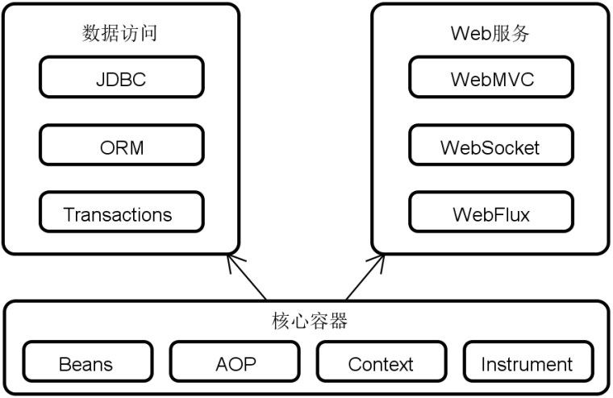
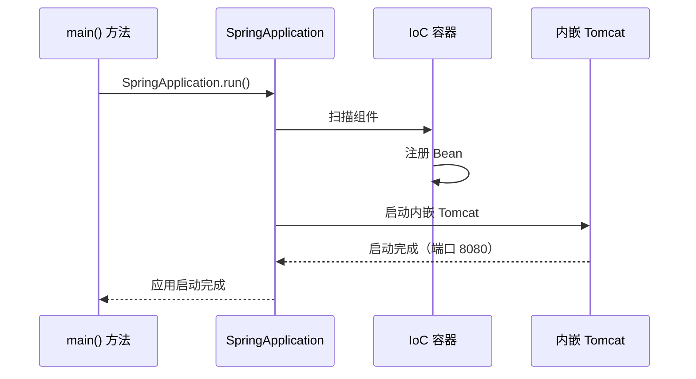

# Spring Boot 概述与快速入门

## 课程目标

- 了解 Spring 框架的整体架构和核心设计思想
- 掌握 IoC 容器和依赖注入的基本概念，并通过代码示例加深理解
- 了解 Spring Boot 的诞生背景与核心优势
- 掌握使用 Spring Initializr 创建 Spring Boot 项目的方法
- 完成第一个 Spring Boot Web 应用程序的编写与运行
- 理解 @RestController 和 @GetMapping 的基本用法


## Spring 框架概述

### 什么是 Spring

Spring 是 Java 企业级开发的事实标准框架。它提供了一整套基础设施，帮助开发者构建健壮、可维护的企业级应用。

**Spring 的核心模块：**



**核心容器**：

- 位于底部的“核心容器”部分，该部分包含了一个容器所应该具备的主体功能，涉及到基于依赖注入（Dependency Injection，DI）的JavaBean处理机制、面向切面编程（Aspect Oriented Program，AOP）、上下文（Context）、以及Spring自身所提供的表达式语言（Spring Expression Language，SpEL）等一些辅助功能。

**数据访问和Web服务**：

- 上半部分包含了构建应用程序所需要的两大功能组件，即数据访问和Web服务，它们也是我们日常开发中最常用的组件。这两大部分组件中包含的内容非常多，而且充分体现了Spring的集成性。也就是说，框架内部整合了业界主流的数据库驱动、消息中间件、ORM框架等各种工具，开发人员可以根据需要灵活的替换和调整自己想要使用的工具。


### Spring 的核心设计思想：IoC 和 DI

**IoC（控制反转）** ：将对象的创建和依赖关系的管理交给容器（Spring 容器），而不是由对象自己创建依赖。

**DI（依赖注入）** ：容器将依赖的对象“注入”到需要它的对象中。

#### 传统方式 vs Spring IoC 方式对比

**传统方式（对象自己创建依赖）：**

```java
// 传统方式：Service 自己创建 Repository
public class BookService {
    private BookRepository repository = new BookRepository();  // 硬编码依赖
    public void save(Book book) {
        repository.save(book);
    }
}
```

**Spring IoC 方式（由容器注入依赖）：**

```java
// Spring 方式：依赖由容器注入
@Service
public class BookService {
    @Autowired
    private BookRepository repository;  // 由容器注入
  
    public void save(Book book) {
        repository.save(book);
    }
}
```


#### 纯 Spring 示例（非 Spring Boot）

为了理解 Spring 容器的基本原理，我们先用纯 Spring（无 Spring Boot）演示 IoC 容器的工作方式。

**步骤 1：创建 Maven 项目，添加 Spring Context 依赖**

```xml
<dependency>
    <groupId>org.springframework</groupId>
    <artifactId>spring-context</artifactId>
    <version>6.1.0</version>
</dependency>
```

**步骤 2：定义接口和实现类**

```java
// 接口
public interface GreetingService {
    String greet(String name);
}

// 实现类
public class GreetingServiceImpl implements GreetingService {
    @Override
    public String greet(String name) {
        return "Hello, " + name + "!";
    }
}
```

**步骤 3：创建 Spring 配置类**

```java
import org.springframework.context.annotation.Bean;
import org.springframework.context.annotation.Configuration;

@Configuration
public class AppConfig {
    @Bean
    public GreetingService greetingService() {
        return new GreetingServiceImpl();
    }
}
```

**步骤 4：启动容器并获取 Bean**

```java
import org.springframework.context.ApplicationContext;
import org.springframework.context.annotation.AnnotationConfigApplicationContext;

public class Main {
    public static void main(String[] args) {
        // 启动 Spring 容器
        ApplicationContext context = new AnnotationConfigApplicationContext(AppConfig.class);
        // 从容器中获取 Bean
        GreetingService service = context.getBean(GreetingService.class);
        // 调用方法
        System.out.println(service.greet("Alice"));
    }
}
```

**输出：**

```
Hello, Alice!
```

**代码解析：**

- `@Configuration` 标记配置类，相当于一个“工厂”，负责创建 Bean。
- `@Bean` 标记方法，告诉 Spring 该方法返回的对象需要被容器管理。
- `ApplicationContext` 是 Spring 容器的接口，负责管理所有 Bean 的生命周期和依赖关系。
- `getBean()` 从容器中获取指定类型的 Bean。

> [!NOTE]
>
> 上述代码演示了纯 Spring IoC 容器的基本用法，不依赖 Spring Boot，也不依赖 Web 环境。这正是 Spring Boot  的基石——Spring Boot 在 Spring  容器的基础上，增加了自动配置和内嵌服务器等特性，让开发者无需手动创建容器和配置，直接编写业务代码即可。


### Spring 技术生态

Spring 不仅仅是一个框架，而是一个庞大的技术生态：

- 微服务架构（Microservices）：以Spring Boot、Spring Cloud为代表的一套完整构建微服务系统的技术体系
- 响应式编程（Reactive）：内置了Project Reactor响应式编程框架的面向Web、数据访问等常见的全栈响应式技术体系
- 云原生（Cloud）：以Spring Cloud为代表的一组满足云原生架构下的分布式技术体系
- Web应用（Web Applications）：以Spring WebMVC为代表的一批实现REST API的Web技术体系
- Serverless架构（Serverless）：以Spring Cloud Function为代表的FaaS（Function as a Service）技术体系
- 事件驱动（Event Driven）：以Spring Cloud Stream为代表的面向事件和消息处理的技术体系
- 批处理（Batch）：以Spring Batch为代表的轻量级离线批处理技术体系

> [!NOTE]
>
> 本系列课程聚焦于 Spring Boot，它是 Spring 生态的“基石”——几乎所有 Spring 应用都基于 Spring Boot 构建。


## 从 Spring 到 Spring Boot

### 传统 Spring 开发的痛点

在 Spring Boot 出现之前，使用 Spring 框架开发需要做大量配置：

| 痛点             | 说明                                                         |
| ---------------- | ------------------------------------------------------------ |
| **配置繁琐**     | 需要配置 web.xml、applicationContext.xml、数据源、事务管理器等大量 XML 文件 |
| **依赖管理复杂** | 需要手动管理 Spring 各模块的版本兼容性                       |
| **部署麻烦**     | 需要将应用打包成 WAR 部署到外部 Tomcat                       |
| **入门门槛高**   | 新手需要花大量时间学习配置，而非业务开发                     |

**传统 Spring Web 项目的配置文件示例（仅部分）：**

```xml
<!-- web.xml -->
<web-app>
    <servlet>
        <servlet-name>dispatcher</servlet-name>
        <servlet-class>org.springframework.web.servlet.DispatcherServlet</servlet-class>
        <init-param>
            <param-name>contextConfigLocation</param-name>
            <param-value>/WEB-INF/spring-mvc.xml</param-value>
        </init-param>
    </servlet>
</web-app>
```


### Spring Boot 的诞生

Spring Boot 由 Pivotal 团队于 2014 年发布，目标是**简化 Spring 应用的初始搭建和开发过程**。

**Spring Boot 的核心特性：**

| 特性             | 说明                                         |
| ---------------- | -------------------------------------------- |
| **自动配置**     | 根据 classpath 中的依赖自动配置 Spring 组件  |
| **内嵌容器**     | 内置 Tomcat / Jetty / Undertow，无需部署 WAR |
| **Starter 依赖** | 预定义的依赖集合，一键引入全套功能           |
| **生产就绪**     | 内置健康检查、指标监控、外部化配置           |
| **无代码生成**   | 不需要生成任何代码，也不需要 XML 配置        |
| **约定优于配置** | 遵循行业默认约定，减少配置量                 |

### “约定优于配置” 理念

Spring Boot 采用“约定优于配置”（Convention over Configuration）的设计哲学：

| 约定             | 说明                                              |
| ---------------- | ------------------------------------------------- |
| 主启动类放在根包 | `@SpringBootApplication` 所在包及子包会被自动扫描 |
| 配置文件名称     | `application.properties` 或 `application.yml`     |
| 静态资源位置     | `src/main/resources/static` 或 `public`           |
| 模板文件位置     | `src/main/resources/templates`                    |
| 内嵌端口         | 默认 8080                                         |

> [!NOTE]
>
> 这些约定都是可以覆盖的——但如果你遵循约定，就几乎不需要配置。


## 开发第一个 Spring Boot 应用程序

### 使用 Spring Initializr 创建项目

Spring Initializr 是官方提供的项目生成工具，有两种使用方式：

#### 通过 start.spring.io 网页创建

1. 访问 https://start.spring.io
2. 填写项目信息：
   - **Project**：Maven
   - **Language**：Java
   - **Spring Boot**：选择最新稳定版本（如 3.4.x）
   - **Group**：`com.example`
   - **Artifact**：`book-manager`
   - **Packaging**：Jar
   - **Java**：17 或 21
3. 添加依赖：点击 **ADD DEPENDENCIES**，搜索并添加 `Spring Web`
4. 点击 **GENERATE** 下载项目 ZIP 包
5. 解压后在 IDE 中打开（作为 Maven 项目）

#### 通过 IDE 创建（推荐）

**IntelliJ IDEA 操作步骤：**

1. 选择 **File → New → Project**
2. 选择 **Spring Boot**
3. 填写 Group、Artifact 等信息
4. 选择依赖：**Spring Web**
5. 点击 **Finish**

### 分析项目结构

项目创建完成后，目录结构如下：

```
book-manager/
├── pom.xml                          # Maven 配置文件
├── src/
│   ├── main/
│   │   ├── java/
│   │   │   └── com/example/bookmanager/
│   │   │       └── BookManagerApplication.java   # 主启动类
│   │   └── resources/
│   │       ├── application.properties            # 配置文件（空）
│   │       ├── static/                           # 静态资源
│   │       └── templates/                        # 模板文件
│   └── test/
│       └── java/                                 # 测试代码
└── target/                                      # 构建输出（自动生成）
```

#### 分析 pom.xml

```xml
<?xml version="1.0" encoding="UTF-8"?>
<project xmlns="http://maven.apache.org/POM/4.0.0">
    <modelVersion>4.0.0</modelVersion>
    
    <!-- 继承 Spring Boot 父 POM（统一版本管理） -->
    <parent>
        <groupId>org.springframework.boot</groupId>
        <artifactId>spring-boot-starter-parent</artifactId>
        <version>3.5.16</version>
    </parent>
    
    <groupId>com.example</groupId>
    <artifactId>book-manager</artifactId>
    <version>0.0.1-SNAPSHOT</version>
    
    <properties>
        <java.version>17</java.version>
    </properties>
    
    <dependencies>
        <!-- Spring Web Starter：包含 Spring MVC + 内嵌 Tomcat -->
        <dependency>
            <groupId>org.springframework.boot</groupId>
            <artifactId>spring-boot-starter-web</artifactId>
        </dependency>
        
        <!-- Spring Boot 测试 Starter -->
        <dependency>
            <groupId>org.springframework.boot</groupId>
            <artifactId>spring-boot-starter-test</artifactId>
            <scope>test</scope>
        </dependency>
    </dependencies>
    
    <build>
        <plugins>
            <!-- Spring Boot Maven 插件：打包可执行 JAR -->
            <plugin>
                <groupId>org.springframework.boot</groupId>
                <artifactId>spring-boot-maven-plugin</artifactId>
            </plugin>
        </plugins>
    </build>
</project>
```

> [!NOTE]
>
> `spring-boot-starter-parent` 统一管理了所有 Spring Boot 相关依赖的版本，我们不需要再手动指定版本号。


#### 分析主启动类

```java
package com.example.bookmanager;

import org.springframework.boot.SpringApplication;
import org.springframework.boot.autoconfigure.SpringBootApplication;

@SpringBootApplication
public class BookManagerApplication {

    public static void main(String[] args) {
        SpringApplication.run(BookManagerApplication.class, args);
    }
}
```

`@SpringBootApplication` 是一个**组合注解**，包含三个核心注解：

| 注解                       | 作用                                                 |
| -------------------------- | ---------------------------------------------------- |
| `@SpringBootConfiguration` | 标记为 Spring Boot 配置类（等同于 `@Configuration`） |
| `@EnableAutoConfiguration` | 启用自动配置                                         |
| `@ComponentScan`           | 扫描当前包及子包中的组件（Controller、Service 等）   |

### 编写 Hello World 接口

在 `com.example.bookmanager` 包下创建 `controller` 子包，然后创建 `HelloController`：

```java
package com.example.bookmanager.controller;

import org.springframework.web.bind.annotation.GetMapping;
import org.springframework.web.bind.annotation.RestController;

@RestController
public class HelloController {

    @GetMapping("/hello")
    public String sayHello() {
        return "Hello, Spring Boot!";
    }
}
```

**代码解释：**

| 注解                    | 作用                                           |
| ----------------------- | ---------------------------------------------- |
| `@RestController`       | 标记为 REST 控制器，返回值直接作为 HTTP 响应体 |
| `@GetMapping("/hello")` | 将 HTTP GET 请求 `/hello` 映射到该方法         |

### 启动应用

有两种启动方式：

#### 在 IDE 中运行

在 `BookManagerApplication` 类中，点击 `main` 方法左侧的绿色三角形，选择 **Run**。

#### 使用 Maven 命令行

```
# 在项目根目录执行
mvn clean package
java -jar target/book-manager-0.0.1-SNAPSHOT.jar
```


### 观察启动日志

启动后，控制台会输出类似以下日志：

```
  .   ____          _            __ _ _
 /\\ / ___'_ __ _ _(_)_ __  __ _ \ \ \ \
( ( )\___ | '_ | '_| | '_ \/ _` | \ \ \ \
 \\/  ___)| |_)| | | | | || (_| |  ) ) ) )
  '  |____| .__|_| |_|_| |_\__, | / / / /
 =========|_|==============|___/=/_/_/_/

 :: Spring Boot ::                (v3.4.x)

2026-07-03T10:00:00.123Z  INFO 12345 --- [main] c.e.b.BookManagerApplication : Starting BookManagerApplication
2026-07-03T10:00:00.456Z  INFO 12345 --- [main] c.e.b.BookManagerApplication : Started BookManagerApplication in 2.5 seconds
```

> [!NOTE]
>
> 日志中的 `Started ... in 2.5 seconds` 表示应用启动成功。


### 测试接口

打开浏览器，访问：`http://localhost:8080/hello`

页面应显示：

```
Hello, Spring Boot!
```

也可以使用 `curl` 命令测试：

```
curl http://localhost:8080/hello
```


### 项目启动流程解析




## 作业

### 作业一：代码阅读——启动类分析

观察以下代码，回答问题。

```java
@SpringBootApplication
public class MyApplication {
    public static void main(String[] args) {
        SpringApplication.run(MyApplication.class, args);
    }
}
```

**问题：**

1. `@SpringBootApplication` 包含了哪三个核心注解？
2. 如果我们将 `MyApplication` 类移动到一个子包中（如 `com.example.myapp.config`），会出现什么问题？为什么？
3. `SpringApplication.run()` 方法返回的是什么类型？它的作用是什么？

------

### 作业二：创建并运行 Spring Boot 项目

1. 使用 Spring Initializr（或 IDE）创建一个新的 Spring Boot 项目：
   - Group：`com.yourname`
   - Artifact：`hello-springboot`
   - 依赖：`Spring Web`
2. 创建一个新的 Controller 类，添加一个 `/greet` 接口，返回 `"欢迎学习 Spring Boot！"`。
3. 启动应用，在浏览器中访问 `http://localhost:8080/greet`，确认能看到正确输出。
4. 修改 `application.yaml`，添加 `server.port=9090`，重启应用并再次访问（注意端口变化）。

------

### 作业三：接口路径修改

在上一题的基础上：

1. 新增一个 `/info` 接口，返回当前应用的名称和版本（可硬编码）。
2. 在浏览器中测试两个接口。

------

### 作业四：自定义 Spring Boot 启动 Banner

Spring Boot 在启动时会在控制台打印一个 Banner（默认是 Spring 的 ASCII 艺术字）。你可以通过自定义 `banner.txt` 来替换它。

**任务：**

1. 在 `src/main/resources` 目录下创建一个 `banner.txt` 文件。

2. 在文件中写入自定义内容，例如：

   ```
   ================================
   欢迎使用我的 Spring Boot 应用！
   版本: 1.0.0
   作者: 你的名字
   ================================
   ```

3. 重新启动应用，观察控制台输出，确认自定义 Banner 已生效。

4. （选做）尝试使用在线 ASCII 艺术字生成工具（如 http://patorjk.com/software/taag）生成更酷的图案，替换 `banner.txt` 中的内容。
