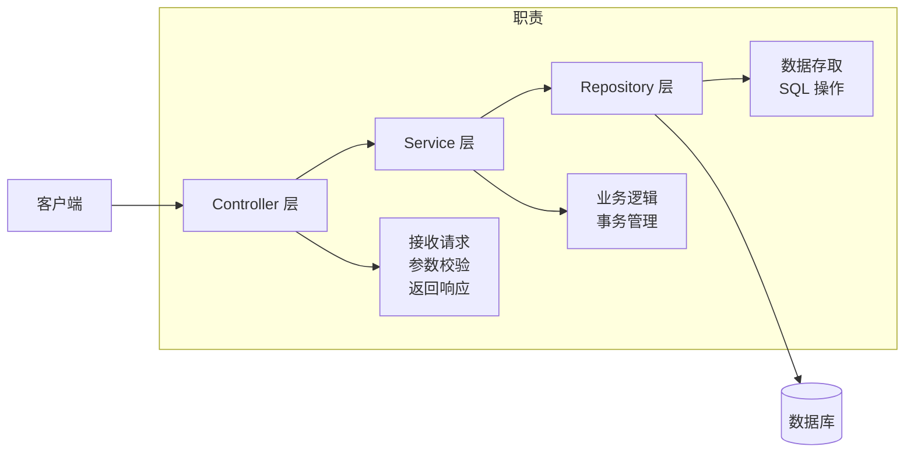
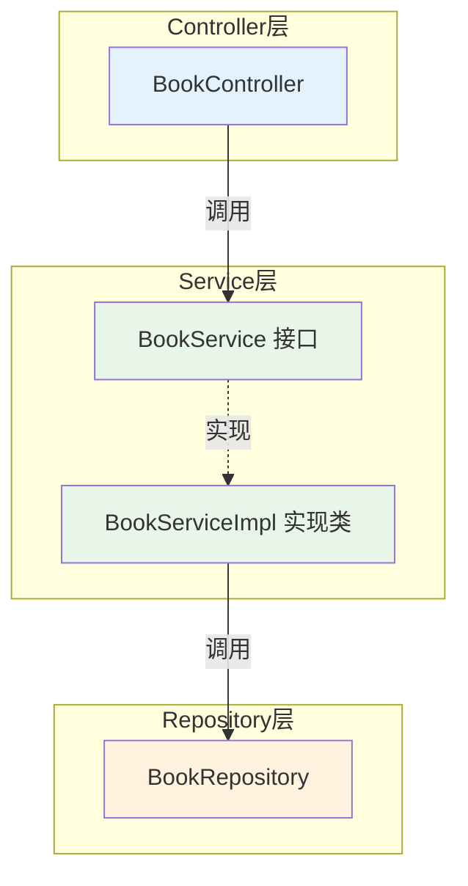
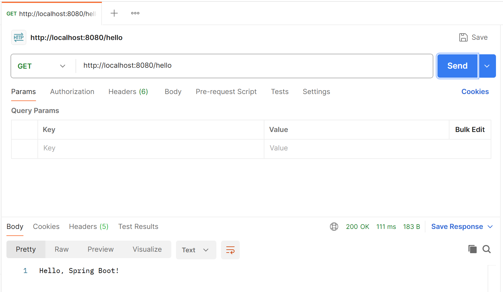

# Spring Boot 应用程序结构与分层设计

## 课程目标

- 掌握 Spring Boot 标准目录结构及各目录的职责
- 理解三层架构设计（Controller-Service-Repository）
- 能够按照分层架构搭建项目骨架
- 熟悉 `@RestController`、`@Service`、`@Repository` 常见注解的用途


## 贯穿项目：图书管理系统

在正式学习分层架构之前，先了解一下我们将在整个课程中逐步构建的项目。

### 项目概述

**图书管理系统**是一个贯穿本课程的实战项目，它将随着课程的深入从简单的 Hello World 逐步演进为完整的 REST API 服务。

**核心功能：**

| 功能模块 | 说明                       |
| -------- | -------------------------- |
| 图书管理 | 图书的增删改查操作         |
| 分类管理 | 按图书分类筛选             |
| 库存管理 | 查询和修改库存数量         |
| 统计查询 | 按作者、价格区间等维度查询 |

### 数据模型

图书实体（`Book`）包含以下核心字段：

| 字段       | 类型      | 说明                         |
| ---------- | --------- | ---------------------------- |
| `id`       | `Long`    | 图书唯一标识（自动生成）     |
| `title`    | `String`  | 书名                         |
| `author`   | `String`  | 作者                         |
| `price`    | `Double`  | 价格（≥ 0）                  |
| `stock`    | `Integer` | 库存数量（≥ 0）              |
| `category` | `String`  | 分类（如：编程、文学、历史） |

### API 设计概览

| 方法   | 路径                             | 功能           |
| ------ | -------------------------------- | -------------- |
| POST   | `/api/books`                     | 新增图书       |
| GET    | `/api/books`                     | 查询所有图书   |
| GET    | `/api/books/{id}`                | 查询单本图书   |
| PUT    | `/api/books/{id}`                | 更新图书       |
| DELETE | `/api/books/{id}`                | 删除图书       |
| GET    | `/api/books/author?name=xxx`     | 按作者查询     |
| GET    | `/api/books/price?min=10&max=50` | 按价格区间查询 |

在未来几节课内容中，我们将围绕这个项目逐步实现上述所有功能。现在，让我们回到分层架构的学习，为项目搭建规范的代码结构。


## Spring Boot 标准目录结构

### 完整目录结构

```text
src/
├── main/
│   ├── java/
│   │   └── com/example/bookmanager/
│   │       ├── BookManagerApplication.java     # 主启动类
│   │       ├── controller/                     # 控制器层（接收请求）
│   │       │   └── BookController.java
│   │       ├── service/                        # 业务逻辑层
│   │       │   ├── BookService.java            # 接口
│   │       │   └── impl/
│   │       │       └── BookServiceImpl.java    # 实现类
│   │       ├── repository/                     # 数据访问层
│   │       │   └── BookRepository.java
│   │       ├── model/                          # 数据模型
│   │       │   └── Book.java
│   │       ├── dto/                            # 数据传输对象
│   │       │   └── BookRequest.java
│   │       └── config/                         # 配置类
│   │           └── AppConfig.java
│   └── resources/
│       ├── application.properties              # 配置文件
│       ├── static/                             # 静态资源（CSS/JS/图片）
│       └── templates/                          # 模板文件（Thymeleaf 等）
└── test/
    └── java/
        └── com/example/bookmanager/
            └── BookManagerApplicationTests.java # 测试类
```

### 各目录职责说明

| 目录/包       | 职责                          | 关键注解                             |
| ------------- | ----------------------------- | ------------------------------------ |
| 主启动类      | 应用入口，包含 `main` 方法    | `@SpringBootApplication`             |
| `controller/` | 接收 HTTP 请求，返回响应      | `@RestController`、`@RequestMapping` |
| `service/`    | 业务逻辑处理                  | `@Service`                           |
| `repository/` | 数据访问（数据库操作）        | `@Repository`                        |
| `model/`      | 数据实体/领域对象             | 无特殊注解                           |
| `dto/`        | 数据传输对象（接口输入/输出） | 无特殊注解                           |
| `config/`     | 配置类                        | `@Configuration`                     |

> [!NOTE]
> 主启动类应放在**根包**（如 `com.example.bookmanager`）中，这样 `@ComponentScan` 才能扫描到所有子包。


### 为什么需要分层



**分层的好处：**

| 好处         | 说明                                             |
| ------------ | ------------------------------------------------ |
| **职责清晰** | 每层只做自己分内的事，代码易于理解               |
| **可维护性** | 修改某层代码不影响其他层                         |
| **可测试性** | 每层可以独立进行单元测试                         |
| **可替换性** | 可以替换某层的实现（如更换数据库）而不影响其他层 |


## 三层架构设计

### 架构概述

三层架构是 Spring Boot 项目中最常见的组织方式：

| 层级           | 职责                          | 不应包含             |
| -------------- | ----------------------------- | -------------------- |
| **Controller** | 接收请求、参数校验、返回 JSON | 业务逻辑、数据库操作 |
| **Service**    | 核心业务逻辑、事务管理        | HTTP 处理、直接 SQL  |
| **Repository** | 数据持久化、CRUD 操作         | 业务逻辑             |

### 层间调用关系



> [!NOTE]
> Controller 依赖 Service **接口**（而非具体实现），这是面向接口编程的体现，便于后续替换实现或进行单元测试 Mock。


## 搭建项目分层骨架

我们将从上一节的 Hello World 项目继续，按照三层架构搭建“图书管理系统”的业务骨架。

### 创建 Model 层（数据模型）

在 `model` 包下创建 `Book.java`：

```java
package com.example.bookmanager.model;

public class Book {
    private Long id;
    private String title;
    private String author;
    private Double price;
    private Integer stock;  // 库存

    public Book() {}

    public Book(Long id, String title, String author, Double price, Integer stock) {
        this.id = id;
        this.title = title;
        this.author = author;
        this.price = price;
        this.stock = stock;
    }

    // Getter 和 Setter
    public Long getId() { return id; }
    public void setId(Long id) { this.id = id; }
    public String getTitle() { return title; }
    public void setTitle(String title) { this.title = title; }
    public String getAuthor() { return author; }
    public void setAuthor(String author) { this.author = author; }
    public Double getPrice() { return price; }
    public void setPrice(Double price) { this.price = price; }
    public Integer getStock() { return stock; }
    public void setStock(Integer stock) { this.stock = stock; }

    @Override
    public String toString() {
        return "Book{id=" + id + ", title='" + title + "', author='" + author + "'}";
    }
}
```


### 创建 Repository 层（数据访问）

在 `repository` 包下创建 `BookRepository.java`：

```java
package com.example.bookmanager.repository;

import com.example.bookmanager.model.Book;
import org.springframework.stereotype.Repository;

import java.util.ArrayList;
import java.util.List;
import java.util.Map;
import java.util.concurrent.ConcurrentHashMap;
import java.util.concurrent.atomic.AtomicLong;

@Repository
public class BookRepository {
    // 使用内存存储模拟数据库（后续课程会替换为真实数据库）
    private final Map<Long, Book> store = new ConcurrentHashMap<>();
    private final AtomicLong idGenerator = new AtomicLong(1);

    public Book save(Book book) {
        if (book.getId() == null) {
            book.setId(idGenerator.getAndIncrement());
        }
        store.put(book.getId(), book);
        return book;
    }

    public Book findById(Long id) {
        return store.get(id);
    }

    public List<Book> findAll() {
        return new ArrayList<>(store.values());
    }

    public boolean deleteById(Long id) {
        return store.remove(id) != null;
    }

    public Book update(Book book) {
        if (store.containsKey(book.getId())) {
            store.put(book.getId(), book);
            return book;
        }
        return null;
    }

    // 按作者查询
    public List<Book> findByAuthor(String author) {
        List<Book> result = new ArrayList<>();
        for (Book book : store.values()) {
            if (author.equals(book.getAuthor())) {
                result.add(book);
            }
        }
        return result;
    }

    // 按价格范围查询
    public List<Book> findByPriceRange(Double min, Double max) {
        List<Book> result = new ArrayList<>();
        for (Book book : store.values()) {
            if (book.getPrice() >= min && book.getPrice() <= max) {
                result.add(book);
            }
        }
        return result;
    }
}
```

> [!NOTE]
> `@Repository` 注解标记该类为数据访问组件，Spring 会将其纳入 IoC 容器管理。目前使用内存存储模拟数据库，后续会替换为真实数据库。


### 创建 Service 层（业务逻辑）

#### 定义 Service 接口

在 `service` 包下创建 `BookService.java`：

```java
package com.example.bookmanager.service;

import com.example.bookmanager.model.Book;
import java.util.List;

public interface BookService {
    Book createBook(Book book);
    Book getBookById(Long id);
    List<Book> getAllBooks();
    Book updateBook(Book book);
    boolean deleteBook(Long id);
    List<Book> getBooksByAuthor(String author);
    List<Book> getBooksByPriceRange(Double min, Double max);
}
```


#### 实现 Service 接口

在 `service/impl` 包下创建 `BookServiceImpl.java`：

```java
package com.example.bookmanager.service.impl;

import com.example.bookmanager.model.Book;
import com.example.bookmanager.repository.BookRepository;
import com.example.bookmanager.service.BookService;
import org.springframework.beans.factory.annotation.Autowired;
import org.springframework.stereotype.Service;

import java.util.List;

@Service
public class BookServiceImpl implements BookService {

    @Autowired
    private BookRepository bookRepository;

    @Override
    public Book createBook(Book book) {
        // 业务校验：价格不能为负数
        if (book.getPrice() == null || book.getPrice() < 0) {
            throw new IllegalArgumentException("图书价格不能为空或为负数");
        }
        // 业务校验：库存不能为负数
        if (book.getStock() == null || book.getStock() < 0) {
            throw new IllegalArgumentException("图书库存不能为空或为负数");
        }
        return bookRepository.save(book);
    }

    @Override
    public Book getBookById(Long id) {
        Book book = bookRepository.findById(id);
        if (book == null) {
            throw new RuntimeException("图书不存在，ID: " + id);
        }
        return book;
    }

    @Override
    public List<Book> getAllBooks() {
        return bookRepository.findAll();
    }

    @Override
    public Book updateBook(Book book) {
        if (book.getId() == null) {
            throw new IllegalArgumentException("更新图书时 ID 不能为空");
        }
        Book existing = bookRepository.findById(book.getId());
        if (existing == null) {
            throw new RuntimeException("要更新的图书不存在，ID: " + book.getId());
        }
        return bookRepository.update(book);
    }

    @Override
    public boolean deleteBook(Long id) {
        if (id == null) {
            throw new IllegalArgumentException("删除时 ID 不能为空");
        }
        return bookRepository.deleteById(id);
    }

    @Override
    public List<Book> getBooksByAuthor(String author) {
        if (author == null || author.trim().isEmpty()) {
            throw new IllegalArgumentException("作者名称不能为空");
        }
        return bookRepository.findByAuthor(author);
    }

    @Override
    public List<Book> getBooksByPriceRange(Double min, Double max) {
        if (min == null || max == null || min < 0 || max < 0 || min > max) {
            throw new IllegalArgumentException("价格范围参数无效");
        }
        return bookRepository.findByPriceRange(min, max);
    }
}
```

> [!NOTE]
> `@Service` 注解标记该类为业务逻辑组件。`@Autowired` 用于注入 `BookRepository` 依赖——这就是 **依赖注入（DI）** 的实际应用。


### 创建 Controller 层（Web 接口）

在 `controller` 包下创建 `BookController.java`：

```java
package com.example.bookmanager.controller;

import com.example.bookmanager.model.Book;
import com.example.bookmanager.service.BookService;
import org.springframework.beans.factory.annotation.Autowired;
import org.springframework.web.bind.annotation.*;

import java.util.List;

@RestController
@RequestMapping("/api/books")
public class BookController {

    @Autowired
    private BookService bookService;

    @PostMapping
    public Book createBook(@RequestBody Book book) {
        return bookService.createBook(book);
    }

    @GetMapping("/{id}")
    public Book getBook(@PathVariable Long id) {
        return bookService.getBookById(id);
    }

    @GetMapping
    public List<Book> getAllBooks() {
        return bookService.getAllBooks();
    }

    @PutMapping("/{id}")
    public Book updateBook(@PathVariable Long id, @RequestBody Book book) {
        book.setId(id);
        return bookService.updateBook(book);
    }

    @DeleteMapping("/{id}")
    public String deleteBook(@PathVariable Long id) {
        boolean deleted = bookService.deleteBook(id);
        return deleted ? "删除成功" : "删除失败";
    }

    @GetMapping("/author")
    public List<Book> getBooksByAuthor(@RequestParam String name) {
        return bookService.getBooksByAuthor(name);
    }

    @GetMapping("/price")
    public List<Book> getBooksByPriceRange(
            @RequestParam Double min,
            @RequestParam Double max) {
        return bookService.getBooksByPriceRange(min, max);
    }
}
```

> [!NOTE]
> `@RestController` 是 `@Controller` + `@ResponseBody` 的组合，表示该类的所有方法返回值直接作为 HTTP 响应体。`@RequestMapping("/api/books")` 为该控制器设置基础路径。


## 依赖注入与层间调用

### 依赖注入

在 `BookController` 中，我们使用了 `@Autowired` 注入 `BookService`：

```java
@Autowired
private BookService bookService;
```

**使用 Spring 的依赖注入：**

- Spring 容器在创建 `BookController` 时，会自动找到 `BookService` 的实现类（`BookServiceImpl`），并将其注入。
- 这样做的好处是：`BookController` 不需要关心 `BookService` 是如何创建的，也不关心它用的是哪个实现类。

### 各层注解总结

| 层级          | 注解              | 作用                         |
| ------------- | ----------------- | ---------------------------- |
| Controller 层 | `@RestController` | 标记为 REST 控制器，纳入容器 |
| Service 层    | `@Service`        | 标记为业务逻辑组件，纳入容器 |
| Repository 层 | `@Repository`     | 标记为数据访问组件，纳入容器 |
| 依赖注入      | `@Autowired`      | 自动注入依赖的 Bean          |

> [!NOTE]
> `@Component` 是通用的组件注解，`@Controller`、`@Service`、`@Repository` 都是它的特化版本，语义更清晰。


## 启动与测试

### 启动应用

在 IDE 中运行 `BookManagerApplication` 的 `main` 方法。

### 使用HTTP客户端工具

Postman 是一款全球最流行的 API（应用程序接口）开发与测试工具。它本质上是一个图形化软件，为开发者提供了一站式的接口管理平台。

**核心功能包括：**

- **接口调试**：支持发送各种 HTTP 请求（如 GET、POST），并能直观地查看返回的 JSON 或 XML 数据，是开发联调时的得力助手。
- **自动化测试**：允许编写脚本进行断言验证，实现接口的批量回归测试，确保系统稳定性。
- **生成文档**：可自动将接口信息转为清晰的可视化文档，方便前后端协作。
- **环境管理**：支持切换开发、测试、生产等不同环境变量，无需修改请求内容。

无论是后端开发、前端调用还是测试工程师，Postman 都是日常工作中不可或缺的效率利器。



下载地址：https://www.postman.com/downloads/

### 使用 Postman 测试接口

| 操作       | 方法   | URL                                                   | 请求体 |
| ---------- | ------ | ----------------------------------------------------- | ------ |
| 创建图书   | POST   | `http://localhost:8080/api/books`                     | JSON   |
| 获取所有   | GET    | `http://localhost:8080/api/books`                     | 无     |
| 获取单本   | GET    | `http://localhost:8080/api/books/1`                   | 无     |
| 更新图书   | PUT    | `http://localhost:8080/api/books/1`                   | JSON   |
| 删除图书   | DELETE | `http://localhost:8080/api/books/1`                   | 无     |
| 按作者查询 | GET    | `http://localhost:8080/api/books/author?name=Craig`   | 无     |
| 按价格查询 | GET    | `http://localhost:8080/api/books/price?min=30&max=80` | 无     |

**创建图书的请求示例（Postman Body → raw → JSON）：**

```json
{
    "title": "Spring Boot 实战",
    "author": "Craig Walls",
    "price": 79.0,
    "stock": 15
}
```

**预期响应：**

```json
{
    "id": 1,
    "title": "Spring Boot 实战",
    "author": "Craig Walls",
    "price": 79.0,
    "stock": 15
}
```


## 小结

本节课我们学习了：

1. **Spring Boot 标准目录结构**：主启动类、controller、service、repository、model、dto、config 等包的职责。
2. **三层架构设计**：Controller（接收请求）→ Service（业务逻辑）→ Repository（数据访问）。
3. **搭建项目骨架**：创建了 Model、Repository、Service、Controller 各层的代码。
4. **依赖注入**：通过 `@Autowired` 让 Spring 容器自动注入依赖，实现层与层之间的解耦。
5. **接口测试**：使用 Postman 验证各层联调是否正常。


## 作业

### 作业一：代码阅读——分层调用分析

观察以下代码片段，回答问题。

```java
@RestController
@RequestMapping("/api/users")
public class UserController {
    @Autowired
    private UserService userService;

    @GetMapping("/{id}")
    public User getUser(@PathVariable Long id) {
        return userService.findById(id);
    }
}
```

```java
@Service
public class UserService {
    @Autowired
    private UserRepository userRepository;

    public User findById(Long id) {
        return userRepository.findById(id);
    }
}
```

**问题：**

1. 当客户端请求 `GET /api/users/1` 时，请求经过了哪些层？顺序是什么？
2. 如果 `UserService` 没有被 `@Service` 注解标记，会发生什么？
3. 如果 `UserController` 中的 `@Autowired` 被移除，会发生什么？

------

### 作业二：目录结构设计

假设你要开发一个“订单管理系统”，包含以下功能：

- 用户管理（注册、登录、信息查询）
- 商品管理（增删改查）
- 订单管理（创建订单、查询订单、取消订单）

请设计这个项目的包结构（画出目录树），并说明每个包的职责。
