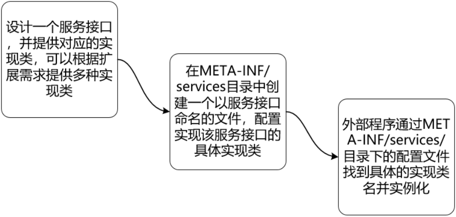
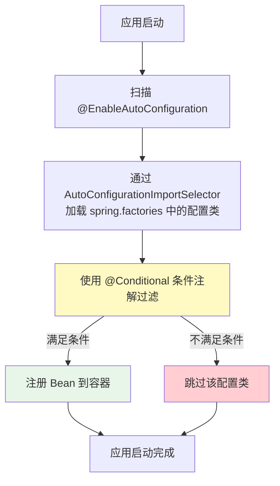

# 自动配置原理与 Starter 剖析

## 课程目标

- 理解 Spring Boot 自动配置的核心机制
- 掌握 @SpringBootApplication 的组成结构
- 了解 spring.factories 与自动配置加载流程
- 掌握常用的 @Conditional 条件注解
- 理解 spring-boot-starter-web 的自动配置原理
- 学会通过日志查看自动配置报告


## 自动配置概述

### 什么是自动配置

Spring Boot 的自动配置（Auto-Configuration）是其最核心的特性之一。它根据 classpath 中的依赖、配置文件中的属性以及各种条件，**自动**为应用配置所需的 Bean，无需开发者手动编写 XML 或 Java 配置。

**自动配置解决的问题：**

| 场景                                | 没有自动配置                                     | 有了自动配置                              |
| ----------------------------------- | ------------------------------------------------ | ----------------------------------------- |
| 添加 spring-boot-starter-web        | 手动配置 DispatcherServlet、Tomcat、ViewResolver | 自动配置 Web 环境，直接写 @RestController |
| 添加 spring-boot-starter-validation | 手动配置 Validator                               | 自动配置校验器，直接使用 @Valid           |
| 添加 spring-boot-starter-aop        | 手动配置 AOP 代理                                | 自动配置，直接使用 @Aspect                |

> [!NOTE]
> 自动配置的核心理念是“**开箱即用，约定优于配置**”。Spring Boot 会根据 classpath 中的依赖“猜测”你需要什么，并替你配置好。


## @SpringBootApplication 注解分析

### 组合注解的组成

`@SpringBootApplication` 是一个组合注解，它整合了三个核心注解：

```java
@Target(ElementType.TYPE)
@Retention(RetentionPolicy.RUNTIME)
@Documented
@Inherited
@SpringBootConfiguration
@EnableAutoConfiguration
@ComponentScan
public @interface SpringBootApplication {
    // 可以排除特定的自动配置类
    @AliasFor(annotation = EnableAutoConfiguration.class)
    Class<?>[] exclude() default {};
    
    // 排除特定的自动配置类名称
    @AliasFor(annotation = EnableAutoConfiguration.class)
    String[] excludeName() default {};
    
    // 指定扫描的包路径
    @AliasFor(annotation = ComponentScan.class, attribute = "basePackages")
    String[] scanBasePackages() default {};
}
```


### 三个核心注解的职责

| 注解                       | 职责                                                 |
| -------------------------- | ---------------------------------------------------- |
| `@SpringBootConfiguration` | 标记为配置类，等同于 `@Configuration`                |
| `@EnableAutoConfiguration` | **启用自动配置**，是自动配置的开关                   |
| `@ComponentScan`           | 扫描当前包及子包中的组件（@Controller、@Service 等） |

### @EnableAutoConfiguration 源码

`@EnableAutoConfiguration` 是自动配置的核心入口：

```java
@Target(ElementType.TYPE)
@Retention(RetentionPolicy.RUNTIME)
@Documented
@Inherited
@AutoConfigurationPackage
@Import(AutoConfigurationImportSelector.class)
public @interface EnableAutoConfiguration {
    String ENABLED_OVERRIDE_PROPERTY = "spring.boot.enableautoconfiguration";

    Class<?>[] exclude() default {};
    String[] excludeName() default {};
}
```

两个关键部分：

- `@AutoConfigurationPackage`：将主启动类所在的包作为基础扫描包
- `@Import(AutoConfigurationImportSelector.class)`：导入自动配置选择器，负责加载所有自动配置类

> [!NOTE]
> `@Import` 是 Spring 框架的核心注解，用于向容器中导入一个或多个类。`AutoConfigurationImportSelector` 负责从 `spring.factories` 中读取自动配置类的列表。


## spring.factories 与自动配置加载

Spring Boot 使用 **SPI（Service Provider Interface）** 机制来加载自动配置类。

### 什么是SPI？

SPI是Java提供的一种**服务发现机制**，核心目的是将**服务接口定义**与**具体实现类**进行解耦。它通过一套“约定优于配置”的规则，让程序在运行时动态加载外部jar包中的具体实现，从而避免在代码中通过`new`或硬编码类名的方式创建对象。

| 环节              | 具体操作与规范                                               |
| ----------------- | :----------------------------------------------------------- |
| **1. 服务定义**   | 由接口方（如Spring框架）定义一套标准的服务接口（如`AutoConfiguration`）。 |
| **2. 服务提供**   | 服务提供者（如第三方Starter包）实现该接口，编写具体的业务逻辑类。 |
| **3. 约定配置**   | 在自身jar包的 **`META-INF/services/`** 目录下，创建一个**以该服务接口全限定名命名**的文件。 |
| **4. 配置内容**   | 在此文件中，配置服务接口与具体实现类的映射关系。**（注：** 标准Java SPI规范要求文件内容为**每行一个实现类的全限定名**，您提到的“Key-Value”可理解为该映射关系的逻辑抽象，实际文件格式多为纯类名列表，但在Spring Boot早期的`spring.factories`中确实采用了Key（接口名）=Value（实现类列表）的键值对形式。**）** |
| **5. 动态加载**   | 当外部主程序（如Spring Boot容器）装配此jar包时，会扫描所有依赖包中的`META-INF/services/`目录，读取配置文件中的类名。 |
| **6. 实例化注入** | 通过Java原生的`ServiceLoader`类（或Spring自定义的加载器）反射实例化这些实现类，并将其注入到容器中，完成目标服务的装配。 |



### Spring Boot中的spring.factories

Spring Boot的**自动配置（Auto-Configuration）** 是SPI机制的经典实践，接口定义包含在`spring.factories`文件中：

- Starter包在`META-INF/`下提供配置文件，声明哪些类是自动配置类。
- Spring Boot启动时，利用SPI思想扫描这些文件，获取配置类全名并实例化，从而动态地向IoC容器注入`DataSource`、`RedisTemplate`等Bean，而开发者只需引入依赖即可，无需手动编写配置代码。

在 `spring-boot-autoconfigure` 模块的 `META-INF/spring.factories` 文件中，列出了所有的自动配置类：

```text
# 位于 spring-boot-autoconfigure 的 META-INF/spring.factories
org.springframework.boot.autoconfigure.EnableAutoConfiguration=\
org.springframework.boot.autoconfigure.web.servlet.DispatcherServletAutoConfiguration,\
org.springframework.boot.autoconfigure.web.servlet.WebMvcAutoConfiguration,\
org.springframework.boot.autoconfigure.web.servlet.ServletWebServerFactoryAutoConfiguration,\
org.springframework.boot.autoconfigure.web.servlet.error.ErrorMvcAutoConfiguration,\
org.springframework.boot.autoconfigure.jackson.JacksonAutoConfiguration,\
...
```

> [!NOTE]
> 在 Spring Boot 2.7+ 中，`spring.factories` 正在逐步被 `META-INF/spring/org.springframework.boot.autoconfigure.AutoConfiguration.imports` 文件替代，但原理相同——都是列出需要加载的自动配置类。


### 自动配置加载流程



### AutoConfigurationImportSelector 核心逻辑

`AutoConfigurationImportSelector` 的核心方法 `selectImports()` 会：

1. 读取 `spring.factories` 中 `EnableAutoConfiguration` 对应的所有配置类
2. 应用 `@Conditional` 条件过滤
3. 对配置类进行排序（`@AutoConfigureOrder`、`@AutoConfigureBefore`、`@AutoConfigureAfter`）
4. 返回最终需要加载的配置类列表


## 条件注解体系

`@Conditional` 是 Spring Boot 自动配置的核心机制，它根据条件决定是否加载某个配置或 Bean。

### 常用条件注解

| 注解                              | 条件                       |
| --------------------------------- | -------------------------- |
| `@ConditionalOnClass`             | classpath 中存在指定类     |
| `@ConditionalOnMissingClass`      | classpath 中不存在指定类   |
| `@ConditionalOnBean`              | 容器中存在指定 Bean        |
| `@ConditionalOnMissingBean`       | 容器中不存在指定 Bean      |
| `@ConditionalOnProperty`          | 配置文件中存在指定的属性值 |
| `@ConditionalOnWebApplication`    | 当前是 Web 应用环境        |
| `@ConditionalOnNotWebApplication` | 当前不是 Web 应用环境      |

### 示例：WebMvcAutoConfiguration 的条件

以 `WebMvcAutoConfiguration` 为例，它负责 Spring MVC 的自动配置：

```java
@Configuration(proxyBeanMethods = false)
@ConditionalOnWebApplication(type = Type.SERVLET)  // 必须是 Servlet Web 环境
@ConditionalOnClass({ Servlet.class, DispatcherServlet.class, WebMvcConfigurer.class })
@ConditionalOnMissingBean(WebMvcConfigurationSupport.class)
@AutoConfigureOrder(Ordered.HIGHEST_PRECEDENCE + 10)
@AutoConfigureAfter({ DispatcherServletAutoConfiguration.class, ... })
public class WebMvcAutoConfiguration {
    // 自动配置视图解析器、消息转换器、静态资源映射等
}
```

**关键点分析：**

- `@ConditionalOnWebApplication(type = Type.SERVLET)`：只有当前是 Servlet Web 环境时才加载。
- `@ConditionalOnClass({ Servlet.class, DispatcherServlet.class, ... })`：classpath 中必须有 Servlet 和 DispatcherServlet 相关类（由 `spring-boot-starter-web` 提供）。
- `@ConditionalOnMissingBean(WebMvcConfigurationSupport.class)`：如果用户没有自定义 `WebMvcConfigurationSupport`，才使用自动配置。

> [!NOTE]
> 这种“先检查是否已有用户自定义配置，没有再创建默认配置”的机制，是 Spring Boot 允许开发者覆盖自动配置的核心设计。


### @ConditionalOnProperty 示例

```java
@Configuration
@ConditionalOnProperty(
    name = "app.feature.enabled", 
    havingValue = "true", 
    matchIfMissing = false
)
public class FeatureConfiguration {
    @Bean
    public SomeService someService() {
        return new SomeService();
    }
}
```

只有当 `app.feature.enabled=true` 时，`FeatureConfiguration` 才会加载。


## 案例分析：spring-boot-starter-web 自动配置

### spring-boot-starter-web

`spring-boot-starter-web` 是 Spring Boot 中用于构建 Web 应用的核心 Starter。它汇集了构建 Web 应用所需的所有依赖和自动配置：

```xml
<dependency>
    <groupId>org.springframework.boot</groupId>
    <artifactId>spring-boot-starter-web</artifactId>
</dependency>
```

### 它包含什么？

| 依赖/模块                    | 作用                     |
| ---------------------------- | ------------------------ |
| `spring-boot-starter`        | Spring Boot 核心 Starter |
| `spring-boot-starter-tomcat` | 内嵌 Tomcat 服务器       |
| `spring-web`                 | Spring Web 核心支持      |
| `spring-webmvc`              | Spring MVC 框架          |
| `jackson-databind`           | JSON 序列化/反序列化     |

### 它自动配置了什么？

引入 `spring-boot-starter-web` 后，Spring Boot 会自动配置以下核心组件（由 `WebMvcAutoConfiguration` 等配置类完成）：

| 组件                           | 说明                                |
| ------------------------------ | ----------------------------------- |
| `DispatcherServlet`            | 前端控制器，请求分发核心            |
| `RequestMappingHandlerMapping` | 请求映射处理器                      |
| `RequestMappingHandlerAdapter` | 请求适配器                          |
| `ViewResolver`                 | 视图解析器（处理 JSP/Thymeleaf 等） |
| `HttpMessageConverter`         | HTTP 消息转换器（JSON/XML 等）      |
| `StaticResourceHandler`        | 静态资源处理                        |
| `ErrorPageRegistrar`           | 错误页面处理                        |

> [!NOTE]
> 正是因为 `spring-boot-starter-web` 自动配置了这些组件，我们写 `@RestController` 才能正常工作——DispatcherServlet 和 HandlerMapping 已经准备好了。


### 验证自动配置的效果

**创建一个简单的 Controller：**

```java
@RestController
public class HelloController {
    @GetMapping("/hello")
    public String hello() {
        return "Hello, Spring Boot!";
    }
}
```

**启动应用后，以下流程自动完成：**

1. `DispatcherServlet` 已自动配置，可以接收请求
2. `RequestMappingHandlerMapping` 已自动配置，可以识别 `@GetMapping`
3. Jackson 已自动配置，可以将返回值转为 JSON
4. 内嵌 Tomcat 已自动启动，监听 8080 端口

**整个过程中，我们没有写一行配置代码！**


## 查看自动配置报告

Spring Boot 提供了 `--debug` 启动参数，可以输出详细的自动配置报告，显示哪些配置生效了、哪些被跳过了及原因。

```
java -jar book-manager.jar --debug
```


### 自动配置报告示例（Web 相关）

```
============================
CONDITIONS EVALUATION REPORT
============================

Positive matches:
-----------------
   WebMvcAutoConfiguration matched:
      - @ConditionalOnWebApplication found 'servlet' web application (OnWebApplicationCondition)
      - @ConditionalOnClass found required classes 'javax.servlet.Servlet', 'org.springframework.web.servlet.DispatcherServlet' (OnClassCondition)
      - @ConditionalOnMissingBean did not find any beans of type 'WebMvcConfigurationSupport' (OnBeanCondition)

   DispatcherServletAutoConfiguration matched:
      - @ConditionalOnClass found required class 'org.springframework.web.servlet.DispatcherServlet' (OnClassCondition)

Negative matches:
-----------------
   DataSourceAutoConfiguration:
      - @ConditionalOnClass required classes 'javax.sql.DataSource' not found (OnClassCondition)
```

**Positive matches**：已生效的自动配置（如 WebMvcAutoConfiguration）
**Negative matches**：被跳过的自动配置（含跳过原因）


## 自动配置的覆盖与排除

### 如何覆盖自动配置

**方式一：自定义 Bean**

Spring Boot 的自动配置使用了 `@ConditionalOnMissingBean`，当容器中存在用户自定义的 Bean 时，自动配置会“让路”。

```java
@Configuration
public class MyWebConfig {
    @Bean
    public WebMvcConfigurer webMvcConfigurer() {
        return new WebMvcConfigurer() {
            @Override
            public void addResourceHandlers(ResourceHandlerRegistry registry) {
                // 自定义静态资源映射
                registry.addResourceHandler("/assets/**")
                        .addResourceLocations("classpath:/assets/");
            }
        };
    }
}
```


**方式二：配置文件覆盖**

通过 `application.yml` 覆盖自动配置的参数：

```yaml
spring:
  mvc:
    static-path-pattern: /static/**      # 覆盖静态资源路径模式
  resources:
    static-locations: classpath:/public/ # 覆盖静态资源位置

server:
  port: 9090                              # 覆盖服务器端口
  servlet:
    context-path: /api                    # 覆盖应用上下文路径
```


### 如何排除自动配置

**方式一：使用 exclude 属性**

在 `@SpringBootApplication` 中排除：

```java
@SpringBootApplication(exclude = {DataSourceAutoConfiguration.class})
public class BookManagerApplication {
    public static void main(String[] args) {
        SpringApplication.run(BookManagerApplication.class, args);
    }
}
```


**方式二：使用配置文件排除**

```yaml
spring:
  autoconfigure:
    exclude:
      - org.springframework.boot.autoconfigure.jdbc.DataSourceAutoConfiguration
```


## 自动配置原理总结

```mermaid
flowchart TB
    subgraph 依赖引入
        A[添加 spring-boot-starter-web] --> B[classpath 中包含<br/>Servlet、DispatcherServlet 等类]
    end

    subgraph 自动配置加载
        B --> C[@EnableAutoConfiguration 触发]
        C --> D[AutoConfigurationImportSelector 读取 spring.factories]
        D --> E[加载 WebMvcAutoConfiguration 等配置类]
    end

    subgraph 条件判断
        E --> F[@ConditionalOnWebApplication<br/>@ConditionalOnClass<br/>@ConditionalOnMissingBean]
        F -->|满足条件| G[配置生效]
        F -->|不满足条件| H[配置跳过]
    end

    subgraph Bean 注册
        G --> I[注册 DispatcherServlet<br/>HandlerMapping<br/>ViewResolver 等]
        I --> J[Web 环境就绪]
    end
```


### 自动配置的核心要点

| 要点             | 说明                                          |
| ---------------- | --------------------------------------------- |
| **依赖驱动**     | 自动配置由 classpath 中的依赖触发             |
| **条件控制**     | 通过 @Conditional 系列注解精确控制加载时机    |
| **可覆盖性**     | 开发者自定义的 Bean 会覆盖自动配置的默认 Bean |
| **约定优于配置** | 大部分场景无需任何配置即可使用                |
| **可观察性**     | 通过 `--debug` 参数可查看配置报告             |


## 小结

本节课我们学习了：

1. **@SpringBootApplication 的组成**：@SpringBootConfiguration + @EnableAutoConfiguration + @ComponentScan。
2. **自动配置加载机制**：通过 spring.factories（或 AutoConfiguration.imports）加载配置类。
3. **条件注解体系**：@ConditionalOnClass、@ConditionalOnMissingBean、@ConditionalOnWebApplication 等。
4. **spring-boot-starter-web 自动配置**：
   - 自动配置 DispatcherServlet、HandlerMapping、ViewResolver 等 Web 组件
   - 引入依赖即可写 @RestController，零配置启动
5. **查看自动配置报告**：使用 `--debug` 参数查看哪些配置生效了。
6. **覆盖与排除**：通过自定义 Bean 或配置文件覆盖自动配置。


## 作业

### 作业一：代码阅读——自动配置条件分析

观察 `WebMvcAutoConfiguration` 的代码片段，回答问题。

```java
@Configuration(proxyBeanMethods = false)
@ConditionalOnWebApplication(type = Type.SERVLET)
@ConditionalOnClass({ Servlet.class, DispatcherServlet.class, WebMvcConfigurer.class })
@ConditionalOnMissingBean(WebMvcConfigurationSupport.class)
@AutoConfigureOrder(Ordered.HIGHEST_PRECEDENCE + 10)
@AutoConfigureAfter({ DispatcherServletAutoConfiguration.class })
public class WebMvcAutoConfiguration {
    // ...
}
```

**问题：**

1. 这个自动配置类在什么条件下会加载？（至少说出两个条件）
2. `@ConditionalOnMissingBean(WebMvcConfigurationSupport.class)` 的作用是什么？
3. 如果开发者在自己的配置类中定义了一个 `WebMvcConfigurationSupport` 类型的 Bean，会发生什么？
4. `@AutoConfigureAfter(DispatcherServletAutoConfiguration.class)` 的作用是什么？

------

### 作业二：分析 spring-boot-starter-web 自动配置

基于图书管理系统项目（已包含 spring-boot-starter-web 依赖），完成以下任务：

1. 使用 `--debug` 参数启动应用，在启动日志中找到 **CONDITIONS EVALUATION REPORT** 部分。
2. 在报告中查找以下自动配置类，记录它们是否生效：
   - `WebMvcAutoConfiguration`
   - `DispatcherServletAutoConfiguration`
   - `JacksonAutoConfiguration`
   - `ServletWebServerFactoryAutoConfiguration`
3. 对于生效的配置，记录其 Positive matches 中的条件。
4. 分析 `WebMvcAutoConfiguration` 生效后，Spring Boot 为我们配置了哪些核心组件。
