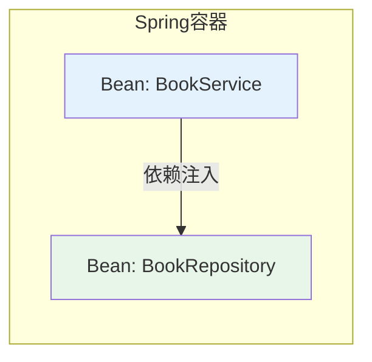

# 依赖注入基本概念与三种注入方式

## 课程目标

- 理解 IoC（控制反转）和 DI（依赖注入）的核心概念
- 掌握 Spring 中三种依赖注入方式：构造器注入、Setter 注入、字段注入
- 能够根据场景选择合适的注入方式
- 理解为什么构造器注入是推荐方式


## IoC 与 DI 基本概念

### 什么是 IoC（控制反转）

**IoC（Inversion of Control，控制反转）** 是一种设计思想，它将对象的创建和依赖关系的管理从对象本身转移到外部容器（如 Spring 容器）。对象不再自己创建依赖，而是由容器“注入”依赖。

**传统方式：** 对象主动创建依赖

```java
// 对象自己创建依赖
public class BookService {
    private BookRepository repository = new BookRepository();  // 主动创建
}
```

**IoC 方式：** 对象被动接收依赖

```java
// 容器注入依赖
@Service
public class BookService {
    private BookRepository repository;  // 容器注入
}
```

### 什么是 DI（依赖注入）

**DI（Dependency Injection，依赖注入）** 是 IoC 的具体实现方式。容器在创建对象时，将依赖的对象“注入”给需要它的对象。



> [!NOTE]
> IoC 是一种设计思想，DI 是这种思想的具体实现。可以说 DI 是 IoC 的一种实现方式。

### IoC 容器的核心职责

| 职责             | 说明                           |
| ---------------- | ------------------------------ |
| **创建对象**     | 管理 Bean 的实例化             |
| **管理生命周期** | 控制 Bean 的创建、初始化、销毁 |
| **管理依赖**     | 解析并注入 Bean 之间的依赖关系 |
| **配置管理**     | 读取配置，按需创建和组装对象   |


## 三种依赖注入方式

Spring 提供了三种主要的依赖注入方式：构造器注入、Setter 注入和字段注入。

### 构造器注入（Constructor Injection）

通过类的**构造方法**来注入依赖，这是 Spring 官方推荐的注入方式。

```java
@Service
public class BookService {
    private final BookRepository bookRepository;
    private final CacheService cacheService;

    // 构造器注入
    // 主构造器（全参），使用 @Autowired 指明 Spring 优先使用此构造器
    @Autowired
    public BookService(BookRepository bookRepository, CacheService cacheService) {
        this.bookRepository = bookRepository;
        this.cacheService = cacheService;
    }

    // 重载构造器：只注入 BookRepository，CacheService 置为 null
    public BookService(BookRepository bookRepository) {
        this(bookRepository, null);
    }

    public Book getBook(Long id) {
        return bookRepository.findById(id);
    }
}
```

**在 Controller 中使用构造器注入：**

```java
@RestController
@RequestMapping("/api/books")
public class BookController {
    private final BookService bookService;

    // 构造器注入
    public BookController(BookService bookService) {
        this.bookService = bookService;
    }

    @GetMapping("/{id}")
    public Book getBook(@PathVariable Long id) {
        return bookService.getBookById(id);
    }
}
```

> [!NOTE]
> 如果类只有一个构造方法，可以省略 `@Autowired` 注解。Spring 会自动使用该构造方法进行注入。


### Setter 注入（Setter Injection）

通过**Setter 方法**来注入依赖。

```java
@Service
public class BookService {
    private BookRepository bookRepository;
    private CacheService cacheService; // 可选依赖

    @Autowired
    public void setBookRepository(BookRepository bookRepository) {
        this.bookRepository = bookRepository;
    }

    @Autowired(required = false)  // 可选依赖
    public void setCacheService(CacheService cacheService) {
        this.cacheService = cacheService;
    }
}
```

**Setter 注入的特点：**

- 适合**可选依赖**（不是必须的）
- 可以在运行时重新注入
- 便于单元测试（可以手动调用 Setter 替换依赖）


### 字段注入（Field Injection）

直接在**字段**上使用 `@Autowired` 注解，这是最简洁的方式，但也是**不推荐**的方式。

```java
@Service
public class BookService {
    @Autowired
    private BookRepository bookRepository;  // 字段注入

    @Autowired
    private CacheService cacheService;
}
```

**在 Controller 中使用字段注入：**

```java
@RestController
@RequestMapping("/api/books")
public class BookController {
    @Autowired
    private BookService bookService;  // 字段注入
}
```


### 三种方式对比表

| 对比维度       | 构造器注入                       | Setter 注入               | 字段注入       |
| -------------- | -------------------------------- | ------------------------- | -------------- |
| **不可变性**   | ✅ 支持（final 字段）             | ❌ 不支持                  | ❌ 不支持       |
| **是否必须**   | 强制依赖                         | 可选依赖                  | 强制/可选均可  |
| **循环依赖**   | 不支持（会报错）                 | 支持                      | 支持           |
| **空指针安全** | ✅ 安全（构造完成后所有依赖就绪） | ⚠️ 可能为 null             | ⚠️ 可能为 null  |
| **单元测试**   | 容易（构造方法传参）             | 容易（setter 或构造方法） | 困难（需反射） |
| **代码简洁性** | 代码稍多                         | 代码较多                  | 最简洁         |
| **官方推荐**   | ✅ **最推荐**                     | ⚠️ 仅用于可选依赖          | ❌ **不推荐**   |


## 推荐与不推荐的理由

### 为什么推荐构造器注入

**1. 保证不可变性**

使用 `final` 关键字确保依赖在构造完成后不可变：

```java
private final BookRepository bookRepository;
```

**2. 保证非空**

构造器注入保证了所有依赖在对象创建时就已经注入，不会出现 `NullPointerException`。

**3. 便于单元测试**

构造器注入让单元测试变得简单：

```java
// 测试时直接传入 Mock 对象
BookRepository mockRepo = mock(BookRepository.class);
BookService service = new BookService(mockRepo);
```

**4. 更符合面向对象设计**

对象应该在构造时完成所有必要的初始化，依赖是对象状态的一部分。


### 为什么不推荐字段注入

**1. 隐藏依赖关系**

字段注入让依赖关系不明显，只能通过查看类内部代码才能知道它依赖了什么。

**2. 违反单一职责原则**

字段注入让类容易积累过多依赖（因为添加依赖太简单了），导致类变得臃肿。

**3. 难以测试**

字段注入的类在单元测试时需要 Spring 容器支持，无法独立测试。

```java
// 字段注入的测试
@SpringBootTest
class BookServiceTest {
    @Autowired
    private BookService bookService;  // 需要启动容器
}

// 构造器注入的测试
class BookServiceTest {
    @Test
    void testGetBook() {
        BookRepository mock = mock(BookRepository.class);
        BookService service = new BookService(mock);  // 直接构造
    }
}
```

**4. 与 IoC 容器耦合**

字段注入的类必须依赖 Spring 容器才能实例化，增加了与框架的耦合。


## 实战示例：为图书管理系统注入依赖

### 使用构造器注入（推荐）

**Repository 层：**

```java
@Repository
public class BookRepository {
    // 数据访问逻辑...
}
```

**Service 层（构造器注入）：**

```java
package com.example.bookmanager.service.impl;

import com.example.bookmanager.model.Book;
import com.example.bookmanager.repository.BookRepository;
import com.example.bookmanager.service.BookService;
import org.springframework.stereotype.Service;

import java.util.List;

@Service
public class BookServiceImpl implements BookService {

    private final BookRepository bookRepository;

    // 构造器注入（只有一个构造方法，@Autowired 可省略）
    public BookServiceImpl(BookRepository bookRepository) {
        this.bookRepository = bookRepository;
    }

    @Override
    public Book getBookById(Long id) {
        return bookRepository.findById(id);
    }

    @Override
    public List<Book> getAllBooks() {
        return bookRepository.findAll();
    }

    // 其他方法...
}
```

**Controller 层（构造器注入）：**

```java
package com.example.bookmanager.controller;

import com.example.bookmanager.model.Book;
import com.example.bookmanager.service.BookService;
import org.springframework.web.bind.annotation.*;

import java.util.List;

@RestController
@RequestMapping("/api/books")
public class BookController {

    private final BookService bookService;

    // 构造器注入（只有一个构造方法，@Autowired 可省略）
    public BookController(BookService bookService) {
        this.bookService = bookService;
    }

    @GetMapping
    public List<Book> getAllBooks() {
        return bookService.getAllBooks();
    }

    @GetMapping("/{id}")
    public Book getBook(@PathVariable Long id) {
        return bookService.getBookById(id);
    }

    @PostMapping
    public Book createBook(@RequestBody Book book) {
        return bookService.createBook(book);
    }
}
```


### 使用 Setter 注入（可选依赖）

如果某个依赖是可选的（如日志服务、监控服务），可以使用 Setter 注入：

```java
@Service
public class BookServiceImpl implements BookService {

    private final BookRepository bookRepository;
    private AuditService auditService;  // 可选依赖

    public BookServiceImpl(BookRepository bookRepository) {
        this.bookRepository = bookRepository;
    }

    @Autowired(required = false)
    public void setAuditService(AuditService auditService) {
        this.auditService = auditService;
    }

    @Override
    public Book getBookById(Long id) {
        Book book = bookRepository.findById(id);
        if (auditService != null) {
            auditService.log("查询图书: " + id);
        }
        return book;
    }
}
```

### 注入决策流程

```Mermaid
flowchart TB
    Start[需要注入依赖] --> Q1{依赖是否必须？}
    Q1 -->|是| Q2{依赖是否变化？}
    Q1 -->|否| Setter[使用 Setter 注入<br/>+ required=false]
    Q2 -->|否| Constructor[使用构造器注入<br/>推荐]
    Q2 -->|是| Setter

    Constructor --> Final[使用 final 字段<br/>不可变、线程安全]
    Setter --> Optional[允许运行时重新注入]

    style Constructor fill:#e8f5e9
    style Setter fill:#fff3e0
    style Final fill:#e8f5e9
```

> [!CAUTION]
>
> - 字段注入虽然简洁，但**不推荐在生产代码中使用**。
> - 如果类有多个构造方法，需要在目标构造方法上显式添加 `@Autowired`。
> - 构造器注入无法解决循环依赖问题（如果出现循环依赖，考虑重构设计）。关于循环依赖后续课程会详细介绍。


## 小结

本节课我们学习了：

1. **IoC（控制反转）** ：将对象的创建和依赖管理交给容器，而非对象自己控制。
2. **DI（依赖注入）** ：IoC 的具体实现方式，容器将依赖注入给对象。
3. **三种注入方式**：
   - **构造器注入**：通过构造方法注入，推荐方式，保证不可变性和非空性。
   - **Setter 注入**：通过 Setter 方法注入，适合可选依赖。
   - **字段注入**：直接在字段上注入，简洁但不推荐。
4. **选择建议**：
   - 强制依赖 → 构造器注入
   - 可选依赖 → Setter 注入
   - 避免使用字段注入


## 作业

### 作业一：代码阅读——构造器注入识别

阅读以下代码，回答问题。

```java
@RestController
@RequestMapping("/api/users")
public class UserController {
    private final UserService userService;

    public UserController(UserService userService) {
        this.userService = userService;
    }

    @GetMapping("/{id}")
    public User getUser(@PathVariable Long id) {
        return userService.findById(id);
    }
}
```

**问题：**

1. `UserController` 使用的是哪种注入方式？
2. 为什么 `userService` 字段使用了 `final` 修饰？有什么好处？
3. 如果 `UserController` 同时有多个构造方法，Spring 如何决定使用哪个构造方法？

------

### 作业二：代码阅读——三种注入方式对比

观察以下三段代码，分析它们的区别和优劣。

**代码 A：**

```java
@RestController
public class OrderController {
    @Autowired
    private OrderService orderService;
}
```

**代码 B：**

```java
@RestController
public class OrderController {
    private final OrderService orderService;

    public OrderController(OrderService orderService) {
        this.orderService = orderService;
    }
}
```

**代码 C：**

```java
@RestController
public class OrderController {
    private OrderService orderService;

    @Autowired
    public void setOrderService(OrderService orderService) {
        this.orderService = orderService;
    }
}
```

**问题：**

1. 三段代码分别使用了什么注入方式？
2. 哪段代码是官方推荐的？为什么？
3. 代码 A 有哪些潜在问题？
4. 如果 `OrderService` 是一个可选依赖，应该使用哪种方式？

------

### 作业三：将图书管理系统改造为构造器注入

基于第 2 课的图书管理系统项目（`BookController` 和 `BookServiceImpl` 目前使用字段注入），完成以下改造：

1. 检查当前 `BookController` 和 `BookServiceImpl` 中依赖注入的方式。
2. 如果使用了字段注入（`@Autowired` 在字段上），将其改为构造器注入。
3. 如果使用了 Setter 注入，评估是否可以改为构造器注入。
4. 验证改造后应用仍然正常启动，所有接口功能不变。
5. 在改造后的代码中，将依赖字段声明为 `final`。

------

### 作业四：可选依赖实战——添加日志服务

在图书管理系统中添加一个可选的日志服务：

1. 创建一个 `AuditService` 类（空实现）：

   ```java
@Service
   public class AuditService {
       public void log(String message) {
           System.out.println("[AUDIT] " + message);
       }
   }
   ```
   
   在 `BookServiceImpl` 中使用 Setter 注入注入 `AuditService`，并设置 `required = false`。

3. 在 `getBookById` 方法中，如果 `auditService` 不为 null，调用 `log` 方法记录查询操作。

4. 测试：先不注入（注释掉 Setter 方法），确认应用正常启动；再启用 Setter 方法，确认日志正常输出。
