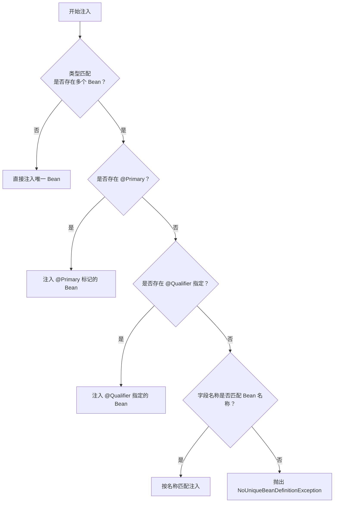

# @Autowired 详解与注入决策流程

## 课程目标

- 深入理解 @Autowired 的工作原理
- 掌握 @Primary、@Qualifier 处理多 Bean 场景的方法
- 了解 @Resource 与 @Autowired 的区别
- 能够在复杂依赖场景下正确选择注入方式


## @Autowired 的基本用法

### 什么是 @Autowired

`@Autowired` 是 Spring 提供的用于依赖注入的核心注解，它告诉 Spring 容器需要在运行时自动注入匹配的 Bean。它可以用在构造方法、Setter 方法、字段上。

## 在字段上使用

```java
@RestController
public class BookController {
    @Autowired
    private BookService bookService;
}
```

### 在构造方法上使用

```java
@RestController
public class BookController {
    private final BookService bookService;

    @Autowired
    public BookController(BookService bookService) {
        this.bookService = bookService;
    }
}
```

> [!NOTE]
> 如果类只有一个构造方法，可以省略 `@Autowired`，Spring 会自动使用该构造方法。

### 在 Setter 方法上使用

```java
@RestController
public class BookController {
    private BookService bookService;

    @Autowired
    public void setBookService(BookService bookService) {
        this.bookService = bookService;
    }
}
```

### 在任意方法上使用

`@Autowired` 也可以用在任意方法上，Spring 会执行该方法并传入匹配的 Bean：

```java
@Service
public class BookServiceImpl {
    private BookRepository repository;
    private CacheService cache;

    @Autowired
    public void init(BookRepository repository, CacheService cache) {
        this.repository = repository;
        this.cache = cache;
        // 可以执行额外的初始化逻辑
        System.out.println("依赖注入完成");
    }
}
```


## @Autowired 的核心特性

### required 属性

`@Autowired` 有一个 `required` 属性，默认为 `true`：

```java
// 必须注入，如果找不到匹配的 Bean 会抛出异常
@Autowired
private BookService bookService;

// 可选注入，找不到时不报错，字段保持 null
@Autowired(required = false)
private OptionalService optionalService;
```

**适用场景：**

- `required = true`（默认）：强制依赖，必须存在
- `required = false`：可选依赖，不存在也能正常启动

### 注入数组和集合

`@Autowired` 可以注入一个接口的所有实现类，自动组装成数组或集合：

```java
public interface PaymentService {
    void pay();
}

@Service
public class AlipayService implements PaymentService { ... }

@Service
public class WechatPayService implements PaymentService { ... }

@Service
public class OrderService {
    @Autowired
    private PaymentService[] paymentServices;  // 注入所有实现

    @Autowired
    private List<PaymentService> paymentServiceList;  // 注入所有实现

    public void payAll() {
        for (PaymentService ps : paymentServices) {
            ps.pay();
        }
    }
}
```

### 注入 Map

`@Autowired` 也可以注入 Map，键为 Bean 名称，值为 Bean 实例：

```java
@Service
public class OrderService {
    @Autowired
    private Map<String, PaymentService> paymentServiceMap;

    public void payByType(String type) {
        PaymentService service = paymentServiceMap.get(type);
        if (service != null) {
            service.pay();
        }
    }
}
```


## 多 Bean 场景与注入决策

### 问题引入

当容器中存在多个相同类型的 Bean 时，`@Autowired` 如何选择？

```java
// 定义接口
public interface BookService {
    List<Book> getAllBooks();
}

// 实现类1：基础实现
@Service
public class BookServiceImpl implements BookService {
    @Override
    public List<Book> getAllBooks() { ... }
}

// 实现类2：高级实现（带缓存）
@Service
public class CachedBookServiceImpl implements BookService {
    @Override
    public List<Book> getAllBooks() { ... }
}
```

此时，如果直接在字段上注入 `BookService`，Spring 会因无法确定选择哪个 Bean 而抛出异常。

### 注入决策流程



## 使用 @Primary 指定首选 Bean

`@Primary` 用于标记一个 Bean 为“首选”，当多个 Bean 匹配时优先注入。

```java
// 首选实现
@Primary
@Service
public class CachedBookServiceImpl implements BookService {
    @Override
    public List<Book> getAllBooks() {
        System.out.println("从缓存获取图书");
        // ...
    }
}
```

现在当注入 `BookService` 时，Spring 会优先选择 `CachedBookService`。

```java
@RestController
public class BookController {
    @Autowired
    private BookService bookService;  // 将注入 CachedBookService
}
```


## 使用 @Qualifier 精确指定 Bean

当有多个同类型 Bean 且没有设置 `@Primary`，或需要注入特定的某个 Bean 时，使用 `@Qualifier` 按名称精确指定。

```java
@Service
public class BookServiceImpl implements BookService {
    // ...
}

@Service("cached")  // 指定 Bean 名称
public class CachedBookServiceImpl implements BookService {
    // ...
}
```

**方式一：在注入点使用 @Qualifier**

```java
@RestController
public class BookController {
    @Autowired
    @Qualifier("cached")  // 精确指定使用 cached 这个 Bean
    private BookService bookService;
}
```

**方式二：在构造方法参数中使用**

```java
@RestController
public class BookController {
    private final BookService bookService;

    public BookController(@Qualifier("basic") BookService bookService) {
        this.bookService = bookService;
    }
}
```


### 自定义 @Qualifier 注解

可以创建自定义的限定符注解，提高可读性：

```java
@Target({ElementType.FIELD, ElementType.PARAMETER, ElementType.TYPE})
@Retention(RetentionPolicy.RUNTIME)
@Qualifier
public @interface Basic {
}

@Target({ElementType.FIELD, ElementType.PARAMETER, ElementType.TYPE})
@Retention(RetentionPolicy.RUNTIME)
@Qualifier
public @interface Cached {
}
```

使用自义注解：

```java
@Cached
@Service
public class CachedBookServiceImpl implements BookService { ... }

@RestController
public class BookController {
    @Autowired
    @Cached
    private BookService bookService;
}
```

> [!NOTE]
>
> 技巧：**开启自动导入（推荐）**：你可以在设置中开启自动导入功能，让 IDEA 在你输入代码时就帮你自动完成导入，几乎不需要手动操作。
>
> 1. 打开设置：`File` → `Settings` (Windows/Linux) 或 `IntelliJ IDEA` → `Preferences` (Mac)。
> 2. 进入路径：`Editor` → `General` → `Auto Import`。
> 3. 勾选 **`Add unambiguous imports on the fly`**（动态添加明确的 import）和 **`Optimize imports on the fly`**（动态优化导入）。


## @Resource 注解

`@Resource` 是 JSR-250 规范提供的注入注解，与 `@Autowired` 功能类似，但有以下区别：

| 对比              | @Autowired                 | @Resource                  |
| ----------------- | -------------------------- | -------------------------- |
| 来源              | Spring 专有                | Java 标准（JSR-250）       |
| 匹配方式          | **先按类型**匹配，再按名称 | **先按名称**匹配，再按类型 |
| 是否支持 required | ✅ 支持 required            | ❌ 不支持（默认必须存在）   |
| 是否支持 @Primary | ✅ 支持                     | ✅ 支持（类型匹配时）       |
| 是否支持集合/数组 | ✅ 支持                     | ❌ 不支持                   |

**@Resource 的使用示例：**

```java
@RestController
public class BookController {
    // 按名称注入（name 属性指定）
    @Resource(name = "cachedBookService")
    private BookService bookService;

    // 如果不指定 name，默认按字段名匹配
    @Resource
    private BookService cachedBookService;  // 匹配名为 basicBookService 的 Bean
}
```

> [!NOTE]
> 实际开发中推荐优先使用 `@Autowired`，因为它是 Spring 原生注解，功能更强大。


## 实战：图书管理系统中的多 Bean 场景

### 场景描述

假设图书管理系统中需要支持多种存储方式：

- `MemoryBookRepository`：内存存储（快速测试）
- `DatabaseBookRepository`：数据库存储（生产环境）

我们可以在不同环境中切换。

### 实现代码

**接口定义：**

```java
public interface BookRepository {
    Book save(Book book);
    Book findById(Long id);
    List<Book> findAll();
    boolean deleteById(Long id);
    Book update(Book book);
  	List<Book> findByAuthor(String author);
  	List<Book> findByPriceRange(Double min, Double max);
}
```

**实现类1：内存存储**

```java
@Primary  // 默认使用内存存储
@Service
public class MemoryBookRepository implements BookRepository {
    private final Map<Long, Book> store = new ConcurrentHashMap<>();
    private final AtomicLong idGenerator = new AtomicLong(1);

    @Override
    public Book save(Book book) {
        if (book.getId() == null) {
            book.setId(idGenerator.getAndIncrement());
        }
        store.put(book.getId(), book);
        return book;
    }
    // 其他方法...
}
```

**实现类2：数据库存储（模拟）**

```java
@Service
public class DatabaseBookRepository implements BookRepository {
    @Override
    public Book save(Book book) {
        System.out.println("保存到数据库: " + book);
        return book;
    }
    // 其他方法...
}
```

**Service 层注入：**

```java
@Service
public class BookService {
    private final BookRepository bookRepository;

    // 注入时使用 @Qualifier 指定具体实现
    public BookService(@Qualifier("databaseBookRepository") BookRepository bookRepository) {
        this.bookRepository = bookRepository;
    }
    // 业务方法...
}
```

**Controller 层保持不变：**

```java
@RestController
@RequestMapping("/api/books")
public class BookController {
    private final BookService bookService;

    public BookController(BookService bookService) {
        this.bookService = bookService;
    }
}
```

### 切换策略

- 如果 `MemoryBookRepository` 加了 `@Primary`，且没有 `@Qualifier` 指定，则默认使用内存存储。
- 如果希望切换到数据库存储，可以通过 `@Qualifier("databaseBookRepository")` 指定。


## 常见问题与注意事项

### 1. 注入失败：NoSuchBeanDefinitionException

```java
@Autowired
private SomeService someService;  // 如果容器中没有 SomeService 类型的 Bean，会抛出异常
```

**解决方案：**

- 确保 Bean 已被 Spring 管理（添加 `@Service`/`@Component` 等注解）
- 检查包扫描路径是否正确
- 如果可选依赖，设置 `required = false`

### 2. 注入失败：NoUniqueBeanDefinitionException

```java
@Autowired
private BookService bookService;  // 容器中存在多个 BookService 实现
```

**解决方案：**

- 在其中一个实现上添加 `@Primary`
- 在注入点使用 `@Qualifier` 指定

### 3. 循环依赖问题

构造器注入无法解决循环依赖。下节课做专题分析。

### 4. @Autowired 与 @Resource 混用

在同一类中混用两种注解可能导致混淆，建议统一使用 `@Autowired`。


## 小结

本节课我们学习了：

1. **@Autowired 的基本用法**：可作用于字段、构造方法、Setter 方法、任意方法。
2. **注入数组和集合**：自动注入同一类型的所有 Bean。
3. **注入决策流程**：
   - 唯一匹配 → 直接注入
   - 多个匹配 → @Primary → @Qualifier → 按名称匹配 → 抛出异常
4. **@Primary**：标记首选 Bean，降低注入决策歧义。
5. **@Qualifier**：按名称精确指定要注入的 Bean。
6. **@Resource**：JSR-250 标准注解，先按名称匹配后按类型匹配。
7. **实战案例**：在图书管理系统中实现多种存储方式切换。


## 作业

### 作业一：代码阅读——注入决策分析

阅读以下代码，回答问题。

```java
public interface GreetingService {
    String greet();
}

@Service
@Primary
public class EnglishGreetingService implements GreetingService {
    @Override
    public String greet() { return "Hello"; }
}

@Service
public class ChineseGreetingService implements GreetingService {
    @Override
    public String greet() { return "你好"; }
}

@RestController
public class GreetingController {
    @Autowired
    private GreetingService greetingService;

    @GetMapping("/greet")
    public String greet() {
        return greetingService.greet();
    }
}
```

**问题：**

1. 访问 `/greet` 接口返回什么？为什么？
2. 如果希望返回 `"你好"`，有哪些修改方式？
3. 如果 `@Primary` 同时被注解在两个类上，会发生什么？

------

### 作业二：代码阅读——@Resource 与 @Autowired 对比

```java
@Component
public class ServiceA { }

@Component
public class ServiceB { }

@Configuration
public class AppConfig {
    @Bean("customA")
    public ServiceA serviceA() { return new ServiceA(); }

    @Bean("customB")
    public ServiceB serviceB() { return new ServiceB(); }
}

public class Client {
    @Autowired
    private ServiceA serviceA;  // 注入的是 customA 还是 ServiceA？
    
    @Resource
    private ServiceB serviceB;  // 注入的是 customB 还是 ServiceB？
}
```

**问题：**

1. `@Autowired` 注入 `ServiceA` 时，按什么匹配规则？
2. `@Resource` 注入 `ServiceB` 时，按什么匹配规则？与 `@Autowired` 有何不同？
3. 如果 `@Resource` 不指定 `name` 属性，它会匹配哪个 Bean？

------

### 作业三：为图书管理系统添加多种存储实现

基于图书管理系统项目，完成以下任务：

1. 创建 `BookRepository` 接口。
2. 创建两个实现类：
   - `InMemoryBookRepository`：使用 `ConcurrentHashMap` 存储
   - `FileBookRepository`：模拟文件存储（仅打印日志，不做实际文件操作）
3. 在 `BookService` 中通过 `@Qualifier` 指定使用 `InMemoryBookRepository`。
4. 在 `InMemoryBookRepository` 上添加 `@Primary`，然后注释掉 `@Qualifier`，验证默认注入哪个实现。
5. 编写一个测试 Controller 方法，展示当前使用的存储类型。

------

### 作业四：自定义 @Qualifier 注解（选做）

1. 创建两个自定义限定符注解：
   - `@InMemory`
   - `@FileBased`
2. 使用它们分别标记两个 `BookRepository` 实现类。
3. 在 `BookService` 构造方法中使用 `@InMemory` 或 `@FileBased` 指定注入哪个实现。
4. 验证不同限定符切换时，业务行为是否随之变化。
