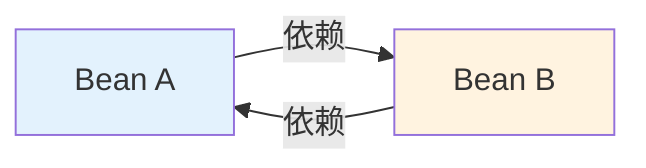
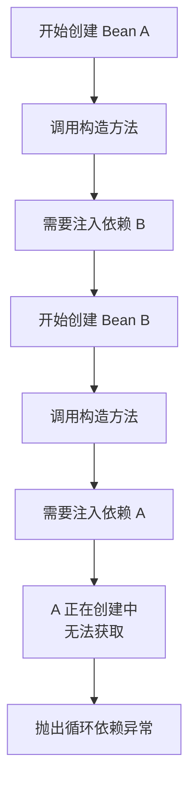
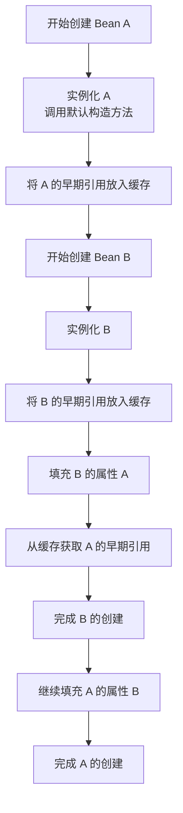
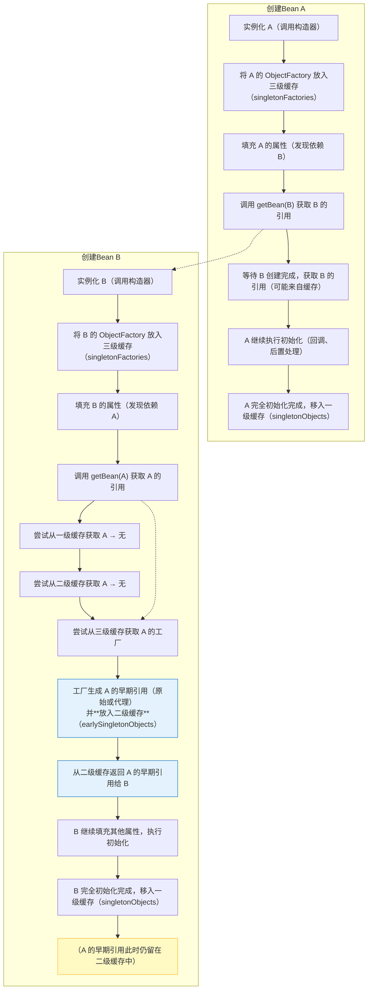

# 循环依赖与三级缓存机制

## 课程目标

- 理解循环依赖的定义和产生原因
- 掌握构造器注入导致的循环依赖问题及解决方案
- 了解 Spring 三级缓存机制的基本原理
- 掌握使用 Setter 注入和 @Lazy 解决循环依赖的方法
- 能够在实际项目中识别和避免循环依赖


## 什么是循环依赖

### 定义

**循环依赖** 是指两个或多个 Bean 之间相互依赖，形成闭环。例如：A 依赖 B，B 依赖 A；或 A 依赖 B，B 依赖 C，C 依赖 A。



### 产生原因

在 Spring IoC 容器中，循环依赖通常发生在以下场景：

1. **构造器注入**：A 的构造方法需要 B，B 的构造方法需要 A，导致无法创建任何一个。
2. **字段/Setter 注入**：A 在创建后注入 B，B 在创建后注入 A，Spring 可以通过提前暴露未完全初始化的对象来解决。

> [!NOTE]
> Spring 能够解决 **字段注入** 和 **Setter 注入** 的循环依赖，但 **构造器注入** 的循环依赖无法解决。


## 构造器注入导致的循环依赖

### 问题复现

```java
// A 依赖 B
@Component
public class A {
    private final B b;

    public A(B b) {
        this.b = b;
    }
}

// B 依赖 A
@Component
public class B {
    private final A a;

    public B(A a) {
        this.a = a;
    }
}
```

**启动应用时，会抛出异常：**

```
The dependencies of some of the beans in the application context form a cycle:
```


### 为什么构造器注入无法解决循环依赖

Spring 创建 Bean 的流程如下：



> [!NOTE]
> 构造器注入要求 Bean 在创建时就必须完成所有依赖的注入。在创建 A 时发现需要 B，于是去创建 B；创建 B 时又发现需要 A，而此时 A 还在创建中且尚未完成，因此无法获取，导致死循环。


## 字段/Setter 注入解决循环依赖

将构造器注入改为 Setter 注入或字段注入，Spring 可以解决循环依赖。

### 方式一：字段注入

```java
@Component
public class A {
    @Autowired
    private B b;
}

@Component
public class B {
    @Autowired
    private A a;
}
```

### 方式二：Setter 注入

```java
@Component
public class A {
    private B b;

    @Autowired
    public void setB(B b) {
        this.b = b;
    }
}

@Component
public class B {
    private A a;

    @Autowired
    public void setA(A a) {
        this.a = a;
    }
}
```

> [!NOTE]
>
> 请注意，上述代码能够正确执行的前提是ClassA和ClassB的作用域都是Singleton。
>
> 同时，从 Spring Boot 2.6.0 开始，*默认*禁止循环依赖，需要设置如下配置项来开启循环依赖支持：
>
> ```
> spring:
> 	main:
>   		allow-circular-references:true
> ```


#### 单例与原型作用域

在 Spring IoC 容器中，Bean 的**默认作用域是单例（singleton）**，也就是说不管对 Bean 的引用有多少个，容器只会创建一个实例。而**原型（prototype）作用域**则不同，每次请求 Bean 时，Spring IoC 容器都会创建一个新的对象实例。

从两种作用域的效果而言，我们总结一条开发上的经验：**对于无状态的 Bean，应使用单例作用域；反之，对于有状态的 Bean，则应使用原型作用域。**

那么，什么样的 Bean 属于有状态的呢？结合 Web 应用程序，我们可以明确：对于每次 HTTP 请求，我们都应该创建一个 Bean  来代表这一次的请求对象；同样，对于会话而言，我们也需要针对每个会话创建一个会话状态对象。这些都是常见的有状态的 Bean。


### 为什么 Setter/字段注入可以解决



> [!NOTE]
> 关键区别在于：Setter/字段注入允许先实例化对象（调用无参构造方法），再通过 Setter 或反射注入依赖。Spring 在对象实例化后、完全初始化前，会将“早期引用”暴露出来，供其他 Bean 使用。


## 三级缓存机制

Spring 通过 **三级缓存** 巧妙地解决了单例 Bean 之间的 Setter / 字段注入循环依赖问题。理解这三层缓存的交互，是掌握 IoC 容器核心原理的关键。

------

### 三级缓存的职责与存储内容

| 缓存名称                             | 存储对象类型                    | 存储内容                                                     | 何时读取                                                     |
| ------------------------------------ | ------------------------------- | ------------------------------------------------------------ | ------------------------------------------------------------ |
| **一级缓存** `singletonObjects`      | `Map<String, Object>`           | **完全初始化**的单例 Bean 实例（已执行完所有生命周期回调、属性填充、初始化方法） | 所有 `getBean()` 请求优先查询，保证单例                      |
| **二级缓存** `earlySingletonObjects` | `Map<String, Object>`           | **早期暴露**的 Bean 实例（未初始化完成，仅实例化后的原始对象或代理对象） | 在循环依赖中，提前获取其他 Bean 的早期引用（避免重复创建工厂） |
| **三级缓存** `singletonFactories`    | `Map<String, ObjectFactory<?>>` | **对象工厂**（`ObjectFactory`），用于生成 Bean 的早期引用（可以是原始对象或代理对象） | 当检测到循环依赖时，调用工厂生成早期引用并升级到二级缓存     |

### 详细步骤解析

假设两个单例 Bean：`A` 依赖 `B`，`B` 依赖 `A`（均为 Setter 注入）。

| 步骤   | 操作                                                         | 缓存变化（写入/读取）                                        |
| ------ | ------------------------------------------------------------ | ------------------------------------------------------------ |
| **1**  | `getBean(A)` 开始创建 A                                      | —                                                            |
| **2**  | 实例化 A（调用构造器），得到一个 **原始对象** `A_raw`        | —                                                            |
| **3**  | 将 `A_raw` 的 `ObjectFactory` 放入 **三级缓存**              | `singletonFactories.put("A", factoryA)`                      |
| **4**  | 开始填充 A 的属性，发现依赖 B                                | —                                                            |
| **5**  | 调用 `getBean(B)` 创建 B                                     | —                                                            |
| **6**  | 实例化 B，得到 `B_raw`                                       | —                                                            |
| **7**  | 将 `B_raw` 的 `ObjectFactory` 放入 **三级缓存**              | `singletonFactories.put("B", factoryB)`                      |
| **8**  | 填充 B 的属性，发现依赖 A                                    | —                                                            |
| **9**  | 调用 `getBean(A)` 获取 A 的引用。此时： - 一级缓存无 A（未完成） - 二级缓存无 A（尚未生成） - 三级缓存有 A 的工厂 | 读取 `singletonFactories`                                    |
| **10** | 从三级缓存取出 `factoryA`，调用 `getObject()` 生成 A 的**早期引用**（可能是原始对象 `A_raw`，也可能被 AOP 增强为代理对象）。**然后将该引用放入二级缓存**，并从三级缓存移除（后续可直接从二级缓存取）。 | `earlySingletonObjects.put("A", earlyA)` `singletonFactories.remove("A")` |
| **11** | 将 A 的早期引用注入到 B 的 `a` 属性中                        | —                                                            |
| **12** | B 继续完成其他属性填充，执行 `@PostConstruct`、`InitializingBean` 等初始化回调 | —                                                            |
| **13** | B 完全初始化，将 B 的完整实例移入**一级缓存**                | `singletonObjects.put("B", B_complete)` （若有二级缓存中 B 的早期引用，此时会被覆盖或移除） |
| **14** | 回到 A 的属性填充步骤，此时 `getBean(B)` 返回完全初始化的 B 实例，注入到 A 的 `b` 属性中 | —                                                            |
| **15** | A 继续完成初始化（回调等），完成后将 A 移入**一级缓存**      | `singletonObjects.put("A", A_complete)` （二级缓存中可能仍有 A 的早期引用，但已无用，后续会被清理） |

### 工作流程图



### 二级缓存的关键作用

- **防止重复创建早期引用**：当多个 Bean 同时依赖 A 时，若每次都去三级缓存取工厂，可能多次生成代理对象（导致不一致）。二级缓存确保**只有第一次**会触发工厂，后续直接复用已生成的早期对象。
- **保持代理对象唯一性**：如果 A 需要 AOP 代理，三级缓存的工厂会返回代理对象，放入二级缓存后，所有依赖 A 的 Bean 获得的是**同一个代理实例**，符合单例语义。
- **提升性能**：工厂 `getObject()` 可能涉及复杂逻辑，缓存早期对象避免重复执行。

### 为什么需要三级缓存，二级不够吗？

如果只用二级缓存（即实例化后直接放入一个 `earlySingletonObjects`），则**无法处理需要 AOP 代理的场景**。因为代理对象的生成通常在 Bean 初始化之后（通过后置处理器），而循环依赖发生时，目标 Bean 尚处于“未初始化完成”状态，此时生成代理的时机必须由工厂延迟控制。三级缓存将“创建早期引用”的逻辑封装在 `ObjectFactory` 中，只有真正需要时才会触发，保证了代理生成的正确时机。

通过上述缓存机制，Spring 在保证单例的前提下，优雅地解决了大部分 Setter/字段注入的循环依赖问题，同时兼顾了代理、作用域等复杂特性。


## @Lazy 延迟注入解决循环依赖

`@Lazy` 注解可以让 Spring 在注入时创建一个代理对象，实际使用时才真正创建目标 Bean，从而打破循环依赖。

### 使用示例

```java
@Component
public class A {
    private final B b;

    public A(@Lazy B b) {
        this.b = b;
    }
}

@Component
public class B {
    private final A a;

    public B(A a) {
        this.a = a;
    }
}
```

### 工作原理

```mermaid
flowchart LR
    A[A 的构造方法] -->|@Lazy| Proxy[创建 B 的代理对象]
    Proxy --> B[代理对象注入 A]
    B --> Later[实际调用 B 的方法时<br/>才真正创建 B]

    style Proxy fill:#fff3e0
```

> [!CAUTION]
> `@Lazy` 虽然能解决循环依赖，但会引入代理对象，如果后续调用方法时出现延迟初始化错误，会增加调试难度。应优先考虑重构设计。


## 场景分析：真实项目中的循环依赖

### 场景模拟

在图书管理系统中，我们可能有这样的设计：

- `OrderService` 负责订单处理，依赖 `BookService` 获取图书信息。
- `BookService` 在处理库存更新时，依赖 `OrderService` 获取订单数量。

这种情况在现实业务中可能存在，但设计上应该避免。我们通过它来演示循环依赖的解决。

### 复现循环依赖

```java
@Service
public class BookService {
    private final OrderService orderService;

    public BookService(OrderService orderService) {
        this.orderService = orderService;
    }

    public void updateStock(Long bookId) {
        int orderCount = orderService.getOrderCountByBook(bookId);
        // 更新库存逻辑...
    }
}

@Service
public class OrderService {
    private final BookService bookService;

    public OrderService(BookService bookService) {
        this.bookService = bookService;
    }

    public int getOrderCountByBook(Long bookId) {
        return bookService.getBookById(bookId).getStock(); // 模拟
    }
}
```

**启动失败：** 构造器注入的循环依赖导致 `BeanCurrentlyInCreationException`。

### 解决方案

#### 方案一：改为 Setter 注入

```java
@Service
public class BookService {
    private OrderService orderService;

    @Autowired
    public void setOrderService(OrderService orderService) {
        this.orderService = orderService;
    }
}

@Service
public class OrderService {
    private BookService bookService;

    @Autowired
    public void setBookService(BookService bookService) {
        this.bookService = bookService;
    }
}
```

#### 方案二：使用 @Lazy

```java
@Service
public class BookService {
    private final OrderService orderService;

    public BookService(@Lazy OrderService orderService) {
        this.orderService = orderService;
    }
}

@Service
public class OrderService {
    private final BookService bookService;

    public OrderService(BookService bookService) {
        this.bookService = bookService;
    }
}
```

#### 方案三：重构设计（推荐）

将相互依赖的逻辑抽取到新的服务类中：

```java
@Service
public class InventoryService {
    private final BookService bookService;
    private final OrderService orderService;

    public InventoryService(BookService bookService, OrderService orderService) {
        this.bookService = bookService;
        this.orderService = orderService;
    }

    public void updateStock(Long bookId) {
        int orderCount = orderService.getOrderCountByBook(bookId);
        // 更新库存逻辑...
    }
}
```


## 避免循环依赖的设计原则

| 原则           | 说明                                           |
| -------------- | ---------------------------------------------- |
| **单一职责**   | 每个类只做一件事，减少不必要的依赖             |
| **依赖抽象**   | 依赖接口而非具体实现，使用策略模式解耦         |
| **提取中间层** | 将多个类共用的逻辑提取到新的服务中             |
| **事件驱动**   | 使用事件发布/订阅机制替代直接的互相调用        |
| **向上依赖**   | 避免同级模块之间的依赖，让高层模块依赖低层模块 |


## 小结

本节课我们学习了：

1. **循环依赖的定义**：多个 Bean 相互依赖形成闭环。
2. **构造器注入的循环依赖**：无法解决，会抛出异常。
3. **Setter/字段注入的循环依赖**：Spring 可以解决，利用三级缓存。
4. **三级缓存机制**：
   - 一级缓存：完全初始化的 Bean
   - 二级缓存：早期暴露的 Bean 实例
   - 三级缓存：ObjectFactory 工厂
5. **@Lazy 延迟注入**：使用代理对象打破循环。
6. **重构设计**：优先通过设计避免循环依赖。


## 作业

### 作业一：代码阅读——循环依赖识别

阅读以下代码，判断是否会产生循环依赖，并说明原因。

```java
@Component
public class ServiceA {
    private ServiceB serviceB;

    @Autowired
    public ServiceA(ServiceB serviceB) {
        this.serviceB = serviceB;
    }
}

@Component
public class ServiceB {
    private ServiceA serviceA;

    @Autowired
    public void setServiceA(ServiceA serviceA) {
        this.serviceA = serviceA;
    }
}
```

**问题：**

1. 这段代码是否存在循环依赖？
2. 如果存在，Spring 能解决吗？为什么？
3. 如果希望解决，应该怎么修改？

------

### 作业二：代码阅读——三级缓存流程分析

假设有以下循环依赖场景，分析 Spring 创建 Bean 的顺序。

```java
@Configuration
public class AppConfig {
    @Bean
    public A a() { return new A(b()); }

    @Bean
    public B b() { return new B(a()); }
}
```

**问题：**

1. 这段代码使用了什么注入方式？
2. 尝试创建 A 和 B 时，Spring 会发生什么？请按步骤描述。
3. 如果改为 Setter 注入，创建顺序会发生什么变化？

------

### 作业三：修改图书管理系统中的循环依赖

在图书管理系统中，`OrderService` 和 `BookService` 存在循环依赖。请至少使用两种方式解决该问题，并比较它们的优缺点。

**要求：**

1. 复现循环依赖（构造器注入）。
2. 记录启动时抛出的异常信息。
3. 分别使用 Setter 注入和 @Lazy 解决循环依赖，验证应用可以正常启动。
4. 分析两种方式哪个更优，并说明理由。
