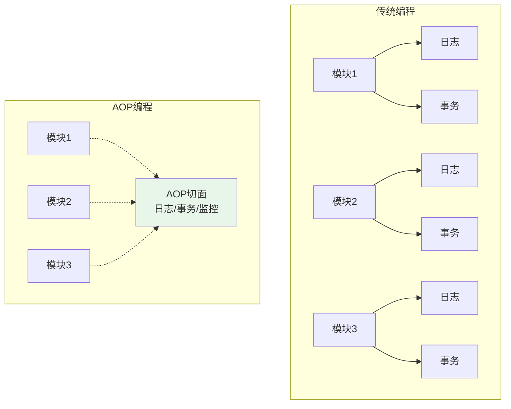
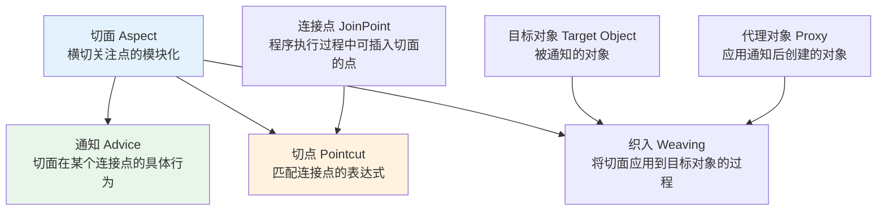
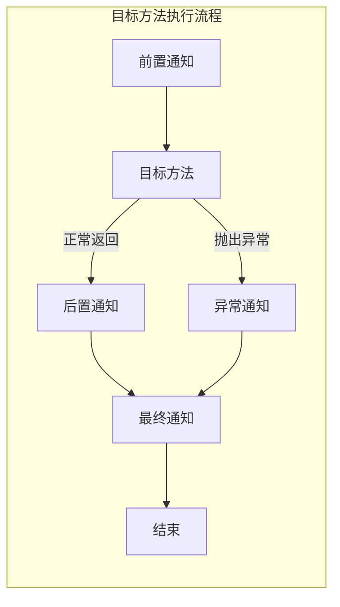
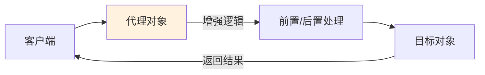
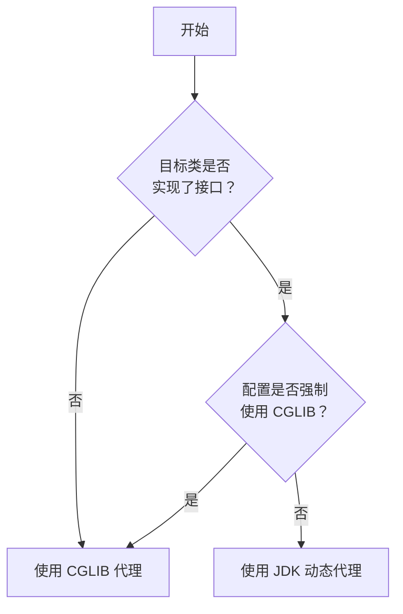

# AOP 编程思想与动态代理机制

## 课程目标

- 理解 AOP（面向切面编程）的核心思想和应用场景
- 掌握 AOP 的核心术语（切面、连接点、切点、通知、织入）
- 理解 JDK 动态代理和 CGLIB 代理的区别和适用场景
- 能够区分 Spring AOP 在不同情况下的代理选择策略


## AOP 概述

### 什么是 AOP

**AOP（Aspect Oriented Programming，面向切面编程）** 是一种编程范式，它允许开发者将横切关注点（Cross-Cutting Concerns）从业务逻辑中分离出来，实现代码的模块化复用。

**横切关注点** 是指那些分散在应用各个模块中的共同功能，如日志记录、性能监控、事务管理、权限校验等。



### 为什么需要 AOP

| 问题           | 说明                                       |
| -------------- | ------------------------------------------ |
| **代码重复**   | 日志、监控等代码在每个方法中重复出现       |
| **关注点混杂** | 业务逻辑与非业务逻辑混合在一起，降低可读性 |
| **维护困难**   | 修改日志格式需要改动所有相关方法           |
| **难以复用**   | 横切逻辑无法在其他模块中复用               |

> [!NOTE]
> AOP 的核心价值在于**关注点分离**。让业务逻辑专注于核心业务，让横切关注点独立管理和维护。


## AOP 核心概念

### 核心术语



| 术语                     | 说明                                                 | 生活类比                 |
| ------------------------ | ---------------------------------------------------- | ------------------------ |
| **连接点（Join Point）** | 程序执行过程中可插入切面的点（如方法调用、异常抛出） | 所有可以安检的入口       |
| **切点（Pointcut）**     | 匹配连接点的表达式，决定哪些连接点会被通知           | 选择哪些入口需要安检     |
| **通知（Advice）**       | 切面在特定连接点执行的具体行为                       | 安检动作（扫描、检查）   |
| **切面（Aspect）**       | 切点 + 通知的集合，横切关注点的模块化                | 安检员 + 安检规则        |
| **织入（Weaving）**      | 将切面应用到目标对象并创建代理对象的过程             | 把安检设备和流程部署到位 |
| **目标对象（Target）**   | 被通知的原始业务对象                                 | 需要安检的旅客           |
| **代理对象（Proxy）**    | 应用通知后创建的对象，包含增强后的行为               | 安检后放行的旅客         |

### 通知类型

| 通知类型                        | 说明                                     |
| ------------------------------- | ---------------------------------------- |
| **前置通知（@Before）**         | 在目标方法执行之前执行                   |
| **后置通知（@AfterReturning）** | 在目标方法正常返回之后执行               |
| **异常通知（@AfterThrowing）**  | 在目标方法抛出异常之后执行               |
| **最终通知（@After）**          | 在目标方法执行完成后执行（无论是否异常） |
| **环绕通知（@Around）**         | 在目标方法执行前后都执行，最强大         |




## 动态代理基础

### 什么是动态代理

Spring AOP 的底层实现基于**动态代理**。动态代理在运行时为目标对象动态生成代理对象，通过代理对象间接调用目标对象，在调用前后插入增强逻辑。



### 两种动态代理方式

| 代理方式         | 实现机制                                       | 适用条件                 |
| ---------------- | ---------------------------------------------- | ------------------------ |
| **JDK 动态代理** | 基于接口的代理，使用 `java.lang.reflect.Proxy` | 目标类实现了至少一个接口 |
| **CGLIB 代理**   | 基于类继承的代理，通过生成目标类的子类来实现   | 目标类没有实现接口       |


## JDK 动态代理

### 基本实现

JDK 动态代理要求目标对象实现至少一个接口。

**步骤一：定义接口**

```java
public interface BookService {
    ...
}
```

**步骤二：实现目标类**

```java
public class BookServiceImpl implements BookService {
    ...
}
```

**步骤三：实现 InvocationHandler**

```java
import java.lang.reflect.InvocationHandler;
import java.lang.reflect.Method;

public class LoggingInvocationHandler implements InvocationHandler {
    private final Object target;

    public LoggingInvocationHandler(Object target) {
        this.target = target;
    }

    @Override
    public Object invoke(Object proxy, Method method, Object[] args) throws Throwable {
        // 前置增强
        System.out.println("[JDK代理] 调用方法: " + method.getName());
        System.out.println("[JDK代理] 参数: " + Arrays.toString(args));

        // 调用目标方法
        Object result = method.invoke(target, args);

        // 后置增强
        System.out.println("[JDK代理] 方法返回: " + result);
        return result;
    }
}
```

**步骤四：创建代理对象并执行**

```java
import java.lang.reflect.Proxy;

public class JdkProxyDemo {
    public static void main(String[] args) {
        // 创建目标对象
        BookService target = new BookServiceImpl(new BookRepository());

        // 创建代理对象
        BookService proxy = (BookService) Proxy.newProxyInstance(
                target.getClass().getClassLoader(),
                target.getClass().getInterfaces(),
                new LoggingInvocationHandler(target)
        );

        // 通过代理调用方法（增强后的行为）
        Book book = new Book();
        book.setTitle("Spring Boot实战");
        book.setAuthor("Craig Walls");
        book.setPrice(79.0);
        book.setStock(15);
        proxy.createBook(book);

        List<Book> allBooks = proxy.getAllBooks();
        System.out.println("最终结果: " + allBooks);
    }
}
```

**运行结果：**

```
[JDK代理] 调用方法: createBook
[JDK代理] 参数: [Book{id=null, title='Spring Boot实战', author='Craig Walls'}]
添加Book：Spring Boot实战
[JDK代理] 方法返回: Book{id=1, title='Spring Boot实战', author='Craig Walls'}
[JDK代理] 调用方法: getAllBooks
[JDK代理] 参数: null
[JDK代理] 方法返回: [Book{id=1, title='Spring Boot实战', author='Craig Walls'}]
最终结果: [Book{id=1, title='Spring Boot实战', author='Craig Walls'}]
```

### JDK 动态代理的特点

| 特点         | 说明                       |
| ------------ | -------------------------- |
| **基于接口** | 目标类必须实现至少一个接口 |
| **内置 JVM** | 不需要额外引入依赖         |
| **性能开销** | 方法调用通过反射，性能略低 |
| **适用场景** | 目标类有接口定义时优先使用 |


## CGLIB 动态代理

### 基本实现

CGLIB（Code Generation Library）通过继承目标类来生成代理，不需要接口。

**步骤一：添加依赖**

在非 Spring Boot 环境中需要添加依赖：

```xml
<dependency>
    <groupId>cglib</groupId>
    <artifactId>cglib</artifactId>
    <version>3.3.0</version>
</dependency>
```

在 Spring Boot 项目中，直接添加`spring-boot-starter-aop` 即可：

```xml
<dependency>
    <groupId>org.springframework.boot</groupId>
    <artifactId>spring-boot-starter-aop</artifactId>
</dependency>
```

**步骤二：创建目标类（无接口）**

```java
public class BookServiceImpl {
    // 必须提供无参构造函数
  	public BookServiceImpl() {
        this.bookRepository = new BookRepository();
    }
		...
}
```

> [!CAUTION]
>
> 目标类必须提供`无参构造函数`，否则会跑出异常：
>
> Exception in thread "main" java.lang.IllegalArgumentException: Superclass has no null constructors but no arguments were given at org.springframework.cglib.proxy.Enhancer.emitConstructors(Enhancer.java:1025)

**步骤三：实现 MethodInterceptor**

```java
// import net.sf.cglib.proxy.MethodInterceptor;
// import net.sf.cglib.proxy.MethodProxy;

import org.springframework.cglib.proxy.MethodInterceptor;
import org.springframework.cglib.proxy.MethodProxy;
import java.lang.reflect.Method;

public class LoggingMethodInterceptor implements MethodInterceptor {
    @Override
    public Object intercept(Object obj, Method method, Object[] args, MethodProxy proxy) throws Throwable {
        // 前置增强
        System.out.println("[CGLIB代理] 调用方法: " + method.getName());
        System.out.println("[CGLIB代理] 参数: " + Arrays.toString(args));

        // 调用目标方法
        Object result = proxy.invokeSuper(obj, args);

        // 后置增强
        System.out.println("[CGLIB代理] 方法返回: " + result);
        return result;
    }
}
```

**步骤四：创建代理对象并执行**

```java
// import net.sf.cglib.proxy.Enhancer;

import org.springframework.cglib.proxy.Enhancer;

public class CglibProxyDemo {
    public static void main(String[] args) {
        // 创建 Enhancer
        Enhancer enhancer = new Enhancer();
        enhancer.setSuperclass(BookServiceImpl.class);  // 设置父类
        enhancer.setCallback(new LoggingMethodInterceptor());

        // 创建代理对象
        BookServiceImpl proxy = (BookServiceImpl) enhancer.create();

        // 通过代理调用方法
        Book book = new Book();
        book.setTitle("Spring Boot实战");
        book.setAuthor("Craig Walls");
        book.setPrice(79.0);
        book.setStock(15);
        proxy.createBook(book);

        List<Book> allBooks = proxy.getAllBooks();
        System.out.println("最终结果: " + allBooks);
    }
}
```

**运行结果：**

```
[CGLIB代理] 调用方法: createBook
[CGLIB代理] 参数: [Book{id=null, title='Spring Boot实战', author='Craig Walls'}]
添加Book：Spring Boot实战
[CGLIB代理] 方法返回: Book{id=1, title='Spring Boot实战', author='Craig Walls'}
[CGLIB代理] 调用方法: getAllBooks
[CGLIB代理] 参数: []
[CGLIB代理] 方法返回: [Book{id=1, title='Spring Boot实战', author='Craig Walls'}]
最终结果: [Book{id=1, title='Spring Boot实战', author='Craig Walls'}]
```

### CGLIB 代理的特点

| 特点         | 说明                                         |
| ------------ | -------------------------------------------- |
| **基于继承** | 生成目标类的子类，不需要接口                 |
| **额外依赖** | 需要引入 CGLIB 库（Spring Boot 已包含）      |
| **性能开销** | 性能优于 JDK 代理（使用 ASM 字节码生成）     |
| **适用场景** | 目标类没有实现接口时使用                     |
| **限制**     | 无法代理 `final` 类和方法（无法被继承/重写） |


## Spring AOP 的代理选择策略

Spring AOP同样采用动态代理机制，在运行时会自动选择使用 JDK 代理还是 CGLIB 代理。

### 选择规则



> [!NOTE]
> 可以通过配置控制代理的选择结果。

### 配置代理方式

**强制使用 CGLIB（Spring Boot 配置）：**

```yaml
spring:
  aop:
    proxy-target-class: true
```

**使用 @EnableAspectJAutoProxy 配置：**

```java
@Configuration
@EnableAspectJAutoProxy(proxyTargetClass = true)  // true 强制 CGLIB
public class AppConfig {
}
```


### 代理选择对比示例

**场景一：类实现了接口**

```java
public interface UserService { void save(); }

@Service
public class UserServiceImpl implements UserService { ... }
```

→ 默认使用 **JDK 代理**

**场景二：类未实现接口**

```java
@Service
public class UserService { ... }
```

→ 默认使用 **CGLIB 代理**

> [!CAUTION]
> 如果使用 JDK 代理，注入时应该使用**接口类型**而非实现类类型。如果必须使用实现类类型，需要强制使用 CGLIB 代理。


## JDK 代理 vs CGLIB 代理对比

| 对比维度        | JDK 动态代理             | CGLIB 代理              |
| --------------- | ------------------------ | ----------------------- |
| **实现方式**    | 基于接口的反射           | 基于类继承的字节码生成  |
| **依赖要求**    | JDK 自带                 | 需要 CGLIB 库           |
| **目标要求**    | 必须实现接口             | 不能是 final 类         |
| **代理对象**    | 实现了同一接口的新类     | 目标类的子类            |
| **方法限制**    | 只能代理接口中定义的方法 | 可代理所有非 final 方法 |
| **性能**        | 较慢（反射调用）         | 较快（直接调用）        |
| **Spring 默认** | 有接口时优先             | 无接口时使用            |
| **适用场景**    | 面向接口编程             | 无接口或强制使用        |


## 小结

本节课我们学习了：

1. **AOP 的核心思想**：将横切关注点从业务逻辑中分离，实现模块化复用。
2. **AOP 核心术语**：切面、连接点、切点、通知、织入、目标对象、代理对象。
3. **通知类型**：前置、后置、异常、最终、环绕通知。
4. **JDK 动态代理**：基于接口，使用 `java.lang.reflect.Proxy` + `InvocationHandler`。
5. **CGLIB 代理**：基于继承，使用 `Enhancer` + `MethodInterceptor`。
6. **Spring AOP 代理选择策略**：
   - 有接口 → JDK 代理（默认）
   - 无接口 → CGLIB 代理（默认）
   - 可通过 `proxy-target-class=true` 强制 CGLIB


## 作业

### 作业一：代码阅读——代理类型识别

阅读以下代码，判断 Spring AOP 会使用哪种代理方式。

```java
public interface GreetingService {
    String greet(String name);
}

@Service
public class GreetingServiceImpl implements GreetingService {
    @Override
    public String greet(String name) {
        return "Hello, " + name;
    }
}

@RestController
public class GreetingController {
    @Autowired
    private GreetingService greetingService;
}
```

**问题：**

1. `GreetingService` 的代理类型是什么（JDK 还是 CGLIB）？为什么？
2. 如果 `GreetingServiceImpl` 没有实现 `GreetingService` 接口，代理类型会变成什么？
3. 如果添加 `spring.aop.proxy-target-class=true` 配置，代理类型会变成什么？

------

### 作业二：代码阅读——JDK 动态代理分析

阅读以下代码，回答问题。

```java
public interface Calculator {
    int add(int a, int b);
}

public class CalculatorImpl implements Calculator {
    @Override
    public int add(int a, int b) {
        return a + b;
    }
}

public class TimingInvocationHandler implements InvocationHandler {
    private final Object target;

    public TimingInvocationHandler(Object target) {
        this.target = target;
    }

    @Override
    public Object invoke(Object proxy, Method method, Object[] args) throws Throwable {
        long start = System.currentTimeMillis();
        Object result = method.invoke(target, args);
        long end = System.currentTimeMillis();
        System.out.println("耗时: " + (end - start) + "ms");
        return result;
    }
}
```

**问题：**

1. `TimingInvocationHandler` 的 `invoke` 方法中，`proxy` 参数是什么？`method` 参数是什么？
2. 如果 `method.invoke(target, args)` 抛出异常，这段代码会发生什么？
3. 为什么需要传入 `target` 对象？

------

### 作业三：手动实现 JDK 动态代理示例

在图书管理系统中，手动实现一个 JDK 动态代理，为 `BookService` 添加日志增强。

**要求：**

1. 定义 `BookService` 接口，包含 `getBookById` 和 `addBook` 方法。
2. 创建 `BookServiceImpl` 实现类。
3. 创建 `LoggingInvocationHandler`，在方法调用前后打印日志。
4. 在 `main` 方法中使用 `Proxy.newProxyInstance` 创建代理对象并测试。

**输出示例：**

```
[前置] 调用方法: getBookById, 参数: [1]
获取图书: 1
[后置] 方法返回: Book{id=1, title='Spring Boot'}
```
