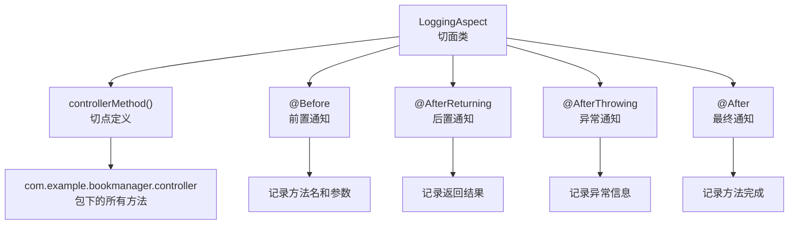

# Spring AOP实战：日志切面

## 课程目标

- 掌握 Spring AOP 的依赖引入和配置
- 掌握使用 @Aspect 定义切面类
- 掌握切入点表达式的写法和含义
- 掌握 @Before、@AfterReturning、@AfterThrowing、@After 等通知的实战用法
- 能够为图书管理系统实现完整的请求日志切面


## 导入：从理论到实践

上一节课我们学习了 AOP 编程思想，理解了 JDK 动态代理和 CGLIB 代理的底层机制。Spring AOP 正是基于这些动态代理技术，提供了更简洁的、注解驱动的切面编程方式。

本节课我们将动手实践，将 AOP 应用到图书管理系统中，实现一个**日志切面**——自动记录每个接口的调用信息，包括请求参数、响应结果和异常信息。

首先确保在 `pom.xml` 中添加 `spring-boot-starter-aop` 依赖：

```xml
<dependency>
    <groupId>org.springframework.boot</groupId>
    <artifactId>spring-boot-starter-aop</artifactId>
</dependency>
```

> [!NOTE]
> `spring-boot-starter-aop` 会启用 Spring AOP 的自动配置。无需额外配置即可使用。


## 定义日志切面

### slf4j日志类的基本操作

SLF4J（Simple Logging Facade for Java）是Spring Boot默认的日志门面，结合Logback作为底层实现。在切面类中，我们通过`LoggerFactory`获取日志实例，然后调用不同级别的方法输出日志。

#### 创建Logger实例

每个类中通常定义一个静态的`Logger`成员变量，用于输出该类相关的日志：

```java
import org.slf4j.Logger;
import org.slf4j.LoggerFactory;

public class LoggingAspect {
    private static final Logger logger = LoggerFactory.getLogger(LoggingAspect.class);
}
```

> [!NOTE]
>
> 建议将`logger`声明为`private static final`，避免重复创建，且线程安全。

#### 日志级别

SLF4J定义了5种日志级别（从低到高）：

| 级别  | 方法                  | 用途                         |
| ----- | --------------------- | ---------------------------- |
| TRACE | `logger.trace("msg")` | 最详细的追踪信息，通常仅调试 |
| DEBUG | `logger.debug("msg")` | 调试信息，开发环境常用       |
| INFO  | `logger.info("msg")`  | 关键业务流程信息             |
| WARN  | `logger.warn("msg")`  | 潜在问题，不影响系统运行     |
| ERROR | `logger.error("msg")` | 错误信息，需要关注和处理     |

**示例：**

```java
logger.trace("这是trace级别的日志");
logger.debug("这是debug级别的日志");
logger.info("这是info级别的日志");
logger.warn("这是warn级别的日志");
logger.error("这是error级别的日志");
```

#### 占位符输出

推荐使用`{}`占位符，避免字符串拼接的开销，并提高可读性：

```java
// ❌ 不推荐（即使日志级别不满足，仍会执行字符串拼接）
logger.debug("用户ID：" + userId + "，姓名：" + name);

// ✅ 推荐（占位符方式，延迟字符串构建）
logger.debug("用户ID：{}，姓名：{}", userId, name);
```

#### 记录异常信息

出现异常时需要记录异常堆栈，可将异常对象作为最后一个参数传入：

```java
try {
    // ...
} catch (Exception e) {
    // 输出异常堆栈
    logger.error("业务处理失败，错误信息：{}", e.getMessage(), e);
}
```

> [!NOTE]
>
> 当传入异常对象时，SLF4J会自动打印完整的堆栈信息，便于问题定位。

#### 配置日志级别

在Spring Boot配置文件中可以控制不同包的日志级别，例如：

```yaml
logging:
  level:
    com.example.bookmanager: DEBUG          # 整个项目的日志级别
    com.example.bookmanager.aspect: TRACE   # 切面类更详细
    org.springframework.web: INFO
```


### 切面类的基本结构

在 `com.example.bookmanager.aspect` 包下创建 `LoggingAspect.java`：

```java
package com.example.bookmanager.aspect;

@Aspect
@Component
public class LoggingAspect {

    // 创建Logger
    private static final Logger logger = LoggerFactory.getLogger(LoggingAspect.class);

    /**
     * 定义切点：匹配 com.example.bookmanager.controller 包及其子包下的所有方法
     */
    @Pointcut("execution(* com.example.bookmanager.controller..*.*(..))")
    public void controllerMethod() {}

    /**
     * 前置通知：在目标方法执行前执行
     */
    @Before("controllerMethod()")
    public void logBefore(JoinPoint joinPoint) {
        String methodName = joinPoint.getSignature().getName();
        Object[] args = joinPoint.getArgs();
        logger.info("🔵 调用方法: {}，参数: {}", methodName, args);
    }

    /**
     * 后置通知：在目标方法正常返回后执行
     */
    @AfterReturning(pointcut = "controllerMethod()", returning = "result")
    public void logAfterReturning(JoinPoint joinPoint, Object result) {
        String methodName = joinPoint.getSignature().getName();
        logger.info("🟢 方法返回: {}，结果: {}", methodName, result);
    }

    /**
     * 异常通知：在目标方法抛出异常后执行
     */
    @AfterThrowing(pointcut = "controllerMethod()", throwing = "exception")
    public void logAfterThrowing(JoinPoint joinPoint, Exception exception) {
        String methodName = joinPoint.getSignature().getName();
        logger.error("🔴 方法异常: {}，异常信息: {}", methodName, exception.getMessage());
    }

    /**
     * 最终通知：在目标方法执行完成后执行（无论是否异常）
     */
    @After("controllerMethod()")
    public void logAfter(JoinPoint joinPoint) {
        String methodName = joinPoint.getSignature().getName();
        logger.info("⬜ 方法执行完成: {}", methodName);
    }
}
```

### 代码结构解析



> [!NOTE]
> `@Aspect` 注解标记该类为切面类，`@Component` 将其注册为 Spring Bean。两者缺一不可——没有 `@Aspect` 则不会被识别为切面，没有 `@Component` 则不会被 Spring 容器管理。


## 切入点表达式详解

### 基本语法

```java
execution(修饰符 返回类型 包名.类名.方法名(参数))
```

| 部分     | 说明                          | 示例                                   |
| -------- | ----------------------------- | -------------------------------------- |
| 修饰符   | 可选（public、private 等）    | `public`                               |
| 返回类型 | 必填，可使用 `*` 匹配任意类型 | `*` 或 `String`                        |
| 包名     | 可使用 `..` 匹配任意子包      | `com.example.bookmanager.controller..` |
| 类名     | 可使用 `*` 匹配任意类         | `*Controller`                          |
| 方法名   | 可使用 `*` 匹配任意方法       | `get*`                                 |
| 参数     | `(..)` 匹配任意参数           | `(..)` 或 `(String, Long)`             |

### 常用切入点表达式示例

| 表达式                                                       | 含义                                  |
| ------------------------------------------------------------ | ------------------------------------- |
| `execution(* com.example.bookmanager.controller..*.*(..))`   | controller 包及子包的所有方法         |
| `execution(* com.example.bookmanager.controller.BookController.*(..))` | BookController 类的所有方法           |
| `execution(public * com.example..*Service.*(..))`            | 以 Service 结尾的类的所有 public 方法 |
| `execution(* get*(..))`                                      | 所有以 get 开头的方法                 |
| `execution(* com.example.bookmanager.service.*.get*(..))`    | service 包中所有以 get 开头的方法     |

### 组合切点

可以通过 `&&`、`||`、`!` 组合切点表达式：

```java
@Pointcut("execution(* com.example.bookmanager.controller..*.*(..))")
public void controllerMethod() {}

@Pointcut("execution(* com.example.bookmanager.service..*.*(..))")
public void serviceMethod() {}

// 组合：Controller 或 Service 层的方法
@Pointcut("controllerMethod() || serviceMethod()")
public void applicationMethod() {}
```


## 通知类型详解

### @Before——前置通知

在目标方法执行**之前**执行，常用于日志记录、权限校验、参数预处理等。

```java
@Before("controllerMethod()")
public void logBefore(JoinPoint joinPoint) {
    String methodName = joinPoint.getSignature().getName();
    Object[] args = joinPoint.getArgs();
    logger.info("🔵 调用方法: {}，参数: {}", methodName, args);
}
```

**执行时机：**

```
@Before → 目标方法 → 返回结果
```


### @AfterReturning——后置通知

在目标方法**正常返回**后执行，常用于记录返回结果、缓存更新等。

```java
@AfterReturning(pointcut = "controllerMethod()", returning = "result")
public void logAfterReturning(JoinPoint joinPoint, Object result) {
    String methodName = joinPoint.getSignature().getName();
    logger.info("🟢 方法返回: {}，结果: {}", methodName, result);
}
```

**注意：**

- `returning` 属性指定接收返回值的参数名，必须与方法参数名一致
- 如果目标方法抛出异常，该通知不会执行


### @AfterThrowing——异常通知

在目标方法**抛出异常**后执行，常用于异常日志记录、报警等。

```java
@AfterThrowing(pointcut = "controllerMethod()", throwing = "exception")
public void logAfterThrowing(JoinPoint joinPoint, Exception exception) {
    String methodName = joinPoint.getSignature().getName();
    logger.error("🔴 方法异常: {}，异常信息: {}", methodName, exception.getMessage());
}
```

**注意：**

- `throwing` 属性指定接收异常的参数名，必须与方法参数名一致
- 可以指定异常类型，只有匹配的类型才会触发


### @After——最终通知

在目标方法执行**完成**后执行（无论是否发生异常），常用于资源清理、释放锁等。

```java
@After("controllerMethod()")
public void logAfter(JoinPoint joinPoint) {
    String methodName = joinPoint.getSignature().getName();
    logger.info("⬜ 方法执行完成: {}", methodName);
}
```


### 通知执行顺序

```mermaid
flowchart TB
    Start[方法调用] --> Before[@Before]
    Before --> Try{执行目标方法}
    Try -->|正常返回| AfterReturning[@AfterReturning]
    Try -->|抛出异常| AfterThrowing[@AfterThrowing]
    AfterReturning --> After[@After]
    AfterThrowing --> After
    After --> End[结束]
```


## 获取请求信息

在实际项目中，日志切面通常需要获取更详细的请求信息，如 IP 地址、请求 URL、HTTP 方法等。这需要通过 `JoinPoint` 获取更多上下文。

### 获取方法签名信息

```java
@Before("controllerMethod()")
public void logBefore(JoinPoint joinPoint) {
    // 获取方法签名
    MethodSignature signature = (MethodSignature) joinPoint.getSignature();
    Method method = signature.getMethod();

    // 获取方法名
    String methodName = method.getName();

    // 获取参数名
    String[] paramNames = signature.getParameterNames();

    // 获取参数值
    Object[] args = joinPoint.getArgs();

    // 获取返回类型
    Class<?> returnType = method.getReturnType();

    logger.info("方法: {}，参数: {}", methodName, args);
}
```


## 实战：为图书管理系统添加日志切面

### 步骤一：添加依赖

确保 `pom.xml` 中已包含 `spring-boot-starter-aop`。

### 步骤二：创建切面类

在 `com.example.bookmanager.aspect` 包下创建 `LoggingAspect.java`。

### 步骤三：测试接口调用

启动应用后，调用几个接口，观察控制台输出：

```
http://localhost:8080/api/books/1
```

**预期输出：**

```
🔵 调用方法: getBook，参数: [1]
🟢 方法返回: getBook，结果: Book{id=1, title='Spring Boot 实战', author='Craig Walls'}
⬜ 方法执行完成: getBook
```

### 步骤四：查看异常场景

模拟一个不存在的图书 ID，观察异常日志：

```
http://localhost:8080/api/books/999
```

**预期输出：**

```
🔵 调用方法: getBook，参数: [999]
🔴 方法异常: getBook，异常信息: 图书不存在，ID: 999
⬜ 方法执行完成: getBook
```


## 注意事项

### 1. 切面方法必须是 public

Spring AOP 只能拦截 `public` 方法。如果切点匹配的是非 `public` 方法，通知不会生效。

```java
// ❌ 不会生效
@Before("controllerMethod()")
private void logBefore() { ... }

// ✅ 正确
@Before("controllerMethod()")
public void logBefore() { ... }
```

### 2. 切面类自身调用无效

在切面类中调用另一个切面方法，AOP 不会拦截（因为不是通过代理调用）。

### 3. 避免循环引用

切面类本身也是一个 Bean，不要注入目标对象造成循环依赖。

### 4. 性能考虑

日志切面会为每个匹配的方法增加额外的处理开销，在性能敏感的场景下应注意：

- 控制日志级别（生产环境使用 INFO 或 WARN）
- 避免在日志中打印大数据对象
- 可以使用条件切点控制哪些方法需要切面


## 小结

本节课我们学习了：

1. **引入 AOP 依赖**：`spring-boot-starter-aop`。
2. **切面类的基本结构**：`@Aspect` + `@Component`。
3. **切入点表达式**：`execution` 语法和常用写法。
4. **四种通知类型**：
   - `@Before`：前置通知，方法执行前调用
   - `@AfterReturning`：后置通知，正常返回后调用
   - `@AfterThrowing`：异常通知，抛出异常时调用
   - `@After`：最终通知，方法完成后调用
6. **实战应用**：为图书管理系统添加完整的请求日志切面。


## 作业

### 作业一：代码阅读——切点表达式分析

阅读以下切点表达式，说明它们匹配哪些方法。

```java
// 表达式1
@Pointcut("execution(* com.example.bookmanager.service.*.*(..))")

// 表达式2
@Pointcut("execution(public * com.example..*Controller.*(..))")

// 表达式3
@Pointcut("execution(* get*(..))")

// 表达式4
@Pointcut("execution(* com.example.bookmanager.service.*.get*(..))")
```

**问题：**

1. 表达式1匹配哪些类的方法？
2. 表达式2匹配哪些方法？`com.example..` 中的 `..` 是什么意思？
3. 表达式3匹配哪些方法？
4. 表达式4匹配哪些方法？

------

### 作业二：代码阅读——通知执行顺序分析

阅读以下代码，回答问题。

```java
@Aspect
@Component
public class TestAspect {
    @Before("execution(* com.example.demo.TestService.test())")
    public void before() { System.out.println("1. @Before"); }

    @AfterReturning("execution(* com.example.demo.TestService.test())")
    public void afterReturning() { System.out.println("2. @AfterReturning"); }

    @AfterThrowing("execution(* com.example.demo.TestService.test())")
    public void afterThrowing() { System.out.println("3. @AfterThrowing"); }

    @After("execution(* com.example.demo.TestService.test())")
    public void after() { System.out.println("4. @After"); }
}
```

**问题：**

1. 如果 `test()` 方法正常执行，输出顺序是什么？
2. 如果 `test()` 方法抛出异常，输出顺序是什么？
3. 如果同时定义了 `@Before` 和 `@Around`，哪个先执行？

------

### 作业三：扩展日志切面——按不同环境切换日志级别

在实际项目中，开发环境和生产环境的日志级别不同。请在日志切面中添加以下功能：

1. 使用 `@Value` 注入 `spring.profiles.active` 配置。
2. 在 `@Before` 通知中，判断当前环境：
   - 如果是 `dev` 环境，打印 `DEBUG` 级别的详细日志。
   - 如果是 `prod` 环境，只打印 `INFO` 级别的简化日志。
3. 验证在不同 Profile 下日志输出不同。
