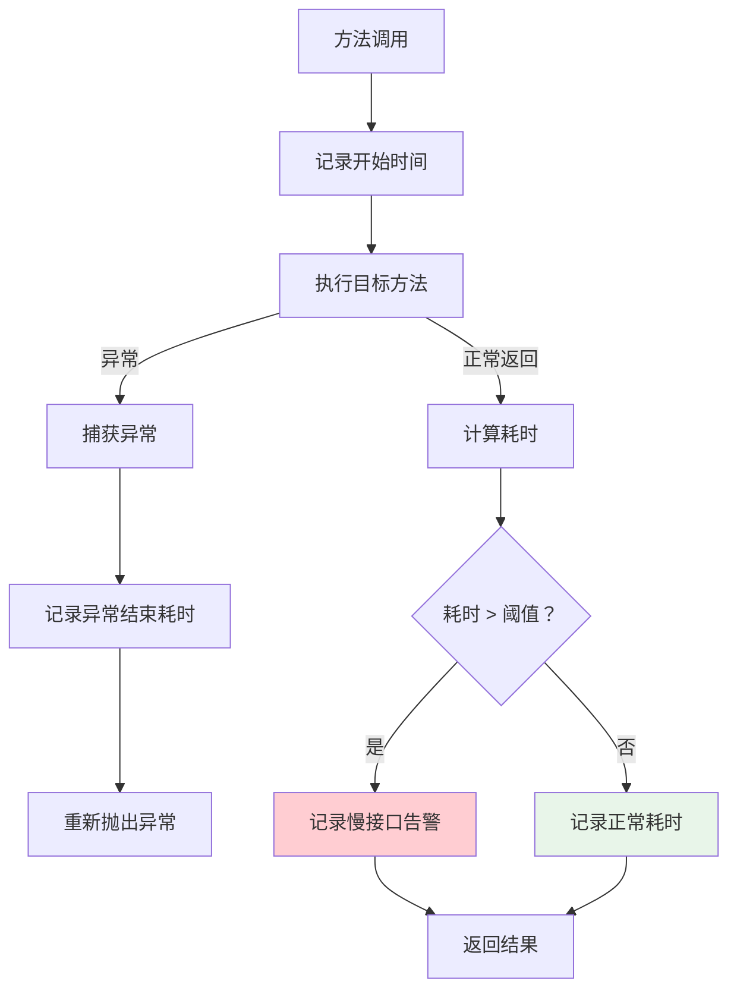
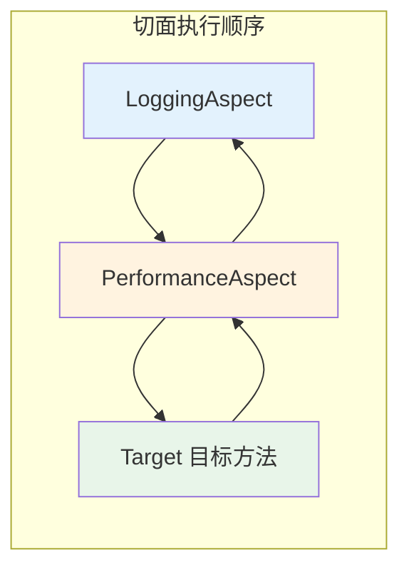

# Spring AOP实战：性能监控与异常处理

## 课程目标

- 掌握 @Around 环绕通知的用法和特点
- 理解环绕通知与其他通知类型的区别和协作
- 实现接口性能监控，自动记录慢接口告警
- 实现统一的异常处理切面，规范错误响应格式
- 掌握多个切面的执行顺序控制方法


## 导入：从日志到监控

上一节课我们实现了日志切面，可以记录每个接口的请求参数和响应结果。但在实际生产环境中，我们还需要关注另一个关键问题：**系统的性能表现**。

- 哪些接口响应最慢？
- 接口响应时间是否超过阈值？
- 异常是否得到统一处理？

本节课将通过 @Around 环绕通知实现性能监控，并通过 AOP 实现统一的异常处理，让图书管理系统具备生产级的可观测性。


## @Around 环绕通知

### 什么是环绕通知

**@Around** 是最强大的通知类型，它可以在目标方法执行**前后**都插入增强逻辑。与 @Before、@After 等通知不同，环绕通知可以：

- 控制目标方法是否执行
- 控制目标方法的参数
- 修改目标方法的返回值
- 替换目标方法的异常处理

### 基本语法

```java
@Around("切点表达式")
public Object aroundMethod(ProceedingJoinPoint joinPoint) throws Throwable {
    // 前置逻辑
    Object result = joinPoint.proceed();  // 执行目标方法
    // 后置逻辑
    return result;
}
```

> [!CAUTION]
> 环绕通知**必须调用 `joinPoint.proceed()`**，否则目标方法不会执行。调用时需处理 `Throwable` 异常。


### JoinPoint vs ProceedingJoinPoint

| 类型                  | 适用通知                                         | 核心方法                                     |
| --------------------- | ------------------------------------------------ | -------------------------------------------- |
| `JoinPoint`           | @Before、@After、@AfterReturning、@AfterThrowing | `getSignature()`、`getArgs()`、`getTarget()` |
| `ProceedingJoinPoint` | @Around 专用（继承 JoinPoint）                   | `proceed()`（执行目标方法）                  |

ProceedingJoinPoint示例：

```java
@Around("controllerMethod()")
public Object around(ProceedingJoinPoint joinPoint) throws Throwable {
    // 获取方法信息（继承自 JoinPoint）
    String methodName = joinPoint.getSignature().getName();
    Object[] args = joinPoint.getArgs();

    // 执行目标方法
    Object result = joinPoint.proceed();

    return result;
}
```


## 性能监控切面

### 创建性能监控切面

在 `com.example.bookmanager.aspect` 包下创建 `PerformanceAspect.java`：

```java
package com.example.bookmanager.aspect;

@Aspect
@Component
public class PerformanceAspect {

    private static final Logger logger = LoggerFactory.getLogger(PerformanceAspect.class);

    // 慢接口阈值：1000ms
    private static final long SLOW_THRESHOLD = 1000;

    @Pointcut("execution(* com.example.bookmanager.controller..*.*(..))")
    public void controllerMethod() {}

    @Pointcut("execution(* com.example.bookmanager.service..*.*(..))")
    public void serviceMethod() {}

    @Around("controllerMethod() || serviceMethod()")
    public Object measurePerformance(ProceedingJoinPoint joinPoint) throws Throwable {
        // 1. 获取方法信息
        MethodSignature signature = (MethodSignature) joinPoint.getSignature();
        String className = joinPoint.getTarget().getClass().getSimpleName();
        String methodName = signature.getName();

        // 2. 记录开始时间
        long startTime = System.currentTimeMillis();

        // 3. 执行目标方法
        Object result;
        try {
            result = joinPoint.proceed();
        } catch (Throwable throwable) {
            // 记录执行时间（即使发生异常）
            long duration = System.currentTimeMillis() - startTime;
            logger.warn("⏱️ [异常结束] {}.{}() 耗时: {}ms", className, methodName, duration);
            throw throwable;
        }

        // 4. 计算耗时
        long duration = System.currentTimeMillis() - startTime;

        // 5. 判断是否慢接口
        if (duration > SLOW_THRESHOLD) {
            logger.warn("🐢 [慢接口] {}.{}() 耗时: {}ms (超过阈值 {}ms)", 
                className, methodName, duration, SLOW_THRESHOLD);
        } else {
            logger.debug("⚡ [正常] {}.{}() 耗时: {}ms", className, methodName, duration);
        }

        return result;
    }
}
```


### 性能监控切面的执行流程



> [!NOTE]
> 性能监控切面覆盖了 Controller 层和 Service 层，可以追踪完整的调用链路耗时。这有助于快速定位性能瓶颈。


## 统一异常处理切面

在 `com.example.bookmanager.aspect` 包下创建 `ExceptionAspect.java`：

```java
package com.example.bookmanager.aspect;

@Aspect
@Component
public class ExceptionAspect {

    private static final Logger logger = LoggerFactory.getLogger(ExceptionAspect.class);

    @Pointcut("execution(* com.example.bookmanager.controller..*.*(..))")
    public void controllerMethod() {}

    @AfterThrowing(pointcut = "controllerMethod()", throwing = "exception")
    public void handleException(Exception exception) {
        // 记录异常日志
        logger.error("统一异常处理: {}", exception.getMessage(), exception);
        // 本切面仅用于异常日志记录，业务异常的返回值由 @ControllerAdvice 统一处理
    }
}
```

> [!NOTE]
>
> `handleException`方法不能直接修改返回值，实际返回值的统一处理需要配合 `@ControllerAdvice`。`@ControllerAdvice` 统一处理机制将在介绍Spring MVC时做全面展开。


## 多切面协作与执行顺序

### 多个切面的执行顺序

当多个切面都作用于同一个目标方法时，需要明确它们的执行顺序。



### 使用 @Order 控制顺序

```java
import org.springframework.core.annotation.Order;

@Aspect
@Component
@Order(1)  // 数字越小越先执行（前置通知）或越后执行（后置通知）
public class LoggingAspect {
    // ...
}

@Aspect
@Component
@Order(2)
public class PerformanceAspect {
    // ...
}
```

### 执行顺序规则

| 通知类型                                            | 执行顺序            |
| --------------------------------------------------- | ------------------- |
| 前置通知（@Before）                                 | Order 小 → Order 大 |
| 目标方法                                            | —                   |
| 后置通知（@After、@AfterReturning、@AfterThrowing） | Order 大 → Order 小 |

> [!NOTE]
> 完整的日志链路帮助开发者在出现问题时快速定位是哪个环节出了问题：参数是否正确、业务逻辑是否执行、性能是否达标。


## 注意事项

### @Around 必须调用 proceed()

```java
// ❌ 错误：忘记调用 proceed()，目标方法不会执行
@Around("controllerMethod()")
public Object around(ProceedingJoinPoint joinPoint) {
    System.out.println("开始");
    return null;
}

// ✅ 正确
@Around("controllerMethod()")
public Object around(ProceedingJoinPoint joinPoint) throws Throwable {
    System.out.println("开始");
    Object result = joinPoint.proceed();
    System.out.println("结束");
    return result;
}
```

### 异常处理顺序

```java
@Around("controllerMethod()")
public Object around(ProceedingJoinPoint joinPoint) {
    try {
        return joinPoint.proceed();
    } catch (Throwable e) {
        // 此处捕获异常后，@AfterThrowing 仍然会执行
        throw e;  // 建议重新抛出，让上层统一处理
    }
}
```

### 性能开销

性能监控切面本身会有一定的性能开销（记录时间、日志输出等）。对于超高并发场景，建议：

- 使用异步日志记录
- 采样统计（不是每个请求都记录）
- 使用专门的监控工具（如 Prometheus + Grafana）

### 切面粒度控制

不建议在 `getter`/`setter` 等高频调用的方法上使用 AOP，会显著增加性能开销。


## 小结

本节课我们学习了：

1. **@Around 环绕通知**：最强大的通知类型，可以控制目标方法的执行、参数、返回值和异常。
2. **性能监控切面**：
   - 使用 `System.currentTimeMillis()` 记录耗时
   - 配置慢接口阈值，自动告警
   - 覆盖 Controller 和 Service 层
3. **统一异常处理**：
   - 业务异常类设计
   - AOP 的 @AfterThrowing 用于异常日志记录
4. **多切面协作**：使用 `@Order` 控制执行顺序。
5. **实战应用**：在图书管理系统中集成性能监控和异常处理。


## 作业

### 作业一：代码阅读——环绕通知分析

阅读以下代码，回答问题。

```java
@Aspect
@Component
public class CacheAspect {
    private final Map<String, Object> cache = new ConcurrentHashMap<>();

    @Around("execution(* com.example.demo.UserService.getUserById(..))")
    public Object cacheAround(ProceedingJoinPoint joinPoint) throws Throwable {
        Object[] args = joinPoint.getArgs();
        String key = "user:" + args[0];

        if (cache.containsKey(key)) {
            System.out.println("从缓存获取: " + key);
            return cache.get(key);
        }

        Object result = joinPoint.proceed();
        cache.put(key, result);
        System.out.println("缓存结果: " + key);
        return result;
    }
}
```

**问题：**

1. 当 `getUserById(1L)` 第一次被调用时，`cacheAround` 方法执行哪些步骤？
2. 当 `getUserById(1L)` 第二次被调用时，`cacheAround` 方法还会执行 `joinPoint.proceed()` 吗？为什么？
3. 如果 `getUserById` 方法抛出异常，`cacheAround` 会怎么处理？

------

### 作业二：代码阅读——多切面执行顺序

```java
@Aspect
@Component
@Order(1)
public class AspectA {
    @Before("execution(* com.example.demo.TestService.run())")
    public void beforeA() { System.out.println("A: @Before"); }

    @After("execution(* com.example.demo.TestService.run())")
    public void afterA() { System.out.println("A: @After"); }
}

@Aspect
@Component
@Order(2)
public class AspectB {
    @Around("execution(* com.example.demo.TestService.run())")
    public Object aroundB(ProceedingJoinPoint joinPoint) throws Throwable {
        System.out.println("B: @Around 开始");
        Object result = joinPoint.proceed();
        System.out.println("B: @Around 结束");
        return result;
    }
}
```

**问题：**

1. 执行 `TestService.run()` 时，控制台的输出顺序是什么？
2. 如果调换 `@Order` 的值（A 为 2，B 为 1），输出顺序会怎样？
3. `@Around` 的 `proceed()` 执行时，其他切面的通知会在什么时机执行？

------

### 作业三：为图书管理系统添加性能监控切面

基于图书管理系统项目，完成以下任务：

1. 创建 `PerformanceAspect` 类，定义切点匹配 Controller 层和 Service 层。
2. 使用 `@Around` 环绕通知，记录每个方法的执行耗时。
3. 定义慢接口阈值（例如 500ms），超过阈值打印 WARN 级别日志。
4. 在 Controller 中模拟一个慢接口（使用 `Thread.sleep(1500)`），验证告警是否触发。
5. 在 `application.yml` 中配置日志级别，使 `@Around` 中的调试日志可见。
