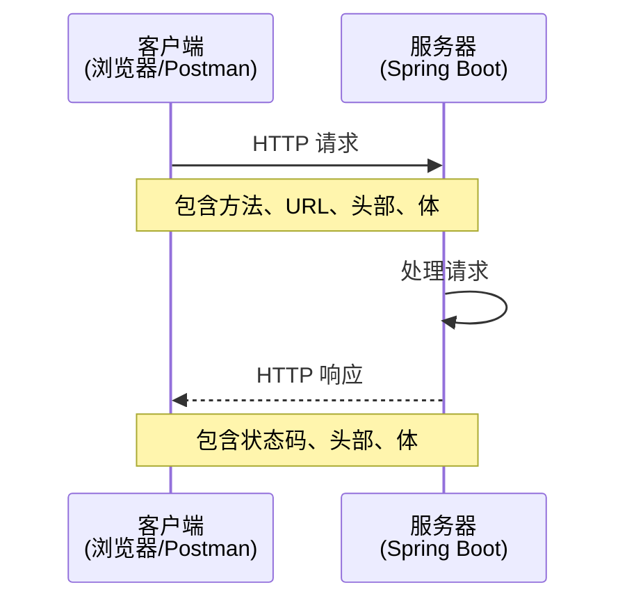
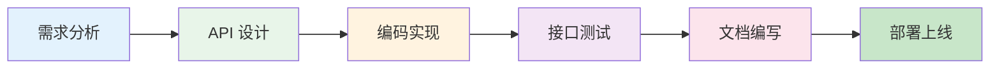

# HTTP 协议与 Web 服务开发流程

## 课程目标

- 理解 HTTP 协议的基本结构（请求/响应）
- 掌握常见的 HTTP 方法（GET、POST、PUT、DELETE 等）和状态码
- 理解 HTTP 请求头、请求体、响应头的含义
- 掌握使用 Postman 调试 HTTP 接口的常用方法
- 理解 Web 服务开发流程


## HTTP 协议概述

### 什么是 HTTP

**HTTP（HyperText Transfer Protocol，超文本传输协议）** 是 Web 应用的核心通信协议，用于客户端和服务器之间的数据交换。它基于请求-响应模型：客户端发送请求，服务器返回响应。



### HTTP 请求结构

一个典型的 HTTP 请求由三部分组成：

| 部分                 | 说明                            | 示例                             |
| -------------------- | ------------------------------- | -------------------------------- |
| **请求行**           | 方法 + URL + 协议版本           | `GET /api/books/1 HTTP/1.1`      |
| **请求头（Header）** | 键值对，描述请求元信息          | `Content-Type: application/json` |
| **请求体（Body）**   | 可选，传输数据（POST/PUT 常用） | `{"title":"Spring Boot"}`        |

```http
POST /api/books HTTP/1.1
Host: localhost:8080
Content-Type: application/json
User-Agent: PostmanRuntime/7.26.8

{
    "title": "Spring Boot 实战",
    "author": "Craig Walls",
    "price": 79.0
}
```


### HTTP 响应结构

响应也由三部分组成：

| 部分       | 说明                         | 示例                                  |
| ---------- | ---------------------------- | ------------------------------------- |
| **状态行** | 协议版本 + 状态码 + 状态描述 | `HTTP/1.1 200 OK`                     |
| **响应头** | 键值对，描述响应元信息       | `Content-Type: application/json`      |
| **响应体** | 可选，返回的数据             | `{"id":1,"title":"Spring Boot 实战"}` |

```http
HTTP/1.1 201 Created
Content-Type: application/json
Content-Length: 56

{
    "id": 1,
    "title": "Spring Boot 实战",
    "author": "Craig Walls",
    "price": 79.0
}
```


## HTTP 方法

HTTP 定义了多种请求方法，表示对资源的操作意图。Web API 开发中最常用的是以下四种：

| 方法       | 含义         | 幂等性 | 安全 | 示例                     |
| ---------- | ------------ | ------ | ---- | ------------------------ |
| **GET**    | 获取资源     | ✅ 是   | ✅ 是 | 查询图书列表             |
| **POST**   | 创建资源     | ❌ 否   | ❌ 否 | 新增图书                 |
| **PUT**    | 完整更新资源 | ✅ 是   | ❌ 否 | 替换整个图书信息         |
| **DELETE** | 删除资源     | ✅ 是   | ❌ 否 | 删除图书                 |
| **PATCH**  | 部分更新资源 | ❌ 否   | ❌ 否 | 更新图书价格（部分字段） |

### 方法详解

**GET**

- 用于获取资源，不应有副作用（安全）
- 参数通过 URL 传递（查询字符串）
- 可缓存，可收藏

**POST**

- 用于创建新资源
- 数据在请求体中传递
- 非幂等：多次调用会创建多个资源

**PUT**

- 用于完整替换资源
- 请求体包含完整的资源表示
- 幂等：多次调用效果相同

**DELETE**

- 用于删除资源
- 幂等：删除已不存在的资源，状态仍为成功

> [!NOTE]
> **幂等性**：无论执行多少次，结果相同。**安全性**：不修改服务器状态。GET 是安全的，POST 既非安全也非幂等。


## HTTP 状态码

状态码由三位数字组成，表示请求的处理结果。开发中常见的状态码如下：

| 分类 | 范围    | 含义       |
| ---- | ------- | ---------- |
| 1xx  | 100-199 | 信息性响应 |
| 2xx  | 200-299 | 成功       |
| 3xx  | 300-399 | 重定向     |
| 4xx  | 400-499 | 客户端错误 |
| 5xx  | 500-599 | 服务器错误 |

### 常用状态码

| 状态码                        | 含义               | 使用场景                    |
| ----------------------------- | ------------------ | --------------------------- |
| **200 OK**                    | 请求成功           | GET、PUT、DELETE 成功时返回 |
| **201 Created**               | 资源已创建         | POST 创建成功后返回         |
| **204 No Content**            | 请求成功，无返回体 | 删除成功时常用              |
| **400 Bad Request**           | 请求参数有误       | 参数校验失败                |
| **401 Unauthorized**          | 未认证             | 未登录或 token 无效         |
| **403 Forbidden**             | 无权限             | 已登录但无操作权限          |
| **404 Not Found**             | 资源不存在         | 请求的资源找不到            |
| **500 Internal Server Error** | 服务器内部错误     | 未捕获的异常                |


## HTTP 请求头与响应头

### 常用请求头

| 请求头          | 说明                 | 示例                    |
| --------------- | -------------------- | ----------------------- |
| `Content-Type`  | 请求体的媒体类型     | `application/json`      |
| `Accept`        | 客户端期望的响应类型 | `application/json`      |
| `Authorization` | 认证凭证             | `Bearer eyJhbGciOi...`  |
| `User-Agent`    | 客户端信息           | `PostmanRuntime/7.26.8` |
| `Host`          | 目标主机             | `localhost:8080`        |

### 常用响应头

| 响应头           | 说明             | 示例               |
| ---------------- | ---------------- | ------------------ |
| `Content-Type`   | 响应体的媒体类型 | `application/json` |
| `Content-Length` | 响应体长度       | `56`               |
| `Cache-Control`  | 缓存控制         | `no-cache`         |
| `Location`       | 新资源的 URL     | `/api/books/1`     |


## Web 服务开发流程

一个完整的 Web 服务从需求到上线通常包含以下步骤：



**1. 需求分析**

- 确定业务功能（图书管理需要哪些操作）
- 明确数据模型（图书包含哪些字段）
- 确定非功能需求（性能、安全等）

**2. API 设计**

- 设计资源路径（RESTful 风格）
- 确定请求方法（GET、POST 等）
- 定义请求参数和响应格式

**3. 编码实现**

- 创建 Controller、Service、Repository
- 实现业务逻辑
- 处理异常

**4. 接口测试**

- 使用 Postman 调试单个接口
- 编写单元测试和集成测试
- 验证接口正确性和健壮性

**5. 文档编写**

- 使用 Swagger/OpenAPI 自动生成文档
- 编写 API 使用说明

**6. 部署上线**

- 打包成 JAR/WAR
- 部署到服务器
- 监控运行状态


## 使用 Postman 调试接口

### 测试图书接口

**GET 请求（查询所有图书）**

- Method: `GET`
- URL: `http://localhost:8080/api/books`
- Headers: 无
- Body: 无

**POST 请求（新增图书）**

- Method: `POST`
- URL: `http://localhost:8080/api/books`
- Headers: `Content-Type: application/json`
- Body (JSON):

```json
{
    "title": "Spring Boot 实战",
    "author": "Craig Walls",
    "price": 79.0,
    "stock": 10
}
```

**GET 请求（查询单本图书）**

- Method: `GET`
- URL: `http://localhost:8080/api/books/1`

**PUT 请求（更新图书）**

- Method: `PUT`
- URL: `http://localhost:8080/api/books/1`
- Headers: `Content-Type: application/json`
- Body (JSON):

```json
{
    "title": "Spring Boot 实战 第2版",
    "author": "Craig Walls",
    "price": 99.0,
    "stock": 5
}
```

**DELETE 请求（删除图书）**

- Method: `DELETE`
- URL: `http://localhost:8080/api/books/1`

### 环境变量与集合

- **环境变量**：可以定义开发、测试、生产环境，一键切换
- **集合**：将一组相关的请求保存在一起，便于管理

> [!NOTE]
> Postman 的 **Collections** 功能可以保存请求历史，方便重复测试。**Environments** 可以定义变量（如 `{{base_url}}`），切换环境时自动替换。


## 实战：使用 Postman 测试图书管理系统

### 前置条件

- 图书管理系统已在本地启动（端口 8080）
- 安装了 Postman

### 操作步骤

1. **创建 Collection**，命名为 `图书管理系统`
2. **添加请求**：
   - `GET /api/books`（查询所有图书）
   - `POST /api/books`（新增图书）
   - `GET /api/books/{id}`（查询单本）
   - `PUT /api/books/{id}`（更新图书）
   - `DELETE /api/books/{id}`（删除图书）
3. **设置环境变量**，创建 `dev` 环境，添加 `base_url = http://localhost:8080`
4. **测试流程**：
   - 先执行 POST 创建一本书，记录返回的 ID
   - 使用 GET 查询所有，验证新书已存在
   - 使用 GET 查询单本，验证详情正确
   - 使用 PUT 更新该书
   - 使用 DELETE 删除该书
   - 再次查询所有，验证已删除

### 观察响应

每次请求后，注意观察：

- **状态码**：是否符合预期（200、201、404 等）
- **响应体**：数据结构是否正确
- **响应时间**：性能是否符合要求


## 小结

本节课我们学习了：

1. **HTTP 协议基础**：
   - 请求结构（请求行、请求头、请求体）
   - 响应结构（状态行、响应头、响应体）
2. **HTTP 方法**：GET、POST、PUT、DELETE，理解幂等性和安全性。
3. **HTTP 状态码**：2xx 成功、4xx 客户端错误、5xx 服务器错误。
4. **Web 服务开发流程**：需求分析 → API 设计 → 编码 → 测试 → 文档 → 部署。
5. **Postman 使用**：发送请求、查看响应、管理集合和环境变量。


## 作业

### 作业一：代码阅读——HTTP 请求解析

阅读以下 HTTP 请求报文，回答问题。

```http
POST /api/books HTTP/1.1
Host: localhost:8080
Content-Type: application/json
Authorization: Bearer abc123

{
    "title": "Java 核心技术",
    "price": 89.0
}
```

**问题：**

1. 请求使用的是什么方法？目标是什么资源？
2. 请求头中包含了哪些信息？
3. 请求体是什么格式？包含哪些字段？
4. 如果服务器返回 201 Created，代表什么含义？

------

### 作业二：代码阅读——HTTP 状态码分析

阅读以下场景，判断应该返回哪个 HTTP 状态码。

1. 客户端查询一个不存在的图书 ID（如 `/api/books/999`）
2. 客户端成功创建了一本新图书
3. 客户端发送的请求体缺少必填字段（如 `title` 为空）
4. 服务器内部发生了未捕获的异常
5. 客户端请求获取所有图书，操作成功
6. 客户端尝试删除一个不存在的图书

------

### 作业三：使用 Postman 测试图书接口

启动图书管理系统，按照以下步骤操作：

1. 创建 Postman Collection `图书管理系统`。
2. 添加所有 CRUD 接口（GET、POST、PUT、DELETE）。
3. 使用环境变量 `{{base_url}}` 替代硬编码的 localhost:8080。
4. 完整测试流程：新增 → 查询 → 更新 → 删除，记录每个接口的请求和响应。
5. 截图保存每个步骤的请求和响应内容。
