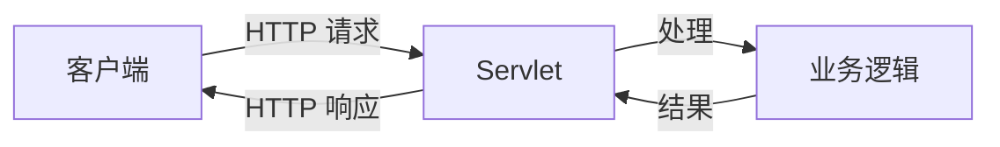
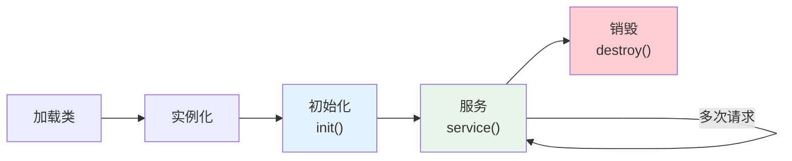
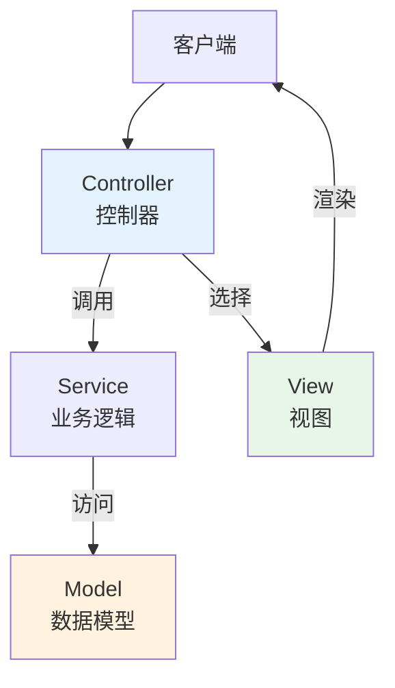
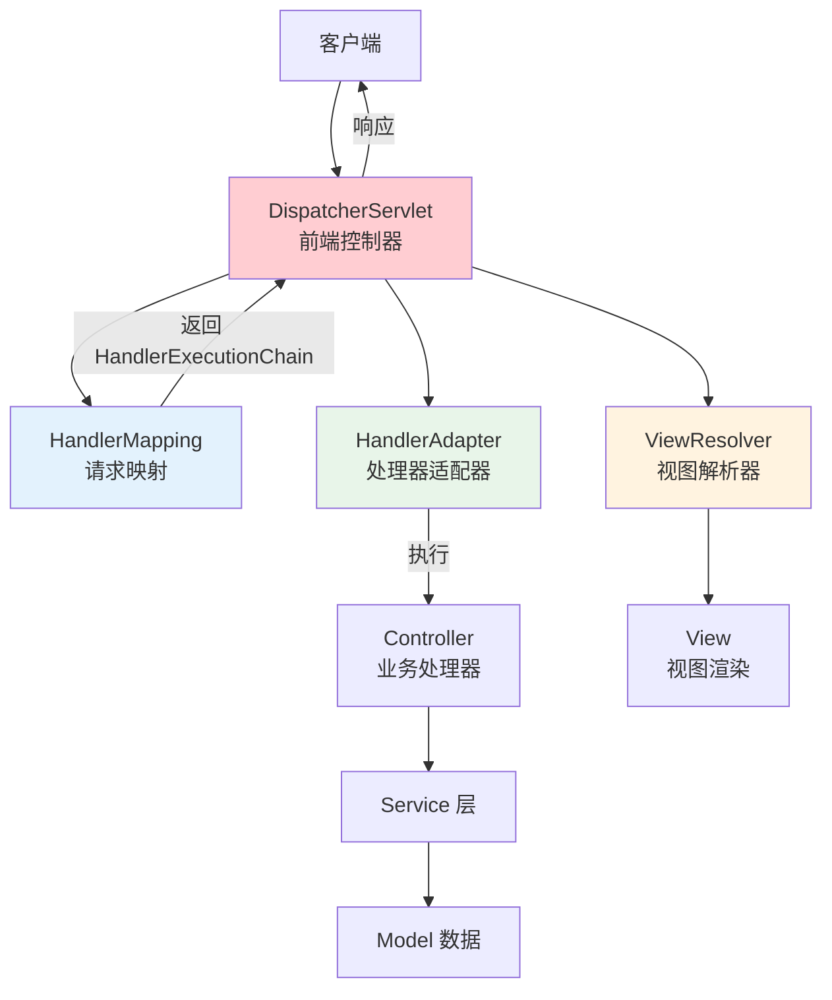
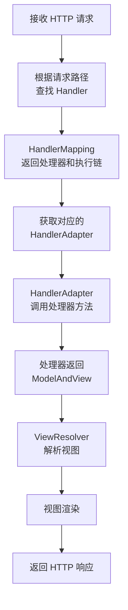
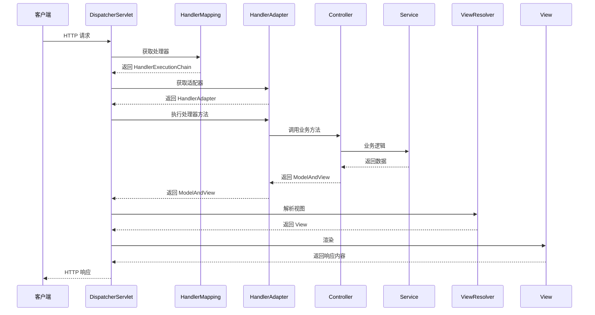

# Servlet 与 Spring WebMVC 架构解析

## 课程目标

- 理解 Servlet 规范的核心概念和生命周期
- 了解 Servlet 容器的作用和请求处理流程
- 掌握 Spring WebMVC 的整体架构和核心组件
- 理解 DispatcherServlet 的工作流程
- 能够区分 Spring WebMVC 各组件（HandlerMapping、HandlerAdapter、ViewResolver）的职责


## Servlet 概述

### 什么是 Servlet

**Servlet** 是 Java EE 规范中定义的一种服务器端程序，用于处理 HTTP 请求并生成动态响应。它是 Java Web 应用的基础技术，所有 Java Web 框架（包括 Spring WebMVC）底层都基于 Servlet 构建。

**Servlet 的核心职责：**

- 接收来自客户端的 HTTP 请求
- 解析请求参数和数据
- 执行业务逻辑
- 生成并返回 HTTP 响应



### Servlet 与 Servlet 容器

**Servlet 容器**（也称为 Web 容器）是运行 Servlet 的环境，负责管理 Servlet 的生命周期、请求分发、线程管理等。

| Servlet 容器 | 说明                                |
| ------------ | ----------------------------------- |
| **Tomcat**   | 最常用的 Servlet 容器，开源、轻量级 |
| **Jetty**    | Eclipse 基金会下的轻量级容器        |
| **Undertow** | Red Hat 开发的高性能容器            |

> [!NOTE]
> Spring Boot 默认使用 **Tomcat** 作为内嵌 Servlet 容器。引入 `spring-boot-starter-web` 时，Tomcat 会自动嵌入，无需额外部署。


### Servlet 生命周期

Servlet 容器管理 Servlet 的整个生命周期，包含以下阶段：



| 阶段             | 方法        | 说明                         |
| ---------------- | ----------- | ---------------------------- |
| **加载与实例化** | 构造方法    | 容器创建 Servlet 实例        |
| **初始化**       | `init()`    | 仅执行一次，用于加载资源     |
| **服务**         | `service()` | 每次请求调用，处理 HTTP 请求 |
| **销毁**         | `destroy()` | 容器关闭时调用，释放资源     |


## 传统 Servlet 示例（对比 Spring WebMVC）

在 Spring WebMVC 出现之前，开发 Web 应用需要编写 Servlet 类并在 `web.xml` 中配置映射。

### 编写 Servlet

```java
import javax.servlet.ServletException;
import javax.servlet.http.HttpServlet;
import javax.servlet.http.HttpServletRequest;
import javax.servlet.http.HttpServletResponse;
import java.io.IOException;
import java.io.PrintWriter;

public class HelloServlet extends HttpServlet {

    @Override
    public void init() throws ServletException {
        System.out.println("Servlet 初始化");
    }

    @Override
    protected void doGet(HttpServletRequest req, HttpServletResponse resp)
            throws ServletException, IOException {
        resp.setContentType("text/html");
        PrintWriter out = resp.getWriter();
        out.println("<html><body>");
        out.println("<h1>Hello, Servlet!</h1>");
        out.println("</body></html>");
    }

    @Override
    public void destroy() {
        System.out.println("Servlet 销毁");
    }
}
```

### web.xml 配置

```xml
<web-app>
    <servlet>
        <servlet-name>hello</servlet-name>
        <servlet-class>com.example.HelloServlet</servlet-class>
    </servlet>
    <servlet-mapping>
        <servlet-name>hello</servlet-name>
        <url-pattern>/hello</url-pattern>
    </servlet-mapping>
</web-app>
```

> [!NOTE]
> 传统方式存在以下问题：每个请求都需要单独编写 Servlet 类，配置繁琐，代码重复度高。Spring WebMVC 在此基础上提供了更高层次的抽象，通过 `DispatcherServlet` 统一处理请求，开发者只需编写 `@Controller` 方法。


## Spring WebMVC 架构

### 什么是 Spring WebMVC

**Spring WebMVC** 是 Spring 框架提供的 Web 层解决方案，基于 MVC（Model-View-Controller）设计模式，通过 `DispatcherServlet` 作为前端控制器统一处理请求，将请求分发给具体的处理器（Controller 方法）。

### MVC 设计模式



| 组件           | 职责                                     |
| -------------- | ---------------------------------------- |
| **Model**      | 数据模型，封装业务数据和状态             |
| **View**       | 视图，负责数据展示（如 JSP、JSON）       |
| **Controller** | 控制器，接收请求、调用业务逻辑、选择视图 |

### Spring WebMVC 整体架构




## DispatcherServlet 详解

### DispatcherServlet 是什么

**DispatcherServlet** 是 Spring WebMVC 的核心，它是整个 Web 层请求处理的中枢。它本质上也是一个 Servlet，拦截所有请求并进行统一分发处理。

### 核心工作流程



### DispatcherServlet 源码分析（核心方法 `doDispatch`）

Spring WebMVC 的核心逻辑在 `DispatcherServlet.doDispatch()` 方法中。以下为简化版流程：

```java
protected void doDispatch(HttpServletRequest request, HttpServletResponse response)
        throws Exception {
    // 1. 获取请求的处理器（Handler）
    HandlerExecutionChain mappedHandler = getHandler(request);
    if (mappedHandler == null) {
        // 没有找到处理器，返回 404
        response.sendError(HttpServletResponse.SC_NOT_FOUND);
        return;
    }

    // 2. 获取处理器适配器
    HandlerAdapter ha = getHandlerAdapter(mappedHandler.getHandler());

    // 3. 执行拦截器的前置方法
    if (!mappedHandler.applyPreHandle(request, response)) {
        return;
    }

    // 4. 执行处理器方法并获取 ModelAndView
    ModelAndView mv = ha.handle(request, response, mappedHandler.getHandler());

    // 5. 执行拦截器的后置方法
    mappedHandler.applyPostHandle(request, response, mv);

    // 6. 处理视图渲染
    processDispatchResult(request, response, mappedHandler, mv, dispatchException);
}
```

### DispatcherServlet 的配置

**方式一：web.xml（传统 Servlet 时代）**

```xml
<servlet>
    <servlet-name>dispatcher</servlet-name>
    <servlet-class>org.springframework.web.servlet.DispatcherServlet</servlet-class>
    <init-param>
        <param-name>contextConfigLocation</param-name>
        <param-value>/WEB-INF/spring-mvc.xml</param-value>
    </init-param>
    <load-on-startup>1</load-on-startup>
</servlet>
<servlet-mapping>
    <servlet-name>dispatcher</servlet-name>
    <url-pattern>/</url-pattern>
</servlet-mapping>
```

**方式二：Spring Boot 自动配置（推荐）**

在 Spring Boot 中，DispatcherServlet 由 `DispatcherServletAutoConfiguration` 自动配置，无需手动配置。只需在 `application.yml` 中调整参数：

```yaml
spring:
  mvc:
    servlet:
      load-on-startup: 1          # 启动时加载
    throw-exception-if-no-handler-found: true  # 无处理器时抛出异常
  web:
    resources:
      add-mappings: true          # 启用静态资源映射
```


## Spring WebMVC 核心组件

### HandlerMapping（请求映射）

**职责：** 根据请求 URL 找到对应的处理器（Controller 方法）。

**常用实现类：**

- `RequestMappingHandlerMapping`：处理 `@RequestMapping` 注解（Spring 3.1+ 默认）
- `SimpleUrlHandlerMapping`：通过配置文件映射 URL 到 Bean

**示例（注解方式）：**

```java
@RestController
@RequestMapping("/api/books")
public class BookController {
    @GetMapping("/{id}")
    public Book getBook(@PathVariable Long id) { ... }
}
```

`RequestMappingHandlerMapping` 会解析 `@GetMapping("/{id}")` 和 `@PathVariable`，建立 `/api/books/{id}` 到 `getBook` 方法的映射。

### HandlerAdapter（处理器适配器）

**职责：** 适配不同类型的处理器，统一调用方式，返回 `ModelAndView`。

**常用实现类：**

- `RequestMappingHandlerAdapter`：处理 `@RequestMapping` 方法
- `HttpRequestHandlerAdapter`：处理 `HttpRequestHandler` 接口
- `SimpleControllerHandlerAdapter`：处理 `Controller` 接口

**HandlerAdapter 的核心作用：**

- 参数绑定（`@RequestParam`、`@PathVariable`、`@RequestBody` 等）
- 返回值处理（ModelAndView、JSON 等）
- 异常处理

### ViewResolver（视图解析器）

**职责：** 将逻辑视图名解析为具体的视图对象（JSP、JSON 等）。

**常用实现类：**

| ViewResolver                   | 说明               |
| ------------------------------ | ------------------ |
| `InternalResourceViewResolver` | 解析 JSP 视图      |
| `JsonViewResolver`             | 解析 JSON 视图     |
| `BeanNameViewResolver`         | 根据 Bean 名称解析 |

> [!NOTE]
> 在 REST API 开发中，通常使用 `@ResponseBody` 或 `@RestController`，直接返回 JSON，不经过 ViewResolver。


## 请求处理完整流程（时序图）




## Spring WebMVC vs 传统 Servlet

| 对比维度     | 传统 Servlet              | Spring WebMVC                           |
| ------------ | ------------------------- | --------------------------------------- |
| **开发方式** | 每个请求一个 Servlet 类   | 一个 Controller 多个方法                |
| **配置**     | web.xml 配置映射          | 注解驱动（@RequestMapping）             |
| **参数绑定** | 手动从 request 获取并转换 | 自动绑定（@RequestParam、@RequestBody） |
| **返回值**   | 手动输出到 response       | 自动转换为 JSON/XML                     |
| **异常处理** | 手动在 Servlet 中处理     | 统一异常处理（@ControllerAdvice）       |
| **拦截**     | Filter                    | HandlerInterceptor                      |


## 小结

本节课我们学习了：

1. **Servlet 规范**：Java Web 应用的基础，Servlet 容器管理生命周期（init → service → destroy）。
2. **传统 Servlet**：手动配置和编写，代码重复度高。
3. **Spring WebMVC 架构**：基于 MVC 设计模式，DispatcherServlet 作为前端控制器。
4. **核心组件**：
   - HandlerMapping：请求映射
   - HandlerAdapter：适配处理器
   - ViewResolver：视图解析
   - HandlerInterceptor：拦截器
5. **请求处理流程**：DispatcherServlet → HandlerMapping → HandlerAdapter → Controller → ViewResolver → View → 响应。


## 作业

### 作业一：代码阅读——Servlet 生命周期

阅读以下代码，回答问题。

```java
public class LifecycleServlet extends HttpServlet {
    public LifecycleServlet() {
        System.out.println("1. 构造方法");
    }

    @Override
    public void init() throws ServletException {
        System.out.println("2. init()");
    }

    @Override
    protected void service(HttpServletRequest req, HttpServletResponse resp) {
        System.out.println("3. service()");
    }

    @Override
    public void destroy() {
        System.out.println("4. destroy()");
    }
}
```

**问题：**

1. 当客户端第一次访问该 Servlet 时，控制台的输出顺序是什么？
2. 当客户端第二次访问该 Servlet 时，控制台还会输出 `2. init()` 吗？为什么？
3. `service()` 方法在什么时候被调用？

------

### 作业二：代码阅读——DispatcherServlet 流程分析

阅读以下 Spring WebMVC 代码片段，回答问题。

```java
@RestController
@RequestMapping("/api/books")
public class BookController {
    @GetMapping("/{id}")
    public Book getBook(@PathVariable Long id) {
        return new Book(id, "Spring Boot");
    }
}
```

**问题：**

1. 客户端请求 `GET /api/books/1` 时，DispatcherServlet 通过哪个组件找到 `getBook` 方法？
2. `@PathVariable` 的参数绑定由哪个组件完成？
3. 方法返回的 `Book` 对象是如何转换为 JSON 响应的？
