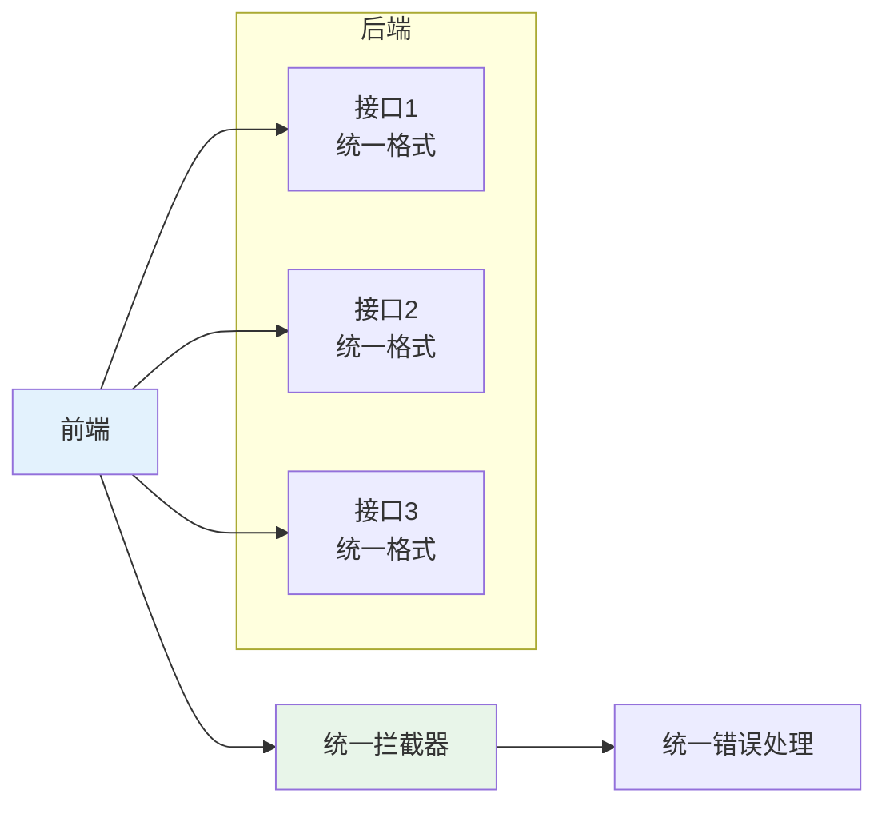
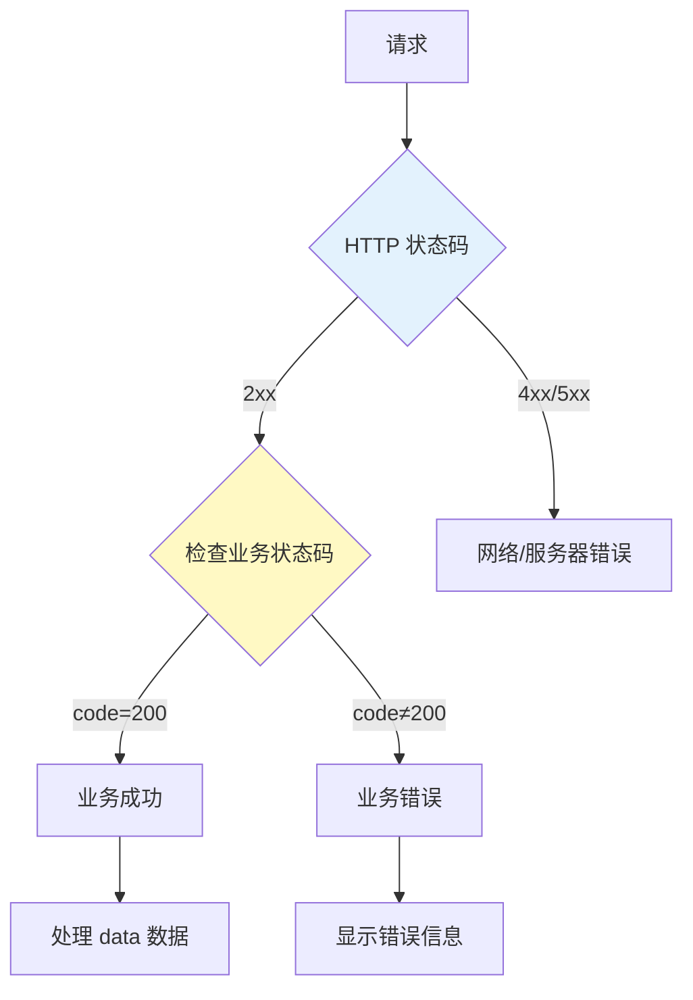
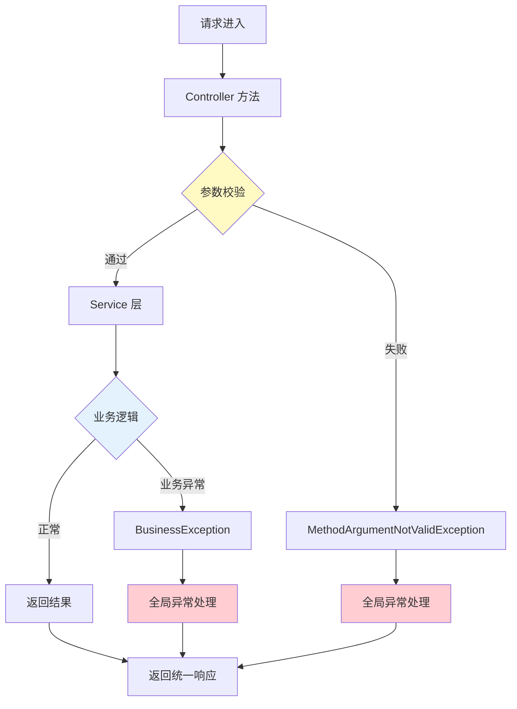

# REST API 开发：响应封装和全局异常处理

## 课程目标

- 理解统一响应封装在前后端协作中的重要性
- 掌握统一响应类 `Result<T>` 的设计与使用
- 掌握业务状态码枚举的设计方法
- 理解 @ControllerAdvice 统一异常处理机制
- 掌握 @ExceptionHandler 处理特定异常
- 能够为图书管理系统实现完整的响应结果和全局异常处理


## 为什么需要统一响应封装

### 现状问题

在之前的课程中，我们的 Controller 直接返回了 `Book` 对象或 `List<Book>`。这种方式的缺点：

| 问题               | 说明                                                         |
| ------------------ | ------------------------------------------------------------ |
| **格式不一致**     | 成功返回对象，失败返回 `Result.error`，前端需要分别处理不同格式 |
| **缺少元信息**     | 无法返回业务状态码、时间戳等辅助信息                         |
| **错误信息不规范** | 错误信息直接暴露给前端，缺乏统一格式                         |
| **前端处理困难**   | 每个接口的响应结构不同，需要为每个接口编写不同的处理逻辑     |

### 统一响应的好处



| 好处             | 说明                                                 |
| ---------------- | ---------------------------------------------------- |
| **一致性**       | 所有接口返回相同结构，前端可以编写统一的数据处理逻辑 |
| **可扩展性**     | 可以在响应中附加额外信息（时间戳、版本号、请求ID）   |
| **错误处理统一** | 前端根据固定的 `code` 字段判断请求是否成功           |
| **便于监控**     | 统一的响应格式便于日志分析和系统监控                 |
| **便于文档生成** | Swagger 可以基于统一响应类生成一致文档               |


## 统一响应类设计

### 基本结构

一个标准的统一响应类通常包含以下字段：

| 字段              | 类型      | 说明                             |
| ----------------- | --------- | -------------------------------- |
| `code`            | `Integer` | 业务状态码（与 HTTP 状态码区分） |
| `message`         | `String`  | 响应描述信息                     |
| `data`            | `T`       | 响应数据（泛型）                 |
| `timestamp`       | `Long`    | 响应时间戳（便于追踪）           |
| `path`（可选）    | `String`  | 请求路径（便于调试）             |
| `success`（可选） | `Boolean` | 是否成功（冗余字段）             |

### 完整实现

在 `com.example.bookmanager.model` 包下创建 `Result.java`：

```java
package com.example.bookmanager.model;

import com.fasterxml.jackson.annotation.JsonInclude;

@JsonInclude(JsonInclude.Include.NON_NULL)
public class Result<T> {
    private Integer code;
    private String message;
    private T data;
    private Long timestamp;
    private String path;

    public Result() {
        this.timestamp = System.currentTimeMillis();
    }

    private Result(Integer code, String message, T data) {
        this.code = code;
        this.message = message;
        this.data = data;
        this.timestamp = System.currentTimeMillis();
    }

    /**
     * 成功响应（带数据）
     */
    public static <T> Result<T> success(T data) {
        return new Result<>(ResultCode.SUCCESS.getCode(), 
                ResultCode.SUCCESS.getMessage(), data);
    }

    /**
     * 成功响应（自定义消息，带数据）
     */
    public static <T> Result<T> success(String message, T data) {
        return new Result<>(ResultCode.SUCCESS.getCode(), message, data);
    }

    /**
     * 成功响应（无数据）
     */
    public static <T> Result<T> success() {
        return new Result<>(ResultCode.SUCCESS.getCode(), 
                ResultCode.SUCCESS.getMessage(), null);
    }

    /**
     * 失败响应（使用预定义状态码）
     */
    public static <T> Result<T> error(ResultCode resultCode) {
        return new Result<>(resultCode.getCode(), 
                resultCode.getMessage(), null);
    }

    /**
     * 失败响应（自定义消息）
     */
    public static <T> Result<T> error(ResultCode resultCode, String message) {
        return new Result<>(resultCode.getCode(), message, null);
    }

    /**
     * 失败响应（使用状态码和消息）
     */
    public static <T> Result<T> error(Integer code, String message) {
        return new Result<>(code, message, null);
    }

    // Getter 和 Setter
}
```

> [!NOTE]
>
> `@JsonInclude(JsonInclude.Include.NON_NULL)` 表示序列化时忽略 `null` 值，避免返回大量空字段。


## 业务状态码设计

### 什么是业务状态码

**业务状态码**是接口返回的用于表示业务处理结果的数字编码，不同于 HTTP 状态码。它让前端能够精确判断业务处理的具体情况，而不仅仅知道请求成功或失败。

### 设计原则

| 原则         | 说明                               |
| ------------ | ---------------------------------- |
| **分层分类** | 按功能模块或错误类型分类，便于扩展 |
| **语义清晰** | 状态码本身能反映错误类型           |
| **规范统一** | 全系统使用同一套状态码规范         |
| **可扩展**   | 预留状态码段供后续业务扩展         |

### 状态码分段设计

| 段         | 范围      | 含义                       |
| ---------- | --------- | -------------------------- |
| 成功       | 200       | 请求成功                   |
| 客户端错误 | 400-499   | 请求参数、格式、权限等问题 |
| 服务器错误 | 500-599   | 服务器内部错误             |
| 业务错误   | 1000-1999 | 业务规则校验失败           |

### 状态码枚举实现

在 `com.example.bookmanager.model` 包下创建 `ResultCode.java`：

```java
package com.example.bookmanager.model;

public enum ResultCode {
    // 成功
    SUCCESS(200, "操作成功"),
    CREATED(201, "创建成功"),
    NO_CONTENT(204, "操作成功，无返回数据"),

    // 客户端错误 400-499
    BAD_REQUEST(400, "请求参数错误"),
    UNAUTHORIZED(401, "未认证或登录已过期"),
    FORBIDDEN(403, "无权限访问"),
    NOT_FOUND(404, "资源不存在"),
    METHOD_NOT_ALLOWED(405, "请求方法不支持"),
    PARAM_ERROR(422, "参数校验失败"),

    // 服务器错误 500-599
    INTERNAL_ERROR(500, "系统内部错误，请稍后重试"),
    SERVICE_UNAVAILABLE(503, "服务暂时不可用"),

    // 业务错误 1000-1999
    BUSINESS_ERROR(1000, "业务处理失败"),
    RESOURCE_NOT_FOUND(1001, "资源不存在"),
    RESOURCE_EXISTS(1002, "资源已存在"),
    INVALID_OPERATION(1003, "操作不允许"),
    STOCK_INSUFFICIENT(1004, "库存不足");

    private final int code;
    private final String message;

    ResultCode(int code, String message) {
        this.code = code;
        this.message = message;
    }

    public int getCode() { return code; }
    public String getMessage() { return message; }
}
```

> [!NOTE]
>
> 业务状态码与 HTTP 状态码虽然数字可能相同（如 404），但含义独立。前端优先检查业务状态码来判断业务结果，HTTP 状态码用于判断请求是否成功到达服务器。
> 

## HTTP 状态码与业务状态码的关系

### 两者的分工

| 角色         | HTTP 状态码                             | 业务状态码       |
| ------------ | --------------------------------------- | ---------------- |
| **负责范围** | HTTP 协议层面的状态                     | 业务层面的状态   |
| **谁设置**   | 服务器（Spring 通过 `@ResponseStatus`） | 应用程序代码设置 |
| **作用对象** | 客户端和中间件                          | 前端业务逻辑     |
| **示例**     | 200、404、500                           | 200、1001、1004  |

### 两者的协作




**最佳实践建议：**

- HTTP 状态码用于判断请求是否**到达并处理**（网络、服务器、权限等）
- 业务状态码用于判断**业务结果**（数据是否正确、业务规则是否满足）
- 前端应**优先检查业务状态码**，因为 HTTP 状态码 200 不代表业务一定成功

### 示例对比

| 场景       | HTTP 状态码 | 业务状态码 | 响应体                                              |
| ---------- | ----------- | ---------- | --------------------------------------------------- |
| 查询成功   | 200         | 200        | `{"code":200,"message":"操作成功","data":{...}}`    |
| 参数错误   | 400         | 400        | `{"code":400,"message":"参数校验失败","data":null}` |
| 资源不存在 | 404         | 1001       | `{"code":1001,"message":"资源不存在","data":null}`  |
| 库存不足   | 200         | 1004       | `{"code":1004,"message":"库存不足","data":null}`    |


## 实战：为图书管理系统统一响应格式

### 改造 Controller

```java
package com.example.bookmanager.controller;

@RestController
@RequestMapping("/api/books")
public class BookController {

    private final BookService bookService;

    public BookController(BookService bookService) {
        this.bookService = bookService;
    }

    @GetMapping
    public Result<List<Book>> getAllBooks() {
        return Result.success(bookService.getAllBooks());
    }

    @GetMapping("/{id}")
    public Result<Book> getBook(@Min(1) @PathVariable Long id) {
        return Result.success(bookService.getBookById(id));
    }

    @GetMapping("/author")
    public Result<List<Book>> getBooksByAuthor(@RequestParam String name) {
        return Result.success(bookService.getBooksByAuthor(name));
    }

    @GetMapping("/price")
    public Result<List<Book>> getBooksByPriceRange(
            @RequestParam @Min(0) Double min,
            @RequestParam @Min(0) Double max) {
        return Result.success(bookService.getBooksByPriceRange(min, max));
    }

    @PostMapping
    @ResponseStatus(HttpStatus.CREATED)
    public Result<Book> createBook(@Valid @RequestBody Book book) {
        Book created = bookService.createBook(book);
        return Result.success(ResultCode.CREATED.getMessage(), created);
    }

    @PutMapping("/{id}")
    public Result<Book> updateBook(
            @PathVariable Long id,
            @Valid @RequestBody Book book) {
        book.setId(id);
        return Result.success(bookService.updateBook(book));
    }

    @DeleteMapping("/{id}")
    @ResponseStatus(HttpStatus.NO_CONTENT)
    public Result<Void> deleteBook(@PathVariable Long id) {
        bookService.deleteBook(id);
        return Result.success(ResultCode.NO_CONTENT.getMessage(), null);
    }
}
```


## 全局异常处理

### @ControllerAdvice 概述

`@ControllerAdvice` 是 Spring 提供的统一异常处理注解，它可以让一个类成为全局的异常处理器，作用于所有 Controller。

| 注解                    | 作用                                                 |
| ----------------------- | ---------------------------------------------------- |
| `@ControllerAdvice`     | 全局异常处理 + 全局数据绑定 + 全局数据预处理         |
| `@RestControllerAdvice` | `@ControllerAdvice` + `@ResponseBody`，用于 REST API |

> [!NOTE]
> 推荐使用 `@RestControllerAdvice`，返回值自动转为 JSON。


### 业务异常类

```java
// 业务异常基类
package com.example.bookmanager.exception;

public class BusinessException extends RuntimeException{

    public BusinessException(String message) {
        super(message);
    }
}


// 资源不存在异常
package com.example.bookmanager.exception;

public class ResourceNotFoundException extends BusinessException {

    public ResourceNotFoundException(String message) {
        super(message);
    }

    public ResourceNotFoundException(String resource, Long id) {
        super(resource + "不存在：id：" + id);
    }
}
```

### 在 Service 层抛出异常

```java
@Service
public class BookServiceImpl implements BookService {

    @Autowired
    private BookRepository bookRepository;

  	@Override
		public Book createBook(Book book) {
        // 业务校验
        if(book.getPrice() == null || book.getPrice() < 0) {
            throw new BusinessException("图书价格不能为空或者为负数");
        }

        if(book.getStock() == null || book.getStock() < 0) {
            throw new BusinessException("图书库存不能为空或者为负数");
        }

        return bookRepository.save(book);
    }
  
    @Override
    public Book getBookById(Long id) {
        Book book = bookRepository.findById(id);
        if (book == null) {
            throw new ResourceNotFoundException("Book", id);
        }
        return book;
    }
}
```

### 创建全局异常处理器

在 `com.example.bookmanager.advice` 包下创建 `GlobalExceptionHandler.java`：

```java
package com.example.bookmanager.advice;

@RestControllerAdvice
public class GlobalExceptionHandler {

    /**
     * 处理参数校验异常（@Valid 校验失败）
     */
    @ExceptionHandler(MethodArgumentNotValidException.class)
    @ResponseStatus(HttpStatus.BAD_REQUEST)
    public Result<?> handleValidation(MethodArgumentNotValidException e) {
        String message = e.getBindingResult().getAllErrors()
                .stream()
                .map(error -> error.getDefaultMessage())
                .collect(Collectors.joining("; "));
        // 使用 PARAM_ERROR (422) 表示参数校验失败
        return Result.error(ResultCode.PARAM_ERROR, message);
    }

    /**
     * 处理约束校验异常（@RequestParam 校验失败）
     */
    @ExceptionHandler(ConstraintViolationException.class)
    @ResponseStatus(HttpStatus.BAD_REQUEST)
    public Result<?> handleConstraintViolation(ConstraintViolationException e) {
        String message = e.getConstraintViolations()
                .stream()
                .map(violation -> violation.getMessage())
                .collect(Collectors.joining("; "));
        return Result.error(ResultCode.PARAM_ERROR, message);
    }

    /**
     * 处理资源不存在异常
     */
    @ExceptionHandler(ResourceNotFoundException.class)
    @ResponseStatus(HttpStatus.NOT_FOUND)
    public Result<?> handleResourceNotFound(ResourceNotFoundException e) {
        return Result.error(ResultCode.RESOURCE_NOT_FOUND, e.getMessage());
    }

    /**
     * 处理业务异常
     */
    @ExceptionHandler(BusinessException.class)
    @ResponseStatus(HttpStatus.BAD_REQUEST)
    public Result<?> handleBusinessException(BusinessException e) {
        // 使用通用的业务错误码
        return Result.error(ResultCode.BUSINESS_ERROR, e.getMessage());
    }

    /**
     * 处理参数类型转换异常
     */
    @ExceptionHandler(MethodArgumentTypeMismatchException.class)
    @ResponseStatus(HttpStatus.BAD_REQUEST)
    public Result<?> handleTypeMismatch(MethodArgumentTypeMismatchException e) {
        String msg = String.format("参数 %s 类型错误，期望 %s",
                e.getName(), e.getRequiredType().getSimpleName());
        return Result.error(ResultCode.PARAM_ERROR, msg);
    }

    /**
     * 处理非法参数异常（如 Service 层抛出的 IllegalArgumentException）
     */
    @ExceptionHandler(IllegalArgumentException.class)
    @ResponseStatus(HttpStatus.BAD_REQUEST)
    public Result<?> handleIllegalArgument(IllegalArgumentException e) {
        return Result.error(ResultCode.BAD_REQUEST, e.getMessage());
    }

    /**
     * 处理其他未捕获异常
     */
    @ExceptionHandler(Exception.class)
    @ResponseStatus(HttpStatus.INTERNAL_SERVER_ERROR)
    public Result<?> handleException(Exception e) {
        e.printStackTrace(); // 打印日志
        return Result.error(ResultCode.INTERNAL_ERROR);
    }
}
```

> [!NOTE]
>
> 对 `@RequestParam` 的校验需要类级别 `@Validated` 注解，并且 Spring 会抛出 `ConstraintViolationException`，需要在上面的全局异常处理器中处理。
>


## 实战：图书管理系统集成校验与异常

### 校验与异常处理流程图




### 响应示例

#### 成功响应（查询）

```json
{
    "code": 200,
    "message": "操作成功",
    "data": [
        {"id": 1, "title": "Spring Boot 实战", "author": "Craig Walls", "price": 79.0},
        {"id": 2, "title": "Java 核心技术", "author": "Cay S. Horstmann", "price": 89.0}
    ],
    "timestamp": 1741180800000
}
```

### 成功响应（创建）

```json
{
    "code": 201,
    "message": "创建成功",
    "data": {"id": 3, "title": "新的图书", "author": "Unknown", "price": 49.0},
    "timestamp": 1741180800123
}
```

### 错误响应（参数校验失败）

```json
{
    "code": 422,
    "message": "书名不能为空; 价格不能为空",
    "data": null,
    "timestamp": 1741180800234
}
```

### 错误响应（资源不存在）

```json
{
    "code": 1001,
    "message": "Book不存在，ID: 999",
    "data": null,
    "timestamp": 1741180800345
}
```


## 注意事项

### 1. 业务状态码与 HTTP 状态码保持一致

在 RESTful API 中，建议业务状态码与 HTTP 状态码保持对应关系，避免混淆。例如，资源不存在时，HTTP 状态码和业务状态码都使用 404。

### 2. 成功不一定返回 200

创建资源成功应返回 201，删除成功返回 204。但这需要与前端团队提前约定。

### 3. 错误信息要友好

错误信息应包含足够的上下文，帮助前端定位问题，但不暴露系统内部细节。

### 4. 保持响应格式的一致性

所有接口（包括错误）应使用相同的响应结构，避免前端判断逻辑复杂化。

### 5. 状态码枚举的维护

随着业务发展，状态码会不断增加。应定期整理和归档，避免状态码重复或含义模糊。


## 小结

本节课我们学习了：

1. **统一响应封装**：使用 `Result<T>` 泛型类统一所有接口的响应格式。

2. **业务状态码设计**：使用枚举 `ResultCode` 统一定义所有业务状态码。

3. **全局异常处理**：

   - @RestControllerAdvice 统一处理异常
   - @ExceptionHandler 处理特定异常类型
   - 统一返回 Result 响应格式

4. **业务异常设计**：

   - 继承 RuntimeException 自定义异常

   - 包含错误码，便于前端处理


## 作业

### 作业一：代码阅读——响应格式分析

阅读以下响应体，回答问题。

**响应体：**

```json
{
    "code": 404,
    "message": "资源不存在",
    "data": null,
    "timestamp": 1741180800345
}
```

**问题：**

1. 该响应代表请求是成功还是失败？如何判断？
2. 这个响应对应 HTTP 状态码可能是什么？
3. 如果业务状态码为 200 但 `data` 为 `null`，表示什么含义？

------

### 作业二：代码阅读——状态码设计分析

分析以下状态码设计，指出其中存在的问题。

```java
public enum ApiCode {
    SUCCESS(0, "成功"),
    FAIL(-1, "失败"),
    ERROR(500, "系统错误"),
    NOT_FOUND(404, "未找到"),
    PARAM_ERROR(1, "参数错误"),
    USER_NOT_FOUND(2, "用户不存在"),
    BOOK_NOT_FOUND(2, "图书不存在"),
}
```

**问题：**

1. 该枚举存在哪些设计问题？
2. 成功和失败的编码方式有什么问题？
3. 状态码重复（BOOK_NOT_FOUND 和 USER_NOT_FOUND 都是 2）会导致什么后果？

------

### 作业三：代码阅读——全局异常处理分析

阅读以下 `@RestControllerAdvice` 代码，回答问题。

```java
@RestControllerAdvice
public class MyExceptionHandler {
    @ExceptionHandler(MethodArgumentNotValidException.class)
    @ResponseStatus(HttpStatus.BAD_REQUEST)
    public Map<String, Object> handleValidation(MethodArgumentNotValidException e) {
        Map<String, Object> result = new HashMap<>();
        result.put("code", 400);
        result.put("message", e.getBindingResult().getAllErrors().get(0).getDefaultMessage());
        return result;
    }
}
```

**问题：**

1. 该处理器捕获什么类型的异常？
2. `@ResponseStatus(HttpStatus.BAD_REQUEST)` 的作用是什么？
3. 如果同时存在多个校验错误，该处理器返回的消息是什么（是否完整）？
4. 如果要捕获所有异常，应如何修改？

------

### 作业四：扩展状态码设计

在图书管理系统中扩展以下业务状态码：

1. **1001**：资源不存在（已有）
2. **1002**：资源已存在（如创建时 ISBN 已存在）
3. **1003**：操作不允许（如不允许删除有在借记录的图书）
4. **1004**：库存不足（如购买时库存不足）

**要求：**

1. 在 `ResultCode` 枚举中添加上述状态码。
2. 在 `BookService` 中适当位置抛出对应的业务异常。
3. 在 `GlobalExceptionHandler` 中处理这些异常，返回对应的状态码和消息。
