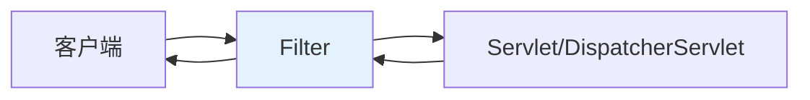
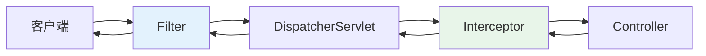
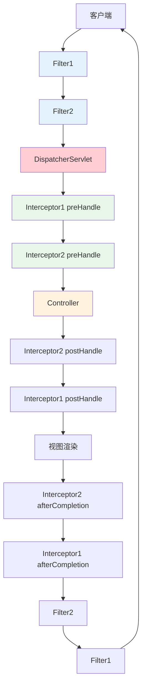

# REST API 高级：过滤器与拦截器实战

## 课程目标

- 理解 Filter（过滤器）与 Interceptor（拦截器）的概念和区别
- 掌握 Filter 的实现方式和注册方法
- 掌握 HandlerInterceptor 的实现方式和配置
- 理解两者的执行顺序和应用场景
- 能够为图书管理系统添加请求日志过滤器和权限认证拦截器


## 过滤器与拦截器概述

在 Web 开发中，经常需要在请求处理的前后执行一些通用逻辑，如日志记录、权限校验、性能监控、请求参数预处理等。Spring 提供了两种机制：**过滤器（Filter）** 和 **拦截器（Interceptor）**。

### 什么是 Filter（过滤器）

**Filter** 是 Java Servlet 规范定义的组件，在请求到达 Servlet 之前和响应返回客户端之后执行。它对所有请求有效，不依赖 Spring 框架。



### 什么是 Interceptor（拦截器）

**Interceptor** 是 Spring 框架提供的组件，基于 AOP 思想，在请求进入 Controller 之前和之后执行。它只对 Spring 管理的 Controller 方法有效。



### Filter 与 Interceptor 的区别

| 对比维度                 | Filter                         | Interceptor                          |
| ------------------------ | ------------------------------ | ------------------------------------ |
| **规范**                 | Servlet 规范                   | Spring 框架                          |
| **适用范围**             | 所有请求                       | Spring Controller 方法               |
| **触发时机**             | Servlet 之前/之后              | Controller 之前/之后                 |
| **是否依赖 Spring**      | 否                             | 是                                   |
| **能否注入 Spring Bean** | 可以（但需要特殊配置）         | 可以直接注入                         |
| **拦截粒度**             | 粗粒度（路径匹配）             | 细粒度（方法级、参数级）             |
| **典型应用**             | 字符编码、日志记录、压缩、鉴权 | 权限校验、日志、性能监控、参数预处理 |


## Filter 实战

### Filter 接口

Spring 中的 `Filter` 接口实际上是 **Servlet 规范** 的一部分，它定义在 `javax.servlet` 包中。Filter 是 Java Web 应用中的一种强大组件，用于在请求到达 Servlet 或响应返回客户端之前，对其进行拦截和处理。

`Filter` 接口定义了三个方法，分别对应其生命周期的不同阶段。

| 方法                     | 执行时机                                                     | 主要用途                                                     |
| ------------------------ | ------------------------------------------------------------ | ------------------------------------------------------------ |
| **`init(FilterConfig)`** | Web 容器启动时，Filter 实例被创建后立即调用，且**仅调用一次**。 | 执行 Filter 的初始化工作，例如从 `FilterConfig` 中获取初始化参数。 |
| **`doFilter(...)`**      | 每当有匹配的客户端请求时被调用。                             | 核心过滤方法，在此实现请求/响应的拦截、处理和传递。必须调用 `chain.doFilter()` 将请求传递给下一个 Filter 或目标 Servlet。 |
| **`destroy()`**          | Web 容器关闭或 Filter 被移除时调用，**仅调用一次**。         | 执行清理工作，如释放资源。                                   |

### 实现方式一：实现 Filter 接口

```java
package com.example.bookmanager.filter;

@Component
public class LoggingFilter implements Filter {

    private static final Logger logger = LoggerFactory.getLogger(LoggingFilter.class);

    @Override
    public void init(FilterConfig filterConfig) throws ServletException {
        logger.info("LoggingFilter 初始化");
    }

    @Override
    public void doFilter(ServletRequest request, ServletResponse response, FilterChain chain)
            throws IOException, ServletException {
        HttpServletRequest httpRequest = (HttpServletRequest) request;

        // 记录请求信息
        long startTime = System.currentTimeMillis();
        String method = httpRequest.getMethod();
        String uri = httpRequest.getRequestURI();
        String ip = httpRequest.getRemoteAddr();

        logger.info("📨 [Filter] 请求: {} {} | IP: {}", method, uri, ip);

        // 继续执行后续过滤器或请求处理
        chain.doFilter(request, response);

        // 记录响应耗时
        long duration = System.currentTimeMillis() - startTime;
        logger.info("✅ [Filter] 完成: {} {} | 耗时: {}ms", method, uri, duration);
    }

    @Override
    public void destroy() {
        logger.info("LoggingFilter 销毁");
    }
}
```

### 实现方式二：使用 Spring 的 OncePerRequestFilter

`OncePerRequestFilter` 是 Spring 提供的抽象类，确保过滤器在每个请求中只执行一次（避免某些情况下被多次调用）。

```java
package com.example.bookmanager.filter;

@Component
public class LoggingFilter extends OncePerRequestFilter {

    private static final Logger logger = LoggerFactory.getLogger(LoggingFilter.class);

    @Override
    protected void doFilterInternal(HttpServletRequest request,
                                    HttpServletResponse response,
                                    FilterChain filterChain)
            throws ServletException, IOException {

        long startTime = System.currentTimeMillis();
        String method = request.getMethod();
        String uri = request.getRequestURI();
        String ip = request.getRemoteAddr();

        // 记录请求
        logger.info("📨 [Filter] 请求: {} {} | IP: {}", method, uri, ip);

        // 继续执行
        filterChain.doFilter(request, response);

        // 记录响应耗时
        long duration = System.currentTimeMillis() - startTime;
        logger.info("✅ [Filter] 完成: {} {} | 耗时: {}ms", method, uri, duration);
    }
}
```


### 注册 Filter 的三种方式

**方式一：使用 @Component 自动注册（默认所有请求）**

在 Filter 类上添加 `@Component`，Spring Boot 会自动将其注册到所有请求路径。

**方式二：使用 @WebFilter + @ServletComponentScan**

```java
@WebFilter(urlPatterns = "/api/*")
public class MyFilter implements Filter { ... }
```

在主启动类上添加 `@ServletComponentScan`。

**方式三：使用 FilterRegistrationBean 手动注册（推荐，可配置路径和顺序）**

```java
package com.example.bookmanager.config;

@Configuration
public class FilterConfig {

    @Bean
    public FilterRegistrationBean<LoggingFilter> loggingFilter() {
        FilterRegistrationBean<LoggingFilter> registrationBean = new FilterRegistrationBean<>();
        registrationBean.setFilter(new LoggingFilter());
        // 配置拦截路径
        registrationBean.addUrlPatterns("/api/*");
        // 配置执行顺序（数字越小越先执行）
        registrationBean.setOrder(1);
        return registrationBean;
    }
}
```

> [!NOTE]
> 使用 `FilterRegistrationBean` 可以精确控制路径匹配和多个 Filter 的执行顺序，推荐在需要精细配置时使用。


## Interceptor 实战

### HandlerInterceptor接口

`HandlerInterceptor` 是 Spring Web MVC 框架中用于在请求处理流程的特定节点（如控制器方法执行前后）插入自定义逻辑的接口。它支持实现日志记录、权限检查等横切关注点，有助于避免代码重复

`HandlerInterceptor` 接口定义了三个核心方法，它们在请求处理的不同阶段被调用。

| 方法                  | 执行时机                                               | 返回值                                                       | 主要用途                                                   |
| --------------------- | ------------------------------------------------------ | ------------------------------------------------------------ | ---------------------------------------------------------- |
| **`preHandle`**       | 在**控制器（Handler）方法执行之前**被调用。            | `boolean`：返回`true`则继续执行后续流程；返回`false`则中断执行链。 | 权限检查、登录验证、请求日志记录等前置处理。               |
| **`postHandle`**      | 在**控制器方法执行之后**，但在**视图渲染之前**被调用。 | `void`                                                       | 对返回的`ModelAndView`对象进行修改，如添加额外的模型数据。 |
| **`afterCompletion`** | 在**整个请求处理完成之后**（即视图渲染完毕）被调用。   | `void`                                                       | 进行资源清理、记录请求处理总时间等善后工作。               |


### 权限认证拦截器：

```java
package com.example.bookmanager.interceptor;

@Component
public class AuthInterceptor implements HandlerInterceptor {

    private static final Logger logger = LoggerFactory.getLogger(AuthInterceptor.class);

    /**
     * 前置处理：在 Controller 方法执行之前调用
     */
    @Override
    public boolean preHandle(HttpServletRequest request, HttpServletResponse response, Object handler)
            throws Exception {
        // 获取请求头中的 Token
        String token = request.getHeader("Authorization");

        // 模拟权限校验：检查 Token 是否有效
        if (token == null || !token.startsWith("Bearer ")) {
            logger.warn("未认证请求: {}", request.getRequestURI());
            // 返回 401 未认证
            response.setStatus(HttpServletResponse.SC_UNAUTHORIZED);
            response.setContentType("application/json;charset=UTF-8");

            Result<?> result = Result.error(ResultCode.UNAUTHORIZED);
            PrintWriter writer = response.getWriter();
            writer.write(new ObjectMapper().writeValueAsString(result));
            writer.flush();
            return false;  // 拦截请求，不再继续执行
        }

        // 模拟从 Token 中解析用户 ID（实际项目可使用 JWT）
        String userId = token.substring(7); // 去掉 "Bearer "
        request.setAttribute("userId", userId);
        logger.info("认证通过，用户ID: {}", userId);

        return true;  // 继续执行
    }

    /**
     * 后置处理：在 Controller 方法执行之后，视图渲染之前调用
     */
    @Override
    public void postHandle(HttpServletRequest request, HttpServletResponse response,
                           Object handler, ModelAndView modelAndView) throws Exception {
        // 可以在这里对响应数据进行额外处理
        // 对于 REST API，通常不做特殊处理
    }

    /**
     * 完成处理：在视图渲染之后调用，用于资源清理
     */
    @Override
    public void afterCompletion(HttpServletRequest request, HttpServletResponse response,  Object handler, Exception ex) throws Exception {
        if (ex != null) {
            logger.error("请求异常: {}", request.getRequestURI(), ex);
        }
    }
}
```

> [!NOTE]
> `preHandle` 返回 `true` 表示继续执行后续拦截器和 Controller；返回 `false` 表示中断请求，不会继续执行。


### 性能监控拦截器

```java
package com.example.bookmanager.interceptor;

@Component
public class PerformanceInterceptor implements HandlerInterceptor {

    private static final Logger logger = LoggerFactory.getLogger(PerformanceInterceptor.class);
    private static final long SLOW_THRESHOLD = 1000;

    @Override
    public boolean preHandle(HttpServletRequest request, HttpServletResponse response, Object handler)
            throws Exception {
        request.setAttribute("_startTime", System.currentTimeMillis());
        return true;
    }

    @Override
    public void afterCompletion(HttpServletRequest request, HttpServletResponse response,
                                Object handler, Exception ex) throws Exception {
        Long startTime = (Long) request.getAttribute("_startTime");
        if (startTime != null) {
            long duration = System.currentTimeMillis() - startTime;
            String uri = request.getRequestURI();
            if (duration > SLOW_THRESHOLD) {
                logger.warn("🐢 [Interceptor] 慢接口: {} 耗时: {}ms", uri, duration);
            } else {
                logger.debug("⚡ [Interceptor] {} 耗时: {}ms", uri, duration);
            }
        }
    }
}
```


### 注册 Interceptor

```java
package com.example.bookmanager.config;

@Configuration
public class WebConfig implements WebMvcConfigurer {

    @Autowired
    private AuthInterceptor authInterceptor;

    @Autowired
    private PerformanceInterceptor performanceInterceptor;

    @Override
    public void addInterceptors(InterceptorRegistry registry) {
        // 注册权限拦截器，拦截 /api/** 路径，排除 /api/health
        registry.addInterceptor(authInterceptor)
                .addPathPatterns("/api/**")
                .excludePathPatterns("/api/health", "/api/public/**");

        // 注册性能拦截器，拦截 /api/books/** 路径
        registry.addInterceptor(performanceInterceptor)
                .addPathPatterns("/api/books/**");
    }
}
```


## 请求处理链路完整流程



### 执行顺序总结

| 步骤 | 组件                         | 说明     |
| ---- | ---------------------------- | -------- |
| 1    | Filter1.doFilter             | 前置逻辑 |
| 2    | Filter2.doFilter             | 前置逻辑 |
| 3    | Interceptor1.preHandle       | 前置拦截 |
| 4    | Interceptor2.preHandle       | 前置拦截 |
| 5    | Controller                   | 业务处理 |
| 6    | Interceptor2.postHandle      | 后置拦截 |
| 7    | Interceptor1.postHandle      | 后置拦截 |
| 8    | Interceptor2.afterCompletion | 完成处理 |
| 9    | Interceptor1.afterCompletion | 完成处理 |
| 10   | Filter2.doFilter             | 后置逻辑 |
| 11   | Filter1.doFilter             | 后置逻辑 |

## 过滤器与拦截器的选择建议

| 场景                       | 推荐使用                   |
| -------------------------- | -------------------------- |
| 字符编码、请求/响应压缩    | Filter                     |
| 请求日志记录、跨域处理     | Filter 或 Interceptor 均可 |
| 认证/权限校验              | Interceptor                |
| 参数预处理（如格式化）     | Interceptor                |
| 性能监控（按接口粒度）     | Interceptor                |
| 静态资源访问控制           | Filter                     |
| 业务日志（需要访问请求体） | Interceptor                |


## 注意事项

### 1. Filter 中注入 Bean 的问题

在 `@Component` 标记的 Filter 中可以直接注入 Spring Bean，但使用 `new` 创建的 Filter 无法自动注入。推荐使用 `@Component` 方式，或通过 `FilterRegistrationBean` 配合构造函数注入。

### 2. 拦截器与 AOP 的关系

拦截器本质上是 AOP 的一种简化实现，但只能拦截 Controller 方法。如果需要更细粒度的拦截（如特定注解的方法），应使用 AOP 切面。

### 3. 静态资源拦截

Spring Boot 默认对静态资源（`/static/**`、`/public/**` 等）不经过 `DispatcherServlet`，因此拦截器不会拦截静态资源请求。如需拦截，应配置 `WebMvcConfigurer.addResourceHandlers` 或使用 Filter。

### 4. 排除路径的配置

在注册拦截器时，可使用 `excludePathPatterns` 排除特定路径，如登录接口、健康检查等。

### 5. 多个过滤器的顺序

使用 `FilterRegistrationBean.setOrder()` 控制执行顺序，数字越小越先执行。


## 小结

本节课我们学习了：

1. **Filter（过滤器）**：Servlet 规范的组件，对所有请求有效，不依赖 Spring。
2. **Interceptor（拦截器）**：Spring 框架的组件，对 Controller 方法有效，可以注入 Spring Bean。
3. **两者的区别**：规范不同、生效范围不同、粒度不同。
4. **Filter 实战**：通过 `OncePerRequestFilter` 实现请求日志过滤器，使用 `FilterRegistrationBean` 注册。
5. **Interceptor 实战**：通过 `HandlerInterceptor` 实现权限认证拦截器，使用 `WebMvcConfigurer` 注册。
6. **执行顺序**：Filter → DispatcherServlet → Interceptor → Controller。


## 作业

### 作业一：代码阅读——Filter 与 Interceptor 执行顺序分析

假设有以下配置，分析请求 `/api/books/1` 时各组件的执行顺序。

```java
@Configuration
public class WebConfig implements WebMvcConfigurer {
    @Override
    public void addInterceptors(InterceptorRegistry registry) {
        registry.addInterceptor(new InterceptorA()).addPathPatterns("/api/**");
        registry.addInterceptor(new InterceptorB()).addPathPatterns("/api/books/**");
    }
}

@Order(1)
@Component
public class FilterA extends OncePerRequestFilter { ... }

@Order(2)
@Component
public class FilterB extends OncePerRequestFilter { ... }
```

**问题：**

1. FilterA 和 FilterB 哪个先执行？为什么？
2. InterceptorA 和 InterceptorB 哪个先执行？为什么？
3. 完整的执行顺序是什么（从请求进入开始到响应返回）？

------

### 作业二：代码阅读——拦截器认证流程分析

阅读以下代码，回答问题。

```java
@Component
public class AuthInterceptor implements HandlerInterceptor {
    @Override
    public boolean preHandle(HttpServletRequest request, HttpServletResponse response, Object handler) {
        String token = request.getHeader("Authorization");
        if (token == null) {
            response.setStatus(401);
            return false;
        }
        return true;
    }
}
```

**问题：**

1. 如果请求头中没有 `Authorization`，该拦截器会返回什么 HTTP 状态码？
2. 返回 `false` 后，后续的拦截器和 Controller 会执行吗？
3. 如果希望返回 JSON 格式的错误信息，应该如何修改？

------

### 作业三：为图书管理系统添加请求日志过滤器

基于图书管理系统，完成以下任务：

1. 创建 `LoggingFilter` 继承 `OncePerRequestFilter`，在 `doFilterInternal` 中记录：
   - 请求方法、URL、IP、请求参数（`request.getParameterMap()`）
   - 响应耗时
2. 使用 `@Component` 自动注册过滤器。
3. 启动应用，调用几个接口，观察控制台输出的日志。
4. （选做）使用 `FilterRegistrationBean` 精确控制过滤器路径和顺序。

------

### 作业四：实现自定义权限认证拦截器

在图书管理系统中实现简单的 Token 认证：

**要求：**

1. 创建 `AuthInterceptor` 实现 `HandlerInterceptor`。
2. 从请求头 `Authorization` 中获取 Token（格式：`Bearer {token}`）。
3. 预置一个有效的 Token（如 `Bearer admin123`），如果 Token 匹配则放行，否则返回 401 JSON 响应。
4. 配置拦截器拦截 `/api/**`，排除 `/api/health` 和 `/api/public/**`。
5. 测试：
   - 带有效 Token 访问 `/api/books` → 正常返回数据
   - 不带 Token 访问 `/api/books` → 返回 401 错误信息
   - 带错误 Token 访问 → 返回 401 错误信息

**提示：** 使用 `response.getWriter()` 返回 JSON 错误响应，需设置 `response.setContentType("application/json;charset=UTF-8")`。
