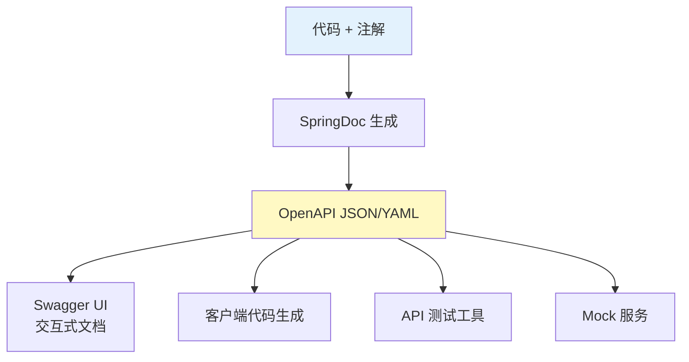

# REST API 文档自动生成与 API 规范

## 课程目标

- 理解 API 文档在开发协作中的重要性
- 了解 OpenAPI 规范的基本概念
- 掌握使用 SpringDoc 自动生成 OpenAPI 文档
- 掌握使用注解增强 API 文档描述
- 能够对 API 进行分组管理
- 了解 API 规范的最佳实践


## API 文档的重要性

### 为什么需要 API 文档

在前后端分离开发中，API 文档是沟通前后端的重要契约。一份规范、清晰、可维护的 API 文档能显著提升团队协作效率。

| 问题场景 | 没有文档             | 有规范文档             |
| -------- | -------------------- | ---------------------- |
| 前端开发 | 反复询问接口字段含义 | 独立查阅文档开发       |
| 接口变更 | 口头通知，容易遗漏   | 文档同步更新，变更可见 |
| 新人上手 | 需要老员工逐个讲解   | 查阅文档快速了解       |
| 联调测试 | 凭经验猜测参数格式   | 按文档精确构造请求     |

### 传统文档的痛点

- **手动维护成本高**：代码变更后需要同步更新文档，容易不一致
- **格式不统一**：Word、PDF、Wiki 等多种格式并存
- **缺乏交互性**：无法在线调试接口
- **版本管理困难**：无法追溯文档的历史版本

> [!NOTE]
> **OpenAPI + SpringDoc** 方案实现了文档与代码的同步维护，通过注解自动生成 OpenAPI 规范的文档，并提供交互式调试界面。


## OpenAPI 规范简介

### 什么是 OpenAPI

**OpenAPI 规范**（前身为 Swagger 规范）是一种与语言无关的 REST API 描述标准，使用 JSON 或 YAML 格式描述 API 的路径、参数、请求体、响应等信息。

### OpenAPI 的核心价值



### OpenAPI 文档结构

一个完整的 OpenAPI 文档包含以下主要部分：

| 部分         | 说明                              |
| ------------ | --------------------------------- |
| `openapi`    | OpenAPI 规范版本                  |
| `info`       | API 基本信息（标题、版本、描述）  |
| `servers`    | 服务器地址（开发/测试/生产）      |
| `paths`      | 所有 API 路径及操作方法           |
| `components` | 可复用的数据模型（schemas）和参数 |
| `security`   | 认证方式配置                      |
| `tags`       | 接口分组标签                      |


## 集成 SpringDoc

### 什么是 SpringDoc

**SpringDoc OpenAPI** 是 Spring Boot 的 OpenAPI 实现，它能在运行时自动扫描 Controller，基于注解生成 OpenAPI 文档，并提供内置的 Swagger UI 界面。

### 添加依赖

在 `pom.xml` 中添加 SpringDoc 依赖。该依赖会自动引入 Swagger UI 前端资源，无需额外配置。启动后可通过 `/swagger-ui.html` 访问交互式文档。

```xml
<dependency>
    <groupId>org.springdoc</groupId>
    <artifactId>springdoc-openapi-starter-webmvc-ui</artifactId>
    <version>2.7.0</version>
</dependency>
```

> [!CAUTION]
>
> 请注意与Spring Boot的版本对应关系，例如Spring Boot 3.5.16需要依赖springdoc-openapi-starter-webmvc-ui的2.7.0版本，更低版本会报错。


### 查看自动生成的文档

启动应用后，访问以下地址：

| 地址                | 说明                      |
| ------------------- | ------------------------- |
| `/swagger-ui.html`  | 交互式 API 文档界面       |
| `/v3/api-docs`      | OpenAPI JSON 格式原始文档 |
| `/v3/api-docs.yaml` | OpenAPI YAML 格式原始文档 |

> [!NOTE]
> 默认情况下，SpringDoc 会扫描所有 Controller 并生成文档。无需任何配置即可获得基本的 API 描述。


## 常用注解增强文档

虽然 SpringDoc 能自动生成文档，但默认信息（如参数描述）较为简略。通过注解可以为 API 补充更丰富的描述信息。

### 核心注解

| 注解           | 适用位置         | 说明                               |
| -------------- | ---------------- | ---------------------------------- |
| `@Tag`         | 类（Controller） | 给 Controller 分组并添加名称和描述 |
| `@Operation`   | 方法             | 描述接口的用途                     |
| `@Parameter`   | 方法参数         | 描述单个参数的名称、说明、是否必填 |
| `@Schema`      | 实体类/字段      | 描述数据模型的字段含义、示例值     |
| `@ApiResponse` | 方法             | 描述可能的响应状态码和含义         |
| `@Hidden`      | 方法/类          | 隐藏该接口或类，不生成文档         |

### 在 Controller 中使用注解

```java
package com.example.bookmanager.controller;


@RestController
@RequestMapping("/api/books")
@Tag(name = "图书管理", description = "图书的增删改查接口")
public class BookController {

    @Autowired
    private BookService bookService;

    @GetMapping
    @Operation(summary = "查询所有图书", description = "返回系统中所有图书的列表")
    @ApiResponse(responseCode = "200", description = "查询成功",
            content = @Content(schema = @Schema(implementation = Result.class)))
    public Result<List<Book>> getAllBooks() {
        return Result.success(bookService.getAllBooks());
    }

    @GetMapping("/{id}")
    @Operation(summary = "根据ID查询单本图书", description = "通过图书ID获取完整的图书信息")
    @Parameter(name = "id", description = "图书ID", required = true, example = "1")
    @ApiResponse(responseCode = "200", description = "查询成功")
    @ApiResponse(responseCode = "404", description = "图书不存在")
    public Result<Book> getBook(@PathVariable Long id) {
        return Result.success(bookService.getBookById(id));
    }

    @PostMapping
    @Operation(summary = "新增图书", description = "创建一本新的图书")
    @ApiResponse(responseCode = "201", description = "创建成功")
    @ApiResponse(responseCode = "400", description = "参数校验失败")
    public Result<Book> createBook(@Valid @RequestBody Book book) {
        return Result.success(ResultCode.CREATED.getMessage(), bookService.createBook(book));
    }

    @PutMapping("/{id}")
    @Operation(summary = "更新图书", description = "根据ID完整更新图书信息")
    public Result<Book> updateBook(
            @Parameter(description = "图书ID", required = true, example = "1")
            @PathVariable Long id,
            @Valid @RequestBody Book book) {
        book.setId(id);
        return Result.success(bookService.updateBook(book));
    }

    @DeleteMapping("/{id}")
    @Operation(summary = "删除图书", description = "根据ID删除图书")
    @ApiResponse(responseCode = "204", description = "删除成功")
    @ApiResponse(responseCode = "404", description = "图书不存在")
    public Result<Void> deleteBook(@PathVariable Long id) {
        bookService.deleteBook(id);
        return Result.success(ResultCode.NO_CONTENT.getMessage(), null);
    }
}
```


### 在实体类中使用 @Schema

```java
package com.example.bookmanager.model;

import io.swagger.v3.oas.annotations.media.Schema;

@Schema(description = "图书实体")
public class Book {

    @Schema(description = "图书ID", example = "1", accessMode = Schema.AccessMode.READ_ONLY)
    private Long id;

    @Schema(description = "图书名称", required = true, example = "Spring Boot 实战")
    private String title;

    @Schema(description = "作者姓名", required = true, example = "Craig Walls")
    private String author;

    @Schema(description = "图书价格", required = true, example = "79.00")
    private Double price;

    @Schema(description = "库存数量", required = true, example = "10")
    private Integer stock;

    @Schema(description = "图书分类", example = "编程")
    private String category;

    // Getter 和 Setter...
}
```

> [!NOTE]
> `accessMode = Schema.AccessMode.READ_ONLY` 表示该字段在请求体（创建/更新）中不需要提供，但会出现在响应中。


## API 分组管理

### 按功能模块分组

当项目包含多个功能模块时，可以使用 `@Tag` 注解将接口分组，让文档更清晰。

```java
@Tag(name = "图书管理", description = "图书的增删改查接口")
public class BookController { ... }

@Tag(name = "用户管理", description = "用户注册、登录、个人信息接口")
public class UserController { ... }
```


### 分组显示效果

在 Swagger UI 中，接口会按照 `@Tag` 的名称分组展示，每个分组下显示该 Controller 的所有接口。

### 自定义分组配置

在 `application.yml` 中可配置分组：

```yaml
springdoc:
  group-configs:
    - group: "图书管理"
      paths-to-match: "/api/books/**"
    - group: "用户管理"
      paths-to-match: "/api/users/**"
```

> [!NOTE]
> 分组配置对大型项目特别有用，可以按微服务、模块或团队职责划分文档。


## 导出 OpenAPI 文档

### 导出 JSON 格式

```
# 导出 JSON 格式文档
curl http://localhost:8080/v3/api-docs > openapi.json
```

### 导出 YAML 格式

```
# 导出 YAML 格式文档
curl http://localhost:8080/v3/api-docs.yaml > openapi.yaml
```

### 导出特定分组

```
# 导出指定分组的文档
curl http://localhost:8080/v3/api-docs/图书管理 > books-api.json
```

### 导入到其他工具

导出的 OpenAPI 文件可以导入到多种工具中：

| 工具               | 用途                            |
| ------------------ | ------------------------------- |
| **Postman**        | 导入后生成可执行的 API 测试集合 |
| **Apifox**         | 文档协作和 Mock 服务            |
| **YAPI**           | 接口文档管理和测试              |
| **Swagger Editor** | 在线查看和编辑 OpenAPI 文档     |
| **Stoplight**      | API 设计平台                    |
| **Redoc**          | 生成漂亮的静态文档页面          |


## API 规范最佳实践

### 文档规范

| 规范                            | 说明                            |
| ------------------------------- | ------------------------------- |
| **所有接口必须标注 @Operation** | 描述接口功能，便于前端理解      |
| **所有参数使用 @Parameter**     | 说明每个参数的用途和示例值      |
| **所有实体字段使用 @Schema**    | 标注字段含义、示例、是否必填    |
| **错误响应使用 @ApiResponse**   | 描述可能的错误状态码和原因      |
| **Controller 使用 @Tag**        | 按模块/功能分组，使文档结构清晰 |

### 版本管理

```java
@Tag(name = "v1.0 图书管理")
@RestController
@RequestMapping("/api/v1/books")
public class BookControllerV1 { ... }

@Tag(name = "v2.0 图书管理")
@RestController
@RequestMapping("/api/v2/books")
public class BookControllerV2 { ... }
```

### 隐藏不必要暴露的接口

使用 `@Hidden` 隐藏内部接口：

```java
@Hidden
@GetMapping("/internal")
public String internalApi() { ... }
```

### 文档与代码同步

- 代码变更时，同步更新文档注解
- 使用 CI/CD 流程自动生成并发布文档
- 在 PR 检查中验证文档是否与代码匹配


## 注意事项

### 1. 隐私和安全

不要在文档注释中暴露敏感信息（如密钥、密码、内部 IP）。OpenAPI 文档可能被公开访问，建议在生产环境关闭或限制访问。

```yaml
springdoc:
  api-docs:
    enabled: false  # 生产环境可关闭
  swagger-ui:
    enabled: false
```

### 2. 性能影响

自动扫描所有 Controller 并生成文档对启动时间有一定影响，开发环境可开启，生产环境建议关闭。

### 3. 参数绑定混淆

当使用 `@RequestParam` 时，SpringDoc 可能无法识别字段的 `required` 属性，建议显式在注解中指定。

### 4. 与 Spring Security 集成

如果项目使用 Spring Security，需要放行 `/swagger-ui/**`、`/v3/api-docs/**` 等路径。

```java
@Bean
public SecurityFilterChain filterChain(HttpSecurity http) throws Exception {
    http.authorizeHttpRequests(auth -> auth
        .requestMatchers("/swagger-ui/**", "/v3/api-docs/**").permitAll()
        .anyRequest().authenticated()
    );
    return http.build();
}
```


## 小结

本节课我们学习了：

1. **API 文档的重要性**：前后端协作的契约，降低沟通成本。
2. **OpenAPI 规范**：语言无关的 API 描述标准，支持 JSON/YAML 格式。
3. **SpringDoc 集成**：添加依赖即可自动生成文档，访问 `/swagger-ui.html` 查看交互式文档。
4. **注解增强文档**：@Tag、@Operation、@Parameter、@Schema、@ApiResponse。
5. **API 分组管理**：使用 @Tag 或配置分组，使文档结构清晰。
6. **导出 OpenAPI 文档**：可导出 JSON/YAML 文件，导入到 Postman、Apifox 等工具。
7. **API 规范最佳实践**：保持文档与代码同步，版本管理，隐藏敏感接口。


## 作业

### 作业一：代码阅读——SpringDoc 注解识别

阅读以下代码，回答问题。

```java
@Tag(name = "用户管理", description = "用户相关操作")
@RestController
@RequestMapping("/api/users")
public class UserController {

    @Operation(summary = "用户登录")
    @PostMapping("/login")
    public Result<String> login(@RequestBody LoginRequest request) { ... }

    @Operation(summary = "获取用户信息")
    @Parameter(name = "id", description = "用户ID", required = true)
    @GetMapping("/{id}")
    public Result<User> getUser(@PathVariable Long id) { ... }
}
```

**问题：**

1. `@Tag(name = "用户管理")` 的作用是什么？在 Swagger UI 中会呈现什么效果？
2. `@Operation(summary = "用户登录")` 的作用是什么？
3. `@Parameter` 注解描述的是哪个参数？`required = true` 表示什么？
4. 如果 `User` 类中有 `@Schema(description = "用户名")`，这个信息会在文档中哪里显示？

------

### 作业二：代码阅读——OpenAPI 文档结构

已知一个 SpringDoc 生成的 OpenAPI 文档包含以下内容片段，请指出各部分对应的 OpenAPI 组成部分。

```yaml
openapi: 3.0.1
info:
  title: 图书管理系统 API
  version: 1.0.0
paths:
  /api/books:
    get:
      summary: 查询所有图书
      responses:
        '200':
          description: 查询成功
components:
  schemas:
    Book:
      type: object
      properties:
        id:
          type: integer
        title:
          type: string
```

**问题：**

1. `info` 部分包含什么信息？
2. `paths` 部分描述了什么？
3. `components/schemas` 部分的作用是什么？
4. 如果我们要添加 `POST /api/books` 接口，应该在文档的哪个部分添加？

------

### 作业三：为图书管理系统集成 SpringDoc

基于图书管理系统，完成以下任务：

1. 在 `pom.xml` 中添加 `springdoc-openapi-starter-webmvc-ui` 依赖。
2. 启动应用，访问 `/swagger-ui.html`，确认文档已生成。
3. 访问 `/v3/api-docs`，查看原始 JSON 文档。
4. 为 `BookController` 添加以下注解：
   - 在类上使用 `@Tag`，设置 name 为 `"图书管理"`
   - 为 `getBook`、`createBook`、`updateBook`、`deleteBook` 方法添加 `@Operation`
   - 为 `@PathVariable` 参数添加 `@Parameter`
5. 在 `Book` 类的字段上添加 `@Schema`，描述字段含义和示例值。
6. 重新访问 Swagger UI，验证文档更新。

------

### 作业四：导出 OpenAPI 文档并导入 Postman

1. 从图书管理系统导出 OpenAPI JSON 文档：

   ```
curl http://localhost:8080/v3/api-docs > book-api.json
   ```
   
   打开 Postman，点击 **File** → **Import**→ 上传 `book-api.json`。

3. 查看导入后生成的 Collection，确认接口和参数正确。

4. 在 Postman 中发送一个请求（如 GET `/api/books`），验证导入的文档可用。

5. 思考：这种自动导入文档的方式比手动编写 Postman Collection 有何优势？
