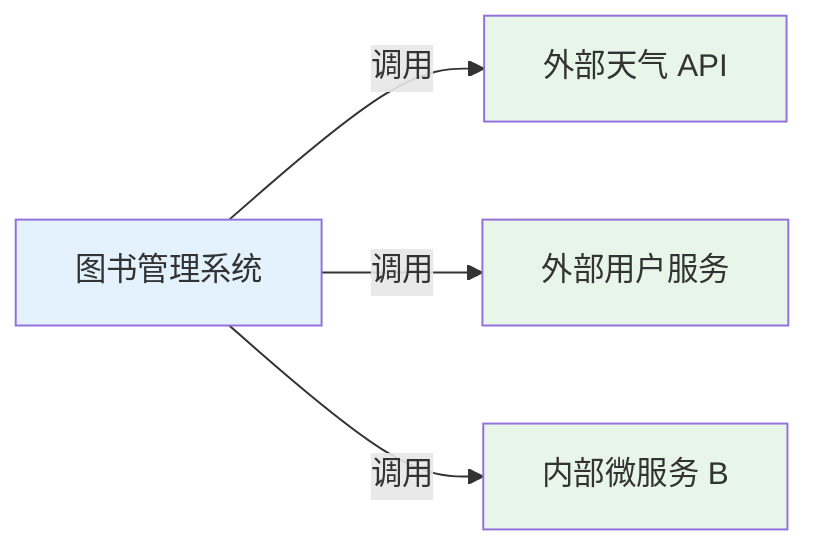

# RestTemplate 与服务间调用

## 课程目标

- 理解服务间调用的场景和实现方式
- 掌握 RestTemplate 的创建和配置
- 掌握使用 RestTemplate 发送 GET、POST 请求
- 掌握 RestTemplate 的异常处理
- 能够调用第三方 API 并在图书管理系统中使用返回数据


## 服务间调用概述

### 什么是服务间调用

在微服务架构或分布式系统中，一个服务经常需要调用另一个服务的 API 来获取数据或执行操作。这种服务间的通信被称为**服务间调用**。在单体应用阶段，我们可能也需要调用外部第三方 API（如天气、短信、支付等）。



### 常见的调用方式

| 方式                     | 说明                                                |
| ------------------------ | --------------------------------------------------- |
| **RestTemplate**         | Spring 提供的同步 HTTP 客户端，简单易用（本课重点） |
| **WebClient**            | Spring 5 引入的非阻塞响应式客户端，性能更好         |
| **Feign**                | 声明式 HTTP 客户端（Spring Cloud 组件）             |
| **HttpClient（Apache）** | Apache 提供的 HTTP 客户端库                         |
| **OkHttp**               | 高效的第三方 HTTP 客户端                            |

> [!NOTE]
> 在 Spring Boot 3.x 中，RestTemplate 仍可使用，但官方更推荐 WebClient。不过 RestTemplate 仍然广泛使用，且对于初学者更友好。WebClient在下一节中会有专门介绍。


## RestTemplate 简介

### 什么是 RestTemplate

**RestTemplate** 是 Spring 提供的用于访问 REST API 的同步 HTTP 客户端。它简化了 HTTP 请求的发送和响应的解析，支持多种 HTTP 方法和数据格式。

### 核心方法

| 方法                                                       | 说明                                              |
| ---------------------------------------------------------- | ------------------------------------------------- |
| `getForObject(url, responseType)`                          | GET 请求，直接返回对象                            |
| `getForEntity(url, responseType)`                          | GET 请求，返回包含状态码、头信息的 ResponseEntity |
| `postForObject(url, request, responseType)`                | POST 请求，提交对象并返回响应                     |
| `postForEntity(url, request, responseType)`                | POST 请求，返回 ResponseEntity                    |
| `put(url, request)`                                        | PUT 请求，更新资源                                |
| `delete(url)`                                              | DELETE 请求，删除资源                             |
| `exchange(url, method, requestEntity, responseType)`       | 通用请求，支持自定义请求头等                      |
| `execute(url, method, requestCallback, responseExtractor)` | 底层执行方法                                      |

## 创建和配置 RestTemplate

### 基本用法（使用默认配置）

```java
// 直接 new 实例（默认配置）
RestTemplate restTemplate = new RestTemplate();
String result = restTemplate.getForObject("https://api.example.com/data", String.class);
```

### 推荐方式：配置为 Spring Bean

在 `com.example.bookmanager.config` 包下创建 `RestTemplateConfig.java`：

```java
package com.example.bookmanager.config;

@Configuration
public class RestTemplateConfig {

    @Bean
    public RestTemplate restTemplate() {
        // 创建工厂，设置超时
        SimpleClientHttpRequestFactory factory = new SimpleClientHttpRequestFactory();
        factory.setConnectTimeout(5000);   // 连接超时 5 秒
        factory.setReadTimeout(10000);     // 读取超时 10 秒

        return new RestTemplate(factory);
    }
}
```

> [!NOTE]
> 通过配置超时时间，可以避免调用外部服务时长时间阻塞。


### 在 Service 中注入并使用

```java
@Service
public class ExternalApiService {

    @Autowired
    private RestTemplate restTemplate;

    public String fetchData() {
        String url = "https://api.example.com/data";
        return restTemplate.getForObject(url, String.class);
    }
}
```


## GET 请求实战

### 示例：调用免费天气 API

我们将调用一个免费的天气 API（如 `https://api.openweathermap.org/data/2.5/weather`）来获取指定城市的天气信息，并将结果展示在图书管理系统中。

**步骤一：配置 API 密钥和 URL**

在 `application.yml` 中添加配置：

```yaml
app:
  weather:
    api-key: your_api_key_here
    url: https://api.openweathermap.org/data/2.5/weather
```

**步骤二：创建配置类读取配置**

```java
package com.example.bookmanager.config;

@Component
@ConfigurationProperties(prefix = "app.weather")
@Data
public class WeatherProperties {
    private String apiKey;
    private String url;
}
```

**步骤三：创建返回数据模型**

模拟Postman请求获取返回结果：

- q：Shanghai
- appid：your_api_key_here
- units：metric
- lang：zh_cn

根据返回结果在 `com.example.bookmanager.model` 包下创建 `WeatherInfo.java`：

```java
package com.example.bookmanager.model;

@Schema(description = "天气信息")
@Data
public class WeatherInfo {
    private String city;
    private Double temperature;
    private String description;
    private Integer humidity;
    private Double windSpeed;
}
```

**步骤四：创建服务类调用外部 API**

在 `com.example.bookmanager.service` 包下创建 `WeatherService.java`：

```java
package com.example.bookmanager.service;

@Service
public class WeatherService {

    private static final Logger logger = LoggerFactory.getLogger(WeatherService.class);

    @Autowired
    private RestTemplate restTemplate;

    @Autowired
    private WeatherProperties weatherProperties;

    @Autowired
    private ObjectMapper objectMapper;

    public WeatherInfo getWeather(String city) {
        try {
            // 构建 URL
            URI uri = UriComponentsBuilder.fromHttpUrl(weatherProperties.getUrl())
                    .queryParam("q", city)
                    .queryParam("appid", weatherProperties.getApiKey())
                    .queryParam("units", "metric")
                    .queryParam("lang", "zh_cn")
                    .build()
                    .toUri();

            logger.info("调用天气 API: {}", uri);

            // 发送 GET 请求，获取原始 JSON
            String jsonResponse = restTemplate.getForObject(uri, String.class);

            // 解析 JSON
            JsonNode root = objectMapper.readTree(jsonResponse);
            WeatherInfo weather = new WeatherInfo();
            weather.setCity(root.path("name").asText());
            weather.setTemperature(root.path("main").path("temp").asDouble());
            weather.setDescription(root.path("weather").get(0).path("description").asText());
            weather.setHumidity(root.path("main").path("humidity").asInt());
            weather.setWindSpeed(root.path("wind").path("speed").asDouble());

            return weather;
        } catch (Exception e) {
            logger.error("获取天气信息失败: {}", e.getMessage());
            throw new RuntimeException("天气服务调用失败: " + e.getMessage());
        }
    }
}
```

> [!NOTE]
> 使用 `UriComponentsBuilder` 可以安全地构建 URL，自动处理参数编码。

**步骤五：添加 Controller 接口**

```java
package com.example.bookmanager.controller;

@RestController
@RequestMapping("/api/weather")
@Tag(name = "外部服务", description = "调用第三方服务接口")
public class WeatherController {

    @Autowired
    private WeatherService weatherService;

    @GetMapping
    @Operation(summary = "查询城市天气", description = "调用第三方天气 API 获取实时天气")
    public Result<WeatherInfo> getWeather(
            @Parameter(description = "城市名称（拼音）", required = true, example = "beijing")
            @RequestParam String city) {
        WeatherInfo weather = weatherService.getWeather(city);
        return Result.success(weather);
    }
}
```


## POST 请求示例

### 示例：调用外部服务创建资源

假设我们需要调用一个外部用户服务来创建用户，然后同步到图书管理系统的用户表（模拟）。

```java
@Service
public class UserSyncService {

    @Autowired
    private RestTemplate restTemplate;

    public User createUserFromExternal(User user) {
        String url = "https://api.example.com/users";

        // 发送 POST 请求，将 user 对象序列化为 JSON 发送
        User createdUser = restTemplate.postForObject(url, user, User.class);
        return createdUser;
    }
}
```

### 使用 exchange 进行更灵活的请求

当需要设置请求头（如认证 Token）或获取响应头时，可以使用 `exchange`：

```java
public User createUserWithAuth(User user) {
    String url = "https://api.example.com/users";

    // 设置请求头
    HttpHeaders headers = new HttpHeaders();
    headers.setContentType(MediaType.APPLICATION_JSON);
    headers.set("Authorization", "Bearer " + authToken);

    HttpEntity<User> requestEntity = new HttpEntity<>(user, headers);

    // 发送请求
    ResponseEntity<User> response = restTemplate.exchange(
            url,
            HttpMethod.POST,
            requestEntity,
            User.class
    );

    if (response.getStatusCode().is2xxSuccessful()) {
        return response.getBody();
    } else {
        throw new RuntimeException("调用失败，状态码: " + response.getStatusCode());
    }
}
```

## 异常处理

### RestTemplate 的异常

调用外部 API 时可能发生多种异常，常见的包括：

| 异常                       | 说明                               |
| -------------------------- | ---------------------------------- |
| `HttpClientErrorException` | 4xx 客户端错误（如 404 Not Found） |
| `HttpServerErrorException` | 5xx 服务器错误                     |
| `ResourceAccessException`  | 网络连接超时、IO 异常              |
| `RestClientException`      | 其他异常（父类）                   |

### 全局异常处理

在 `WeatherService` 中对异常进行捕获和转换：

```java
@Service
public class WeatherService {

    private static final Logger logger = LoggerFactory.getLogger(WeatherService.class);

    public WeatherInfo getWeather(String city) {
        try {
            // ... 调用 API
        } catch (HttpClientErrorException e) {
            // 处理 4xx 错误（如城市不存在）
            logger.warn("天气 API 客户端错误: {}", e.getStatusCode());
            if (e.getStatusCode() == HttpStatus.NOT_FOUND) {
                throw new ResourceNotFoundException("城市不存在: " + city);
            }
            throw new RuntimeException("外部 API 调用失败");
        } catch (ResourceAccessException e) {
            // 网络超时等
            logger.error("天气 API 连接超时", e);
            throw new RuntimeException("网络连接超时，请稍后重试");
        } catch (Exception e) {
            logger.error("调用天气 API 异常", e);
            throw new BusinessException("获取天气信息失败");
        }
    }
}
```


## 实战：在图书管理系统中整合天气信息

在图书管理系统中，我们希望为图书添加一个功能：根据图书作者的所在地（国家/城市），显示当前天气。这展示了如何将外部数据与内部数据结合。

**步骤一：在 Book 模型中添加作者所在城市字段（或从已有字段获取）**

假设 `Book` 中有 `author` 字段，我们可以根据作者映射到默认城市，或者由前端传入城市参数。

**步骤二：创建组合 DTO对象**

```java
package com.example.bookmanager.model;

@Data
public class BookWithWeather {
    private Book book;
    private WeatherInfo weather;

    public BookWithWeather(Book book, WeatherInfo weather) {
        this.book = book;
        this.weather = weather;
    }
}
```

**步骤三：创建服务整合方法**

在 `BookService` 中增加方法，获取图书信息的同时查询天气：

```java
@Service
public class BookService {

    @Autowired
    private WeatherService weatherService;

    public BookWithWeather getBookWithWeather(Long bookId, String city) {
        Book book = getBookById(bookId);
        WeatherInfo weather = weatherService.getWeather(city);
        return new BookWithWeather(book, weather);
    }
}
```

**步骤四：添加 Controller 接口**

```java
@GetMapping("/{id}/weather")
@Operation(summary = "获取图书及作者所在城市天气")
public Result<BookWithWeather> getBookWithWeather(
        @PathVariable Long id,
        @RequestParam String city) {
    return Result.success(bookService.getBookWithWeather(id, city));
}
```

> [!NOTE]
> 这种集成方式展示了服务间调用的典型应用场景：将外部数据与内部数据结合，丰富业务功能。


## 注意事项

### 1. 超时配置

外部 API 可能响应缓慢，必须设置超时时间，避免请求线程被长时间占用。

```java
SimpleClientHttpRequestFactory factory = new SimpleClientHttpRequestFactory();
factory.setConnectTimeout(3000);
factory.setReadTimeout(5000);
```

### 2. 错误处理

- 外部 API 可能返回错误，必须有完善的错误处理机制
- 避免将外部异常直接暴露给客户端，转换为业务异常

### 3. 连接池

频繁调用外部 API 时，建议使用连接池（如 `HttpComponentsClientHttpRequestFactory`），避免创建过多连接。

```java
@Bean
public RestTemplate restTemplate() {
    HttpClient httpClient = HttpClients.custom()
            .setMaxConnTotal(100)
            .setMaxConnPerRoute(20)
            .build();
    HttpComponentsClientHttpRequestFactory factory = 
            new HttpComponentsClientHttpRequestFactory(httpClient);
    factory.setConnectTimeout(5000);
    factory.setReadTimeout(10000);
    return new RestTemplate(factory);
}
```

### 4. 日志记录

启用 RestTemplate 的日志，便于调试：

```yaml
logging:
  level:
    org.springframework.web.client.RestTemplate: DEBUG
```


## 小结

本节课我们学习了：

1. **服务间调用**：在单体系统或微服务中调用外部 API。
2. **RestTemplate 简介**：Spring 提供的同步 HTTP 客户端，支持 GET、POST 等。
3. **创建和配置**：通过 `@Bean` 配置 RestTemplate，设置超时时间。
4. **GET 请求**：调用天气 API，解析 JSON 返回结果。
5. **POST 请求**：提交数据到外部服务，使用 `exchange` 设置请求头。
6. **异常处理**：捕获 `HttpClientErrorException`、`ResourceAccessException` 等，转换为业务异常。
7. **实战应用**：在图书管理系统中整合天气信息。


## 作业

### 作业一：代码阅读——RestTemplate GET 请求

阅读以下代码，回答问题。

```java
@Service
public class ExternalService {

    @Autowired
    private RestTemplate restTemplate;

    public String getData(String id) {
        String url = "https://api.example.com/data/{id}";
        return restTemplate.getForObject(url, String.class, id);
    }
}
```

**问题：**

1. `url` 中的 `{id}` 是什么？它在调用时如何被替换？
2. `getForObject` 方法会将响应体自动转换为 `String`，如果返回的是 JSON，如何直接转换为 Java 对象？
3. 如果外部服务返回 HTTP 404，这段代码会抛什么异常？

------

### 作业二：代码阅读——RestTemplate 配置

阅读以下配置代码，回答问题。

```java
@Bean
public RestTemplate restTemplate() {
    SimpleClientHttpRequestFactory factory = new SimpleClientHttpRequestFactory();
    factory.setConnectTimeout(3000);
    factory.setReadTimeout(5000);
    return new RestTemplate(factory);
}
```

**问题：**

1. `setConnectTimeout(3000)` 和 `setReadTimeout(5000)` 分别代表什么？
2. 如果外部 API 在 4 秒后才响应，会发生什么？
3. 如果使用 Apache HttpClient 代替 SimpleClientHttpRequestFactory，有什么好处？

------

### 作业三：在图书管理系统中集成外部 API

在图书管理系统中添加一个外部服务调用，实现根据 ISBN 查询图书信息。

**要求：**

1. 注册一个免费 ISBN 查询 API（如 `https://openlibrary.org/api/books`），或使用模拟数据。
2. 在 `application.yml` 中配置 API URL 和参数。
3. 创建 `IsbnService`，实现 `getBookByIsbn(String isbn)` 方法，返回图书信息。
4. 创建 `IsbnController`，提供 `/api/external/books/{isbn}` 接口。
5. 调用外部 API，解析返回的数据（JSON），转换为 `Book` 对象。
6. 如果外部 API 返回错误，处理异常并返回友好的错误信息。
