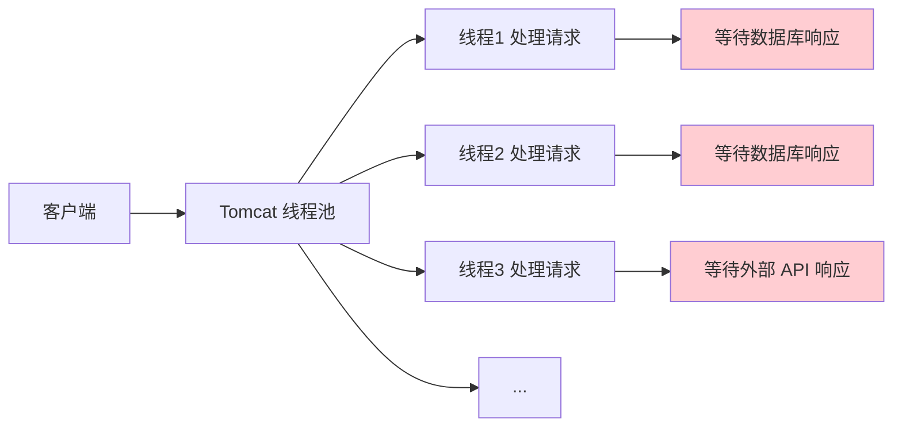
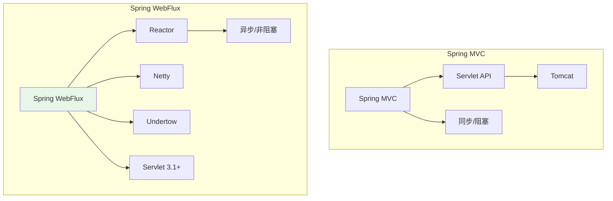
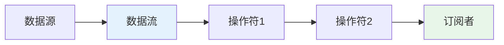
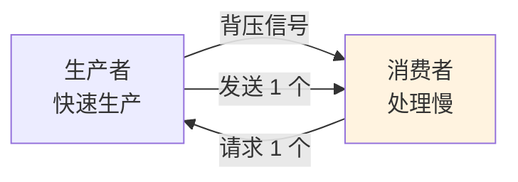
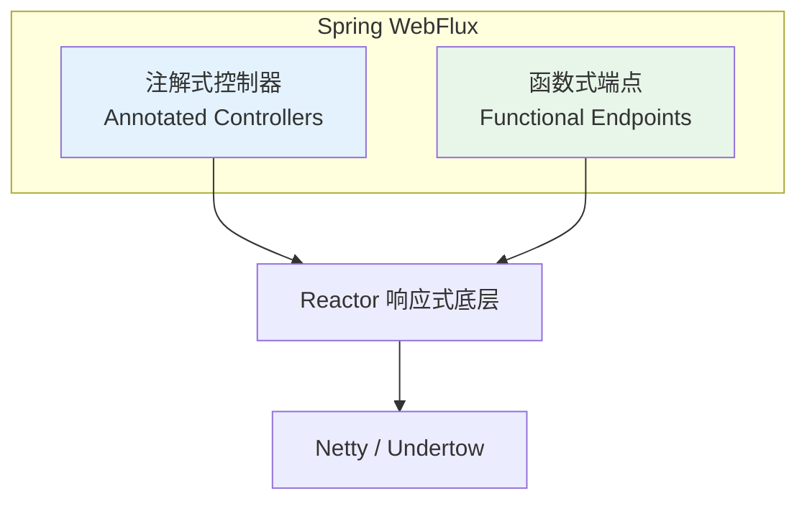

# Spring WebFlux 编程模型与实战

## 课程目标

- 理解 Spring WebFlux 的诞生背景和核心设计目标
- 掌握响应式编程的基本概念（非阻塞 I/O、背压）
- 掌握 Reactor 的核心类型：Mono 和 Flux
- 掌握 Spring WebFlux 的两种编程模型
- 理解两种编程模型的适用场景和选择原则
- 了解 WebClient 响应式 HTTP 客户端


## 从 Spring MVC 到 Spring WebFlux

### 传统 Spring MVC 的局限性

在传统的 Spring MVC 中，每个请求都会占用一个线程，直到请求处理完成。这种“每请求一线程”模型在以下场景中会遇到瓶颈：



当请求需要等待 I/O 操作（如数据库查询、远程 API 调用）时，线程会**阻塞等待**，此时线程无法处理其他请求，造成资源浪费。

| 问题               | 说明                                 |
| ------------------ | ------------------------------------ |
| **线程资源浪费**   | 大量线程在等待 I/O 时处于阻塞状态    |
| **上下文切换开销** | 线程数量增加导致 CPU 频繁切换        |
| **并发能力受限**   | 系统支持的并发请求数受限于线程池大小 |
| **响应延迟**       | 高并发时线程排队，响应时间增加       |

### Servlet 3.1 非阻塞 I/O 的不足

Servlet 3.1 虽然提供了非阻塞 I/O 的 API，但 Servlet API 的其他部分（如 Filter）仍然是同步阻塞的。这使得在 Servlet 容器中构建完整的非阻塞应用变得困难。

### Spring WebFlux 的诞生

Spring WebFlux 是 Spring Framework 5.0 引入的响应式 Web 框架，它**完全非阻塞**，支持响应式流（Reactive Streams）规范，可以运行在 Netty、Undertow 和 Servlet 3.1+ 容器上。



> [!NOTE]
> Spring WebFlux 并不是要替代 Spring MVC。两者在 Spring Framework 中共存，开发者可以根据场景选择使用。

> [!NOTE]
>
> Spring WebFlux 是构建微服务架构核心组件Spring Cloud Gateway的基础，这也是我们课程安排 Spring WebFlux 的主要原因。


## 响应式编程核心概念

### 什么是响应式编程

**响应式编程**是一种基于异步数据流的编程范式，其核心目标是构建弹性、韧性和高效的系统，能够从容应对高并发场景下的流量波动。



### 响应式编程的核心特性

| 特性                     | 说明                                                     |
| ------------------------ | -------------------------------------------------------- |
| **非阻塞 I/O**           | 线程在等待 I/O 时可以处理其他任务，极大提升线程利用率    |
| **异步流处理**           | 将数据抽象为流，通过声明式操作符进行处理                 |
| **背压（Backpressure）** | 消费者可以根据自身处理能力，主动控制生产者的数据发送速度 |

### 什么是背压

背压是响应式编程区别于普通异步编程的关键特性。在异步通信中，如果生产者发送数据的速度远大于消费者的处理速度，会导致数据积压，最终引发内存溢出。



背压机制允许消费者根据自身处理能力，主动向生产者反馈需求，调节数据生产的速度，实现生产与消费的平衡。


## Spring WebFlux vs Spring MVC

| 特性           | Spring MVC           | Spring WebFlux                 |
| -------------- | -------------------- | ------------------------------ |
| **核心依赖**   | Servlet API          | Reactor 库（Mono/Flux）        |
| **编程模型**   | 同步/阻塞            | 异步/非阻塞                    |
| **线程模型**   | 每请求一线程         | 事件循环，少量线程处理大量请求 |
| **适用场景**   | 低并发、简单业务逻辑 | 高并发、低延迟、实时数据流     |
| **服务器**     | Tomcat、Jetty        | Netty、Undertow、Tomcat        |
| **函数式支持** | 有限                 | 原生支持函数式端点             |

> [!CAUTION]
> Spring WebFlux 适合 I/O 密集型和高并发场景，但对于 CPU 密集型任务，并不会带来性能提升。


## Reactor 核心类型

Spring WebFlux 基于 **Project Reactor** 实现，它提供了两种核心的响应式类型。

在 `pom.xml` 中添加 Project Reactor 依赖或 Spring WebFlux 依赖：

```xml
<dependency>
    <groupId>io.projectreactor</groupId>
    <artifactId>reactor-core</artifactId>
    <version>2025.0.6</version>
</dependency>

<dependency>
    <groupId>org.springframework.boot</groupId>
    <artifactId>spring-boot-starter-webflux</artifactId>
</dependency>
```

### Mono —— 0 或 1 个元素的异步序列

`Mono` 表示包含 **0 或 1 个元素** 的异步序列，适用于返回单个结果的场景。

```java
// 创建一个包含单个元素的 Mono
Mono<String> mono = Mono.just("Hello, WebFlux!");

// 创建空的 Mono
Mono<String> empty = Mono.empty();

// 创建包含异常的 Mono
Mono<String> error = Mono.error(new RuntimeException("出错了"));

// 订阅并消费数据
mono.subscribe(data -> System.out.println(data));
```

**常见使用场景：**

- 根据 ID 查询单个用户
- 单个对象的新增或更新
- 返回单个值的计算

### Flux —— 0 到 N 个元素的异步序列

`Flux` 表示包含 **0 到 N 个元素** 的异步序列，适用于返回多个结果的场景。

```java
// 创建包含多个元素的 Flux
Flux<Integer> flux = Flux.just(1, 2, 3, 4, 5);

// 从集合创建
List<String> list = Arrays.asList("a", "b", "c");
Flux<String> fluxFromList = Flux.fromIterable(list);

// 创建范围序列
Flux<Integer> range = Flux.range(1, 10);

// 订阅并消费数据
flux.subscribe(data -> System.out.println(data));
```

**常见使用场景：**

- 查询所有用户
- 流式数据处理
- 实时数据推送

### Mono 与 Flux 的转换

```java
// Flux → Mono（取第一个元素）
Flux<Integer> flux = Flux.just(1, 2, 3);
Mono<Integer> mono = flux.next();  // 只取第一个

// Mono → Flux
Mono<String> mono = Mono.just("hello");
Flux<String> fluxFromMono = mono.flux();  // 转换为 Flux

// 空值处理
Mono<Object> empty = Mono.empty();
Flux<Object> defaultFlux = empty.defaultIfEmpty("default").flux();
```


## 创建第一个 Spring WebFlux 应用

### 添加依赖

在 `pom.xml` 中添加 Spring WebFlux 依赖：

```xml
<dependency>
    <groupId>org.springframework.boot</groupId>
    <artifactId>spring-boot-starter-webflux</artifactId>
</dependency>
```

> [!NOTE]
> `spring-boot-starter-webflux` 默认使用 **Netty** 作为内嵌服务器。Netty 是异步、事件驱动的非阻塞服务器，天然适合响应式应用。关于Netty后续课程有专门的系列进行详细讲解。

### 主启动类

```java
package com.example.webfluxdemo;

@SpringBootApplication
public class WebFluxDemoApplication {
    public static void main(String[] args) {
        SpringApplication.run(WebFluxDemoApplication.class, args);
    }
}
```

### 注解式 Controller（与 Spring MVC 风格一致）

```java
package com.example.webfluxdemo.controller;

@RestController
public class HelloController {

    @GetMapping("/hello")
    public Mono<String> hello() {
        // 返回 0-1 个元素（单个字符串）
        return Mono.just("Hello, Spring WebFlux!");
    }

    @GetMapping("/users")
    public Flux<String> users() {
        // 返回 0-N 个元素（字符串列表）
        return Flux.just("Alice", "Bob", "Charlie", "Diana");
    }

    @GetMapping("/users/{id}")
    public Mono<String> getUser(@PathVariable Long id) {
        // 根据 ID 返回单个用户
        return Mono.just("User-" + id);
    }
}
```

> [!NOTE]
> 与 Spring MVC 相比，最大的变化是返回值类型：不再直接返回对象，而是返回 **`Mono<T>`** 或 **`Flux<T>`**。

### 流式响应示例

```java
package com.example.webfluxdemo.controller;

@RestController
public class StreamController {

    // 每秒推送一个数字，产生无限流
    @GetMapping(value = "/numbers", produces = MediaType.TEXT_EVENT_STREAM_VALUE)
    public Flux<Long> numbers() {
        return Flux.interval(Duration.ofSeconds(1))
                .map(i -> i + 1)
                .take(10);  // 只取前 10 个
    }

    // 流式返回用户列表
    @GetMapping(value = "/users/stream", produces = MediaType.TEXT_EVENT_STREAM_VALUE)
    public Flux<String> userStream() {
        return Flux.just("Alice", "Bob", "Charlie")
                .delayElements(Duration.ofSeconds(1));  // 每秒发送一个
    }
}
```

### 启动并测试

1. 启动应用，观察控制台日志——可以看到 Netty 启动而非 Tomcat。
2. 访问 `http://localhost:8080/hello`，返回 `Hello, Spring WebFlux!`。
3. 访问 `http://localhost:8080/users`，返回用户列表。
4. 访问 `http://localhost:8080/numbers`，观察流式返回的数字。


## Spring WebFlux 两种编程模型

Spring WebFlux 提供了两种编程模型供开发者选择，它们共享相同的响应式底层：



| 编程模型         | 说明                                                         | 风格         |
| ---------------- | ------------------------------------------------------------ | ------------ |
| **注解式控制器** | 使用 `@Controller`、`@RestController`、`@RequestMapping` 等注解，与 Spring MVC 风格一致 | 声明式、传统 |
| **函数式端点**   | 使用 `RouterFunction` 和 `HandlerFunction`，以函数式方式定义路由和处理逻辑 | 函数式、现代 |


## 注解式控制器（Annotated Controllers）

注解式控制器与 Spring MVC 的使用方式非常相似，最大的区别是方法返回响应式类型。

### Service 层实现

```java
package com.example.webfluxdemo.service;

@Service
public class UserService {

    private final Map<Long, User> store = new ConcurrentHashMap<>();
    private final AtomicLong idGenerator = new AtomicLong(1);

    public Flux<User> findAll() {
        // 返回所有用户（Flux）
        return Flux.fromIterable(store.values());
    }

    public Mono<User> findById(Long id) {
        // 根据 ID 查找（Mono），可能为空
        return Mono.justOrEmpty(store.get(id));
    }

    public Mono<User> save(User user) {
        // 保存用户
        user.setId(idGenerator.getAndIncrement());
        store.put(user.getId(), user);
        return Mono.just(user);
    }

    public Mono<User> update(User user) {
        if (store.containsKey(user.getId())) {
            store.put(user.getId(), user);
            return Mono.just(user);
        }
        return Mono.empty();  // 或抛出异常
    }

    public Mono<Void> deleteById(Long id) {
        store.remove(id);
        return Mono.empty();  // 返回空 Mono 表示完成
    }
}
```

### Controller层实现

```java
package com.example.webfluxdemo.controller;

@RestController
@RequestMapping("/api/users")
public class UserController {

    private final UserService userService;

    public UserController(UserService userService) {
        this.userService = userService;
    }

    // 查询所有用户
    @GetMapping
    public Flux<User> getAllUsers() {
        return userService.findAll();
    }

    // 根据 ID 查询单个用户
    @GetMapping("/{id}")
    public Mono<User> getUser(@PathVariable Long id) {
        return userService.findById(id);
    }

    // 创建用户
    @PostMapping
    @ResponseStatus(HttpStatus.CREATED)
    public Mono<User> createUser(@RequestBody User user) {
        return userService.save(user);
    }

    // 更新用户
    @PutMapping("/{id}")
    public Mono<User> updateUser(@PathVariable Long id, @RequestBody User user) {
        user.setId(id);
        return userService.update(user);
    }

    // 删除用户
    @DeleteMapping("/{id}")
    @ResponseStatus(HttpStatus.NO_CONTENT)
    public Mono<Void> deleteUser(@PathVariable Long id) {
        return userService.deleteById(id);
    }
}
```


## 函数式端点（Functional Endpoints）

函数式端点是 Spring WebFlux 提供的另一种编程模型，使用 `RouterFunction` 和 `HandlerFunction` 来定义路由和处理逻辑。

### 核心组件

| 组件              | 说明                                                         |
| ----------------- | ------------------------------------------------------------ |
| `RouterFunction`  | 定义路由规则，将请求路径映射到处理函数                       |
| `HandlerFunction` | 处理请求的函数，接收 `ServerRequest`，返回 `Mono<ServerResponse>` |
| `ServerRequest`   | 封装 HTTP 请求的不可变对象                                   |
| `ServerResponse`  | 封装 HTTP 响应的不可变对象                                   |

### 定义 Handler（处理函数）

```java
package com.example.webfluxdemo.handler;

@Component
public class UserHandler {

    private final UserService userService;

    public UserHandler(UserService userService) {
        this.userService = userService;
    }

    // 查询所有用户
    public Mono<ServerResponse> getAll(ServerRequest request) {
        return ServerResponse.ok()
                .contentType(MediaType.APPLICATION_JSON)
                .body(userService.findAll(), User.class);
    }

    // 根据 ID 查询单个用户
    public Mono<ServerResponse> getById(ServerRequest request) {
        Long id = Long.parseLong(request.pathVariable("id"));
        return userService.findById(id)
                .flatMap(user -> ServerResponse.ok()
                        .contentType(MediaType.APPLICATION_JSON)
                        .bodyValue(user))
                .switchIfEmpty(ServerResponse.notFound().build());
    }

    // 创建用户
    public Mono<ServerResponse> create(ServerRequest request) {
        return request.bodyToMono(User.class)
                .flatMap(userService::save)
                .flatMap(saved -> ServerResponse.status(201)
                        .contentType(MediaType.APPLICATION_JSON)
                        .bodyValue(saved));
    }

    // 删除用户
    public Mono<ServerResponse> delete(ServerRequest request) {
        Long id = Long.parseLong(request.pathVariable("id"));
        return userService.deleteById(id)
                .then(ServerResponse.noContent().build());
    }
}
```

### 定义 Router（路由配置）

```java
package com.example.webfluxdemo.config;

@Configuration
public class RouterConfig {

    @Bean
    public RouterFunction<ServerResponse> userRoutes(UserHandler handler) {
        return route(GET("/api/users"), handler::getAll)
                .andRoute(GET("/api/users/{id}"), handler::getById)
                .andRoute(POST("/api/users"), handler::create)
                .andRoute(DELETE("/api/users/{id}"), handler::delete);
    }
}
```

### 使用 RouterFunctions 组合路由

```java
@Bean
public RouterFunction<ServerResponse> combinedRoutes(UserHandler handler) {
    return route()
            .GET("/api/users", handler::getAll)
            .GET("/api/users/{id}", handler::getById)
            .POST("/api/users", handler::create)
            .DELETE("/api/users/{id}", handler::delete)
            .build();
}
```


## 注解式 vs 函数式：如何选择

| 对比维度     | 注解式控制器             | 函数式端点                 |
| ------------ | ------------------------ | -------------------------- |
| **学习曲线** | 低（与 Spring MVC 一致） | 中等（需要理解函数式编程） |
| **代码量**   | 较少                     | 较多                       |
| **灵活性**   | 有限                     | 高度灵活                   |
| **可测试性** | 良好                     | 优秀（纯函数）             |
| **适用场景** | 大多数常规 REST API      | 需要精细控制、轻量级网关   |
| **团队偏好** | 大多数团队熟悉           | 需要函数式编程基础         |

> [!NOTE]
> 两种模型可以**混合使用**，在同一个项目中部分接口使用注解式，部分使用函数式。


## WebClient 响应式 HTTP 客户端

### 什么是 WebClient

**WebClient** 是 Spring WebFlux 提供的非阻塞、响应式 HTTP 客户端，可以替代传统的阻塞式 `RestTemplate`，支持异步、流式数据处理和背压。

### 创建 WebClient

```java
@Configuration
public class WebClientConfig {

    @Bean
    public WebClient webClient() {
        return WebClient.builder()
                .baseUrl("https://localhost:8080/api")
                .defaultHeader(HttpHeaders.CONTENT_TYPE, MediaType.APPLICATION_JSON_VALUE)
                .build();
    }
}
```

### WebClient核心方法

#### 请求构建方法（HTTP 方法）

- **`get()` / `post()` / `put()` / `delete()` 等**
  这些方法用于指定 HTTP 请求方法，返回 `WebClient.RequestHeadersUriSpec`（对于 GET/HEAD/DELETE）或 `WebClient.RequestBodyUriSpec`（对于 POST/PUT/PATCH 等带请求体的方法），从而开始构建一个请求。

  ```java
  webClient.get()          // 构建 GET 请求
  webClient.post()         // 构建 POST 请求
  ```

#### URI 指定方法

- **`uri(String uri, Object... uriVariables)`**
  用于设置请求的目标路径，支持路径变量占位符（`{id}`）。后续参数按顺序替换占位符，也可使用 `Map` 或 `URI` 对象。该方法返回当前构建器，支持链式调用。

  ```java
  .uri("/users/{id}", id)          // 路径变量替换
  .uri("/users")                   // 静态路径
  ```

#### 请求体设置方法（仅用于 POST/PUT/PATCH）

- **`bodyValue(Object body)`**
  直接设置请求体对象，框架会自动进行序列化（如 JSON）。适用于简单对象。

  ```java
  .bodyValue(user)
  ```

- **`body(Publisher<?> publisher, Class<?> elementClass)`**
  用于流式发送响应式数据源（如 `Flux`、`Mono`），适合大数据或流式场景。
  例如：`.body(Flux.just(user1, user2), User.class)`。

#### 响应获取方法

**`retrieve()`** （最常用）

直接获取响应体，返回 `WebClient.ResponseSpec`，提供对响应状态码和体的便捷处理。之后必须调用 `bodyToMono` 或 `bodyToFlux` 来提取响应体。

- **`bodyToMono(Class<T> targetClass)`**
  将响应体反序列化为一个 `Mono<T>`（适用于单个对象）。

- **`bodyToFlux(Class<T> targetClass)`**
  将响应体反序列化为一个 `Flux<T>`（适用于集合或流式数据）。

  ```java
  .retrieve()
  .bodyToMono(User.class)   // 返回 Mono<User>
  .bodyToFlux(User.class)   // 返回 Flux<User>
  ```

**`exchangeToMono(Function<ClientResponse, Mono<T>> handler)`**

更底层的响应处理方式，可以访问完整的 `ClientResponse`（包括状态码、头部、Cookie 等），适用于需要精细控制响应处理的场景（如检查响应头、处理不同状态码等）。使用后需手动释放或消费响应体。

#### 错误处理（状态码处理）

- **`onStatus(Predicate<HttpStatus> statusPredicate, Function<ClientResponse, Mono<? extends  Throwable>> exceptionFunction)`**
  属于 `ResponseSpec` 的方法，用于针对特定的 HTTP 状态码自定义异常转换。当响应状态匹配谓词时，执行异常函数，最终抛出指定的错误。

  ```java
  .onStatus(status -> status.is4xxClientError(),
            response -> Mono.error(new RuntimeException("用户不存在")))
  ```

  还可以链式调用多个 `onStatus`，分别处理 404、500 等。若不处理，默认对 4xx/5xx 响应会抛出 `WebClientResponseException`。

### 调用WebFlux服务

```java
@Service
public class ExternalApiService {

    private final WebClient webClient;

    public ExternalApiService(WebClient webClient) {
        this.webClient = webClient;
    }

    // GET 请求
    public Mono<User> fetchUser(Long id) {
        return webClient.get()
                .uri("/users/{id}", id)
                .retrieve()
                .bodyToMono(User.class);
    }

    // GET 请求返回列表
    public Flux<User> fetchAllUsers() {
        return webClient.get()
                .uri("/users")
                .retrieve()
                .bodyToFlux(User.class);
    }

    // POST 请求
    public Mono<User> createUser(User user) {
        return webClient.post()
                .uri("/users")
                .bodyValue(user)
                .retrieve()
                .bodyToMono(User.class);
    }

    // 带错误处理
    public Mono<User> fetchUserWithErrorHandling(Long id) {
        return webClient.get()
                .uri("/users/{id}", id)
                .retrieve()
                .onStatus(status -> status.is4xxClientError(), 
                        response -> Mono.error(new RuntimeException("用户不存在")))
                .bodyToMono(User.class);
    }
}
```

### WebClient vs RestTemplate

| 对比            | RestTemplate         | WebClient             |
| --------------- | -------------------- | --------------------- |
| **阻塞/非阻塞** | 阻塞                 | 非阻塞                |
| **响应式支持**  | 有限                 | 原生支持（Mono/Flux） |
| **流式处理**    | 不支持               | 支持                  |
| **背压**        | 不支持               | 支持                  |
| **未来趋势**    | 维护模式（部分弃用） | 推荐使用              |


## 注意事项

### 避免阻塞操作

在 WebFlux 中，**任何阻塞操作都会破坏响应式架构**。以下操作需要避免：

```java
// ❌ 错误：阻塞操作
User user = userRepository.findById(id).block();  // 不要使用 block()！
Thread.sleep(1000);  // 不要使用 Thread.sleep()！

// ✅ 正确：非阻塞方式
Mono<User> userMono = userRepository.findById(id);
return userMono.delayElement(Duration.ofSeconds(1));
```

### 线程模型

WebFlux 使用**少量事件循环线程**处理所有请求，因此**不要在线程局部变量（如 ThreadLocal）中存储数据**。

### 调试困难

响应式编程的异步特性使得调试比同步代码更困难。建议使用 `log()` 操作符进行调试：

```java
Flux.just(1, 2, 3)
    .log()  // 打印每个操作
    .map(i -> i * 2)
    .subscribe();
```

### 选择合适的场景

WebFlux 适合 **I/O 密集型**和**高并发**场景。对于 **CPU 密集型**任务，传统阻塞模型可能更合适。


## 小结

本节课我们学习了：

1. **Spring MVC 的局限性**：每请求一线程模型在 I/O 等待时浪费线程资源。
2. **Spring WebFlux 的诞生**：Spring 5.0 引入的响应式 Web 框架，完全非阻塞，支持背压。
3. **响应式编程核心概念**：非阻塞 I/O、异步流处理、背压。

4. **Spring WebFlux两种编程模型**：

   - **注解式控制器**：与 Spring MVC 风格一致，返回 `Mono`/`Flux`

   - **函数式端点**：使用 `RouterFunction` + `HandlerFunction`


5. **注解式控制器实战**：CRUD 接口、Service 层、异常处理

6. **函数式端点实战**：Handler 定义、Router 配置、路由组合

7. **WebClient**：响应式 HTTP 客户端，替代 RestTemplate


## 作业

### 作业一：代码阅读——编程模型识别

阅读以下代码，判断使用的是哪种编程模型。

```java
@RestController
@RequestMapping("/api/orders")
public class OrderController {
    @GetMapping("/{id}")
    public Mono<Order> getOrder(@PathVariable Long id) { ... }
}
```

```java
@Component
public class OrderHandler {
    public Mono<ServerResponse> handleGet(ServerRequest request) { ... }
}

@Configuration
public class OrderRouter {
    @Bean
    public RouterFunction<ServerResponse> routes(OrderHandler handler) {
        return route(GET("/api/orders/{id}"), handler::handleGet);
    }
}
```

**问题：**

1. 第一段代码使用了什么编程模型？为什么？
2. 第二段代码使用了什么编程模型？为什么？
3. 两种模型的 `ServerRequest` 和 `@PathVariable` 分别如何获取路径参数？

------

### 作业二：函数式端点实现

将第 1 课中的 `HelloController` 改写为函数式端点实现：

1. 创建 `HelloHandler`，包含 `hello`、`helloName`、`names` 三个处理方法。
2. 创建 `HelloRouter`，配置对应的路由。
3. 启动应用，测试所有接口与第 1 课结果一致。

------

### 作业三：集成 WebClient 调用外部 API

在 WebFlux 项目中，使用 WebClient 调用一个免费的公共 API：

1. 配置 `WebClient` Bean，baseUrl 设置为 `https://jsonplaceholder.typicode.com`。
2. 创建 `PostService`，使用 WebClient 调用 `/posts` 接口：
   - `getAllPosts()`：返回 `Flux<Post>`
   - `getPostById(Long id)`：返回 `Mono<Post>`
3. 创建对应的 Controller，暴露 `/api/posts` 和 `/api/posts/{id}` 接口。
4. 启动应用，测试接口。

**Post 实体：**

```java
public class Post {
    private Long id;
    private Long userId;
    private String title;
    private String body;
    // Getter/Setter...
}
```
