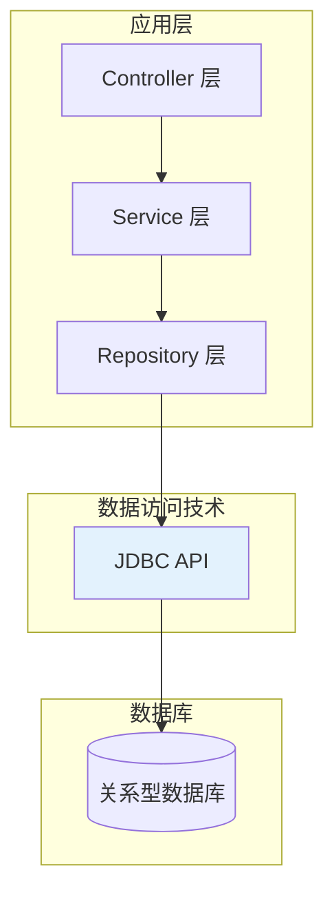
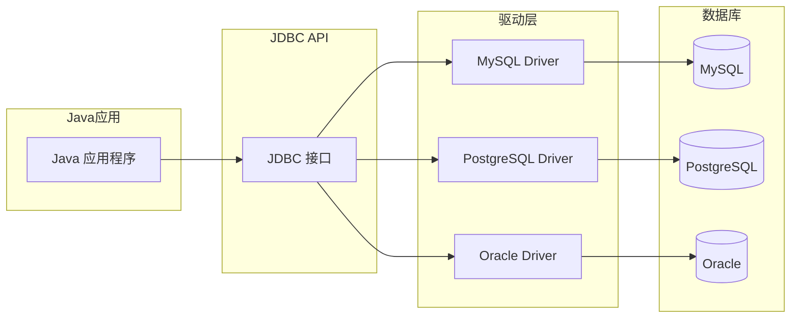
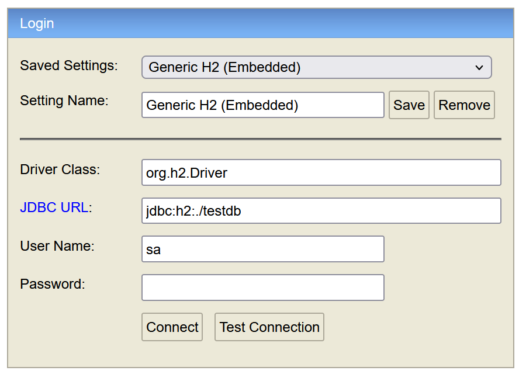
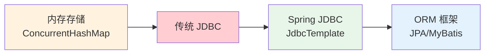

# JDBC 规范解析

## 课程目标

- 理解 JDBC 规范的基本概念和在 Java 生态中的地位
- 掌握 JDBC 的核心接口和类（DriverManager、Connection、Statement、ResultSet）
- 能够编写传统的 JDBC 代码完成 CRUD 操作
- 理解传统 JDBC 开发的核心痛点
- 了解 Spring JDBC 如何解决这些问题


## 数据访问层次概述

### 应用程序数据访问架构

一个典型的 Java 应用通过分层架构访问数据库：



### 数据访问技术的演进

| 阶段        | 技术                             | 特点                             |
| ----------- | -------------------------------- | -------------------------------- |
| 原生 JDBC   | `java.sql.*`                     | 最底层，代码重复，需手动管理资源 |
| Spring JDBC | `JdbcTemplate`                   | 模板化，自动资源管理，异常封装   |
| ORM 框架    | JPA / Hibernate / MyBatis        | 对象-关系映射，生产力更高        |
| Spring Data | Spring Data JPA / JDBC / MongoDB | 统一抽象，Repository 模式        |

> [!NOTE]
> 本系列课程从最基础的 JDBC 开始，逐步演进到 Spring JDBC 和 ORM 框架。理解底层原理有助于更好地使用上层工具。


## JDBC 规范概述

### 什么是 JDBC

**JDBC（Java Database Connectivity）** 是 Java 语言访问关系型数据库的标准 API，由 `java.sql` 和 `javax.sql` 包组成。它定义了一套统一的接口，让 Java 程序可以通过相同的方式访问不同的数据库。



> [!NOTE]
> JDBC 是一套“接口规范”，具体实现由各数据库厂商提供（称为数据库驱动）。开发者只需要面向 JDBC 接口编程，更换数据库时只需更换驱动和连接信息，代码逻辑无需修改。


### JDBC 核心接口

| 接口                | 说明                                     |
| ------------------- | ---------------------------------------- |
| `DriverManager`     | 管理 JDBC 驱动，创建数据库连接           |
| `Connection`        | 代表与数据库的物理连接                   |
| `Statement`         | 执行静态 SQL 语句                        |
| `PreparedStatement` | 执行预编译 SQL 语句（防 SQL 注入，推荐） |
| `ResultSet`         | 封装查询结果集                           |
| `SQLException`      | JDBC 操作中的异常                        |

#### `DriverManager`（驱动管理器）

- **核心职责**：作为 JDBC 架构的“服务注册中心”，负责加载并注册数据库驱动（如 MySQL、Oracle 的驱动类），并根据传入的 JDBC URL 从已注册的驱动列表中匹配合适的驱动，从而建立与数据库的物理连接。
- **关键方法**：`getConnection(String url, String user, String password)`。
- **展开说明**：
  - **自动加载**：JDBC 4.0+ 利用 SPI（服务提供者机制），驱动包中的 `META-INF/services` 会被自动扫描，不再需要手动执行 `Class.forName()`。
  - **连接参数**：除了用户名密码，还可在 URL 后追加参数（如 `?useSSL=false&serverTimezone=UTC`），或通过 `Properties` 对象传入超时时间、连接池初始大小等扩展属性。
  - **注意事项**：该接口是重量级的静态工厂，通常在应用启动时初始化一次，不建议在业务代码中频繁调用（实际生产环境多交给 HikariCP 等连接池代理）。

------

#### `Connection`（数据库连接）

- **核心职责**：代表与数据库服务器之间的一个网络会话（Session）。它是执行 SQL 语句的上下文环境，也是事务管理的核心边界。
- **关键方法**：`createStatement()`、`prepareStatement(String sql)`、`setAutoCommit(boolean)`、`commit()`、`rollback()`、`close()`。
- **展开说明**：
  - **事务控制**：默认是自动提交（`autoCommit=true`），即每条 DML 语句执行后立即持久化。为了确保业务原子性（如转账），需关闭自动提交（`setAutoCommit(false)`），在全部成功时 `commit()`，异常时 `rollback()`。
  - **隔离级别**：可通过 `setTransactionIsolation()` 设置读未提交、读已提交、可重复读、串行化，以平衡数据一致性与并发性能。
  - **资源管理**：`Connection` 是重量级资源，必须在使用后显式关闭（建议放在 `try-with-resources` 中），否则会导致连接泄露，耗尽数据库连接数。

------

#### `Statement`（静态 SQL 执行器）

- **核心职责**：用于执行**静态**的 SQL 语句（即 SQL 字符串在编译时已完全确定），并将执行后的结果返回。
- **关键方法**：`executeQuery(String sql)`（查询）、`executeUpdate(String sql)`（增删改/DDL）、`execute(String sql)`（通用）。
- **展开说明**：
  - **致命缺陷（SQL 注入）**：因为 SQL 语句是通过字符串拼接形成的（如 `"SELECT * FROM user WHERE id=" + id`），若参数 `id` 包含恶意 `' OR '1'='1`，会导致整个表数据泄露。**极度不推荐在生产查询代码中使用**。
  - **性能短板**：每次执行时，数据库都需要对 SQL 进行语法解析、编译和生成执行计划，无法复用缓存，在循环批量执行时效率极低。
  - **适用场景**：仅适合执行无需参数参与的 DDL 语句（如 `CREATE TABLE`）或数据库元数据查询。

------

#### `PreparedStatement`（预编译 SQL 执行器，⭐推荐）

- **核心职责**：继承自 `Statement`，在创建时即传入带占位符（`?`）的 SQL 模板，发送给数据库进行**预编译**（生成执行计划），后续仅需传入参数即可复用执行计划。
- **关键方法**：`setXxx(int index, Xxx value)`（如 `setString`、`setInt`）、`executeQuery()`、`executeUpdate()`。
- **展开说明**：
  - **防 SQL 注入（核心优势）**：预编译机制将参数内容视为**纯数据**而非 SQL 语法结构，即使参数包含恶意关键字，也不会被数据库解析为指令，从根本上杜绝了注入风险。
  - **性能飞跃**：在批量操作（`addBatch()` + `executeBatch()`）场景下，只需传输参数数据，网络开销小，且数据库无需重复解析，批量插入数万条记录时性能提升数倍。
  - **注意事项**：占位符 `?` **仅支持字段值**，不能用于表名、列名、SQL 关键字（如 `ORDER BY` 后的字段名）等元数据。此外，MySQL 默认未开启服务端预编译（需在 URL 中加 `useServerPrepStmts=true`）。

------

#### `ResultSet`（结果集）

- **核心职责**：封装数据库返回的**临时数据表**（包含行和列），提供游标（Cursor）来逐行遍历查询结果，并提取每一列的值。
- **关键方法**：`next()`（移动游标并判断是否有下一行）、`getString(int columnIndex)`、`getString(String columnLabel)`、`getObject()`、`close()`。
- **展开说明**：
  - **游标模式**：默认类型为 `TYPE_FORWARD_ONLY`（只能向前滚动），如需支持双向滚动或游标定位（`absolute`、`previous`），需在 `createStatement` 或 `prepareStatement` 时指定 `ResultSet.TYPE_SCROLL_INSENSITIVE`。
  - **数据提取**：建议优先使用**列名**（`getString("name")`）而非列索引（`getString(1)`），以增强代码可读性和抗字段顺序变更的能力。注意 JDBC 索引从 1 开始。
  - **生命周期**：`ResultSet` 必须依附于开启状态的 `Statement` 和 `Connection`。一旦父级 `Statement` 关闭（或者再次执行新的查询），当前的 `ResultSet` 会自动关闭。为了避免内存泄漏，建议显式调用 `close()`。

------

#### `SQLException`（数据库异常）

- **核心职责**：JDBC 操作中所有与数据库交互相关的**受查异常（Checked Exception）** 的根类，用于捕获连接失败、语法错误、约束冲突、锁超时等数据库层级的错误。
- **关键方法**：`getErrorCode()`（数据库厂商特定的错误码）、`getSQLState()`（遵循 X/Open 标准的 SQL 状态码，如 "23000" 表示违反约束）、`getNextException()`（支持异常链）。
- **展开说明**：
  - **异常链机制**：一个 JDBC 操作可能触发多个底层异常（如网络超时 + 回滚失败），通过 `getNextException()` 可以遍历完整的异常链表，不要只看第一个异常。
  - **处理策略**：捕获后务必将错误信息转化为业务可读的提示（而非直接抛出堆栈给前端）；在事务上下文中，捕获到 `SQLException` 后通常需要调用 `Connection.rollback()` 释放资源锁。
  - **现代替代**：Spring 等框架会将 `SQLException` 封装为非受查异常（如 `DataAccessException`），避免业务代码中反复 try-catch。

### 基本使用流程


## 传统 JDBC 开发实战

### 准备工作：数据库与依赖

#### 引入H2 内存数据库

H2 数据库是一个用纯 Java 编写的开源关系型数据库。它最特别的地方在于**支持全内存运行**——数据可以完全存储在 JVM 的内存中，而不是硬盘上。因此，它常被称为“内存数据库”。

它本身只是一个 **JAR 包（约 2MB）** ，可以直接嵌入到 Java 应用中，无需单独安装和配置数据库服务器。

下载地址：https://www.h2database.com/html/download.html。解压并直接执行`h2.bat`命令即可。



Maven 依赖如下：

```xml
<dependency>
    <groupId>com.h2database</groupId>
    <artifactId>h2</artifactId>
    <version>2.2.224</version>
    <scope>runtime</scope>
</dependency>
```

> [!NOTE]
> 先使用 H2 内存数据库，无需安装额外的数据库软件，方便演示和测试，后续升级到PostgreSQL。

#### 数据库表结构（H2 内存数据库示例）

定义schema.sql：

```sql
CREATE TABLE book (
    id BIGINT AUTO_INCREMENT PRIMARY KEY,
    title VARCHAR(100) NOT NULL,
    author VARCHAR(50) NOT NULL,
    price DECIMAL(10, 2) NOT NULL,
    stock INT NOT NULL
);
```

定义data.sql

```sql
INSERT INTO book (title, author, price, stock) VALUES
    ('Spring Boot 实战', 'Craig Walls', 79.00, 10),
    ('Java 核心技术', 'Cay S. Horstmann', 89.00, 8),
    ('深入理解 Java 虚拟机', '周志明', 129.00, 5);
```


### 查询操作

```java
import java.sql.*;

public class JdbcQueryDemo {

    public static void main(String[] args) {
        Connection conn = null;
        Statement stmt = null;
        ResultSet rs = null;

        try {
            // 1. 加载驱动（JDBC 4.0+ 可省略，但仍建议保留）
            Class.forName("org.h2.Driver");

            // 2. 建立连接
            String url = "jdbc:h2:~/testdb;DB_CLOSE_DELAY=-1";
            String user = "sa";
            String password = "";
            conn = DriverManager.getConnection(url, user, password);

            // 3. 创建 Statement
            stmt = conn.createStatement();

            // 4. 执行查询
            String sql = "SELECT id, title, author, price, stock FROM book";
            rs = stmt.executeQuery(sql);

            // 5. 处理结果集
            System.out.println("=== 图书列表 ===");
            while (rs.next()) {
                Long id = rs.getLong("id");
                String title = rs.getString("title");
                String author = rs.getString("author");
                Double price = rs.getDouble("price");
                int stock = rs.getInt("stock");
                System.out.printf("ID: %d, 书名: %s, 作者: %s, 价格: %.2f, 库存: %d%n",
                        id, title, author, price, stock);
            }

        } catch (ClassNotFoundException e) {
            System.err.println("未找到数据库驱动: " + e.getMessage());
        } catch (SQLException e) {
            System.err.println("数据库操作失败: " + e.getMessage());
        } finally {
            // 6. 释放资源
            try {
                if (rs != null) rs.close();
                if (stmt != null) stmt.close();
                if (conn != null) conn.close();
            } catch (SQLException e) {
                e.printStackTrace();
            }
        }
    }
}
```

> [!NOTE]
>
> `DB_CLOSE_DELAY=-1` 确保应用关闭前数据库不关闭。

### 插入操作

```java
public class JdbcInsertDemo {

    public static void main(String[] args) {
        // 使用 PreparedStatement 防止 SQL 注入
        String sql = "INSERT INTO book (title, author, price, stock) VALUES (?, ?, ?, ?)";

        try (Connection conn = DriverManager.getConnection(
                "jdbc:h2:~/testdb;DB_CLOSE_DELAY=-1", "sa", "");
             PreparedStatement pstmt = conn.prepareStatement(sql)) {

            // 设置参数
            pstmt.setString(1, "Spring 源码深度解析");
            pstmt.setString(2, "郝佳");
            pstmt.setDouble(3, 99.00);
            pstmt.setInt(4, 3);

            // 执行插入
            int rows = pstmt.executeUpdate();
            System.out.println("成功插入 " + rows + " 条记录");

        } catch (SQLException e) {
            System.err.println("插入失败: " + e.getMessage());
        }
    }
}
```

### 更新和删除操作

```java
public class JdbcUpdateDemo {

    public static void main(String[] args) {
        // 更新操作
        String updateSql = "UPDATE book SET price = ? WHERE id = ?";

        try (Connection conn = DriverManager.getConnection(
                "jdbc:h2:~/testdb;DB_CLOSE_DELAY=-1", "sa", "");
             PreparedStatement pstmt = conn.prepareStatement(updateSql)) {

            pstmt.setDouble(1, 89.00);
            pstmt.setLong(2, 1L);
            int rows = pstmt.executeUpdate();
            System.out.println("更新了 " + rows + " 条记录");

        } catch (SQLException e) {
            System.err.println("更新失败: " + e.getMessage());
        }

        // 删除操作
        String deleteSql = "DELETE FROM book WHERE id = ?";

        try (Connection conn = DriverManager.getConnection(
                "jdbc:h2:mem:testdb;DB_CLOSE_DELAY=-1", "sa", "");
             PreparedStatement pstmt = conn.prepareStatement(deleteSql)) {

            pstmt.setLong(1, 3L);
            int rows = pstmt.executeUpdate();
            System.out.println("删除了 " + rows + " 条记录");

        } catch (SQLException e) {
            System.err.println("删除失败: " + e.getMessage());
        }
    }
}
```

> [!NOTE]
> 使用 `PreparedStatement` 而不是 `Statement` 可以防止 SQL 注入，并且参数化查询的性能更好（数据库可以缓存执行计划）。


## 传统 JDBC 的痛点分析

通过上面的代码，我们可以清晰地看到传统 JDBC 开发的主要痛点：

### 痛点一：重复代码过多

每个数据库操作都需要重复以下步骤：

- 获取连接
- 创建 Statement
- 执行 SQL
- 处理结果集
- 关闭资源

在大型项目中，这些重复代码占据了大量篇幅，降低了开发效率。

### 痛点二：资源管理繁琐

```java
// 需要手动关闭每个资源，而且顺序不能错
try {
    if (rs != null) rs.close();
    if (stmt != null) stmt.close();
    if (conn != null) conn.close();
} catch (SQLException e) {
    e.printStackTrace();
}
```

忘记关闭连接会导致**连接泄漏**，最终耗尽数据库连接池，应用崩溃。

### 痛点三：异常处理冗长

```java
try {
    // 业务代码
} catch (SQLException e) {
    // 每个方法都要写类似的异常处理
}
```

`SQLException` 是一个受检异常，必须捕获或声明。每个方法都要重复写 try-catch，代码臃肿。

### 痛点四：结果集映射繁琐

```java
Book book = new Book();
book.setId(rs.getLong("id"));
book.setTitle(rs.getString("title"));
book.setAuthor(rs.getString("author"));
book.setPrice(rs.getDouble("price"));
book.setStock(rs.getInt("stock"));
```

需要手动将 `ResultSet` 的每列映射到 Java 对象的每个字段。当字段很多时，代码量巨大且容易出错。

### 痛点五：SQL 与 Java 代码耦合

SQL 语句直接写在 Java 代码中，修改 SQL 需要重新编译。在大型项目中，SQL 的调试和维护困难。


## Spring JDBC 解决方案预览

Spring JDBC 框架（`spring-jdbc` 模块）针对上述痛点提供了优雅的解决方案：

| 痛点       | Spring JDBC 解决方案                                      |
| ---------- | --------------------------------------------------------- |
| 重复代码   | `JdbcTemplate` 模板方法封装了重复步骤                     |
| 资源管理   | 自动管理连接和 Statement 的关闭                           |
| 异常处理   | 将 `SQLException` 转换为非受检异常 `DataAccessException`  |
| 结果集映射 | `RowMapper` 和 `ResultSetExtractor` 统一映射逻辑          |
| SQL 耦合   | 支持外部化配置，但实际仍写在代码中（后续 ORM 进一步解决） |

```java
// 对比：使用 Spring JDBC 后的代码（预览）
JdbcTemplate jdbcTemplate = new JdbcTemplate(dataSource);

// 查询单条
Book book = jdbcTemplate.queryForObject(
    "SELECT * FROM book WHERE id = ?",
    new BeanPropertyRowMapper<>(Book.class),
    id
);

// 查询列表
List<Book> books = jdbcTemplate.query(
    "SELECT * FROM book",
    new BeanPropertyRowMapper<>(Book.class)
);
```

> [!NOTE]
> Spring JDBC 将代码量减少了 70% 以上，资源管理交给框架，异常统一处理。后续课程将详细讲解。


## 在图书管理系统中的应用

### 当前状态

在前面的 Spring Boot 课程中，我们使用 `ConcurrentHashMap` 实现了**内存存储**，数据在应用重启后丢失。

```java
@Repository
public class BookRepository {
    private final Map<Long, Book> store = new ConcurrentHashMap<>();
    // ...
}
```

### 演进方向

从下一课开始，我们将用 **Spring JDBC** 替换内存存储，实现真正的数据库持久化。

```java
// 未来代码
@Repository
public class BookRepository {
    @Autowired
    private JdbcTemplate jdbcTemplate;

    public Book save(Book book) {
        // 使用 JdbcTemplate 插入数据库
    }

    public Book findById(Long id) {
        // 使用 JdbcTemplate 查询数据库
    }
}
```

### 演进路线图




## 小结

本节课我们学习了：

1. **数据访问层次架构**：应用程序通过 JDBC 访问数据库，Spring 提供了更高层次的抽象。
2. **JDBC 规范**：Java 标准数据库访问 API，核心接口包括 `DriverManager`、`Connection`、`Statement`、`PreparedStatement`、`ResultSet`。
3. **传统 JDBC 开发流程**：加载驱动 → 建立连接 → 创建 Statement → 执行 SQL → 处理结果集 → 释放资源。
4. **传统 JDBC 的五大痛点**：
   - 重复代码多
   - 资源管理繁琐
   - 异常处理冗长
   - 结果集映射繁琐
   - SQL 与 Java 代码耦合
5. **Spring JDBC 预览**：通过 `JdbcTemplate` 简化 JDBC 操作，后续课程详细展开。
6. **图书管理系统的演进**：从内存存储逐步演进到真实数据库持久化。


## 作业

### 作业一：代码阅读——JDBC 流程识别

阅读以下代码片段，回答问题。

```java
Connection conn = null;
PreparedStatement pstmt = null;
ResultSet rs = null;

try {
    conn = DriverManager.getConnection(url, user, password);
    pstmt = conn.prepareStatement("SELECT * FROM user WHERE age > ?");
    pstmt.setInt(1, 18);
    rs = pstmt.executeQuery();
    while (rs.next()) {
        System.out.println(rs.getString("name"));
    }
} catch (SQLException e) {
    e.printStackTrace();
} finally {
    if (rs != null) try { rs.close(); } catch (SQLException e) {}
    if (pstmt != null) try { pstmt.close(); } catch (SQLException e) {}
    if (conn != null) try { conn.close(); } catch (SQLException e) {}
}
```

**问题：**

1. 该代码使用了 `Statement` 还是 `PreparedStatement`？两者有什么区别？
2. 参数 `18` 是如何传递到 SQL 中的？为什么这种方式比字符串拼接更安全？
3. 该代码缺少了什么？如果 `conn` 获取失败，代码会怎样？
4. 如果数据库查询返回的 `name` 列为 `null`，`rs.getString("name")` 会返回什么？

------

### 作业二：实现简单的 JDBC 查询

基于图书管理系统的数据表，手动编写 JDBC 代码完成以下功能：

1. 初始化 H2 数据库，创建 `book` 表并插入 3 条示例数据。
2. 编写 `findByPriceRange` 方法，接受 `minPrice` 和 `maxPrice`，查询价格在指定范围内的图书。
3. 编写 `countByAuthor` 方法，接受 `author`，统计该作者的图书数量。
4. 在 `main` 方法中测试这两个方法，并打印结果。

------

### 作业三：JDBC 痛点分析与改进思路

观察作业二中自己编写的 JDBC 代码，回答以下问题：

1. 你的代码中哪些部分出现了重复？
2. 如果要在 `findByPriceRange` 和 `countByAuthor` 中复用相同的获取连接的逻辑，你会怎么做？
3. 针对“结果集映射”的痛点，是否可以考虑用反射或工具类简化？请简述思路。
