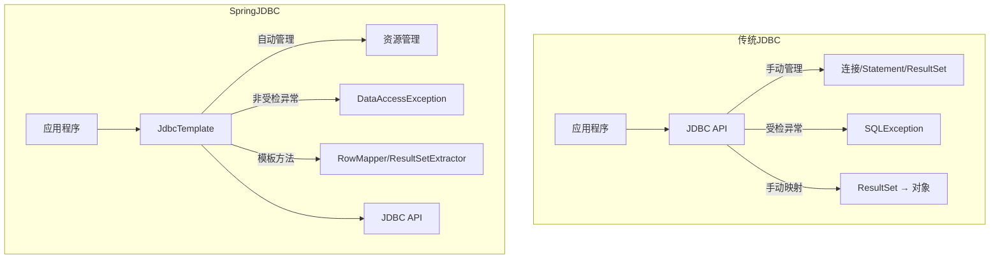
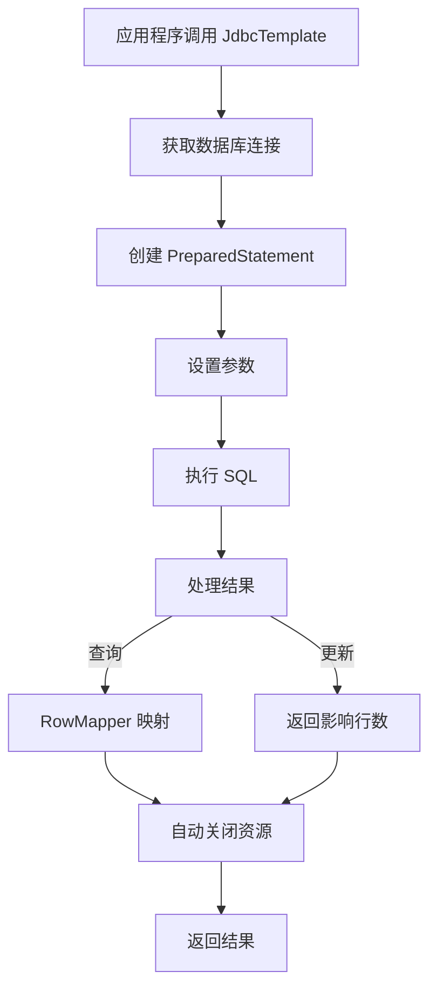

# Spring JDBC解决方案与JdbcTemplate基础

## 课程目标

- 了解 Spring JDBC 的整体架构和设计目标
- 掌握在 Spring Boot 中配置数据源和 JdbcTemplate
- 掌握使用 JdbcTemplate 完成基础 CRUD 操作
- 掌握使用 RowMapper 映射查询结果
- 能够将图书管理系统的 Repository 从内存存储迁移到 JdbcTemplate


## 从传统 JDBC 到 Spring JDBC

### 回顾传统 JDBC 的痛点

上一节课我们通过实际代码体验了传统 JDBC 开发，总结出以下痛点：

| 痛点         | 表现                                                     |
| ------------ | -------------------------------------------------------- |
| **重复代码** | 每次操作都要获取连接、创建 Statement、处理异常、关闭资源 |
| **资源管理** | 容易忘记关闭连接导致资源泄漏                             |
| **异常处理** | SQLException 是受检异常，代码冗长                        |
| **结果映射** | 手动将 ResultSet 转换为 Java 对象，繁琐且易错            |
| **耦合度高** | SQL 散落在业务代码中，难以维护                           |

### Spring JDBC 的设计目标

Spring JDBC（`spring-jdbc` 模块）是 Spring 框架对 JDBC 的封装，旨在**简化 JDBC 操作**，让开发者专注于 SQL 和结果处理，而非底层资源管理。



### Spring JDBC 的核心组件

| 组件                   | 说明                                       |
| ---------------------- | ------------------------------------------ |
| **JdbcTemplate**       | 核心类，封装了所有 JDBC 操作，提供模板方法 |
| **DataSource**         | 数据源，管理数据库连接池                   |
| **RowMapper**          | 将 ResultSet 的一行映射为 Java 对象        |
| **ResultSetExtractor** | 将整个 ResultSet 映射为任意结果            |
| **SimpleJdbcInsert**   | 简化 INSERT 操作（下一课介绍）             |
| **SimpleJdbcCall**     | 简化存储过程调用（很少使用）               |


## 配置数据源与 JdbcTemplate

### 添加依赖

在 `pom.xml` 中添加 Spring JDBC 和数据库驱动依赖：

```xml
<!-- Spring JDBC 支持 -->
<dependency>
    <groupId>org.springframework.boot</groupId>
    <artifactId>spring-boot-starter-jdbc</artifactId>
</dependency>

<!-- H2 数据库（开发测试使用） -->
<dependency>
    <groupId>com.h2database</groupId>
    <artifactId>h2</artifactId>
    <scope>runtime</scope>
</dependency>
```

> [!NOTE]
>
> `spring-boot-starter-jdbc` 自动包含了 `spring-jdbc`、`spring-tx`（事务支持）和 HikariCP 连接池。

### 配置数据源

在 `application.yml` 中配置数据源：

```yaml
spring:
  datasource:
    driver-class-name: org.h2.Driver
    url: jdbc:h2:mem:bookdb;DB_CLOSE_DELAY=-1;MODE=MySQL
    username: sa
    password:
    # H2 控制台（便于查看数据）
  h2:
    console:
      enabled: true
      path: /h2-console # 可以通过/h2-console进行数据库可视化访问
```

> [!NOTE]
>
> `MODE=MySQL` 让 H2 兼容部分 MySQL 语法。

### 初始化数据库表

在 `src/main/resources/schema.sql` 中创建表结构（Spring Boot 启动时会自动执行）：

```sql
-- schema.sql
CREATE TABLE IF NOT EXISTS book (
    id BIGINT AUTO_INCREMENT PRIMARY KEY,
    title VARCHAR(100) NOT NULL,
    author VARCHAR(50) NOT NULL,
    price DECIMAL(10, 2) NOT NULL,
    stock INT NOT NULL,
    category VARCHAR(20),
    created_at TIMESTAMP DEFAULT CURRENT_TIMESTAMP,
    updated_at TIMESTAMP DEFAULT CURRENT_TIMESTAMP
);
```

在 `src/main/resources/data.sql` 中插入初始数据：

```sql
-- data.sql
INSERT INTO book (title, author, price, stock, category) VALUES
('Spring Boot 实战', 'Craig Walls', 79.00, 10, '编程'),
('Java 核心技术', 'Cay S. Horstmann', 89.00, 8, '编程'),
('深入理解 Java 虚拟机', '周志明', 129.00, 5, '编程'),
('百年孤独', '马尔克斯', 55.00, 6, '小说'),
('时间简史', '霍金', 45.00, 4, '科学');
```

> [!NOTE]
>
> Spring Boot 启动时自动执行 `schema.sql` 和 `data.sql`（如果存在）。这在开发测试阶段非常方便。

**自定义文件位置**：你也可以通过配置 `application.properties` 来自定义脚本文件的位置，同时，确保数据库初始化配置开启：

```yaml
spring:
  datasource:
    url: jdbc:h2:./bookdb # 关键：指定数据库文件名，指向当前工作目录
    driver-class-name: org.h2.Driver
    username: sa
    password:
  sql:
    init:
      schema-locations: classpath:db/schema.sql
      data-locations: classpath:db/data.sql
      mode: always
  h2:
    console:
      enabled: true # 可以通过/h2-console进行数据库可视化访问
```


### 配置 JdbcTemplate

Spring Boot 自动配置了 `JdbcTemplate`，可以直接注入使用：

```java
@Repository
public class BookRepository {
    @Autowired
    private JdbcTemplate jdbcTemplate;
    // 直接使用即可
}
```

如果需要自定义配置（如查询超时、获取生成的主键等），可以创建配置类：

```java
@Configuration
public class JdbcConfig {
    @Bean
    public JdbcTemplate jdbcTemplate(DataSource dataSource) {
        JdbcTemplate jdbcTemplate = new JdbcTemplate(dataSource);
        jdbcTemplate.setQueryTimeout(10);  // 查询超时 10 秒
        jdbcTemplate.setFetchSize(100);    // 每次获取 100 条
        return jdbcTemplate;
    }
}
```


## JdbcTemplate 基础 CRUD

### 定义 Book 实体

```java
package com.example.bookmanager.model;

public class Book {
    private Long id;
    private String title;
    private String author;
    private Double price;
    private Integer stock;
    private String category;
    private LocalDateTime createdAt;
    private LocalDateTime updatedAt;
}
```

### RowMapper 实现

`RowMapper` 用于将 `ResultSet` 的一行映射为 `Book` 对象：

```java
package com.example.bookmanager.repository;

@Component
public class BookRowMapper implements RowMapper<Book> {
    @Override
    public Book mapRow(ResultSet rs, int rowNum) throws SQLException {
        Book book = new Book();
        book.setId(rs.getLong("id"));
        book.setTitle(rs.getString("title"));
        book.setAuthor(rs.getString("author"));
        book.setPrice(rs.getDouble("price"));
        book.setStock(rs.getInt("stock"));
        book.setCategory(rs.getString("category"));
        if (rs.getTimestamp("created_at") != null) {
            book.setCreatedAt(rs.getTimestamp("created_at").toLocalDateTime());
        }
        if (rs.getTimestamp("updated_at") != null) {
            book.setUpdatedAt(rs.getTimestamp("updated_at").toLocalDateTime());
        }
        return book;
    }
}
```

### 查询操作

#### 查询单条记录

```java
@Repository
public class BookRepository {
    @Autowired
    private JdbcTemplate jdbcTemplate;

    @Autowired
    private BookRowMapper bookRowMapper;

    public Book findById(Long id) {
        String sql = "SELECT id, title, author, price, stock, category, created_at, updated_at " +
                     "FROM book WHERE id = ?";
        try {
            return jdbcTemplate.queryForObject(sql, bookRowMapper, id);
        } catch (EmptyResultDataAccessException e) {
            return null;
        }
    }
}
```

> [!CAUTION]
>
> `queryForObject` 在未找到结果时会抛出 `EmptyResultDataAccessException`，需要捕获处理。

#### 查询列表

```java
public List<Book> findAll() {
    String sql = "SELECT id, title, author, price, stock, category, created_at, updated_at " +
                 "FROM book ORDER BY id";
    return jdbcTemplate.query(sql, bookRowMapper);
}
```

#### 带条件的查询

```java
public List<Book> findByAuthor(String author) {
    String sql = "SELECT id, title, author, price, stock, category, created_at, updated_at " +
                 "FROM book WHERE author = ?";
    return jdbcTemplate.query(sql, bookRowMapper, author);
}

public List<Book> findByPriceRange(Double min, Double max) {
    String sql = "SELECT id, title, author, price, stock, category, created_at, updated_at " +
                 "FROM book WHERE price BETWEEN ? AND ?";
    return jdbcTemplate.query(sql, bookRowMapper, min, max);
}
```

#### 查询单个值

```java
public int countBooks() {
    String sql = "SELECT COUNT(*) FROM book";
    return jdbcTemplate.queryForObject(sql, Integer.class);
}
```

### 插入操作

使用 `PreparedStatement` 插入数据，并获取自动生成的主键：

```java
public Book save(Book book) {
    String sql = "INSERT INTO book (title, author, price, stock, category) " +
                 "VALUES (?, ?, ?, ?, ?)";

    // 使用 KeyHolder 获取自动生成的主键
    KeyHolder keyHolder = new GeneratedKeyHolder();

    jdbcTemplate.update(connection -> {
        PreparedStatement ps = connection.prepareStatement(sql, Statement.RETURN_GENERATED_KEYS);
        ps.setString(1, book.getTitle());
        ps.setString(2, book.getAuthor());
        ps.setDouble(3, book.getPrice());
        ps.setInt(4, book.getStock());
        ps.setString(5, book.getCategory());
        return ps;
    }, keyHolder);

    // 设置生成的主键
    if (keyHolder.getKey() != null) {
        book.setId(keyHolder.getKey().longValue());
    }

    return book;
}
```

### 更新操作

```java
public int update(Book book) {
    String sql = "UPDATE book SET title = ?, author = ?, price = ?, stock = ?, category = ? " +
                 "WHERE id = ?";
    return jdbcTemplate.update(sql,
            book.getTitle(),
            book.getAuthor(),
            book.getPrice(),
            book.getStock(),
            book.getCategory(),
            book.getId()
    );
}
```

### 删除操作

```java
public int deleteById(Long id) {
    String sql = "DELETE FROM book WHERE id = ?";
    return jdbcTemplate.update(sql, id);
}
```


## 实战：将图书管理系统迁移到 JdbcTemplate

### 改造前（内存存储）

之前使用 `ConcurrentHashMap` 存储：

```java
@Repository
public class BookRepository {
    private final Map<Long, Book> store = new ConcurrentHashMap<>();
    private final AtomicLong idGenerator = new AtomicLong(1);
    // CRUD 操作基于内存...
}
```

### 改造后（JdbcTemplate 存储）

```java
@Repository
public class BookRepository {
    @Autowired
    private JdbcTemplate jdbcTemplate;
    // CRUD 操作基于 JdbcTemplate...
}
```

### Service 层无需改动

`BookService` 依赖 `BookRepository` 接口，接口方法不变，因此 Service 层完全不需要修改：

```java
@Service
public class BookService {
    @Autowired
    private BookRepository bookRepository;
    // 业务逻辑不变...
}
```

> [!NOTE]
>
> 这就是**面向接口编程**和**分层架构**的好处——持久化层的实现变更不影响业务层。


## JdbcTemplate 与 RowMapper 的工作流程

### JdbcTemplate 核心流程

`JdbcTemplate` 封装了 JDBC 的重复流程：



### RowMapper 回调机制

`RowMapper` 是典型的**回调模式**：`JdbcTemplate` 负责遍历 `ResultSet`，每行调用 `RowMapper.mapRow()` 方法进行转换。

```java
// JdbcTemplate 内部简化逻辑
public <T> List<T> query(String sql, RowMapper<T> rowMapper, Object... args) {
    Connection conn = getConnection();
    PreparedStatement ps = conn.prepareStatement(sql);
    ResultSet rs = ps.executeQuery();
    List<T> results = new ArrayList<>();
    int rowNum = 0;
    while (rs.next()) {
        // 回调 RowMapper 的 mapRow 方法
        T item = rowMapper.mapRow(rs, rowNum++);
        results.add(item);
    }
    // 自动关闭资源
    close(rs, ps, conn);
    return results;
}
```

> [!NOTE]
>
> 回调模式让开发者只需关注“如何将一行数据转换为对象”，而无需关心连接管理、异常处理等样板代码。


## 注意事项

### 1. 查询结果的空值处理

- `queryForObject` 无结果时抛出 `EmptyResultDataAccessException`，需捕获处理。
- `query` 无结果时返回空列表，不会抛出异常。
- `queryForList` 无结果时返回空列表。

### 2. SQL 注入防护

始终使用**参数化查询**（`?` 占位符），避免字符串拼接 SQL：

```java
// ❌ 错误：字符串拼接，存在 SQL 注入风险
String sql = "SELECT * FROM book WHERE title = '" + title + "'";

// ✅ 正确：使用参数化查询
String sql = "SELECT * FROM book WHERE title = ?";
```

### 3. 获取主键

- `KeyHolder` 适用于支持自动生成主键的数据库（MySQL、H2、PostgreSQL 等）。
- 不支持自动生成主键的数据库需使用 `Sequence` 或 `UUID` 等方式。

### 4. JdbcTemplate 线程安全

`JdbcTemplate` 是**线程安全**的，可以在多个 Repository 中共享同一个实例。Spring Boot 自动配置的 `JdbcTemplate` 是单例，可直接注入使用。


## 小结

本节课我们学习了：

1. **Spring JDBC 整体架构**：`JdbcTemplate` + `DataSource` + `RowMapper`。
2. **数据源配置**：在 `application.yml` 中配置数据源，Spring Boot 自动创建 `DataSource`。
3. **JdbcTemplate 基础 CRUD**：
   - 查询：`queryForObject`、`query`、`queryForObject`（单值）
   - 插入：使用 `KeyHolder` 获取自动生成的主键
   - 更新/删除：`update` 方法
4. **RowMapper**：将 `ResultSet` 的一行映射为 Java 对象。
5. **实战迁移**：将图书管理系统的 `BookRepository` 从内存存储迁移到 JdbcTemplate。


## 作业

### 作业一：代码阅读——JdbcTemplate 方法识别

阅读以下代码，回答问题。

```java
public class BookRepository {
    @Autowired
    private JdbcTemplate jdbcTemplate;

    public List<String> findAllTitles() {
        String sql = "SELECT title FROM book";
        return jdbcTemplate.queryForList(sql, String.class);
    }

    public Book findBook(Long id) {
        String sql = "SELECT * FROM book WHERE id = ?";
        return jdbcTemplate.queryForObject(sql, new BookRowMapper(), id);
    }

    public int updatePrice(Long id, Double newPrice) {
        String sql = "UPDATE book SET price = ? WHERE id = ?";
        return jdbcTemplate.update(sql, newPrice, id);
    }
}
```

**问题：**

1. `queryForList` 和 `query` 有什么区别？
2. 如果 `findBook` 传入的 `id` 不存在，方法会返回什么？
3. `updatePrice` 方法返回的 `int` 值代表什么？

------

### 作业二：将图书管理系统 Repository 迁移到 JdbcTemplate

基于图书管理系统项目，完成以下任务：

1. 在 `pom.xml` 中添加 `spring-boot-starter-jdbc` 和 H2 依赖。
2. 在 `application.yml` 中配置数据源。
3. 创建 `schema.sql` 和 `data.sql` 初始化数据库。
4. 创建 `Book` 实体类（包含 `id`、`title`、`author`、`price`、`stock`、`category` 字段）。
5. 创建 `BookRowMapper` 实现 `RowMapper<Book>`。
6. 将 `BookRepository` 中所有基于内存存储的方法替换为 `JdbcTemplate` 实现。
7. 使用 Postman 测试所有接口，验证数据持久化正常。

------

### 作业三：自定义查询方法

在 `BookRepository` 中添加以下方法，并编写对应的单元测试：

1. `findByCategory(String category)`：按分类查询图书列表。
2. `findTopByPrice(Double maxPrice)`：查询价格低于 `maxPrice` 的图书，按价格降序排列，取前 3 本。
3. `updateStock(Long id, int delta)`：更新图书库存（支持增加或减少），返回更新后的库存数量。
