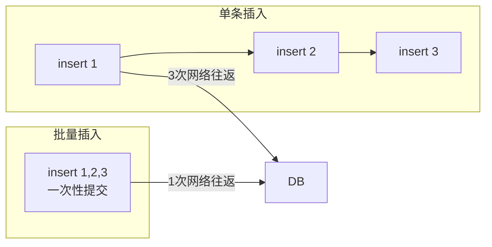

# JdbcTemplate高级操作与SimpleJdbcInsert

## 课程目标

- 掌握使用 JdbcTemplate 进行批量操作（`batchUpdate`）
- 掌握使用 JdbcTemplate 实现分页查询和排序
- 掌握 SimpleJdbcInsert 简化插入操作
- 能够在图书管理系统中应用这些高级特性


## 回顾与导入

### 已学内容回顾

上一节课我们学习了 JdbcTemplate 的基础 CRUD 操作，包括：

| 操作类型  | JdbcTemplate 方法              |
| --------- | ------------------------------ |
| 单条查询  | `queryForObject` + `RowMapper` |
| 列表查询  | `query` + `RowMapper`          |
| 插入      | `update` + `KeyHolder`         |
| 更新/删除 | `update`                       |

### 本节课内容

在实际项目中，我们还需要处理更多场景：

- **批量插入/更新**：一次性操作多条数据
- **分页查询**：大数据量下分段获取
- **排序**：按指定字段排序
- **简化插入**：使用 SimpleJdbcInsert 让插入代码更简洁


## 批量操作

### 什么是批量操作

批量操作是指在一次数据库交互中执行多条 SQL 语句，可以显著减少网络开销，提升性能。



### 批量插入

使用 `batchUpdate` 方法执行批量插入：

```java
public int[][] batchInsert(List<Book> books) {
    String sql = "INSERT INTO book (title, author, price, stock, category) VALUES (?, ?, ?, ?, ?)";
    return jdbcTemplate.batchUpdate(sql, books, books.size(), (ps, book) -> {
        ps.setString(1, book.getTitle());
        ps.setString(2, book.getAuthor());
        ps.setDouble(3, book.getPrice());
        ps.setInt(4, book.getStock());
        ps.setString(5, book.getCategory());
    });
}
```

**方法解析：**

| 参数        | 说明                               |
| ----------- | ---------------------------------- |
| `sql`       | 要执行的 SQL 语句                  |
| `books`     | 数据集合                           |
| `batchSize` | 每批处理的记录数（可控制内存使用） |
| `ps`        | `PreparedStatement` 实例           |
| `book`      | 当前处理的数据对象                 |

**返回结果：** 每个 SQL 执行影响的行数数组（不一定需要处理）。

### 批量更新

```java
public int[][] batchUpdateBooks(List<Book> books) {
    String sql = "UPDATE book SET price = ?, stock = ? WHERE id = ?";
    return jdbcTemplate.batchUpdate(sql, books, books.size(), (ps, book) -> {
        ps.setDouble(1, book.getPrice());
        ps.setInt(2, book.getStock());
        ps.setLong(3, book.getId());
    });
}
```

### 批量删除

```java
public int[][] batchDeleteByIds(List<Long> ids) {
    String sql = "DELETE FROM book WHERE id = ?";
    return jdbcTemplate.batchUpdate(sql, ids, ids.size(), (ps, id) -> {
        ps.setLong(1, id);
    });
}
```

### 分批处理大数据量

当数据量非常大时，建议分批次执行，避免单次操作数据过多导致内存溢出：

```java
public void batchInsertWithChunk(List<Book> books, int chunkSize) {
    String sql = "INSERT INTO book (title, author, price, stock, category) VALUES (?, ?, ?, ?, ?)";

    for (int i = 0; i < books.size(); i += chunkSize) {
        int end = Math.min(i + chunkSize, books.size());
        List<Book> chunk = books.subList(i, end);

        jdbcTemplate.batchUpdate(sql, chunk, chunk.size(), (ps, book) -> {
            ps.setString(1, book.getTitle());
            ps.setString(2, book.getAuthor());
            ps.setDouble(3, book.getPrice());
            ps.setInt(4, book.getStock());
            ps.setString(5, book.getCategory());
        });

        System.out.println("已处理 " + end + " 条记录");
    }
}
```

> [!NOTE]
>
> 批量插入通常比逐条插入快数倍到数十倍，具体取决于数据库和网络环境。


## 分页查询与排序

### 为什么需要分页

在真实系统中，数据量可能很大（数千、数万甚至百万条）。一次性查询全部数据会导致：

- 内存压力大
- 网络传输慢
- 前端渲染卡顿

分页查询将结果分成若干页，每页只返回一小部分数据。

### 分页查询实现

H2/MySQL 使用 `LIMIT offset, pageSize` 语法：

```java
public List<Book> findByPage(int page, int size) {
    int offset = (page - 1) * size;
    String sql = "SELECT id, title, author, price, stock, category, created_at, updated_at " + "FROM book ORDER BY id LIMIT ? OFFSET ?";
    return jdbcTemplate.query(sql, bookRowMapper, size, offset);
}
```

**参数说明：**

- `page`：页码（从 1 开始）
- `size`：每页记录数
- `offset`：跳过的记录数 = `(page - 1) * size`

### 获取总记录数

```java
public int countBooks() {
    String sql = "SELECT COUNT(*) FROM book";
    return jdbcTemplate.queryForObject(sql, Integer.class);
}
```

### 分页结果封装

创建 `PageResult` 类封装分页结果：

```java
package com.example.bookmanager.model;

import java.util.List;

@Data
public class PageResult<T> {
    private int page;
    private int size;
    private long total;
    private int totalPages;
    private List<T> data;

    public PageResult(int page, int size, long total, List<T> data) {
        this.page = page;
        this.size = size;
        this.total = total;
        this.totalPages = (int) Math.ceil((double) total / size);
        this.data = data;
    }
}
```

### 完整分页查询方法

```java
public PageResult<Book> findBooksWithPage(int page, int size, String sortBy, String direction) {
    // 1. 构建排序子句
    String orderClause = "ORDER BY " + sortBy + " " + direction;

    // 2. 分页查询
    int offset = (page - 1) * size;
    String sql = "SELECT id, title, author, price, stock, category, created_at, updated_at " + "FROM book " + orderClause + " LIMIT ? OFFSET ?";
    List<Book> books = jdbcTemplate.query(sql, bookRowMapper, size, offset);

    // 3. 查询总数
    String countSql = "SELECT COUNT(*) FROM book";
    long total = jdbcTemplate.queryForObject(countSql, Long.class);

    return new PageResult<>(page, size, total, books);
}
```


## SimpleJdbcInsert 使用

### 什么是 SimpleJdbcInsert

`SimpleJdbcInsert` 是 Spring JDBC 提供的专门用于简化插入操作的类。它基于数据库元数据自动生成 INSERT 语句，无需手动编写 SQL。

**优势：**

- 无需手动编写 INSERT SQL
- 自动从数据库元数据获取列名
- 支持获取自动生成的主键
- 支持批量插入

### 创建 SimpleJdbcInsert 实例

在 `BookRepository` 中创建 `SimpleJdbcInsert` 实例：

```java
@Repository
public class BookRepository {
    @Autowired
    private JdbcTemplate jdbcTemplate;

    private SimpleJdbcInsert bookInsert;

    @PostConstruct
    public void init() {
        this.bookInsert = new SimpleJdbcInsert(jdbcTemplate)
                .withTableName("book")
                .usingGeneratedKeyColumns("id")
                .usingColumns("title", "author", "price", "stock", "category");
    }
}
```

> [!NOTE]
> `@PostConstruct` 确保在 Bean 初始化后执行。`usingColumns` 指定要插入的列（不指定则插入所有列）。

### 使用 SimpleJdbcInsert 插入单条记录

```java
public Book saveWithSimpleInsert(Book book) {
    // 准备参数（Map 形式）
    Map<String, Object> params = new HashMap<>();
    params.put("title", book.getTitle());
    params.put("author", book.getAuthor());
    params.put("price", book.getPrice());
    params.put("stock", book.getStock());
    params.put("category", book.getCategory());

    // 执行插入，获取自动生成的主键
    Number key = bookInsert.executeAndReturnKey(params);
    book.setId(key.longValue());

    return book;
}
```

### 使用 BeanPropertySqlParameterSource

`BeanPropertySqlParameterSource` 可以直接从 Java Bean 提取属性，无需手动构建 Map：

```java
public Book saveWithBeanSource(Book book) {
    SqlParameterSource paramSource = new BeanPropertySqlParameterSource(book);
    Number key = bookInsert.executeAndReturnKey(paramSource);
    book.setId(key.longValue());
    return book;
}
```

> [!NOTE]
> `BeanPropertySqlParameterSource` 要求 Bean 的属性名与数据库列名一致，否则需使用 `usingColumns` 明确指定映射。


### SimpleJdbcInsert vs 手动 SQL

| 对比         | 手动 SQL         | SimpleJdbcInsert   |
| ------------ | ---------------- | ------------------ |
| 代码量       | 较多             | 较少               |
| SQL 可见性   | 清晰             | 隐藏（需调试）     |
| 数据库兼容性 | 需适配不同数据库 | 基于元数据自动适配 |
| 列变更       | 需修改 SQL       | 自动适应           |
| 灵活性       | 高               | 中等               |


## 实战：图书管理系统整合高级操作

### 在 Service 层添加批量导入功能

```java
@Service
public class BookService {
    @Autowired
    private BookRepository bookRepository;

    // 批量导入图书
    public void importBooks(List<Book> books) {
        // 可以在这里做业务校验
        for (Book book : books) {
            if (book.getPrice() == null || book.getPrice() < 0) {
                throw new IllegalArgumentException("图书价格不能为负数: " + book.getTitle());
            }
        }
        bookRepository.batchInsert(books);
    }

    // 分页查询图书
    public PageResult<Book> listBooks(int page, int size, String sortBy, String direction) {
        // 防止 SQL 注入：验证排序字段和方向
        String validSortBy = validateSortBy(sortBy);
        String validDirection = validateDirection(direction);
        return bookRepository.findBooksWithPage(page, size, validSortBy, validDirection);
    }

    private String validateSortBy(String sortBy) {
        // 允许的排序字段列表
        Set<String> allowed = Set.of("id", "title", "author", "price", "stock", "created_at");
        if (sortBy == null || !allowed.contains(sortBy)) {
            return "id";  // 默认按 ID 排序
        }
        return sortBy;
    }

    private String validateDirection(String direction) {
        if ("desc".equalsIgnoreCase(direction)) {
            return "DESC";
        }
        return "ASC";
    }
}
```

### 在 Controller 中添加分页接口

```java
@RestController
@RequestMapping("/api/books")
@Tag(name = "图书管理")
public class BookController {

    @Autowired
    private BookService bookService;

   @GetMapping("/page")
    public Result<PageResult<Book>> getBooksByPage(
            @RequestParam(defaultValue = "1") int page,
            @RequestParam(defaultValue = "10") int size,
            @RequestParam(required = false) String sortBy,
            @RequestParam(required = false) String direction) {
        return Result.success(bookService.listBooks(page, size, sortBy, direction));
    }

    @PostMapping("/batch")
    public Result<Void> batchImport(@RequestBody List<Book> books) {
        bookService.importBooks(books);
        return Result.success(ResultCode.NO_CONTENT.getMessage(), null);
    }
}
```


## 注意事项

### 1. 批量操作的大小限制

- 批量操作每次提交的数据量不宜过大（建议 500-1000 条），否则可能占用大量内存。
- 使用 `batchUpdate` 的 `batchSize` 参数控制每批大小。

### 2. 分页查询的排序注入

- 排序字段名应使用白名单验证，避免 SQL 注入。
- 排序方向同样需要验证。

### 3. SimpleJdbcInsert 的列名

- `usingColumns` 指定的列必须存在于表中，且顺序不重要。
- 未指定的列将使用数据库默认值或 `NULL`。

### 4. 获取主键的差异

- 不同数据库获取主键的方式不同（MySQL 的 `GENERATED_KEY`、Oracle 的 `RETURNING`）。`SimpleJdbcInsert` 会适配不同数据库。
- 如果表使用复合主键，需使用 `executeAndReturnKeyHolder` 方法。


## 小结

本节课我们学习了：

1. **批量操作**：
   - `batchUpdate` 执行批量插入、更新、删除
   - 分批处理大数据量，控制内存使用
2. **分页查询与排序**：
   - 使用 `LIMIT OFFSET` 实现分页
   - 封装 `PageResult` 统一分页结果
   - 动态构建条件查询
3. **SimpleJdbcInsert**：
   - 基于元数据自动生成 INSERT SQL
   - 支持单条插入和批量插入
   - 支持 `BeanPropertySqlParameterSource` 简化参数构建
4. **实战应用**：
   - 在图书管理系统中集成批量导入
   - 添加分页查询接口


## 作业

### 作业一：代码阅读——批量操作分析

阅读以下代码，回答问题。

```java
public int[] batchUpdateStock(List<Long> ids, List<Integer> deltas) {
    String sql = "UPDATE book SET stock = stock + ? WHERE id = ?";
    List<Object[]> batchArgs = new ArrayList<>();
    for (int i = 0; i < ids.size(); i++) {
        batchArgs.add(new Object[]{deltas.get(i), ids.get(i)});
    }
    return jdbcTemplate.batchUpdate(sql, batchArgs);
}
```

**问题：**

1. 该方法使用了 `batchUpdate` 的哪个重载版本？
2. 如果 `ids` 和 `deltas` 的长度不一致，会发生什么？
3. 如果某条记录的库存更新后变为负数，数据库会怎样？应如何预防？

------

### 作业二：为图书管理系统添加批量导入和分页功能

基于第 2 课的项目，完成以下任务：

1. 在 `BookRepository` 中添加 `batchInsert` 方法，使用 `batchUpdate` 实现批量插入。
2. 添加 `findByPage` 方法，实现分页查询（使用 `LIMIT OFFSET`）。
3. 添加 `countBooks` 方法，查询总记录数。
4. 创建 `PageResult<T>` 分页结果封装类。
5. 在 `BookService` 中添加 `importBooks` 和 `listBooksByPage` 方法。
6. 在 `BookController` 中添加以下接口：
   - `POST /api/books/batch`：批量导入图书（接收 `List<Book>`）
   - `GET /api/books/page`：分页查询图书，支持 `page`、`size`、`sortBy`、`direction` 参数
7. 使用 Postman 测试批量导入（至少 10 本书）和分页查询功能。

------

### 作业三：使用 SimpleJdbcInsert 重构插入逻辑

在图书管理系统中，将现有的插入逻辑（使用 `KeyHolder`）替换为 `SimpleJdbcInsert`：

1. 在 `BookRepository` 中创建 `SimpleJdbcInsert` 实例（使用 `@PostConstruct` 初始化）。
2. 实现 `saveWithSimpleInsert` 方法。
3. 将原有的 `save` 方法替换为 `saveWithSimpleInsert`。
4. 验证功能正常。
5. 对比两种方式的代码量和可读性。
