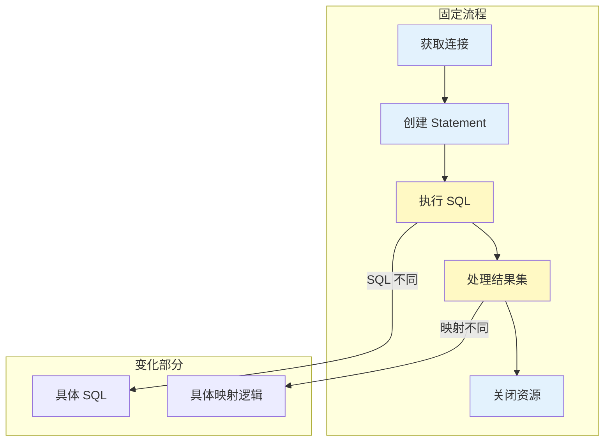
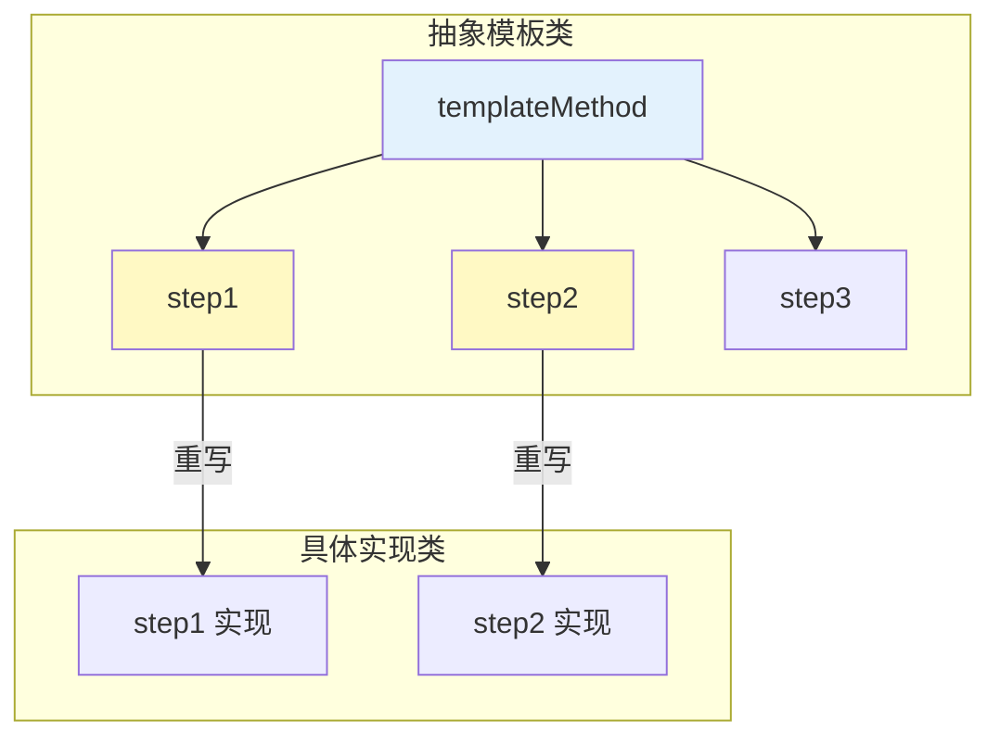
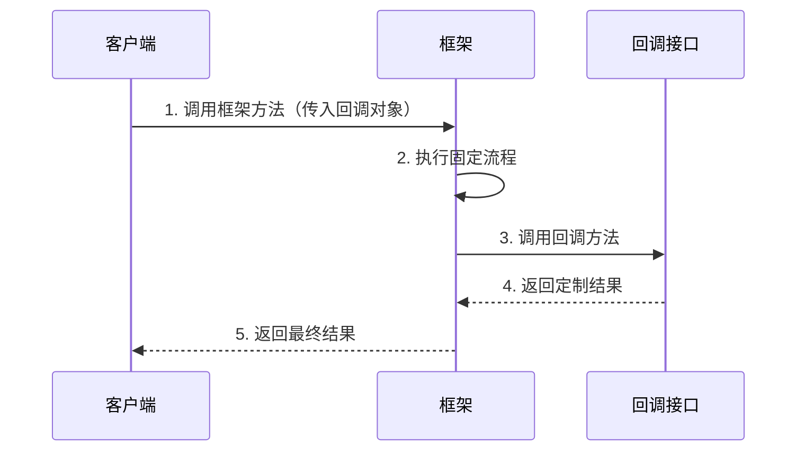
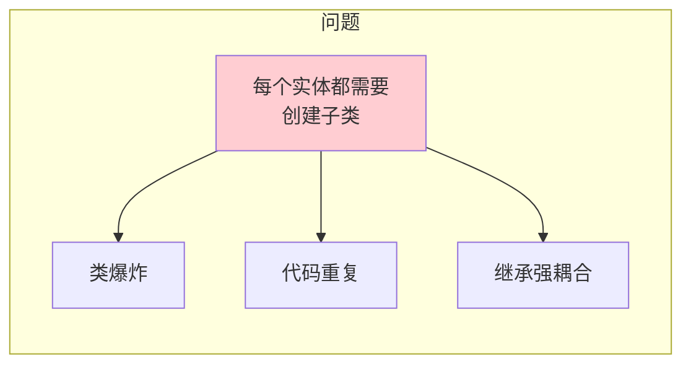
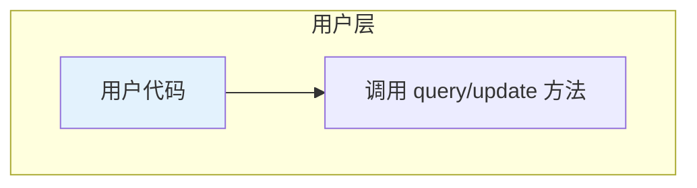
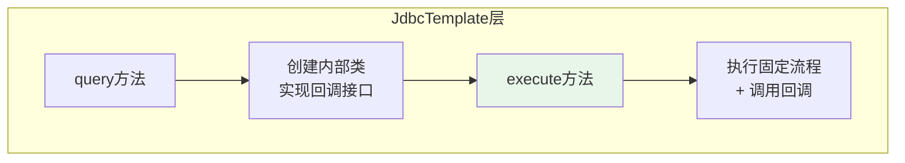
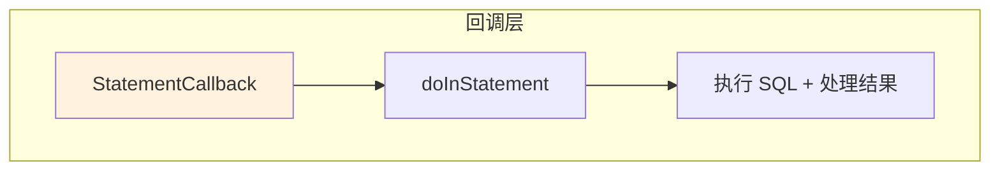
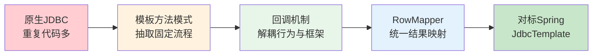

# 自动动手写一个 JdbcTemplate

## 课程目标

- 理解 JdbcTemplate 背后的设计思想（模板方法模式 + 回调机制）
- 掌握模板方法模式在数据访问中的应用
- 掌握回调机制如何实现行为参数化
- 能够亲手实现一个简化版的 JdbcTemplate
- 理解 Spring JdbcTemplate 的源码核心流程


## 导入：从原生 JDBC 到 JdbcTemplate

### 回顾原生 JDBC 的重复代码

在传统的 JDBC 开发中，每次数据库操作都需要编写大量重复的样板代码：

```java
Connection conn = null;
Statement stmt = null;
ResultSet rs = null;
try {
    conn = DriverManager.getConnection(url, user, password);
    stmt = conn.createStatement();
    rs = stmt.executeQuery("SELECT * FROM book");
    // 处理结果集...
} catch (SQLException e) {
    // 处理异常...
} finally {
    // 关闭资源...
}
```

**这些重复代码的本质是什么？**



**关键洞察：** 在 JDBC 操作中，大部分代码是**固定的**（获取连接、创建 Statement、关闭资源），只有 SQL 语句和结果集映射是**变化的**。

本节课我们将从原生 JDBC 出发，一步步推导出 JdbcTemplate 的设计与实现。


## 设计模式基础：模板方法模式

### 什么是模板方法模式

**模板方法模式**定义了一个操作中的算法骨架，而将一些步骤延迟到子类中实现。它让子类可以在不改变算法结构的情况下，重新定义算法的某些特定步骤。



### 模板方法模式的核心特点

| 特点           | 说明                                 |
| -------------- | ------------------------------------ |
| **固定流程**   | 算法骨架在父类中定义，子类不可更改   |
| **可变步骤**   | 某些步骤由子类实现，提供定制化能力   |
| **代码复用**   | 公共代码集中在父类，避免重复         |
| **框架与扩展** | 框架定义流程，应用开发者扩展具体实现 |

> [!NOTE]
> Spring 框架大量使用了模板方法模式，如 `JdbcTemplate`、`TransactionTemplate`、`RestTemplate` 等。


## 设计模式基础：回调机制

### 什么是回调

**回调（Callback）** 是一种将一段代码作为参数传递给另一段代码，并在适当时候被调用的技术。它体现的是一种**双向调用**的关系。



### 回调 vs 模板方法

| 对比          | 模板方法模式     | 回调机制                    |
| ------------- | ---------------- | --------------------------- |
| **实现方式**  | 继承抽象类       | 实现回调接口                |
| **扩展方式**  | 子类重写方法     | 传入回调对象                |
| **耦合度**    | 强（继承耦合）   | 弱（接口耦合）              |
| **灵活性**    | 较低             | 较高                        |
| **Java 实现** | `abstract class` | `interface` + 匿名类/Lambda |

> [!NOTE]
> 回调机制比模板方法模式更灵活，因为它不依赖继承，可以动态传入不同的行为。这也是 Spring JdbcTemplate 选择回调机制的重要原因。


## 第一步：使用模板方法模式重构

### 抽象模板类

首先，我们创建一个抽象类，将 JDBC 的固定流程封装在模板方法中：

```java
public abstract class AbstractJdbcTemplate {
    /**
     * 模板方法：定义 JDBC 操作的固定流程
     */
    public final Object execute(String sql) {
        Connection conn = null;
        Statement stmt = null;
        ResultSet rs = null;
        try {
            conn = DriverManager.getConnection("jdbc:h2:./bookdb;DB_CLOSE_DELAY=-1", "sa", "");
            stmt = conn.createStatement();
            rs = stmt.executeQuery(sql);

            // ★ 变化的部分：由子类实现
            return handleResultSet(rs);

        } catch (SQLException e) {
            System.err.println("SQL 执行失败: " + e.getMessage());
            throw new RuntimeException(e);
        } finally {
            // 释放资源
            closeResultSet(rs);
            closeStatement(stmt);
            closeConnection(conn);
        }
    }

    /**
     * 抽象方法：由子类实现具体的结果集映射逻辑
     */
    protected abstract Object handleResultSet(ResultSet rs) throws SQLException;

    // 资源关闭辅助方法
    private void closeResultSet(ResultSet rs) {
        if (rs != null) {
            try { rs.close(); } catch (SQLException e) {}
        }
    }

    private void closeStatement(Statement stmt) {
        if (stmt != null) {
            try { stmt.close(); } catch (SQLException e) {}
        }
    }

    private void closeConnection(Connection conn) {
        if (conn != null) {
            try { conn.close(); } catch (SQLException e) {}
        }
    }
}
```

### 具体实现子类

针对不同的业务实体，创建不同的子类实现：

```java
@Component
public class BookJdbcTemplate extends AbstractJdbcTemplate {
    @Override
    protected Object handleResultSet(ResultSet rs) throws SQLException {
        List<Book> books = new ArrayList<>();
        while (rs.next()) {
            Book book = new Book();
            book.setId(rs.getLong("id"));
            book.setTitle(rs.getString("title"));
            book.setAuthor(rs.getString("author"));
            book.setPrice(rs.getDouble("price"));
            book.setStock(rs.getInt("stock"));
            books.add(book);
        }
        return books;
    }
}

@Component
public class UserJdbcTemplate extends AbstractJdbcTemplate {
    @Override
    protected Object handleResultSet(ResultSet rs) throws SQLException {
        List<User> users = new ArrayList<>();
        while (rs.next()) {
            User user = new User();
            user.setId(rs.getLong("id"));
            user.setName(rs.getString("name"));
            user.setEmail(rs.getString("email"));
            users.add(user);
        }
        return users;
    }
}
```

### 使用示例

```java
// 查询图书
AbstractJdbcTemplate bookTemplate = new BookJdbcTemplate();
List<Book> books = (List<Book>) bookTemplate.execute("SELECT * FROM book");

// 查询用户
AbstractJdbcTemplate userTemplate = new UserJdbcTemplate();
List<User> users = (List<User>) userTemplate.execute("SELECT * FROM user");
```

### 模板方法模式的局限



| 问题           | 说明                                   |
| -------------- | -------------------------------------- |
| **类爆炸**     | 每个实体都需要一个对应的子类           |
| **继承限制**   | Java 单继承，子类无法继承其他类        |
| **代码重复**   | 不同子类的映射逻辑相似，但仍需重复编写 |
| **编译时绑定** | 无法在运行时动态改变行为               |


## 第二步：使用回调机制重构

### 定义回调接口

```java
public interface StatementCallback {
    Object handleStatement(Statement stmt) throws SQLException;
}
```

### 基于回调的 JdbcTemplate

```java
public class CallbackJdbcTemplate {

    /**
     * 执行 SQL 操作，通过回调处理具体逻辑
     */
    public Object execute(StatementCallback callback) {
        Connection conn = null;
        Statement stmt = null;
        try {
            conn = DriverManager.getConnection("jdbc:h2:./bookdb;DB_CLOSE_DELAY=-1", "sa", "");
            stmt = conn.createStatement();
            
            // ★ 调用回调，由调用者提供具体逻辑
            return callback.handleStatement(stmt);
            
        } catch (SQLException e) {
            System.err.println("SQL 执行失败: " + e.getMessage());
            throw new RuntimeException(e);
        } finally {
            closeStatement(stmt);
            closeConnection(conn);
        }
    }

    // 资源关闭辅助方法
    // ...
}
```

### 使用内部类实现回调

```java
public Object queryBooks(String sql) {
    CallbackJdbcTemplate template = new CallbackJdbcTemplate();
    
    // 使用内部类实现回调
    return template.execute(new StatementCallback() {
        @Override
        public Object handleStatement(Statement stmt) throws SQLException {
            ResultSet rs = stmt.executeQuery(sql);
            List<Book> books = new ArrayList<>();
            while (rs.next()) {
                Book book = new Book();
                book.setId(rs.getLong("id"));
                book.setTitle(rs.getString("title"));
                book.setAuthor(rs.getString("author"));
                book.setPrice(rs.getDouble("price"));
                book.setStock(rs.getInt("stock"));
                books.add(book);
            }
            return books;
        }
    });
}
```

### 使用 Lambda 表达式

```java
public List<Book> queryBooks(String sql) {
    CallbackJdbcTemplate template = new CallbackJdbcTemplate();
    
    // 使用 Lambda 表达式
    return (List<Book>) template.execute(stmt -> {
        ResultSet rs = stmt.executeQuery(sql);
        List<Book> books = new ArrayList<>();
        while (rs.next()) {
            Book book = new Book();
            book.setId(rs.getLong("id"));
            book.setTitle(rs.getString("title"));
            book.setAuthor(rs.getString("author"));
            book.setPrice(rs.getDouble("price"));
            book.setStock(rs.getInt("stock"));
            books.add(book);
        }
        return books;
    });
}
```


## 第三步：通用 RowMapper 设计

### RowMapper 接口

将结果集映射逻辑进一步抽象为 `RowMapper`：

```java
@FunctionalInterface
public interface RowMapper<T> {
    T mapRow(ResultSet rs, int rowNum) throws SQLException;
}
```

### 通用 JdbcTemplate（支持 RowMapper）

```java
public class GeneralJdbcTemplate {
    /**
     * 查询列表，使用 RowMapper 映射
     */
    public <T> List<T> query(String sql, RowMapper<T> rowMapper) {
        return (List<T>) execute(stmt -> {
            ResultSet rs = stmt.executeQuery(sql);
            List<T> results = new ArrayList<>();
            int rowNum = 0;
            while (rs.next()) {
                T item = rowMapper.mapRow(rs, rowNum++);
                results.add(item);
            }
            return results;
        });
    }

    /**
     * 查询单个对象
     */
    public <T> T queryForObject(String sql, RowMapper<T> rowMapper) {
        List<T> results = query(sql, rowMapper);
        if (results.isEmpty()) {
            return null;
        }
        return results.get(0);
    }

    /**
     * 执行更新（INSERT/UPDATE/DELETE）
     */
    public int update(String sql) {
        return (int) execute(stmt -> stmt.executeUpdate(sql));
    }

    /**
     * 执行带参数更新的 PreparedStatement
     */
    public int update(String sql, Object... args) {
        // 使用 PreparedStatement 防止 SQL 注入
        return (int) executeWithPrepared(sql, pstmt -> {
            for (int i = 0; i < args.length; i++) {
                pstmt.setObject(i + 1, args[i]);
            }
            return pstmt.executeUpdate();
        });
    }

    /**
     * 核心 execute 方法
     */
    public Object execute(StatementCallback callback) {
        // 与之前相同...
    }
}
```

### 使用 RowMapper 的示例

```java
// 定义 RowMapper
RowMapper<Book> bookRowMapper = (rs, rowNum) -> {
    Book book = new Book();
    book.setId(rs.getLong("id"));
    book.setTitle(rs.getString("title"));
    book.setAuthor(rs.getString("author"));
    book.setPrice(rs.getDouble("price"));
    book.setStock(rs.getInt("stock"));
    return book;
};

// 使用通用 JdbcTemplate
GeneralJdbcTemplate template = new GeneralJdbcTemplate();
List<Book> books = template.query("SELECT * FROM book", bookRowMapper);

// 查询单条
Book book = template.queryForObject("SELECT * FROM book WHERE id = 1", bookRowMapper);
```


## 第四步：对标 Spring JdbcTemplate 源码

### Spring JdbcTemplate 核心流程

Spring 的 JdbcTemplate 采用了与我们的设计完全相同的思路。让我们看看其核心源码：

#### StatementCallback 接口

```java
// Spring JdbcTemplate 中的 StatementCallback
public interface StatementCallback<T> {
    T doInStatement(Statement stmt) throws SQLException, DataAccessException;
}
```

#### execute 方法（核心）

```java
// Spring JdbcTemplate 的 execute 方法
public <T> T execute(StatementCallback<T> action) throws DataAccessException {
    Assert.notNull(action, "Callback object must not be null");

    // 1. 获取连接
    Connection con = DataSourceUtils.getConnection(obtainDataSource());
    Statement stmt = null;
    try {
        // 2. 创建 Statement
        stmt = con.createStatement();
        // 3. 应用 Statement 设置（超时、fetchSize 等）
        applyStatementSettings(stmt);
        // 4. ★ 执行回调（变化的部分）
        T result = action.doInStatement(stmt);
        // 5. 处理警告
        handleWarnings(stmt);
        return result;
    } catch (SQLException ex) {
        // 6. 异常转换
        String sql = getSql(action);
        JdbcUtils.closeStatement(stmt);
        stmt = null;
        DataSourceUtils.releaseConnection(con, getDataSource());
        con = null;
        throw translateException("StatementCallback", sql, ex);
    } finally {
        // 7. 释放资源
        JdbcUtils.closeStatement(stmt);
        DataSourceUtils.releaseConnection(con, getDataSource());
    }
}
```

### execute(final String sql) 方法

```java
// Spring JdbcTemplate 的 execute(String sql) 方法
public void execute(final String sql) throws DataAccessException {
    if (logger.isDebugEnabled()) {
        logger.debug("Executing SQL statement [" + sql + "]");
    }

    // 内部类实现 StatementCallback
    class ExecuteStatementCallback implements StatementCallback<Object>, SqlProvider {
        @Override
        public Object doInStatement(Statement stmt) throws SQLException {
            stmt.execute(sql);
            return null;
        }
        @Override
        public String getSql() {
            return sql;
        }
    }

    // 调用核心 execute 方法
    execute(new ExecuteStatementCallback());
}
```

### query 方法的实现

```java
// Spring JdbcTemplate 的 query 方法（简化）
public <T> List<T> query(String sql, RowMapper<T> rowMapper) throws DataAccessException {
    return query(sql, new RowMapperResultSetExtractor<>(rowMapper));
}

// 内部使用 execute 方法
public <T> T query(final String sql, final ResultSetExtractor<T> rse) throws DataAccessException {
    class QueryStatementCallback implements StatementCallback<T>, SqlProvider {
        @Override
        public T doInStatement(Statement stmt) throws SQLException {
            ResultSet rs = stmt.executeQuery(sql);
            // ★ 使用 ResultSetExtractor 处理结果集
            return rse.extractData(rs);
        }
        @Override
        public String getSql() {
            return sql;
        }
    }
    return execute(new QueryStatementCallback());
}
```

### Spring JdbcTemplate 的设计总结








## 我们的实现 vs Spring 实现对比

| 特性           | 我们的实现          | Spring JdbcTemplate             |
| -------------- | ------------------- | ------------------------------- |
| **核心思想**   | 模板方法 + 回调     | 模板方法 + 回调                 |
| **回调接口**   | `StatementCallback` | `StatementCallback`             |
| **资源管理**   | 手动 try-finally    | `DataSourceUtils` + try-finally |
| **异常处理**   | `RuntimeException`  | `DataAccessException` 体系      |
| **额外功能**   | 基础功能            | 缓存、批量操作、LOB 处理等      |
| **RowMapper**  | ✅                   | ✅                               |
| **参数化查询** | 基础实现            | 完整支持                        |


## 小结

本节课我们经历了一次完整的代码演进：



### 核心收获

| 知识点           | 说明                                                         |
| ---------------- | ------------------------------------------------------------ |
| **模板方法模式** | 固定流程 + 可变步骤分离，由子类提供具体实现                  |
| **回调机制**     | 行为参数化，比继承更灵活，支持运行时动态改变行为             |
| **设计演进**     | 从原生 JDBC 到模板方法，再到回调机制，最终到 Spring JdbcTemplate |
| **Spring 实现**  | 与我们的设计思路一致，但更完整、更健壮                       |


## 作业

### 作业一：代码阅读——模板方法与回调识别

阅读以下自定义 JdbcTemplate 的代码片段，回答问题。

```java
public class MyJdbcTemplate {
    public <T> List<T> query(String sql, ResultSetExtractor<T> extractor) {
        // 固定流程
        Connection conn = null;
        Statement stmt = null;
        ResultSet rs = null;
        try {
            conn = dataSource.getConnection();
            stmt = conn.createStatement();
            rs = stmt.executeQuery(sql);
            return extractor.extractData(rs);
        } catch (SQLException e) {
            throw new RuntimeException(e);
        } finally {
            // 关闭资源...
        }
    }
}
```

**问题：**

1. `query` 方法中的“固定流程”包括哪些步骤？
2. `ResultSetExtractor` 在这里扮演什么角色？是模板方法模式还是回调机制？
3. 如果要将 `ResultSetExtractor` 替换为 `RowMapper`，你会如何修改？两种设计有什么区别？

------

### 作业二：动手实现简易 JdbcTemplate

基于本课的设计思路，完成一个简易 JdbcTemplate 的编写：

1. 创建 `JdbcTemplate` 类，包含 `DataSource` 字段（通过构造方法注入）。
2. 定义 `RowMapper<T>` 函数式接口，包含 `mapRow(ResultSet rs, int rowNum)` 方法。
3. 实现 `query(String sql, RowMapper<T> rowMapper)` 方法，返回 `List<T>`。
4. 实现 `queryForObject(String sql, RowMapper<T> rowMapper, Object... args)` 方法，返回单个对象。
5. 实现 `update(String sql, Object... args)` 方法，支持参数化更新。
6. 使用 H2 数据库测试你的 JdbcTemplate：
   - 查询所有图书
   - 根据 ID 查询单本图书
   - 插入一本新书
   - 更新图书价格
