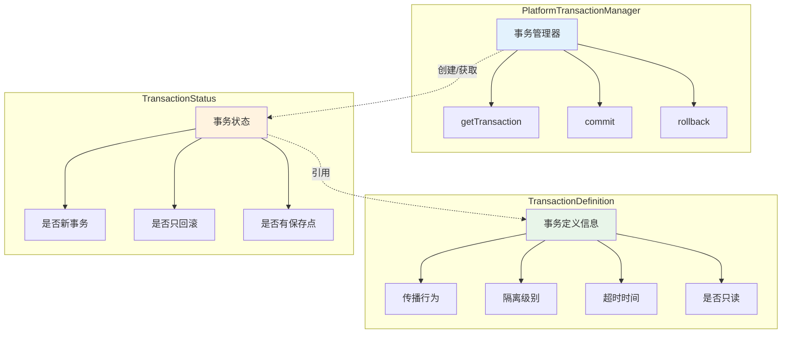

# Spring 事务管理基础

## 课程目标

- 理解事务的核心概念（ACID、隔离级别、传播行为）
- 掌握 Spring 事务抽象的核心接口（PlatformTransactionManager、TransactionDefinition、TransactionStatus）
- 掌握使用 TransactionTemplate 实现编程式事务管理
- 理解编程式事务的适用场景和最佳实践
- 能够在图书管理系统中应用编程式事务


## 事务核心概念

### 什么是事务

**事务（Transaction）** 是一组操作组成的逻辑单元，这些操作要么全部成功，要么全部失败。事务是数据库系统中保证数据一致性的核心机制。

### ACID 特性

事务必须满足 **ACID** 四个特性：

| 特性                      | 说明                                         | 生活类比                               |
| ------------------------- | -------------------------------------------- | -------------------------------------- |
| **原子性（Atomicity）**   | 事务中的所有操作要么全部完成，要么全部不完成 | 转账：扣款和到账必须同时成功或同时失败 |
| **一致性（Consistency）** | 事务执行前后，数据必须保持一致状态           | 转账前后，账户总金额不变               |
| **隔离性（Isolation）**   | 并发事务之间互不干扰                         | 两人同时取款，互不影响                 |
| **持久性（Durability）**  | 事务提交后，数据永久保存                     | 转账成功后记录永久保留                 |

### 并发事务的问题

当多个事务并发执行时，可能产生以下问题：

| 问题                                  | 说明                                   |
| ------------------------------------- | -------------------------------------- |
| **脏读（Dirty Read）**                | 读取到另一个事务未提交的数据           |
| **不可重复读（Non-Repeatable Read）** | 同一事务内两次读取同一数据，结果不同   |
| **幻读（Phantom Read）**              | 同一事务内两次查询，结果集**数量**不同 |

### 事务隔离级别

| 隔离级别         | 脏读   | 不可重复读 | 幻读   |
| ---------------- | ------ | ---------- | ------ |
| READ_UNCOMMITTED | ✅ 可能 | ✅ 可能     | ✅ 可能 |
| READ_COMMITTED   | ❌      | ✅ 可能     | ✅ 可能 |
| REPEATABLE_READ  | ❌      | ❌          | ✅ 可能 |
| SERIALIZABLE     | ❌      | ❌          | ❌      |


## Spring 事务抽象

Spring 提供了**一致的事务抽象**，让开发者可以用相同的方式处理不同的事务 API（JDBC、JPA、JTA 等）。

### 三大核心接口



### PlatformTransactionManager

`PlatformTransactionManager` 是 Spring 事务抽象的核心接口，定义了事务管理的基本操作：

```java
public interface PlatformTransactionManager extends TransactionManager {
    // 根据事务定义获取事务状态（创建新事务或加入已有事务）
    TransactionStatus getTransaction(TransactionDefinition definition) 
            throws TransactionException;
    
    // 提交事务
    void commit(TransactionStatus status) throws TransactionException;
    
    // 回滚事务
    void rollback(TransactionStatus status) throws TransactionException;
}
```

**主要实现类：**

| 实现类                         | 适用场景                |
| ------------------------------ | ----------------------- |
| `DataSourceTransactionManager` | 单数据源 JDBC / MyBatis |
| `JpaTransactionManager`        | JPA（Hibernate 等）     |
| `JtaTransactionManager`        | 分布式事务（JTA）       |

> [!NOTE]
> `TransactionException` 是**非受检异常**（继承 `RuntimeException`），开发者不需要强制捕获。

### TransactionDefinition

`TransactionDefinition` 定义事务的属性：

```java
public interface TransactionDefinition {
    // 传播行为
    int getPropagationBehavior();
    
    // 隔离级别
    int getIsolationLevel();
    
    // 超时时间（秒）
    int getTimeout();
    
    // 是否只读
    boolean isReadOnly();
    
    // 默认传播行为：REQUIRED
    int PROPAGATION_REQUIRED = 0;
    
    // 默认隔离级别：使用数据库默认
    int ISOLATION_DEFAULT = -1;
}
```

### TransactionStatus

`TransactionStatus` 表示当前事务的状态：

```java
public interface TransactionStatus extends SavepointManager {
    // 是否是新事务
    boolean isNewTransaction();
    
    // 是否有保存点
    boolean hasSavepoint();
    
    // 设置只回滚
    void setRollbackOnly();
    
    // 是否只回滚
    boolean isRollbackOnly();
    
    // 是否已完成
    boolean isCompleted();
}
```

> [!NOTE]
>
> 保存点是事务内部的一个“书签/里程碑”。它允许你部分回滚事务，而不是回滚整个事务。


## 编程式事务管理

Spring 提供两种编程式事务管理方式：

| 方式                                    | 适用场景           |
| --------------------------------------- | ------------------ |
| **TransactionTemplate**                 | 命令式编程（推荐） |
| **直接使用 PlatformTransactionManager** | 需要更细粒度控制时 |

Spring 团队通常推荐在命令式流程中使用 `TransactionTemplate` 进行编程式事务管理。

### TransactionTemplate 基本用法

`TransactionTemplate` 采用与 `JdbcTemplate` 相同的**回调模式**，将应用代码从样板式的资源获取和释放代码中解放出来。

#### 配置 TransactionTemplate

```java
@Configuration
public class TransactionConfig {
    
    @Bean
    public PlatformTransactionManager transactionManager(DataSource dataSource) {
        return new DataSourceTransactionManager(dataSource);
    }
    
    @Bean
    public TransactionTemplate transactionTemplate(PlatformTransactionManager transactionManager) {
        return new TransactionTemplate(transactionManager);
    }
}
```

或者在 Service 中直接构造：

```java
@Service
public class BookService {
    private final TransactionTemplate transactionTemplate;
    
    // 构造器注入 PlatformTransactionManager
    public BookService(PlatformTransactionManager transactionManager) {
        this.transactionTemplate = new TransactionTemplate(transactionManager);
    }
}
```

#### 有返回值的事务

```java
@Service
public class BookService {
    private final TransactionTemplate transactionTemplate;
    private final BookRepository bookRepository;
    
    public BookService(PlatformTransactionManager transactionManager, 
                       BookRepository bookRepository) {
        this.transactionTemplate = new TransactionTemplate(transactionManager);
        this.bookRepository = bookRepository;
    }
    
    public Book createBookWithTransaction(Book book) {
        return transactionTemplate.execute(new TransactionCallback<Book>() {
            @Override
            public Book doInTransaction(TransactionStatus status) {
                // 这段代码在事务中执行
                Book saved = bookRepository.save(book);
                // 可以执行多个数据库操作
                bookRepository.updateStock(saved.getId(), 10);
                return saved;
            }
        });
    }
}
```

**使用 Lambda 表达式（更简洁）：**

```java
public Book createBookWithTransaction(Book book) {
    return transactionTemplate.execute(status -> {
        Book saved = bookRepository.save(book);
        bookRepository.updateStock(saved.getId(), 10);
        return saved;
    });
}
```

#### 无返回值的事务

使用 `TransactionCallbackWithoutResult`：

```java
public void transferStock(Long fromBookId, Long toBookId, int amount) {
    transactionTemplate.execute(new TransactionCallbackWithoutResult() {
        @Override
        protected void doInTransactionWithoutResult(TransactionStatus status) {
            bookRepository.decreaseStock(fromBookId, amount);
            bookRepository.increaseStock(toBookId, amount);
        }
    });
}
```

**使用 Lambda 表达式：**

```java
public void transferStock(Long fromBookId, Long toBookId, int amount) {
    transactionTemplate.executeWithoutResult(status -> {
        bookRepository.decreaseStock(fromBookId, amount);
        bookRepository.increaseStock(toBookId, amount);
    });
}
```

#### 手动回滚事务

在回调中可以通过 `TransactionStatus.setRollbackOnly()` 手动将事务标记为回滚：

```java
public void transferStockWithValidation(Long fromBookId, Long toBookId, int amount) {
    transactionTemplate.executeWithoutResult(status -> {
        try {
            int currentStock = bookRepository.getStock(fromBookId);
            if (currentStock < amount) {
                // 库存不足，标记回滚
                status.setRollbackOnly();
                return;
            }
            bookRepository.decreaseStock(fromBookId, amount);
            bookRepository.increaseStock(toBookId, amount);
        } catch (Exception ex) {
            // 发生异常，标记回滚
            status.setRollbackOnly();
        }
    });
}
```

#### 自定义事务设置

可以为特定的 `TransactionTemplate` 定制事务设置：

```java
@Service
public class BookService {
    private final TransactionTemplate transactionTemplate;
    
    public BookService(PlatformTransactionManager transactionManager) {
        // 默认事务设置
        this.transactionTemplate = new TransactionTemplate(transactionManager);
    }
    
    // 创建只读事务的 TransactionTemplate
    private TransactionTemplate createReadOnlyTemplate() {
        TransactionTemplate template = new TransactionTemplate(transactionTemplate);
        template.setReadOnly(true);
        template.setTimeout(30);
        template.setIsolationLevel(TransactionDefinition.ISOLATION_READ_COMMITTED);
        return template;
    }
    
    public List<Book> getBooksReadOnly() {
        TransactionTemplate readOnlyTemplate = createReadOnlyTemplate();
        return readOnlyTemplate.execute(status -> {
            return bookRepository.findAll();
        });
    }
}
```


### 直接使用 PlatformTransactionManager

如果需要更细粒度的控制，也可以直接使用 `PlatformTransactionManager`：

```java
@Service
public class BookService {
    private final PlatformTransactionManager transactionManager;
    
    public BookService(PlatformTransactionManager transactionManager) {
        this.transactionManager = transactionManager;
    }
    
    public void manualTransaction() {
        // 1. 定义事务属性
        DefaultTransactionDefinition def = new DefaultTransactionDefinition();
        def.setPropagationBehavior(TransactionDefinition.PROPAGATION_REQUIRED);
        def.setIsolationLevel(TransactionDefinition.ISOLATION_READ_COMMITTED);
        
        // 2. 获取事务状态
        TransactionStatus status = transactionManager.getTransaction(def);
        
        try {
            // 3. 执行业务操作
            bookRepository.save(new Book(...));
            bookRepository.updateStock(1L, 10);
            
            // 4. 提交事务
            transactionManager.commit(status);
        } catch (Exception ex) {
            // 5. 发生异常，回滚事务
            transactionManager.rollback(status);
            throw ex;
        }
    }
}
```

> [!NOTE]
> 直接使用 `PlatformTransactionManager` 需要手动管理事务的开始、提交和回滚，代码较为繁琐。**推荐优先使用 `TransactionTemplate`**。


## TransactionTemplate vs PlatformTransactionManager

| 对比         | TransactionTemplate | PlatformTransactionManager |
| ------------ | ------------------- | -------------------------- |
| **代码量**   | 较少（回调模式）    | 较多（手动管理）           |
| **资源管理** | 自动                | 手动                       |
| **异常处理** | 自动处理            | 需手动处理                 |
| **灵活性**   | 较高                | 更高                       |
| **推荐度**   | ✅ 推荐              | ⚠️ 仅在需要细粒度控制时使用 |


## 在图书管理系统中应用编程式事务

### 业务场景

在图书管理系统中，创建订单时需要同时执行多个操作：

1. 创建订单记录
2. 扣减图书库存
3. 更新图书销量

这些操作必须在一个事务中完成，保证数据一致性。

### 使用PostgreSQL数据库

从本讲内容开始，我们将使用PostgreSQL数据库来替换H2内存数据库。

```xml
<dependency>
     <groupId>org.postgresql</groupId>
     <artifactId>postgresql</artifactId>
     <scope>runtime</scope>
</dependency>
```

> [!NOTE]
>
> 关于PostgreSQL数据库的相关内容不是我们课程的重点，大家可以参考渡一的数据库通用课程内容进行系统学习。

配置PostgreSQL数据库驱动：

```yaml
spring:
  datasource:
    driver-class-name: org.postgresql.Driver
    url: jdbc:postgresql://localhost:5432/bookdb
    username: postgres
    password: admin
    hikari:
      maximum-pool-size: 10
      minimum-idle: 5
```

### 实现代码

```java
@Service
public class OrderServiceImpl implements OrderService {

    private final TransactionTemplate transactionTemplate;
    private final OrderRepository orderRepository;
    private final BookRepository bookRepository;

    public OrderServiceImpl(PlatformTransactionManager transactionManager,
                        OrderRepository orderRepository,
                        BookRepository bookRepository) {
        this.transactionTemplate = new TransactionTemplate(transactionManager);
        this.orderRepository = orderRepository;
        this.bookRepository = bookRepository;
    }

    @Override
    public Order createOrder(Long bookId, int quantity) {
        return transactionTemplate.execute(status -> {
            int currentStock = bookRepository.getStock(bookId);
            if (currentStock < quantity) {
                status.setRollbackOnly();
                throw new BusinessException("库存不足，当前库存: " + currentStock);
            }

            Order order = new Order();
            order.setBookId(bookId);
            order.setQuantity(quantity);
            order.setStatus("CREATED");
            Order savedOrder = orderRepository.save(order);

            int rows = bookRepository.decreaseStock(bookId, quantity);
            if (rows != 1) {
                status.setRollbackOnly();
                throw new BusinessException("扣减库存失败");
            }

            bookRepository.increaseSales(bookId, quantity);
            return savedOrder;
        });
    }
}
```

> [!NOTE]
>
> 为了简化操作，本讲内容假设Order与Book的对应关系为1:1，现实中应该为1:n，后续课程中会做对应调整。

### 使用IDEA HTTP Request功能

IntelliJ IDEA 的 HTTP Client 是一个功能强大的内置工具，让你能直接在 IDE 中创建、编辑和执行 HTTP 请求，而无需切换到外部工具如 Postman 或浏览器。

环境变量设置：

```json
{
  "dev": {
    "base_url": "http://localhost:8080"
  },
  "prod": {
    "base_url": "https://api.example.com"
  }
}
```

使用示例：

```http
### 环境切换（默认使用 dev）
GET {{base_url}}/actuator/health

### 创建订单（正常场景，库存充足）
POST {{base_url}}/api/orders
Content-Type: application/json
Authorization: Bearer 123456

{
  "bookId": 1,
  "quantity": 2
}

### 创建订单（库存不足场景，应回滚并返回错误）
POST {{base_url}}/api/orders
Content-Type: application/json
Authorization: Bearer 123456

{
  "bookId": 1,
  "quantity": 999
}
```


## 编程式事务 vs 声明式事务

| 对比         | 编程式事务                          | 声明式事务                 |
| ------------ | ----------------------------------- | -------------------------- |
| **实现方式** | 代码显式控制（TransactionTemplate） | 注解配置（@Transactional） |
| **代码侵入** | 有                                  | 无                         |
| **灵活性**   | 高（可精确控制事务边界）            | 中（方法级别）             |
| **适用场景** | 需要精细控制事务边界、避免大事务    | 大多数场景                 |

> [!NOTE]
> 大多数场景推荐使用**声明式事务**（下一节课详细讲解）。编程式事务适用于需要**精细控制事务边界**或**避免大事务问题**的场景。


## 小结

本节课我们学习了：

1. **事务核心概念**：ACID 特性、隔离级别。
2. **Spring 事务抽象**：
   - `PlatformTransactionManager`：事务管理器核心接口
   - `TransactionDefinition`：事务定义（传播行为、隔离级别等）
   - `TransactionStatus`：事务状态
3. **编程式事务管理**：
   - `TransactionTemplate`（推荐）
   - 直接使用 `PlatformTransactionManager`
4. **实战应用**：在图书管理系统中使用 `TransactionTemplate` 实现订单创建的事务管理。


## 作业

### 作业一：代码阅读——TransactionTemplate 使用分析

阅读以下代码，回答问题。

```java
@Service
public class TransferService {
    private final TransactionTemplate transactionTemplate;
    private final AccountRepository accountRepository;
    
    public TransferService(PlatformTransactionManager transactionManager,
                           AccountRepository accountRepository) {
        this.transactionTemplate = new TransactionTemplate(transactionManager);
        this.accountRepository = accountRepository;
    }
    
    public void transfer(Long fromId, Long toId, BigDecimal amount) {
        transactionTemplate.executeWithoutResult(status -> {
            BigDecimal fromBalance = accountRepository.getBalance(fromId);
            if (fromBalance.compareTo(amount) < 0) {
                status.setRollbackOnly();
                return;
            }
            accountRepository.decrease(fromId, amount);
            accountRepository.increase(toId, amount);
        });
    }
}
```

**问题：**

1. `transfer` 方法使用了 `TransactionTemplate` 的哪个方法？与 `execute` 方法有什么区别？
2. 如果 `fromBalance` 小于 `amount`，事务会提交还是回滚？为什么？
3. 如果 `accountRepository.decrease` 执行成功但 `accountRepository.increase` 抛出异常，事务会怎样？

------

### 作业二：配置 TransactionTemplate

在图书管理系统中，完成以下任务：

1. 在配置类中创建 `PlatformTransactionManager` Bean（使用 `DataSourceTransactionManager`）。
2. 在配置类中创建 `TransactionTemplate` Bean。
3. 在 `BookService` 中注入 `TransactionTemplate`。
4. 编写一个 `batchUpdateStock` 方法，使用 `TransactionTemplate` 批量更新多本图书的库存（保证原子性）。
5. 编写一个 `transferStock` 方法，将一本图书的库存转移到另一本图书（使用 `TransactionCallbackWithoutResult`）。

------

### 作业三：编程式事务与异常处理

在图书管理系统中，创建一个 `OrderService` 类：

1. 创建订单时，需要同时执行：
   - 保存订单记录到 `orders` 表
   - 扣减 `books` 表中的库存
   - 在 `order_items` 表中记录订单明细
2. 使用 `TransactionTemplate` 保证所有操作在一个事务中执行。
3. 如果库存不足，事务回滚并抛出 `BusinessException`。
4. 如果任意一步失败，整个事务回滚。
5. 编写单元测试验证事务的正常提交和回滚场景。
