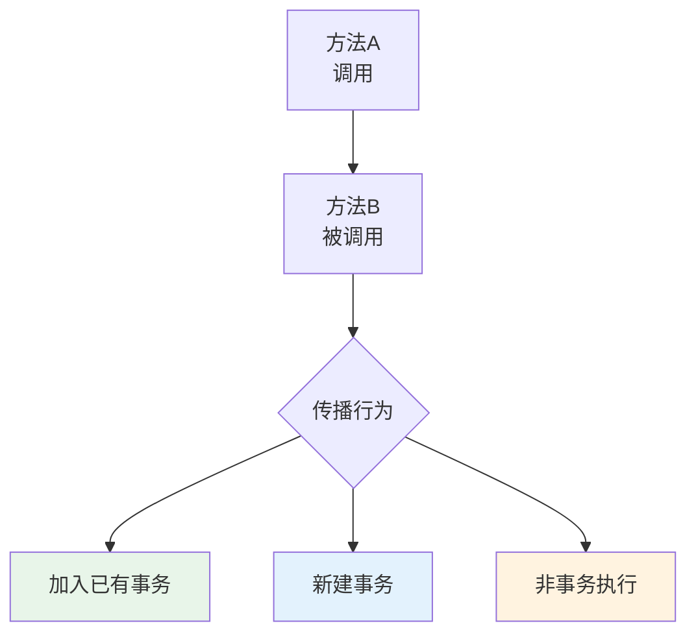

# Spring 声明式事务与事务传播

## 课程目标

- 掌握 @Transactional 注解的核心属性和使用方法
- 理解 Spring 的事务传播行为及其适用场景
- 理解事务隔离级别和常见属性的配置
- 掌握 @Transactional 的常见失效场景及解决方案
- 能够在图书管理系统中正确使用声明式事务


## 从编程式事务到声明式事务

### 回顾编程式事务

上一节课我们使用 `TransactionTemplate` 实现了编程式事务：

```java
@Service
public class OrderService {
    private final TransactionTemplate transactionTemplate;
    
    public Order createOrder(Order order) {
        return transactionTemplate.execute(status -> {
            // 业务逻辑...
            return orderRepository.save(order);
        });
    }
}
```

**编程式事务的问题：**

- 事务逻辑和业务逻辑混合在一起
- 每个需要事务的方法都需要重复编写事务模板代码
- 代码可读性降低

### 声明式事务的优势

声明式事务基于 AOP 实现，通过 `@Transactional` 注解声明事务边界，将事务管理与业务逻辑分离。

```java
@Service
public class OrderService {
    @Transactional
    public Order createOrder(Order order) {
        // 业务逻辑（事务由 AOP 自动管理）
        return orderRepository.save(order);
    }
}
```

| 对比         | 编程式事务         | 声明式事务     |
| ------------ | ------------------ | -------------- |
| **代码侵入** | 有                 | 无             |
| **代码量**   | 较多               | 较少           |
| **可读性**   | 事务代码与业务混合 | 业务逻辑清晰   |
| **灵活性**   | 高（细粒度控制）   | 中（方法级别） |
| **适用场景** | 精细控制事务边界   | 大多数业务场景 |


## 启用声明式事务

### Spring Boot 自动配置

Spring Boot 的 `DataSourceTransactionManagerAutoConfiguration` 会自动配置事务管理器，无需额外配置。

### 手动启用（Spring 非 Boot 项目）

如果使用非 Spring Boot 项目，需要添加 `@EnableTransactionManagement` 注解：

```java
@Configuration
@EnableTransactionManagement
public class AppConfig {
    @Bean
    public PlatformTransactionManager transactionManager(DataSource dataSource) {
        return new DataSourceTransactionManager(dataSource);
    }
}
```

> [!NOTE]
> 在 Spring Boot 项目中，`@EnableTransactionManagement` 通常不需要显式添加，Spring Boot 在满足条件时会自动开启。


## @Transactional 注解详解

### 注解属性

| 属性                 | 类型                           | 说明                     | 默认值                        |
| -------------------- | ------------------------------ | ------------------------ | ----------------------------- |
| `propagation`        | `Propagation`                  | 事务传播行为             | `Propagation.REQUIRED`        |
| `isolation`          | `Isolation`                    | 事务隔离级别             | `Isolation.DEFAULT`           |
| `timeout`            | `int`                          | 超时时间（秒）           | -1（使用数据库默认）          |
| `readOnly`           | `boolean`                      | 是否只读事务             | `false`                       |
| `rollbackFor`        | `Class<? extends Throwable>[]` | 触发回滚的异常类型       | `RuntimeException` 和 `Error` |
| `noRollbackFor`      | `Class<? extends Throwable>[]` | 不触发回滚的异常类型     | 空数组                        |
| `transactionManager` | `String`                       | 指定事务管理器 Bean 名称 | 默认事务管理器                |

### 基本使用

```java
@Service
public class BookService {
    @Autowired
    private BookRepository bookRepository;
    
    // 默认传播行为（REQUIRED），默认隔离级别，默认回滚 RuntimeException
    @Transactional
    public Book createBook(Book book) {
        return bookRepository.save(book);
    }
    
    // 指定隔离级别和超时
    @Transactional(isolation = Isolation.READ_COMMITTED, timeout = 30)
    public Book getBookById(Long id) {
        return bookRepository.findById(id);
    }
    
    // 指定只读事务（优化查询性能）
    @Transactional(readOnly = true)
    public List<Book> findAllBooks() {
        return bookRepository.findAll();
    }
    
    // 指定回滚特定异常
    @Transactional(rollbackFor = {BusinessException.class, DataAccessException.class})
    public void updateBook(Book book) {
        bookRepository.update(book);
    }
}
```


## 事务传播行为

### 传播行为概述

事务传播行为定义了**当一个事务方法被另一个事务方法调用时，事务如何传播**。



### 七种传播行为

| 传播行为             | 说明                                     |
| -------------------- | ---------------------------------------- |
| **REQUIRED（默认）** | 当前存在事务则加入，否则新建             |
| **SUPPORTS**         | 当前存在事务则加入，否则无事务执行       |
| **MANDATORY**        | 当前必须存在事务，否则抛出异常           |
| **REQUIRES_NEW**     | 新建事务，挂起当前事务                   |
| **NOT_SUPPORTED**    | 以非事务方式执行，挂起当前事务           |
| **NEVER**            | 以非事务方式执行，当前存在事务则抛出异常 |
| **NESTED**           | 当前存在事务则在嵌套事务中执行           |

### 传播行为详解与示例

#### REQUIRED（默认）

如果当前存在事务，则加入；如果没有，则新建一个事务。

```java
@Service
public class OrderService {
    @Autowired
    private PaymentService paymentService;
    
    @Transactional  // REQUIRED（默认）
    public void createOrder(Order order) {
        orderRepository.save(order);
        // 调用另一个 @Transactional 方法
        paymentService.processPayment(order);  // 加入同一个事务
    }
}

@Service
public class PaymentService {
    @Transactional  // REQUIRED（默认）
    public void processPayment(Order order) {
        paymentRepository.save(order);
    }
}
```

**执行流程：**

```text
createOrder() 启动事务 T1
  └── paymentService.processPayment()
        └── 加入事务 T1（不新建）
```


#### REQUIRES_NEW

每次调用都会新建一个独立的事务，挂起当前事务。

```java
@Service
public class AuditService {
    @Transactional(propagation = Propagation.REQUIRES_NEW)
    public void logOperation(String message) {
        // 即使外层事务失败，审计日志仍能保存
        auditRepository.save(message);
    }
}

@Service
public class OrderService {
    @Transactional
    public void createOrder(Order order) {
        orderRepository.save(order);
        try {
            auditService.logOperation("创建订单");  // 独立事务
        } catch (Exception e) {
            // 审计日志异常不影响主事务
        }
    }
}
```

**执行流程：**

```text
createOrder() 启动事务 T1
  └── auditService.logOperation()
        └── 挂起 T1，创建新事务 T2
        └── 提交 T2
        └── 恢复 T1
（T1 回滚不影响 T2）
```

> [!NOTE]
> `REQUIRES_NEW` 常用于审计日志、历史记录等需要独立事务的场景，即使主事务回滚，这些记录仍然保留。


#### NESTED

如果当前存在事务，则创建一个嵌套事务；如果没有，则与 `REQUIRED` 行为相同。嵌套事务是当前事务的子事务，可以通过保存点（Savepoint）实现部分回滚。

```java
@Service
public class OrderService {
    @Transactional
    public void createOrder(Order order) {
        orderRepository.save(order);
        // 嵌套事务：如果扣款失败，只回滚嵌套部分
        paymentService.deductPayment(order);  // NESTED
        inventoryService.reduceStock(order);  // NESTED
    }
}

@Service
public class PaymentService {
    @Transactional(propagation = Propagation.NESTED)
    public void deductPayment(Order order) {
        // 嵌套事务
    }
}
```

> [!CAUTION]
> `NESTED` 需要 JDBC 3.0+ 和 Savepoint 支持。某些数据库可能不支持，使用前需确认。


#### SUPPORTS

如果有事务则加入，否则以非事务方式执行。

```java
@Transactional(propagation = Propagation.SUPPORTS)
public List<Book> findAllBooks() {
    // 有事务则使用，没有也无所谓
    return bookRepository.findAll();
}
```


#### MANDATORY

必须存在事务，否则抛出 `IllegalTransactionStateException`。

```java
@Transactional(propagation = Propagation.MANDATORY)
public void updateBook(Book book) {
    // 必须被事务方法调用，否则抛异常
}
```


#### NOT_SUPPORTED

以非事务方式执行，如果当前存在事务则挂起。

```java
@Transactional(propagation = Propagation.NOT_SUPPORTED)
public void generateReport() {
    // 不需要事务，挂起当前事务
}
```


#### NEVER

以非事务方式执行，如果当前存在事务则抛出异常。

```java
@Transactional(propagation = Propagation.NEVER)
public void simpleQuery() {
    // 绝对不能在有事务的情况下调用
}
```


### 传播行为选择指南

| 场景                           | 推荐传播行为       |
| ------------------------------ | ------------------ |
| 常规业务方法（CRUD）           | `REQUIRED`（默认） |
| 审计日志（需独立保存）         | `REQUIRES_NEW`     |
| 批量处理（部分失败不影响其他） | `NESTED`           |
| 只读查询                       | `SUPPORTS`         |
| 强制必须事务                   | `MANDATORY`        |


## 事务隔离级别

### 配置隔离级别

```java
@Transactional(isolation = Isolation.READ_COMMITTED)
public Book findBook(Long id) {
    return bookRepository.findById(id);
}
```


### 隔离级别选项

| 隔离级别           | 说明                               |
| ------------------ | ---------------------------------- |
| `DEFAULT`          | 使用数据库默认隔离级别             |
| `READ_UNCOMMITTED` | 最低级别，可能脏读                 |
| `READ_COMMITTED`   | 解决脏读（Oracle 默认）            |
| `REPEATABLE_READ`  | 解决脏读和不可重复读（MySQL 默认） |
| `SERIALIZABLE`     | 解决所有问题，性能最低             |

> [!NOTE]
> MySQL 默认 `REPEATABLE_READ`，Oracle 默认 `READ_COMMITTED`。大多数场景使用 `READ_COMMITTED` 即可满足需求。


## @Transactional 失效场景分析

### 场景一：非 public 方法

`@Transactional` 只能在 `public` 方法上生效。AOP 代理无法拦截非 `public` 方法。

```java
@Service
public class BookService {
    // ❌ 不生效：private 方法
    @Transactional
    private void doSomething() { ... }
    
    // ✅ 生效：public 方法
    @Transactional
    public void doSomethingPublic() { ... }
}
```

### 场景二：同类方法自调用

在同一个类中，一个方法调用另一个 `@Transactional` 方法，会绕过代理，事务不生效。

```java
@Service
public class BookService {
    public void createBookAndLog(Book book) {
        // ❌ 直接调用，事务不生效
        createBook(book);
    }
    
    @Transactional
    public void createBook(Book book) {
        bookRepository.save(book);
    }
}
```

**解决方案一：将调用方法也加上事务（推荐）**

```java
@Transactional
public void createBookAndLog(Book book) {
    createBook(book);  // 在同一事务中执行
}
```

**解决方案二：注入自身（通过代理调用）**

```java
@Service
public class BookService {
    @Autowired
    private BookService self;  // 注入自身代理
    
    public void createBookAndLog(Book book) {
        // ✅ 通过代理调用，事务生效
        self.createBook(book);
    }
    
    @Transactional
    public void createBook(Book book) {
        bookRepository.save(book);
    }
}
```

### 场景三：异常类型不匹配

默认情况下，`@Transactional` 只对 `RuntimeException` 和 `Error` 回滚，对受检异常（`Exception`）不回滚。

```java
// ❌ 不会回滚：捕获了受检异常，但未设置 rollbackFor
@Transactional
public void updateBook(Book book) throws Exception {
    try {
        bookRepository.update(book);
    } catch (SQLException e) {
        // 捕获异常后，事务不会回滚（因为异常未抛出）
        System.out.println("数据库异常");
    }
}

// ✅ 正确：设置 rollbackFor 捕获特定异常
@Transactional(rollbackFor = Exception.class)
public void updateBook(Book book) throws Exception {
    bookRepository.update(book);
}
```

**处理异常的正确方式：**

```java
@Transactional(rollbackFor = Exception.class)
public void updateBook(Book book) {
    try {
        bookRepository.update(book);
    } catch (SQLException e) {
        // 记录日志后重新抛出，触发回滚
        throw new RuntimeException("更新失败", e);
    }
}
```

### 事务失效场景总结

| 失效场景         | 解决方案                           |
| ---------------- | ---------------------------------- |
| 非 public 方法   | 改为 public                        |
| 同类方法自调用   | 注入自身代理或将调用方法也加事务   |
| 异常被捕获未抛出 | 重新抛出异常或设置 rollbackFor     |
| 异常类型不匹配   | 设置 rollbackFor = Exception.class |


## 实战：在图书管理系统中使用声明式事务

### Service 层改造

将 `BookServiceImpl` 中的业务方法添加 `@Transactional` 注解：

```java
@Service
public class BookServiceImpl implements BookService {

    private final BookRepository bookRepository;

    /**
     * 注入自身代理，解决自调用事务失效问题
     */
    @Autowired
  	@Lazy
    private BookService self;

    public BookServiceImpl(BookRepository bookRepository) {
        this.bookRepository = bookRepository;
    }

    // ========== 写入操作：需要事务 ==========

    @Override
    @Transactional(rollbackFor = BusinessException.class)
    public Book createBook(Book book) {
        // 业务校验：价格不能为负数
        if (book.getPrice() == null || book.getPrice() < 0) {
            throw new BusinessException("图书价格不能为空或为负数");
        }
        // 业务校验：库存不能为负数
        if (book.getStock() == null || book.getStock() < 0) {
            throw new BusinessException("库存不能为负数");
        }

        System.out.println("添加Book：" + book.getTitle());
        return bookRepository.save(book);
    }

    @Override
    @Transactional(rollbackFor = BusinessException.class)
    public Book updateBook(Book book) {
        if (book.getId() == null) {
            throw new IllegalArgumentException("更新图书时 ID 不能为空");
        }
        Book existing = bookRepository.findById(book.getId());
        if (existing == null) {
            throw new ResourceNotFoundException("要更新的图书不存在，ID: " + book.getId());
        }
        return bookRepository.update(book);
    }

    @Override
    @Transactional(rollbackFor = BusinessException.class)
    public boolean deleteBook(Long id) {
        if (id == null) {
            throw new IllegalArgumentException("删除时 ID 不能为空");
        }
        return bookRepository.deleteById(id);
    }

    /**
     * 批量导入：使用 @Transactional 声明式事务
     * 替代原 TransactionTemplate 编程式事务
     * <p>
     * 注意：使用 self 调用避免自调用失效
     */
    @Override
    @Transactional(rollbackFor = Exception.class)
    public void importBooks(List<Book> books) {
        // 前置校验
        for (Book book : books) {
            if (book.getPrice() == null || book.getPrice() < 0) {
                throw new BusinessException("图书价格不能为负数: " + book.getTitle());
            }
        }

        // 通过 self 代理调用，确保事务生效
        for (Book book : books) {
            self.createBook(book);
        }

        // 原 batchInsert 方式（如果 Repository 支持批量插入）
        // bookRepository.batchInsert(books);
    }
		...   
}
```

### 审计服务（独立事务）

```java
@Service
public class AuditService {

    @Autowired
    private AuditRepository auditRepository;

    // 使用 REQUIRES_NEW 确保审计日志独立提交
    @Transactional(propagation = Propagation.REQUIRES_NEW)
    public void logOperation(String message) {
        AuditLog log = new AuditLog();
        log.setMessage(message);
        log.setCreatedAt(LocalDateTime.now());
        auditRepository.save(log);
    }
}
```


### 重构对比总结

| 方面             | 重构前                        | 重构后                            |
| ---------------- | ----------------------------- | --------------------------------- |
| **事务管理方式** | TransactionTemplate（编程式） | @Transactional（声明式）          |
| **代码侵入**     | 高（每个方法需包装）          | 低（仅需注解）                    |
| **事务传播控制** | 手动编写复杂逻辑              | 注解配置 `propagation` 属性       |
| **只读事务优化** | 无                            | `@Transactional(readOnly = true)` |
| **自调用失效**   | 未处理                        | 注入 `self` 代理解决              |
| **审计日志**     | 无                            | `REQUIRES_NEW` 独立事务           |
| **可读性**       | 事务代码与业务混合            | 事务与业务分离                    |


## 注意事项

1. **事务方法应尽量精简**：只包含需要事务保护的操作，避免大事务影响性能。
2. **只读事务性能优化**：查询方法设置 `readOnly = true`，数据库可进行优化。
3. **避免在事务中执行耗时操作**：如远程调用、文件操作等，会长时间持有连接。
4. **注意事务传播行为的组合**：`REQUIRES_NEW` 和 `NESTED` 需根据业务场景选择。
5. **测试事务是否生效**：可使用 `@Rollback` 注解进行测试。


## 小结

本节课我们学习了：

1. **声明式事务的优势**：AOP 驱动，无代码侵入，将事务与业务分离。
2. **@Transactional 注解**：核心属性（传播行为、隔离级别、超时、只读、回滚规则）。
3. **七种事务传播行为**：
   - `REQUIRED`（默认）加入或创建
   - `REQUIRES_NEW` 新建独立事务
   - `NESTED` 创建嵌套事务（Savepoint）
   - 其他：`SUPPORTS`、`MANDATORY`、`NOT_SUPPORTED`、`NEVER`
4. **隔离级别**：`DEFAULT`、`READ_UNCOMMITTED`、`READ_COMMITTED`、`REPEATABLE_READ`、`SERIALIZABLE`。
5. **@Transactional 失效场景**：非 public、自调用、异常被捕获、异常类型不匹配、数据库引擎不支持。


## 作业

### 作业一：代码阅读——声明式事务识别

阅读以下代码，回答问题。

```java
@Transactional
public void updateBooks(List<Book> books) {
    for (Book book : books) {
        try {
            bookRepository.update(book);
            logService.logSuccess(book.getId());
        } catch (DataAccessException e) {
            logService.logError(book.getId(), e.getMessage());
        }
    }
}

@Service
public class LogService {
    @Transactional(propagation = Propagation.REQUIRES_NEW)
    public void logSuccess(Long id) { ... }
    
    @Transactional(propagation = Propagation.REQUIRES_NEW)
    public void logError(Long id, String msg) { ... }
}
```

**问题：**

1. `updateBooks` 使用了哪种事务传播行为？
2. 如果 `updateBooks` 在事务中执行，`logService.logSuccess` 是在同一个事务中还是独立事务中？为什么？
3. 如果某个 `logService.logError` 调用失败，会影响 `updateBooks` 的事务吗？

------

### 作业二：代码阅读——事务传播行为分析

阅读以下代码，回答问题。

```java
@Service
public class TransferService {
    @Transactional(propagation = Propagation.REQUIRED)
    public void transfer(Account from, Account to, BigDecimal amount) {
        deduct(from, amount);
        add(to, amount);
        notificationService.sendNotification(to, amount);
    }
    
    @Transactional(propagation = Propagation.REQUIRES_NEW)
    public void deduct(Account account, BigDecimal amount) {
        account.setBalance(account.getBalance().subtract(amount));
    }
    
    @Transactional(propagation = Propagation.REQUIRES_NEW)
    public void add(Account account, BigDecimal amount) {
        account.setBalance(account.getBalance().add(amount));
    }
}
```

**问题：**

1. 调用 `transfer` 方法时，总共有几个事务被创建？分别是哪些？
2. 如果 `deduct` 方法执行成功但 `add` 方法失败，转账结果如何？
3. 如果 `notificationService.sendNotification` 失败，对事务有何影响？

------

### 作业三：@Transactional 失效场景修复

阅读以下代码，指出 `@Transactional` 不生效的原因，并给出修改建议。

```java
@Service
public class BookService {
    private final BookRepository bookRepository;
    
    public BookService(BookRepository bookRepository) {
        this.bookRepository = bookRepository;
    }
    
    @Transactional
    private Book createBookInternal(Book book) {
        return bookRepository.save(book);
    }
    
    public Book createBookWithLog(Book book) {
        Book saved = createBookInternal(book);
        System.out.println("创建成功: " + saved.getTitle());
        return saved;
    }
    
    @Transactional
    public void updatePrice(Long id, Double newPrice) {
        try {
            bookRepository.updatePrice(id, newPrice);
        } catch (DataAccessException e) {
            System.out.println("更新失败: " + e.getMessage());
        }
    }
}
```

**问题：**

1. `createBookInternal` 上的 `@Transactional` 生效了吗？为什么？
2. `createBookWithLog` 方法中的 `createBookInternal` 调用是否在事务中执行？
3. `updatePrice` 方法执行时，如果数据库更新失败，事务会回滚吗？为什么？

------

### 作业四：为图书管理系统添加声明式事务

基于图书管理系统项目，完成以下任务：

1. 在 `BookService` 的所有写操作方法上添加 `@Transactional`：
   - `createBook`
   - `updateBook`
   - `deleteBook`
   - `batchImportBooks`
2. 为所有查询方法添加 `@Transactional(readOnly = true)`：
   - `getBookById`
   - `getAllBooks`
   - `listBooks`
3. 创建一个 `AuditService` 类，记录操作日志，使用 `REQUIRES_NEW` 传播行为确保审计日志独立提交。
4. 在 `BookService` 的 `batchImportBooks` 方法中使用 `NESTED` 传播行为，确保单本图书失败不影响其他图书的导入。
5. 测试验证事务是否生效。
