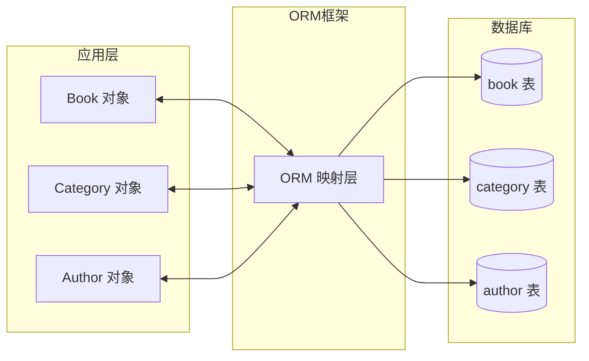
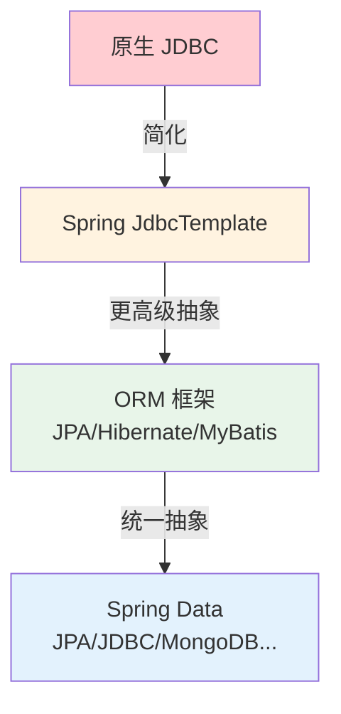
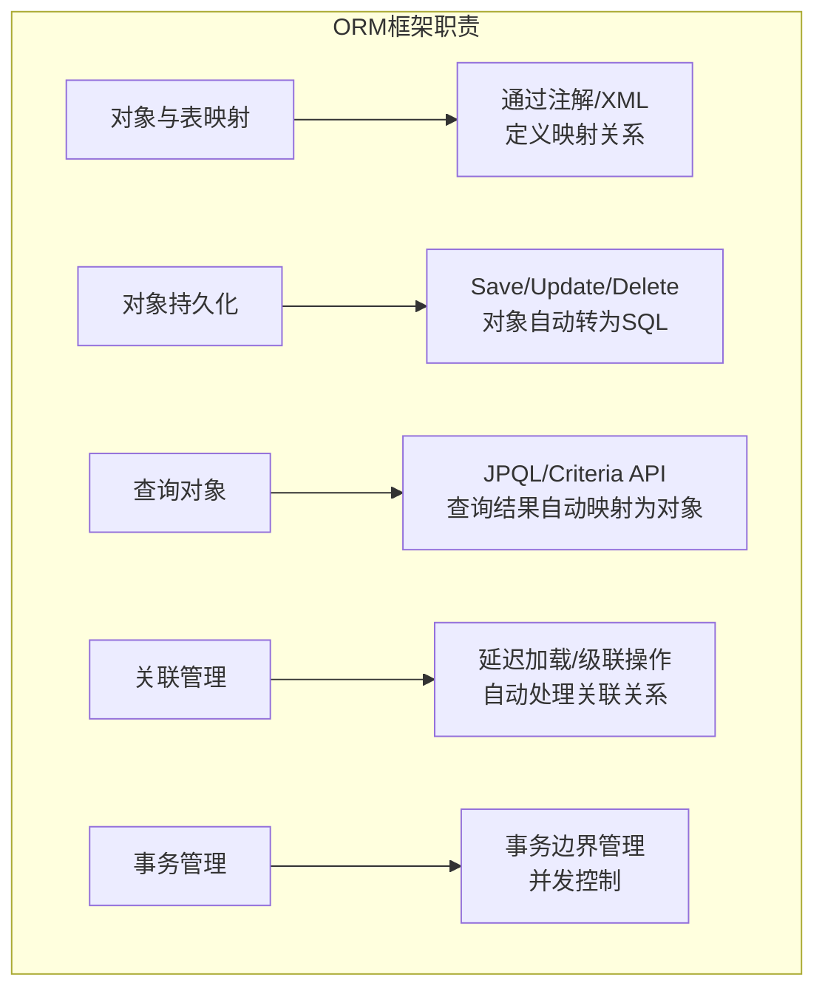
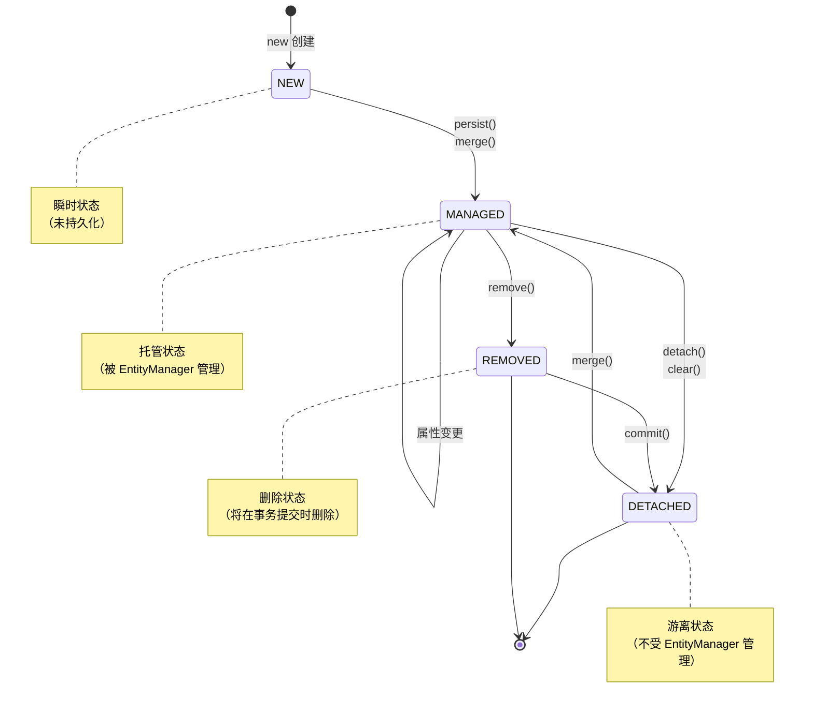
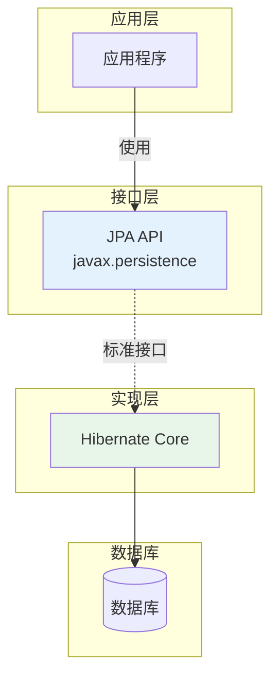
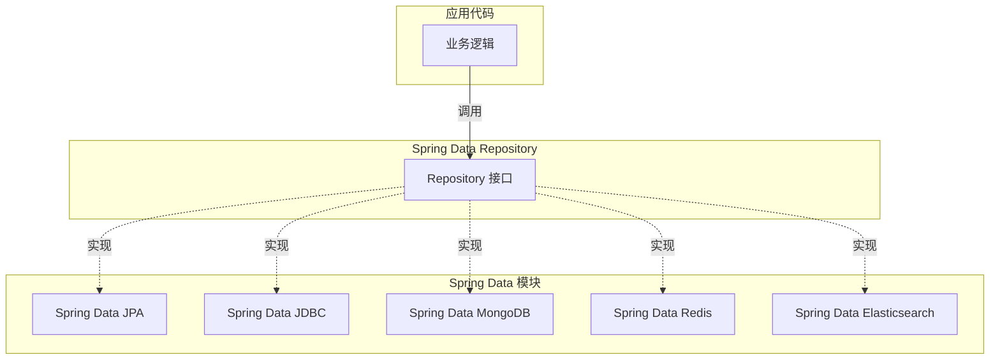
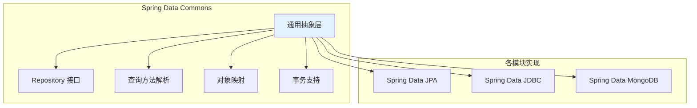
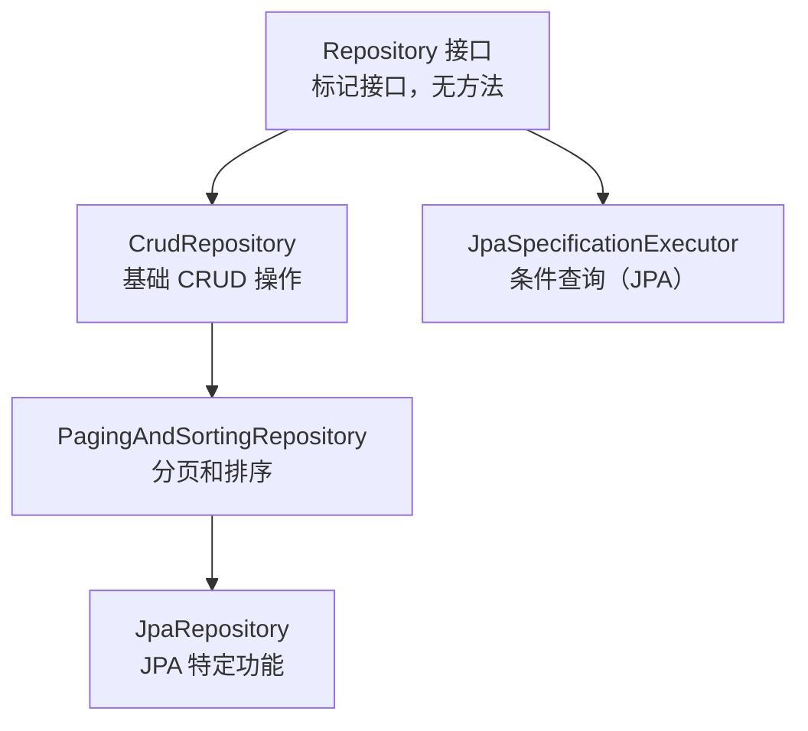
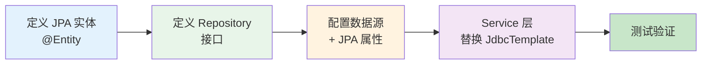

# ORM 核心概念与 Spring Data 架构

## 课程目标

- 理解 ORM 的基本概念和核心价值
- 了解 JPA 规范及其在 Java 生态中的地位
- 理解 Hibernate 与 JPA 的关系
- 掌握 Spring Data 的整体架构和设计理念
- 熟悉 Spring Data 的核心接口（Repository、CrudRepository 等）
- 能够为图书管理系统规划从 Spring JDBC 到 Spring Data JPA 的迁移


## 从 JDBC 到 ORM 的演进

### 回顾 JDBC 开发的痛点

在前面的课程中，我们使用 Spring JDBC 和 JdbcTemplate 大幅简化了数据访问代码：

```java
// JdbcTemplate 方式（已比原生 JDBC 好很多）
public Book findById(Long id) {
    String sql = "SELECT * FROM book WHERE id = ?";
    return jdbcTemplate.queryForObject(sql, bookRowMapper, id);
}
```

但 JdbcTemplate 仍然存在以下问题：

| 痛点                     | 说明                                         |
| ------------------------ | -------------------------------------------- |
| **SQL 与 Java 代码耦合** | SQL 写在 Java 代码中，修改 SQL 需要重新编译  |
| **结果集映射繁琐**       | 每个查询都要定义 RowMapper，字段多时重复劳动 |
| **对象关系不匹配**       | 数据库表结构与 Java 对象模型存在阻抗不匹配   |
| **关联处理复杂**         | 处理关联查询（JOIN）需要手动组装对象关系     |
| **无法利用面向对象特性** | 数据库操作以 SQL 为中心，而非对象为中心      |

> [!NOTE]
>
> **阻抗不匹配**：数据库是“方”的（行与列），Java 对象是“圆”的（嵌套引用），两者天生“对不上”，迫使开发者必须手写繁重的 SQL 和对象转换代码.

### ORM 的诞生

**ORM（Object-Relational Mapping，对象关系映射）** 是一种编程技术，用于将关系型数据库中的数据映射为面向对象语言中的对象，解决“阻抗不匹配”问题。



### 数据访问技术演进路线图




## ORM 核心概念

### 什么是 ORM

ORM 是一种编程范式，它将数据库中的表映射为编程语言中的类，将表中的行映射为对象，将列映射为对象的属性。

### ORM 的核心思想

| 数据库概念          | ORM 映射 | Java 概念        |
| ------------------- | -------- | ---------------- |
| 表（Table）         | ↔        | 类（Class）      |
| 行（Row）           | ↔        | 对象（Object）   |
| 列（Column）        | ↔        | 属性（Field）    |
| 主键（Primary Key） | ↔        | `@Id` 标注的属性 |
| 外键（Foreign Key） | ↔        | 对象引用（关联） |

### ORM 框架的核心职责



### ORM 的优缺点

| 优点                                 | 缺点                         |
| ------------------------------------ | ---------------------------- |
| ✅ 面向对象编程，提高开发效率         | ❌ 性能开销（反射、SQL 生成） |
| ✅ 自动生成 SQL，减少重复代码         | ❌ 复杂查询不如手写 SQL 灵活  |
| ✅ 数据库方言适配（切换数据库更容易） | ❌ 学习曲线较陡               |
| ✅ 关联关系自动管理（懒加载、级联）   | ❌ 可能导致 N+1 查询问题      |


## JPA 规范

### 什么是 JPA

**JPA（Java Persistence API，Java 持久化 API）** 是 Java EE 平台的一个标准规范，定义了对象关系映射和实体持久化的 API。它本身只是一个规范（接口），由各个厂商提供实现。

```mermaid
flowchart TB
    subgraph JPA规范
        JPA1[实体映射<br/>@Entity/@Table]
        JPA2[实体管理<br/>EntityManager]
        JPA3[查询语言<br/>JPQL]
        JPA4[事务管理<br/>事务 API]
    end

    subgraph 实现者
        H[Hibernate]
        E[EclipseLink]
        O[OpenJPA]
    end

    JPA规范 --> H
    JPA规范 --> E
    JPA规范 --> O
```

### JPA 的核心接口

| 接口/类                | 说明                                     |
| ---------------------- | ---------------------------------------- |
| `EntityManager`        | 实体管理器，负责实体的持久化操作（CRUD） |
| `EntityManagerFactory` | 创建 EntityManager 的工厂                |
| `PersistenceContext`   | 持久化上下文，管理实体的生命周期         |
| `EntityTransaction`    | 事务控制（JTA 或 RESOURCE_LOCAL）        |

### JPA 实体生命周期



> [!NOTE]
> JPA 只是一种规范，不能直接使用，需要配合具体的实现框架（如 Hibernate）。


## Hibernate 与 JPA 的关系

### Hibernate 是什么

**Hibernate** 是最流行的 JPA 实现框架，早在 JPA 规范出现之前就已经存在。它提供了完整的 ORM 功能，并成为 JPA 规范的主要参考实现。

### Hibernate 与 JPA 的关系



### JPA vs Hibernate 对比

| 对比               | JPA                           | Hibernate                             |
| ------------------ | ----------------------------- | ------------------------------------- |
| **类型**           | 规范（接口）                  | 实现（产品）                          |
| **来源**           | Java EE 标准                  | Red Hat / 开源社区                    |
| **使用方式**       | 通过 `javax.persistence.*` 包 | 通过 `org.hibernate.*` 包             |
| **是否有独立功能** | 无（需实现）                  | 有（Hibernate 特有功能）              |
| **推荐方式**       | 使用 JPA 标准 API             | 需要高级功能时使用 Hibernate 特有 API |

### 使用 JPA 标准 API 的好处

```java
// 使用 JPA 标准 API（推荐）
import javax.persistence.*;

@Entity
public class Book {
    @Id
    private Long id;
    // ...
}

// 使用 Hibernate 特有 API（不推荐，除非必要）
import org.hibernate.annotations.*;
// ...
```

**好处：**

- 可替换实现（更换 ORM 框架无需修改代码）
- 更广泛的兼容性和可移植性
- 更清晰的边界（避免过度依赖特定厂商特性）


## Spring Data 整体架构

### 什么是 Spring Data

**Spring Data** 是 Spring 框架的一个子项目，旨在简化各种数据访问技术的使用。它提供了统一的 Repository 编程模型，使开发者可以用相同的方式访问关系型数据库、NoSQL 数据库等。

### Spring Data 核心设计理念

**统一抽象**：无论使用什么数据库（MySQL、MongoDB、Redis 等），都使用相同的 Repository 接口模式。



### Spring Data 生态系统

| 模块                          | 说明                       |
| ----------------------------- | -------------------------- |
| **Spring Data JPA**           | JPA 规范实现（本系列重点） |
| **Spring Data JDBC**          | 轻量级 JDBC 抽象           |
| **Spring Data MongoDB**       | MongoDB 文档数据库         |
| **Spring Data Redis**         | Redis 键值存储             |
| **Spring Data Elasticsearch** | Elasticsearch 搜索引擎     |
| **Spring Data REST**          | 自动暴露 REST API          |

### Spring Data Commons

**Spring Data Commons** 是所有 Spring Data 模块的**基础**，提供了通用的 Repository 抽象和基础设施。




## Spring Data 核心接口

### Repository 接口层次结构



### 各接口功能对比

| 接口                           | 主要方法                                             | 用途                   |
| ------------------------------ | ---------------------------------------------------- | ---------------------- |
| **Repository**                 | 无                                                   | 标记接口，用于类型识别 |
| **CrudRepository**             | `save`, `findById`, `findAll`, `deleteById`, `count` | 基础 CRUD              |
| **PagingAndSortingRepository** | `findAll(Pageable)`, `findAll(Sort)`                 | 分页和排序查询         |
| **JpaRepository**              | `flush`, `saveAndFlush`, `deleteInBatch`             | JPA 特定功能           |

### CrudRepository 方法详解

```java
public interface CrudRepository<T, ID> extends Repository<T, ID> {
    // 保存实体（插入或更新）
    <S extends T> S save(S entity);
    
    // 保存多个实体
    <S extends T> Iterable<S> saveAll(Iterable<S> entities);
    
    // 根据 ID 查找
    Optional<T> findById(ID id);
    
    // 判断是否存在
    boolean existsById(ID id);
    
    // 查询全部
    Iterable<T> findAll();
    
    // 查询多个 ID
    Iterable<T> findAllById(Iterable<ID> ids);
    
    // 统计记录数
    long count();
    
    // 根据 ID 删除
    void deleteById(ID id);
    
    // 删除实体
    void delete(T entity);
    
    // 删除多个实体
    void deleteAll(Iterable<? extends T> entities);
    
    // 删除全部
    void deleteAll();
}
```

### PagingAndSortingRepository 方法

```java
public interface PagingAndSortingRepository<T, ID> extends CrudRepository<T, ID> {
    // 分页查询
    Page<T> findAll(Pageable pageable);
    
    // 排序查询
    Iterable<T> findAll(Sort sort);
}
```

### 使用示例（预览）

```java
// 定义 Repository 接口（只需继承，无需实现）
public interface BookRepository extends JpaRepository<Book, Long> {
    // 方法命名自动生成查询
    List<Book> findByAuthor(String author);
    List<Book> findByPriceBetween(Double min, Double max);
    Page<Book> findByCategory(String category, Pageable pageable);
}

// 使用
@Service
public class BookService {
    @Autowired
    private BookRepository bookRepository;
    
    public Book createBook(Book book) {
        return bookRepository.save(book);  // 无需写 SQL
    }
    
    public Page<Book> getBooksByCategory(String category, int page, int size) {
        Pageable pageable = PageRequest.of(page, size);
        return bookRepository.findByCategory(category, pageable);
    }
}
```


## Spring Data JPA vs Spring JDBC

| 对比         | Spring JDBC (JdbcTemplate) | Spring Data JPA                  |
| ------------ | -------------------------- | -------------------------------- |
| **SQL 编写** | 手写 SQL                   | 自动生成 SQL（可通过注解自定义） |
| **结果映射** | 手写 RowMapper             | 自动映射实体                     |
| **关联处理** | 手动拼接                   | 自动关联（懒加载/急加载）        |
| **代码量**   | 较多                       | 很少（只需定义接口）             |
| **面向对象** | 以 SQL 为中心              | 以对象为中心                     |
| **学习曲线** | 平缓                       | 中等                             |
| **适用场景** | 复杂 SQL、性能要求高       | 标准 CRUD、领域模型驱动          |


## 在图书管理系统中规划迁移路线

### 当前状态（Spring JDBC）

```java
@Repository
public class BookRepository {
    @Autowired
    private JdbcTemplate jdbcTemplate;
    
    public List<Book> findAll() {
        String sql = "SELECT * FROM book";
        return jdbcTemplate.query(sql, bookRowMapper);
    }
    
    public Book save(Book book) {
        // 手写 SQL + KeyHolder
    }
}
```

### 未来状态（Spring Data JPA）

```java
// 只需定义接口，无需实现
public interface BookRepository extends JpaRepository<Book, Long> {
    List<Book> findByAuthor(String author);
    Page<Book> findByCategory(String category, Pageable pageable);
}

// Service 层直接注入使用
@Service
public class BookService {
    @Autowired
    private BookRepository bookRepository;
    
    public List<Book> getBooksByAuthor(String author) {
        return bookRepository.findByAuthor(author);
    }
}
```

### 迁移步骤概览




## 小结

本节课我们学习了：

1. **ORM 核心概念**：将数据库表映射为 Java 对象，解决阻抗不匹配。
2. **JPA 规范**：Java 持久化的标准 API，定义了实体映射、EntityManager、JPQL 等。
3. **Hibernate 与 JPA 的关系**：JPA 是规范，Hibernate 是主要实现，推荐使用 JPA 标准 API。
4. **Spring Data 整体架构**：统一 Repository 抽象，支持多种数据源（JPA、JDBC、MongoDB 等）。
5. **Spring Data 核心接口**：
   - `Repository`：标记接口
   - `CrudRepository`：基础 CRUD
   - `PagingAndSortingRepository`：分页排序
   - `JpaRepository`：JPA 特定功能
6. **迁移规划**：从 Spring JDBC 平滑迁移到 Spring Data JPA。


## 作业

### 作业一：从 JDBC 痛点推导 ORM 价值

使用 JdbcTemplate 仍然存在的 5 个痛点（SQL 与 Java 耦合、结果集映射繁琐、对象关系不匹配、关联处理复杂、无法利用面向对象特性）。

请针对其中任意 **3 个**痛点，分别回答：

1. 这个痛点具体指什么？
2. ORM 框架是如何解决这个痛点的？（对照课件中 ORM 核心职责部分回答）

------

### 作业二：绘制并标注 Spring Data 架构图

根据课件中“Spring Data 整体架构”和“Spring Data Commons”两部分内容：

1. 手绘或使用工具绘制一幅 **Spring Data 架构图**，必须包含以下元素：
   - 应用层（业务逻辑）
   - Repository 接口层
   - Spring Data Commons（通用抽象层）
   - 至少 3 个具体模块（如 JPA、JDBC、MongoDB）
   - 数据库层
2. 在图中用箭头标注出 **依赖关系** 和 **实现关系**，并简要文字说明“统一抽象”设计理念的含义。

------

### 作业三：接口功能对照表

Spring Data 包含4 个核心接口：`Repository`、`CrudRepository`、`PagingAndSortingRepository`、`JpaRepository`。

请完成以下表格（在作业中手写或电子表格填写）：

| 接口名称                   | 继承自谁 | 新增了哪些功能（用一句话概括） | 至少列举 2 个方法名 |
| -------------------------- | -------- | ------------------------------ | ------------------- |
| Repository                 | —        |                                |                     |
| CrudRepository             |          |                                |                     |
| PagingAndSortingRepository |          |                                |                     |
| JpaRepository              |          |                                |                     |
