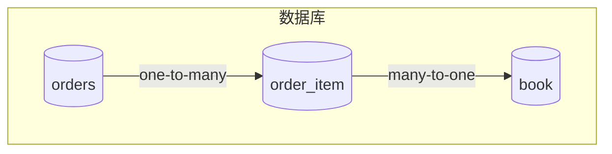
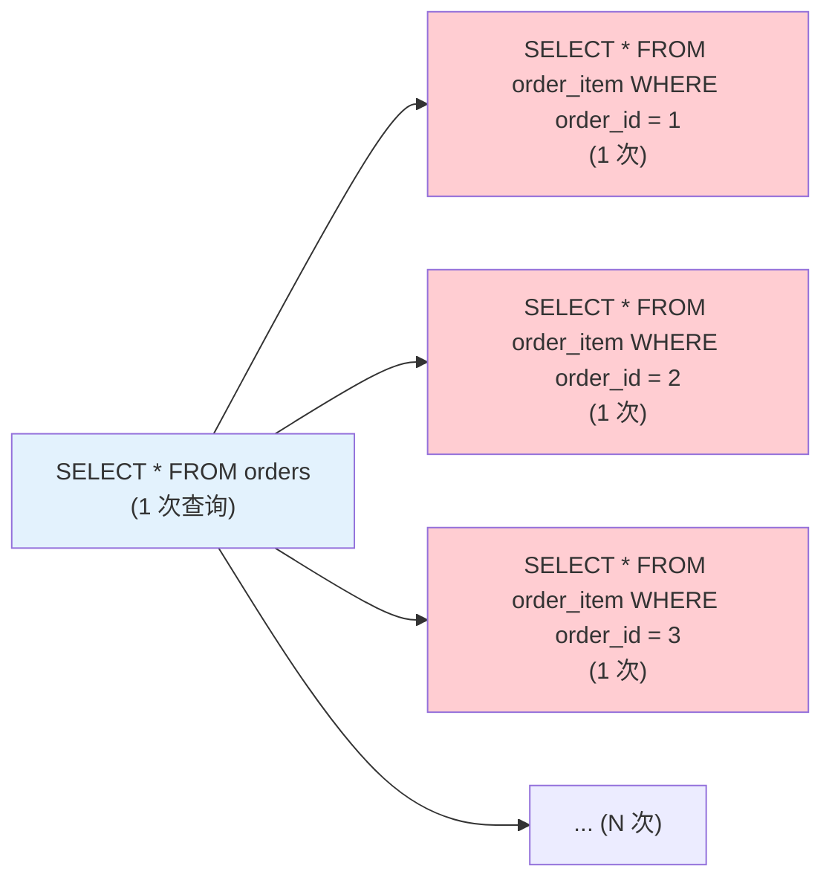

# Spring Data JPA 关联映射与实战

## 课程目标

- 掌握 JPA 中四种关联关系的映射（@ManyToOne、@OneToMany、@OneToOne、@ManyToMany）
- 理解单向关联与双向关联的区别
- 掌握级联操作（CascadeType）的使用场景
- 理解懒加载（LAZY）与急加载（EAGER）的区别
- 掌握 N+1 查询问题的成因、危害及解决方案（JOIN FETCH、EntityGraph、批量抓取）
- 能够在图书管理系统中正确使用关联映射，实现订单与订单项的关联管理


## 导入：从单表到关联表

在前几节课中，我们只操作了 `book` 单表。但在实际业务中，表之间往往存在关联关系：



**JPA 关联映射** 让我们可以在 Java 对象中直接操作关联关系，而无需手动编写 JOIN SQL。

| 关联类型 | 数据库表现     | Java 表现                   |
| -------- | -------------- | --------------------------- |
| 一对一   | 外键 + UNIQUE  | `@OneToOne`                 |
| 一对多   | 外键在多的一方 | `@OneToMany` / `@ManyToOne` |
| 多对多   | 中间表         | `@ManyToMany`               |

本节课将以 **订单（Order）- 订单项（OrderItem）- 图书（Book）** 这一业务场景为主线，深入讲解 JPA 关联映射的实战应用。


## 数据库表结构定义

在编写实体类之前，先明确数据库表结构。本课程使用 PostgreSQL，以下为完整的 DDL 定义。

```sql
-- ======================================================
-- 1. 图书表 (book)
-- ======================================================
CREATE TABLE IF NOT EXISTS book (
    id BIGSERIAL PRIMARY KEY,
    title VARCHAR(100) NOT NULL,
    author VARCHAR(50) NOT NULL,
    price NUMERIC(10, 2) NOT NULL,
    stock INT NOT NULL,
    sales INT DEFAULT 0,
    category VARCHAR(20),
    isbn VARCHAR(20),
    description TEXT,
    created_at TIMESTAMP DEFAULT CURRENT_TIMESTAMP,
    updated_at TIMESTAMP DEFAULT CURRENT_TIMESTAMP
);

CREATE INDEX idx_book_author ON book(author);
CREATE INDEX idx_book_category ON book(category);
CREATE INDEX idx_book_price ON book(price);

-- ======================================================
-- 2. 订单表 (orders)
-- ======================================================
CREATE TABLE IF NOT EXISTS orders (
    id BIGSERIAL PRIMARY KEY,
    order_number VARCHAR(20) NOT NULL UNIQUE,
    total_amount NUMERIC(12, 2),
    status VARCHAR(20) NOT NULL DEFAULT 'CREATED',
    created_at TIMESTAMP DEFAULT CURRENT_TIMESTAMP,
    updated_at TIMESTAMP DEFAULT CURRENT_TIMESTAMP
);

CREATE INDEX idx_orders_status ON orders(status);
CREATE INDEX idx_orders_created_at ON orders(created_at);

-- ======================================================
-- 3. 订单项表 (order_item)
-- ======================================================
CREATE TABLE IF NOT EXISTS order_item (
    id BIGSERIAL PRIMARY KEY,
    quantity INT NOT NULL,
    price NUMERIC(10, 2) NOT NULL,
    order_id BIGINT NOT NULL,
    book_id BIGINT NOT NULL,
    CONSTRAINT fk_order_item_order FOREIGN KEY (order_id)
        REFERENCES orders(id) ON DELETE CASCADE,
    CONSTRAINT fk_order_item_book FOREIGN KEY (book_id)
        REFERENCES book(id) ON DELETE RESTRICT
);

CREATE INDEX idx_order_item_order_id ON order_item(order_id);
CREATE INDEX idx_order_item_book_id ON order_item(book_id);
```

### 表结构说明

| 表           | 说明                                                         |
| ------------ | ------------------------------------------------------------ |
| `book`       | 与之前课程一致，新增 `sales` 用于销量统计，`category`、`isbn`、`description` 为扩展字段。 |
| `orders`     | 订单主表，`order_number` 为业务唯一标识，`total_amount` 由订单项计算得出，`status` 控制订单状态。 |
| `order_item` | 订单明细，`price` 为下单时快照，避免图书价格变动影响历史订单。外键 `order_id` 级联删除（删除订单时自动清理明细），`book_id` 限制删除（有订单引用时不能删除图书）。 |

> [!NOTE]
> `ON DELETE CASCADE` 符合业务逻辑：删除订单时自动清理订单项。`ON DELETE RESTRICT` 防止删除已被订单引用的图书，保障数据完整性。


## 关联关系概述

### 单向关联 vs 双向关联

| 关联方式     | 说明                     | 代码表现                                                 |
| ------------ | ------------------------ | -------------------------------------------------------- |
| **单向关联** | 只有一方持有另一方的引用 | 只在 `OrderItem` 中有 `Order` 字段                       |
| **双向关联** | 双方互相持有引用         | `Order` 中有 `List<OrderItem>`，`OrderItem` 中有 `Order` |

> [!NOTE]
> 双向关联便于双向导航，但需要维护关系两端的一致性。通常建议**单向关联**，除非确实需要双向遍历。

### 核心注解回顾

| 注解          | 说明                           |
| ------------- | ------------------------------ |
| `@ManyToOne`  | 多对一关系，在“多”的一方使用   |
| `@OneToMany`  | 一对多关系，在“一”的一方使用   |
| `@JoinColumn` | 指定外键列名                   |
| `mappedBy`    | 双向关联中，指定由对方维护关系 |
| `@OneToOne`   | 一对一关系                     |
| `@ManyToMany` | 多对多关系，需 `@JoinTable`    |


## 定义 JPA 实体

### Book 实体（已有，添加关联）

在现有 `Book.java` 中添加 `orderItems` 字段（双向关联的可选方向）：

```java
@Entity
@Table(name = "book")
public class Book {
    // ... 已有字段

    @OneToMany(mappedBy = "book", fetch = FetchType.LAZY)
    private List<OrderItem> orderItems = new ArrayList<>();

    // 如果只需要从 OrderItem 到 Book 的单向关联，此字段可省略
}
```

### Order 实体

```java
@Entity
@Table(name = "orders")
public class Order {

    @Id
    @GeneratedValue(strategy = GenerationType.IDENTITY)
    private Long id;

    @Column(name = "order_number", nullable = false, unique = true)
    private String orderNumber;

    @Column(name = "total_amount")
    private Double totalAmount;

    @Column(name = "status")
    private String status; // CREATED, PAID, SHIPPED, COMPLETED, CANCELLED

    @Column(name = "created_at", updatable = false)
    private LocalDateTime createdAt;

    @Column(name = "updated_at")
    private LocalDateTime updatedAt;

    // 双向一对多关联（一的一方，不维护外键）
    @OneToMany(mappedBy = "order", cascade = CascadeType.ALL, fetch = FetchType.LAZY)
    private List<OrderItem> items = new ArrayList<>();

    @PrePersist
    protected void onCreate() {
        createdAt = LocalDateTime.now();
        updatedAt = LocalDateTime.now();
        if (status == null) {
            status = "CREATED";
        }
    }

    @PreUpdate
    protected void onUpdate() {
        updatedAt = LocalDateTime.now();
    }

    // 辅助方法：维护双向关联一致性
    public void addItem(OrderItem item) {
        items.add(item);
        item.setOrder(this);
    }

    public void removeItem(OrderItem item) {
        items.remove(item);
        item.setOrder(null);
    }

    // 构造方法、Getter、Setter
    public Order() {}

    public Order(String orderNumber) {
        this.orderNumber = orderNumber;
    }

    // Getter/Setter 略
}
```

### OrderItem 实体

```java
@Entity
@Table(name = "order_item")
public class OrderItem {

    @Id
    @GeneratedValue(strategy = GenerationType.IDENTITY)
    private Long id;

    @Column(name = "quantity", nullable = false)
    private Integer quantity;

    @Column(name = "price", nullable = false)
    private Double price; // 下单时的单价快照

    @ManyToOne(fetch = FetchType.LAZY)
    @JoinColumn(name = "order_id", nullable = false)
    private Order order;

    @ManyToOne(fetch = FetchType.LAZY)
    @JoinColumn(name = "book_id", nullable = false)
    private Book book;

    public OrderItem() {}

    public OrderItem(Book book, Integer quantity, Double price) {
        this.book = book;
        this.quantity = quantity;
        this.price = price;
    }

    // Getter/Setter 略
}
```

> [!NOTE]
> 外键列 `order_id` 和 `book_id` 均设置为 `nullable = false`，保证数据完整性。使用 `LAZY` 加载避免不必要的关联查询。


## 级联操作（CascadeType）

在 `Order` 的 `items` 上配置 `cascade = CascadeType.ALL`，实现对订单项的级联保存、更新、删除。

```java
@OneToMany(mappedBy = "order", cascade = CascadeType.ALL, fetch = FetchType.LAZY)
private List<OrderItem> items = new ArrayList<>();
```

| 级联类型  | 效果                           |
| --------- | ------------------------------ |
| `PERSIST` | 保存订单时自动保存所有订单项   |
| `MERGE`   | 更新订单时自动更新订单项       |
| `REMOVE`  | 删除订单时自动删除所有订单项   |
| `ALL`     | 以上全部（适合父子强依赖场景） |

> [!CAUTION]
> 慎用 `CascadeType.REMOVE`，物理删除可能造成数据丢失。如需软删除，可改用状态字段 `status` 标记订单取消，并手动删除关联项。


## 懒加载（LAZY）与急加载（EAGER）

### 默认策略

| 注解          | 默认抓取策略 |
| ------------- | ------------ |
| `@OneToMany`  | `LAZY`       |
| `@ManyToMany` | `LAZY`       |
| `@ManyToOne`  | **`EAGER`**  |
| `@OneToOne`   | **`EAGER`**  |

> [!CAUTION]
> `@ManyToOne` 默认 `EAGER` 是导致 N+1 问题的常见元凶。**强烈建议将所有关联显式设置为 `LAZY`**，然后按需加载。

### 配置建议

推荐所有关联关系使用 `LAZY`，仅在需要时通过 `JOIN FETCH` 或 `EntityGraph` 预加载。

```java
@ManyToOne(fetch = FetchType.LAZY)   // 推荐
@JoinColumn(name = "order_id")
private Order order;
```


## N+1 查询问题与解决方案

### 什么是 N+1 查询问题

**N+1 查询问题** 是 JPA/Hibernate 中最常见、也最容易被忽视的性能陷阱。它指的是：当查询一个实体列表时（1 次查询），JPA 为了获取每个实体关联的数据，又额外执行了 N 次查询（N 为实体数量），导致总共执行了 N+1 次 SQL。



### 问题复现

假设我们查询 10 个订单，并在循环中访问每个订单的订单项：

```java
// ❌ 典型的 N+1 问题
@Transactional(readOnly = true)
public List<Order> getAllOrders() {
    List<Order> orders = orderRepository.findAll();  // 1 次查询
    
    for (Order order : orders) {
        // 每次访问 order.getItems() 都会触发一次额外的查询
        int size = order.getItems().size();  // N 次查询
        System.out.println("订单 " + order.getId() + " 包含 " + size + " 个商品");
    }
    return orders;
}
```

**实际执行的 SQL：**

```sql
-- 第 1 次查询：查询所有订单
SELECT * FROM orders;

-- 第 2 次查询：为了获取订单 1 的订单项
SELECT * FROM order_item WHERE order_id = 1;

-- 第 3 次查询：为了获取订单 2 的订单项
SELECT * FROM order_item WHERE order_id = 2;

-- ... 以此类推，共执行 1 + N 次查询
```

启动SQL日志：

```yaml
spring:
	jpa:
    show-sql: true
    properties:
      hibernate:
        format_sql: true

logging:
  level:
    org.hibernate.SQL: DEBUG
    org.hibernate.orm.jdbc.bind: TRACE
```

### N+1 问题的根源

#### 懒加载的副作用

懒加载是为了“按需加载”而设计的，但在循环中逐条访问关联数据时，反而会触发多次查询。

#### 急加载的陷阱

`@ManyToOne` 和 `@OneToOne` 的默认抓取策略是 `EAGER`，会导致在查询主实体时，自动执行额外的查询来加载关联实体。

```java
// ❌ 即使不访问 order 字段，查询 OrderItem 时也会触发 N+1
@Entity
public class OrderItem {
    @ManyToOne  // 默认 EAGER，会额外查询 Order
    private Order order;
}
```

执行 `findAll()` 查询 `OrderItem` 时，会先查 `order_item` 表，然后对每个 `OrderItem` 再查一次 `orders` 表。**即使你不需要 `order` 数据，它也会被加载！**

### 解决方案一：JOIN FETCH（JPQL）

`JOIN FETCH` 在 JPQL 中显式指定加载关联数据，生成一条 **LEFT JOIN** 或 **INNER JOIN** SQL，一次性加载所有数据。

```java
@Repository
public interface OrderRepository extends JpaRepository<Order, Long> {
    
    @Query("SELECT o FROM Order o JOIN FETCH o.items i JOIN FETCH i.book WHERE o.id = :id")
    Optional<Order> findByIdWithItems(@Param("id") Long id);
    
    @Query("SELECT o FROM Order o JOIN FETCH o.items i JOIN FETCH i.book")
    List<Order> findAllWithItems();
}
```

**生成的 SQL：**
```sql
SELECT o.*, i.*, b.* 
FROM orders o 
LEFT JOIN order_item i ON o.id = i.order_id 
LEFT JOIN book b ON i.book_id = b.id;
```

> ✅ **优点**：只执行 1 次查询，性能最优。
> ❌ **缺点**：
>
> - 多个 `JOIN FETCH` 可能导致结果集膨胀（笛卡尔积）。
> - 无法与分页（`Pageable`）良好配合（内存分页 vs 数据库分页）。
> - SQL 是静态的，不易动态调整加载内容。

### 解决方案二：EntityGraph（推荐）

`@EntityGraph` 是 JPA 2.1 引入的功能，通过注解声明要加载的关联路径，让 JPA 在查询时自动生成相应的 SQL。

```java
@Repository
public interface OrderRepository extends JpaRepository<Order, Long> {
    
    @EntityGraph(attributePaths = {"items", "items.book"})
    @Query("SELECT o FROM Order o WHERE o.id = :id")
    Optional<Order> findByIdWithItems(@Param("id") Long id);
    
    @EntityGraph(attributePaths = {"items", "items.book"})
    List<Order> findAll();
}
```

当你在方法上标注 `@EntityGraph(attributePaths = {"items", "items.book"})` 时，Spring Data JPA 做了两件核心的事：

- **动态生成抓取策略**：它告诉 JPA 持久化提供者（如 Hibernate），在生成 SQL 时，**必须**通过 `LEFT JOIN` 一次性将 `Order`、`OrderItem`（items）以及 `Book`（items.book）这三张表的数据全部拉取出来。
- **覆盖默认懒加载**：即使你的 `Order` 实体中 `items` 字段标记为 `LAZY`（懒加载），这个注解也会强制在当前查询中将其改为 `EAGER`（立即加载），保证在查询关闭前所有数据都已填充到对象中。

> ✅ **优点**：类型安全，配置集中，可复用。
> ❌ **缺点**：静态定义，无法在运行时动态调整。

### 解决方案三：批量抓取（Batch Fetching）

#### 配置全局批量抓取大小

在 `application.yml` 中配置：
```yaml
spring:
  jpa:
    properties:
      hibernate:
        default_batch_fetch_size: 20
```

Hibernate 会将 N 次查询合并为 `N / batch_size` 次查询：

```sql
-- 假设批量大小为 20，查询 10 个订单的订单项
-- 不会执行 10 次，而是 1 次：
SELECT * FROM order_item WHERE order_id IN (1,2,3,4,5,6,7,8,9,10);
```

#### 使用 @BatchSize 注解

在实体类上精确控制：
```java
@Entity
public class Order {
    @OneToMany(mappedBy = "order", fetch = FetchType.LAZY)
    @BatchSize(size = 10)
    private List<OrderItem> items = new ArrayList<>();
}
```

> ✅ **优点**：无需修改 JPQL，代码改动小。
> ❌ **缺点**：仍然是多次查询（N / batch_size 次），只是减少了次数，未完全消除。

### 方案对比与选择指南

| 方案               | 查询次数   | SQL 复杂度 | 代码改动 | 灵活性 | 推荐场景             |
| ------------------ | ---------- | ---------- | -------- | ------ | -------------------- |
| 默认 LAZY          | N+1        | 低         | 无       | 高     | ❌ 不推荐（生产环境） |
| **JOIN FETCH**     | **1**      | 中         | 中       | 低     | 单条查询、简单关联   |
| **EntityGraph**    | **1**      | 中         | 中       | 中     | 多场景复用、清晰语义 |
| **Batch Fetching** | **N/Size** | 低         | 低       | 高     | 快速应急、关联深度浅 |

### N+1 问题最佳实践总结

1. **全局设置为 LAZY**
   
   ```java
   @ManyToOne(fetch = FetchType.LAZY)
   @OneToOne(fetch = FetchType.LAZY)
   ```
   这是避免 N+1 问题的第一步。
   
2. **按需加载，而非一刀切**
   
   - 默认只加载当前需要的数据。
   - 需要关联数据时，在 Repository 方法中使用 `JOIN FETCH` 或 `EntityGraph`。
   
3. **使用 `@EntityGraph` 优于手写 `JOIN FETCH`**
   
   - 更可维护，支持复用。
   - 避免 `JOIN FETCH` 与分页的冲突。
   
4. **监控 SQL 执行**
   
   - 开发环境开启 SQL 日志。
   - 生产环境使用慢查询监控。
   
   

## 实战：Repository 与 Service

### OrderRepository

```java
package com.example.bookmanager.repository;

@Repository
public interface OrderRepository extends JpaRepository<Order, Long> {

    Optional<Order> findByOrderNumber(String orderNumber);

    List<Order> findByStatus(String status);

    // 方案一：JOIN FETCH
    @Query("SELECT o FROM Order o JOIN FETCH o.items i JOIN FETCH i.book WHERE o.id = :id")
    Optional<Order> findByIdWithItems(@Param("id") Long id);

    // 方案二：EntityGraph
    @EntityGraph(attributePaths = {"items", "items.book"})
    List<Order> findAll();

    // 方案二：EntityGraph + 条件查询
    @EntityGraph(attributePaths = {"items", "items.book"})
    List<Order> findByStatus(String status);
}
```

### OrderService

```java
@Service
@Transactional
public class OrderServiceImpl implements OrderService {

    private final OrderRepository orderRepository;
    private final BookRepository bookRepository;

    public OrderServiceImpl(OrderRepository orderRepository, BookRepository bookRepository) {
        this.orderRepository = orderRepository;
        this.bookRepository = bookRepository;
    }

    @Override
    public Order createOrder(List<OrderItemRequest> itemRequests) {
        // 1. 创建订单
        Order order = new Order();
        order.setOrderNumber(UUID.randomUUID().toString().substring(0, 8).toUpperCase());
        order.setStatus("CREATED");

        double totalAmount = 0.0;

        // 2. 遍历每个订单项请求
        for (OrderItemRequest request : itemRequests) {
            Long bookId = request.getBookId();
            Integer quantity = request.getQuantity();

            // 3. 查询图书
            Book book = bookRepository.findById(bookId)
                    .orElseThrow(() -> new BusinessException("图书不存在: " + bookId));

            // 4. 校验库存
            if (book.getStock() < quantity) {
                throw new BusinessException("库存不足，图书: " + book.getTitle() +
                        "，剩余库存: " + book.getStock() + "，需要: " + quantity);
            }

            // 5. 扣减库存（这里先扣减，后面在事务提交时写入数据库）
            book.setStock(book.getStock() - quantity);

            // 6. 创建订单项
            OrderItem item = new OrderItem();
            item.setBook(book);
            item.setQuantity(quantity);
            item.setPrice(book.getPrice()); // 快照价格
            item.setOrder(order);

            // 7. 维护双向关联（order 的 addItem 方法会同时设置 item.order = this）
            order.addItem(item);

            // 8. 累加总金额
            totalAmount += book.getPrice() * quantity;
        }

        // 9. 设置订单总金额
        order.setTotalAmount(totalAmount);

        // 10. 保存订单（CascadeType.ALL 会级联保存所有 OrderItem）
        return orderRepository.save(order);
    }

    @Override
    @Transactional(readOnly = true)
    public Order getOrderWithItems(Long orderId) {
        return orderRepository.findByIdWithItems(orderId)
                .orElseThrow(() -> new RuntimeException("订单不存在"));
    }

    @Override
    @Transactional(readOnly = true)
    public List<Order> getAllOrdersWithItems() {
        return orderRepository.findAll();
    }

    @Override
    @Transactional(readOnly = true)
    public List<Order> getOrdersByStatusWithItems(String status) {
        return orderRepository.findByStatus(status);
    }

    @Override
    public void cancelOrder(Long orderId) {
        Order order = orderRepository.findById(orderId)
                .orElseThrow(() -> new RuntimeException("订单不存在"));
        if ("PAID".equals(order.getStatus())) {
            throw new RuntimeException("已支付订单不能取消");
        }
        order.setStatus("CANCELLED");
        orderRepository.save(order);
    }
}
```

### Controller 层

```java
@RestController
@RequestMapping("/api/orders")
public class OrderController {

    private final OrderService orderService;

    public OrderController(OrderService orderService) {
        this.orderService = orderService;
    }

    @PostMapping
    @ResponseStatus(HttpStatus.CREATED)
    public Result<Order> createOrder(@Valid @RequestBody OrderCreateRequest request) {
        Order order = orderService.createOrder(request.getItems());
        return Result.success(order);
    }

    @GetMapping("/{id}")
    public Result<Order> getOrderWithItems(@PathVariable Long id) {
        Order order = orderService.getOrderWithItems(id);
        return Result.success(order);
    }

    @GetMapping
    public Result<List<Order>> getAllOrdersWithItems() {
        List<Order> orders = orderService.getAllOrdersWithItems();
        return Result.success(orders);
    }

    @GetMapping("/status/{status}")
    public Result<List<Order>> getOrdersByStatusWithItems(@PathVariable String status) {
        List<Order> orders = orderService.getOrdersByStatusWithItems(status);
        return Result.success(orders);
    }

    @PutMapping("/{id}/cancel")
    public Result<Void> cancelOrder(@PathVariable Long id) {
        orderService.cancelOrder(id);
        return Result.success();
    }
}
```


## 注意事项

1. **双向关联维护一致性**：必须通过 `addItem` / `removeItem` 同时设置两端，否则 JPA 可能无法正确保存外键。
2. **级联删除风险**：`CascadeType.REMOVE` 会物理删除子记录，慎用。建议使用状态字段实现逻辑删除。
3. **循环引用序列化**：在 REST 返回中，双向关联可能造成循环引用导致 `StackOverflowError`，可使用 `@JsonIgnore` 忽略一方，或使用 DTO 返回。此外，实体类的 toString() 方法如果包含双向关联，同样会在日志打印、调试时引发栈溢出，建议使用 Lombok 的 @ToString.Exclude 排除关联字段，避免循环调用。同时处理这两个问题，才能彻底杜绝因循环引用引发的异常。
4. **外键非空约束**：`@JoinColumn(nullable = false)` 确保数据完整性，与数据库 `NOT NULL` 约束一致。
5. **性能优化**：使用 `LAZY` + 按需预加载，避免不必要的查询。
6. **N+1 问题排查**：开启 SQL 日志，监控 `findAll` 等批量查询方法是否产生大量重复 SQL。


## 小结

本节课我们以订单-订单项-图书的业务场景为主线，学习了：

1. **数据库表设计**：明确外键关系、级联删除策略和索引。
2. **关联关系映射**：
   - `@ManyToOne` / `@OneToMany` 实现一对多双向关联
   - `mappedBy` 指定维护方
   - `@JoinColumn` 定义外键列
3. **级联操作（CascadeType）**：`PERSIST`、`MERGE`、`REMOVE`、`ALL` 的使用与风险。
4. **懒加载（LAZY） vs 急加载（EAGER）**：推荐 LAZY + 按需预加载。
5. **N+1 查询问题**：
   - 问题的根源：默认 EAGER 和循环中触发懒加载
   - 四种解决方案：JOIN FETCH、EntityGraph、批量抓取
   - 方案对比与选择指南
   - 最佳实践总结
6. **实战应用**：完整的订单创建、查询、取消功能实现。


## 作业

### 作业一：代码阅读——关联关系识别

阅读以下代码，回答问题。

```java
@Entity
public class Order {
    @OneToMany(mappedBy = "order", cascade = CascadeType.ALL)
    private List<OrderItem> items = new ArrayList<>();
}

@Entity
public class OrderItem {
    @ManyToOne(fetch = FetchType.LAZY)
    @JoinColumn(name = "order_id")
    private Order order;
    @ManyToOne(fetch = FetchType.LAZY)
    @JoinColumn(name = "book_id")
    private Book book;
}
```

**问题：**
1. `Order` 和 `OrderItem` 是什么关联关系？是单向还是双向？
2. `Order` 的 `items` 使用 `CascadeType.ALL`，删除订单时会怎样？
3. `OrderItem` 中 `order` 和 `book` 都使用 `LAZY`，查询订单项时，获取订单和图书信息会触发几次查询？

---

### 作业二：实现订单与订单项的双向关联

在图书管理系统中，完成以下任务：

1. 使用提供的 DDL 创建数据库表。
2. 创建 `Order` 和 `OrderItem` 实体，建立双向一对多关联。
3. 在 `Order` 中提供 `addItem` 和 `removeItem` 辅助方法。
4. 创建 `OrderRepository` 。
5. 在 `OrderRepository` 中添加 `createOrder`、`getOrderById`、`cancelOrder`方法。
6. 实现 `OrderService` 的 `createOrder`、`getOrderById`、`cancelOrder` 方法。
7. 编写测试，验证功能。

---

### 作业三：解决 N+1 查询

在 `OrderService` 中添加 `getAllOrdersWithItems` 方法，分别使用 JOIN FETCH 和 EntityGraph 实现，并对比 SQL 执行次数。

1. 使用 `@Query` 实现 JOIN FETCH。
2. 使用 `@EntityGraph` 实现另一种方案。
3. 开启 SQL 日志，观察两种方法生成的 SQL。
4. 总结两种方式的优缺点。
