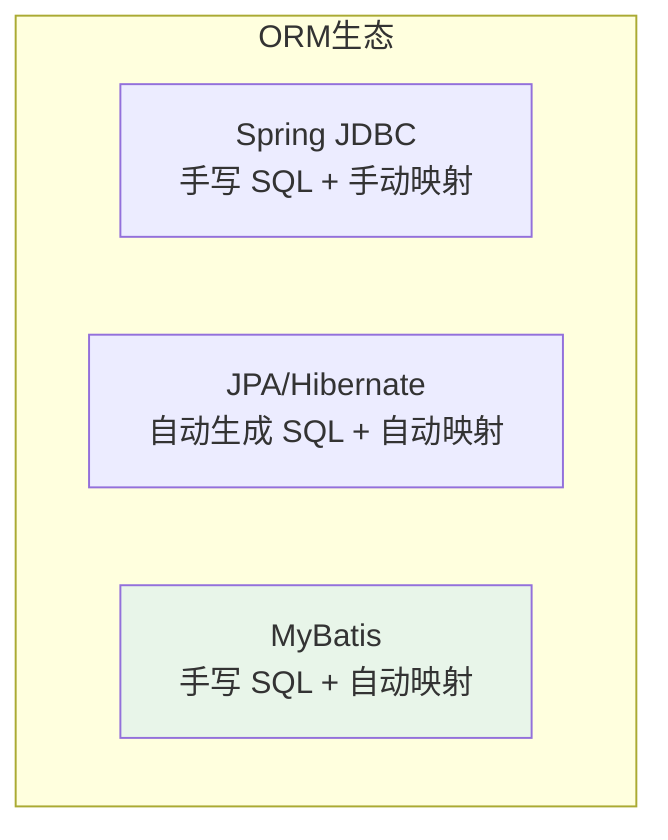
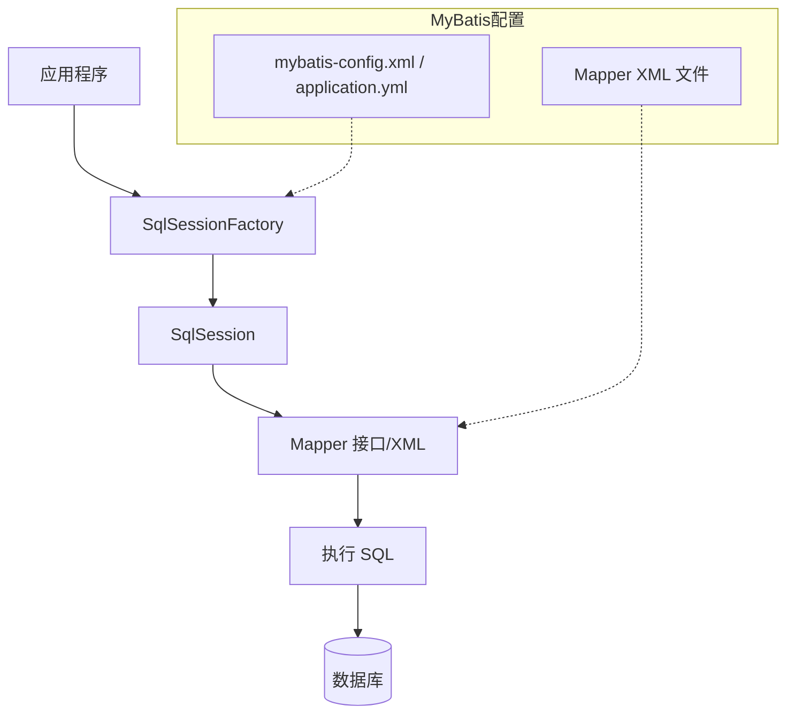
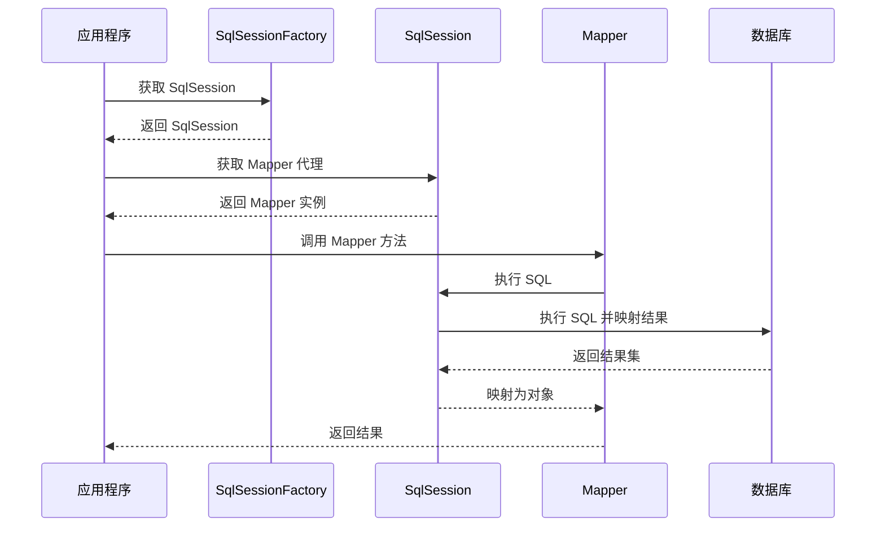

# MyBatis 概述与 Spring Boot 集成

## 课程目标

- 理解 ORM 核心思想及 MyBatis 在其中的定位
- 掌握 MyBatis 与 JPA、Spring JDBC 的对比差异
- 能够在 Spring Boot 中成功集成 MyBatis
- 能够编写第一个 Mapper 接口和 XML 映射文件
- 能够通过 Service 层调用 Mapper 完成基础 CRUD


## ORM 核心概念回顾

### 什么是 ORM

**ORM（Object-Relational Mapping，对象关系映射）** 是一种编程技术，用于将关系型数据库中的表结构映射为面向对象语言中的对象，让开发者可以用操作对象的方式来操作数据库。

| 数据库概念   | ORM 映射 | Java 概念      |
| ------------ | -------- | -------------- |
| 表（Table）  | ↔        | 类（Class）    |
| 行（Row）    | ↔        | 对象（Object） |
| 列（Column） | ↔        | 属性（Field）  |

### MyBatis 在 ORM 生态中的定位



| 对比维度       | Spring JDBC            | JPA/Hibernate           | MyBatis                      |
| -------------- | ---------------------- | ----------------------- | ---------------------------- |
| **SQL 控制**   | 完全手写               | 自动生成                | 完全手写                     |
| **结果集映射** | 手动（RowMapper）      | 自动                    | 自动（XML/注解）             |
| **开发效率**   | 低                     | 高                      | 中                           |
| **SQL 优化**   | 完全可控               | 难控                    | 完全可控                     |
| **学习曲线**   | 平缓                   | 陡峭                    | 中等                         |
| **适用场景**   | 简单查询、性能极致要求 | 标准 CRUD、领域模型驱动 | 复杂查询、遗留系统、DBA 友好 |

> [!NOTE]
> MyBatis 的设计哲学是“**SQL 与代码分离，保留 SQL 的灵活性，同时提供自动映射**”。它既不像 JPA 那样屏蔽 SQL，也不像 JDBC 那样要求手动映射，而是找到了一个平衡点。


## MyBatis 概述

### 什么是 MyBatis

**MyBatis** 是一款优秀的**持久层框架**，它支持自定义 SQL、存储过程以及高级映射。MyBatis 消除了几乎所有的 JDBC 代码和参数的手工设置以及结果集的检索封装。

### MyBatis 核心架构



### 核心组件说明

| 组件                  | 说明                                                 |
| --------------------- | ---------------------------------------------------- |
| **SqlSessionFactory** | 工厂模式，负责创建 SqlSession，是 MyBatis 的核心入口 |
| **SqlSession**        | 会话对象，代表一次数据库连接会话，执行 SQL 操作      |
| **Mapper**            | 映射器，由接口 + XML（或注解）组成，定义 SQL 映射    |
| **Configuration**     | 配置对象，包含 MyBatis 所有配置信息                  |
| **Executor**          | 执行器，负责 SQL 执行和缓存管理                      |

### MyBatis 工作流程



> [!NOTE]
> MyBatis 的核心是 **Mapper 动态代理**：应用程序调用 Mapper 接口方法时，MyBatis 通过动态代理生成代理对象，解析 XML 或注解中的 SQL，执行并映射结果。


## Spring Boot 集成 MyBatis

### 添加依赖

在 `pom.xml` 中添加 MyBatis Spring Boot Starter：

```xml
<!-- MyBatis Spring Boot Starter -->
<dependency>
    <groupId>org.mybatis.spring.boot</groupId>
    <artifactId>mybatis-spring-boot-starter</artifactId>
    <version>3.0.3</version>
</dependency>

<!-- PostgreSQL 驱动（已存在） -->
<dependency>
    <groupId>org.postgresql</groupId>
    <artifactId>postgresql</artifactId>
    <scope>runtime</scope>
</dependency>
```

> [!NOTE]
> `mybatis-spring-boot-starter` 会自动引入 MyBatis、Spring 整合包和自动配置。Spring Boot 会自动创建 `SqlSessionFactory` 和 `SqlSessionTemplate`。

### 配置数据源和 MyBatis 属性

在 `application.yml` 中配置：

```yaml
spring:
  datasource:
    driver-class-name: org.postgresql.Driver
    url: jdbc:postgresql://localhost:5432/bookdb
    username: postgres
    password: your_password

# MyBatis 配置
mybatis:
  # XML 映射文件位置（默认 classpath*:mapper/**/*.xml）
  mapper-locations: classpath:mapper/*.xml
  # 实体类包路径（用于简化 resultType 写法）
  type-aliases-package: com.example.bookmanager.model
  configuration:
    # 下划线转驼峰（如 created_at → createdAt）
    map-underscore-to-camel-case: true
    # 开启控制台 SQL 日志（开发环境）
    log-impl: org.apache.ibatis.logging.stdout.StdOutImpl
```

| 配置项                         | 说明                                                      |
| ------------------------------ | --------------------------------------------------------- |
| `mapper-locations`             | 指定 XML 映射文件所在目录                                 |
| `type-aliases-package`         | 指定实体类包，XML 中可直接用类名（如 `Book`）而非全限定名 |
| `map-underscore-to-camel-case` | 数据库下划线字段自动映射为 Java 驼峰属性                  |
| `log-impl`                     | 指定日志实现，`StdOutImpl` 将 SQL 输出到控制台            |

### 扫描 Mapper 接口

**方式一：使用 `@MapperScan` 注解（推荐）**

在主启动类或配置类上添加 `@MapperScan`：

```java
@SpringBootApplication
@MapperScan("com.example.bookmanager.mapper")  // 扫描指定包
public class BookManagerApplication {
    public static void main(String[] args) {
        SpringApplication.run(BookManagerApplication.class, args);
    }
}
```

**方式二：在每个 Mapper 接口上使用 `@Mapper` 注解**

```java
@Mapper
public interface BookMapper {
    // ...
}
```

> [!NOTE]
> 推荐使用 `@MapperScan`，避免在每个 Mapper 接口重复添加 `@Mapper`。


## 第一个 Mapper：XML 映射文件

### 创建实体类

在 `com.example.bookmanager.model` 包下创建 `Book.java`（与之前 JPA 版本的 Book 结构相同，但不含 JPA 注解）：

```java
package com.example.bookmanager.model;

import java.time.LocalDateTime;

public class Book {
    private Long id;
    private String title;
    private String author;
    private Double price;
    private Integer stock;
    private Integer sales;
    private String category;
    private LocalDateTime createdAt;
    private LocalDateTime updatedAt;

    // 无参构造、全参构造、Getter/Setter、toString
}
```

### 创建 Mapper 接口

在 `com.example.bookmanager.mapper` 包下创建 `BookMapper.java`：

```java
package com.example.bookmanager.mapper;

@Mapper
public interface BookMapper {

    /**
     * 根据 ID 查询图书
     */
    Book selectById(@Param("id") Long id);

    /**
     * 查询所有图书
     */
    List<Book> selectAll();

    /**
     * 新增图书（返回插入行数）
     */
    int insert(Book book);

    /**
     * 更新图书（返回更新行数）
     */
    int update(Book book);

    /**
     * 根据 ID 删除图书（返回删除行数）
     */
    int deleteById(@Param("id") Long id);
}
```

> [!NOTE]
> `@Param` 注解用于为参数命名，在 XML 中通过 `#{id}` 引用。如果只有一个参数且类型简单，可以省略。

### 创建 XML 映射文件

### 核心标签

| 标签                  | 用途                       |
| --------------------- | -------------------------- |
| `<insert>`            | 插入语句，可返回生成的主键 |
| `<update>`            | 更新语句，返回影响行数     |
| `<delete>`            | 删除语句，返回影响行数     |
| `<resultMap>`         | 自定义结果集映射规则       |
| `<select>`            | 查询语句，返回结果集       |
| `<sql>` / `<include>` | SQL 片段定义与引用         |

在 `src/main/resources/mapper/` 目录下创建 `BookMapper.xml`：

```xml
<?xml version="1.0" encoding="UTF-8" ?>
<!DOCTYPE mapper
        PUBLIC "-//mybatis.org//DTD Mapper 3.0//EN"
        "http://mybatis.org/dtd/mybatis-3-mapper.dtd">
<mapper namespace="com.example.bookmanager.mapper.BookMapper">

    <!-- 结果集映射（可复用） -->
    <resultMap id="BaseResultMap" type="Book">
        <id property="id" column="id"/>
        <result property="title" column="title"/>
        <result property="author" column="author"/>
        <result property="price" column="price"/>
        <result property="stock" column="stock"/>
        <result property="sales" column="sales"/>
        <result property="category" column="category"/>
        <result property="createdAt" column="created_at"/>
        <result property="updatedAt" column="updated_at"/>
    </resultMap>

    <!-- 查询所有 -->
    <select id="selectAll" resultMap="BaseResultMap">
        SELECT id, title, author, price, stock, sales, category,
               created_at, updated_at
        FROM book
        ORDER BY id
    </select>

    <!-- 根据 ID 查询 -->
    <select id="selectById" resultMap="BaseResultMap">
        SELECT id, title, author, price, stock, sales, category,
               created_at, updated_at
        FROM book
        WHERE id = #{id}
    </select>

    <!-- 插入（返回自动生成的主键） -->
    <insert id="insert" useGeneratedKeys="true" keyProperty="id">
        INSERT INTO book (title, author, price, stock, sales, category)
        VALUES (#{title}, #{author}, #{price}, #{stock}, #{sales}, #{category})
    </insert>

    <!-- 更新 -->
    <update id="update">
        UPDATE book
        SET title = #{title},
            author = #{author},
            price = #{price},
            stock = #{stock},
            sales = #{sales},
            category = #{category},
            updated_at = CURRENT_TIMESTAMP
        WHERE id = #{id}
    </update>

    <!-- 删除 -->
    <delete id="deleteById">
        DELETE FROM book WHERE id = #{id}
    </delete>
</mapper>
```

> [!NOTE]
> - `namespace` 必须与 Mapper 接口的全限定名一致。
> - `id` 必须与接口方法名一致。
> - `useGeneratedKeys="true"` 和 `keyProperty="id"` 用于获取数据库自动生成的主键。
> - `resultMap` 指定了结果集映射规则，支持驼峰自动映射。


## 在 Service 层注入 Mapper 并测试

### 创建 Service 接口与实现

**BookService.java（接口）：**

```java
public interface BookService {
    Book getBookById(Long id);
    List<Book> getAllBooks();
    Book createBook(Book book);
    Book updateBook(Book book);
    boolean deleteBook(Long id);
}
```

**BookServiceImpl.java（实现类）：**

```java
@Service
@Transactional
public class BookServiceImpl implements BookService {

    private final BookMapper bookMapper;

    public BookServiceImpl(BookMapper bookMapper) {
        this.bookMapper = bookMapper;
    }

    @Override
    @Transactional(readOnly = true)
    public Book getBookById(Long id) {
        Book book = bookMapper.selectById(id);
        if (book == null) {
            throw new ResourceNotFoundException("Book", id);
        }
        return book;
    }

    @Override
    @Transactional(readOnly = true)
    public List<Book> getAllBooks() {
        return bookMapper.selectAll();
    }

    @Override
    public Book createBook(Book book) {
        if (book.getPrice() == null || book.getPrice() < 0) {
            throw new BusinessException("价格不能为负数");
        }
        if (book.getStock() == null || book.getStock() < 0) {
            throw new BusinessException("库存不能为负数");
        }
        // 销量默认为 0
        book.setSales(0);
        int rows = bookMapper.insert(book);
        if (rows != 1) {
            throw new BusinessException("新增图书失败");
        }
        return book;
    }

    @Override
    public Book updateBook(Book book) {
        if (book.getId() == null) {
            throw new IllegalArgumentException("更新时 ID 不能为空");
        }
        Book existing = bookMapper.selectById(book.getId());
        if (existing == null) {
            throw new ResourceNotFoundException("要更新的图书不存在，ID: " + book.getId());
        }
        int rows = bookMapper.update(book);
        if (rows != 1) {
            throw new BusinessException("更新图书失败");
        }
        return book;
    }

    @Override
    public boolean deleteBook(Long id) {
        if (id == null) {
            throw new IllegalArgumentException("删除时 ID 不能为空");
        }
        Book existing = bookMapper.selectById(id);
        if (existing == null) {
            throw new ResourceNotFoundException("要删除的图书不存在，ID: " + id);
        }
        int rows = bookMapper.deleteById(id);
        return rows == 1;
    }
}
```

### Controller 层保持不变

`BookController` 无需修改（仅修改 Service 注入实现类即可，若使用接口编程则完全无感）。

### 测试验证

启动应用，使用 Postman 或 IDEA HTTP Client 测试：

```http
### 查询所有图书
GET {{base_url}}/api/books
Authorization: Bearer 123456

### 查询单本图书
GET {{base_url}}/api/books/1
Authorization: Bearer 123456

### 新增图书
POST {{base_url}}/api/books
Content-Type: application/json
Authorization: Bearer 123456

{
  "title": "深入理解 MyBatis",
  "author": "刘增辉",
  "price": 69.00,
  "stock": 10,
  "category": "编程"
}

### 更新图书
PUT {{base_url}}/api/books/1
Content-Type: application/json
Authorization: Bearer 123456

{
  "title": "Spring Boot 实战（第2版）",
  "author": "Craig Walls",
  "price": 99.00,
  "stock": 8,
  "category": "编程"
}

### 删除图书
DELETE {{base_url}}/api/books/4
Authorization: Bearer 123456
```

> [!NOTE]
> 观察控制台 SQL 日志（因配置了 `StdOutImpl`），可看到 MyBatis 执行的 SQL 语句和参数绑定。


## 注意事项

1. **XML 文件路径必须匹配**：`mybatis.mapper-locations` 默认值为 `classpath*:mapper/**/*.xml`，确保 XML 文件放在 `src/main/resources/mapper/` 目录或其子目录下。

2. **namespace 必须与 Mapper 接口全限定名一致**：如果 namespace 写错，应用启动时会报错。

3. **resultType 与 resultMap**

- `resultType` 用于简单映射（字段名与列名自动匹配或符合驼峰规则）
- `resultMap` 用于复杂映射（如关联对象、自定义映射规则）
- 若同时配置了 `map-underscore-to-camel-case: true`，大多数简单查询可用 `resultType`

4. **事务管理**：MyBatis 可以与 Spring 事务管理无缝整合，使用 `@Transactional` 即可，无需额外配置。


## 小结

本节课我们学习了：

1. **ORM 核心概念**：对象-关系映射，以及 MyBatis 在其中的定位。
2. **MyBatis 概述**：核心架构、组件和工作流程。
3. **Spring Boot 集成**：依赖添加、配置属性、`@MapperScan` 扫描。
4. **第一个 Mapper**：编写 XML 映射文件，包含 `select`、`insert`、`update`、`delete`。
5. **Service 层注入**：在 Service 中注入 Mapper 并实现 CRUD。


## 作业

### 作业一：代码阅读——MyBatis 配置识别

阅读以下 `application.yml` 配置片段，回答问题。

```yaml
mybatis:
  mapper-locations: classpath:mapper/*.xml
  type-aliases-package: com.example.bookmanager.model
  configuration:
    map-underscore-to-camel-case: true
    log-impl: org.apache.ibatis.logging.stdout.StdOutImpl
```

**问题：**
1. `mapper-locations` 的作用是什么？如果 XML 文件放在 `src/main/resources/mapper/book/` 目录下，如何修改配置？
2. `type-aliases-package` 的作用是什么？如果不配置，在 XML 中 `resultType` 应该怎么写？
3. `map-underscore-to-camel-case` 的作用是什么？请举例说明。
4. `log-impl` 的作用是什么？生产环境建议用哪种日志实现？

---

### 作业二：创建并测试 MyBatis 集成

在图书管理系统中完成以下任务：

1. 添加 `mybatis-spring-boot-starter` 依赖。
2. 在 `application.yml` 中配置 MyBatis 属性（参考课程示例）。
3. 创建 `BookMapper` 接口（包含 `selectById`、`selectAll`、`insert`、`update`、`deleteById`）。
4. 创建 `BookMapper.xml` 映射文件（放在 `src/main/resources/mapper/` 下）。
5. 在 `BookServiceImpl` 中注入 `BookMapper`，实现 CRUD 方法。
6. 启动应用，测试所有接口，验证功能正常。

---

### 作业三：调试与 SQL 日志观察

1. 开启 MyBatis SQL 日志（配置 `log-impl`）。
2. 执行 `selectById`、`insert`、`update` 操作，观察控制台输出的 SQL。
3. 尝试执行一个错误 SQL（如表名错误），观察 MyBatis 抛出的异常类型。
