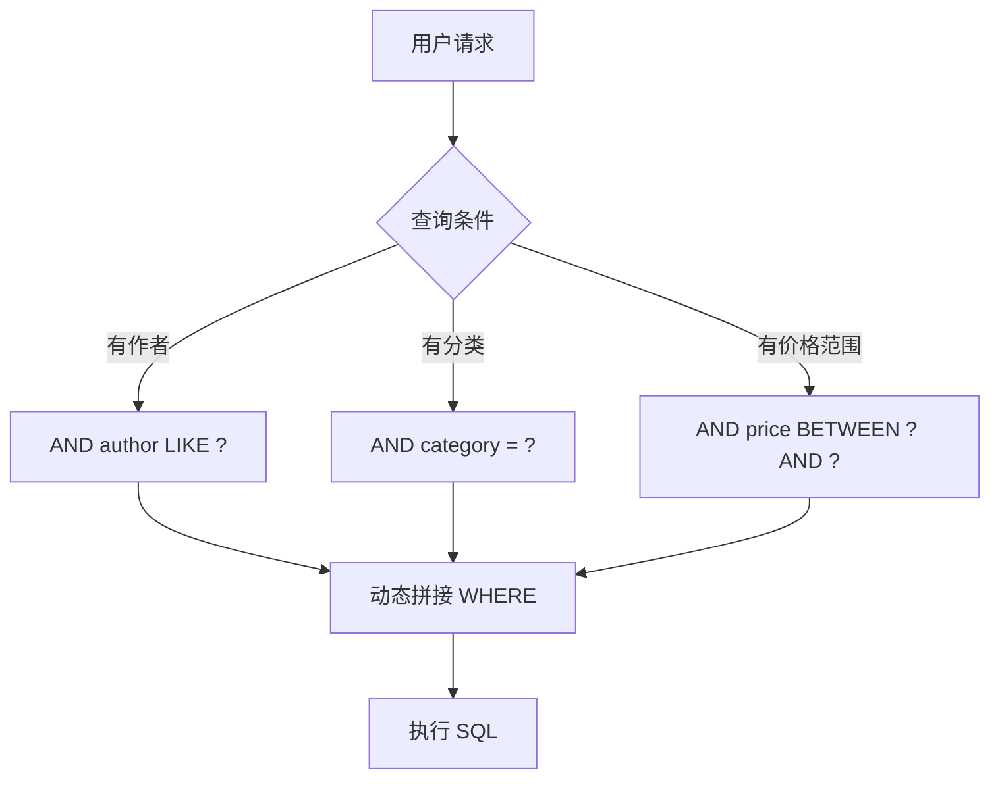

# MyBatis 映射文件与动态 SQL

## 课程目标

- 掌握 MyBatis 映射文件的核心元素（select、insert、update、delete）
- 掌握结果集映射（resultMap）处理复杂关联关系（一对一、一对多）
- 掌握动态 SQL 的常用标签（if、where、set、foreach、choose）
- 能够编写多条件动态查询和批量操作
- 能够完成 Book、Order、OrderItem 的完整关联映射和业务实现


## 回顾与导入

在上一讲中，我们完成了 MyBatis 与 Spring Boot 的集成，并编写了基础的 CRUD 映射。但在实际业务中，查询条件往往是动态组合的，而且表与表之间存在着关联关系。



本节课将深入学习 MyBatis 映射文件的高级特性，重点掌握动态 SQL 和关联映射，并完整实现图书订单管理功能。


## 动态 SQL

### `<if>` 条件判断

根据参数是否存在动态添加条件：

```xml
<select id="searchBooks" resultType="Book">
    SELECT id, title, author, price, stock, category
    FROM book
    WHERE 1=1
    <if test="author != null and author != ''">
        AND author LIKE CONCAT('%', #{author}, '%')
    </if>
    <if test="category != null and category != ''">
        AND category = #{category}
    </if>
    <if test="minPrice != null">
        AND price >= #{minPrice}
    </if>
    <if test="maxPrice != null">
        AND price &lt;= #{maxPrice}
    </if>
    ORDER BY id
</select>
```

### `<where>` 动态生成 WHERE 子句

`<where>` 会智能处理 `AND`/`OR` 前缀，避免 `WHERE 1=1` 的写法：

```xml
<select id="searchBooks" resultType="Book">
    SELECT id, title, author, price, stock, category
    FROM book
    <where>
        <if test="author != null and author != ''">
            AND author LIKE CONCAT('%', #{author}, '%')
        </if>
        <if test="category != null and category != ''">
            AND category = #{category}
        </if>
        <if test="minPrice != null">
            AND price >= #{minPrice}
        </if>
        <if test="maxPrice != null">
            AND price &lt;= #{maxPrice}
        </if>
    </where>
    ORDER BY id
</select>
```

> [!NOTE]
> `<where>` 会自动去除第一个多余的 `AND`/`OR`，使生成的 SQL 更整洁。

### `<set>` 动态生成 SET 子句

用于 UPDATE 语句，智能处理逗号：

```xml
<update id="updateSelective">
    UPDATE book
    <set>
        <if test="title != null">title = #{title},</if>
        <if test="author != null">author = #{author},</if>
        <if test="price != null">price = #{price},</if>
        <if test="stock != null">stock = #{stock},</if>
        <if test="category != null">category = #{category},</if>
        updated_at = CURRENT_TIMESTAMP
    </set>
    WHERE id = #{id}
</update>
```

> [!NOTE]
> `<set>` 会自动去除末尾多余的逗号。

### `<foreach>` 遍历集合

用于 IN 查询、批量插入等场景。

**IN 查询：**
```xml
<select id="selectByIds" resultType="Book">
    SELECT id, title, author, price, stock, category
    FROM book
    WHERE id IN
    <foreach collection="ids" item="id" open="(" close=")" separator=",">
        #{id}
    </foreach>
</select>
```

**批量插入：**
```xml
<insert id="batchInsert">
    INSERT INTO book (title, author, price, stock, category)
    VALUES
    <foreach collection="books" item="book" separator=",">
        (#{book.title}, #{book.author}, #{book.price}, #{book.stock}, #{book.category})
    </foreach>
</insert>
```

> [!NOTE]
> `collection` 属性：当参数为 List 时默认值为 `list`，为数组时默认值为 `array`。也可使用 `@Param("xxx")` 自定义名称。

###  `<choose>` 多分支选择

类似于 Java 的 `switch-case`：

```xml
<select id="findBooksByCondition" resultType="Book">
    SELECT id, title, author, price, stock, category
    FROM book
    <where>
        <choose>
            <when test="category != null and category != ''">
                AND category = #{category}
            </when>
            <when test="author != null and author != ''">
                AND author LIKE CONCAT('%', #{author}, '%')
            </when>
            <otherwise>
                AND price > 0
            </otherwise>
        </choose>
    </where>
</select>
```

### 参数传递：`#{}` vs `${}`

| 方式  | 说明                                  | 示例                                 | 安全性   |
| ----- | ------------------------------------- | ------------------------------------ | -------- |
| `#{}` | 预编译占位符，生成 `?`，防止 SQL 注入 | `WHERE id = #{id}` → `WHERE id = ?`  | ✅ 安全   |
| `${}` | 字符串直接拼接，存在注入风险          | `ORDER BY ${column}` → `ORDER BY id` | ❌ 不安全 |

**使用建议：**

- 优先使用 `#{}` 传递参数值

- `${}` 仅用于表名、列名、排序方向等**无法预编译**的场景，且必须进行**白名单校验**

  

## 结果集映射（resultMap）

### 基础 resultMap

```xml
<resultMap id="BookResultMap" type="Book">
    <id property="id" column="id"/>
    <result property="title" column="title"/>
    <result property="author" column="author"/>
    <result property="price" column="price"/>
    <result property="stock" column="stock"/>
    <result property="sales" column="sales"/>
    <result property="category" column="category"/>
    <result property="isbn" column="isbn"/>
    <result property="description" column="description"/>
    <result property="createdAt" column="created_at"/>
    <result property="updatedAt" column="updated_at"/>
</resultMap>
```

### 关联映射（association）

处理**一对一**或**多对一**关系。例如，`OrderItem` 关联 `Book`。

**OrderItem 实体：**

```java
public class OrderItem {
    private Long id;
    private Integer quantity;
    private Double price;
    private Book book;         // 关联的图书
}
```

**OrderItemMapper.xml（使用 association）：**
```xml
<resultMap id="OrderItemWithBookMap" type="OrderItem">
    <id property="id" column="id"/>
    <result property="quantity" column="quantity"/>
    <result property="price" column="price"/>
    <association property="book" javaType="Book" resultMap="com.example.bookmanager.mapper.BookMapper.BookResultMap"/>
</resultMap>

<select id="selectOrderItemWithBook" resultMap="OrderItemWithBookMap">
    SELECT oi.*, b.*
    FROM order_item oi
    LEFT JOIN book b ON oi.book_id = b.id
    WHERE oi.id = #{id}
</select>
```

### 集合映射（collection）

处理**一对多**关系。例如，`Order` 包含多个 `OrderItem`。

**Order 实体：**
```java
public class Order {
    private Long id;
    private String orderNumber;
    private Double totalAmount;
    private List<OrderItem> items;  // 订单项集合
}
```

**OrderMapper.xml（使用 collection）：**
```xml
<resultMap id="OrderWithItemsMap" type="Order">
    <id property="id" column="id"/>
    <result property="orderNumber" column="order_number"/>
    <result property="totalAmount" column="total_amount"/>
    <collection property="items" ofType="OrderItem" 
                resultMap="com.example.bookmanager.mapper.OrderItemMapper.OrderItemMap"/>
</resultMap>

<select id="selectOrderWithItems" resultMap="OrderWithItemsMap">
    SELECT o.*, oi.*
    FROM orders o
    LEFT JOIN order_item oi ON o.id = oi.order_id
    WHERE o.id = #{id}
</select>
```

> [!NOTE]
> `association` 使用 `javaType` 指定关联对象的类型，`collection` 使用 `ofType` 指定集合元素的类型。


## 完整实战：图书订单管理

### 数据库表结构（PostgreSQL）

保持不变，参考源码中的SQL语句

### 实体类

**Book.java**
```java
public class Book {
    private Long id;
    private String title;
    private String author;
    private Double price;
    private Integer stock;
    private Integer sales;
    private String category;
    private String isbn;
    private String description;
    private LocalDateTime createdAt;
    private LocalDateTime updatedAt;
    // getter/setter
}
```

**Order.java**
```java
public class Order {
    private Long id;
    private String orderNumber;
    private Double totalAmount;
    private String status;
    private LocalDateTime createdAt;
    private LocalDateTime updatedAt;
    private List<OrderItem> items;  // 关联的订单项
    // getter/setter
}
```

**OrderItem.java**

```java
public class OrderItem {
    private Long id;
    private Integer quantity;
    private Double price;
    private Long orderId;
    private Long bookId;
    private Book book;  // 关联的图书
    // getter/setter
}
```

### Mapper 接口与 XML 映射

#### OrderMapper.java
```java
@Mapper
public interface OrderMapper {
    // 基础 CRUD
    Order selectById(Long id);
    List<Order> selectAll();
    int insert(Order order);
    int update(Order order);
    int deleteById(Long id);
    
    // 关联查询（带订单项和图书）
    Order selectOrderWithItems(Long id);
    List<Order> selectAllWithItems();
    
    // 动态条件查询
    List<Order> searchOrders(@Param("status") String status,
                             @Param("startDate") LocalDateTime startDate,
                             @Param("endDate") LocalDateTime endDate);
}
```

#### OrderMapper.xml
```xml
<?xml version="1.0" encoding="UTF-8" ?>
<!DOCTYPE mapper PUBLIC "-//mybatis.org//DTD Mapper 3.0//EN" "http://mybatis.org/dtd/mybatis-3-mapper.dtd">
<mapper namespace="com.example.bookmanager.mapper.OrderMapper">
    <sql id="Order_Column_List">
        id, order_number, total_amount, status, created_at, updated_at
    </sql>

    <resultMap id="OrderResultMap" type="Order">
        <id property="id" column="id"/>
        <result property="orderNumber" column="order_number"/>
        <result property="totalAmount" column="total_amount"/>
        <result property="status" column="status"/>
        <result property="createdAt" column="created_at"/>
        <result property="updatedAt" column="updated_at"/>
    </resultMap>

    <resultMap id="OrderWithItemsMap" type="Order" extends="OrderResultMap">
        <collection property="items" ofType="OrderItem"
                    select="com.example.bookmanager.mapper.OrderItemMapper.selectByOrderId"
                    column="id" fetchType="lazy"/>
    </resultMap>

    <!-- 一次性 JOIN 加载（避免 N+1） -->
    <resultMap id="OrderWithItemsJoinMap" type="Order" extends="OrderResultMap">
        <collection property="items" ofType="OrderItem">
            <id property="id" column="oi_id"/>
            <result property="quantity" column="quantity"/>
            <result property="price" column="price"/>
            <result property="orderId" column="order_id"/>
            <result property="bookId" column="book_id"/>
            <association property="book" javaType="Book">
                <id property="id" column="b_id"/>
                <result property="title" column="b_title"/>
                <result property="author" column="b_author"/>
                <result property="price" column="b_price"/>
                <result property="stock" column="b_stock"/>
                <result property="sales" column="b_sales"/>
                <result property="category" column="b_category"/>
                <result property="isbn" column="b_isbn"/>
                <result property="description" column="b_description"/>
                <result property="createdAt" column="b_created_at"/>
                <result property="updatedAt" column="b_updated_at"/>
            </association>
        </collection>
    </resultMap>

    <select id="selectAll" resultMap="OrderResultMap">
        SELECT <include refid="Order_Column_List"/> FROM orders ORDER BY created_at DESC
    </select>

    <select id="selectById" resultMap="OrderResultMap">
        SELECT <include refid="Order_Column_List"/> FROM orders WHERE id = #{id}
    </select>

    <select id="selectOrderWithItems" resultMap="OrderWithItemsJoinMap">
        SELECT
            o.id, o.order_number, o.total_amount, o.status, o.created_at, o.updated_at,
            oi.id AS oi_id, oi.quantity, oi.price, oi.order_id, oi.book_id,
            b.id AS b_id, b.title AS b_title, b.author AS b_author,
            b.price AS b_price, b.stock AS b_stock, b.sales AS b_sales,
            b.category AS b_category, b.isbn AS b_isbn, b.description AS b_description,
            b.created_at AS b_created_at, b.updated_at AS b_updated_at
        FROM orders o
                 LEFT JOIN order_item oi ON o.id = oi.order_id
                 LEFT JOIN book b ON oi.book_id = b.id
        WHERE o.id = #{id}
    </select>

    <select id="selectAllWithItems" resultMap="OrderWithItemsJoinMap">
        SELECT
            o.id, o.order_number, o.total_amount, o.status, o.created_at, o.updated_at,
            oi.id AS oi_id, oi.quantity, oi.price, oi.order_id, oi.book_id,
            b.id AS b_id, b.title AS b_title, b.author AS b_author,
            b.price AS b_price, b.stock AS b_stock, b.sales AS b_sales,
            b.category AS b_category, b.isbn AS b_isbn, b.description AS b_description,
            b.created_at AS b_created_at, b.updated_at AS b_updated_at
        FROM orders o
                 LEFT JOIN order_item oi ON o.id = oi.order_id
                 LEFT JOIN book b ON oi.book_id = b.id
        ORDER BY o.created_at DESC
    </select>

    <insert id="insert" useGeneratedKeys="true" keyProperty="id">
        INSERT INTO orders (order_number, total_amount, status)
        VALUES (#{orderNumber}, #{totalAmount}, #{status})
    </insert>

    <update id="update">
        UPDATE orders SET total_amount=#{totalAmount}, status=#{status}, updated_at=CURRENT_TIMESTAMP WHERE id=#{id}
    </update>

    <delete id="deleteById">DELETE FROM orders WHERE id=#{id}</delete>

    <select id="searchOrders" resultMap="OrderResultMap">
        SELECT <include refid="Order_Column_List"/> FROM orders
        <where>
            <if test="status != null and status != ''">AND status = #{status}</if>
            <if test="startDate != null">AND created_at >= #{startDate}</if>
            <if test="endDate != null">AND created_at &lt;= #{endDate}</if>
        </where>
        ORDER BY created_at DESC
    </select>
</mapper>
```

#### OrderItemMapper.java
```java
@Mapper
public interface OrderItemMapper {
    List<OrderItem> selectByOrderId(Long orderId);
    int insert(OrderItem orderItem);
    int batchInsert(@Param("items") List<OrderItem> items);
    int deleteByOrderId(Long orderId);
}
```

#### OrderItemMapper.xml
```xml
<?xml version="1.0" encoding="UTF-8" ?>
<!DOCTYPE mapper PUBLIC "-//mybatis.org//DTD Mapper 3.0//EN" "http://mybatis.org/dtd/mybatis-3-mapper.dtd">
<mapper namespace="com.example.bookmanager.mapper.OrderItemMapper">
    <resultMap id="OrderItemMap" type="OrderItem">
        <id property="id" column="id"/>
        <result property="quantity" column="quantity"/>
        <result property="price" column="price"/>
        <result property="orderId" column="order_id"/>
        <result property="bookId" column="book_id"/>
    </resultMap>

    <resultMap id="OrderItemWithBookMap" type="OrderItem" extends="OrderItemMap">
        <association property="book" javaType="Book"
                     resultMap="com.example.bookmanager.mapper.BookMapper.BookResultMap"/>
    </resultMap>

    <select id="selectByOrderId" resultMap="OrderItemWithBookMap">
        SELECT oi.*, b.*
        FROM order_item oi
                 LEFT JOIN book b ON oi.book_id = b.id
        WHERE oi.order_id = #{orderId}
    </select>

    <insert id="insert" useGeneratedKeys="true" keyProperty="id">
        INSERT INTO order_item (quantity, price, order_id, book_id)
        VALUES (#{quantity}, #{price}, #{orderId}, #{bookId})
    </insert>

    <insert id="batchInsert" useGeneratedKeys="true" keyProperty="id">
        INSERT INTO order_item (quantity, price, order_id, book_id)
        VALUES
        <foreach collection="items" item="item" separator=",">
            (#{item.quantity}, #{item.price}, #{item.orderId}, #{item.bookId})
        </foreach>
    </insert>

    <delete id="deleteByOrderId">DELETE FROM order_item WHERE order_id = #{orderId}</delete>
</mapper>
```

---

### Service 层

#### OrderService.java
```java
public interface OrderService {
    Order createOrder(List<OrderItemRequest> items);
    Order getOrderWithItems(Long orderId);
    List<Order> getAllOrdersWithItems();
    List<Order> searchOrders(String status, LocalDateTime startDate, LocalDateTime endDate);
    void cancelOrder(Long orderId);
}
```

#### OrderServiceImpl.java
```java
@Service
@Transactional
public class OrderServiceImpl implements OrderService {
    @Autowired
    private OrderMapper orderMapper;

    @Autowired
    private BookMapper bookMapper;

    @Autowired
    private OrderItemMapper orderItemMapper;

    @Override
    public Order createOrder(List<OrderItemRequest> items) {
        // 1. 先创建订单（状态为 CREATED），获得 orderId
        Order order = new Order();
        order.setOrderNumber(UUID.randomUUID().toString().substring(0, 8).toUpperCase());
        order.setStatus("CREATED");
        order.setTotalAmount(0.0);
        orderMapper.insert(order);

        double totalAmount = 0.0;

        // 2. 循环处理每个订单项：校验库存 → 扣减库存 → 插入订单项
        //    所有操作在同一事务中，任何失败都会整体回滚
        for (OrderItemRequest req : items) {
            // 2.1 查询图书信息（同时用于校验存在性和库存）
            Book book = bookMapper.selectById(req.getBookId());
            if (book == null) {
                throw new BusinessException("图书ID " + req.getBookId() + " 不存在");
            }
            if (book.getStock() < req.getQuantity()) {
                throw new BusinessException("图书《" + book.getTitle() + "》库存不足，当前库存：" + book.getStock());
            }

            // 2.2 扣减库存
            Book updateBook = new Book();
            updateBook.setId(book.getId());
            updateBook.setStock(book.getStock() - req.getQuantity());
            bookMapper.update(updateBook);

            // 2.3 创建订单项并插入（单价取下单时的图书价格，防止后续价格变动）
            OrderItem item = new OrderItem();
            item.setOrderId(order.getId());
            item.setBookId(req.getBookId());
            item.setQuantity(req.getQuantity());
            item.setPrice(book.getPrice());   // 快照价格
            orderItemMapper.insert(item);

            // 2.4 累加订单总金额
            totalAmount += book.getPrice() * req.getQuantity();
        }

        // 3. 更新订单总金额
        order.setTotalAmount(totalAmount);
        orderMapper.update(order);

        // 4. 返回完整的订单信息（包含所有订单项及其关联的图书详情）
        //    利用 OrderMapper 中定义的 selectOrderWithItems（JOIN 查询）一次性加载
        return orderMapper.selectOrderWithItems(order.getId());
    }
  	...
}
```

---

### Controller 层

#### OrderController.java
```java
@RestController
@RequestMapping("/api/orders")
public class OrderController {
    @Autowired
    private OrderService orderService;

    @PostMapping
    @ResponseStatus(HttpStatus.CREATED)   // 可添加，表明创建成功
    public Result<Order> createOrder(@Valid @RequestBody OrderCreateRequest request) {
        Order order = orderService.createOrder(request.getItems());
        return Result.success(order);
    }

    @GetMapping("/{id}")
    public Result<Order> getOrderWithItems(@PathVariable Long id) {
        return Result.success(orderService.getOrderWithItems(id));
    }

    @GetMapping
    public Result<List<Order>> getAllOrdersWithItems() {
        return Result.success(orderService.getAllOrdersWithItems());
    }

    @GetMapping("/search")
    public Result<List<Order>> searchOrders(@RequestParam(required = false) String status, @RequestParam(required = false) String startDate, @RequestParam(required = false) String endDate) {
        LocalDateTime start = startDate != null ? LocalDateTime.parse(startDate + "T00:00:00") : null;
        LocalDateTime end = endDate != null ? LocalDateTime.parse(endDate + "T23:59:59") : null;
        return Result.success(orderService.searchOrders(status, start, end));
    }

    @PutMapping("/{id}/cancel")
    public Result<Void> cancel(@PathVariable Long id) {
        orderService.cancelOrder(id);
        return Result.success();
    }
}
```


## 注意事项

1. **动态 SQL 的性能**：复杂动态 SQL 建议通过单元测试验证生成的 SQL 是否符合预期。

2. **N+1 问题**：使用 `collection` 的 `select` 属性会触发 N+1，推荐使用 JOIN（`resultMap` 嵌套）一次性加载。

3. **列值覆盖问题**：Book、Order和OrderItem三个表都有同名的 id、created_at、updated_at 等字段，在结果集中后出现的列值会覆盖前面的，导致 MyBatis 无法正确识别订单项和图书的主键，从而将多个订单项错误地合并为一个（或只取最后一条）

4. **`#{}` vs `${}`**：

   - `#{}`：预编译占位符，防止 SQL 注入（推荐）
   - `${}`：字符串直接拼接，存在 SQL 注入风险，仅用于表名、列名等动态部分

   

## 小结

本节课我们学习了：

1. **映射文件核心元素**：`select`、`insert`、`update`、`delete` 的用法。
2. **参数传递**：`#{}`（安全） vs `${}`（拼接）。
3. **结果集映射（resultMap）**：基础映射、`association`（一对一）、`collection`（一对多）。
4. **动态 SQL**：`<if>`、`<where>`、`<set>`、`<foreach>`、`<choose>`。
5. **完整实战**：Book、Order、OrderItem 的完整 Mapper、Service、Controller 实现。


## 作业

### 作业一：代码阅读——动态 SQL 与 resultMap 分析

阅读以下 MyBatis XML 映射文件片段，回答问题。

```xml
<resultMap id="OrderWithItemsMap" type="Order" extends="OrderResultMap">
    <collection property="items" ofType="OrderItem" 
                select="com.example.bookmanager.mapper.OrderItemMapper.selectByOrderId" 
                column="id" fetchType="lazy"/>
</resultMap>

<select id="searchOrders" resultMap="OrderResultMap">
    SELECT id, order_number, total_amount, status, created_at, updated_at
    FROM orders
    <where>
        <if test="status != null and status != ''">
            AND status = #{status}
        </if>
        <if test="startDate != null">
            AND created_at >= #{startDate}
        </if>
        <if test="endDate != null">
            AND created_at &lt;= #{endDate}
        </if>
    </where>
    ORDER BY created_at DESC
</select>
```

**问题：**

1. `collection` 元素中 `select` 属性的作用是什么？这种配置方式存在什么性能风险？如何优化？
2. 在 `searchOrders` 查询中，如果 `status` 为 `null`，`startDate` 和 `endDate` 都有值，生成的 SQL 会包含哪些条件？
3. 如果 `status` 为 `""`（空字符串），条件是否会被添加？为什么？
4. `<where>` 标签和手写 `WHERE 1=1` 相比有什么优势？

---

### 作业二：代码阅读——association 关联映射

阅读以下 `OrderItemMapper.xml` 中的映射片段：

```xml
<resultMap id="OrderItemWithBookMap" type="OrderItem" extends="OrderItemMap">
    <association property="book" javaType="Book" 
                 resultMap="com.example.bookmanager.mapper.BookMapper.BookResultMap"/>
</resultMap>

<select id="selectByOrderId" resultMap="OrderItemWithBookMap">
    SELECT oi.*, b.*
    FROM order_item oi
    LEFT JOIN book b ON oi.book_id = b.id
    WHERE oi.order_id = #{orderId}
</select>
```

**问题：**

1. `association` 标签的作用是什么？`resultMap` 属性引用了哪个 Mapper 的哪个 resultMap？
2. 如果去掉 `LEFT JOIN book`，只查询 `order_item` 表，`book` 属性会是什么值？
3. 这种写法属于“嵌套结果”还是“嵌套查询”？它与 `collection` 的 `select` 属性方式有何不同？

---

### 作业三：动态更新实现

在 `BookMapper` 中实现一个动态更新方法 `updateSelective`，只更新传入的非空字段（`title`、`author`、`price`、`stock`、`category` 等），并保留 `updated_at` 的自动更新。

**要求：**

1. 在 `BookMapper.java` 中声明 `int updateSelective(Book book);`。
2. 在 `BookMapper.xml` 中使用 `<set>` 和 `<if>` 实现动态 SQL。
3. 在 `BookService` 中调用该方法，并验证只更新指定字段时，其他字段保持不变
