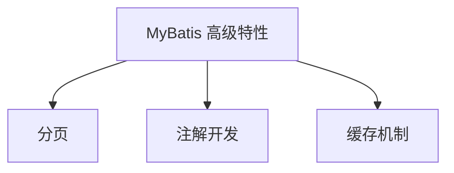

# MyBatis 高级特性

## 课程目标

- 掌握 MyBatis 分页的多种实现方式及 PageHelper 插件的集成
- 掌握 MyBatis 注解开发的基本用法
- 了解一级缓存和二级缓存机制
- 掌握Mybatis拦截器的基本概念和实现方式


## 回顾与导入

前两节课我们完成了 MyBatis 的基础集成、XML 映射和动态 SQL。在实际项目中，我们还需要处理：

- **分页**：大数据量查询时如何分段返回
- **灵活开发**：注解方式简化简单 SQL
- **缓存优化**：减少重复查询



本节课将逐一深入这些高级特性。


## 分页实现方式

### 分页方式对比

| 方式           | 实现原理                 | 优点                 | 缺点           |
| -------------- | ------------------------ | -------------------- | -------------- |
| **RowBounds**  | 逻辑分页，在内存中截取   | 无需修改 SQL         | 大数据量性能差 |
| **SQL LIMIT**  | 物理分页，数据库层面限制 | 性能好               | 需手写 SQL     |
| **PageHelper** | 自动拦截 SQL，添加 LIMIT | 零侵入，自动生成分页 | 需引入插件     |

### 方式一：RowBounds（不推荐）

```java
// 逻辑分页：先查询全部，再截取
RowBounds rowBounds = new RowBounds(offset, limit);
List<Book> books = sqlSession.selectList("selectAll", null, rowBounds);
```

> [!CAUTION]
> RowBounds 会查询所有数据，仅在内存中截取，**大数据量下性能极差**，不推荐使用。

### 方式二：手写 LIMIT（物理分页）

```xml
<select id="selectByPage" resultType="Book">
    SELECT id, title, author, price, stock
    FROM book
    ORDER BY id
    LIMIT #{offset}, #{limit}
</select>
```

```java
List<Book> selectByPage(@Param("offset") int offset, @Param("limit") int limit);
```

> [!NOTE]
> 手写 LIMIT 简单直观，但每个查询都要写分页逻辑，且不同数据库语法不同。

### 方式三：PageHelper 分页插件（推荐）

**PageHelper** 是 MyBatis 最流行的分页插件，通过拦截器自动为 SQL 添加分页语句，支持多种数据库。


## PageHelper 分页插件集成

### 1. 添加依赖

```xml
<dependency>
    <groupId>com.github.pagehelper</groupId>
    <artifactId>pagehelper-spring-boot-starter</artifactId>
    <version>1.4.7</version>
</dependency>
```

> [!NOTE]
> `pagehelper-spring-boot-starter` 会自动配置拦截器，无需额外配置。

### 2. 配置分页参数（可选）

在 `application.yml` 中：

```yaml
pagehelper:
  helper-dialect: postgresql      # 数据库方言
  reasonable: true                # 分页合理化（pageNum <= 0 自动取第一页）
  support-methods-arguments: true # 支持通过 Mapper 方法参数传递分页参数
  params: count=countSql          # 自动生成 count 查询
```

### 3. 使用 PageHelper

**基本用法：**

```java
@Service
public class BookService {
    @Autowired
    private BookMapper bookMapper;

    public PageInfo<Book> getBooksByPage(int pageNum, int pageSize) {
        // 1. 设置分页参数（必须紧跟在查询前）
        PageHelper.startPage(pageNum, pageSize);
        // 2. 执行查询（无需修改 SQL）
        List<Book> books = bookMapper.selectAll();
        // 3. 封装为 PageInfo（包含总记录数、总页数等信息）
        return new PageInfo<>(books);
    }
}
```

**带条件的分页查询：**

```java
public PageInfo<Book> searchBooks(String author, String category, 
                                  int pageNum, int pageSize) {
    PageHelper.startPage(pageNum, pageSize);
    List<Book> books = bookMapper.searchBooks(author, category, null, null, null);
    return new PageInfo<>(books);
}
```

### 4. PageInfo 对象属性

| 属性              | 说明         |
| ----------------- | ------------ |
| `total`           | 总记录数     |
| `pages`           | 总页数       |
| `pageNum`         | 当前页码     |
| `pageSize`        | 每页大小     |
| `list`            | 当前页数据   |
| `isFirstPage`     | 是否第一页   |
| `isLastPage`      | 是否最后一页 |
| `hasPreviousPage` | 是否有上一页 |
| `hasNextPage`     | 是否有下一页 |

### 5. Controller 示例

```java
@GetMapping("/page")
public Result<PageInfo<Book>> getBooksByPage(
        @RequestParam(defaultValue = "1") int pageNum,
        @RequestParam(defaultValue = "10") int pageSize) {
    PageInfo<Book> pageInfo = bookService.getBooksByPage(pageNum, pageSize);
    return Result.success(pageInfo);
}
```

> [!NOTE]
> 分页插件通过拦截器在 SQL 执行前动态添加 `LIMIT offset, limit`，对业务代码零侵入。


## MyBatis 注解开发

MyBatis 支持使用注解代替 XML 编写 SQL，适用于简单查询。

### 常用注解

| 注解       | 用途         |
| ---------- | ------------ |
| `@Select`  | 定义查询 SQL |
| `@Insert`  | 定义插入 SQL |
| `@Update`  | 定义更新 SQL |
| `@Delete`  | 定义删除 SQL |
| `@Results` | 结果集映射   |
| `@Result`  | 单个字段映射 |
| `@Param`   | 参数命名     |

### 注解示例

```java
@Mapper
public interface BookMapper {

    @Select("SELECT * FROM book WHERE id = #{id}")
    Book selectById(Long id);

    @Select("SELECT * FROM book WHERE author LIKE CONCAT('%', #{author}, '%')")
    List<Book> selectByAuthor(@Param("author") String author);

    @Insert("INSERT INTO book (title, author, price, stock, category) VALUES (#{title}, #{author}, #{price}, #{stock}, #{category})")
    @Options(useGeneratedKeys = true, keyProperty = "id")
    int insert(Book book);

    @Update("UPDATE book SET title = #{title}, price = #{price} WHERE id = #{id}")
    int update(Book book);

    @Delete("DELETE FROM book WHERE id = #{id}")
    int deleteById(Long id);

    // 复杂映射使用 @Results
    @Select("SELECT id, title, author, price, stock, category FROM book WHERE id = #{id}")
    @Results(id = "bookResultMap", value = {
        @Result(property = "id", column = "id", id = true),
        @Result(property = "title", column = "title"),
        @Result(property = "author", column = "author")
    })
    Book selectWithResultMap(Long id);
}
```

### 注解 vs XML

| 对比维度     | 注解                    | XML                |
| ------------ | ----------------------- | ------------------ |
| **适用场景** | 简单 SQL                | 复杂 SQL、动态 SQL |
| **动态 SQL** | 支持（使用 `<script>`） | 原生支持           |
| **可读性**   | SQL 与代码混合          | SQL 独立，易维护   |
| **调试**     | 较难                    | 方便（单独文件）   |
| **团队协作** | 可能冲突                | 较少冲突           |

> [!NOTE]
> 实际项目中常**混合使用**：简单查询用注解，复杂查询和动态 SQL 用 XML。但同一SQL 映射键（如`update`）的注解和XML配置不能并存，会排除类似"Mapped Statements collection already contains key com.example.bookmanager.mapper.BookMapper.update"异常。


## MyBatis 缓存机制

MyBatis 提供两级缓存，减少重复查询，提升性能。

### 一级缓存（SqlSession 级别）

- **默认开启**，作用范围为同一个 SqlSession。
- 在同一个 SqlSession 中执行相同 SQL 和参数，直接返回缓存结果。

**测试示例：**
```java
try (SqlSession session = sqlSessionFactory.openSession()) {
    BookMapper mapper = session.getMapper(BookMapper.class);
    // 第一次查询
    Book book1 = mapper.selectById(1L);
    // 第二次查询（命中一级缓存）
    Book book2 = mapper.selectById(1L);
    // book1 == book2（同一对象）
}
```

**失效场景：**
- 执行 `insert`、`update`、`delete` 后缓存清空
- 手动调用 `sqlSession.clearCache()`
- 不同 SqlSession 之间独立

### 二级缓存（Mapper 级别）

- **默认关闭**，需手动开启。
- 作用范围为同一个 Mapper（namespace），可跨 SqlSession 共享。

**开启二级缓存：**

1. 在 MyBatis 配置中启用：
```yaml
mybatis:
  configuration:
    cache-enabled: true
```

2. 在 Mapper XML 中添加 `<cache>` 标签：
```xml
<mapper namespace="com.example.bookmanager.mapper.BookMapper">
    <!-- 启用二级缓存 -->
    <cache 
        eviction="LRU"
        flushInterval="60000"
        size="512"
        readOnly="false"/>
</mapper>
```

3. 实体类需实现 `Serializable` 接口（缓存可能序列化到磁盘或网络）。

**缓存配置属性**

| 属性            | 说明                                      | 默认值 |
| --------------- | ----------------------------------------- | ------ |
| `eviction`      | 淘汰策略（LRU、FIFO、SOFT、WEAK）         | LRU    |
| `flushInterval` | 刷新间隔（毫秒）                          | 无     |
| `size`          | 缓存容量（引用数）                        | 1024   |
| `readOnly`      | 只读（true 返回对象本身，false 返回拷贝） | false  |

> [!CAUTION]
> 二级缓存**不适用于多表关联查询**，因为更新一张表时无法清空其他表的缓存，可能导致脏数据。建议在复杂业务中谨慎使用。

**使用二级缓存：**

```xml
<select id="selectById" resultType="Book" useCache="true">
    SELECT * FROM book WHERE id = #{id}
</select>
```

执行方法调用，观察日志确认是否重复执行SQL查询操作。


## 实战：整合分页与缓存

### 在 Service 层使用分页

```java
@Service
public class BookService {
    @Autowired
    private BookMapper bookMapper;

    public PageInfo<Book> listBooks(int pageNum, int pageSize, String author, String category) {
        PageHelper.startPage(pageNum, pageSize);
        List<Book> books = bookMapper.searchBooks(author, category, null, null, null);
        return new PageInfo<>(books);
    }
}
```

### Controller 调用

```java
@GetMapping("/page")
public Result<PageInfo<Book>> getBooksByPage(
        @RequestParam(defaultValue = "1") int pageNum,
        @RequestParam(defaultValue = "10") int pageSize,
        @RequestParam(required = false) String author,
        @RequestParam(required = false) String category) {
    PageInfo<Book> pageInfo = bookService.listBooks(pageNum, pageSize, author, category);
    return Result.success(pageInfo);
}
```

### 缓存使用场景

- **一级缓存**：在同一个事务内重复查询时自动生效，无需额外配置。
- **二级缓存**：适用于不常变动的字典表、配置表，建议开启后监控命中率。


## MyBatis 拦截器

MyBatis 允许通过**拦截器（Interceptor）** 对 SQL 执行过程进行 AOP 增强，这是其最强大的扩展点之一。

### 拦截器原理

MyBatis 的四大核心对象（`Executor`、`StatementHandler`、`ParameterHandler`、`ResultSetHandler`）都可以被拦截。通过在方法执行前后插入逻辑，我们可以：

- 记录 SQL 执行耗时
- 打印或改写 SQL
- 实现自定义分页、读写分离等

### 实现慢 SQL 监控拦截器

#### 1. 创建拦截器类

在项目中新建 `SlowSqlInterceptor`，实现 `Interceptor` 接口，并拦截 `Executor` 的 `query` 和 `update` 方法：

```java
@Intercepts({
        @Signature(type = Executor.class, method = "query",
                args = {MappedStatement.class, Object.class, RowBounds.class, ResultHandler.class, CacheKey.class, BoundSql.class})
})
@Component
public class SlowSqlInterceptor implements Interceptor {

    private long slowSqlThreshold = 1000L; // 默认 1 秒

    @Override
    public Object intercept(Invocation invocation) throws Throwable {
        Object[] args = invocation.getArgs();
        MappedStatement ms = (MappedStatement) args[0];
        Object parameter = args[1];
        BoundSql boundSql = ms.getBoundSql(parameter);

        long start = System.currentTimeMillis();
        try {
            return invocation.proceed();
        } finally {
            long cost = System.currentTimeMillis() - start;
            if (cost > slowSqlThreshold) {
                String sql = boundSql.getSql().replaceAll("\\s+", " ");
                System.out.printf("慢SQL告警！耗时: {} ms, SQL: {}, 参数: {}",
                        cost, sql, parameter);
            }
        }
    }

    @Override
    public Object plugin(Object target) {
        return Plugin.wrap(target, this);
    }

    @Override
    public void setProperties(Properties properties) {
        String threshold = properties.getProperty("slowSqlThreshold");
        if (threshold != null) {
            slowSqlThreshold = Long.parseLong(threshold);
        }
    }
}
```

#### 2. 注册拦截器

通过 MyBatis 配置类将拦截器添加到 `SqlSessionFactory`：

```java
@Configuration
public class MyBatisConfig {

    @Bean
    public SlowSqlInterceptor slowSqlInterceptor() {
        SlowSqlInterceptor interceptor = new SlowSqlInterceptor();
        // 可通过 Properties 设置阈值
        Properties props = new Properties();
        props.setProperty("slowSqlThreshold", "2000");
        interceptor.setProperties(props);
        return interceptor;
    }

    @Bean
    public ConfigurationCustomizer mybatisConfigurationCustomizer() {
        return configuration -> configuration.addInterceptor(slowSqlInterceptor());
    }
}
```

#### 3. 测试验证

启动应用执行查询，若耗时超过阈值，日志中会出现警告：

```
慢SQL告警！耗时: {} ms, SQL: {}, 参数: {}慢SQL告警！耗时: {} ms, SQL: {}, 参数: {}Releasing transactional SqlSession [org.apache.ibatis.session.defaults.DefaultSqlSession@5e80d960]
```


## 注意事项

1. PageHelper 分页失效场景

   - `PageHelper.startPage()` 必须放在查询**之前**，且与查询在同一个方法中。

   - 分页参数仅在**第一次查询**生效，若查询后又执行其他查询，需重新设置。

   - 多线程环境下，`PageHelper.startPage()` 是线程安全的（基于 ThreadLocal），但需确保每个线程独立调用。


2. 缓存数据一致性

   - **一级缓存**：在 Spring 环境下，SqlSession 由 Spring 管理，一个事务对应一个 SqlSession，所以事务内重复查询可享受一级缓存。

   - **二级缓存**：若数据变更频繁，不建议开启，否则可能读取到过期数据。


3. 拦截器使用

   - 慢 SQL 阈值应结合业务合理设置，避免过于敏感或迟钝。

   - 生产环境下，建议将慢 SQL 日志单独输出到文件，便于**集中分析**。

     

## 小结

本节课我们学习了：

1. **分页实现**：
   - RowBounds（逻辑分页，不推荐）
   - 手写 LIMIT（物理分页）
   - **PageHelper 插件**（推荐，零侵入）
3. **MyBatis 注解开发**：
   - `@Select`、`@Insert`、`@Update`、`@Delete`
   - `@Results`、`@Result` 映射
   - 注解与 XML 的混合使用
4. **缓存机制**：
   - 一级缓存（SqlSession 级别，默认开启）
   - 二级缓存（Mapper 级别，需配置）

4. **拦截器**：

   - 拦截器的定位、类型和开发模式


   - 拦截器的具体应用


## 作业

### 作业一：集成 PageHelper 分页

在图书管理系统中完成以下任务：

1. 添加 `pagehelper-spring-boot-starter` 依赖。
2. 在 `application.yml` 中配置分页参数（dialect 为 postgresql）。
3. 在 `BookService` 中添加 `listBooksWithPage(int pageNum, int pageSize, String author, String category)` 方法，使用 PageHelper 分页。
4. 在 Controller 中添加 `/api/books/page` 接口，支持分页和条件查询。
5. 测试接口，观察生成的 SQL 是否包含 `LIMIT`。

---

### 作业二：注解开发实践

将 `BookMapper` 中部分方法改为注解方式：

1. `selectById` 使用 `@Select`。
2. `insert` 使用 `@Insert` + `@Options(useGeneratedKeys = true)`。
3. `update` 和 `deleteById` 使用对应注解。
4. 保留 XML 中的动态查询方法（`searchBooks`），实现注解与 XML 混合使用。
5. 测试所有方法功能正常。

### 作业三：慢 SQL 监控

1. 实现上述 `SlowSqlInterceptor`，并将其注册到 MyBatis 中。
2. 设置阈值为 500ms，执行一些耗时查询（可构造复杂关联或使用 `pg_sleep` 模拟）。
3. 观察日志输出，确认慢 SQL 告警生效。
