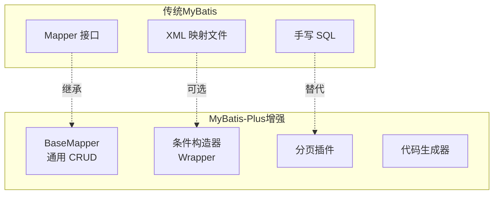
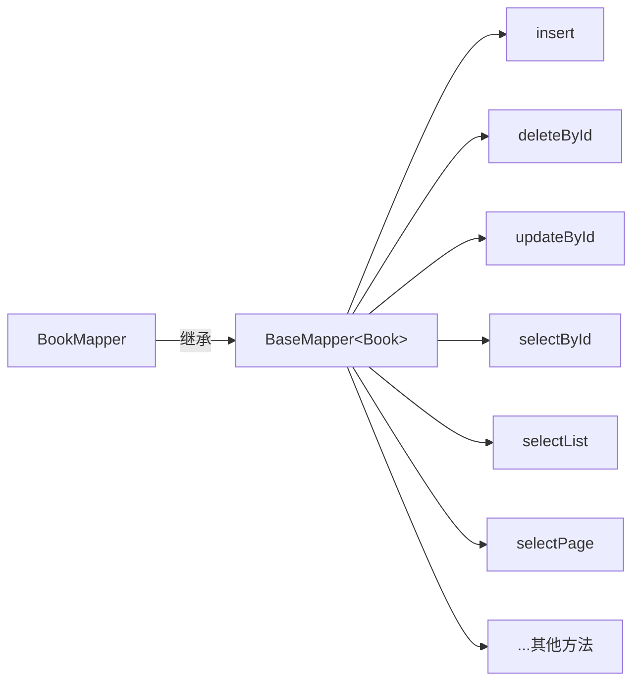

# MyBatis-Plus 概述与快速上手

## 课程目标

- 理解 MyBatis-Plus 的设计哲学：“只做增强不做改变”
- 掌握 MyBatis-Plus 与原生 MyBatis 的对比差异
- 能够在 Spring Boot 中成功集成 MyBatis-Plus
- 掌握 BaseMapper 实现零 SQL 的通用 CRUD
- 掌握常用注解：@TableName、@TableId、@TableField


## 回顾与导入

在前面课程中，我们完成了 MyBatis 的基础集成、XML 映射、动态 SQL 和分页等高级特性。但有一个问题始终困扰着开发者：


**传统 MyBatis 开发的痛点：**
- 每张表都要写一套 CRUD 的 XML 和接口方法
- 单表操作大量重复，但无法复用
- 开发效率受限于重复劳动

MyBatis-Plus 正是为了解决这个问题而生。


## MyBatis-Plus 概述

### 什么是 MyBatis-Plus

**MyBatis-Plus（简称 MP）** 是 MyBatis 的**增强工具包**，它在 MyBatis 的基础上提供了额外的功能，**而不对 MyBatis 核心框架做任何修改**。

### 核心设计理念：“只做增强不做改变”



> [!NOTE]
> MyBatis-Plus 不会改变 MyBatis 的任何行为。你仍然可以使用 MyBatis 的所有功能，MP 只是在上面“加了东西”。

### MyBatis-Plus vs 原生 MyBatis

| 对比维度      | 原生 MyBatis             | MyBatis-Plus        |
| ------------- | ------------------------ | ------------------- |
| **基础 CRUD** | 手写 SQL                 | BaseMapper 自动提供 |
| **单表操作**  | 手写 XML                 | 零 XML              |
| **条件查询**  | 手写动态 SQL             | Wrapper 条件构造器  |
| **分页**      | 手写 LIMIT 或 PageHelper | 内置分页插件        |
| **代码生成**  | 无                       | 代码生成器          |
| **开发效率**  | 中                       | 高                  |
| **学习曲线**  | 平缓                     | 平缓（MP 易上手）   |

> [!NOTE]
> MyBatis-Plus 是 MyBatis 的**补充**而非**替代**。你可以同时使用 MP 的增强功能和 MyBatis 的原生功能。


## Spring Boot 集成 MyBatis-Plus

### 1. 替换依赖

在 `pom.xml` 中，将 `mybatis-spring-boot-starter` 替换为 `mybatis-plus-boot-starter`：

```xml
<!-- 移除 mybatis-spring-boot-starter -->
<!--
<dependency>
    <groupId>org.mybatis.spring.boot</groupId>
    <artifactId>mybatis-spring-boot-starter</artifactId>
    <version>3.0.3</version>
</dependency>
-->

<!-- 添加 mybatis-plus-boot-starter -->
<dependency>
    <groupId>com.baomidou</groupId>
    <artifactId>mybatis-plus-spring-boot3-starter</artifactId>
    <version>3.5.17</version>  <!-- 当前最新版本  -->
</dependency>
```

> [!CAUTION]
> 根据 Spring Boot 版本选择正确的 Starter：
> - Spring Boot 2.x：使用 `mybatis-plus-boot-starter`
> - Spring Boot 3.x：使用 `mybatis-plus-spring-boot3-starter`
> - Spring Boot 4.x：使用 `mybatis-plus-boot-starter`（自 3.5.13 开始支持）

### 2. 配置数据源和 MyBatis-Plus 属性

在 `application.yml` 中配置（与 MyBatis 配置类似）：

```yaml
spring:
  datasource:
    driver-class-name: org.postgresql.Driver
    url: jdbc:postgresql://localhost:5432/bookdb
    username: postgres
    password: your_password

# MyBatis-Plus 配置
mybatis-plus:
  # XML 映射文件位置（可沿用原有配置）
  mapper-locations: classpath*:mapper/**/*.xml
  # 实体类包路径
  type-aliases-package: com.example.bookmanager.model
  # 全局配置
  global-config:
    db-config:
      # 主键策略：自增
      id-type: auto
      # 逻辑删除字段名
      logic-delete-field: deleted
      logic-delete-value: 1
      logic-not-delete-value: 0
  # 配置信息
  configuration:
    # 下划线转驼峰
    map-underscore-to-camel-case: true
    # 日志输出
    log-impl: org.apache.ibatis.logging.stdout.StdOutImpl
```

### 3. 扫描 Mapper 接口

使用 `@MapperScan` 扫描 Mapper 接口：

```java
@SpringBootApplication
@MapperScan("com.example.bookmanager.mapper")  // 与 MyBatis 一致
public class BookManagerApplication {
    public static void main(String[] args) {
        SpringApplication.run(BookManagerApplication.class, args);
    }
}
```

> [!NOTE]
> MyBatis-Plus 的 `@MapperScan` 与 MyBatis 完全兼容，无需修改。


## 实体类注解

### 核心注解概览

| 注解          | 作用                       | 示例                           |
| ------------- | -------------------------- | ------------------------------ |
| `@TableName`  | 指定实体类对应的数据库表名 | `@TableName("book")`           |
| `@TableId`    | 指定主键字段及生成策略     | `@TableId(type = IdType.AUTO)` |
| `@TableField` | 指定字段与列的映射关系     | `@TableField("created_at")`    |
| `@TableLogic` | 逻辑删除字段标记           | `@TableLogic`                  |

### Book 实体类改造

将原有的 `Book` 类改造为 MyBatis-Plus 实体：

```java
@TableName("book")
public class Book {

    @TableId(type = IdType.AUTO)
    private Long id;

    private String title;
    private String author;
    private Double price;
    private Integer stock;
    private Integer sales;

    @TableField("category")
    private String category;

    @TableField("isbn")
    private String isbn;

    @TableField("description")
    private String description;

    @TableField(value = "created_at")
    private LocalDateTime createdAt;

    @TableField(value = "updated_at")
    private LocalDateTime updatedAt;
}
```

### 主键生成策略（IdType）

| 策略          | 说明                                       |
| ------------- | ------------------------------------------ |
| `AUTO`        | 数据库自增（推荐 PostgreSQL 的 BIGSERIAL） |
| `ASSIGN_ID`   | 雪花算法，生成 19 位 Long 型 ID            |
| `ASSIGN_UUID` | 生成 32 位 UUID 字符串                     |
| `INPUT`       | 用户手动输入                               |
| `NONE`        | 默认，跟随全局配置                         |


## BaseMapper 通用 CRUD

### BaseMapper 简介

`BaseMapper<T>` 是 MyBatis-Plus 提供的**通用 Mapper 接口**，继承后即可获得单表的完整 CRUD 方法。



### 定义 Mapper 接口

```java
@Mapper
public interface BookMapper extends BaseMapper<Book> {
    // 无需编写任何方法，BaseMapper 已提供完整 CRUD 
}
```

### BaseMapper 核心方法

| 方法                                                 | 功能                  |
| ---------------------------------------------------- | --------------------- |
| `insert(T entity)`                                   | 插入一条记录          |
| `deleteById(Serializable id)`                        | 根据 ID 删除          |
| `deleteByMap(Map<String, Object> columnMap)`         | 根据 Map 条件删除     |
| `delete(Wrapper<T> wrapper)`                         | 根据 Wrapper 条件删除 |
| `updateById(T entity)`                               | 根据 ID 更新          |
| `update(T entity, Wrapper<T> updateWrapper)`         | 根据 Wrapper 条件更新 |
| `selectById(Serializable id)`                        | 根据 ID 查询          |
| `selectBatchIds(Collection<Serializable> idList)`    | 根据 ID 列表批量查询  |
| `selectByMap(Map<String, Object> columnMap)`         | 根据 Map 条件查询     |
| `selectOne(Wrapper<T> queryWrapper)`                 | 查询单条记录          |
| `selectList(Wrapper<T> queryWrapper)`                | 查询列表              |
| `selectPage(IPage<T> page, Wrapper<T> queryWrapper)` | 分页查询              |

### 使用 BaseMapper 完成 CRUD

```java
@Service
public class BookService {
    @Autowired
    private BookMapper bookMapper;

    // ---------- 插入 ----------
    public Book createBook(Book book) {
        int rows = bookMapper.insert(book);
        // 插入后 book.getId() 会被自动设置（主键回填）
        return book;
    }

    // ---------- 查询 ----------
    public Book getBookById(Long id) {
        return bookMapper.selectById(id);
    }

    public List<Book> getAllBooks() {
        // null 表示无条件，查询全部
        return bookMapper.selectList(null);
    }

    // ---------- 更新 ----------
    public Book updateBook(Book book) {
        int rows = bookMapper.updateById(book);
        return book;
    }

    // ---------- 删除 ----------
    public boolean deleteBook(Long id) {
        int rows = bookMapper.deleteById(id);
        return rows > 0;
    }
}
```

> [!NOTE]
> 与原生 MyBatis 对比：原来需要手写 XML 的 select、insert、update、delete，现在全部由 BaseMapper 自动提供。


## 逻辑删除

### 什么是逻辑删除

逻辑删除不真正删除数据库记录，而是通过一个标记字段（如 `deleted`）标记为“已删除”，查询时自动过滤。


### 配置逻辑删除

#### 1. 数据库添加字段

```sql
ALTER TABLE book ADD COLUMN deleted INT DEFAULT 0;
```

#### 2. 实体类添加注解

```java
@TableName("book")
public class Book {
    // ... 其他字段

    @TableLogic
    @TableField("deleted")
    private Integer deleted;
}
```

#### 3. 全局配置（可选）

在 `application.yml` 中配置全局默认值：

```yaml
mybatis-plus:
  global-config:
    db-config:
      logic-delete-field: deleted      # 全局逻辑删除字段名
      logic-delete-value: 1            # 逻辑已删除值（默认 1）
      logic-not-delete-value: 0        # 逻辑未删除值（默认 0）
```

### 使用逻辑删除

```java
// 执行删除（实际是 UPDATE）
int rows = bookMapper.deleteById(1L);  // SQL: UPDATE book SET deleted = 1 WHERE id = 1

// 查询（自动过滤已删除）
List<Book> books = bookMapper.selectList(null);  // SQL: WHERE deleted = 0

// 查询包含已删除（使用 wrapper 不加 deleted 条件）
LambdaQueryWrapper<Book> wrapper = new LambdaQueryWrapper<>();
wrapper.eq(Book::getDeleted, 1);  // 手动查询已删除数据
```

> [!NOTE]
>
> 逻辑删除后，`selectList`、`selectById` 等查询方法会自动追加 `WHERE deleted = 0` 条件。


## 实战：将图书管理系统从 MyBatis 迁移到 MyBatis-Plus

### 迁移步骤概览


### 1. 修改 BookMapper

```java
// 原 MyBatis Mapper
@Mapper
public interface BookMapper {
    Book selectById(Long id);
    List<Book> selectAll();
    int insert(Book book);
    int update(Book book);
    int deleteById(Long id);
}
```

```java
// MyBatis-Plus Mapper（一行搞定）
@Mapper
public interface BookMapper extends BaseMapper<Book> {
    // 自动获得所有 CRUD 方法！
}
```

### 2. 修改 BookService

```java
@Service
@Transactional
public class BookService {
    @Autowired
    private BookMapper bookMapper;

    public Book getBookById(Long id) {
        return bookMapper.selectById(id);
    }

    public List<Book> getAllBooks() {
        return bookMapper.selectList(null);
    }

    public Book createBook(Book book) {
        bookMapper.insert(book);
        return book;
    }
  	...
}
```

### 3. 混合使用：自定义方法

MyBatis-Plus 支持与原生 MyBatis 混合使用。在 `BookMapper` 中添加自定义方法：

```java
@Mapper
public interface BookMapper extends BaseMapper<Book> {
    // BaseMapper 自动提供的方法：insert、selectById、updateById、deleteById...
    
    // 自定义方法：仍然可以使用 XML 或注解
    @Select("SELECT * FROM book WHERE author LIKE CONCAT('%', #{author}, '%')")
    List<Book> selectByAuthor(@Param("author") String author);
}
```

对应的 XML 文件（`BookMapper.xml`）仍然有效，与 MP 共存。

> [!NOTE]
> 原生 MyBatis 的 XML 映射文件与 MyBatis-Plus 的 BaseMapper 可以**无缝共存**。你可以在同一个 Mapper 中同时使用继承的方法和自定义的方法。


## 注意事项

### 1. 实体类必须有无参构造方法

MyBatis-Plus 通过反射创建实体实例，必须提供**无参构造方法**。

### 2. 主键策略选择

- PostgreSQL 使用 `BIGSERIAL` 时，推荐 `IdType.AUTO`
- 分布式场景推荐 `IdType.ASSIGN_ID`（雪花算法）

### 3. 字段名映射

默认开启 `map-underscore-to-camel-case`，数据库下划线字段自动映射为 Java 驼峰属性。如需自定义，使用 `@TableField` 注解。

### 4. 逻辑删除

使用 `@TableLogic` 标记逻辑删除字段后：
- `deleteById` 变为逻辑删除（UPDATE deleted = 1）
- `selectList` 自动过滤已删除数据（WHERE deleted = 0）

### 5. 版本兼容性

| Spring Boot 版本 | MyBatis-Plus Starter                        |
| ---------------- | ------------------------------------------- |
| 2.x              | `mybatis-plus-boot-starter`                 |
| 3.x              | `mybatis-plus-spring-boot3-starter`         |
| 4.x              | `mybatis-plus-boot-starter`（自 3.5.13 起） |


## 小结

本节课我们学习了：

1. **MyBatis-Plus 设计哲学**：只做增强不做改变，是 MyBatis 的补充而非替代。
2. **Spring Boot 集成**：替换依赖、配置属性、`@MapperScan` 扫描。
3. **实体类注解**：
   - `@TableName`：指定表名
   - `@TableId`：主键及策略
   - `@TableField`：字段映射
   - `@TableLogic`：逻辑删除
4. **BaseMapper**：继承即获得完整 CRUD，无需编写 XML。
5. **混合使用**：MP 的 BaseMapper 与原生 MyBatis 的 XML/注解可共存。


## 作业

### 作业一：代码阅读——MyBatis-Plus 注解识别

阅读以下实体类，回答问题。

```java
@TableName("product")
public class Product {
    @TableId(type = IdType.AUTO)
    private Long id;
    private String name;
    private Double price;
    @TableField("stock_count")
    private Integer stock;
    private LocalDateTime createdAt;
    @TableLogic
    private Integer deleted;
}
```

**问题：**
1. 该实体对应数据库中的哪张表？
2. `id` 字段的主键生成策略是什么？
3. `stock` 字段在数据库中的列名是什么？
5. `deleted` 字段的作用是什么？

---

### 作业二：将图书管理系统迁移到 MyBatis-Plus

完成以下任务：

1. 将 `mybatis-spring-boot-starter` 替换为 `mybatis-plus-boot-starter`（根据 Spring Boot 版本选择）。
2. 在 `application.yml` 中配置 MyBatis-Plus 属性（`mapper-locations`、`type-aliases-package`、`map-underscore-to-camel-case`）。
3. 修改 `Book` 实体类，添加 MP 注解：
   - `@TableName("book")`
   - `@TableId(type = IdType.AUTO)`
   - `@TableField` 映射 `created_at`、`updated_at`
   - `@TableLogic` 添加逻辑删除字段（需在数据库中添加 `deleted` 列）
4. 修改 `BookMapper` 继承 `BaseMapper<Book>`，删除原有的 CRUD 方法。
5. 修改 `BookService`，使用 `BaseMapper` 提供的方法。
6. 启动应用，测试所有接口，验证功能正常。

---

### 作业三：BaseMapper 方法测试

编写测试类，测试 `BaseMapper` 的以下方法：

1. `insert`：插入一本新书，验证主键自动回填。
2. `selectById`：查询单本图书。
3. `selectList(null)`：查询所有图书。
4. `updateById`：更新图书信息。
5. `deleteById`：删除图书（验证逻辑删除是否生效）。
6. `selectBatchIds`：根据 ID 列表批量查询。

---

### 作业四：混合使用自定义方法

在 `BookMapper` 中保留一个自定义方法，演示 MP 与原生 MyBatis 的混合使用：

1. 在 `BookMapper` 中添加 `@Select("SELECT * FROM book WHERE title LIKE CONCAT('%', #{keyword}, '%')")` 方法。
2. 在 Service 中调用该方法。
3. 验证自定义方法与 BaseMapper 方法可以共存且正常工作。
