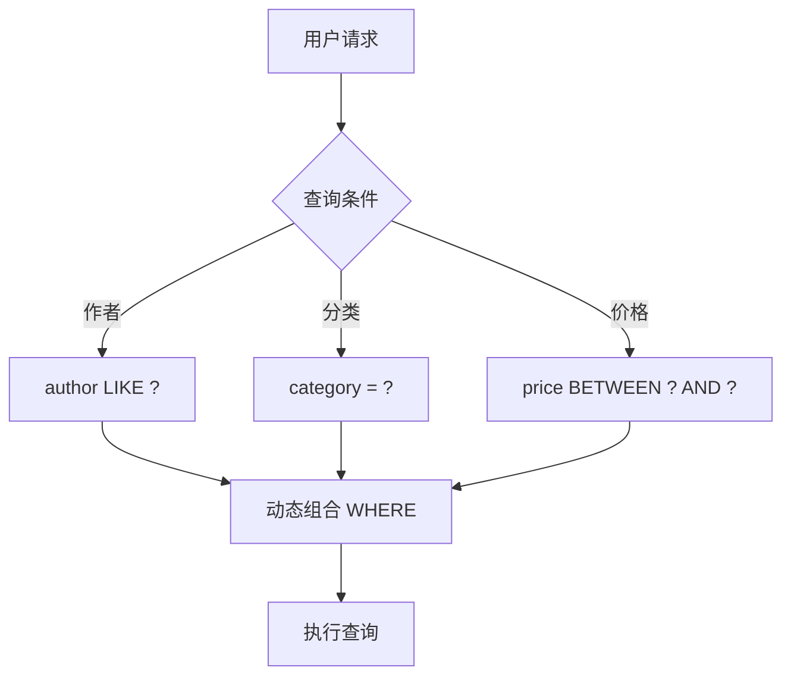
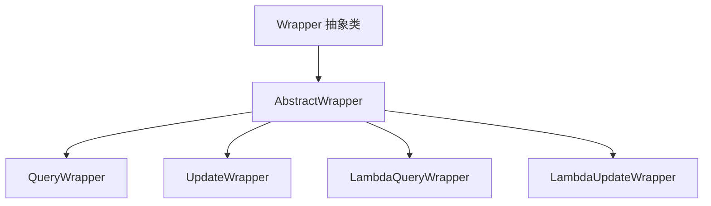

# MyBatis-Plus 条件构造器与分页插件

## 课程目标

- 掌握 MyBatis-Plus 条件构造器（Wrapper）的体系结构
- 掌握 QueryWrapper 和 LambdaQueryWrapper 的常用方法
- 掌握 UpdateWrapper 进行条件更新
- 能够集成并使用 MyBatis-Plus 分页插件


## 条件构造器体系

### 回顾和导入

在上一讲中，我们使用 `BaseMapper` 实现了零 SQL 的通用 CRUD。但实际业务中，查询条件往往是动态组合的：



MyBatis-Plus 提供了**条件构造器（Wrapper）** 来优雅地处理动态查询，无需手写 SQL 或 XML。

### 整体架构



| 类                    | 说明                               |
| --------------------- | ---------------------------------- |
| `QueryWrapper`        | 普通查询条件构造器，字段名用字符串 |
| `LambdaQueryWrapper`  | 类型安全的查询条件构造器（推荐）   |
| `UpdateWrapper`       | 普通更新条件构造器                 |
| `LambdaUpdateWrapper` | 类型安全的更新条件构造器（推荐）   |

> [!NOTE]
> 推荐使用 **Lambda 版本**（`LambdaQueryWrapper` / `LambdaUpdateWrapper`），利用 Lambda 表达式引用实体字段，避免硬编码字段名，且支持 IDE 自动补全和重构。


## QueryWrapper 常用方法

### 比较条件

| 方法        | 说明                    | 示例                                                    |
| ----------- | ----------------------- | ------------------------------------------------------- |
| `eq`        | 等于 `=`                | `wrapper.eq("category", "编程")`                        |
| `ne`        | 不等于 `<>`             | `wrapper.ne("status", "DELETED")`                       |
| `gt`        | 大于 `>`                | `wrapper.gt("price", 50)`                               |
| `ge`        | 大于等于 `>=`           | `wrapper.ge("price", 50)`                               |
| `lt`        | 小于 `<`                | `wrapper.lt("price", 100)`                              |
| `le`        | 小于等于 `<=`           | `wrapper.le("price", 100)`                              |
| `between`   | BETWEEN 区间            | `wrapper.between("price", 50, 100)`                     |
| `like`      | LIKE 模糊匹配（含 `%`） | `wrapper.like("title", "Spring")`                       |
| `likeLeft`  | LIKE 左匹配 `%value`    | `wrapper.likeLeft("title", "Boot")`                     |
| `likeRight` | LIKE 右匹配 `value%`    | `wrapper.likeRight("title", "Spring")`                  |
| `in`        | IN 查询                 | `wrapper.in("category", Arrays.asList("编程", "小说"))` |
| `notIn`     | NOT IN 查询             | `wrapper.notIn("id", ids)`                              |
| `isNull`    | IS NULL                 | `wrapper.isNull("description")`                         |
| `isNotNull` | IS NOT NULL             | `wrapper.isNotNull("isbn")`                             |

### 排序

| 方法                          | 说明     |
| ----------------------------- | -------- |
| `orderByAsc("字段")`          | 升序     |
| `orderByDesc("字段")`         | 降序     |
| `orderBy(true, true, "字段")` | 条件排序 |

### 使用示例

```java
@Service
public class BookService {
    @Autowired
    private BookMapper bookMapper;

    // 多条件动态查询（QueryWrapper）
    public List<Book> searchBooks(String author, String category, Double minPrice, Double maxPrice) {
        QueryWrapper<Book> wrapper = new QueryWrapper<>();
        
        // 条件链式调用
        wrapper.like(author != null && !author.isEmpty(), "author", author)
               .eq(category != null && !category.isEmpty(), "category", category)
               .ge(minPrice != null, "price", minPrice)
               .le(maxPrice != null, "price", maxPrice)
               .orderByAsc("id");
        
        return bookMapper.selectList(wrapper);
    }
}
```

> [!NOTE]
> `like`、`eq` 等方法支持**条件判断**：第一个参数为 `true` 时才添加该条件。这样可避免大量 `if` 语句。


## LambdaQueryWrapper（推荐）

### 为什么使用 LambdaQueryWrapper

- **类型安全**：通过 `实体类::getter` 引用字段，编译期检查字段名
- **IDE 支持**：自动补全、重构友好
- **可读性强**：无需字符串硬编码

### 基本用法

```java
@Service
public class BookService {
    @Autowired
    private BookMapper bookMapper;

    public List<Book> searchBooks(String author, String category, Double minPrice, Double maxPrice) {
        LambdaQueryWrapper<Book> wrapper = new LambdaQueryWrapper<>();
        
        // 使用 Lambda 表达式引用字段
        wrapper.like(StringUtils.hasText(author), Book::getAuthor, author)
               .eq(StringUtils.hasText(category), Book::getCategory, category)
               .ge(minPrice != null, Book::getPrice, minPrice)
               .le(maxPrice != null, Book::getPrice, maxPrice)
               .orderByAsc(Book::getId);
        
        return bookMapper.selectList(wrapper);
    }
}
```

### 常用 Lambda 条件

| 方法                                        | 说明     |
| ------------------------------------------- | -------- |
| `wrapper.like(Book::getTitle, keyword)`     | 模糊查询 |
| `wrapper.eq(Book::getCategory, "编程")`     | 等于     |
| `wrapper.ge(Book::getPrice, 50)`            | 大于等于 |
| `wrapper.between(Book::getPrice, 50, 100)`  | BETWEEN  |
| `wrapper.in(Book::getCategory, categories)` | IN 查询  |
| `wrapper.isNull(Book::getDescription)`      | 为空     |
| `wrapper.orderByDesc(Book::getCreatedAt)`   | 降序     |

### 复杂查询示例

```java
public List<Book> complexSearch(String keyword, String category, Double minPrice, Double maxPrice) {
    LambdaQueryWrapper<Book> wrapper = new LambdaQueryWrapper<>();
    
    // 组合条件：标题或作者包含关键字
    if (StringUtils.hasText(keyword)) {
        wrapper.and(w -> w.like(Book::getTitle, keyword)
                         .or()
                         .like(Book::getAuthor, keyword));
    }
    
    // 分类精确匹配
    wrapper.eq(StringUtils.hasText(category), Book::getCategory, category);
    
    // 价格区间
    wrapper.ge(minPrice != null, Book::getPrice, minPrice)
           .le(maxPrice != null, Book::getPrice, maxPrice);
    
    // 只查询库存 > 0 的图书
    wrapper.gt(Book::getStock, 0);
    
    // 按价格降序，价格相同按 ID 升序
    wrapper.orderByDesc(Book::getPrice)
           .orderByAsc(Book::getId);
    
    return bookMapper.selectList(wrapper);
}
```

### 查询单条记录

```java
public Book findOneByTitle(String title) {
    LambdaQueryWrapper<Book> wrapper = new LambdaQueryWrapper<>();
    wrapper.eq(Book::getTitle, title);
    return bookMapper.selectOne(wrapper);
}
```

### 统计数量

```java
public long countByCategory(String category) {
    LambdaQueryWrapper<Book> wrapper = new LambdaQueryWrapper<>();
    wrapper.eq(Book::getCategory, category);
    return bookMapper.selectCount(wrapper);
}
```


## UpdateWrapper 条件更新

### 基本用法

`UpdateWrapper` 用于批量更新，无需先查询再更新。

```java
public int updatePriceByCategory(String category, Double multiplier) {
    LambdaUpdateWrapper<Book> wrapper = new LambdaUpdateWrapper<>();
    
    // 更新条件
    wrapper.eq(Book::getCategory, category);
    
    // 设置更新字段
    wrapper.set(Book::getPrice, new Column("price * " + multiplier));
    // 或直接设置固定值
    // wrapper.set(Book::getCategory, "新技术");
    
    return bookMapper.update(null, wrapper);
}
```

> [!CAUTION]
> 使用 `UpdateWrapper` 时，`update` 方法的第一个参数为 `null`，表示不传递实体，完全依赖 Wrapper 更新。

### 增量更新示例

```java
public int increasePriceByCategory(String category, Double percent) {
    LambdaUpdateWrapper<Book> wrapper = new LambdaUpdateWrapper<>();
    wrapper.eq(Book::getCategory, category)
           .setSql("price = price * (1 + " + percent / 100 + ")")  // 自定义 SQL 片段
           .set(Book::getUpdatedAt, LocalDateTime.now());
    
    return bookMapper.update(null, wrapper);
}
```


## 分页插件

### 配置分页插件

MyBatis-Plus 内置了分页插件，需配置 `MybatisPlusInterceptor`。

```java
@Configuration
public class MybatisPlusConfig {
    
    @Bean
    public MybatisPlusInterceptor mybatisPlusInterceptor() {
        MybatisPlusInterceptor interceptor = new MybatisPlusInterceptor();
        // 添加分页插件（指定数据库类型）
        interceptor.addInnerInterceptor(new PaginationInnerInterceptor(DbType.POSTGRE_SQL));
        return interceptor;
    }
}
```

MyBatis-Plus 从 **3.5.0** 版本开始，对依赖进行了拆分。分页插件 `PaginationInnerInterceptor` 被移出了核心包，因此需要单独引入。从 **3.5.9** 版本开始，分页插件也移到了 `mybatis-plus-jsqlparser` 模块中。

```xml
<dependency>
    <groupId>com.baomidou</groupId>
    <artifactId>mybatis-plus-jsqlparser</artifactId>
    <!-- 请将版本号替换为你使用的 MyBatis-Plus 版本 -->
    <version>${mybatis-plus.version}</version>
</dependency>
```

> [!NOTE]
>
> 需要同步去掉原先Mybatis所使用的`pagehelper-spring-boot-starter`的依赖。

### 使用 Page 对象分页

```java
@Service
public class BookService {
    @Autowired
    private BookMapper bookMapper;

    public Page<Book> getBooksByPage(int pageNum, int pageSize, String author, String category) {
        // 1. 创建 Page 对象
        Page<Book> page = new Page<>(pageNum, pageSize);
        
        // 2. 构建条件
        LambdaQueryWrapper<Book> wrapper = new LambdaQueryWrapper<>();
        wrapper.like(StringUtils.hasText(author), Book::getAuthor, author)
               .eq(StringUtils.hasText(category), Book::getCategory, category)
               .orderByDesc(Book::getCreatedAt);
        
        // 3. 执行分页查询（MyBatis-Plus 自动注入 LIMIT 和 COUNT）
        return bookMapper.selectPage(page, wrapper);
    }
}
```

### Page 对象常用方法

| 方法            | 说明           |
| --------------- | -------------- |
| `getTotal()`    | 总记录数       |
| `getPages()`    | 总页数         |
| `getCurrent()`  | 当前页码       |
| `getSize()`     | 每页大小       |
| `getRecords()`  | 当前页数据列表 |
| `hasNext()`     | 是否有下一页   |
| `hasPrevious()` | 是否有上一页   |

### Controller 示例

```java
@GetMapping("/page")
public Result<Page<Book>> getBooksByPage(
        @RequestParam(defaultValue = "1") int pageNum,
        @RequestParam(defaultValue = "10") int pageSize,
        @RequestParam(required = false) String author,
        @RequestParam(required = false) String category) {
    Page<Book> page = bookService.getBooksByPage(pageNum, pageSize, author, category);
    return Result.success(page);
}
```


## 实战：在图书管理系统中集成 Wrapper 和分页

### Service 层完整实现

```java
package com.example.bookmanager.service;

@Service
public class BookService {
    private final BookMapper bookMapper;

    public BookService(BookMapper bookMapper) {
        this.bookMapper = bookMapper;
    }

    // ---------- 条件查询（LambdaQueryWrapper） ----------
    public List<Book> searchBooks(String author, String category, Double minPrice, Double maxPrice) {
        LambdaQueryWrapper<Book> wrapper = new LambdaQueryWrapper<>();
        wrapper.like(StringUtils.hasText(author), Book::getAuthor, author)
               .eq(StringUtils.hasText(category), Book::getCategory, category)
               .ge(minPrice != null, Book::getPrice, minPrice)
               .le(maxPrice != null, Book::getPrice, maxPrice)
               .orderByAsc(Book::getId);
        return bookMapper.selectList(wrapper);
    }

    // ---------- 分页查询 ----------
    public Page<Book> getBooksByPage(int pageNum, int pageSize, String author, String category) {
        Page<Book> page = new Page<>(pageNum, pageSize);
        LambdaQueryWrapper<Book> wrapper = new LambdaQueryWrapper<>();
        wrapper.like(StringUtils.hasText(author), Book::getAuthor, author)
               .eq(StringUtils.hasText(category), Book::getCategory, category)
               .orderByDesc(Book::getCreatedAt);
        return bookMapper.selectPage(page, wrapper);
    }

    // ---------- 批量更新（LambdaUpdateWrapper） ----------
    public int updatePriceByCategory(String category, Double multiplier) {
        LambdaUpdateWrapper<Book> wrapper = new LambdaUpdateWrapper<>();
        wrapper.eq(Book::getCategory, category)
               .setSql("price = price * " + multiplier)
               .set(Book::getUpdatedAt, java.time.LocalDateTime.now());
        return bookMapper.update(null, wrapper);
    }

    // ---------- 逻辑删除 ----------
    public boolean deleteBook(Long id) {
        int rows = bookMapper.deleteById(id);
        return rows > 0;
    }
}
```

### Controller 调用

```java
@RestController
@RequestMapping("/api/books")
public class BookController {
    private final BookService bookService;

    @GetMapping("/search")
    public Result<List<Book>> searchBooks(
            @RequestParam(required = false) String author,
            @RequestParam(required = false) String category,
            @RequestParam(required = false) Double minPrice,
            @RequestParam(required = false) Double maxPrice) {
        List<Book> books = bookService.searchBooks(author, category, minPrice, maxPrice);
        return Result.success(books);
    }

    @GetMapping("/page")
    public Result<Page<Book>> getBooksByPage(
            @RequestParam(defaultValue = "1") int pageNum,
            @RequestParam(defaultValue = "10") int pageSize,
            @RequestParam(required = false) String author,
            @RequestParam(required = false) String category) {
        Page<Book> page = bookService.getBooksByPage(pageNum, pageSize, author, category);
        return Result.success(page);
    }

    @PutMapping("/price-update")
    public Result<Integer> updatePriceByCategory(
            @RequestParam String category,
            @RequestParam Double multiplier) {
        int rows = bookService.updatePriceByCategory(category, multiplier);
        return Result.success(rows);
    }
}
```


## 注意事项

### 1. 分页插件需配置数据库类型

在 `PaginationInnerInterceptor` 中指定 `DbType.POSTGRE_SQL`，否则生成的 SQL 语法可能不正确。

### 2. Lambda 表达式与序列化

`LambdaQueryWrapper` 依赖实体类的 `Serializable` 支持，但通常无需额外实现。

### 3. 条件构造器的 `and` 与 `or`

- 多个条件默认用 `AND` 连接。
- 使用 `or()` 切换逻辑关系。
- 使用 `and(w -> w.条件1.or().条件2)` 构建复杂括号。

### 4. 分页与性能

- `Page` 对象会自动生成 `COUNT` 查询，对于大表可能影响性能。
- 可通过 `Page` 的 `optimizeCountSql` 或 `isSearchCount` 控制是否生成 COUNT。


## 小结

本节课我们学习了：

1. **条件构造器体系**：
   - `QueryWrapper`（字符串字段名）
   - `LambdaQueryWrapper`（Lambda 表达式，推荐）
   - `UpdateWrapper` 和 `LambdaUpdateWrapper`（条件更新）
2. **常用方法**：`eq`、`like`、`ge`、`le`、`in`、`between`、`orderBy` 等。
3. **分页插件**：
   - 配置 `PaginationInnerInterceptor`
   - 使用 `Page` 对象进行分页查询
5. **实战应用**：图书管理系统中使用 Wrapper 实现动态查询、分页和条件更新。


## 作业

### 作业一：代码阅读——条件构造器分析

阅读以下代码，回答问题。

```java
LambdaQueryWrapper<Book> wrapper = new LambdaQueryWrapper<>();
wrapper.like(Book::getTitle, keyword)
       .eq(Book::getCategory, category)
       .ge(Book::getPrice, minPrice)
       .le(Book::getPrice, maxPrice)
       .orderByDesc(Book::getCreatedAt);
```

**问题：**

1. 该查询生成 SQL 的 WHERE 条件是什么？
2. 如果 `keyword` 为 `null`，条件如何变化？
3. 如果 `category` 为 `null`，`eq` 条件是否添加？为什么？

---

### 作业二：实现图书多条件查询和分页

在图书管理系统中完成以下任务：

1. 在 `BookService` 中添加 `searchBooks` 方法，使用 `LambdaQueryWrapper` 实现：
   - 作者（模糊匹配）
   - 分类（精确匹配）
   - 价格区间（minPrice、maxPrice）
   - 关键词（同时搜索标题和作者）
2. 添加分页查询方法 `getBooksByPage`，支持上述条件。
3. 在 Controller 中添加 `/api/books/search` 和 `/api/books/page` 接口。
4. 测试所有接口，观察生成的 SQL。

---

### 作业三：条件更新与逻辑删除

完成以下任务：

1. 在 `BookService` 中添加 `updatePriceByCategory` 方法，使用 `LambdaUpdateWrapper` 批量更新某分类下图书的价格（乘以指定倍数）。
2. 在数据库中添加 `deleted` 字段，为 `Book` 实体添加 `@TableLogic` 注解。
3. 测试 `deleteById` 是否变为逻辑删除。
4. 测试 `selectList` 是否自动过滤已删除数据。

---

### 作业四：复杂条件构造

使用 `LambdaQueryWrapper` 实现以下复杂查询：

1. 查询分类为“编程”且（价格 > 80 或库存 < 5）的图书。
2. 查询标题包含“Spring”且价格在 50 到 100 之间的图书。
3. 编写单元测试验证查询结果。
