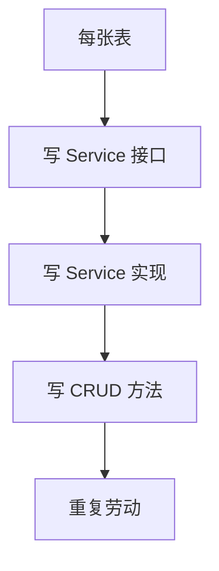
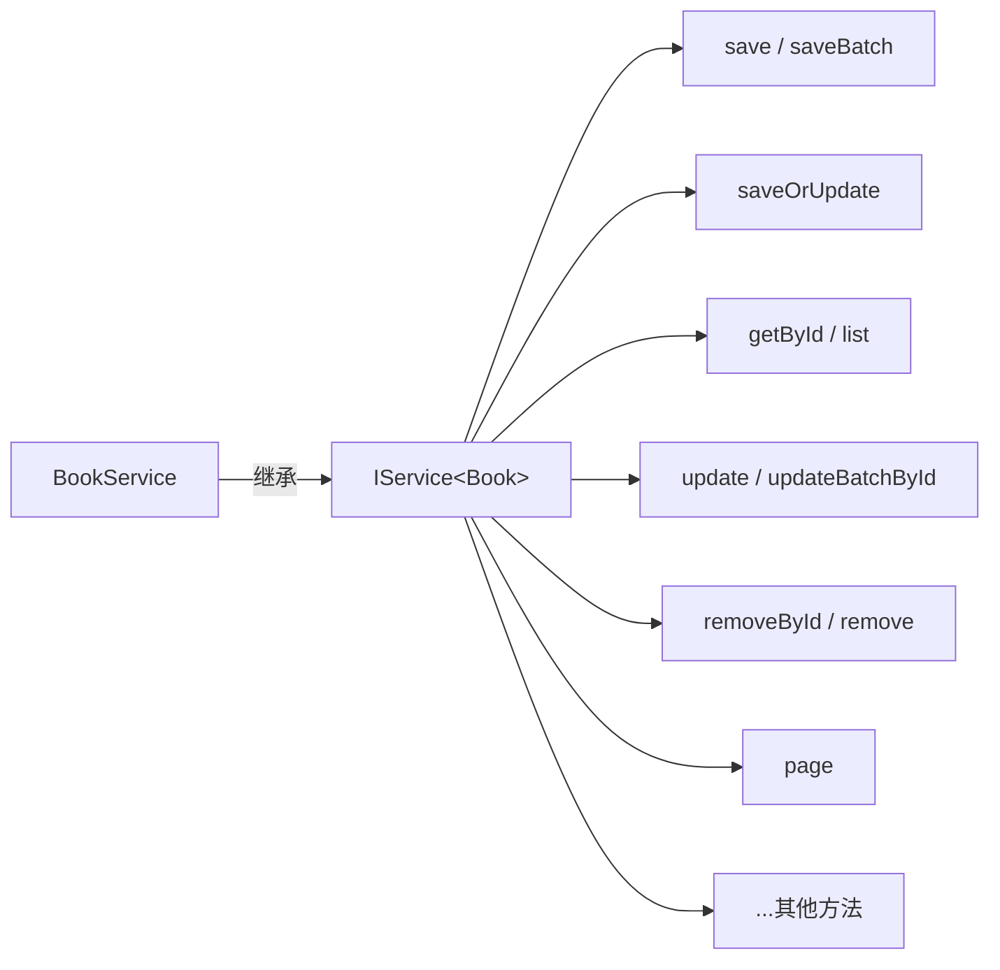
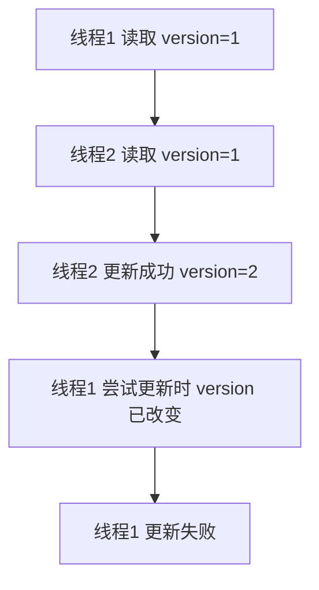

# MyBatis-Plus 扩展

## 课程目标

- 掌握通用 Service（IService 与 ServiceImpl）的使用，简化 Service 层开发
- 掌握自动填充功能，自动管理创建时间、更新时间等字段
- 掌握乐观锁插件的配置与使用，解决并发更新问题
- 能够使用代码生成器快速生成项目骨架


## 回顾与导入

在前面课程中，我们掌握了 MyBatis-Plus 的 BaseMapper 和条件构造器，已经可以高效完成单表 CRUD 和动态查询。但 Service 层仍然存在重复代码：



MyBatis-Plus 提供了 **通用 Service** 来进一步简化 Service 层的开发。


## 通用 Service（IService 与 ServiceImpl）

### IService 接口

`IService<T>` 是 MyBatis-Plus 提供的通用 Service 接口，封装了常见的业务方法。



### 定义 Service 接口

```java
public interface BookService extends IService<Book> {
    // 可添加自定义业务方法
    List<Book> searchBooks(String author, String category, Double minPrice, Double maxPrice);
}
```

### 实现 Service 实现类

```java
@Service
public class BookServiceImpl extends ServiceImpl<BookMapper, Book> implements BookService {

    @Override
    public List<Book> searchBooks(String author, String category, Double minPrice, Double maxPrice) {
        LambdaQueryWrapper<Book> wrapper = new LambdaQueryWrapper<>();
        wrapper.like(StringUtils.hasText(author), Book::getAuthor, author)
               .eq(StringUtils.hasText(category), Book::getCategory, category)
               .ge(minPrice != null, Book::getPrice, minPrice)
               .le(maxPrice != null, Book::getPrice, maxPrice)
               .orderByAsc(Book::getId);
        return baseMapper.selectList(wrapper);
    }
}
```

### IService 核心方法

| 分类     | 方法                                                     | 说明                       |
| -------- | -------------------------------------------------------- | -------------------------- |
| **保存** | `save(T entity)`                                         | 插入一条记录               |
|          | `saveBatch(Collection<T> entityList)`                    | 批量插入                   |
|          | `saveOrUpdate(T entity)`                                 | 插入或更新（根据 ID 判断） |
| **删除** | `removeById(Serializable id)`                            | 根据 ID 删除               |
|          | `remove(Wrapper<T> queryWrapper)`                        | 根据 Wrapper 条件删除      |
|          | `removeByIds(Collection<? extends Serializable> idList)` | 批量删除                   |
| **更新** | `updateById(T entity)`                                   | 根据 ID 更新               |
|          | `update(Wrapper<T> updateWrapper)`                       | 根据 Wrapper 条件更新      |
|          | `updateBatchById(Collection<T> entityList)`              | 批量更新                   |
| **查询** | `getById(Serializable id)`                               | 根据 ID 查询               |
|          | `list(Wrapper<T> queryWrapper)`                          | 查询列表                   |
|          | `listByIds(Collection<? extends Serializable> idList)`   | 批量查询                   |
|          | `page(IPage<T> page, Wrapper<T> queryWrapper)`           | 分页查询                   |
| **计数** | `count(Wrapper<T> queryWrapper)`                         | 统计数量                   |

### 使用 IService 简化 Controller

```java
@RestController
@RequestMapping("/api/books")
public class BookController {
    private final BookService bookService;

    public BookController(BookService bookService) {
        this.bookService = bookService;
    }

    @PostMapping
    public Result<Book> createBook(@RequestBody Book book) {
        boolean saved = bookService.save(book);
        return saved ? Result.success(book) : Result.error(ResultCode.INTERNAL_ERROR, "保存失败");
    }

    @GetMapping("/{id}")
    public Result<Book> getBook(@PathVariable Long id) {
        Book book = bookService.getById(id);
        return book != null ? Result.success(book) : Result.error(ResultCode.NOT_FOUND, "图书不存在");
    }

    @GetMapping
    public Result<List<Book>> getAllBooks() {
        return Result.success(bookService.list());
    }

    @PutMapping("/{id}")
    public Result<Book> updateBook(@PathVariable Long id, @RequestBody Book book) {
        book.setId(id);
        boolean updated = bookService.updateById(book);
        return updated ? Result.success(book) : Result.error(ResultCode.INTERNAL_ERROR, "更新失败");
    }

    @DeleteMapping("/{id}")
    public Result<Void> deleteBook(@PathVariable Long id) {
        boolean removed = bookService.removeById(id);
        return removed ? Result.success() : Result.error(ResultCode.INTERNAL_ERROR, "删除失败");
    }
}
```

> [!NOTE]
> `ServiceImpl` 继承后，通过 `baseMapper` 可访问 `BookMapper` 的 MyBatis-Plus 方法，无需再手动注入 `BookMapper`。


## 自动填充功能

### 业务场景

在数据操作中，我们经常需要自动记录创建时间、更新时间、创建人、更新人等字段，这些字段通常不应该由业务代码手动设置。

### 使用 @TableField 注解

```java
@TableName("book")
public class Book {
    // ... 其他字段

    @TableField(value = "created_at", fill = FieldFill.INSERT)
    private LocalDateTime createdAt;

    @TableField(value = "updated_at", fill = FieldFill.INSERT_UPDATE)
    private LocalDateTime updatedAt;

    @TableField(value = "created_by", fill = FieldFill.INSERT)
    private String createdBy;

    @TableField(value = "updated_by", fill = FieldFill.INSERT_UPDATE)
    private String updatedBy;
}
```

| `fill` 值                 | 说明               |
| ------------------------- | ------------------ |
| `FieldFill.INSERT`        | 插入时自动填充     |
| `FieldFill.UPDATE`        | 更新时自动填充     |
| `FieldFill.INSERT_UPDATE` | 插入和更新时都填充 |
| `FieldFill.DEFAULT`       | 默认不填充         |

### 实现 MetaObjectHandler

```java
@Component
public class MyMetaObjectHandler implements MetaObjectHandler {

    @Override
    public void insertFill(MetaObject metaObject) {
        this.strictInsertFill(metaObject, "createdAt", LocalDateTime.class, LocalDateTime.now());
        this.strictInsertFill(metaObject, "updatedAt", LocalDateTime.class, LocalDateTime.now());
        this.strictInsertFill(metaObject, "createdBy", String.class, getCurrentUser());
        this.strictInsertFill(metaObject, "updatedBy", String.class, getCurrentUser());
    }

    @Override
    public void updateFill(MetaObject metaObject) {
        this.strictUpdateFill(metaObject, "updatedAt", LocalDateTime.class, LocalDateTime.now());
        this.strictUpdateFill(metaObject, "updatedBy", String.class, getCurrentUser());
    }

    /**
     * 获取当前用户（可从 SecurityContext 或 ThreadLocal 获取）
     */
    private String getCurrentUser() {
        // 模拟从 Spring Security 获取当前用户
        // 例如：SecurityContextHolder.getContext().getAuthentication().getName()
        return "system";
    }
}
```

> [!NOTE]
> `MetaObjectHandler` 是 Spring Bean，会被 MyBatis-Plus 自动识别。填充逻辑在 `insert` 或 `update` 时触发，无需在业务代码中显式调用。


## 乐观锁插件

### 业务场景

当多个用户同时修改同一数据时，可能出现更新丢失问题。乐观锁通过版本号（version）机制解决并发更新冲突。



### 配置乐观锁插件

```java
@Configuration
public class MybatisPlusConfig {
    
    @Bean
    public MybatisPlusInterceptor mybatisPlusInterceptor() {
        MybatisPlusInterceptor interceptor = new MybatisPlusInterceptor();
        // 分页插件
        interceptor.addInnerInterceptor(new PaginationInnerInterceptor(DbType.POSTGRE_SQL));
        // 乐观锁插件
        interceptor.addInnerInterceptor(new OptimisticLockerInnerInterceptor());
        return interceptor;
    }
}
```

### 实体类添加 @Version

```java
@TableName("book")
public class Book {
    // ... 其他字段

    @Version
    @TableField("version")
    private Integer version;
}
```

### 数据库添加 version 字段

```sql
ALTER TABLE book ADD COLUMN version INT DEFAULT 0;
```

### 使用乐观锁

```java
@Service
public class BookService {
    @Autowired
    private BookMapper bookMapper;

    public boolean updateBookWithVersion(Book book) {
        // 先查询当前版本
        Book existing = baseMapper.selectById(book.getId());
        if (existing == null) {
            return false;
        }
        // 设置版本号（用于乐观锁）
        book.setVersion(existing.getVersion());
        
        // 更新时，MyBatis-Plus 会自动增加 WHERE version = #{version}
        int rows = baseMapper.updateById(book);
        return rows > 0;  // rows=0 表示更新失败（版本已变）
    }
}
```

> [!NOTE]
> MyBatis-Plus 会在 UPDATE 语句中自动添加 `WHERE version = #{version}`，并将版本号 +1。若影响行数为 0，表示数据已被其他线程修改。


## 代码生成器

### 什么是代码生成器

MyBatis-Plus 代码生成器可根据数据库表自动生成：
- 实体类（Entity）
- Mapper 接口
- Service 接口与实现类
- Controller 类

### 添加依赖

```xml
<!-- MyBatis-Plus 代码生成器 -->
<dependency>
    <groupId>com.baomidou</groupId>
    <artifactId>mybatis-plus-generator</artifactId>
    <version>3.5.3</version>
</dependency>

<!-- 模板引擎（Freemarker） -->
<dependency>
    <groupId>org.freemarker</groupId>
    <artifactId>freemarker</artifactId>
</dependency>
```

### 编写代码生成器配置

```java
public class CodeGenerator {
    public static void main(String[] args) {
        FastAutoGenerator.create(
                "jdbc:postgresql://localhost:5432/bookdb3",
                "postgres",
                "your_password"
        )
        .globalConfig(builder -> builder
                .author("BookManager Team")
                .enableSwagger()
                .outputDir(System.getProperty("user.dir") + "/code/src/main/java")
                .commentDate("yyyy-MM-dd")
        )
        .packageConfig(builder -> builder
                .parent("com.example.bookmanager")
                .moduleName("")
                .entity("model")
                .service("service")
                .serviceImpl("service.impl")
                .mapper("mapper")
                .controller("controller")
                .pathInfo(Collections.singletonMap(
                        OutputFile.xml, System.getProperty("user.dir") + "/code/src/main/resources/mapper"
                ))
        )
        .strategyConfig(builder -> builder
                .addInclude("book", "orders", "order_item")  // 要生成的表
                .addTablePrefix("t_", "tb_")                 // 表前缀过滤
                .serviceBuilder()
                    .formatServiceFileName("%sService")
                    .formatServiceImplFileName("%sServiceImpl")
                .entityBuilder()
                    .enableLombok()                          // 使用 Lombok
                    .enableTableFieldAnnotation()
                    .logicDeleteColumnName("deleted")        // 逻辑删除字段
                .controllerBuilder()
                    .enableRestStyle()                       // 生成 @RestController
                .mapperBuilder()
                    .enableMapperAnnotation()
        )
        .templateEngine(new FreemarkerTemplateEngine())
        .execute();
    }
}
```

### 运行代码生成器

执行 `CodeGenerator.main()` 方法，即可在指定目录生成完整的 CRUD 代码结构。

> [!NOTE]
> 代码生成器适合快速创建新模块的初始代码，然后开发者可根据业务需求进行修改和扩展。


## 注意事项

### 1. IService 的 saveOrUpdate 逻辑

- `saveOrUpdate` 根据实体是否存在 ID 判断：有 ID 则执行更新，无 ID 则执行插入。
- 更新时需保证实体包含 ID，否则会认为是插入。

### 2. 自动填充与乐观锁共存

- 自动填充和乐观锁可同时使用，互不影响。
- 乐观锁的版本字段**不应**使用自动填充（避免每次更新都重置版本号）。

### 3. 代码生成器配置需根据项目调整

- 生成器生成的代码是基础模板，需根据实际业务修改。
- 不建议对已生成代码重复执行生成，避免覆盖自定义修改。

### 4. 自定义 SQL 与 BaseMapper 方法冲突

- 自定义方法名不要与 BaseMapper 的默认方法同名，否则可能导致调用歧义。
- 自定义方法可通过 XML 或注解实现，推荐使用 XML（便于维护）。


## 小结

本节课我们学习了：

1. **通用 Service（IService / ServiceImpl）**：继承即可获得完整业务方法，简化 Service 层开发。
2. **自动填充功能**：使用 `@TableField(fill = ...)` + `MetaObjectHandler` 自动管理创建/更新时间等字段。
3. **乐观锁插件**：通过 `@Version` 注解解决并发更新问题。
4. **代码生成器**：根据数据库表快速生成 Entity、Mapper、Service、Controller 代码。


## 作业

### 作业一：代码阅读——自动填充与乐观锁识别

阅读以下代码，回答问题。

```java
@TableName("product")
public class Product {
    @TableId(type = IdType.AUTO)
    private Long id;
    private String name;
    private Double price;
    @Version
    private Integer version;
    @TableField(fill = FieldFill.INSERT)
    private LocalDateTime createdAt;
    @TableField(fill = FieldFill.INSERT_UPDATE)
    private LocalDateTime updatedAt;
}
```

**问题：**
1. `version` 字段的作用是什么？配置了乐观锁插件后，更新时会自动添加什么条件？
2. `createdAt` 在插入时会自动填充，那在更新时会被填充吗？
3. 如果业务代码中手动设置了 `updatedAt`，自动填充还会生效吗？两者优先级如何？

---

### 作业二：集成通用 Service

将图书管理系统的 `BookService` 改造为继承 `IService`：

1. 修改 `BookService` 接口继承 `IService<Book>`。
2. 修改 `BookServiceImpl` 继承 `ServiceImpl<BookMapper, Book>` 并实现 `BookService`。
3. 移除原有的 `@Autowired BookMapper`，改为使用 `baseMapper`。
4. 修改 `BookController` 使用 `IService` 提供的方法。
5. 测试 CRUD 功能是否正常。

---

### 作业三：使用代码生成器生成新模块

使用 MyBatis-Plus 代码生成器为系统中的 `category` 表生成完整的代码：

1. 创建 `category` 表（id, name, description）。
2. 配置代码生成器，生成 `Category` 的实体、Mapper、Service、Controller。
3. 实现 `CategoryController` 的 CRUD 接口。
4. 整合到现有图书管理系统中，实现图书的分类管理。
