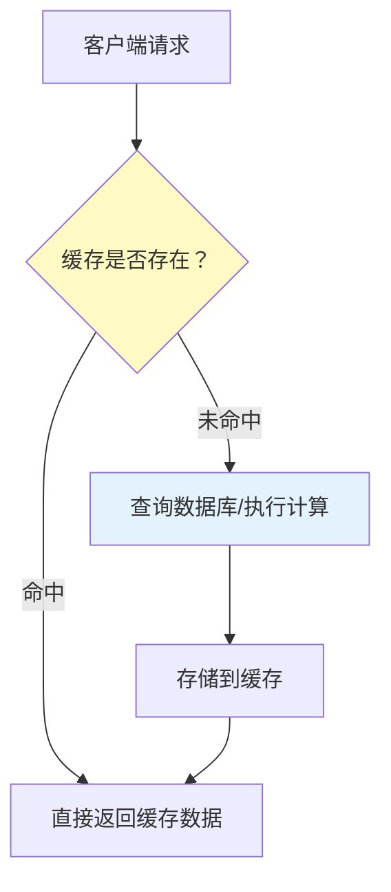
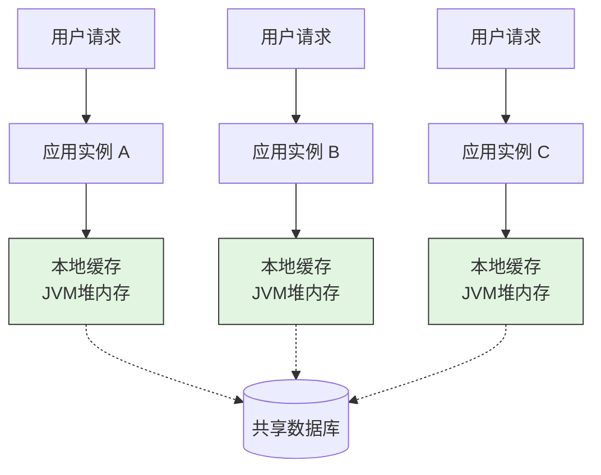
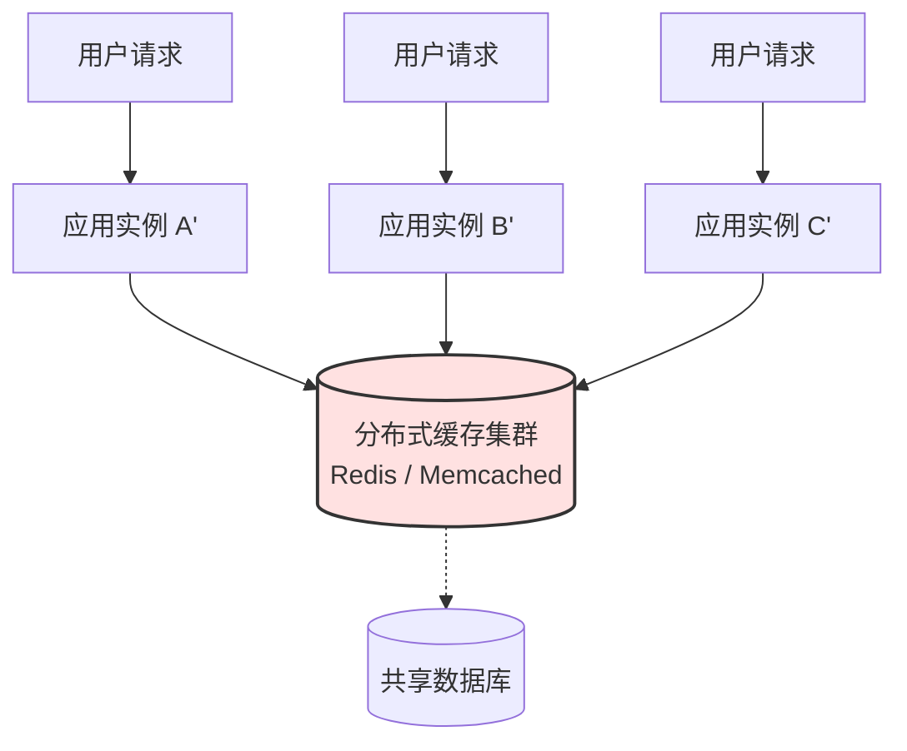
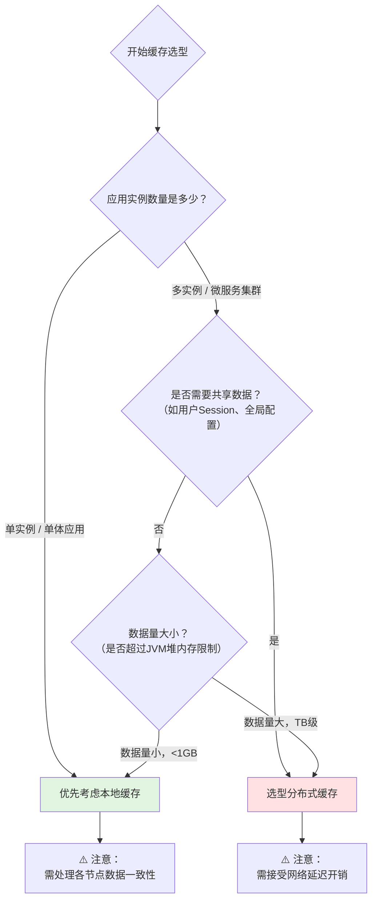
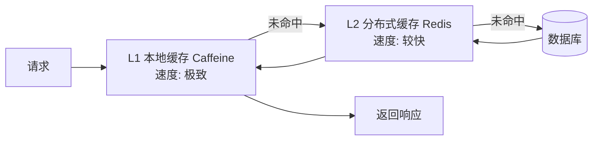
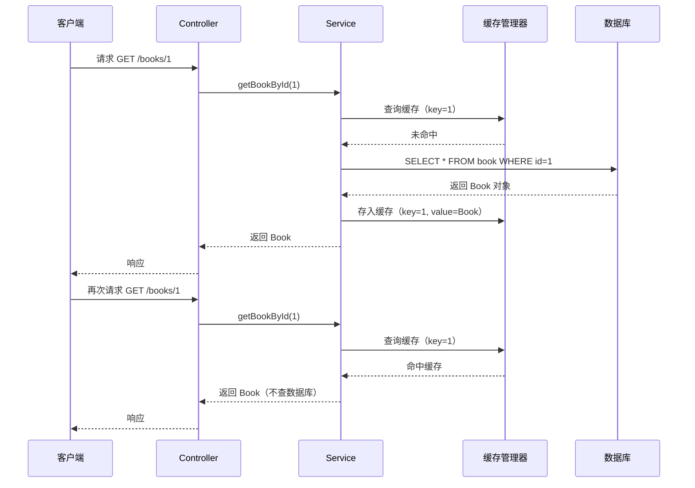

# 缓存概述与 Spring Cache 入门

## 课程目标

- 理解缓存的基本概念和应用场景
- 了解 Spring Cache 抽象的设计思想
- 掌握在 Spring Boot 项目中集成 Spring Cache 的方法
- 掌握 @Cacheable 注解的基本用法
- 能够为图书管理系统添加缓存，验证缓存效果


## 缓存概述

### 什么是缓存

**缓存（Cache）** 是一种临时存储数据的机制，它将经常访问的数据存储在访问速度更快的介质中（如内存），以便后续请求能够更快地获取数据，从而提升系统性能。



### 为什么需要缓存

| 问题                 | 缓存解决方案                             |
| -------------------- | ---------------------------------------- |
| **数据库查询慢**     | 将高频查询结果缓存到内存，减少数据库访问 |
| **接口响应时间长**   | 缓存计算结果，直接返回，降低延迟         |
| **系统吞吐量受限**   | 缓存减少对后端资源的压力，提升并发能力   |
| **热点数据重复读取** | 将热点数据缓存，减少重复计算和 I/O       |

### 缓存的核心要素

一个典型的缓存系统由以下核心要素组成：

| 要素                            | 说明                   | 示例                               |
| ------------------------------- | ---------------------- | ---------------------------------- |
| **缓存键（Key）**               | 唯一标识一份缓存数据   | 用户ID、商品ID、查询条件的组合     |
| **缓存值（Value）**             | 被缓存的具体数据       | 用户对象、商品列表、计算结果       |
| **缓存存储（Store）**           | 存储键值对的容器       | ConcurrentHashMap、Redis、Caffeine |
| **有效期（TTL）**               | 数据在缓存中存活的时间 | 5分钟、1小时、永不过期             |
| **淘汰策略（Eviction Policy）** | 缓存满时清理哪些数据   | LRU、LFU、FIFO、随机淘汰           |

### 缓存的典型应用场景

| 场景                  | 说明                                         |
| --------------------- | -------------------------------------------- |
| **数据字典/配置信息** | 不常变更的系统配置，如国家代码、分类信息     |
| **查询结果**          | 高频执行的 SELECT 查询，如商品详情、用户信息 |
| **计算结果**          | 复杂计算或大数据量统计的结果                 |
| **会话/Token 信息**   | 用户登录状态、权限信息                       |
| **页面缓存**          | 整页或页面片段的 HTML 输出                   |

> [!NOTE]
> 缓存并非“银弹”，不适合缓存频繁变更的数据，也不适合缓存数据量巨大且访问不频繁的内容。需要根据业务场景合理使用。


## 本地缓存 vs 分布式缓存

数据存储的位置：本地缓存和分布式缓存

### 本地缓存部署架构

本次缓存中每个应用实例独立持有缓存副本。


每个应用实例（A/B/C）内部都嵌入了一个独立的缓存区域（JVM堆）。当缓存未命中时，各实例会回源到**同一个共享数据库**进行填充。由于缓存数据相互隔离，更新操作仅影响单个节点，导致各实例间的数据容易产生不一致。

---

### 分布式缓存部署架构

分布式缓存中所有应用实例指向同一份中心化缓存数据。


所有应用实例（A'/B'/C'）通过网络连接至**独立的缓存服务器集群**（如Redis）。这份缓存数据是全局唯一的，任何实例的写入或失效操作，都会立刻被其他所有实例感知，从而保证了集群内的数据强一致性，但代价是需要承受额外的网络传输开销。

| 对比           | 本地缓存                | 分布式缓存                 |
| -------------- | ----------------------- | -------------------------- |
| **存储位置**   | 应用实例本地内存        | 独立的缓存服务器集群       |
| **访问速度**   | 极快（毫秒级）          | 较快（网络延迟）           |
| **数据一致性** | 各实例数据不一致        | 各实例共享同一份数据       |
| **容量限制**   | 受限于 JVM 堆内存       | 可横向扩展                 |
| **典型实现**   | Caffeine、ConcurrentMap | Redis、Memcached           |
| **适用场景**   | 单应用、数据量小        | 多实例、数据量大、需要共享 |

### 缓存技术选型



在实际架构中，两者并非互斥，通常结合使用（**一级本地 + 二级分布式**），以达到**极致速度**与**数据共享**的平衡：



我们会在"分布式和微服务架构"系列课程中介绍分布式缓存，本系列课程重点介绍本地缓存的实现过程，但两者在很多设计方法上是通用的。


## Spring Cache 简介

### 什么是 Spring Cache

**Spring Cache** 是 Spring 框架提供的一套**缓存抽象**，它定义了一套统一的缓存编程模型，让开发者可以使用注解来声明式地管理缓存，而不需要关心底层缓存实现的具体 API。

```mermaid
flowchart TB
    subgraph 应用层
        Service[业务方法]
    end

    subgraph Spring Cache抽象
        Annotation[缓存注解<br/>@Cacheable/@CachePut/@CacheEvict]
        Interceptor[CacheInterceptor<br/>缓存拦截器]
    end

    subgraph 缓存实现层
        CM[CacheManager]
        C1[ConcurrentMap]
        C2[Caffeine]
        C3[Redis]
        C4[其他实现]
    end

    Service --> Annotation
    Annotation --> Interceptor
    Interceptor --> CM
    CM --> C1
    CM --> C2
    CM --> C3
    CM --> C4

    style Service fill:#e3f2fd
    style Annotation fill:#e8f5e9
    style CM fill:#fff3e0
```

### 核心接口

| 接口                   | 说明                                                         |
| ---------------------- | ------------------------------------------------------------ |
| **`Cache`**            | 代表一个具体的缓存实例，提供 `get`、`put`、`evict` 等基本操作 |
| **`CacheManager`**     | 缓存管理器，负责创建和管理多个 `Cache` 实例                  |
| **`CacheInterceptor`** | 缓存拦截器，基于 AOP 拦截方法调用，执行缓存逻辑              |

### Spring Cache 的设计理念

- **声明式缓存**：通过注解（`@Cacheable`、`@CachePut`、`@CacheEvict`）声明缓存规则，业务代码零侵入。
- **缓存抽象**：不绑定具体缓存技术，可以无缝切换缓存实现（如从 ConcurrentMap 到 Redis）。
- **与 Spring 生态无缝集成**：与 Spring Boot 自动配置结合，开箱即用。

> [!NOTE]
> Spring Cache 的底层基于 **AOP** 实现。当方法被调用时，缓存拦截器会检查方法参数，根据注解配置决定是否从缓存获取数据、是否执行方法、是否更新缓存。


## Spring Cache 快速上手

### 1. 添加依赖

在 `pom.xml` 中添加 Spring Cache Starter：

```xml
<dependency>
    <groupId>org.springframework.boot</groupId>
    <artifactId>spring-boot-starter-cache</artifactId>
</dependency>
```

> [!NOTE]
> `spring-boot-starter-cache` 包含了 Spring 缓存抽象和默认的 `ConcurrentMapCacheManager`。不需要额外添加其他依赖即可运行。

启用Spring Cache日志：

```yaml
logging:
  level:
    org.springframework.cache: TRACE
```

### 2. 启用缓存

在主启动类或配置类上添加 `@EnableCaching` 注解：

```java
@SpringBootApplication
@EnableCaching   // 启用 Spring Cache
public class BookManagerApplication {
    public static void main(String[] args) {
        SpringApplication.run(BookManagerApplication.class, args);
    }
}
```

> [!NOTE]
> `@EnableCaching` 会触发 Spring 缓存的自动配置，创建缓存拦截器和缓存管理器。如果不加此注解，缓存注解不会生效。

### 3. 使用 @Cacheable

在需要缓存的方法上添加 `@Cacheable` 注解：

```java
@Service
public class BookService {

    private final BookRepository bookRepository;

    public BookService(BookRepository bookRepository) {
        this.bookRepository = bookRepository;
    }

    // 缓存查询结果
    @Cacheable(value = "books", key = "#id")
    public Book getBookById(Long id) {
        System.out.println("📖 从数据库查询图书: " + id);
        return bookRepository.findById(id);
    }

    // 也可以直接返回 List
    @Cacheable(value = "books", key = "'all'")
    public List<Book> getAllBooks() {
        System.out.println("📖 从数据库查询所有图书");
        return bookRepository.findAll();
    }
}
```

**代码解析：**

| 属性              | 说明                                         |
| ----------------- | -------------------------------------------- |
| `value = "books"` | 指定缓存名称（缓存分区），相当于缓存的前缀   |
| `key = "#id"`     | 缓存键，使用 SpEL 表达式指定方法的参数作为键 |
| `key = "'all'"`   | 固定字符串作为缓存键（注意单引号）           |

> [!NOTE]
> - `#id` 是 SpEL 表达式，表示方法参数 `id` 的值。
> - 当 `getBookById(1)` 第一次被调用时，会执行方法体，并将结果缓存到 `books` 缓存中，键为 `1`。
> - 第二次调用 `getBookById(1)` 时，直接返回缓存结果，方法体不再执行。

### 4. 验证缓存效果

编写测试代码或直接启动应用，调用接口观察控制台输出：

```java
@RestController
@RequestMapping("/api/books")
public class BookController {
    private final BookService bookService;

    public BookController(BookService bookService) {
        this.bookService = bookService;
    }

    @GetMapping("/{id}")
    public Result<Book> getBook(@PathVariable Long id) {
        return Result.success(bookService.getBookById(id));
    }
}
```

**第一次请求 `GET /api/books/1`：**

控制台输出：
```
📖 从数据库查询图书: 1
```
（同时缓存了结果）

**第二次请求 `GET /api/books/1`：**

控制台不再输出查询日志，直接返回缓存数据。

> [!CAUTION]
> 默认使用 `ConcurrentMapCacheManager`，缓存存储在当前 JVM 内存中，应用重启后缓存失效。仅适用于开发测试，生产环境建议使用 Redis 或 Caffeine。


## 缓存工作流程




## 小结

本节课我们学习了：

1. **缓存基本概念**：缓存的作用、应用场景、本地 vs 分布式。
2. **Spring Cache 抽象**：核心接口（Cache、CacheManager）、设计理念（声明式、解耦）。
3. **快速上手**：
   - 添加 `spring-boot-starter-cache` 依赖
   - 使用 `@EnableCaching` 启用缓存
   - 使用 `@Cacheable` 注解缓存方法结果
4. **实战应用**：为图书管理系统的查询方法添加缓存，验证缓存命中效果。


## 作业

### 作业一：代码阅读——@Cacheable 行为分析

阅读以下代码，回答问题。

```java
@Cacheable(value = "users", key = "#id")
public User getUserById(Long id) {
    System.out.println("查询用户: " + id);
    return userRepository.findById(id);
}

@Cacheable(value = "users", key = "'all'")
public List<User> getAllUsers() {
    System.out.println("查询所有用户");
    return userRepository.findAll();
}
```

**问题：**
1. 第一次调用 `getUserById(1)` 会执行方法吗？会缓存吗？
2. 第二次调用 `getUserById(1)` 会执行方法吗？会从哪里返回数据？
3. `getUserById(2)` 和 `getUserById(1)` 使用的缓存键是否相同？
4. 缓存名称 `users` 的作用是什么？

---

### 作业二：为图书管理系统添加缓存

在图书管理系统中，完成以下任务：

1. 添加 `spring-boot-starter-cache` 依赖。
2. 在主启动类上添加 `@EnableCaching`。
3. 在 `BookService` 中为 `getBookById` 和 `getAllBooks` 添加 `@Cacheable`。
4. 启动应用，分别访问 `/api/books/1` 和 `/api/books` 多次，观察控制台输出，验证缓存生效。

---

### 作业三：缓存键的 SpEL 实验

在 `BookService` 中添加一个新方法 `getBooksByAuthor(String author)`，使用 `@Cacheable` 缓存结果，键为作者名称。

1. 定义方法并添加 `@Cacheable(value = "books", key = "#author")`。
2. 在 `BookController` 中添加 `/api/books/author?name=xxx` 接口。
3. 测试：先用 `author=Craig` 查询，再用 `author=Craig` 查询第二次，观察是否命中缓存；再用 `author=Martin` 查询，观察是否执行新查询。

