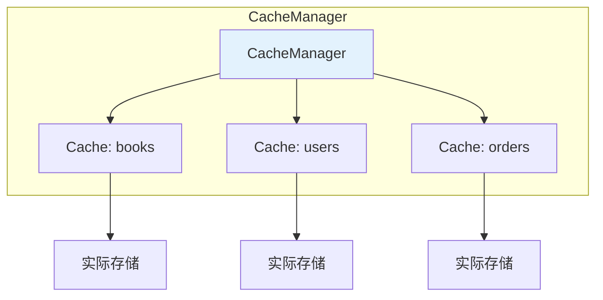
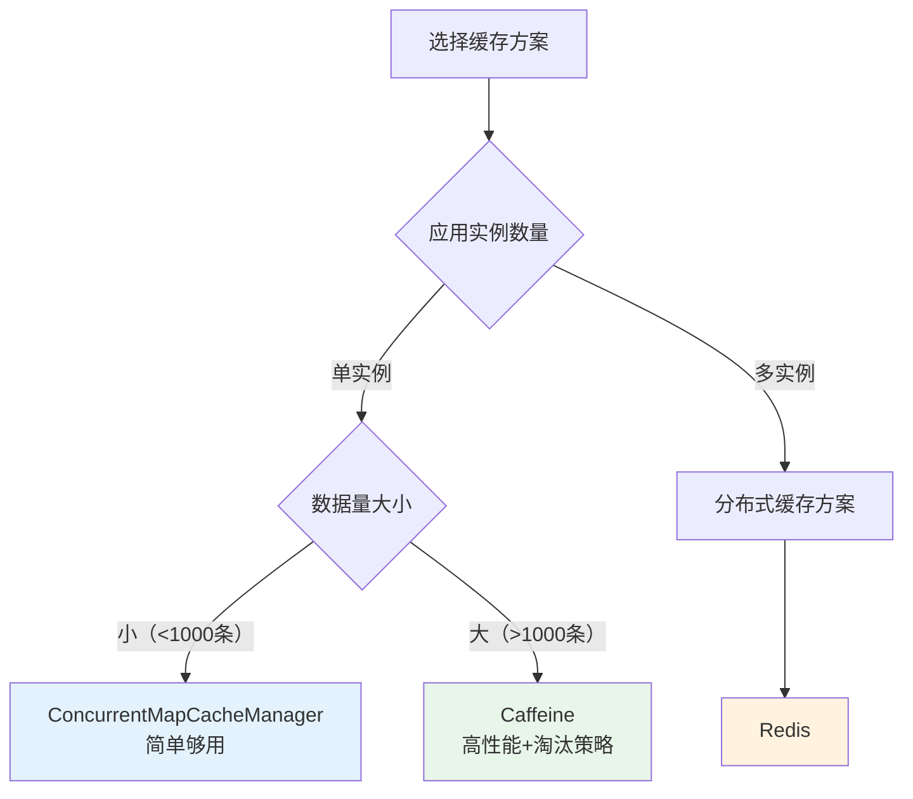

# 缓存管理器与缓存存储配置

## 课程目标

- 理解 CacheManager 在 Spring Cache 中的核心作用
- 掌握 Spring Boot 中默认的 ConcurrentMapCacheManager 配置
- 掌握 Caffeine 本地缓存的集成与配置（缓存大小、过期时间、淘汰策略）
- 能够根据业务场景选择合适的缓存存储方案


## 回顾与导入

在前两课中，我们学习了 Spring Cache 的注解（@Cacheable、@CachePut、@CacheEvict），并基于默认的 `ConcurrentMapCacheManager` 实现了缓存功能。但默认的缓存管理器有以下局限：

| 局限           | 说明                          |
| -------------- | ----------------------------- |
| **数据持久化** | 缓存在应用重启后丢失          |
| **内存管理**   | 无容量限制，可能耗尽 JVM 内存 |
| **过期策略**   | 不支持过期时间（TTL）         |
| **淘汰策略**   | 无淘汰机制                    |
| **多实例共享** | 无法跨应用实例共享缓存数据    |

在实际生产环境中，我们需要更专业的缓存实现。本节课将深入讲解 Spring Cache 的缓存管理器体系，并配置 Caffeine 实现高性能本地缓存。


## CacheManager 与缓存配置体系

###  CacheManager 回顾

`CacheManager` 是 Spring Cache 抽象中的核心接口，负责管理多个 `Cache` 实例。每个 `Cache` 实例对应一个缓存名称（如 `books`）。



### Spring Boot 自动配置的 CacheManager

Spring Boot 根据 classpath 中的依赖自动选择合适的 `CacheManager`：

| 依赖                             | 自动配置的 CacheManager     |
| -------------------------------- | --------------------------- |
| 无额外依赖                       | `ConcurrentMapCacheManager` |
| `caffeine`                       | `CaffeineCacheManager`      |
| `spring-boot-starter-data-redis` | `RedisCacheManager`         |
| `ehcache`                        | `EhCacheCacheManager`       |
| `jcache`（JSR-107）              | `JCacheCacheManager`        |

> [!NOTE]
> 如果同时存在多个缓存实现，Spring Boot 会按优先级选择。可以通过 `spring.cache.type` 强制指定缓存类型。

### 缓存管理器配置方式

Spring Boot 提供了两种配置方式：

1. **配置文件（application.yml）**：适用于简单配置
2. **Java 配置类**：适用于精细控制


## ConcurrentMapCacheManager（默认）

### 简介

`ConcurrentMapCacheManager` 是 Spring Boot 默认的缓存管理器，基于 `ConcurrentHashMap` 实现。它不需要任何额外依赖，开箱即用，适合开发和测试环境。

### 自动配置

Spring Boot 在 classpath 中没有其他缓存实现时，自动配置 `ConcurrentMapCacheManager`。

### 配置示例（可选）

虽然默认即可使用，但可以通过配置文件自定义缓存名称：

```yaml
spring:
  cache:
    type: simple  # 或 concurrent-map
    cache-names:
      - books
      - orders
```

```java
@Configuration
public class CacheConfig {
    @Bean
    public CacheManager cacheManager() {
        ConcurrentMapCacheManager cacheManager = new ConcurrentMapCacheManager();
        // 设置初始缓存名称
        cacheManager.setCacheNames(Arrays.asList("books", "orders"));
        // 允许缓存 null 值（默认允许）
        cacheManager.setAllowNullValues(true);
        return cacheManager;
    }
}
```

> [!NOTE]
> `ConcurrentMapCacheManager` 不支持过期时间（TTL）和淘汰策略。如需这些特性，请使用 Caffeine 或 Redis。


## Caffeine 本地缓存配置

### 什么是 Caffeine

**Caffeine** 是 Java 8 编写的高性能本地缓存库，被认为是 Guava Cache 的继任者。它提供了丰富的缓存策略：

| 特性         | 说明                               |
| ------------ | ---------------------------------- |
| **容量限制** | 设置最大缓存条目数                 |
| **过期策略** | 基于时间（写入后过期、访问后过期） |
| **淘汰策略** | 基于大小、权重、时间               |
| **统计信息** | 命中率、加载时间、回收次数         |
| **异步加载** | 支持异步加载缓存数据               |

### 配置文件方式（简单）

```yaml
spring:
  cache:
    type: caffeine
    caffeine:
      spec: maximumSize=100,expireAfterWrite=10m
    cache-names:
      - books
      - orders
```

**Caffeine Spec 语法：**

| 配置项              | 说明           | 示例                   |
| ------------------- | -------------- | ---------------------- |
| `maximumSize`       | 最大缓存条目数 | `maximumSize=100`      |
| `expireAfterWrite`  | 写入后过期时间 | `expireAfterWrite=10m` |
| `expireAfterAccess` | 访问后过期时间 | `expireAfterAccess=5m` |
| `recordStats`       | 开启统计       | `recordStats`          |

### Java 配置方式（精细控制）

```java
@Configuration
@EnableCaching
public class CacheConfig {
    @Bean
    public CacheManager cacheManager() {
        CaffeineCacheManager cacheManager = new CaffeineCacheManager();
        
        // 设置缓存名称
        cacheManager.setCacheNames(Set.of("books", "orders"));
        
        // 构建 Caffeine 配置
        cacheManager.setCaffeine(Caffeine.newBuilder()
                // 最大缓存条目数
                .maximumSize(1000)
                // 写入后过期时间
                .expireAfterWrite(10, TimeUnit.MINUTES)
                // 访问后过期时间（单独使用或与写入过期组合）
                // .expireAfterAccess(5, TimeUnit.MINUTES)
                // 开启统计
                .recordStats()
        );
        
        // 允许缓存 null 值
        cacheManager.setAllowNullValues(false);
        
        return cacheManager;
    }
}
```


## 多缓存管理器配置

在某些场景下，我们希望同时使用本地缓存和分布式缓存。例如：
- 热点数据使用本地缓存（Caffeine）减少网络开销
- 共享数据使用 Redis 缓存保证一致性

### 配置多个 CacheManager

```java
@Configuration
public class CacheConfig {
  
    @Bean
    @Primary  // 默认使用 ConcurrentMap
    public CacheManager concurrentMapCacheManager() {
				// ConcurrentMap 缓存管理器配置...
    }
  
    @Bean
    public CacheManager caffeineCacheManager() {
        // Caffeine 缓存管理器配置...
    }
}
```

### 在 @Cacheable 中指定 CacheManager

```java
@Service
public class BookService {
    
    // 使用默认的缓存管理器（Redis）
    @Cacheable(value = "books", key = "#id")
    public Book getBookById(Long id) { ... }

    // 使用 Caffeine 缓存管理器（通过 cacheManager 属性指定）
    @Cacheable(value = "books", key = "#id", cacheManager = "caffeineCacheManager")
    public Book getBookByIdLocal(Long id) { ... }
}
```

> [!NOTE]
> 如果只有一个 `CacheManager`，无需指定 `cacheManager` 属性。如果有多个，需要使用 `@Primary` 或通过属性明确指定。

### 使用 CompositeCacheManager 组合多个缓存

Spring 提供了 `CompositeCacheManager`，可以按顺序查询多个缓存管理器：

```java
@Bean
@Primary
public CacheManager compositeCacheManager(
        CacheManager caffeineCacheManager,
        CacheManager redisCacheManager) {
    
    CompositeCacheManager composite = new CompositeCacheManager();
    composite.setCacheManagers(Arrays.asList(
            caffeineCacheManager,  // 先查询本地缓存
            redisCacheManager      // 本地缓存未命中再查 Redis
    ));
    composite.setFallbackToNoOpCache(true);  // 如果所有缓存都没有，允许无操作
    return composite;
}
```

这样，查询缓存时会先查 Caffeine（本地），未命中再查 Redis（分布式），最后才执行方法体。


### 缓存管理器选择指南

| 场景                       | 推荐缓存                     | 理由                                   |
| -------------------------- | ---------------------------- | -------------------------------------- |
| 开发测试                   | `ConcurrentMapCacheManager`  | 简单、无需外部依赖                     |
| 单实例应用、数据量小       | Caffeine                     | 高性能、支持过期和淘汰                 |
| 多实例部署、需共享         | Redis                        | 分布式共享、持久化                     |
| 高并发热点数据             | 多级缓存（Caffeine + Redis） | 本地缓存减少网络开销，Redis 保证一致性 |
| 读多写少、可接受短暂不一致 | Caffeine（配置短 TTL）       | 性能最优                               |
| 对一致性要求高             | Redis                        | 数据集中管理                           |

缓存选择决策树:




## 实战：为图书管理系统配置 Caffeine 缓存

### 目标

为图书管理系统配置 Caffeine 本地缓存，替代默认的 ConcurrentMap 实现。

### 实现

**步骤一：添加依赖**

```xml
<dependency>
    <groupId>org.springframework.boot</groupId>
    <artifactId>spring-boot-starter-cache</artifactId>
</dependency>
<dependency>
    <groupId>com.github.ben-manes.caffeine</groupId>
    <artifactId>caffeine</artifactId>
</dependency>
```

**步骤二：配置类**

```java
@Configuration
@EnableCaching
public class CacheConfig {

    @Bean
    public CacheManager cacheManager() {
        CaffeineCacheManager cacheManager = new CaffeineCacheManager();
        cacheManager.setCacheNames(Set.of("books", "orders"));
        cacheManager.setCaffeine(Caffeine.newBuilder()
                .maximumSize(500)                        // 最大 500 条
                .expireAfterWrite(10, TimeUnit.MINUTES) // 写入后 10 分钟过期
                .expireAfterAccess(10, TimeUnit.MINUTES) // 访问后 10 分钟过期
                .recordStats()                           // 开启统计
        );
        cacheManager.setAllowNullValues(false);
        return cacheManager;
    }
}
```

**步骤三：Service 层无需改动**

缓存注解与缓存管理器解耦，切换缓存实现不影响业务代码。

```java
@Service
public class BookService {
    @Cacheable(value = "books", key = "#id")
    public Book getBookById(Long id) { ... }
}
```

**步骤四：验证缓存效果**

启动应用，调用接口，观察缓存命中情况：

```java
public Map<String, Object> getCacheStats(String cacheName) {
        Map<String, Object> statsMap = new HashMap<>();
        org.springframework.cache.Cache springCache = cacheManager.getCache(cacheName);

        CaffeineCache caffeineCache = (CaffeineCache) springCache;
        com.github.benmanes.caffeine.cache.Cache<Object, Object> nativeCache = caffeineCache.getNativeCache();

        // 获取统计对象（如果未开启 recordStats，所有值均为 0）
        CacheStats stats = nativeCache.stats();
        statsMap.put("hitCount", stats.hitCount());
        statsMap.put("missCount", stats.missCount());
        statsMap.put("hitRate", stats.hitRate());
        statsMap.put("evictionCount", stats.evictionCount());
        statsMap.put("loadSuccessCount", stats.loadSuccessCount());
        statsMap.put("averageLoadPenalty", stats.averageLoadPenalty());
        statsMap.put("currentSize", nativeCache.estimatedSize()); // 近似大小

        return statsMap;
}
```


## 注意事项

### 1. 缓存管理器自动配置的优先级

当同时存在多个缓存实现时，Spring Boot 的自动配置按以下优先级选择：

1. 通过 `spring.cache.type` 强制指定
2. JCache (JSR-107) > EhCache > Redis > Caffeine > Simple

### 2. Caffeine 配置的最佳实践

- **合理设置最大容量**：根据应用内存和可用资源设置，避免 OOM。
- **设置适当的过期时间**：根据数据更新频率设置 TTL，平衡性能与一致性。
- **开启统计监控**：生产环境建议开启 `recordStats()`，便于监控缓存效果。

### 3. Caffeine 淘汰策略说明

当缓存达到最大容量时，Caffeine 使用 **W-TinyLFU** 淘汰策略，它是 LRU 和 LFU 的优化结合，具有较高的命中率。

### 4. 本地缓存的一致性风险

Caffeine 是本地缓存，在多实例部署时，各实例的缓存数据可能不一致。如果业务对一致性要求较高，建议使用 Redis 等分布式缓存方案。


## 小结

本节课我们学习了：

1. **CacheManager 体系**：Spring 缓存抽象的核心，管理多个 Cache 实例。
2. **ConcurrentMapCacheManager**：默认实现，基于 HashMap，适合开发和测试。
3. **Caffeine 本地缓存配置**：
   - 添加依赖、配置 CaffeineCacheManager
   - 设置最大容量、过期时间、淘汰策略
   - 支持统计监控（命中率、命中次数等）
4. **缓存选择指南**：根据应用场景选择合适的缓存实现。


## 作业

### 作业一：代码阅读——缓存管理器配置分析

阅读以下配置代码，回答问题。

```java
@Bean
public CacheManager cacheManager() {
    CaffeineCacheManager cacheManager = new CaffeineCacheManager();
    cacheManager.setCacheNames(Set.of("books", "users"));
    cacheManager.setCaffeine(Caffeine.newBuilder()
            .maximumSize(1000)
            .expireAfterWrite(5, TimeUnit.MINUTES)
            .recordStats()
    );
    cacheManager.setAllowNullValues(false);
    return cacheManager;
}
```

**问题：**

1. 该配置中最大缓存条目数是多少？写入后过期时间是多少？
2. `recordStats()` 的作用是什么？
3. 如果缓存 `null` 值，会发生什么？为什么？
4. 如果希望不同缓存（如 `books` 和 `users`）使用不同的过期时间，应该如何修改配置？

---

### 作业二：配置 Caffeine 缓存管理器

在图书管理系统中，完成以下任务：

1. 添加 Caffeine 依赖。
2. 创建 `CacheConfig` 配置类，配置 `CaffeineCacheManager`：
   - 缓存名称：`books`、`users`
   - 最大容量：500 条
   - 写入后过期时间：10 分钟
   - 开启统计
3. 在 `BookService` 的 `getBookById` 上使用 `@Cacheable`，验证 Caffeine 缓存生效。
4. 编写一个监控接口，输出缓存命中率、命中次数和未命中次数。
