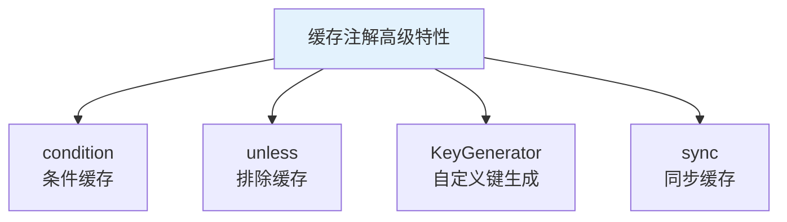
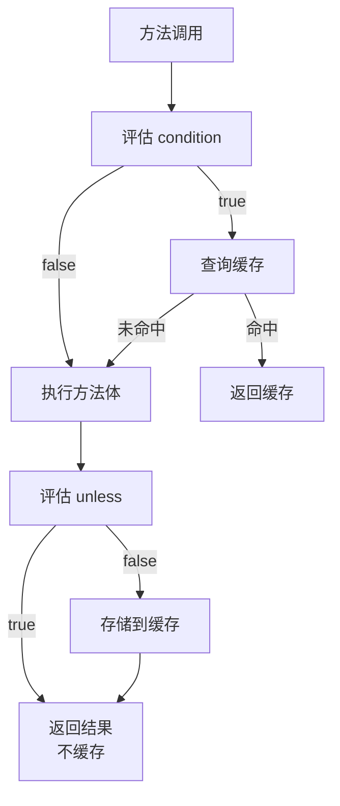
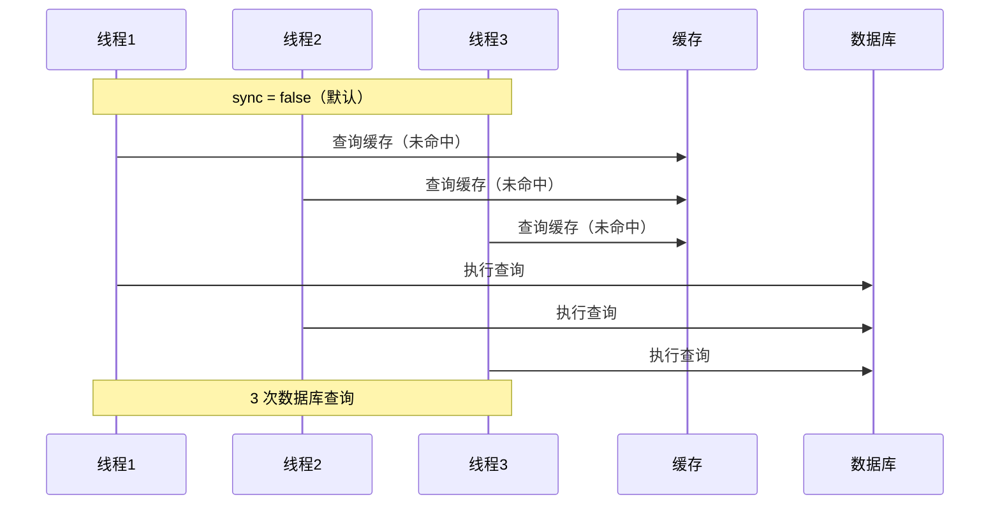
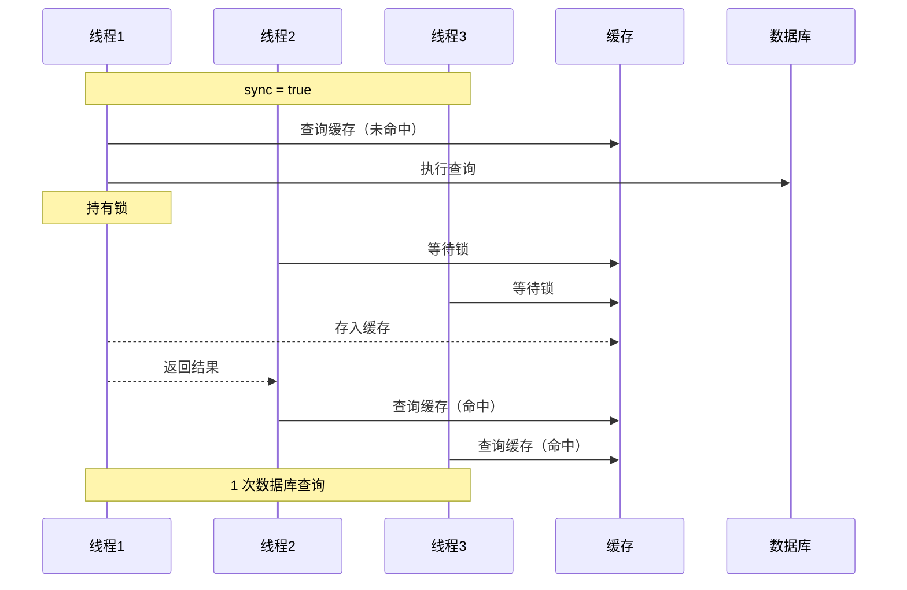

# 缓存注解高级特性

## 课程目标

- 掌握 condition 属性实现条件缓存
- 掌握 unless 属性排除特定结果
- 掌握自定义 KeyGenerator 的实现和配置
- 理解 sync 属性防止缓存击穿的原理
- 能够为图书管理系统应用高级缓存特性


## 回顾与导入

在前面内容中，我们学习了 Spring Cache 的三大核心注解（@Cacheable、@CachePut、@CacheEvict）以及缓存管理器配置。但在实际项目中，我们往往需要更精细的控制：

| 场景                            | 需要的特性            |
| ------------------------------- | --------------------- |
| 只缓存价格大于 100 的商品       | 条件缓存（condition） |
| 不缓存空结果或特定值            | 排除缓存（unless）    |
| 不同参数组合使用不同缓存键      | SpEL 表达式           |
| 统一的缓存键生成策略            | 自定义 KeyGenerator   |
| 防止热点 Key 失效时大量请求穿透 | sync 属性             |

本节课将深入讲解这些高级特性，帮助你应对复杂的缓存场景。




## 条件缓存（condition）

### 什么是 condition

`condition` 属性用于**在满足特定条件时才执行缓存操作**。它接受一个 SpEL 表达式，只有表达式结果为 `true` 时，才会进行缓存的查询和存储。

### 执行时机

`condition` 在**方法执行前**评估，因此：
- 可以访问方法参数（如 `#id`、`#book`）
- **不能访问** `#result`（返回值尚未产生）

### 基本用法

```java
// 只有 ID 大于 0 时才缓存
@Cacheable(value = "books", key = "#id", condition = "#id > 0")
public Book getBookById(Long id) {
    return bookRepository.findById(id);
}

// 只有价格大于 50 的图书才缓存
@Cacheable(value = "books", key = "#book.id", condition = "#book.price > 50")
public Book saveBook(Book book) {
    return bookRepository.save(book);
}

// 多个条件组合（支持 && 和 ||）
@Cacheable(value = "books", key = "#id", 
           condition = "#id != null && #id > 0 && #id < 1000")
public Book getBookById(Long id) {
    return bookRepository.findById(id);
}
```

### 实际场景

**场景一：只缓存热门商品**

```java
@Cacheable(value = "books", key = "#id", condition = "#id % 100 == 0")
public Book getBookById(Long id) {
    // 只有 ID 是 100 的倍数的图书才被缓存
    return bookRepository.findById(id);
}
```

**场景二：只缓存搜索词长度足够的结果**

```java
@Cacheable(value = "searchResults", key = "#keyword", condition = "#keyword.length() > 2")
public List<Book> searchBooks(String keyword) {
    // 只有关键词长度大于 2 时才缓存
    return bookRepository.search(keyword);
}
```

**场景三：根据配置动态控制缓存**

```java
@Component
public class AppCacheConfig {
    @Value("${app.cache.enabled:true}")
    private boolean enabled;

    public boolean isCacheEnabled() {
        return enabled;
    }
}

@Cacheable(value = "books", key = "#id", 
           condition = "@appCacheConfig.isCacheEnabled()")  // 从配置读取
public Book getBookById(Long id) {
    return bookRepository.findById(id);
}
```

> [!NOTE]
> `condition` 为 `false` 时，不会查询缓存，也不会存储结果，方法总是执行。相当于完全跳过缓存逻辑。


## 排除缓存（unless）

### 什么是 unless

`unless` 属性用于**在满足特定条件时排除缓存**，即不缓存结果。与 `condition` 的区别在于，`unless` 在**方法执行后**评估，因此可以访问 `#result`（方法返回值）。

### 执行时机

| 属性        | 评估时机   | 可访问 #result |
| ----------- | ---------- | -------------- |
| `condition` | 方法执行前 | ❌ 不可访问     |
| `unless`    | 方法执行后 | ✅ 可访问       |

### 基本用法

```java
// 不缓存空结果
@Cacheable(value = "books", key = "#id", unless = "#result == null")
public Book getBookById(Long id) {
    return bookRepository.findById(id);
}

// 不缓存价格低于 10 的图书
@Cacheable(value = "books", key = "#book.id", unless = "#result.price < 10")
public Book saveBook(Book book) {
    return bookRepository.save(book);
}

// 不缓存空列表
@Cacheable(value = "books", key = "'all'", unless = "#result.isEmpty()")
public List<Book> getAllBooks() {
    return bookRepository.findAll();
}

// 不缓存特定状态的数据
@Cacheable(value = "orders", key = "#orderId", 
           unless = "#result.status == 'CANCELLED'")
public Order getOrder(Long orderId) {
    return orderRepository.findById(orderId);
}
```

### condition vs unless 对比

| 对比           | condition            | unless           |
| -------------- | -------------------- | ---------------- |
| 评估时机       | 方法执行前           | 方法执行后       |
| 可访问 #result | ❌                    | ✅                |
| 作用           | 控制是否进入缓存逻辑 | 控制是否存储结果 |
| 表达式为 true  | 执行缓存操作         | 不存储结果       |



### 实际场景

**场景一：不缓存空查询结果**

```java
@Cacheable(value = "books", key = "#keyword", unless = "#result == null || #result.isEmpty()")
public List<Book> searchBooks(String keyword) {
    return bookRepository.search(keyword);
}
```

**场景二：不缓存默认值**

```java
@Cacheable(value = "users", key = "#id", unless = "#result == null || #result.id == -1")
public User getUser(Long id) {
    User user = userRepository.findById(id);
    return user != null ? user : new User(-1L, "Unknown");
}
```

**场景三：不缓存价格过低的商品（对业务意义不大）**

```java
@Cacheable(value = "products", key = "#id", 
           condition = "#id > 0", 
           unless = "#result.price < 1 || #result.stock == 0")
public Product getProduct(Long id) {
    return productRepository.findById(id);
}
```

> [!NOTE]
> `condition` 和 `unless` 可以同时使用。此时，`condition` 控制是否进入缓存逻辑，`unless` 控制是否存储结果。两者都为 `true` 时，方法体执行且结果不缓存。


## 自定义 KeyGenerator

### 为什么需要自定义 KeyGenerator

- 多个方法需要统一的缓存键生成策略
- 默认的键生成方式（基于所有参数）可能不够灵活
- 避免重复编写相同的 SpEL 表达式

### 实现自定义 KeyGenerator

```java
/**
 * 自定义缓存键生成器
 * 生成规则：类名 + 方法名 + 参数列表
 */
@Component("customKeyGenerator")
public class CustomKeyGenerator implements KeyGenerator {

    @Override
    public Object generate(Object target, Method method, Object... params) {
        StringBuilder key = new StringBuilder();
        
        // 1. 添加类名
        key.append(target.getClass().getSimpleName());
        key.append(":");
        
        // 2. 添加方法名
        key.append(method.getName());
        key.append(":");
        
        // 3. 添加参数
        if (params.length == 0) {
            key.append("void");
        } else {
            key.append(Arrays.toString(params));
        }
        
        return key.toString();
    }
}
```

### 使用 KeyGenerator

**方式一：在 @Cacheable 中指定**

```java
@Service
public class BookService {
    
    @Cacheable(value = "books", keyGenerator = "customKeyGenerator")
    public Book getBookById(Long id) {
        return bookRepository.findById(id);
    }
    
    @Cacheable(value = "books", keyGenerator = "customKeyGenerator")
    public List<Book> getAllBooks() {
        return bookRepository.findAll();
    }
}
```

**方式二：配置全局默认 KeyGenerator**

```java
@Configuration
@EnableCaching
public class CacheConfig {
    
    @Bean
    public KeyGenerator keyGenerator() {
        return (target, method, params) -> {
            StringBuilder key = new StringBuilder();
            ...
            return key.toString();
        };
    }
}
```

### KeyGenerator vs key 属性

| 对比         | key 属性               | KeyGenerator         |
| ------------ | ---------------------- | -------------------- |
| **粒度**     | 每个方法单独配置       | 全局或一组方法共享   |
| **灵活性**   | 高，可针对每个方法定制 | 中，统一的生成规则   |
| **复用性**   | 低，需要重复编写       | 高，一次定义多处使用 |
| **使用场景** | 不同方法有不同键需求   | 所有方法使用统一规则 |


## sync 属性（同步缓存）

### 什么是 sync

`sync` 属性用于**防止缓存击穿**。当多个线程同时请求一个未缓存的键时，`sync = true` 会使用锁机制，确保只有一个线程执行方法，其他线程等待结果。

### 问题场景

场景1：sync = false（默认）



场景2：sync = true



### 基本用法

```java
// 启用同步缓存
@Cacheable(value = "books", key = "#id", sync = true)
public Book getBookById(Long id) {
    return bookRepository.findById(id);
}
```

### sync 属性详解

| 属性值                 | 行为                                                         |
| ---------------------- | ------------------------------------------------------------ |
| `sync = false`（默认） | 多个线程同时请求未缓存的键时，各自执行方法体（可能导致缓存击穿） |
| `sync = true`          | 多个线程同时请求未缓存的键时，仅一个线程执行方法体，其他线程等待缓存结果 |

### sync 与 unless 的冲突

> [!CAUTION]
> `sync = true` 与 `unless` 属性**不能同时使用**，因为 `unless` 需要 `#result`（方法返回值），而 `sync = true` 在方法执行前就已加锁，返回值尚未产生。

```java
// ❌ 错误：sync 与 unless 不能同时使用
@Cacheable(value = "books", key = "#id", sync = true, unless = "#result == null")
public Book getBookById(Long id) { ... }

// ✅ 正确：使用 condition 替代（如果需要条件控制）
@Cacheable(value = "books", key = "#id", sync = true, condition = "#id > 0")
public Book getBookById(Long id) { ... }
```

### sync 适用场景

| 场景                           | 是否使用 sync |
| ------------------------------ | ------------- |
| 查询热点数据（如热门商品详情） | ✅ 强烈推荐    |
| 查询耗时较长的方法             | ✅ 推荐        |
| 查询简单且并发量低的方法       | ⚠️ 可选        |
| 需要排除缓存（unless）的场景   | ❌ 不能使用    |


## 实战：为图书管理系统应用高级特性

### 完整 Service 实现

```java
@Service
public class BookService {

    private final BookRepository bookRepository;

    public BookService(BookRepository bookRepository) {
        this.bookRepository = bookRepository;
    }

    // 1. 基本缓存 + sync 防击穿
    @Cacheable(value = "books", key = "#id", sync = true)
    public Book getBookById(Long id) {
        System.out.println("📖 从数据库查询图书: " + id);
        return bookRepository.findById(id);
    }

    // 2. 条件缓存：只有价格 > 50 的图书才缓存 + 排除空结果
    @Cacheable(value = "books", key = "#book.id", 
               condition = "#book.price != null && #book.price > 50",
               unless = "#result == null")
    public Book saveBook(Book book) {
        System.out.println("📖 保存图书: " + book.getTitle());
        return bookRepository.save(book);
    }

    // 3. 排除空结果 + 空列表
    @Cacheable(value = "books", key = "'all'", 
               unless = "#result == null || #result.isEmpty()")
    public List<Book> getAllBooks() {
        System.out.println("📖 从数据库查询所有图书");
        return bookRepository.findAll();
    }

    // 4. 使用自定义 KeyGenerator
    @Cacheable(value = "books", keyGenerator = "customKeyGenerator",
               unless = "#result == null")
    public Book getBookWithCustomKey(Long id) {
        System.out.println("📖 使用自定义键查询: " + id);
        return bookRepository.findById(id);
    }

    // 5. 更新缓存（带条件）
    @CachePut(value = "books", key = "#book.id",
              unless = "#book.price == null || #book.price < 10")
    public Book updateBook(Book book) {
        System.out.println("📖 更新图书: " + book.getId());
        return bookRepository.update(book);
    }

    // 6. 清除缓存（带条件）
    @Caching(
        evict = {
            @CacheEvict(value = "books", key = "#id"),
            @CacheEvict(value = "books", key = "'all'")
        }
    )
    public void deleteBook(Long id) {
        System.out.println("📖 删除图书: " + id);
        bookRepository.deleteById(id);
    }
}
```


## 注意事项

### 1. condition 与 unless 的优先级

`condition` 在方法执行前评估，`unless` 在方法执行后评估。当两者都配置时：
- `condition = true`：进入缓存逻辑，方法执行后根据 `unless` 决定是否缓存
- `condition = false`：跳过缓存逻辑，方法执行，不缓存（`unless` 不会被评估）

### 2. SpEL 表达式的限制

- `condition` 中不能使用 `#result`
- `unless` 中可以使用 `#result`，但不能使用 `#result` 修改缓存键
- 在 `@Cacheable` 的 `key` 中，`#result` 不可用（因为查询缓存时方法尚未执行）

### 3. sync 与 unless 的冲突

`sync = true` 与 `unless` 不兼容，如果同时使用会抛出异常。需要用 `condition` 替代。

### 4. 自定义 KeyGenerator 的线程安全

`KeyGenerator` 实例是单例的，在多线程环境下共享，必须保证线程安全（无状态设计）。


## 小结

本节课我们学习了：

1. **条件缓存（condition）**：
   - 在方法执行前评估，控制是否进入缓存逻辑
   - 不能使用 `#result`
2. **排除缓存（unless）**：
   - 在方法执行后评估，控制是否存储结果
   - 可以使用 `#result`
4. **自定义 KeyGenerator**：
   - 实现 KeyGenerator 接口
   - 全局配置或局部使用
5. **同步缓存（sync）**：
   - 防止缓存击穿
   - 与 `unless` 不兼容


## 作业

### 作业一：代码阅读——缓存条件分析

阅读以下代码，回答问题。

```java
@Cacheable(value = "products", key = "#id", 
           condition = "#id > 0 && #id < 1000",
           unless = "#result == null || #result.price < 50")
public Product getProduct(Long id) {
    return productRepository.findById(id);
}
```

**问题：**
1. 当 `id = -1` 时，方法是否被调用？是否会缓存结果？
2. 当 `id = 500`，查询结果为 `Product`（price=30），是否会缓存结果？为什么？
3. 当 `id = 500`，查询结果为 `null`，是否会缓存结果？为什么？
4. 如果 `id = 1000`，方法是否被调用？是否会缓存结果？

---

### 作业二：自定义 KeyGenerator 实现

1. 实现一个自定义 `KeyGenerator`，生成规则为：
   - 格式：`类名.方法名(参数1,参数2,...)`
   - 示例：`BookService.getBookById(1)`
2. 在 `BookService` 中配置使用该 KeyGenerator。
3. 编写测试，验证不同方法的缓存键是否按照预期生成。

---

### 作业三：条件缓存与排除缓存实战

在图书管理系统中，完成以下任务：

1. 添加 `getBooksByPriceRange(Double min, Double max)` 方法：
   - 使用条件缓存：仅在 `min > 0` 和 `max > 0` 时缓存
   - 缓存键使用 `min` 和 `max` 的组合
   - 排除空列表
2. 添加 `getBooksByCategory(String category)` 方法：
   - 缓存键使用分类名称
   - 排除空列表
   - 当分类名称为 "all" 时，不缓存（使用 condition）
3. 编写测试，验证条件缓存和排除缓存是否生效。
