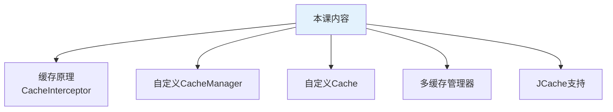
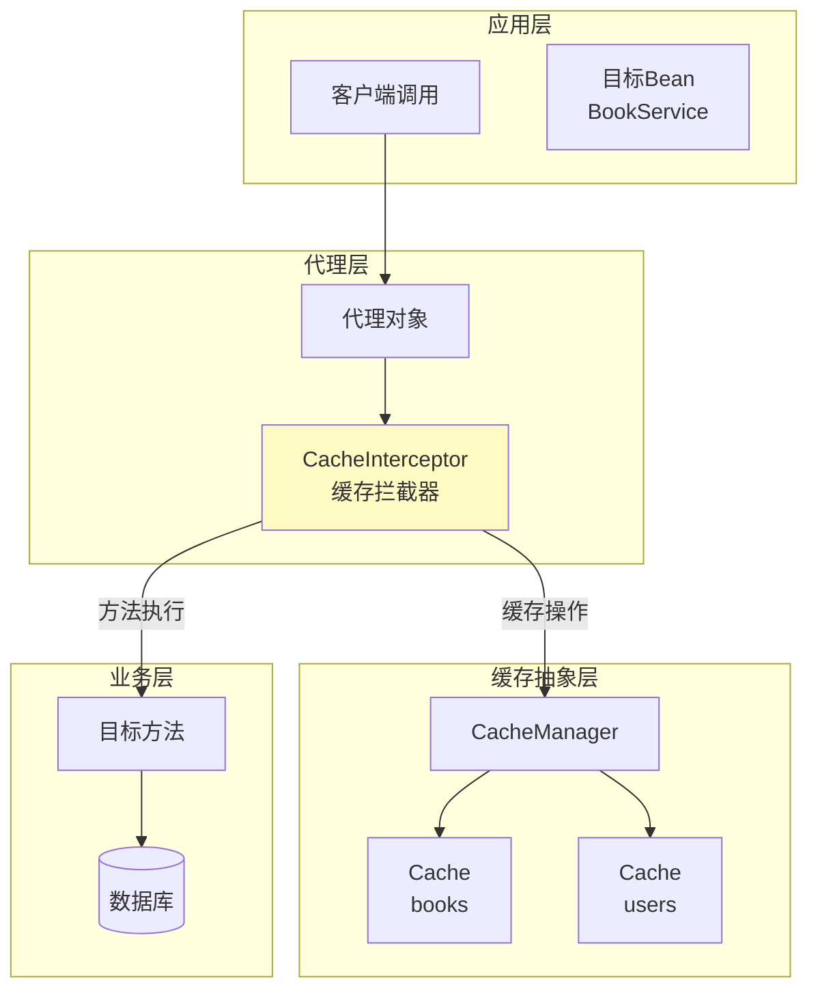
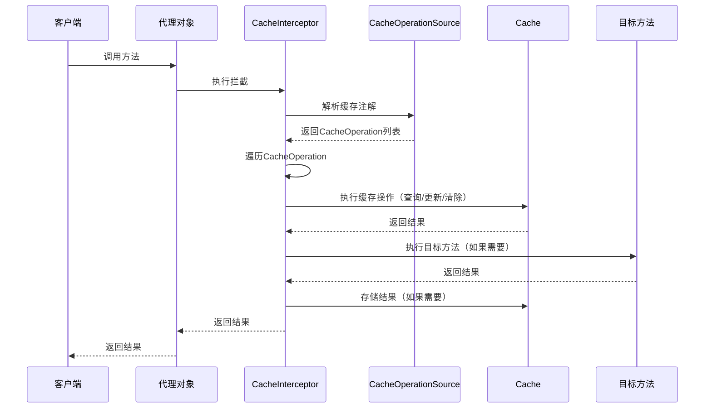

# 缓存原理与自定义扩展

## 课程目标

- 理解 Spring Cache 的底层工作原理（CacheInterceptor 拦截机制）
- 掌握自定义 CacheManager 的实现方法
- 掌握自定义 Cache 实现（带统计功能的缓存）
- 了解 JCache（JSR-107）的支持


## 回顾与导入

到目前为止，我们学习了 Spring Cache 的注解、缓存管理器和高级特性。但这些都是站在**使用者**的角度。在实际项目中，我们可能需要：

- 了解缓存注解为什么能生效
- 自定义缓存存储（如带 TTL、统计功能的缓存）
- 同时使用多种缓存管理器
- 集成 JCache 标准

本节课将深入底层原理，并教你如何自定义扩展 Spring Cache。




## Spring Cache 工作原理

### 整体架构回顾

Spring Cache 基于 **AOP（面向切面编程）** 实现。当方法上标注了缓存注解时，Spring 会在运行时为该 Bean 生成代理对象，通过代理拦截方法调用，执行缓存逻辑。



### 核心组件

| 组件                     | 说明                                                         |
| ------------------------ | ------------------------------------------------------------ |
| **CacheInterceptor**     | 实现 `MethodInterceptor` 接口，是缓存功能的核心拦截器        |
| **CacheOperation**       | 表示一个缓存操作（如 `@Cacheable`、`@CachePut`、`@CacheEvict`） |
| **CacheOperationSource** | 解析方法上的缓存注解，生成 `CacheOperation` 列表             |
| **CacheResolver**        | 根据缓存名称和操作类型解析出 `Cache` 实例                    |
| **KeyGenerator**         | 生成缓存键（可自定义）                                       |
| **CacheManager**         | 管理多个 `Cache` 实例                                        |

### CacheInterceptor 执行流程



### CacheInterceptor 核心源码分析（简化）

```java
public class CacheInterceptor extends CacheAspectSupport implements MethodInterceptor {
    
    @Override
    public Object invoke(final MethodInvocation invocation) throws Throwable {
        // 1. 获取目标方法
        Method method = invocation.getMethod();
        Object target = invocation.getThis();
        Object[] args = invocation.getArguments();
        
        // 2. 解析缓存操作（@Cacheable、@CachePut、@CacheEvict）
        Collection<CacheOperation> operations = getCacheOperationSource()
                .getCacheOperations(method, target.getClass());
        
        // 3. 执行缓存处理（核心方法）
        return execute(invocation, target, method, args, operations);
    }

    // execute 方法简化逻辑
    protected Object execute(...) {
        // 1. 处理 @CacheEvict（beforeInvocation = true）
        // 2. 处理 @Cacheable（查询缓存）
        // 3. 执行目标方法（如果缓存未命中）
        // 4. 处理 @CachePut（更新缓存）
        // 5. 处理 @CacheEvict（默认行为）
        // 6. 返回结果
    }
}
```

### 与 AOP 的关系

Spring Cache 的 `@EnableCaching` 注解会导入 `ProxyCachingConfiguration`，它注册了两个关键 Bean：

- **`CacheInterceptor`**：缓存拦截器
- **`InfrastructureAdvisorAutoProxyCreator`**：自动代理创建器

当 Bean 创建时，自动代理创建器会检查是否有缓存注解，如果有则创建代理对象。

> [!NOTE]
> 理解这些原理有助于排查缓存不生效的问题（如与代理相关的自调用、非 public 方法等）。


## 自定义 Cache 实现

### 为什么需要自定义 Cache2

- 添加监控统计（命中率、访问次数）
- 添加日志记录（便于调试）
- 实现特殊的过期策略
- 适配特殊存储

### Cache 接口定义

```java
/**
 * 缓存抽象接口，定义了缓存的基本操作。
 * 该接口与 Spring Cache 抽象兼容，可用于替换默认的缓存实现。
 */
public interface Cache {

    // 返回缓存名称。
    String getName();

    // 返回底层的原生缓存对象（通常用于直接操作）。
    Object getNativeCache();

    // 根据键获取缓存值，返回 ValueWrapper 包装对象。
    ValueWrapper get(Object key);

    // 根据键获取缓存值，并自动进行类型转换。
    <T> T get(Object key, Class<T> type);

    /**
     * 存入缓存键值对。
     *
     * @param key   缓存键
     * @param value 缓存值（若实现禁止 null，则可能抛出异常）
     * @throws IllegalArgumentException 当 value 为 null 且实现不支持时
     */
    void put(Object key, Object value);

    // 根据键移除缓存项。
    void evict(Object key);

    // 清空当前缓存的所有条目。
    void clear();

    // 缓存值包装器，用于携带实际值。
    interface ValueWrapper {
        Object get();
    }
}
```

### 自定义 Cache 类

```java
/**
 * 自定义缓存实现（带统计功能）
 */
public class CustomCache implements Cache {

    private static final Logger logger = LoggerFactory.getLogger(CustomCache.class);

    private final String name;
    private final Map<Object, Object> store = new ConcurrentHashMap<>();
    private final boolean allowNullValues;

    // 统计信息
    private final AtomicLong hitCount = new AtomicLong(0);
    private final AtomicLong missCount = new AtomicLong(0);
    private final AtomicLong putCount = new AtomicLong(0);
    private final AtomicLong evictCount = new AtomicLong(0);

    public CustomCache(String name) {
        this(name, true);
    }

    public CustomCache(String name, boolean allowNullValues) {
        Assert.notNull(name, "Cache名称不能为空");
        this.name = name;
        this.allowNullValues = allowNullValues;
        logger.info("创建自定义缓存: {}", name);
    }

    @Override
    public String getName() {
        return this.name;
    }

    @Override
    public Object getNativeCache() {
        return this.store;
    }

    @Override
    public ValueWrapper get(Object key) {
        Object value = store.get(key);
        if (value != null || store.containsKey(key)) {
            hitCount.incrementAndGet();
            logger.debug("缓存命中: {} -> {}", key, value);
            return new SimpleValueWrapper(value);
        }
        missCount.incrementAndGet();
        logger.debug("缓存未命中: {}", key);
        return null;
    }

    @Override
    public <T> T get(Object key, Class<T> type) {
        return null;
    }

    @Override
    public <T> T get(Object key, Callable<T> valueLoader) {
        return null;
    }

    @Override
    public void put(Object key, Object value) {
        if (!this.allowNullValues && value == null) {
            throw new IllegalArgumentException("不允许缓存 null 值");
        }
        store.put(key, value);
        putCount.incrementAndGet();
        logger.debug("缓存存储: {} -> {}", key, value);
    }

    @Override
    public void evict(Object key) {
        Object removed = store.remove(key);
        if (removed != null) {
            evictCount.incrementAndGet();
            logger.debug("缓存清除: {}", key);
        }
    }

    @Override
    public void clear() {
        store.clear();
        logger.info("缓存清空: {}", name);
    }

    // 统计方法
    public long getHitCount() { return hitCount.get(); }
    public long getMissCount() { return missCount.get(); }
    public long getPutCount() { return putCount.get(); }
    public long getEvictCount() { return evictCount.get(); }
    public double getHitRate() {
        long total = hitCount.get() + missCount.get();
        return total == 0 ? 0 : (double) hitCount.get() / total;
    }
    public int getSize() { return store.size(); }
}
```


## 自定义 CacheManager

### 为什么需要自定义 CacheManager

虽然 Spring Boot 提供了多种 CacheManager 实现，但在某些场景下我们需要自定义：
- 特殊存储介质（如文件系统、本地磁盘）
- 统一监控和日志
- 动态创建缓存

### CacheManager接口定义

```java
public interface CacheManager {    
    // 获取当前管理器下所有已注册的缓存名称集合
    Collection<String> getCacheNames();  
  
    // 根据缓存名称获取对应的 Cache 对象（如果不存在，具体行为由实现类决定）
    Cache getCache(String name);
}
```

### 自定义 CacheManager 实现

```java
/**
 * 自定义缓存管理器（支持动态创建缓存 + 统计）
 */
public class CustomCacheManager implements CacheManager {

    // 缓存存储容器
    private final Map<String, Cache> cacheMap = new ConcurrentHashMap<>();
    
    // 是否允许动态创建缓存
    private boolean dynamic = true;
    
    // 是否允许缓存 null 值
    private boolean allowNullValues = true;
    
    // 默认缓存名称列表（如果非动态，则只有这些缓存可用）
    private Collection<String> cacheNames;

    public CustomCacheManager() {
        this(true);
    }

    public CustomCacheManager(boolean dynamic) {
        this.dynamic = dynamic;
    }

    @Override
    public Cache getCache(String name) {
        // 从缓存池中获取
        Cache cache = cacheMap.get(name);
        if (cache != null) {
            return cache;
        }
        
        // 如果允许动态创建，则创建新缓存
        if (this.dynamic) {
            // 创建自定义 Cache（稍后定义）
            cache = createCache(name);
            cacheMap.put(name, cache);
            return cache;
        }
        
        return null;
    }

    @Override
    public Collection<String> getCacheNames() {
        return cacheMap.keySet();
    }

    /**
     * 创建缓存实例（可被子类重写）
     */
    protected Cache createCache(String name) {
        return new CustomCache(name, allowNullValues);
    }

    // 设置方法
    public void setDynamic(boolean dynamic) {
        this.dynamic = dynamic;
    }

    public void setAllowNullValues(boolean allowNullValues) {
        this.allowNullValues = allowNullValues;
    }

    public void setCacheNames(Collection<String> cacheNames) {
        this.cacheNames = cacheNames;
        // 预创建缓存
        if (cacheNames != null) {
            for (String name : cacheNames) {
                getCache(name);
            }
        }
    }
}
```

### 在配置类中使用自定义 CacheManager

```java
@Configuration
@EnableCaching
public class CacheConfig {
    
    @Bean
    public CacheManager customCacheManager() {
        CustomCacheManager cacheManager = new CustomCacheManager(true);
        cacheManager.setAllowNullValues(false);
        cacheManager.setCacheNames(Set.of("books", "orders"));
        return cacheManager;
    }
}
```

### 在业务方法上指定自定义CacheManager

```java
@Override
@Cacheable(value = "books", //key = "#id",
    condition = "@appCacheConfig.isCacheEnabled()",
    keyGenerator = "customKeyGenerator",
    cacheManager = "customCacheManager")
public Book getBookById(Long id) {
    System.out.println("从数据库查询图书: " + id);

    Book book = bookMapper.selectById(id);
    if (book == null) {
        throw new ResourceNotFoundException("Book", id);
    }
    return book;
}
```

### 访问缓存统计信息

```java
public Map<String, Object> getCustomCacheStats(String cacheName) {
        Map<String, Object> stats = new HashMap<>();
        if (cacheManager instanceof CustomCacheManager) {
            Cache cache = cacheManager.getCache(cacheName);
            if (cache instanceof CustomCache) {
                CustomCache custom = (CustomCache) cache;
                stats.put("name", custom.getName());
                stats.put("size", custom.getSize());
                stats.put("hitCount", custom.getHitCount());
                stats.put("missCount", custom.getMissCount());
                stats.put("putCount", custom.getPutCount());
                stats.put("evictCount", custom.getEvictCount());
                stats.put("hitRate", custom.getHitRate());
            }
        }
        return stats;
}
```


## JCache（JSR-107）支持

### 什么是 JCache

**JCache（JSR-107）** 是 Java 缓存的标准 API，定义了一套统一的缓存接口（`javax.cache`）。Spring Cache 支持 JCache 注解，可以无缝迁移。

### 添加依赖

```xml
<dependency>
    <groupId>javax.cache</groupId>
    <artifactId>cache-api</artifactId>
</dependency>
<!-- 或使用 Ehcache 实现 -->
<dependency>
    <groupId>org.ehcache</groupId>
    <artifactId>ehcache</artifactId>
</dependency>
```

### JCache 核心注解

| JCache 注解       | Spring 对应                      | 说明         |
| ----------------- | -------------------------------- | ------------ |
| `@CacheResult`    | `@Cacheable`                     | 缓存方法结果 |
| `@CachePut`       | `@CachePut`                      | 更新缓存     |
| `@CacheRemove`    | `@CacheEvict`                    | 清除缓存     |
| `@CacheRemoveAll` | `@CacheEvict(allEntries = true)` | 清空缓存     |

### 使用示例

```java
@Service
public class JCacheBookService {

    @Autowired
    private BookMapper bookMapper;

    @CacheResult(cacheName = "jcache-books")
    public Book getBookById(@CacheKey Long id) {
        return bookMapper.selectById(id);
    }

    @CachePut(cacheName = "jcache-books", cacheKeyGenerator = BookIdCacheKeyGenerator.class)
    public Book saveBook(@CacheValue Book book) {
        bookMapper.insert(book);
        return book;
    }

    @CacheRemove(cacheName = "jcache-books")
    public void deleteBook(@CacheKey Long id) {
        bookMapper.deleteById(id);
    }
}
```

### JCache 配置

```yaml
spring:
  cache:
    type: jcache
    jcache:
      config: classpath:ehcache.xml  # JCache 配置文件
```

### JCache vs Spring Cache

| 对比         | JCache                                      | Spring Cache                             |
| ------------ | ------------------------------------------- | ---------------------------------------- |
| **标准**     | JSR-107 标准                                | Spring 专有                              |
| **注解**     | `@CacheResult`、`@CachePut`、`@CacheRemove` | `@Cacheable`、`@CachePut`、`@CacheEvict` |
| **灵活性**   | 受限（标准 API）                            | 更灵活（SpEL、condition、unless）        |
| **生态系统** | 有限                                        | 广泛（Spring 生态）                      |
| **推荐**     | 需要标准兼容时使用                          | 大多数 Spring 项目                       |


## 小结

本节课我们学习了：

1. **Spring Cache 工作原理**：
   - CacheInterceptor 拦截器
   - 缓存注解解析和执行流程
   - 与 AOP 的关系
2. **自定义 CacheManager**：
   - 实现 `CacheManager` 接口
   - 动态创建 Cache
3. **自定义 Cache**：
   - 实现 `Cache` 接口
   - 添加统计功能（命中率、访问次数）
5. **JCache（JSR-107）支持**：
   - JCache 注解和配置
   - 与 Spring Cache 的对比


## 作业

### 作业一：代码阅读——CacheInterceptor 流程分析

阅读以下简化代码，回答问题。

```java
@Around("@annotation(org.springframework.cache.annotation.Cacheable)")
public Object around(ProceedingJoinPoint joinPoint) throws Throwable {
    Cacheable cacheable = getCacheableAnnotation(joinPoint);
    String cacheName = cacheable.value()[0];
    String key = generateKey(joinPoint);
    Cache cache = cacheManager.getCache(cacheName);
    ValueWrapper wrapper = cache.get(key);
    if (wrapper != null) {
        System.out.println("缓存命中");
        return wrapper.get();
    }
    System.out.println("缓存未命中，执行方法");
    Object result = joinPoint.proceed();
    cache.put(key, result);
    return result;
}
```

**问题：**
1. 这段代码模拟了哪个缓存注解的行为？
2. 如果 `cacheManager.getCache(cacheName)` 返回 `null`，会发生什么？
3. 如果 `joinPoint.proceed()` 抛出异常，缓存会被更新吗？
4. 这段代码是否支持 `unless` 和 `condition`？为什么？

---

### 作业二：自定义 CacheManager 和 Cache

在图书管理系统中，完成以下任务：

1. 创建 `CustomCache` 类，实现 `Cache` 接口，包含：
   - 基本的 get、put、evict、clear 方法
   - 统计：命中次数、未命中次数、put 次数
2. 创建 `CustomCacheManager` 类，实现 `CacheManager` 接口。
3. 在配置类中使用 `CustomCacheManager` 作为默认缓存管理器。
4. 在 `BookService` 中使用 `@Cacheable`，验证缓存功能。
5. 编写一个监控接口 `/api/cache/stats`，输出缓存统计信息。
