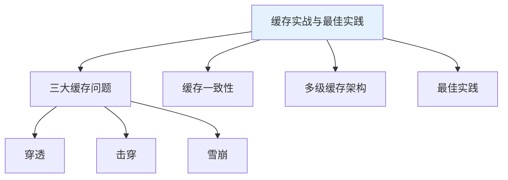
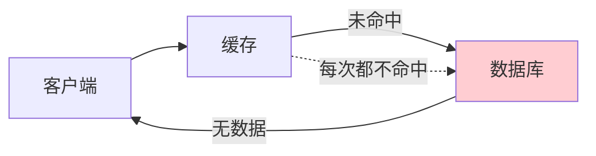
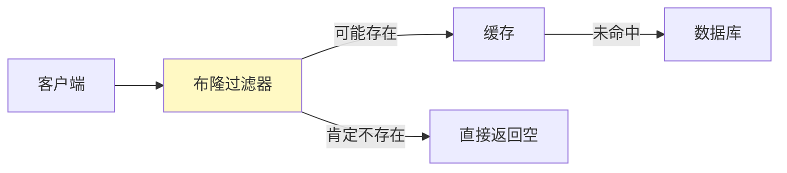
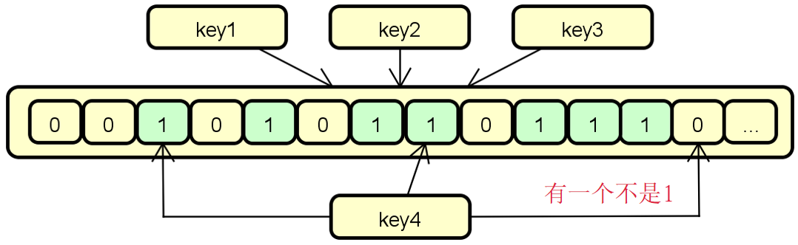
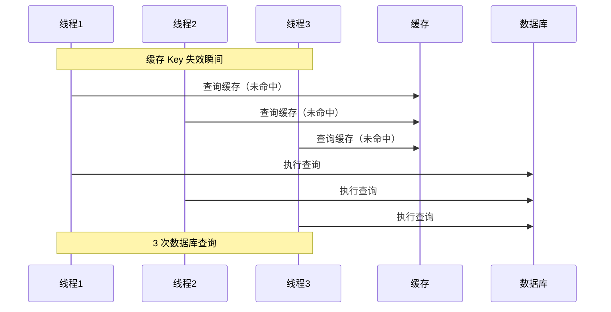
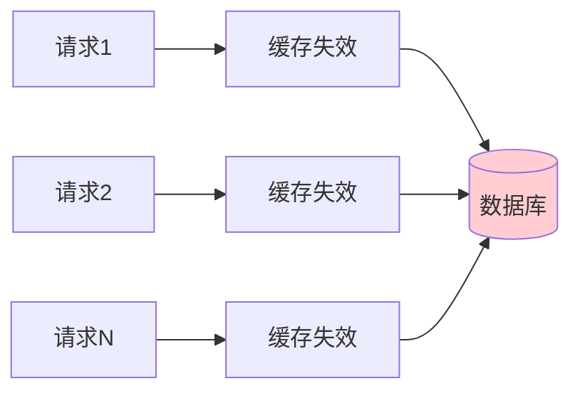
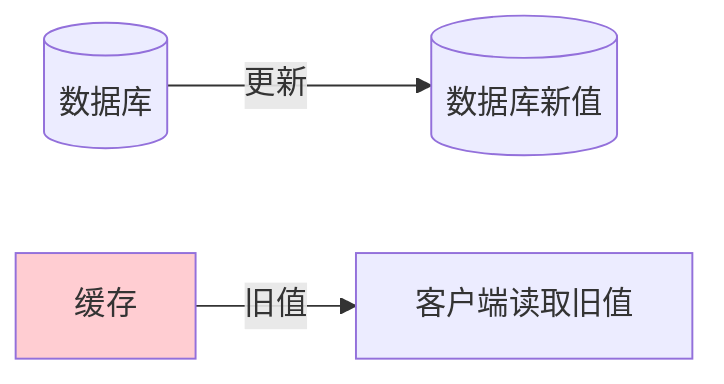
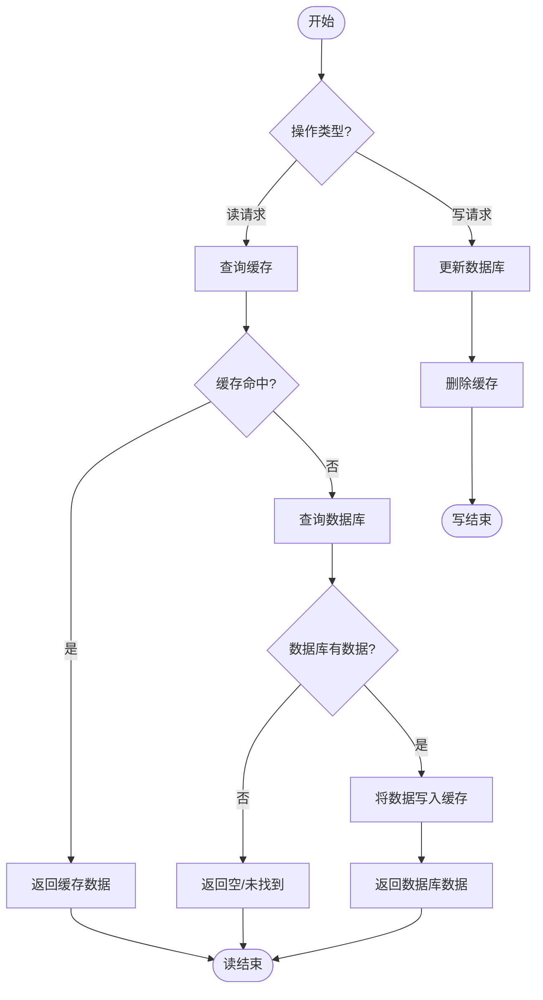
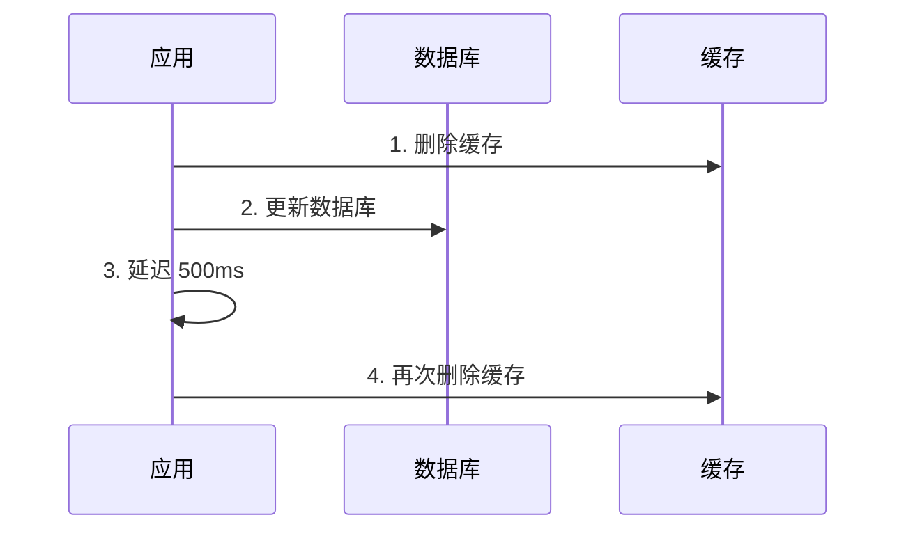

# 缓存核心问题与最佳实践

## 课程目标

- 掌握缓存穿透、缓存击穿、缓存雪崩三大问题的成因与解决方案
- 掌握缓存一致性的常见策略（Cache-Aside、延迟双删）
- 掌握缓存最佳实践（粒度选择、过期时间设置、监控预热等）
- 能够为图书管理系统设计完善的缓存方案


## 回顾与导入

经过前面课程的学习，我们已经掌握了 Spring Cache 的注解、配置、高级特性和自定义扩展。但在真实的生产环境中，仅仅会用注解还不够，我们还需要面对：

| 问题             | 说明                                         |
| ---------------- | -------------------------------------------- |
| **缓存穿透**     | 大量请求查询不存在的数据，穿透缓存直达数据库 |
| **缓存击穿**     | 热点 Key 失效瞬间，大量并发请求压垮数据库    |
| **缓存雪崩**     | 大量缓存同时失效，请求全部打到数据库         |
| **缓存一致性**   | 数据库更新后，缓存数据与数据库数据不一致     |
| **缓存容量管理** | 缓存占用内存过大，影响应用性能               |

本节课将围绕这些实际问题，提供完整的解决方案和最佳实践。




## 缓存三大问题

### 缓存穿透

#### 什么是缓存穿透

**缓存穿透**是指查询一个**不存在的数据**，缓存和数据库中都没有。由于缓存中没有记录，每次请求都会穿透缓存直接查询数据库。



危害：

- 大量的请求直接打到数据库，造成数据库压力过大
- 恶意攻击者可以利用这一点进行攻击（如查询不存在的 ID）

#### 解决方案

**方案一：缓存空值（推荐）**

将查询结果为 `null` 的情况也缓存起来，设置较短的过期时间（如 5 分钟）。

```java
@Cacheable(value = "books", key = "#id") 
public Book getBookById(Long id) {
    return bookRepository.findById(id);
}
```

但默认情况下，Spring Cache **不缓存 null 值**。我们需要调整配置：

```java
// 在 CacheManager 配置中允许缓存 null
@Bean
public CacheManager cacheManager() {
    CaffeineCacheManager cacheManager = new CaffeineCacheManager();
    cacheManager.setAllowNullValues(true);  // 允许缓存 null
    return cacheManager;
}
```

**方案二：布隆过滤器（Bloom Filter）**

在缓存之前增加布隆过滤器，判断 Key 是否可能存在。



**布隆过滤器（Bloom Filter）** 是一种空间效率很高的**概率型数据结构**，用于判断一个元素是否可能在一个集合中。它的核心特点是：

- **判断“不存在”一定准确**：如果布隆过滤器说元素不存在，那它一定不存在。
- **判断“存在”可能误判**：如果它说元素存在，元素不一定真的存在，存在**假阳性**。
- 标准布隆过滤器**不支持删除元素**，也不存储元素本身。

结构上就是一种位数组，该位数组中每个元素的初始值都是0。在创建布隆过滤器时，会先将所有key进行n次hash运算，并将布隆过滤器中对应位置的值设置为1，相当于把所有的key保存到了布隆过滤器中。如果所有对应位置元素的值都为1，说明key在库中存在如果有任意一个位置的值不为1，说明key在库中不存在。



**为什么会有误判？**因为多个不同元素可能哈希到相同的位。例如：

- 插入 `apple` 时，把第 1、4、7 位置为 1；
- 插入 `banana` 时，把第 2、5、7 位置为 1；
- 查询一个从未插入的 `cherry`，它恰好映射到第 1、5、7 位，而这些位都被其他元素置为 1，于是布隆过滤器会误判 `cherry` 存在。

但反过来，如果某个元素确实被插入过，那么它对应的所有位一定已经被置为 1，所以不会出现“实际存在却判断不存在”的假阴性。

布隆过滤器的典型应用：

- 缓存穿透防护：先查布隆过滤器，避免查询不存在的数据；
- 爬虫 URL 去重；
- 数据库避免查询不存在的键；
- 推荐系统去重；
- 网络安全中的黑名单判断；
- 区块链和分布式系统中的集合成员判断。

一句话总结：**布隆过滤器用多个哈希函数把元素映射到位数组中，以少量空间和一定误判率换取高效的存在性判断；说“不存在”一定可信，说“存在”只是可能存在。**

布隆过滤器的实现较为复杂，通常需要借助 Redis 或 Guava。

引入Guava依赖：

```xml
<dependency>
    <groupId>com.google.guava</groupId>
    <artifactId>guava</artifactId>
    <version>33.3.1-jre</version>
</dependency>
```

实现代码：

```java
public class BloomFilterDemo {

    public static void main(String[] args) {
        // 创建布隆过滤器：预计插入 100 万个元素，误判率 1%
        BloomFilter<String> bloomFilter = BloomFilter.create(
                Funnels.stringFunnel(StandardCharsets.UTF_8),
                1_000_000,
                0.01
        );

        // 1. 插入一些数据（模拟已存在的 ID）
        for (int i = 1; i <= 100_000; i++) {
            bloomFilter.put("user_" + i);
        }

        // 2. 测试存在的数据
        System.out.println("===== 存在的数据（应该返回 true） =====");
        System.out.println("user_1: " + bloomFilter.mightContain("user_1"));
        System.out.println("user_50000: " + bloomFilter.mightContain("user_50000"));
        System.out.println("user_100000: " + bloomFilter.mightContain("user_100000"));

        // 3. 测试不存在的数据
        System.out.println("\n===== 不存在的数据（大概率返回 false） =====");
        System.out.println("user_100001: " + bloomFilter.mightContain("user_100001"));
        System.out.println("user_999999: " + bloomFilter.mightContain("user_999999"));
        System.out.println("unknown_key: " + bloomFilter.mightContain("unknown_key"));

        // 4. 模拟误判（极少概率）
        System.out.println("\n===== 误判示例（极少数会误判） =====");
        int falsePositive = 0;
        int totalTest = 100_000;
        for (int i = 100_001; i <= 200_000; i++) {
            if (bloomFilter.mightContain("user_" + i)) {
                falsePositive++;
            }
        }
        System.out.println("测试 " + totalTest + " 个不存在元素，误判次数: " + falsePositive);
        System.out.println("误判率: " + (falsePositive * 100.0 / totalTest) + "%");
    }
}
```

输出结果：

```java
===== 存在的数据（应该返回 true） =====
user_1: true
user_50000: true
user_100000: true

===== 不存在的数据（大概率返回 false） =====
user_100001: false
user_999999: false
unknown_key: false

===== 误判示例（极少数会误判） =====
测试 100000 个不存在元素，误判次数: 987
误判率: 0.987%
```

> [!NOTE]
>
> 布隆过滤器适用于**数据量大且相对稳定**的场景，配合缓存空值使用效果更佳。


### 缓存击穿

#### 什么是缓存击穿

**缓存击穿**是指一个**热点 Key**（如热门商品、首页数据）在缓存失效的瞬间，大量并发请求同时访问，导致所有请求都打到数据库。



#### 解决方案

**方案一：sync 属性（Spring Cache 内置）**

在 `@Cacheable` 中启用 `sync = true`，确保只有一个线程执行方法，其他线程等待。

```java
@Cacheable(value = "books", key = "#id", sync = true)
public Book getBookById(Long id) {
    return bookRepository.findById(id);
}
```

**方案二：互斥锁（分布式锁）**

对于分布式系统，可以使用 Redis 分布式锁。

> [!NOTE]
> 单实例应用使用 `sync = true` 即可；分布式部署需要分布式锁。我们在介绍Redis时再作进一步展开。


### 缓存雪崩

#### 什么是缓存雪崩

**缓存雪崩**是指**大量缓存同时失效**（如设置了相同的过期时间），导致大量请求瞬间涌入数据库，引发数据库压力激增甚至宕机。



#### 危害

- 数据库瞬间压力巨大，可能导致连接耗尽、服务不可用
- 引发连锁故障（数据库挂掉 → 应用挂掉）

#### 解决方案

**方案一：分散缓存过期时间**

为缓存设置不同的过期时间，避免同时失效。

```java
@Cacheable(value = "hot", key = "#id", unless = "#result == null")
public Book getBookById(Long id) {
    return bookRepository.findById(id);
}
```

结合自定义 KeyGenerator 实现差异化 TTL：

```java
@Configuration
@EnableCaching
public class CacheConfig {

    @Bean
    public CacheManager cacheManager() {
        CaffeineCacheManager cacheManager = new CaffeineCacheManager() {
            @Override
            protected com.github.benmanes.caffeine.cache.Cache<Object, Object> createNativeCaffeineCache(String name) {
                // 根据缓存名称动态设置不同的过期时间
                Caffeine<Object, Object> builder;
                switch (name) {
                    case "hot":
                        builder = Caffeine.newBuilder()
                                .maximumSize(500)
                                .expireAfterWrite(2, TimeUnit.MINUTES);
                        break;
                    case "warm":
                        builder = Caffeine.newBuilder()
                                .maximumSize(1000)
                                .expireAfterWrite(10, TimeUnit.MINUTES);
                        break;
                    case "cold":
                    default:
                        builder = Caffeine.newBuilder()
                                .maximumSize(2000)
                                .expireAfterWrite(60, TimeUnit.MINUTES);
                        break;
                }
                return builder.build();
            }
        };
        cacheManager.setCacheNames(Set.of("hot", "warm", "cold"));
        cacheManager.setAllowNullValues(false);
        return cacheManager;
    }
}
```

**方案二：使用随机 TTL**

在设置缓存时，为 TTL 增加随机偏差（例如 5 分钟 ± 随机 1 分钟）。

在 Spring Cache 中，可以通过自定义 `Cache` 实现：

```java
/**
 * 带随机 TTL 的缓存实现
 */
public class RandomizedTTLCache implements Cache {

    private final String name;
    private final Map<Object, CacheEntry> store = new ConcurrentHashMap<>();
    private final long baseTtlMillis;
    private final long randomRangeMillis;

    public RandomizedTTLCache(String name, long baseTtl, TimeUnit unit, long randomRange, TimeUnit randomUnit) {
        this.name = name;
        this.baseTtlMillis = unit.toMillis(baseTtl);
        this.randomRangeMillis = randomUnit.toMillis(randomRange);
    }

    @Override
    public String getName() {
        return name;
    }

    @Override
    public Object getNativeCache() {
        return store;
    }

    @Override
    public ValueWrapper get(Object key) {
        CacheEntry entry = store.get(key);
        if (entry == null || entry.isExpired()) {
            store.remove(key);
            return null;
        }
        return new SimpleValueWrapper(entry.value);
    }

    @Override
    public void put(Object key, Object value) {
        long ttl = baseTtlMillis + (long) (Math.random() * randomRangeMillis);
        store.put(key, new CacheEntry(value, System.currentTimeMillis() + ttl));
    }

    @Override
    public void evict(Object key) {
        store.remove(key);
    }

    @Override
    public void clear() {
        store.clear();
    }

    // 内部缓存条目
    private static class CacheEntry {
        final Object value;
        final long expiryTime;

        CacheEntry(Object value, long expiryTime) {
            this.value = value;
            this.expiryTime = expiryTime;
        }

        boolean isExpired() {
            return System.currentTimeMillis() > expiryTime;
        }
    }
}
```

**方案三：缓存预热 + 过期时间分散**

在应用启动时，主动加载缓存，并让过期时间分散。

```java
@Component
public class CacheWarmer implements ApplicationRunner {

    @Autowired
    private BookService bookService;

    @Override
    public void run(ApplicationArguments args){
        // 这时候的bookService已经是一个代理对象
        List<Long> popularIds = Arrays.asList(2L ,3L, 4L, 5L);
        for (Long id: popularIds) {
            try {
                bookService.getBookById(id);
            } catch (Exception e) {
                //记录日志
            }
        }
    }
}
```


## 缓存一致性

### 什么是一致性问题

当数据库中的数据更新后，缓存中的数据仍为旧值，导致读取到的数据不一致。



### 推荐方案：Cache-Aside（旁路缓存）模式

Cache-Aside模式的核心是：**读时先查缓存，未命中再查数据库并回填缓存；写时先更新数据库，再删除缓存**



- **读流程**：应用先访问缓存；命中则直接返回；未命中则查询数据库，若数据库有数据，则写入缓存后再返回。
- **写流程**：应用先更新数据库，然后删除缓存。下次读请求未命中时，会从数据库加载最新数据并回填缓存。
- **为什么写时删除缓存而不是更新缓存**：删除更简单，也能避免并发写导致缓存与数据库不一致；更新缓存可能引入额外的并发覆盖问题。

在 Spring Cache 中，我们使用 `@CacheEvict` 实现：

```java
@CacheEvict(value = "books", key = "#book.id")
public void updateBook(Book book) {
    bookRepository.update(book);
}
```

**一致性增强**：如果对一致性要求较高，可以配合延迟双删等方式进一步降低不一致窗口。

### 延迟双删策略

在高并发场景下，先更新数据库再删除缓存，仍可能存在短暂的不一致窗口。**延迟双删**能进一步降低不一致概率。



实现方式：

```java
public void updateBook(Book book) {
    // 1. 删除缓存
    cacheManager.getCache("books").evict(book.getId());
    
    // 2. 更新数据库
    bookMapper.updateById(book);
    
    // 3. 延迟后再删除一次（异步）
  	new Thread(() -> {
        try {
            Thread.sleep(200);  // 延迟 200ms
            cacheManager.getCache("books").evict(book.getId());
        } catch (InterruptedException ignored) {}
    }).start();   
}
```

> [!NOTE]
> 延迟双删适用于对一致性要求极高的场景。延迟时间通常设置为数据库主从同步的时间窗口。

### 缓存一致性最佳实践

| 场景             | 推荐策略                                |
| ---------------- | --------------------------------------- |
| 读多写少         | Cache-Aside（先更新数据库，再删除缓存） |
| 写多读少         | 考虑不缓存或短 TTL                      |
| 对一致性要求高   | 延迟双删 + 短 TTL                       |
| 最终一致性可接受 | 仅依赖 TTL 过期                         |


## 缓存最佳实践

### 1. 缓存粒度选择

| 粒度                   | 优点           | 缺点               | 示例         |
| ---------------------- | -------------- | ------------------ | ------------ |
| **细粒度（单条数据）** | 灵活、更新方便 | 缓存条目多         | 单本书籍详情 |
| **粗粒度（聚合数据）** | 减少查询次数   | 更新时缓存失效频繁 | 首页推荐列表 |

**建议：**
- 聚合数据设置较短 TTL
- 单条数据设置较长 TTL

### 2. 缓存过期时间设置

| 场景               | 推荐 TTL                 |
| ------------------ | ------------------------ |
| 静态配置数据       | 1 小时 ~ 24 小时         |
| 用户个人信息       | 10 ~ 30 分钟             |
| 商品详情           | 5 ~ 15 分钟              |
| 实时性要求高的数据 | 1 ~ 5 分钟               |
| 热点数据           | 短 TTL（避免过期后击穿） |

### 3. 缓存监控与指标

| 指标                      | 说明                     |
| ------------------------- | ------------------------ |
| **命中率**                | 缓存的命中比例，核心指标 |
| **命中次数 / 未命中次数** | 反映缓存效果             |
| **缓存大小**              | 监控内存占用             |
| **平均获取延迟**          | 缓存查询耗时             |
| **缓存失效次数**          | 排查异常                 |

### 4. 缓存预热

在应用启动或高峰期来临前，主动加载热点数据。

### 5. 缓存降级与兜底

当缓存不可用时，直接走数据库查询，并记录日志告警：

```java
public Book getBookById(Long id) {
    try {
        return cachedGetBook(id);
    } catch (Exception e) {
        logger.error("缓存不可用，走数据库降级", e);
        return bookMapper.selectById(id);
    }
}

@Cacheable(value = "books", key = "#id")
public Book cachedGetBook(Long id) {
    return bookMapper.selectById(id);
}
```

### 6. 避免缓存大对象

缓存大对象（如包含大量字段的列表）会占用大量内存，建议：
- 只缓存必要字段（使用 DTO）
- 拆分缓存（单个对象 vs 列表）
- 设置合理大小限制


## 实战：图书管理系统完整缓存方案

为图书管理系统设计一套完整的缓存方案，涵盖穿透、击穿、雪崩防护以及一致性策略。

方案设计

```yaml
# 缓存策略总览
books:
  # 查询单本
  getBookById:
    annotation: @Cacheable
    key: "#id"
    sync: true                # 防止击穿

  # 查询所有（列表）
  getAllBooks:
    annotation: @Cacheable
    key: "'all'"
    unless: "#result == null || #result.isEmpty()"

  # 新增
  createBook:
    annotation: @CachePut + @CacheEvict
    put: 单条缓存
    evict: 'all' 缓存

  # 更新
  updateBook:
    annotation: @CacheEvict(单条 + 'all') + 延迟双删

  # 删除
  deleteBook:
    annotation: @CacheEvict(单条 + 'all')
```


## 小结

本节课我们学习了：

1. **缓存穿透**：查询不存在的数据，解决方式：缓存空值、布隆过滤器。
2. **缓存击穿**：热点 Key 失效瞬间大量请求，解决方式：`sync = true`、分布式锁。
3. **缓存雪崩**：大量缓存同时失效，解决方式：分散 TTL、随机 TTL、缓存预热。
4. **缓存一致性**：推荐 Cache-Aside（先更新数据库，再删除缓存），延迟双删提高一致性。
6. **最佳实践**：粒度选择、TTL 设置、监控告警、预热、降级。


## 作业

### 作业一：代码阅读——缓存问题识别

阅读以下代码，指出其中存在的缓存问题，并提出改进方案。

```java
@Cacheable(value = "books", key = "#id")
public Book getBook(Long id) {
    return bookMapper.selectById(id);
}

@CacheEvict(value = "books", key = "#id")
public void updateBook(Book book) {
    bookMapper.updateById(book);
}
```

**问题：**
1. 这段代码存在哪些缓存问题？（至少指出 3 个）
2. 如何防止缓存击穿？
3. 如何防止缓存穿透？
4. 更新数据时，缓存一致性如何保证？

---

### 作业二：实现防缓存穿透

在图书管理系统中，完善缓存穿透防护：

1. 配置缓存管理器允许缓存 `null` 值。
2. 在 `getBookById` 方法中，测试多次查询不存在的 ID，观察是否每次都执行了数据库查询
3. 为 `searchBooks` 方法（按关键词搜索）添加缓存，并排除空列表。

---

### 作业三：实现延迟双删

改造 `updateBook` 方法，实现延迟双删策略：
1. 先删除缓存（使用 `@CacheEvict`）。
2. 更新数据库。
3. 延迟 200ms 后再次删除缓存。
4. 测试，验证更新后缓存是否被正确清除。
