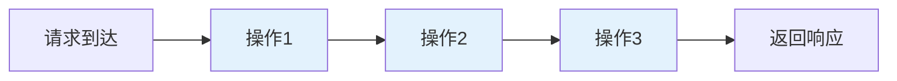
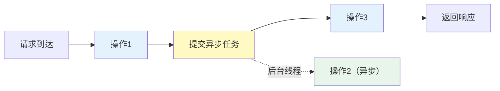
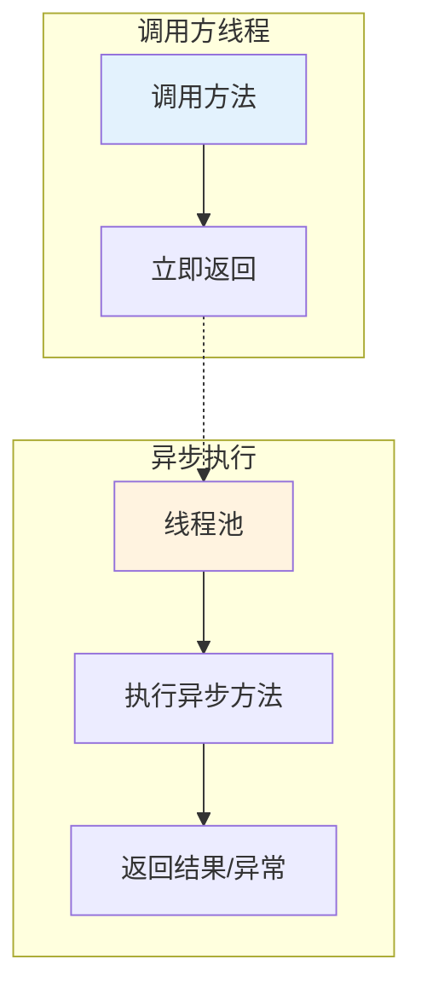

# 异步处理概述与 Spring Async 入门

## 课程目标

- 理解同步与异步处理的核心概念及区别
- 了解异步处理的典型应用场景
- 掌握 @EnableAsync 和 @Async 的基本用法
- 能够编写第一个异步方法并观察执行效果
- 理解异步方法自调用失效的原因及解决方案


## 同步 vs 异步

### 什么是同步处理

**同步（Synchronous）** 是指任务按顺序执行，当前任务完成后才执行下一个任务。在 Web 应用中，一个请求从进入 Controller 到返回响应，所有操作都在同一个线程中顺序执行。



```java
// 同步方式：顺序执行
public String process() {
    // 步骤1：查询数据库（耗时 100ms）
    User user = userRepository.findById(1L);
    // 步骤2：发送邮件（耗时 500ms）
    emailService.send(user.getEmail());
    // 步骤3：记录日志（耗时 50ms）
    logService.save("processed");
    return "done";  // 总耗时约 650ms
}
```

**同步的特点：**
- 代码执行顺序清晰，易于理解和调试
- 线程会被阻塞，等待 I/O 或耗时操作完成
- 一个耗时操作会拖慢整个请求

### 什么是异步处理

**异步（Asynchronous）** 是指任务提交后不等待其完成，而是继续执行后续操作。耗时任务在后台执行，执行完成后通过回调、通知等方式获取结果。



```java
// 异步方式：耗时操作在后台执行
public String process() {
    // 步骤1：查询数据库（耗时 100ms）
    User user = userRepository.findById(1L);
    // 步骤2：异步发送邮件（不阻塞）
    asyncEmailService.send(user.getEmail());  // 立即返回
    // 步骤3：记录日志（耗时 50ms）
    logService.save("processed");
    return "done";  // 总耗时约 150ms
}
```

**异步的特点：**
- 主线程不被阻塞，响应更快
- 耗时任务在独立线程中执行
- 需要处理任务执行结果和异常

### 同步 vs 异步对比

| 对比维度       | 同步                   | 异步                             |
| -------------- | ---------------------- | -------------------------------- |
| **执行方式**   | 顺序执行，阻塞等待     | 提交任务，立即返回               |
| **响应时间**   | 包含所有操作耗时       | 不包含异步任务耗时               |
| **线程占用**   | 全程占用请求线程       | 请求线程快速释放                 |
| **代码复杂度** | 简单直接               | 需要处理回调/结果                |
| **适用场景**   | 必须立即获取结果的操作 | 后台任务、通知、日志、非关键路径 |

### 异步处理的典型场景

| 场景              | 说明                   | 是否适合异步 |
| ----------------- | ---------------------- | ------------ |
| 发送邮件/短信     | 用户注册后发送欢迎邮件 | ✅ 非常适合   |
| 记录操作日志      | 审计日志不需要立即落库 | ✅ 非常适合   |
| 生成报表/导出文件 | 报表生成耗时较长       | ✅ 适合       |
| 调用外部 API      | 调用第三方服务可能超时 | ✅ 适合       |
| 用户登录验证      | 必须立即返回登录结果   | ❌ 不适合     |
| 支付扣款          | 必须立即确认交易结果   | ❌ 不适合     |

> [!NOTE]
> **关键选择原则：** 如果用户不需要立即看到操作结果，或者结果可以通过其他方式通知用户，就可以考虑异步处理。核心业务链路（如支付、登录）应保持同步。


## Spring Async 简介

### 什么是 Spring Async

**Spring Async** 是 Spring 框架提供的异步执行支持，通过 `@Async` 注解将方法的执行提交到独立的线程池，实现非阻塞的异步调用。



### 核心组件

| 组件                            | 说明                                               |
| ------------------------------- | -------------------------------------------------- |
| `@EnableAsync`                  | 启用 Spring Async，放在配置类或启动类上            |
| `@Async`                        | 标记方法为异步执行，被标记的方法将在独立线程中运行 |
| `TaskExecutor`                  | 任务执行器，负责管理线程池和执行异步任务           |
| `AsyncUncaughtExceptionHandler` | 异步方法无返回值时的异常处理                       |

### 与 Spring 其他异步支持的关系

| 技术                                  | 适用场景     |
| ------------------------------------- | ------------ |
| **@Async**                            | 方法级异步   |
| **ApplicationEvent + @EventListener** | 事件驱动异步 |
| **Callable / WebAsyncTask **          | Web 层异步   |

> [!NOTE]
> Spring Async 基于 **AOP 代理** 实现，与 `@Transactional` 类似。在调用 `@Async` 方法时，Spring 会通过代理对象将任务提交给 `TaskExecutor`。


## Spring Async 快速上手

### 1. 添加依赖

Spring Boot 项目无需额外添加依赖，`spring-boot-starter` 已包含所需模块。

```xml
<!-- 无需额外依赖，Spring Boot 核心已包含 -->
<dependency>
    <groupId>org.springframework.boot</groupId>
    <artifactId>spring-boot-starter</artifactId>
</dependency>
```

### 2. 启用异步

在主启动类或配置类上添加 `@EnableAsync` 注解：

```java
@SpringBootApplication
@EnableAsync   // 启用 Spring Async
public class BookManagerApplication {
    public static void main(String[] args) {
        SpringApplication.run(BookManagerApplication.class, args);
    }
}
```

> [!NOTE]
> `@EnableAsync` 会创建一个 `AsyncAnnotationBeanPostProcessor`，负责解析 `@Async` 注解并创建代理对象。

### 3. 创建异步服务

在 `com.example.bookmanager.service` 包下创建 `AsyncLogService.java`：

```java
@Service
public class AsyncLogService {

    private static final Logger logger = LoggerFactory.getLogger(AsyncLogService.class);

  /**
     * 同步记录日志（对比用）
     */
    public void logOperationSync(String message) {
        logger.info("📝 [同步日志] 当前线程: {}，消息: {}",
                Thread.currentThread().getName(), message);
      
        // 模拟耗时操作（如写入文件或数据库）
        try {
            Thread.sleep(2000);
        } catch (InterruptedException e) {
            Thread.currentThread().interrupt();
        }
        logger.info("📝 [同步日志] 日志记录完成: {}", message);
    }
  
    /**
     * 异步记录日志
     * 方法将在独立线程中执行，不阻塞调用方
     */
    @Async
    public void logOperation(String message) {
        // 打印当前线程名，观察异步执行
        logger.info("📝 [异步日志] 当前线程: {}，消息: {}",
                Thread.currentThread().getName(), message);

        // 模拟耗时操作（如写入文件或数据库）
        try {
            Thread.sleep(2000);
        } catch (InterruptedException e) {
            Thread.currentThread().interrupt();
        }

        logger.info("📝 [异步日志] 日志记录完成: {}", message);
    }    
}
```

### 4. 在 Controller 中调用异步方法

```java
@RestController
@RequestMapping("/api/demo")
public class AsyncDemoController {

    private final AsyncLogService asyncLogService;

    public AsyncDemoController(AsyncLogService asyncLogService) {
        this.asyncLogService = asyncLogService;
    }

    /**
     * 测试异步日志（请求快速返回）
     */
    @GetMapping("/async-log")
    public Result<String> asyncLog(@RequestParam String message) {
        long start = System.currentTimeMillis();

        // 调用异步方法，立即返回
        asyncLogService.logOperation(message);

        long elapsed = System.currentTimeMillis() - start;
        return Result.success("异步任务已提交，耗时: " + elapsed + "ms，当前线程: " +
                Thread.currentThread().getName());
    }

    /**
     * 测试同步日志（对比）
     */
    @GetMapping("/sync-log")
    public Result<String> syncLog(@RequestParam String message) {
        long start = System.currentTimeMillis();

        // 调用同步方法，阻塞等待
        asyncLogService.logOperationSync(message);

        long elapsed = System.currentTimeMillis() - start;
        return Result.success("同步任务完成，耗时: " + elapsed + "ms，当前线程: " +
                Thread.currentThread().getName());
    }
}
```

### 5. 观察执行效果

**启动应用，访问异步接口：**

```bash
curl "http://localhost:8080/api/demo/async-log?message=test"
```

**返回结果：**
```
{
    "code": 200,
    "message": "异步任务已提交，耗时: 2ms，当前线程: http-nio-8080-exec-1",
    "data": null
}
```

**控制台日志（异步）：**
```
📝 [异步日志] 当前线程: SimpleAsyncTaskExecutor-1，消息: test
📝 [异步日志] 日志记录完成: test
```

**访问同步接口：**
```bash
curl "http://localhost:8080/api/demo/sync-log?message=test"
```

**返回结果：**
```
{
    "code": 200,
    "message": "同步任务完成，耗时: 2002ms，当前线程: http-nio-8080-exec-2",
    "data": null
}
```

**控制台日志（同步）：**
```
📝 [同步日志] 当前线程: http-nio-8080-exec-2，消息: test
📝 [同步日志] 日志记录完成: test
```

> [!NOTE]
> 观察差异：
> - 异步：响应时间极短（2ms），日志在 `SimpleAsyncTaskExecutor-1` 线程中打印
> - 同步：响应时间约 2 秒，日志在 `http-nio-8080-exec-2`（请求线程）中打印


## @Async 方法自调用问题

### 什么是自调用问题

与 `@Transactional` 类似，`@Async` 基于代理实现。在同一个类内部直接调用 `@Async` 方法，会绕过代理，导致方法**同步执行**而非异步执行。

```java
@Service
public class AsyncLogService {
    @Async
    public void asyncMethod() {
        // 这应该异步执行
    }

    public void caller() {
        // ❌ 自调用：绕过代理，asyncMethod 同步执行
        this.asyncMethod();
    }
}
```

### 问题演示

```java
@Service
public class AsyncLogService {
    @Async
    public void logAsync(String msg) {
        System.out.println("异步执行: " + Thread.currentThread().getName());
    }

    public void logWrapper(String msg) {
        System.out.println("调用方线程: " + Thread.currentThread().getName());
        // ❌ 自调用，不会异步执行
        this.logAsync(msg);
    }
}
```

```java
@RestController
public class TestController {
    @Autowired
    private AsyncLogService asyncLogService;

    @GetMapping("/test")
    public String test() {
        // ✅ 外部调用，异步执行
        asyncLogService.logAsync("test");
        // ❌ 内部调用，同步执行
        asyncLogService.logWrapper("test");
        return "done";
    }
}
```

**控制台输出：**
```
调用方线程: http-nio-8080-exec-1
异步执行: http-nio-8080-exec-1   ← 注意这里仍然是请求线程！
异步执行: SimpleAsyncTaskExecutor-1  ← 只有外部调用才是异步
```

### 解决方案：注入自身代理

在同一个 Bean 中注入自身的代理对象，通过代理调用异步方法：

```java
@Service
public class AsyncLogService {

    @Autowired
    @Lazy  // 延迟注入避免循环依赖
    private AsyncLogService self;

    @Async
    public void logAsync(String msg) {
        System.out.println("异步执行: " + Thread.currentThread().getName());
    }

    public void logWrapper(String msg) {
        System.out.println("调用方线程: " + Thread.currentThread().getName());
        // ✅ 通过代理调用，异步执行
        self.logAsync(msg);
    }
}
```

> [!NOTE]
> `@Lazy` 用于解决自注入时的循环依赖问题。Spring 在创建 Bean 时，代理对象尚未完全初始化，使用 `@Lazy` 可以让代理在第一次使用时才真正初始化。


## 实战：在图书管理系统中应用异步日志

### 场景描述

在图书管理系统中，每次操作（新增、更新、删除）都需要记录操作日志。日志记录是非核心业务，不需要立即完成，适合异步处理。

### 实现

**步骤一：创建异步日志服务**

```java
@Service
public class AsyncLogService {

    private static final Logger logger = LoggerFactory.getLogger(AsyncLogService.class);

    @Async
    public void logOperation(String operation, String details) {
        // 模拟写入数据库或文件
        logger.info("📝 [AUDIT] 操作: {}，详情: {}，时间: {}，线程: {}",
                operation, details, LocalDateTime.now(), Thread.currentThread().getName());
        try {
            Thread.sleep(100);  // 模拟 I/O 操作
        } catch (InterruptedException e) {
            Thread.currentThread().interrupt();
        }
    }
}
```

**步骤二：在业务 Service 中调用**

```java
@Service
public class BookService {
    @Autowired
    private AsyncLogService asyncLogService;

    public Book createBook(Book book) {
        Book saved = bookRepository.save(book);
        // 异步记录日志，不阻塞主流程
        asyncLogService.logOperation("创建图书, 图书ID: " + book.getId());
        return saved;
    }
}
```

**步骤三：观察效果**

调用新增图书接口后，响应快速返回，日志在后台异步记录。


## 注意事项

### 1. @Async 方法必须是 public

Spring 代理只能拦截 `public` 方法，`private` 或 `protected` 方法上的 `@Async` 不会生效。

```java
// ❌ 不生效
@Async
private void logAsync(String msg) { ... }

// ✅ 生效
@Async
public void logAsync(String msg) { ... }
```

### 2. 方法返回类型限制

- 无返回值：`void`
- 有返回值：`Future<T>` 或 `CompletableFuture<T>`（下下节详细介绍）

```java
@Async
public void asyncVoid() { ... }

@Async
public Future<String> asyncWithResult() { ... }
```

### 3. 默认线程池的局限性

Spring 默认使用 `SimpleAsyncTaskExecutor`，它为每个任务创建一个新线程，不重用线程，高并发下可能导致资源耗尽。**生产环境务必配置自定义线程池**（下一节详细介绍）。

### 4. 异常处理

- 无返回值的异步方法，异常默认不会传播到调用方，需要配置 `AsyncUncaughtExceptionHandler`（下下节详细介绍）
- 有返回值的异步方法，异常通过 `Future.get()` 抛出


## 小结

本节课我们学习了：

1. **同步 vs 异步**：
   - 同步：顺序执行，阻塞线程
   - 异步：提交任务，立即返回，独立线程执行
2. **Spring Async 快速上手**：
   - `@EnableAsync` 启用异步
   - `@Async` 标记异步方法
   - 观察线程变化和响应时间差异
3. **自调用问题**：
   - 代理机制导致内部调用失效
   - 注入自身代理解决
4. **实战应用**：在图书管理系统中异步记录操作日志。


## 作业

### 作业一：代码阅读——异步方法识别

阅读以下代码，回答问题。

```java
@Service
public class EmailService {
    @Async
    public void sendWelcomeEmail(String email) {
        System.out.println("发送邮件: " + email + "，线程: " + Thread.currentThread().getName());
    }

    public void sendBatchEmails(List<String> emails) {
        for (String email : emails) {
            this.sendWelcomeEmail(email);
        }
    }
}
```

**问题：**
1. `sendWelcomeEmail` 方法在什么情况下会异步执行？
2. `sendBatchEmails` 方法中的循环调用 `sendWelcomeEmail`，是异步还是同步？为什么？
3. 如何修改代码让循环中的每次调用都异步执行？

---

### 作业二：实现异步日志服务

在图书管理系统中完成以下任务：

1. 在主启动类上添加 `@EnableAsync`。
2. 创建 `AsyncLogService`，包含一个 `@Async` 方法 `log(String message)`，打印当前线程名和消息，并模拟 1 秒的耗时。
3. 创建 `AsyncDemoController`，提供两个接口：
   - `GET /api/demo/async`：调用异步日志方法，返回 "success"
   - `GET /api/demo/sync`：使用同步方式记录日志，对比响应时间
4. 启动应用，分别调用两个接口，观察响应时间和控制台日志。

---

### 作业三：自调用问题实验

1. 在 `AsyncLogService` 中添加一个普通方法 `logWrapper(String msg)`，内部调用 `log(msg)`（自调用）。
2. 在 Controller 中添加接口调用 `logWrapper`，观察控制台输出线程名。
3. 使用 `@Autowired` 注入自身代理，修改 `logWrapper` 通过代理调用 `log`，再次观察线程名。
4. 对比两次调用的差异，总结自调用问题的原因和解决方案。
