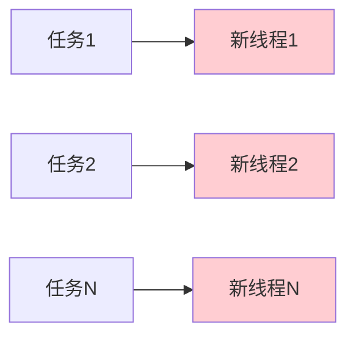
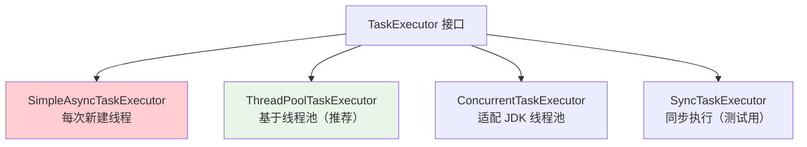
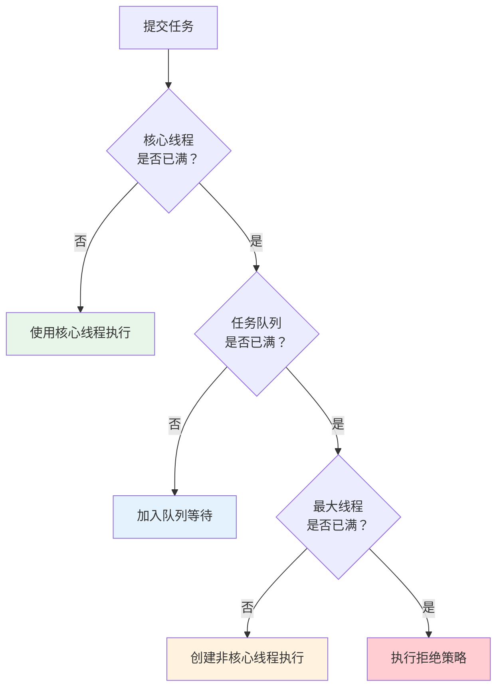

# 任务执行器配置与线程池管理

## 课程目标

- 理解 Spring TaskExecutor 体系及核心实现类
- 掌握 ThreadPoolTaskExecutor 的核心配置参数
- 能够根据业务需求自定义线程池
- 能够为不同异步任务配置独立的线程池
- 理解线程池拒绝策略及适用场景


## 回顾与导入

在上一讲中，我们使用 `@Async` 实现了异步方法，但底层使用的是 Spring 默认的 `SimpleAsyncTaskExecutor`。

**默认执行器的局限：**

| 问题           | 说明                                       |
| -------------- | ------------------------------------------ |
| **无线程复用** | 每个任务创建一个新线程，高并发下线程数爆炸 |
| **无容量限制** | 可以创建无限线程，可能导致 OOM             |
| **无拒绝策略** | 资源耗尽时无法优雅降级                     |
| **性能差**     | 频繁创建销毁线程开销大                     |



**生产环境必须配置自定义线程池！** 本节课将详细讲解如何配置和管理线程池。


## TaskExecutor 体系概述

### 什么是 TaskExecutor

`TaskExecutor` 是 Spring 提供的任务执行器抽象接口，类似于 Java 的 `Executor`，但增加了 Spring 的生命周期管理能力。



### 核心实现类对比

| 实现类                       | 说明                                 | 适用场景            |
| ---------------------------- | ------------------------------------ | ------------------- |
| `SimpleAsyncTaskExecutor`    | 每次调用新建线程，不重用             | ❌ 生产环境不推荐    |
| **`ThreadPoolTaskExecutor`** | 基于线程池，支持核心参数             | ✅ **最常用，推荐**  |
| `ConcurrentTaskExecutor`     | 适配 `java.util.concurrent.Executor` | 需要适配 JDK 线程池 |
| `SyncTaskExecutor`           | 同步执行，不异步                     | 单元测试            |

> [!NOTE]
> 本课重点讲解 `ThreadPoolTaskExecutor`，它是 Spring 对 `java.util.concurrent.ThreadPoolExecutor` 的封装，提供了更友好的配置方式。


## 配置 ThreadPoolTaskExecutor

### 核心参数

| 参数                       | 说明                   | 默认值            |
| -------------------------- | ---------------------- | ----------------- |
| `corePoolSize`             | 核心线程数（常驻线程） | 1                 |
| `maxPoolSize`              | 最大线程数             | Integer.MAX_VALUE |
| `queueCapacity`            | 任务队列容量           | Integer.MAX_VALUE |
| `keepAliveSeconds`         | 非核心线程空闲存活时间 | 60 秒             |
| `threadNamePrefix`         | 线程名称前缀           | 无                |
| `rejectedExecutionHandler` | 拒绝策略               | AbortPolicy       |

### 线程池工作流程



### 参数设置原则

| 场景           | 建议配置                                    |
| -------------- | ------------------------------------------- |
| **CPU 密集型** | corePoolSize = CPU 核心数 + 1               |
| **I/O 密集型** | corePoolSize = CPU 核心数 × 2（或更多）     |
| **混合型**     | corePoolSize = CPU 核心数 × 2，适当增大队列 |
| **队列容量**   | 根据任务提交频率和系统内存合理设置          |

### 基本配置示例

```java
@Configuration
public class AsyncConfig {

    @Bean(name = "taskExecutor")
    public ThreadPoolTaskExecutor taskExecutor() {
        ThreadPoolTaskExecutor executor = new ThreadPoolTaskExecutor();
        // 核心线程数：常驻线程数
        executor.setCorePoolSize(5);
        // 最大线程数：核心 + 非核心
        executor.setMaxPoolSize(20);
        // 任务队列容量：当核心线程满时，任务进入队列
        executor.setQueueCapacity(100);
        // 非核心线程空闲存活时间
        executor.setKeepAliveSeconds(60);
        // 线程名称前缀（便于监控）
        executor.setThreadNamePrefix("async-task-");
        // 拒绝策略：当线程池和队列都满时的处理
        executor.setRejectedExecutionHandler(new ThreadPoolExecutor.CallerRunsPolicy());
        // 等待任务完成后再关闭（优雅关闭）
        executor.setWaitForTasksToCompleteOnShutdown(true);
        // 等待超时时间
        executor.setAwaitTerminationSeconds(30);
        // 初始化线程池
        executor.initialize();
        return executor;
    }
}
```

### 使用自定义线程池

在 `@Async` 中通过 `value` 属性指定线程池 Bean 名称：

```java
@Service
public class AsyncLogService {

    @Async("taskExecutor")  // 指定使用自定义线程池
    public void logAsync(String msg) {
        System.out.println("线程: " + Thread.currentThread().getName());
        // 输出: 线程: async-task-1
    }
}
```

### 在 application.yml 中配置（简化方式）

Spring Boot 也支持通过配置文件配置线程池：

```yaml
spring:
  task:
    execution:
      pool:
        core-size: 5
        max-size: 20
        queue-capacity: 100
        keep-alive: 60s
      thread-name-prefix: async-task-
      shutdown:
        await-termination: true
        await-termination-period: 30s
```

这种方式会自动创建 `TaskExecutor` Bean，名称为 `applicationTaskExecutor`。但灵活性不如 Java 配置。


## 多个独立线程池

### 为什么需要多个线程池

| 场景         | 说明                         |
| ------------ | ---------------------------- |
| **任务隔离** | 日志任务不能影响核心业务任务 |
| **资源隔离** | 不同任务使用不同资源配额     |
| **性能调优** | 不同任务有不同负载特征       |

### 场景分析

| 任务类型  | 特点           | 推荐配置                  |
| --------- | -------------- | ------------------------- |
| 操作日志  | 简单快速，量大 | 核心 3，最大 10，队列 200 |
| 导出报表  | 耗时较长       | 核心 2，最大 5，队列 50   |
| 邮件/通知 | I/O 密集       | 核心 5，最大 20，队列 300 |
| 数据同步  | 高负载         | 核心 4，最大 15，队列 100 |

### 配置多个线程池

```java
@Configuration
public class AsyncConfig {

    /**
     * 核心业务线程池（日志、通知等）
     */
    @Bean(name = "coreExecutor")
    public ThreadPoolTaskExecutor coreExecutor() {
        ThreadPoolTaskExecutor executor = new ThreadPoolTaskExecutor();
        executor.setCorePoolSize(3);
        executor.setMaxPoolSize(10);
        executor.setQueueCapacity(50);
        executor.setThreadNamePrefix("core-");
        executor.setRejectedExecutionHandler(new ThreadPoolExecutor.CallerRunsPolicy());
        executor.initialize();
        return executor;
    }

    /**
     * 报表/导出线程池（耗时长，独立资源）
     */
    @Bean(name = "reportExecutor")
    public ThreadPoolTaskExecutor reportExecutor() {
        ThreadPoolTaskExecutor executor = new ThreadPoolTaskExecutor();
        executor.setCorePoolSize(2);
        executor.setMaxPoolSize(5);
        executor.setQueueCapacity(20);
        executor.setThreadNamePrefix("report-");
        executor.setRejectedExecutionHandler(new ThreadPoolExecutor.DiscardPolicy());
        executor.initialize();
        return executor;
    }

    /**
     * 邮件/通知线程池（高延迟 I/O）
     */
    @Bean(name = "mailExecutor")
    public ThreadPoolTaskExecutor mailExecutor() {
        ThreadPoolTaskExecutor executor = new ThreadPoolTaskExecutor();
        executor.setCorePoolSize(5);
        executor.setMaxPoolSize(20);
        executor.setQueueCapacity(200);
        executor.setThreadNamePrefix("mail-");
        executor.setRejectedExecutionHandler(new ThreadPoolExecutor.AbortPolicy());
        executor.initialize();
        return executor;
    }
}
```

### 在 @Async 中指定不同线程池

```java
@Service
public class AsyncTaskService {

    @Async("coreExecutor")
    public void logTask(String msg) {
        // 使用核心线程池
        System.out.println("核心任务: " + Thread.currentThread().getName());
    }

    @Async("reportExecutor")
    public void reportTask() {
        // 使用报表线程池
        System.out.println("报表任务: " + Thread.currentThread().getName());
    }

    @Async("mailExecutor")
    public void mailTask(String email) {
        // 使用邮件线程池
        System.out.println("邮件任务: " + Thread.currentThread().getName());
    }
}
```


## 拒绝策略详解

### 什么是拒绝策略

当线程池已满（核心线程、任务队列、最大线程都已饱和）时，新提交的任务会触发拒绝策略。

### 内置拒绝策略

| 策略                    | 说明                              | 适用场景                     |
| ----------------------- | --------------------------------- | ---------------------------- |
| **AbortPolicy（默认）** | 抛出 `RejectedExecutionException` | 关键任务，不能丢弃           |
| **CallerRunsPolicy**    | 由调用方线程执行                  | 希望任务必须执行，且需要反馈 |
| **DiscardPolicy**       | 静默丢弃任务                      | 非关键任务，可丢失           |
| **DiscardOldestPolicy** | 丢弃队列中最旧的任务，重试提交    | 最新任务优先级高             |

### 演示不同拒绝策略

```java
@RestController
@RequestMapping("/api/demo")
public class RejectionDemoController {

    @Autowired
    @Qualifier("customExecutor")
    private ThreadPoolTaskExecutor executor;

    @GetMapping("/reject")
    public String rejectDemo() {
        // 模拟大量提交，触发拒绝策略
        for (int i = 0; i < 1000; i++) {
            final int taskId = i;
            executor.submit(() -> {
                try {
                    Thread.sleep(1000);
                    System.out.println("任务 " + taskId + " 完成");
                } catch (InterruptedException e) {}
            });
        }
        return "任务已提交";
    }
}
```

### 自定义拒绝策略

```java
@Bean(name = "customExecutor")
public ThreadPoolTaskExecutor customExecutor() {
    ThreadPoolTaskExecutor executor = new ThreadPoolTaskExecutor();
    executor.setCorePoolSize(2);
    executor.setMaxPoolSize(5);
    executor.setQueueCapacity(10);
    executor.setThreadNamePrefix("custom-");

    // 自定义拒绝策略：记录日志并发送告警
    executor.setRejectedExecutionHandler((r, pool) -> {
        System.out.println("⚠️ 任务被拒绝！线程池已满");
        // 可以发送告警邮件或记录到监控系统
        throw new RejectedExecutionException("线程池已满，任务被拒绝");
    });

    executor.initialize();
    return executor;
}
```


## 线程池监控与调优

```java
@Component
public class ThreadPoolMonitor {

    @Autowired
    @Qualifier("taskExecutor")
    private ThreadPoolTaskExecutor executor;

    public void monitor() {
        ThreadPoolExecutor pool = executor.getThreadPoolExecutor();
        System.out.println("===== 线程池监控 =====");
        System.out.println("核心线程数: " + pool.getCorePoolSize());
        System.out.println("最大线程数: " + pool.getMaximumPoolSize());
        System.out.println("当前活跃线程: " + pool.getActiveCount());
        System.out.println("当前池大小: " + pool.getPoolSize());
        System.out.println("队列大小: " + pool.getQueue().size());
        System.out.println("已完成任务: " + pool.getCompletedTaskCount());
        System.out.println("任务总数: " + pool.getTaskCount());
    }
}
```


## 注意事项

### 1. 线程池大小设置

- **CPU 密集型**：corePoolSize = CPU 核心数 + 1（充分利用 CPU）
- **I/O 密集型**：corePoolSize = CPU 核心数 × 2（更关注 I/O 等待）
- **混合型**：根据实际负载测试，逐步调整

### 2. 队列容量设置

- 队列过大会占用内存，可能导致 OOM
- 队列过小容易触发拒绝策略
- 通常设置为 50-1000，根据任务量和内存决定

### 3. 优雅关闭

```java
executor.setWaitForTasksToCompleteOnShutdown(true);
executor.setAwaitTerminationSeconds(30);
```

确保应用关闭时，正在执行的任务能够完成。

### 4. 监控与告警

- 监控活跃线程数、队列大小
- 设置告警阈值（如队列超过 80%）
- 定期检查任务完成情况


## 小结

本节课我们学习了：

1. **TaskExecutor 体系**：了解主要实现类的特点
2. **ThreadPoolTaskExecutor 配置**：核心参数含义及设置原则
3. **多个线程池**：为不同任务隔离资源
4. **拒绝策略**：四种内置策略及适用场景
5. **监控与调优**：如何监控线程池状态


## 作业

### 作业一：代码阅读——线程池参数分析

```java
@Bean
public ThreadPoolTaskExecutor executor() {
    ThreadPoolTaskExecutor executor = new ThreadPoolTaskExecutor();
    executor.setCorePoolSize(5);
    executor.setMaxPoolSize(20);
    executor.setQueueCapacity(50);
    executor.setThreadNamePrefix("test-");
    return executor;
}
```

**问题：**

1. 当提交 60 个任务时，线程池会创建多少个线程？为什么？
2. 当提交 60 个任务后，再提交第 61 个任务，会发生什么（假设队列已满）？
3. 如果改为 `setQueueCapacity(100)`，最大同时执行的任务数是多少？

---

### 作业二：配置自定义线程池

在图书管理系统中完成以下任务：

1. 创建 `AsyncConfig` 配置类，定义默认线程池：
   - 核心 5，最大 15，队列 100
   - 线程名前缀：`async-`
   - 拒绝策略：CallerRunsPolicy
   - 优雅关闭：等待 30 秒

2. 在 `AsyncLogService` 中指定使用该线程池。

3. 测试：创建多个异步任务，观察线程名是否带有 `async-` 前缀。

---

### 作业三：多个线程池隔离

1. 配置两个线程池：
   - `fastExecutor`：核心 3，最大 10，队列 50
   - `slowExecutor`：核心 2，最大 5，队列 30

2. 创建两个异步方法分别使用不同线程池：
   - `fastTask()` 模拟快速操作（sleep 100ms）
   - `slowTask()` 模拟慢速操作（sleep 2000ms）

3. 编写 Controller，并发调用这两个方法，观察线程池独立运行。
