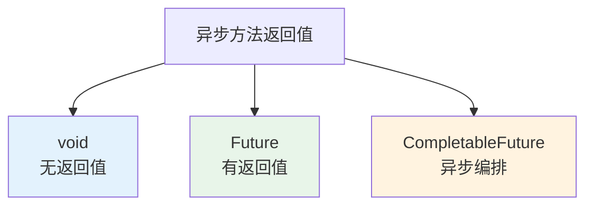

# 异步方法返回值与异常处理

## 课程目标

- 掌握无返回值异步方法的使用和异常处理
- 掌握使用 Future 和 AsyncResult 获取异步方法返回值
- 掌握 CompletableFuture 的链式调用和组合操作
- 理解异步方法的异常处理机制（AsyncUncaughtExceptionHandler）
- 能够为图书管理系统实现异步报表导出功能


## 回顾与导入

在前面内容中，我们学习了 @Async 的基本用法和线程池配置，但所有示例都是无返回值的（`void`）。在实际项目中，我们经常需要异步任务返回结果，并且需要妥善处理可能发生的异常。



本节课将深入讲解异步方法的返回值类型、异常处理机制以及异步编排的最佳实践。


## 无返回值异步方法

### 基本用法

无返回值异步方法是最简单的异步形式，方法声明为 `void`：

```java
@Service
public class AsyncLogService {

    @Async("logExecutor")
    public void logOperation(String msg) {
        // 异步执行，无返回值
        System.out.println("日志记录: " + msg);
    }
}
```

### 异常处理

无返回值异步方法的异常**不会传播到调用方**，需要单独处理。默认情况下，异常会被记录到日志。

```java
@Service
public class AsyncLogService {

    @Async("logExecutor")
    public void logOperation(String msg) {
        // 如果这里抛出异常，调用方不会收到
        if (msg == null || msg.isEmpty()) {
            throw new IllegalArgumentException("消息不能为空");
        }
        System.out.println("日志记录: " + msg);
    }
}
```

**调用方无法感知异常：**

```java
@RestController
public class LogController {
    @Autowired
    private AsyncLogService asyncLogService;

    @GetMapping("/log")
    public String log() {
        // 即使 asyncLogService.logOperation 抛出异常，这里也捕获不到
        asyncLogService.logOperation(null);
        return "success";  // 总是返回 success
    }
}
```

> [!CAUTION]
> 无返回值异步方法的异常默认**静默吞没**，仅打印日志。生产环境必须配置 `AsyncUncaughtExceptionHandler` 来统一处理。

### 配置全局异步异常处理器

实现 `AsyncUncaughtExceptionHandler` 接口：

```java
@Component
@EnableAsync
public class AsyncConfig implements AsyncConfigurer {

    private static final Logger logger = LoggerFactory.getLogger(AsyncConfig.class);

    @Override
    public Executor getAsyncExecutor() {
        ThreadPoolTaskExecutor executor = new ThreadPoolTaskExecutor();
        executor.setCorePoolSize(5);
        executor.setMaxPoolSize(20);
        executor.setQueueCapacity(100);
        executor.setThreadNamePrefix("async-");
        executor.initialize();
        return executor;
    }

    @Override
    public AsyncUncaughtExceptionHandler getAsyncUncaughtExceptionHandler() {
        return new CustomAsyncExceptionHandler();
    }

    /**
     * 自定义异步异常处理器
     */
    public static class CustomAsyncExceptionHandler implements AsyncUncaughtExceptionHandler {
        @Override
        public void handleUncaughtException(Throwable ex, Method method, Object... params) {
            logger.error("异步方法执行异常: 方法={}.{}，参数={}，异常信息={}",
                    method.getDeclaringClass().getSimpleName(),
                    method.getName(),
                    params,
                    ex.getMessage(),
                    ex);
            // 可以发送告警邮件、记录到数据库等
        }
    }
}
```

> [!NOTE]
> 实现 `AsyncConfigurer` 接口可以同时配置线程池和异常处理器，更加集中。


## 有返回值异步方法

### 使用 Future<T> 接收结果

有返回值的异步方法返回 `Future<T>`，调用方可以通过 `Future` 获取执行结果。

```java
@Service
public class AsyncTaskService {

    @Async("reportExecutor")
    public Future<String> generateReport() {
        // 模拟耗时报表生成
        try {
            Thread.sleep(2000);
        } catch (InterruptedException e) {
            Thread.currentThread().interrupt();
        }
        // 使用 AsyncResult 包装返回值
        return new AsyncResult<>("报表内容: 2026年销售数据");
    }
}
```

**调用方获取结果：**
```java
@RestController
public class ReportController {
    @Autowired
    private AsyncTaskService asyncTaskService;

    @GetMapping("/report")
    public String getReport() throws Exception {
        Future<String> future = asyncTaskService.generateReport();
        // 阻塞等待结果（最多等待 5 秒）
        String result = future.get(5, TimeUnit.SECONDS);
        return result;
    }
}
```

### Future 核心方法

| 方法                           | 说明                                |
| ------------------------------ | ----------------------------------- |
| `get()`                        | 阻塞等待结果（无限等待）            |
| `get(timeout, unit)`           | 限时等待，超时抛出 TimeoutException |
| `isDone()`                     | 判断任务是否已完成                  |
| `isCancelled()`                | 判断任务是否被取消                  |
| `cancel(boolean mayInterrupt)` | 取消任务                            |

### 使用 AsyncResult 包装返回值

Spring 提供了 `AsyncResult` 类，实现 `Future` 接口，用于包装异步方法的返回值。

```java
@Async
public Future<List<Book>> asyncSearchBooks(String keyword) {
    List<Book> books = bookRepository.search(keyword);
    return new AsyncResult<>(books);
}
```

**也可以直接返回 `CompletableFuture`（推荐）：**

```java
@Async
public CompletableFuture<List<Book>> asyncSearchBooks(String keyword) {
    List<Book> books = bookRepository.search(keyword);
    return CompletableFuture.completedFuture(books);
}
```

> [!NOTE]
> 推荐使用 `CompletableFuture`，因为它提供了更丰富的异步编排功能。


## CompletableFuture 进阶

### 什么是 CompletableFuture

`CompletableFuture` 是 Java 8 引入的异步编程工具，比 `Future` 更强大：

- 支持链式调用（`thenApply`、`thenAccept`、`thenRun`）
- 支持组合多个异步任务（`allOf`、`anyOf`）
- 支持异常处理（`exceptionally`、`handle`）
- 支持手动完成（`complete`、`completeExceptionally`）

### 链式调用

```java
@Async("reportExecutor")
public CompletableFuture<String> generateReport() {
    // 第一步：生成报表数据（耗时）
    return CompletableFuture.supplyAsync(() -> {
        try { Thread.sleep(3000); } catch (InterruptedException e) {}
        return "原始报表数据";
    }).thenApply(data -> {
        // 第二步：格式化
        return data.toUpperCase();
    }).thenApply(data -> {
        // 第三步：添加标题
        return "=== 销售报表 ===\n" + data;
    }).thenApply(data -> {
        // 第四步：添加时间戳
        return data + "\n生成时间: " + LocalDateTime.now();
    });
}
```

**调用方可以继续编排：**

```java
CompletableFuture<String> future = asyncTaskService.generateReport();
future.thenAccept(result -> {
    System.out.println("报表生成完成: " + result);
}).exceptionally(ex -> {
    System.err.println("报表生成失败: " + ex.getMessage());
    return null;
});
```

### 常用 CompletableFuture 方法

| 方法                                         | 说明                               |
| -------------------------------------------- | ---------------------------------- |
| `thenApply(Function)`                        | 转换结果（同步）                   |
| `thenApplyAsync(Function)`                   | 转换结果（异步）                   |
| `thenAccept(Consumer)`                       | 消费结果（无返回值）               |
| `thenRun(Runnable)`                          | 执行动作（不依赖结果）             |
| `thenCompose(Function)`                      | 扁平映射（返回 CompletableFuture） |
| `thenCombine(CompletableFuture, BiFunction)` | 组合两个任务结果                   |
| `allOf(CompletableFuture...)`                | 等待所有任务完成                   |
| `anyOf(CompletableFuture...)`                | 等待任意一个任务完成               |
| `exceptionally(Function)`                    | 异常时提供备用值                   |
| `handle(BiFunction)`                         | 处理结果或异常                     |
| `complete(T value)`                          | 手动完成（设置结果）               |
| `completeExceptionally(Throwable ex)`        | 手动异常完成                       |

### 组合多个异步任务

```java
@Service
public class AsyncTaskService {

    @Async("reportExecutor")
    public CompletableFuture<String> fetchSalesData() {
        // 模拟获取销售数据
        return CompletableFuture.completedFuture("销售数据: 1000万");
    }

    @Async("reportExecutor")
    public CompletableFuture<String> fetchUserData() {
        // 模拟获取用户数据
        return CompletableFuture.completedFuture("用户数据: 5000人");
    }

    @Async("reportExecutor")
    public CompletableFuture<String> fetchProductData() {
        // 模拟获取产品数据
        return CompletableFuture.completedFuture("产品数据: 200种");
    }

    /**
     * 组合多个异步任务的结果
     */
    public CompletableFuture<String> generateFullReport() {
        CompletableFuture<String> sales = fetchSalesData();
        CompletableFuture<String> users = fetchUserData();
        CompletableFuture<String> products = fetchProductData();

        // 等待所有任务完成，然后汇总
        return CompletableFuture.allOf(sales, users, products)
                .thenApply(v -> {
                    String result = sales.join() + "\n" +
                                    users.join() + "\n" +
                                    products.join();
                    return "=== 综合报表 ===\n" + result;
                });
    }
}
```

### 异常处理

```java
@Async("reportExecutor")
public CompletableFuture<String> generateReportWithException() {
    return CompletableFuture.supplyAsync(() -> {
        // 模拟可能抛异常的操作
        if (Math.random() > 0.5) {
            throw new RuntimeException("生成报表失败");
        }
        return "报表内容";
    }).exceptionally(ex -> {
        // 异常时返回默认值
        System.err.println("报表生成异常: " + ex.getMessage());
        return "默认报表（异常时生成）";
    });
}
```

使用 `handle` 同时处理正常结果和异常：

```java
public CompletableFuture<String> generateReportWithHandle() {
    return CompletableFuture.supplyAsync(() -> {
        if (Math.random() > 0.5) {
            throw new RuntimeException("处理失败");
        }
        return "成功报表";
    }).handle((result, ex) -> {
        if (ex != null) {
            return "错误报表: " + ex.getMessage();
        }
        return "正常报表: " + result;
    });
}
```


## 实战：图书管理系统异步报表导出

### 场景描述

用户在前端触发报表生成，后台异步生成 Excel 文件，生成完成后将文件路径返回给用户。

### 实现

**步骤一：异步任务服务**

```java
@Service
public class ReportService {

    @Autowired
    private BookMapper bookMapper;

    /**
     * 异步生成图书报表
     */
    @Async("reportExecutor")
    public CompletableFuture<String> generateBookReport() {
        return CompletableFuture.supplyAsync(() -> {
            // 1. 查询所有图书
            List<Book> books = bookMapper.selectList(null);
            
            // 2. 生成报表内容
            StringBuilder sb = new StringBuilder();
            sb.append("图书库存报表\n");
            sb.append("生成时间: ").append(LocalDateTime.now()).append("\n");
            sb.append("----------------------------------------\n");
            sb.append(String.format("%-6s %-20s %-10s %-8s\n", "ID", "书名", "价格", "库存"));
            sb.append("----------------------------------------\n");
            for (Book book : books) {
                sb.append(String.format("%-6d %-20s %-10.2f %-8d\n",
                        book.getId(), book.getTitle(), book.getPrice(), book.getStock()));
            }
            sb.append("----------------------------------------\n");
            sb.append("总计: ").append(books.size()).append(" 本图书\n");
            
            // 3. 写入文件（模拟）
            String fileName = "report_" + System.currentTimeMillis() + ".txt";
            File file = new File("./reports/" + fileName);
            file.getParentFile().mkdirs();
            try (FileWriter writer = new FileWriter(file)) {
                writer.write(sb.toString());
            } catch (IOException e) {
                throw new RuntimeException("报表生成失败", e);
            }
            
            return file.getAbsolutePath();
        }).exceptionally(ex -> {
            // 异常时返回错误信息
            return "ERROR: " + ex.getMessage();
        });
    }
}
```

**步骤二：Controller**

```java
@RestController
@RequestMapping("/api/reports")
public class ReportController {

    private final ReportService reportService;

    public ReportController(ReportService reportService) {
        this.reportService = reportService;
    }

    /**
     * 触发报表生成（异步）
     * 立即返回，报表在后台生成
     */
    @GetMapping("/books")
    public Result<String> generateBookReport() {
        CompletableFuture<String> future = reportService.generateBookReport();
        // 不阻塞，立即返回
        return Result.success("报表生成任务已提交，请稍后查看");
    }

    /**
     * 等待报表生成完成（阻塞等待）
     */
    @GetMapping("/books/wait")
    public Result<String> generateBookReportWait() throws Exception {
        CompletableFuture<String> future = reportService.generateBookReport();
        // 等待最多 30 秒
        String filePath = future.get(30, java.util.concurrent.TimeUnit.SECONDS);
        if (filePath.startsWith("ERROR")) {
            return Result.error(500, filePath);
        }
        return Result.success("报表已生成: " + filePath);
    }

    /**
     * 异步生成并回调（通过 CompletableFuture 链式调用）
     */
    @GetMapping("/books/async")
    public CompletableFuture<Result<String>> generateBookReportAsync() {
        return reportService.generateBookReport()
                .thenApply(path -> {
                    if (path.startsWith("ERROR")) {
                        return Result.error(500, path);
                    }
                    return Result.success("报表已生成: " + path);
                })
                .exceptionally(ex -> Result.error(500, "报表生成失败: " + ex.getMessage()));
    }
}
```

**步骤三：测试**

```bash
curl http://localhost:8080/api/reports/books
# 立即返回: {"code":200,"message":"报表生成任务已提交，请稍后查看"}

curl http://localhost:8080/api/reports/books/async
# 异步返回: {"code":200,"message":"报表已生成: ./reports/report_123456789.txt"}
```


## 注意事项

### 1. Future.get() 阻塞问题

`get()` 会阻塞当前线程，如果异步方法执行时间过长，可能导致请求超时。**必须设置超时时间**。

```java
// ❌ 无限等待
String result = future.get();

// ✅ 限时等待
String result = future.get(10, TimeUnit.SECONDS);
```

### 2. 异常处理优先原则

- 无返回值异步方法：使用 `AsyncUncaughtExceptionHandler`
- 有返回值异步方法：使用 `future.get()` 捕获异常
- CompletableFuture：使用 `exceptionally` 或 `handle`

### 3. 异步方法返回类型选择

| 场景         | 推荐返回类型                |
| ------------ | --------------------------- |
| 不需要结果   | `void`                      |
| 需要获取结果 | `CompletableFuture<T>`      |
| 简单场景     | `Future<T>` + `AsyncResult` |

### 4. 线程池隔离

为不同返回值类型的任务配置不同的线程池，避免相互影响。


## 小结

本节课我们学习了：

1. **无返回值异步方法**：使用 `void`，异常通过 `AsyncUncaughtExceptionHandler` 处理
2. **有返回值异步方法**：
   - `Future` + `AsyncResult` 包装结果
   - `Future.get()` 获取结果并处理异常
3. **CompletableFuture 进阶**：
   - 链式调用（`thenApply`、`thenAccept`、`thenRun`）
   - 组合多个任务（`allOf`、`anyOf`）
   - 异常处理（`exceptionally`、`handle`）
4. **实战应用**：异步报表生成和导出


## 作业

### 作业一：代码阅读——异步返回值识别

阅读以下代码，回答问题。

```java
@Service
public class AsyncService {
    @Async
    public void voidMethod() {
        throw new RuntimeException("void 异常");
    }

    @Async
    public Future<String> futureMethod() {
        return new AsyncResult<>("success");
    }

    @Async
    public CompletableFuture<String> completableMethod() {
        return CompletableFuture.supplyAsync(() -> {
            if (Math.random() > 0.5) {
                throw new RuntimeException("completable 异常");
            }
            return "ok";
        });
    }
}
```

**问题：**
1. `voidMethod` 的异常会在调用方捕获吗？如何统一处理？
2. 调用 `futureMethod().get()` 时，返回什么？
3. `completableMethod` 的异常如何捕获？

---

### 作业二：实现异步报表导出

在图书管理系统中完成以下任务：

1. 创建 `ReportService`，包含一个异步方法 `generateBookReport()`，返回 `CompletableFuture<String>`。
2. 报表内容：图书列表（ID、书名、价格、库存）。
3. 模拟耗时 3 秒。
4. 在 Controller 中提供两个接口：
   - `/api/reports/books`：立即返回 "任务已提交"
   - `/api/reports/books/wait`：等待结果后返回报表内容
5. 测试两个接口的响应时间和行为。

---

### 作业三：CompletableFuture 链式调用

1. 创建三个异步方法：
   - `fetchUserData()`：获取用户数据（模拟 1 秒）
   - `fetchBookData()`：获取图书数据（模拟 2 秒）
   - `fetchOrderData()`：获取订单数据（模拟 1.5 秒）
2. 使用 `CompletableFuture.allOf()` 组合这三个任务。
3. 将三个结果拼接成一个完整的报表字符串。
4. 在 Controller 中暴露接口返回组合结果。
