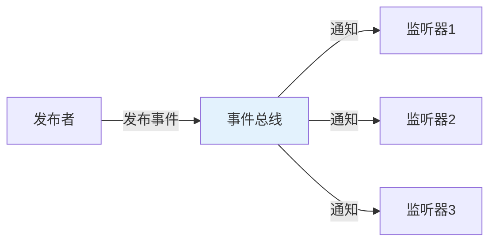
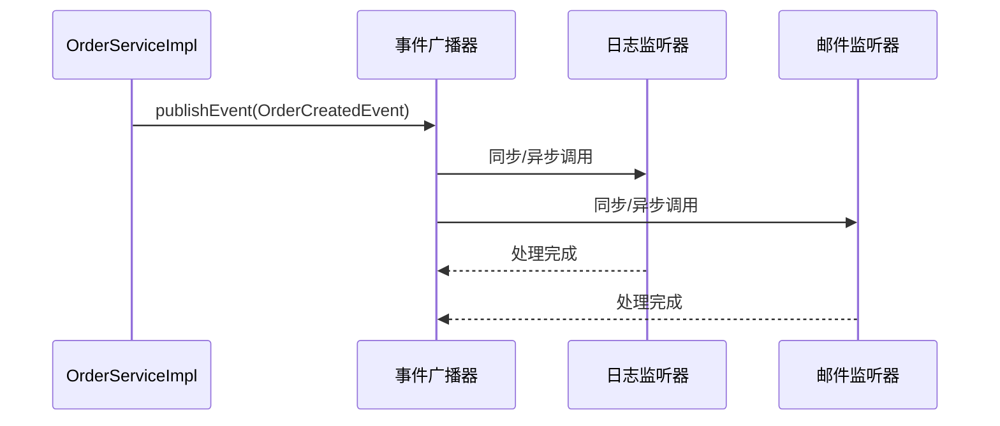

# 异步事件与 ApplicationEvent

## 课程目标

- 理解 Spring 事件机制的核心概念和应用场景
- 掌握自定义事件和事件监听器的定义
- 掌握使用 `@EventListener` 注解简化事件监听
- 掌握使用 `@Async` 实现异步事件监听
- 掌握条件事件监听和事件顺序控制
- 能够在图书管理系统中，基于订单创建流程实现事件驱动的异步解耦


## 回顾与导入

在前面课程中，我们学习了 `@Async` 的基本用法、线程池配置和异步返回值。异步处理的一个重要应用场景是**事件驱动架构**——通过事件发布/订阅模式实现模块间解耦。



事件驱动的好处：

- 松耦合：发布者和监听者互不感知
- 可扩展：添加新监听器不影响现有代码
- 异步化：监听器可以异步执行

本节课以图书管理系统中的订单创建流程为主线。`OrderServiceImpl.createOrder` 负责创建订单、扣减库存、插入订单项、更新总金额，并返回完整订单。订单创建成功后，系统需要发送邮件、记录日志、更新销量统计、通知营销系统。这些操作适合通过 Spring 事件机制解耦。


## Spring 事件机制概述

### 核心组件

| 组件                            | 说明                                              |
| ------------------------------- | ------------------------------------------------- |
| **ApplicationEvent**            | 事件对象，继承自 `ApplicationEvent`，封装事件数据 |
| **ApplicationListener**         | 事件监听器接口，实现 `onApplicationEvent` 方法    |
| **ApplicationEventPublisher**   | 事件发布器，提供 `publishEvent` 方法              |
| **ApplicationEventMulticaster** | 事件广播器，负责将事件分发给监听器                |

### 事件处理流程



### 同步 vs 异步事件

| 对比         | 同步事件         | 异步事件       |
| ------------ | ---------------- | -------------- |
| **执行线程** | 发布者线程       | 独立线程池     |
| **阻塞**     | 阻塞发布者       | 不阻塞发布者   |
| **异常处理** | 异常传播给发布者 | 需单独处理     |
| **适用场景** | 必须立即处理     | 后台任务、通知 |


## 自定义事件

### 定义订单创建事件

在图书管理系统中，订单创建事件 `OrderCreatedEvent` 可以基于 `Order` 对象构建。事件中携带`Order` 对象的数据，监听器无需再次查询订单即可完成邮件、日志、统计等操作。

```java
/**
 * 订单创建事件
 */
public class OrderCreatedEvent extends ApplicationEvent {

    private final Long orderId;
    private final String orderNumber;
    private final Double totalAmount;
    private final String status;
    private final LocalDateTime createdAt;
    private final List<OrderItem> items;

    public OrderCreatedEvent(Object source, Order order) {
        super(source);
        this.orderId = order.getId();
        this.orderNumber = order.getOrderNumber();
        this.totalAmount = order.getTotalAmount();
        this.status = order.getStatus();
        this.createdAt = order.getCreatedAt();
        this.items = order.getItems() == null
                ? Collections.emptyList()
                : List.copyOf(order.getItems());
    }

    public Long getOrderId() {
        return orderId;
    }

    public String getOrderNumber() {
        return orderNumber;
    }

    public Double getTotalAmount() {
        return totalAmount;
    }

    public String getStatus() {
        return status;
    }

    public LocalDateTime getCreatedAt() {
        return createdAt;
    }

    public List<OrderItem> getItems() {
        return items;
    }

    public int getTotalQuantity() {
        return items.stream()
                .mapToInt(OrderItem::getQuantity)
                .sum();
    }

    @Override
    public String toString() {
        return "OrderCreatedEvent{" +
                "orderId=" + orderId +
                ", orderNumber='" + orderNumber + '\'' +
                ", totalAmount=" + totalAmount +
                ", totalQuantity=" + getTotalQuantity() +
                '}';
    }
}
```

> [!NOTE]
> `source` 是事件源，通常传入发布者对象。这里传入 `OrderServiceImpl` 实例，表示事件由订单服务发布。

### 在订单服务中发布事件

在 `OrderServiceImpl` 中注入 `ApplicationEventPublisher`，在订单创建完成并查询到完整订单后发布事件。

```java
@Service
@Transactional
public class OrderServiceImpl implements OrderService {

    @Autowired
    private ApplicationEventPublisher eventPublisher;

    @Override
    public Order createOrder(List<OrderItemRequest> items) {
        // 创建订单、扣减库存、插入订单项、更新总金额
				...
          
        // 查询完整订单
        Order fullOrder = orderMapper.selectOrderWithItems(order.getId());

        // 发布订单创建事件
        eventPublisher.publishEvent(new OrderCreatedEvent(this, fullOrder));

        return fullOrder;
    }
}
```

### 定义事件监听器：实现 ApplicationListener 接口

```java
@Component
public class OrderCreatedLogListener implements ApplicationListener<OrderCreatedEvent> {

    @Override
    public void onApplicationEvent(OrderCreatedEvent event) {
        System.out.println("📝 记录订单日志: " + event);
    }
}
```


## @EventListener 注解

### 基本用法

从 Spring 4.2 开始，推荐使用 `@EventListener` 注解，无需实现接口。

```java
@Component
public class OrderEventListener {

    @EventListener
    public void handleOrderCreated(OrderCreatedEvent event) {
        System.out.println("📧 发送订单确认邮件: 订单号=" + event.getOrderNumber());
    }

    @EventListener
    public void handleOrderCreatedLog(OrderCreatedEvent event) {
        System.out.println("📝 记录订单日志: " + event);
    }
}
```

### 支持多个事件类型

同一个监听器类可以监听多个事件：

```java
@Component
public class MultiOrderEventListener {

    @EventListener
    public void handleOrderCreated(OrderCreatedEvent event) {
        System.out.println("处理订单创建: " + event.getOrderNumber());
    }

    @EventListener
    public void handleOrderPaid(OrderPaidEvent event) {
        System.out.println("处理订单支付: " + event.getOrderId());
    }

    @EventListener
    public void handleOrderCancelled(OrderCancelledEvent event) {
        System.out.println("处理订单取消: " + event.getOrderId());
    }
}
```

### 返回值自动触发新事件

如果 `@EventListener` 方法有返回值，Spring 会自动将返回值作为新事件发布。

```java
@Component
public class OrderNotificationListener {

    @EventListener
    public OrderNotificationEvent handleOrderCreated(OrderCreatedEvent event) {
        System.out.println("订单创建完成，生成通知事件");
        return new OrderNotificationEvent(this, event.getOrderId(), event.getOrderNumber());
    }
}
```


## 异步事件监听

订单创建后，发送邮件和记录日志通常比较耗时。在 `@EventListener` 方法上添加 `@Async`，即可将事件处理变为异步。

```java
@Component
public class AsyncOrderEventListener {

    @Async("mailExecutor")
    @EventListener
    public void handleOrderCreatedEmail(OrderCreatedEvent event) {
        System.out.println("📧 [异步] 发送邮件，订单号=" + event.getOrderNumber()
                + "，线程: " + Thread.currentThread().getName());
        try {
            Thread.sleep(2000);
        } catch (InterruptedException e) {
            Thread.currentThread().interrupt();
        }
        System.out.println("📧 [异步] 邮件发送完成");
    }

    @Async("logExecutor")
    @EventListener
    public void handleOrderCreatedLog(OrderCreatedEvent event) {
        System.out.println("📝 [异步] 记录日志，订单ID=" + event.getOrderId()
                + "，线程: " + Thread.currentThread().getName());
        try {
            Thread.sleep(500);
        } catch (InterruptedException e) {
            Thread.currentThread().interrupt();
        }
        System.out.println("📝 [异步] 日志记录完成");
    }
}
```


## 条件事件监听

### 使用 condition 属性

`@EventListener` 的 `condition` 属性可以基于 SpEL 表达式控制是否执行监听器。在订单场景中，可以根据订单金额或商品总数量过滤。

```java
@Component
public class ConditionalOrderListener {

    /**
     * 仅当订单金额 > 1000 时通知营销系统
     */
    @EventListener(condition = "#event.totalAmount > 1000")
    public void handleLargeOrder(OrderCreatedEvent event) {
        System.out.println("💰 大额订单通知: 订单号=" + event.getOrderNumber()
                + "，金额=" + event.getTotalAmount());
    }

    /**
     * 仅当商品总数量 > 3 时记录批量订单日志
     */
    @EventListener(condition = "#event.totalQuantity > 3")
    public void handleBulkOrder(OrderCreatedEvent event) {
        System.out.println("📦 批量订单: 订单号=" + event.getOrderNumber()
                + "，总数量=" + event.getTotalQuantity());
    }
}
```

### SpEL 表达式可用的上下文

| 变量      | 说明                         |
| --------- | ---------------------------- |
| `#event`  | 事件对象                     |
| `#root`   | 根对象（包含事件和方法信息） |
| `#参数名` | 如果方法有参数，也可使用     |


## 事件顺序控制

当有多个同步监听器监听同一事件时，可以使用 `@Order` 注解控制执行顺序，数字越小优先级越高。

```java
@Component
public class OrderedOrderCreatedListeners {

    @Order(1)
    @EventListener
    public void first(OrderCreatedEvent event) {
        System.out.println("1. 最先执行，订单号=" + event.getOrderNumber());
    }

    @Order(2)
    @EventListener
    public void second(OrderCreatedEvent event) {
        System.out.println("2. 其次执行，订单号=" + event.getOrderNumber());
    }

    @Order(3)
    @EventListener
    public void third(OrderCreatedEvent event) {
        System.out.println("3. 最后执行，订单号=" + event.getOrderNumber());
    }
}
```

> [!NOTE]
> 如果监听器是异步的，`@Order` 只影响任务提交顺序，不保证实际执行顺序。


## 事务绑定事件

`OrderServiceImpl` 类上有 `@Transactional`，`createOrder` 方法整体处于事务中。如果监听器需要在订单真正提交后再更新商品销量，应该使用 `@TransactionalEventListener`。

```java
@Component
public class TransactionalOrderListener {

    /**
     * 事务提交后触发，用于更新商品销量
     */
    @TransactionalEventListener(phase = TransactionPhase.AFTER_COMMIT)
    public void handleAfterCommit(OrderCreatedEvent event) {
        System.out.println("事务已提交，更新商品销量，订单ID=" + event.getOrderId());

        event.getItems().forEach(item -> {
            System.out.println("图书ID=" + item.getBookId()
                    + "，数量=" + item.getQuantity()
                    + "，单价=" + item.getPrice());
            // salesService.increaseSales(item.getBookId(), item.getQuantity());
        });
    }

    /**
     * 事务回滚后触发，用于发送告警
     */
    @TransactionalEventListener(phase = TransactionPhase.AFTER_ROLLBACK)
    public void handleAfterRollback(OrderCreatedEvent event) {
        System.out.println("❌ 事务已回滚，订单创建失败，订单ID=" + event.getOrderId());
    }
}
```

| 阶段               | 说明                     |
| ------------------ | ------------------------ |
| `BEFORE_COMMIT`    | 事务提交前               |
| `AFTER_COMMIT`     | 事务提交后（默认）       |
| `AFTER_ROLLBACK`   | 事务回滚后               |
| `AFTER_COMPLETION` | 事务完成后（提交或回滚） |


## 实战：订单创建事件驱动异步处理

### 场景设计

在图书管理系统中，当用户下单后，需要执行以下操作：

1. 模拟发送订单确认邮件（异步，耗时 2 秒）
2. 模拟记录操作日志（异步，耗时 500ms）
3. 打印订单中商品信息（事务提交后执行）
4. 模拟通知营销系统（异步，耗时 1 秒，仅大额订单）

### 事件定义

使用 `OrderCreatedEvent`

### 监听器实现

```java
@Component
public class OrderEventListeners {

    // 1. 发送订单确认邮件（异步）
    @Async("mailExecutor")
    @EventListener
    public void sendEmail(OrderCreatedEvent event) {
        System.out.println("[异步] 发送订单邮件，订单号=" + event.getOrderNumber()
                + "，线程: " + Thread.currentThread().getName());
        try {
            Thread.sleep(2000);
        } catch (InterruptedException e) {
            Thread.currentThread().interrupt();
        }
        System.out.println("[异步] 邮件发送完成");
    }

    // 2. 记录操作日志（异步）
    @Async("logExecutor")
    @EventListener
    public void logOperation(OrderCreatedEvent event) {
        System.out.println("[异步] 记录订单日志，订单ID=" + event.getOrderId()
                + "，线程: " + Thread.currentThread().getName());
        try {
            Thread.sleep(500);
        } catch (InterruptedException e) {
            Thread.currentThread().interrupt();
        }
        System.out.println("[异步] 日志记录完成");
    }

    // 3. 更新商品销量（事务提交后执行）
    @TransactionalEventListener(phase = TransactionPhase.AFTER_COMMIT)
    public void updateSales(OrderCreatedEvent event) {
        System.out.println("[事务提交后] 更新商品销量，订单ID=" + event.getOrderId());
        event.getItems().forEach(item ->
                System.out.println("   - 图书ID=" + item.getBookId()
                        + "，数量=" + item.getQuantity()));
    }

    // 4. 通知营销系统（异步，仅大额订单）
    @Async("defaultExecutor")
    @EventListener(condition = "#event.totalAmount > 1000")
    public void notifyMarketing(OrderCreatedEvent event) {
        System.out.println("[异步] 大额订单通知营销系统，订单号=" + event.getOrderNumber()
                + "，金额=" + event.getTotalAmount()
                + "，线程: " + Thread.currentThread().getName());
    }
}
```

### 发布事件

在 `OrderServiceImpl.createOrder` 中，订单保存并查询完整后发布事件：

```java
Order fullOrder = orderMapper.selectOrderWithItems(order.getId());
eventPublisher.publishEvent(new OrderCreatedEvent(this, fullOrder));
return fullOrder;
```

### 验证效果

启动应用，调用创建订单接口。控制台可能输出：

```text
[同步] 记录订单日志: OrderCreatedEvent{orderId=1, orderNumber='A1B2C3D4', totalAmount=198.0, totalQuantity=2}
[异步] 发送订单邮件，订单号=A1B2C3D4，线程: mail-1
[异步] 记录订单日志，订单ID=1，线程: log-1
[事务提交后] 更新商品销量，订单ID=1
[异步] 日志记录完成
[异步] 邮件发送完成
```

> [!NOTE]
> 异步监听器的执行顺序不确定，取决于线程池调度。  
> `@TransactionalEventListener(AFTER_COMMIT)` 在事务提交后执行，适合更新销量、发送通知等依赖订单已落库的操作。


## 注意事项

### 1. 事件广播器的配置

Spring 默认使用 `SimpleApplicationEventMulticaster`，支持同步和异步。如果需要自定义，可以配置自己的 `ApplicationEventMulticaster`。

### 2. 异步事件异常处理

异步事件监听器抛出的异常不会影响发布者，需要通过 `AsyncUncaughtExceptionHandler` 处理。

### 3. 事件发布与事务

- 默认事件在事务提交前发布
- 同步监听器会在发布者事务中执行
- 异步监听器在新线程执行，无法访问原事务
- 需要等待事务提交后再执行的逻辑，使用 `@TransactionalEventListener`

### 4. 事件泛滥问题

过多事件会导致代码难以追踪，建议事件粒度适中，避免过于细碎。


## 小结

本节课以图书管理系统订单创建流程为主线，学习了：

1. **Spring 事件机制**：`ApplicationEvent`、`ApplicationListener`、`ApplicationEventPublisher`
2. **自定义事件**：`OrderCreatedEvent` 封装订单 ID、订单号、金额、订单项等数据
3. **`@EventListener` 注解**：简化订单事件监听器定义
4. **异步事件监听**：结合 `@Async` 实现邮件、日志异步处理
5. **条件事件监听**：使用 SpEL 表达式过滤大额订单、批量订单
6. **事件顺序控制**：使用 `@Order` 控制同步监听器执行顺序
7. **事务绑定事件**：使用 `@TransactionalEventListener` 在事务提交后模拟更新商品销量


## 作业

### 作业一：代码阅读——事件机制识别

阅读以下代码，回答问题。

```java
@Component
public class UserEventListener {
    @Async
    @EventListener
    public void handleUserLogin(UserLoginEvent event) {
        System.out.println("处理登录: " + event.getUserId());
    }

    @EventListener(condition = "#event.userId > 100")
    public void handleVipLogin(UserLoginEvent event) {
        System.out.println("VIP登录: " + event.getUserId());
    }

    @TransactionalEventListener
    public void handleAfterCommit(UserLoginEvent event) {
        System.out.println("事务提交后处理");
    }
}
```

**问题：**

1. `handleUserLogin` 是同步还是异步？
2. `handleVipLogin` 在什么条件下执行？
3. `handleAfterCommit` 的执行时机是什么？

---

### 作业二：实现订单创建事件驱动异步处理

在图书管理系统中：

1. 创建 `OrderCreatedEvent` 事件。
2. 创建监听器处理：
   - 同步记录订单创建日志。
   - 异步发送订单确认邮件（模拟 3 秒）。
   - 异步记录操作日志（模拟 1 秒）。
3. 在 `OrderServiceImpl.createOrder` 中发布事件。
4. 测试事件是否异步执行。
