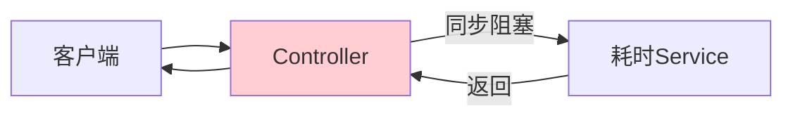
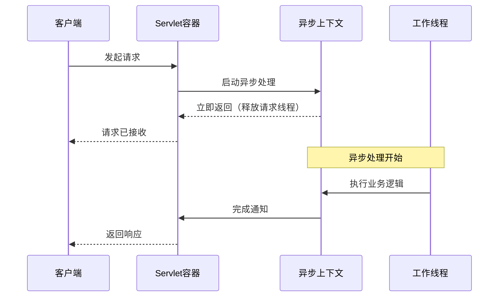
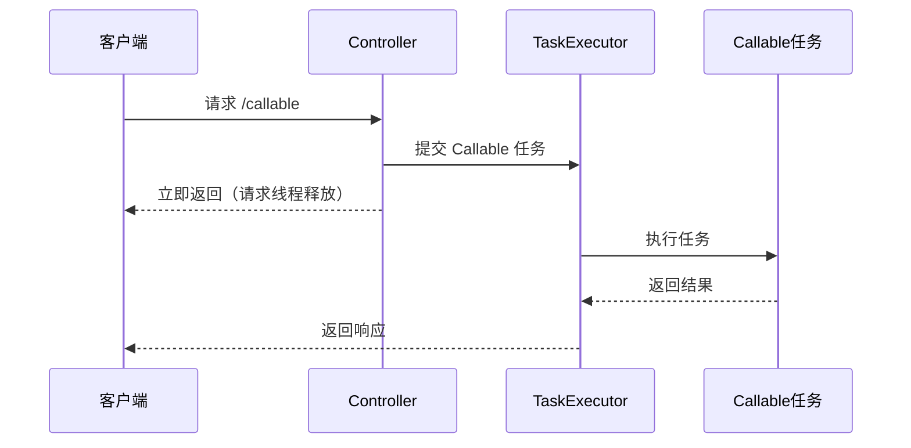
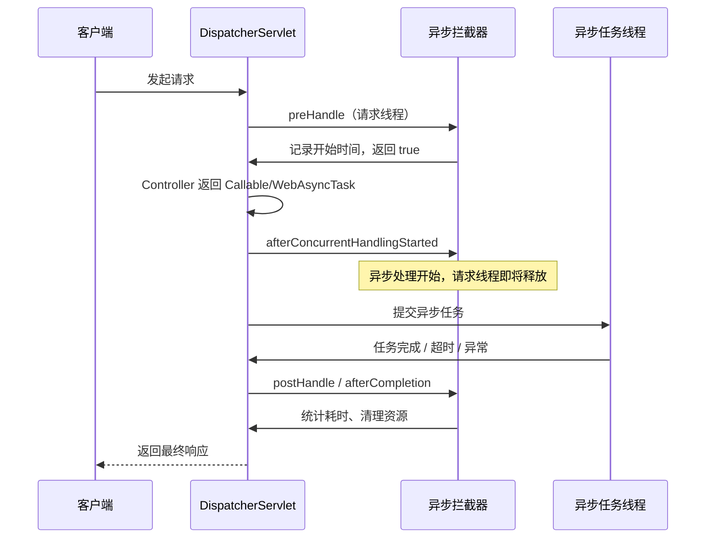
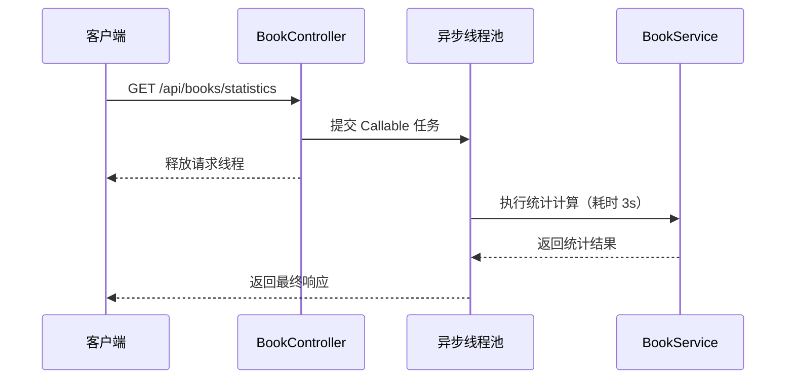

# Web 异步处理

## 课程目标

- 理解 Web 异步处理的背景和适用场景
- 掌握使用 Callable 实现异步 Controller
- 掌握使用 WebAsyncTask 进行精细控制
- 了解异步请求拦截器的使用
- 理解同步与异步 Web 请求的性能差异


## 回顾与导入

在前面的课程中，我们学习了 @Async 方法级异步、线程池配置和事件驱动异步。这些异步处理都是在 **Service 层** 完成的。

现在让我们把目光转向 **Web 层**。当一个 Web 请求需要执行耗时操作（如调用外部 API、复杂计算）时，请求线程会被长时间占用，影响系统的并发能力。



**同步 Web 请求的问题：**
- 请求线程被阻塞，无法处理其他请求
- Tomcat 线程池有限，高并发下响应变慢
- 系统吞吐量受限

**Web 异步处理的目标：**
- 快速释放请求线程
- 耗时操作在独立线程执行
- 提升系统并发能力

本节课将深入讲解 Spring 提供的 Web 层异步处理方案。


## Web 异步处理背景

### Servlet 3.0 异步支持

Servlet 3.0 规范引入了异步处理支持，允许 Servlet 在接收到请求后，将请求处理交给其他线程，而请求线程可以立即返回，从而释放资源。



### Spring Web 异步支持

Spring 在 Servlet 3.0 基础上提供了更高级的异步处理抽象：

| 方式             | 返回类型          | 适用场景                   |
| ---------------- | ----------------- | -------------------------- |
| **Callable**     | `Callable<T>`     | 简单异步，在独立线程中执行 |
| **WebAsyncTask** | `WebAsyncTask<T>` | 更精细控制（超时、回调）   |

> [!NOTE]
> Web 异步处理与 `@Async` 的区别：
> - `@Async`：方法级异步，不涉及 Web 响应
> - Web 异步：Controller 方法返回异步类型，释放请求线程


## Callable 方式

### 基本用法

Controller 方法返回 `Callable<T>`，Spring 会将任务提交到 `TaskExecutor` 执行，请求线程立即释放。

```java
@RestController
@RequestMapping("/api/async")
public class AsyncWebController {

    @GetMapping("/callable")
    public Callable<String> callableDemo() {
        System.out.println("请求线程: " + Thread.currentThread().getName());

        return () -> {
            System.out.println("异步执行线程: " + Thread.currentThread().getName());
            // 模拟耗时操作
            Thread.sleep(3000);
            return "异步结果";
        };
    }
}
```

**执行流程：**



> [!NOTE]
> Callable 默认使用 `TaskExecutor`（`SimpleAsyncTaskExecutor`），建议自定义线程池。

### 配置 Callable 使用的线程池

通过 `WebMvcConfigurer` 配置 `AsyncTaskExecutor`：

```java
@Configuration
public class WebConfig implements WebMvcConfigurer {

    @Override
    public void configureAsyncSupport(AsyncSupportConfigurer configurer) {
        configurer.setDefaultTimeout(30000);  // 默认超时 30 秒
        configurer.setTaskExecutor(asyncTaskExecutor());
    }

    @Bean
    public AsyncTaskExecutor asyncTaskExecutor() {
        ThreadPoolTaskExecutor executor = new ThreadPoolTaskExecutor();
        executor.setCorePoolSize(5);
        executor.setMaxPoolSize(20);
        executor.setQueueCapacity(100);
        executor.setThreadNamePrefix("web-async-");
        executor.initialize();
        return executor;
    }
}
```

### 超时处理

可以在 `Callable` 中设置超时，或通过全局配置：

```java
@GetMapping("/callable-timeout")
public Callable<String> callableWithTimeout() {
    return () -> {
        // 模拟超时操作
        Thread.sleep(10000);
        return "完成";
    };
}
```

全局配置超时：

```java
configurer.setDefaultTimeout(5000);  // 5 秒超时
```


## WebAsyncTask 方式

### 基本用法

`WebAsyncTask` 提供了比 Callable 更精细的控制：
- 超时时间
- 超时回调
- 完成回调
- 错误回调

```java
@RestController
@RequestMapping("/api/async")
public class AsyncWebController {

    @GetMapping("/web-async-task")
    public WebAsyncTask<String> webAsyncTask() {
        System.out.println("请求线程: " + Thread.currentThread().getName());

        // 创建 Callable 任务
        Callable<String> callable = () -> {
            System.out.println("异步执行线程: " + Thread.currentThread().getName());
            Thread.sleep(3000);
            return "WebAsyncTask 结果";
        };

        // 创建 WebAsyncTask，设置超时 5 秒
        WebAsyncTask<String> task = new WebAsyncTask<>(5000, callable);

        // 超时回调
        task.onTimeout(() -> {
            System.out.println("⏰ 任务超时");
            return "超时响应";
        });

        // 完成回调（无论成功、超时、异常都会执行）
        task.onCompletion(() -> {
            System.out.println("✅ 任务完成（回调）");
        });

        // 错误回调
        task.onError(() -> {
            System.out.println("❌ 任务异常");
            return "异常响应";
        });

        return task;
    }
}
```

### 使用自定义线程池

在创建 `WebAsyncTask` 时可以指定线程池：

```java
@Autowired
private ThreadPoolTaskExecutor webAsyncExecutor;

@GetMapping("/web-async-task-custom")
public WebAsyncTask<String> webAsyncTaskCustom() {
    Callable<String> callable = () -> {
        System.out.println("线程: " + Thread.currentThread().getName());
        Thread.sleep(2000);
        return "使用自定义线程池";
    };
    // 传入自定义线程池
    return new WebAsyncTask<>(3000L, webAsyncExecutor, callable);
}
```


## 异步请求拦截器

### 应用场景

异步请求的生命周期与同步请求不同：Controller 返回 `Callable` 或 `WebAsyncTask` 后，请求线程会立即释放，真正的业务处理在独立线程中完成。因此，普通拦截器无法完整覆盖异步请求的各个阶段，需要使用 `AsyncHandlerInterceptor` 进行专门处理。

常见应用场景：

- **请求耗时监控**：记录从请求进入到异步处理完成的总耗时。
- **异步任务追踪**：标记请求何时进入异步阶段、何时完成、是否超时或异常。
- **上下文传递**：将用户信息、TraceId、租户信息等传递到异步线程，便于日志追踪。
- **资源清理**：在异步完成后清理 `ThreadLocal`、MDC、临时文件等资源。
- **异常与超时统计**：统计异步任务超时、失败次数，便于监控告警。
- **限流与审计**：结合异步请求路径、用户信息进行访问审计或限流统计。

### 实现流程

异步请求拦截器的核心执行流程如下：



关键阶段说明：

1. **preHandle**：在请求线程中执行，适合记录开始时间、请求 URI、用户信息等。
2. **afterConcurrentHandlingStarted**：Controller 返回异步类型后调用，表示请求线程即将释放。此时不能向响应写入内容。
3. **异步任务执行**：业务逻辑在 `TaskExecutor` 的线程中执行。
4. **postHandle**：异步处理完成后、视图渲染前调用。异步请求中通常不依赖它写响应。
5. **afterCompletion**：请求最终完成时调用，无论成功、超时还是异常都会执行，适合统计总耗时、清理资源、记录异常。

> [!NOTE]
> `AsyncHandlerInterceptor` 与普通 `HandlerInterceptor` 的区别在于普通拦截器主要用于同步请求，而`AsyncHandlerInterceptor` 增加了 `afterConcurrentHandlingStarted()`，可以感知异步处理开始和请求线程释放。

### 实现拦截器

```java
@Component
public class AsyncRequestInterceptor implements AsyncHandlerInterceptor {

    @Override
    public boolean preHandle(HttpServletRequest request, HttpServletResponse response, Object handler) {
        System.out.println("🔵 [preHandle] 请求开始: " + request.getRequestURI());
        request.setAttribute("startTime", System.currentTimeMillis());
        return true;
    }

    @Override
    public void postHandle(HttpServletRequest request, HttpServletResponse response, Object handler, ModelAndView modelAndView) {
        // 在 Controller 返回后、异步处理完成前调用
    }

    @Override
    public void afterCompletion(HttpServletRequest request, HttpServletResponse response, Object handler, Exception ex) {
        // 异步处理完成后调用
        Long start = (Long) request.getAttribute("startTime");
        if (start != null) {
            System.out.println("🟢 [afterCompletion] 耗时: " + (System.currentTimeMillis() - start) + "ms");
        }
    }

    @Override
    public void afterConcurrentHandlingStarted(HttpServletRequest request, HttpServletResponse response,
                                               Object handler) {
        // 异步处理开始时调用（请求线程释放时）
        System.out.println("🔄 [afterConcurrentHandlingStarted] 异步处理开始，请求线程释放");
    }
}
```

### 注册拦截器

```java
@Configuration
public class WebConfig implements WebMvcConfigurer {

    @Autowired
    private AsyncRequestInterceptor asyncRequestInterceptor;

    @Override
    public void addInterceptors(InterceptorRegistry registry) {
        registry.addInterceptor(asyncRequestInterceptor)
                .addPathPatterns("/api/async/**");
    }
}
```


## 实战：图书管理系统异步统计查询

### 场景描述

在图书管理系统中，用户查看图书列表时，页面需要展示统计信息（如图书总数、总库存、平均价格、分类统计等）。这些统计需要对全表数据进行计算，耗时较长（模拟 3 秒）。若采用同步方式，用户需要等待 3 秒才能看到页面。使用 WebAsyncTask 实现异步查询，释放请求线程，提升系统并发能力。



### 实现步骤

#### 步骤一：定义统计结果模型

```java
/**
 * 图书统计信息
 */
@Data
@AllArgsConstructor
public class BookStatistics {
    private Long totalBooks;           // 图书总数
    private Long totalStock;           // 总库存
    private Double averagePrice;       // 平均价格
    private Map<String, Long> categoryCount;  // 各分类图书数量
    private String generatedAt;        // 生成时间
}
```

#### 步骤二：在 BookService 中实现统计逻辑（模拟耗时操作）

```java
@Service
public class BookService {

    public BookStatistics getStatistics() {
        logger.info("开始统计图书信息，线程: {}", Thread.currentThread().getName());

        // 模拟复杂聚合计算耗时
        try {
            Thread.sleep(3000);
        } catch (InterruptedException e) {
            Thread.currentThread().interrupt();
        }

        // 1. 查询所有图书
        List<Book> books = bookMapper.selectList(null);

        // 2. 计算总数
        long totalBooks = books.size();

        // 3. 计算总库存
        long totalStock = books.stream()
                .mapToLong(book -> book.getStock() == null ? 0 : book.getStock())
                .sum();

        // 4. 计算平均价格
        double averagePrice = books.stream()
                .filter(book -> book.getPrice() != null)
                .mapToDouble(Book::getPrice)
                .average()
                .orElse(0.0);

        // 5. 按分类统计（使用 LambdaQueryWrapper 逐一统计）
        Map<String, Long> categoryCount = new LinkedHashMap<>();
        // 获取所有不重复的分类
        Set<String> categories = books.stream()
                .map(book -> book.getCategory() == null ? "未分类" : book.getCategory())
                .collect(Collectors.toSet());

        for (String category : categories) {
            LambdaQueryWrapper<Book> wrapper = new LambdaQueryWrapper<>();
            wrapper.eq(Book::getCategory, category);
            Long count = bookMapper.selectCount(wrapper);
            categoryCount.put(category, count);
        }

        String generatedAt = LocalDateTime.now()
                .format(DateTimeFormatter.ofPattern("yyyy-MM-dd HH:mm:ss"));

        logger.info("统计完成，图书总数: {}，总库存: {}，线程: {}",
                totalBooks, totalStock, Thread.currentThread().getName());

        return new BookStatistics(totalBooks, totalStock, averagePrice,
                categoryCount, generatedAt);
    }

    // 其他业务方法...
}
```

> [!NOTE]
> 这里用 `Thread.sleep(3000)` 模拟复杂聚合计算。实际项目中，统计可能涉及多表联查、聚合函数、大量数据遍历等。

#### 步骤三：配置异步线程池

```java
@Configuration
public class WebAsyncConfig {

    @Bean(name = "webAsyncExecutor")
    public ThreadPoolTaskExecutor webAsyncExecutor() {
        ThreadPoolTaskExecutor executor = new ThreadPoolTaskExecutor();
        executor.setCorePoolSize(5);
        executor.setMaxPoolSize(20);
        executor.setQueueCapacity(100);
        executor.setKeepAliveSeconds(60);
        executor.setThreadNamePrefix("web-async-");
        executor.setRejectedExecutionHandler(new ThreadPoolExecutor.CallerRunsPolicy());
        executor.setWaitForTasksToCompleteOnShutdown(true);
        executor.setAwaitTerminationSeconds(30);
        executor.initialize();
        return executor;
    }
}
```

#### 步骤四：创建异步 Controller

```java
@RestController
@RequestMapping("/api/books")
public class BookStatisticsController {

    private static final Logger logger = LoggerFactory.getLogger(BookStatisticsController.class);

    private final BookService bookService;
    private final ThreadPoolTaskExecutor webAsyncExecutor;

    public BookStatisticsController(BookService bookService,
                                    @Qualifier("webAsyncExecutor") ThreadPoolTaskExecutor webAsyncExecutor) {
        this.bookService = bookService;
        this.webAsyncExecutor = webAsyncExecutor;
    }


    @GetMapping("/statistics")
    public WebAsyncTask<Result<BookStatistics>> getStatistics() {
        logger.info("收到统计请求，请求线程: {}", Thread.currentThread().getName());

        // 创建 Callable 任务
        Callable<Result<BookStatistics>> callable = () -> {
            logger.info("异步任务开始执行，异步线程: {}", Thread.currentThread().getName());

            try {
                BookStatistics statistics = bookService.getStatistics();
                return Result.success(statistics);
            } catch (Exception e) {
                logger.error("统计失败", e);
                return Result.error(500, "统计服务暂时不可用: " + e.getMessage());
            }
        };

        // 创建 WebAsyncTask，设置超时 5 秒
        WebAsyncTask<Result<BookStatistics>> asyncTask =
                new WebAsyncTask<>(5000L, webAsyncExecutor, callable);

        // 超时回调
        asyncTask.onTimeout(() -> {
            logger.warn("统计请求超时");
            return Result.error(504, "统计服务响应超时，请稍后重试");
        });

        // 异常回调
        asyncTask.onError(() -> {
            logger.error("统计请求异常");
            return Result.error(500, "统计服务异常");
        });

        // 完成回调
        asyncTask.onCompletion(() -> {
            logger.info("统计请求完成");
        });

        return asyncTask;
    }
}
```

#### 步骤五：测试验证

启动应用后，调用接口：预期响应（约 3 秒后）：

```json
{
    "code": 200,
    "message": "success",
    "data": {
        "totalBooks": 5,
        "totalStock": 33,
        "averagePrice": 80.2,
        "categoryCount": {
            "编程": 3,
            "小说": 1,
            "科学": 1
        },
        "generatedAt": "2026-08-23 10:30:00"
    }
}
```

**控制台日志：**

```
收到统计请求，请求线程: http-nio-8080-exec-1
异步任务开始执行，异步线程: web-async-1
开始统计图书信息，线程: web-async-1
统计完成，图书总数: 5，线程: web-async-1
统计请求完成
```

> [!NOTE]
> 观察日志可以发现：
> - 请求线程（`http-nio-8080-exec-1`）接收到请求后，立即释放，不等待统计结果。
> - 异步线程（`web-async-1`）执行实际的统计计算。
> - 请求线程释放后，可以立即处理下一个请求，提升系统并发能力。

#### 步骤六：对比同步方式

创建一个同步版本的接口用于对比：

```java
/**
 * 同步统计图书信息（对比用）
 */
@GetMapping("/statistics-sync")
public Result<BookStatistics> getStatisticsSync() {
    logger.info("[同步] 收到统计请求，请求线程: {}", Thread.currentThread().getName());
    BookStatistics statistics = bookService.getStatistics();
    return Result.success(statistics);
}
```

**压测对比：**

| 指标         | 同步接口 | 异步接口 |
| ------------ | -------- | -------- |
| 并发线程数   | 100      | 100      |
| 平均响应时间 | ~3.2 秒  | ~3.1 秒  |
| 吞吐量       | 较低     | 较高     |
| 请求线程占用 | 全程占用 | 快速释放 |

> [!NOTE]
> 异步接口的端到端响应时间与同步接口接近（因为用户仍需等待统计结果），但异步接口的**请求线程利用率更高**，在高并发场景下能显著提升吞吐量。


## 小结

本节课我们学习了：

1. **Web 异步处理背景**：Servlet 3.0 支持，释放请求线程
2. **Callable 方式**：简单异步，自动线程池
3. **WebAsyncTask 方式**：超时、回调、错误处理
4. **异步拦截器**：监控请求生命周期
6. **实战应用**：基于图书管理系统的异步统计查询案例


## 作业

### 作业一：代码阅读——异步方式识别

阅读以下代码，回答问题。

```java
@GetMapping("/a")
public Callable<String> methodA() {
    return () -> "result";
}

@GetMapping("/c")
public WebAsyncTask<String> methodC() {
    return new WebAsyncTask<>(() -> "result");
}
```

**问题：**

1. 两种方式分别适用于什么场景？
2. 哪个方式可以设置超时回调？
3. 哪个方式支持 onCompletion 和 onError 回调？

------

### 作业二：实现异步图书统计查询

在图书管理系统中，完成以下任务：

1. 在 `BookService` 中添加一个 `getStatistics()` 方法，模拟统计图书信息（耗时 3 秒）。
2. Controller 返回 `WebAsyncTask`，等待统计结果。
3. 使用自定义线程池执行查询。
4. 设置超时 5 秒，超时返回默认统计信息。

------

### 作业三：配置 Web 异步支持

1. 配置全局异步超时时间为 10 秒。
2. 配置自定义异步线程池（核心 5，最大 20，队列 100）。
3. 实现异步请求拦截器，记录每个异步请求的执行时间。
4. 测试异步请求，观察拦截器输出。
