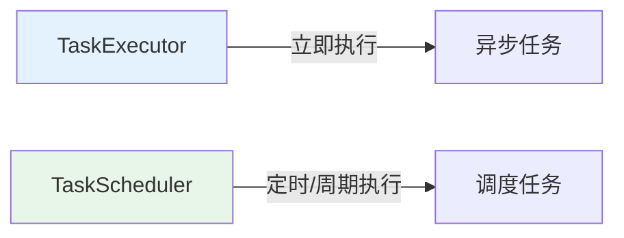

# TaskScheduler 调度器

## 课程目标

- 理解 TaskScheduler 的作用和与 TaskExecutor 的区别
- 掌握 TaskScheduler 接口的核心方法
- 掌握 ThreadPoolTaskScheduler 的配置方法
- 能够使用 TaskScheduler 以编程方式提交、管理、取消调度任务
- 能够在图书管理系统中应用调度器实现定时盘点、缓存刷新


## 回顾与导入

在 Spring Async 系列中，我们学习了 **TaskExecutor**——它解决了"任务交给谁执行"的问题。但执行器只能**立即执行**提交的任务，无法满足"在指定时间执行"或"周期性执行"的需求。



**TaskScheduler** 解决了"**什么时候执行任务**"的问题。

| 对比         | TaskExecutor    | TaskScheduler                 |
| ------------ | --------------- | ----------------------------- |
| **关注点**   | 谁执行          | 何时执行                      |
| **执行时机** | 立即执行        | 定时/周期执行                 |
| **核心方法** | execute、submit | schedule、scheduleAtFixedRate |
| **返回结果** | void / Future   | ScheduledFuture               |

本节课将深入讲解 TaskScheduler 的核心概念和编程式调度方法。


## 启用任务调度器

### @EnableScheduling 注解

要使用任务调度器，必须在配置类或启动类上添加 `@EnableScheduling` 注解：

```java
@SpringBootApplication
@EnableScheduling   // 启用定时任务支持
public class BookManagerApplication {
    public static void main(String[] args) {
        SpringApplication.run(BookManagerApplication.class, args);
    }
}
```

> [!NOTE]
>
> `@EnableScheduling` 会注册一个 `ScheduledAnnotationBeanPostProcessor`，负责扫描所有 `@Scheduled` 注解的方法，并将它们注册到 `TaskScheduler`。

### 自定义TaskScheduler

如果不配置自定义 `TaskScheduler`，Spring Boot 会自动创建默认调度器：

- **单线程调度器**：默认 `poolSize = 1`，所有任务串行执行
- **线程名**：`scheduling-1`、`scheduling-2`...

> [!CAUTION]
>
> 默认单线程调度器会导致**多个定时任务互相阻塞**。生产环境务必配置自定义调度器。


## TaskScheduler 快速入门

在图书管理系统中，我们希望在应用启动后延迟 5 秒执行一次库存盘点任务。

```java
@Service
public class StockCheckService {

    private static final Logger logger = LoggerFactory.getLogger(StockCheckService.class);

    private final TaskScheduler taskScheduler;

    public StockCheckService(TaskScheduler taskScheduler) {
        this.taskScheduler = taskScheduler;
    }

    /**
     * 应用启动后，延迟 5 秒执行一次库存盘点
     */
    @EventListener(ApplicationReadyEvent.class)
    public void scheduleInitialStockCheck() {
        logger.info("注册库存盘点任务，5 秒后执行...");

        // 使用 TaskScheduler 提交延迟任务
        taskScheduler.schedule(
                this::checkStock,
                Instant.now().plus(5, ChronoUnit.SECONDS)
        );
    }

    /**
     * 实际的库存盘点逻辑
     */
    public void checkStock() {
        logger.info("开始库存盘点，线程: {}", Thread.currentThread().getName());
        // 模拟盘点逻辑
        try {
            Thread.sleep(1000);
        } catch (InterruptedException e) {
            Thread.currentThread().interrupt();
        }
        logger.info("库存盘点完成");
    }
}
```

> [!NOTE]
> `ApplicationReadyEvent` 是 Spring Boot 提供的应用启动完成事件。我们用它来触发调度任务的注册。

**启动应用，控制台输出：**
```
注册库存盘点任务，5 秒后执行...
（5 秒后）
开始库存盘点，线程: task-scheduler-1
库存盘点完成
```

> [!NOTE]
> 观察线程名 `task-scheduler-1`，说明任务在 TaskScheduler 的线程池中执行，而不是在请求线程中。


## TaskScheduler 接口核心方法

### 接口概览

```java
public interface TaskScheduler {
    // 根据 Trigger 调度任务（最灵活）
    ScheduledFuture<?> schedule(Runnable task, Trigger trigger);

    // 在指定时间执行一次
    ScheduledFuture<?> schedule(Runnable task, Instant startTime);
    ScheduledFuture<?> schedule(Runnable task, Date startTime);

    // 在指定时间开始，按固定频率执行
    ScheduledFuture<?> scheduleAtFixedRate(Runnable task, Instant startTime, Duration period);
    ScheduledFuture<?> scheduleAtFixedRate(Runnable task, Duration period);

    // 在指定时间开始，按固定延迟执行
    ScheduledFuture<?> scheduleWithFixedDelay(Runnable task, Instant startTime, Duration delay);
    ScheduledFuture<?> scheduleWithFixedDelay(Runnable task, Duration delay);
}
```

### 方法对比

| 方法                                         | 说明                | 典型场景             |
| -------------------------------------------- | ------------------- | -------------------- |
| `schedule(Runnable, Instant)`                | 指定时间执行一次    | 延迟任务、一次性任务 |
| `scheduleAtFixedRate(Runnable, Duration)`    | 固定频率执行        | 定时统计、定时同步   |
| `scheduleWithFixedDelay(Runnable, Duration)` | 固定延迟执行        | 定时清理、顺序任务   |
| `schedule(Runnable, Trigger)`                | 由 Trigger 决定时机 | 复杂调度规则         |

### 固定频率 vs 固定延迟

```mermaid
gantt
    title 固定频率 vs 固定延迟
    dateFormat HH:mm:ss
    axisFormat %S秒
    todayMarker off

    section 固定频率：按开始时间每3秒触发
    任务1 耗时2s :a1, 00:00:00, 2s
    任务2 耗时5s :a2, 00:00:03, 5s
    任务3 耗时1s :a3, 00:00:06, 1s
    任务4 耗时4s :a4, 00:00:09, 4s
    任务5 耗时3s :a5, 00:00:12, 3s
    任务6 耗时2s :a6, 00:00:15, 2s
    任务7 耗时4s :a7, 00:00:18, 4s

    section 固定延迟：完成后延迟3秒再触发
    任务1 耗时2s :b1, 00:00:00, 2s
    任务2 耗时5s :b2, 00:00:05, 5s
    任务3 耗时1s :b3, 00:00:13, 1s
    任务4 耗时4s :b4, 00:00:17, 4s
    任务5 耗时3s :b5, 00:00:24, 3s
    任务6 耗时2s :b6, 00:00:30, 2s
    任务7 耗时4s :b7, 00:00:35, 4s
```



| 模式         | 计算方式                                          | 任务耗时长时 |
| ------------ | ------------------------------------------------- | ------------ |
| **固定频率** | 从任务**开始时间**计时（每 3 秒按“开始时间”触发） | 可能重叠执行 |
| **固定延迟** | 从任务**完成时间**计时（）                        | 一定不会重叠 |

### 返回 ScheduledFuture

所有 `schedule` 方法都返回 `ScheduledFuture<?>`，可用于：
- 取消任务
- 查询任务状态
- 获取任务结果

```java
ScheduledFuture<?> future = taskScheduler.schedule(task, Instant.now().plusSeconds(5));

// 取消任务
boolean cancelled = future.cancel(false);

// 判断是否已取消
boolean isCancelled = future.isCancelled();

// 判断是否已完成
boolean isDone = future.isDone();
```


## ThreadPoolTaskScheduler 配置

### 核心参数

| 参数                               | 说明                   | 默认值 |
| ---------------------------------- | ---------------------- | ------ |
| `poolSize`                         | 调度线程池大小         | 1      |
| `threadNamePrefix`                 | 线程名称前缀           | 无     |
| `removeOnCancelPolicy`             | 取消时是否从队列移除   | false  |
| `errorHandler`                     | 错误处理器             | 无     |
| `waitForTasksToCompleteOnShutdown` | 关闭时是否等待任务完成 | false  |
| `awaitTerminationSeconds`          | 等待超时时间           | 0      |

### Java 配置方式

```java

@Configuration
public class SchedulerConfig {

    @Bean(name = "taskScheduler")
    public TaskScheduler taskScheduler() {
        ThreadPoolTaskScheduler scheduler = new ThreadPoolTaskScheduler();
        // 调度线程池大小（同时执行的任务数量）
        scheduler.setPoolSize(5);
        // 线程名称前缀
        scheduler.setThreadNamePrefix("book-scheduler-");
        // 取消任务时从队列中移除
        scheduler.setRemoveOnCancelPolicy(true);
        // 优雅关闭：等待任务完成
        scheduler.setWaitForTasksToCompleteOnShutdown(true);
        scheduler.setAwaitTerminationSeconds(30);
        // 初始化
        scheduler.initialize();
        return scheduler;
    }
}
```

### application.yml 配置方式

```yaml
spring:
  task:
    scheduling:
      pool:
        size: 5
      thread-name-prefix: book-scheduler-
      shutdown:
        await-termination: true
        await-termination-period: 30s
```

> [!NOTE]
> 使用 `application.yml` 配置时，Spring Boot 会自动创建 `TaskScheduler` Bean（名称为 `taskScheduler`），无需手动配置。


## 编程式调度

在应用程序开发过程中，有时需要在运行时启动或停止调度任务。使用 `ScheduledFuture` 可以实现这一点。

```java
@Service
public class DynamicTaskService {

    private static final Logger logger = LoggerFactory.getLogger(DynamicTaskService.class);

    private final TaskScheduler taskScheduler;

    // 存储正在运行的调度任务
    private final Map<String, ScheduledFuture<?>> runningTasks = new ConcurrentHashMap<>();

    public DynamicTaskService(TaskScheduler taskScheduler) {
        this.taskScheduler = taskScheduler;
    }

    /**
     * 启动一个定时任务
     */
    public boolean startTask(String taskId, Runnable task, Duration period) {
        if (runningTasks.containsKey(taskId)) {
            logger.warn("任务 {} 已在运行", taskId);
            return false;
        }

        ScheduledFuture<?> future = taskScheduler.scheduleAtFixedRate(task, period);
        runningTasks.put(taskId, future);
        logger.info("任务 {} 已启动", taskId);
        return true;
    }

    /**
     * 停止一个定时任务
     */
    public boolean stopTask(String taskId) {
        ScheduledFuture<?> future = runningTasks.remove(taskId);
        if (future == null) {
            logger.warn("任务 {} 不存在", taskId);
            return false;
        }
        boolean cancelled = future.cancel(false);
        logger.info("任务 {} 已取消: {}", taskId, cancelled);
        return cancelled;
    }

    /**
     * 查询任务是否在运行
     */
    public boolean isTaskRunning(String taskId) {
        ScheduledFuture<?> future = runningTasks.get(taskId);
        return future != null && !future.isCancelled() && !future.isDone();
    }

    /**
     * 获取所有运行中的任务
     */
    public Map<String, ScheduledFuture<?>> getRunningTasks() {
        return runningTasks;
    }
}
```

**Controller 调用：**

```java
@RestController
@RequestMapping("/api/tasks")
public class TaskController {

    private final DynamicTaskService dynamicTaskService;

    public TaskController(DynamicTaskService dynamicTaskService) {
        this.dynamicTaskService = dynamicTaskService;
    }

    @PostMapping("/start")
    public Result<String> startTask(@RequestParam String taskId,
        @RequestParam(defaultValue = "10") int intervalSeconds) {
        Runnable task = () -> System.out.println("执行任务: " + taskId);
        boolean started = dynamicTaskService.startTask(taskId, task, Duration.ofSeconds(intervalSeconds));
        return started ? Result.success("任务已启动") : Result.error(400, "任务已存在");
    }

    @PostMapping("/stop")
    public Result<String> stopTask(@RequestParam String taskId) {
        boolean stopped = dynamicTaskService.stopTask(taskId);
        return stopped ? Result.success("任务已停止") : Result.error(404, "任务不存在");
    }

    @GetMapping("/status")
    public Result<Boolean> status(@RequestParam String taskId) {
        return Result.success(dynamicTaskService.isTaskRunning(taskId));
    }
}
```

**测试：**

```bash
# 启动任务
curl -X POST "http://localhost:8080/api/tasks/start?taskId=stockCheck&intervalSeconds=5"

# 查询状态
curl "http://localhost:8080/api/tasks/status?taskId=stockCheck"

# 停止任务
curl -X POST "http://localhost:8080/api/tasks/stop?taskId=stockCheck"
```


## 实战：图书管理系统完整定时盘点模块

### 需求

在图书管理系统中实现一个定时盘点模块，要求：
1. 应用启动后 10 秒执行一次初始化盘点
2. 每 30 秒执行一次增量盘点
3. 支持手动启停增量盘点

### 实现

```java
@Service
public class StockCheckService {

    private static final Logger logger = LoggerFactory.getLogger(StockCheckService.class);

    private final TaskScheduler taskScheduler;
    private final AtomicReference<ScheduledFuture<?>> incrementalTask = new AtomicReference<>();

    public StockCheckService(TaskScheduler taskScheduler) {
        this.taskScheduler = taskScheduler;
    }

    /**
     * 应用启动后 10 秒执行初始化盘点
     */
    @EventListener(ApplicationReadyEvent.class)
    public void scheduleInitialCheck() {
        logger.info("注册初始化盘点，10 秒后执行");
        taskScheduler.schedule(
                this::doInitialCheck,
                Instant.now().plusSeconds(10)
        );
    }

    /**
     * 初始化盘点（耗时较长）
     */
    private void doInitialCheck() {
        logger.info("开始初始化盘点，线程: {}", Thread.currentThread().getName());
        try {
            Thread.sleep(3000);
        } catch (InterruptedException e) {
            Thread.currentThread().interrupt();
        }
        logger.info("初始化盘点完成，启动增量盘点");
        // 初始化完成后，自动启动增量盘点
        startIncrementalCheck();
    }

    /**
     * 启动增量盘点（每 30 秒）
     */
    public synchronized void startIncrementalCheck() {
        if (incrementalTask.get() != null && !incrementalTask.get().isCancelled()) {
            logger.warn("增量盘点已在运行");
            return;
        }

        ScheduledFuture<?> future = taskScheduler.scheduleAtFixedRate(
                this::doIncrementalCheck,
                Duration.ofSeconds(30)
        );
        incrementalTask.set(future);
        logger.info("增量盘点已启动（每 30 秒）");
    }

    /**
     * 停止增量盘点
     */
    public synchronized void stopIncrementalCheck() {
        ScheduledFuture<?> future = incrementalTask.getAndSet(null);
        if (future != null) {
            future.cancel(false);
            logger.info("增量盘点已停止");
        }
    }

    /**
     * 查询增量盘点状态
     */
    public boolean isIncrementalCheckRunning() {
        ScheduledFuture<?> future = incrementalTask.get();
        return future != null && !future.isCancelled() && !future.isDone();
    }

    /**
     * 增量盘点
     */
    private void doIncrementalCheck() {
        logger.info("增量盘点，线程: {}", Thread.currentThread().getName());
    }
}
```

**Controller：**

```java
@RestController
@RequestMapping("/api/stock")
public class StockCheckController {

    private final StockCheckService stockCheckService;

    public StockCheckController(StockCheckService stockCheckService) {
        this.stockCheckService = stockCheckService;
    }

    @PostMapping("/start")
    public Result<String> start() {
        stockCheckService.startIncrementalCheck();
        return Result.success("增量盘点已启动");
    }

    @PostMapping("/stop")
    public Result<String> stop() {
        stockCheckService.stopIncrementalCheck();
        return Result.success("增量盘点已停止");
    }

    @GetMapping("/status")
    public Result<Boolean> status() {
        return Result.success(stockCheckService.isIncrementalCheckRunning());
    }
}
```

**测试流程：**

```bash
# 1. 启动应用，观察日志：10 秒后执行初始化盘点
# 2. 初始化完成后，增量盘点自动启动
# 3. 停止增量盘点
curl -X POST "http://localhost:8080/api/stock/stop"

# 4. 查询状态
curl "http://localhost:8080/api/stock/status"

# 5. 重新启动
curl -X POST "http://localhost:8080/api/stock/start"
```


## 注意事项

### 1. TaskScheduler 的线程池大小

- 默认 `poolSize = 1`，所有任务共用一个线程，任务会串行执行。
- 如果多个任务需要并行执行，应增大 `poolSize`。
- 建议根据任务数量和执行时长设置合理的 `poolSize`。

### 2. 固定频率的任务堆积问题

使用 `scheduleAtFixedRate` 时，如果任务执行时间超过间隔时间，会导致任务堆积：

```java
// 每 5 秒执行一次，但任务耗时 10 秒
taskScheduler.scheduleAtFixedRate(task, Duration.ofSeconds(5));
// 会导致任务堆积，内存占用增加
```

**解决方案：**
- 使用 `scheduleWithFixedDelay`（任务完成后才开始计时）
- 或增大间隔时间

### 3. 取消任务时是否中断

`future.cancel(true)` 会尝试中断正在执行的任务，`cancel(false)` 只取消未执行的任务。

### 4. 优雅关闭

应用关闭时，如果任务正在执行，可能会导致任务中断。建议配置：

```java
scheduler.setWaitForTasksToCompleteOnShutdown(true);
scheduler.setAwaitTerminationSeconds(30);
```


## 小结

本节课我们学习了：

1. **TaskScheduler 快速入门**：与 TaskExecutor 的区别
2. **TaskScheduler 接口核心方法**：
   - `schedule(Runnable, Instant)`：指定时间执行一次
   - `scheduleAtFixedRate`：固定频率执行
   - `scheduleWithFixedDelay`：固定延迟执行
   - `ScheduledFuture` 的使用
3. **ThreadPoolTaskScheduler 配置**：poolSize、threadNamePrefix、优雅关闭
4. **编程式调度实战**：动态调度任务
5. **完整案例**：图书管理系统定时盘点模块


## 作业

### 作业一：代码阅读——调度方法识别

阅读以下代码，回答问题。

```java
@Service
public class DemoService {
    @Autowired
    private TaskScheduler taskScheduler;

    public void start() {
        // A
        taskScheduler.schedule(this::taskA, Instant.now().plusSeconds(10));

        // B
        taskScheduler.scheduleAtFixedRate(this::taskB, Duration.ofSeconds(5));

        // C
        taskScheduler.scheduleWithFixedDelay(this::taskC, Duration.ofSeconds(5));
    }
}
```

**问题：**
1. A、B、C 三种调度方式有什么区别？
2. 如果 `taskB` 的执行时间需要 8 秒，会出现什么情况？
3. 如果 `taskC` 的执行时间需要 8 秒，会出现什么情况？

---

### 作业二：实现图书销量定时统计

在图书管理系统中完成以下任务：

1. 创建 `SalesStatisticsService`，使用 `TaskScheduler` 实现：
   - 应用启动后延迟 5 秒执行一次统计
   - 之后每 60 秒执行一次增量统计
2. 统计逻辑（模拟）：查询所有图书，计算总销量，打印统计结果。
3. 实现以下接口：
   - `POST /api/statistics/start`：启动定时统计
   - `POST /api/statistics/stop`：停止定时统计
   - `GET /api/statistics/status`：查询运行状态
4. 测试：启动、停止、查询状态。

---

### 作业三：配置自定义调度线程池

1. 在 `SchedulerConfig` 中配置 `ThreadPoolTaskScheduler`：
   - poolSize：5
   - threadNamePrefix：`book-scheduler-`
   - 优雅关闭：等待 30 秒
2. 启动多个调度任务，观察线程名。
3. 对比 poolSize = 1 和 poolSize = 5 的差异。
