```mermaid
gantt
    title fixedRate = 5000ms
    dateFormat ss
    axisFormat %S秒

    section 任务执行
    任务1（2s） :a1, 00, 2s
    任务2（2s） :a2, 05, 2s
    任务3（2s） :a3, 10, 2s
```

```mermaid
gantt
    title fixedDelay = 5000ms
    dateFormat ss
    axisFormat %S秒

    section 任务执行
    任务1（2s） :a1, 00, 2s
    等待5秒 :a2, 02, 5s
    任务2（2s） :a3, 07, 2s
    等待5秒 :a4, 09, 5s
    任务3（2s） :a5, 14, 2s
```

```mermaid
gantt
    title initialDelay = 10000ms, fixedRate = 5000ms
    dateFormat ss
    axisFormat %S秒

    section 任务执行
    应用启动 :milestone, m1, 00, 0s
    等待10秒 :a0, 00, 10s
    任务1 :a1, 10, 2s
    任务2 :a2, 15, 2s
    任务3 :a3, 20, 2s
```

# @Scheduled 注解应用

## 课程目标

- 掌握 @Scheduled 的基本用法
- 掌握 @Scheduled 的四种调度模式（fixedRate、fixedDelay、initialDelay、cron）
- 理解四种模式的差异及适用场景
- 掌握 @Scheduled 与 @Async 的组合使用
- 能够在图书管理系统中实现完整的定时任务


## 回顾与导入

在上一讲中，我们使用 `TaskScheduler` 以**编程方式**提交调度任务。这种方式灵活，但代码量较大，每次都要手动创建任务、管理 `ScheduledFuture`。

```java
// 编程式调度
taskScheduler.scheduleAtFixedRate(this::checkStock, Duration.ofSeconds(30));
```

**@Scheduled 注解** 提供了**声明式**的调度方式，只需在方法上添加注解即可，无需手动提交任务。

```java
// 声明式调度
@Scheduled(fixedRate = 30000)
public void checkStock() {
    // 每 30 秒执行
}
```

```mermaid
flowchart LR
    A[TaskScheduler<br/>编程式调度] -->|手动提交| B[调度任务]
    C[@Scheduled<br/>声明式调度] -->|自动注册| B

    style A fill:#e3f2fd
    style C fill:#e8f5e9
```

| 对比         | TaskScheduler        | @Scheduled       |
| ------------ | -------------------- | ---------------- |
| **使用方式** | 编程式，手动提交     | 声明式，注解标记 |
| **灵活性**   | 高，可动态管理       | 中，编译时确定   |
| **代码量**   | 较多                 | 很少             |
| **适用场景** | 动态启停、运行时决策 | 固定调度规则     |


## @Scheduled 四种调度模式

### 模式一：fixedRate（固定频率）

**含义：** 以固定的频率执行任务，从**任务开始时间**开始计时。

```java
@Scheduled(fixedRate = 5000)  // 每 5 秒执行一次
public void fixedRateTask() {
    System.out.println("固定频率执行: " + System.currentTimeMillis());
}
```

**执行示意图：**



**特点：**

- 每隔固定时间执行一次（无论上次是否完成）
- 如果任务执行时间 > 间隔时间，会导致任务堆积

### 模式二：fixedDelay（固定延迟）

**含义：** 在上次任务**完成后**等待固定时间，再执行下一次。

```java
@Scheduled(fixedDelay = 5000)  // 上次完成后等 5 秒再执行
public void fixedDelayTask() {
    System.out.println("固定延迟执行: " + System.currentTimeMillis());
}
```

**执行示意图：**



**特点：**
- 保证任务不会重叠执行
- 执行周期 = 任务执行时间 + 延迟时间

### 模式三：initialDelay（初始延迟）

**含义：** 应用启动后延迟指定时间才开始第一次执行，通常与 `fixedRate` 或 `fixedDelay` 配合使用。

```java
@Scheduled(initialDelay = 10000, fixedRate = 5000)
public void initialDelayTask() {
    System.out.println("启动后 10 秒开始，之后每 5 秒执行一次");
}
```

**执行示意图：**



**特点：**
- 避免应用启动时立即执行任务
- 给应用初始化留出时间

### 模式四：cron（Cron 表达式）

**含义：** 使用 Cron 表达式定义复杂的调度规则（下一课详细讲解）。

```java
@Scheduled(cron = "0 0 2 * * ?")  // 每天凌晨 2 点执行
public void cronTask() {
    System.out.println("每天凌晨 2 点执行");
}
```

**特点：**
- 最灵活，可以定义任意时间规则
- 支持秒、分、时、日、月、周等字段

### 四种模式对比

| 模式           | 触发时机           | 任务重叠 | 适用场景             |
| -------------- | ------------------ | -------- | -------------------- |
| `fixedRate`    | 从**开始时间**计时 | 可能     | 短时间任务、定时统计 |
| `fixedDelay`   | 从**完成时间**计时 | 不会     | 长任务、顺序任务     |
| `initialDelay` | 配合前两者使用     | —        | 延迟启动             |
| `cron`         | Cron 表达式        | 可能     | 复杂时间规则         |

### 执行差异演示

```java
@Component
public class SchedulingDemo {

    private final Logger logger = LoggerFactory.getLogger(SchedulingDemo.class);

    @Scheduled(fixedRate = 5000)
    public void fixedRateDemo() throws InterruptedException {
        logger.info("【fixedRate】开始，线程: {}", Thread.currentThread().getName());
        Thread.sleep(7000);  // 模拟耗时 7 秒（超过 5 秒间隔）
        logger.info("【fixedRate】结束");
    }

    @Scheduled(fixedDelay = 5000)
    public void fixedDelayDemo() throws InterruptedException {
        logger.info("【fixedDelay】开始，线程: {}", Thread.currentThread().getName());
        Thread.sleep(7000);  // 模拟耗时 7 秒
        logger.info("【fixedDelay】结束");
    }
}
```

**日志输出（观察差异）：**

```
【fixedRate】开始，线程: book-scheduler-1
（7秒后）
【fixedRate】结束
【fixedRate】开始，线程: book-scheduler-1  ← 立即开始，不等待
（7秒后）
【fixedRate】结束

【fixedDelay】开始，线程: book-scheduler-2
（7秒后）
【fixedDelay】结束
（5秒后）
【fixedDelay】开始，线程: book-scheduler-2  ← 等待 5 秒后才开始
```

> [!NOTE]
> `fixedRate` 模式下，由于任务执行时间（7秒）> 间隔时间（5秒），任务会密集执行。而 `fixedDelay` 模式会保证任务之间有 5 秒的间隔。


## @Scheduled 与 @Async 组合使用

### 问题背景

默认情况下，`@Scheduled` 任务在调度线程池的线程中执行。如果任务执行时间长，会阻塞调度线程，影响其他定时任务。

```java
@Scheduled(fixedRate = 5000)
public void longTask() throws InterruptedException {
    // 这个任务耗时 10 秒
    Thread.sleep(10000);
}
// 由于调度线程被占用，其他定时任务可能被延迟执行
```

### 解决方案：@Scheduled + @Async

在 `@Scheduled` 方法上同时添加 `@Async`，让任务在独立的线程池中执行：

```java
@Scheduled(fixedRate = 5000)
@Async("taskExecutor")  // 在异步线程池中执行
public void longTask() throws InterruptedException {
    // 这个任务在独立线程池中执行，不阻塞调度线程
    Thread.sleep(10000);
}
```

> [!NOTE]
> 使用 `@Async` 后，`@Scheduled` 的调度器只负责“触发”，实际执行在异步线程池中完成。

### 对比表

| 配置                | 执行线程   | 是否阻塞调度器 | 适用场景 |
| ------------------- | ---------- | -------------- | -------- |
| 仅 @Scheduled       | 调度线程池 | 会阻塞         | 短任务   |
| @Scheduled + @Async | 异步线程池 | 不阻塞         | 长任务   |


## 实战：图书管理系统定时任务

### 需求分析

为图书管理系统实现以下定时任务：

| 任务     | 调度模式                  | 执行周期             | 说明               |
| -------- | ------------------------- | -------------------- | ------------------ |
| 缓存预热 | fixedDelay + initialDelay | 启动后 10 秒执行一次 | 应用启动后预热缓存 |
| 销量统计 | fixedRate                 | 每 30 秒             | 统计图书销量       |
| 缓存清理 | fixedDelay                | 每 5 分钟            | 清理过期缓存       |
| 库存同步 | fixedRate                 | 每 10 秒             | 同步库存数据       |

### 完整实现

**步骤一：配置调度器**

```yaml
# application.yml
spring:
  task:
    scheduling:
      pool:
        size: 5
      thread-name-prefix: book-scheduler-
```

**步骤二：创建定时任务类**

```java
@Component
public class BookScheduledTasks {

    private static final Logger logger = LoggerFactory.getLogger(BookScheduledTasks.class);
    private static final DateTimeFormatter FORMATTER =
            DateTimeFormatter.ofPattern("yyyy-MM-dd HH:mm:ss");

    private final BookService bookService;
    private final AtomicLong statisticCount = new AtomicLong(0);

    public BookScheduledTasks(BookService bookService) {
        this.bookService = bookService;
    }

    /**
     * 1. 缓存预热：应用启动后 10 秒执行一次
     */
    @Scheduled(initialDelay = 10000, fixedRate = Long.MAX_VALUE)
    public void warmUpCache() {
        logger.info(" [缓存预热] 开始，时间: {}", LocalDateTime.now().format(FORMATTER));
        // 预热逻辑：加载热门图书到缓存
        try {
            Thread.sleep(2000);  // 模拟耗时
        } catch (InterruptedException e) {
            Thread.currentThread().interrupt();
        }
        logger.info(" [缓存预热] 完成");
    }

    /**
     * 2. 销量统计：每 30 秒执行一次
     */
    @Scheduled(fixedRate = 30000)
    public void statisticsSales() {
        long count = statisticCount.incrementAndGet();
        logger.info(" [销量统计] 第 {} 次执行，线程: {}", count,
                Thread.currentThread().getName());
        // 统计逻辑
        long total = bookService.count();
        logger.info(" [销量统计] 当前图书总数: {}", total);
    }

    /**
     * 3. 缓存清理：上次完成后等 5 分钟再执行
     */
    @Scheduled(fixedDelay = 300000)  // 5 分钟
    public void cleanExpiredCache() {
        logger.info(" [缓存清理] 开始，时间: {}", LocalDateTime.now().format(FORMATTER));
        // 清理逻辑
        logger.info(" [缓存清理] 完成");
    }

    /**
     * 4. 库存同步：每 10 秒执行一次，使用 @Async 避免阻塞
     */
    @Scheduled(fixedRate = 10000)
    @Async("taskExecutor")
    public void syncStock() {
        logger.info(" [库存同步] 开始，线程: {}", Thread.currentThread().getName());
        // 同步逻辑（模拟耗时操作）
        try {
            Thread.sleep(2000);
        } catch (InterruptedException e) {
            Thread.currentThread().interrupt();
        }
        logger.info(" [库存同步] 完成");
    }
}
```

**步骤三：启动应用，观察日志**

```
（启动后 10 秒）
 [缓存预热] 开始，时间: 2026-09-18 10:30:10
 [缓存预热] 完成

（每 30 秒）
 [销量统计] 第 1 次执行，线程: book-scheduler-2
 [销量统计] 当前图书总数: 5
 [销量统计] 第 2 次执行，线程: book-scheduler-3
...

（每 10 秒，独立线程池）
 [库存同步] 开始，线程: task-1
 [库存同步] 完成
...

（每 5 分钟）
 [缓存清理] 开始，时间: 2026-09-18 10:35:00
 [缓存清理] 完成
```

> [!NOTE]
> 观察日志可以发现：
> - 多个定时任务使用不同的调度线程（`book-scheduler-2`、`book-scheduler-3`）
> - 使用 `@Async` 的任务在独立的异步线程池（`task-1`）中执行
> - 各任务互不阻塞，按各自的调度规则独立运行


## 注意事项

### 1. 定时任务的异常处理

`@Scheduled` 方法抛出的异常**默认会被记录到日志**，但不会影响后续调度。

```java
@Scheduled(fixedRate = 5000)
public void task() {
    throw new RuntimeException("任务异常");  // 会被记录，但任务继续调度
}
```

自定义异常处理：

```java
@Configuration
public class SchedulerConfig {

    @Bean
    public TaskScheduler taskScheduler() {
        ThreadPoolTaskScheduler scheduler = new ThreadPoolTaskScheduler();
        scheduler.setPoolSize(5);
        scheduler.setErrorHandler(t -> {
            logger.error("调度任务异常: {}", t.getMessage(), t);
        });
        return scheduler;
    }
}
```

### 2. @Async 与 @Scheduled 的配合

- `@Async` 方法返回类型应为 `void` 或 `Future`
- `@Async` 需要 `@EnableAsync` 启用（Spring Async 系列已介绍）
- 两者组合使用时，`@Scheduled` 负责触发，`@Async` 负责执行

### 3. 开发调试技巧

- **缩短周期**：开发时把间隔改短（如 5 秒），便于验证
- **日志记录**：在每个任务开始和结束时打印日志
- **禁用任务**：通过配置开关控制任务是否执行


## 小结

本节课我们学习了：

1. **@Scheduled 四种模式**：
   - `fixedRate`：固定频率执行（从开始时间计时）
   - `fixedDelay`：固定延迟执行（从完成时间计时）
   - `initialDelay`：初始延迟
   - `cron`：Cron 表达式
2. **四种模式对比**：任务重叠、适用场景
3. **@Scheduled 与 @Async 组合**：避免长任务阻塞调度线程
4. **实战应用**：为图书管理系统实现缓存预热、销量统计、缓存清理、库存同步等定时任务


## 作业

### 作业一：代码阅读——调度模式识别

阅读以下代码，回答问题。

```java
@Component
public class DemoTask {

    @Scheduled(fixedRate = 3000)
    public void taskA() throws InterruptedException {
        Thread.sleep(5000);
    }

    @Scheduled(fixedDelay = 3000)
    public void taskB() throws InterruptedException {
        Thread.sleep(5000);
    }

    @Scheduled(initialDelay = 10000, fixedRate = 3000)
    public void taskC() {
    }

    @Scheduled(cron = "0 0 2 * * ?")
    public void taskD() {
    }
}
```

**问题：**
1. `taskA` 和 `taskB` 的执行差异是什么？
2. `taskC` 什么时候开始执行？间隔是多少？
3. `taskD` 什么时候执行？
4. 如果任务执行时间（5秒）大于间隔时间（3秒），`taskA` 和 `taskB` 分别表现如何？

---

### 作业二：实现图书管理系统定时任务

在图书管理系统中完成以下任务：

1. 创建 `BookScheduledTasks` 类，实现以下定时任务：
   - 应用启动后延迟 5 秒执行一次缓存预热
   - 每 30 秒执行一次销量统计（打印当前图书总数）
   - 每 1 分钟执行一次缓存清理
   - 每 10 秒执行一次库存同步（使用 @Async）

2. 配置调度线程池（`poolSize = 5`）。

3. 在每个任务中打印线程名和执行时间，观察调度行为。

---

### 作业三：@Scheduled 与 @Async 组合实验

1. 创建一个耗时的定时任务（`Thread.sleep(8000)`），间隔 5 秒。
2. 先不添加 `@Async`，观察调度是否被阻塞。
3. 添加 `@Async("taskExecutor")`，观察执行变化。
4. 对比两次运行的日志差异，总结 `@Async` 的作用。
