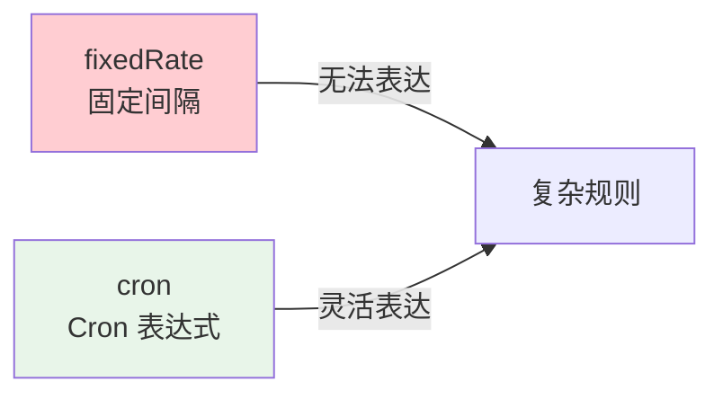

# Cron 表达式与调度综合实战

## 课程目标

- 掌握 Cron 表达式的语法规则和字段含义
- 掌握特殊字符的使用方法
- 能够编写常见的 Cron 调度规则
- 掌握 Cron 表达式的验证方法
- 完成图书管理系统的完整定时任务模块


## 回顾与导入

在前面内容中，我们学习了：

| 内容               | 调度方式                            |
| ------------------ | ----------------------------------- |
| TaskScheduler 基础 | 编程式调度                          |
| @Scheduled 注解    | 声明式调度（fixedRate、fixedDelay） |

但 `fixedRate` 和 `fixedDelay` 只能处理**固定间隔**的场景，无法表达"每天凌晨 2 点执行"、"每周一执行"、"每月最后一天执行"这类复杂规则。

**Cron 表达式** 正是用来描述这类复杂时间规则的强大工具。



本节课将深入学习 Cron 表达式，并通过综合实战完成图书管理系统的完整定时任务模块。


## Cron 表达式基础

### 什么是 Cron

**Cron** 是一种用于描述定时任务执行规则的时间表达式。最初来源于 Unix/Linux 系统的 `cron` 守护进程，Spring 在此基础上扩展了部分语法。

### 字段含义

Spring 的 Cron 表达式由 **6 个或 7 个字段** 组成，字段之间用空格分隔：

```
秒 分 时 日 月 周 [年]
```

| 字段 | 位置            | 取值范围                            | 允许的特殊字符              |
| ---- | --------------- | ----------------------------------- | --------------------------- |
| 秒   | 第 1 位         | 0-59                                | `*` `,` `-` `/`             |
| 分   | 第 2 位         | 0-59                                | `*` `,` `-` `/`             |
| 时   | 第 3 位         | 0-23                                | `*` `,` `-` `/`             |
| 日   | 第 4 位         | 1-31                                | `*` `,` `-` `/` `?` `L` `W` |
| 月   | 第 5 位         | 1-12 或 JAN-DEC                     | `*` `,` `-` `/`             |
| 周   | 第 6 位         | 0-7 或 SUN-SAT（0 和 7 都表示周日） | `*` `,` `-` `/` `?` `L` `#` |
| 年   | 第 7 位（可选） | 1970-2099                           | `*` `,` `-` `/`             |

> [!NOTE]
> Spring 的 Cron 表达式与 Linux Cron 的区别：
> - Linux Cron 是 **5 个字段**（分 时 日 月 周）
> - Spring Cron 是 **6 或 7 个字段**（秒 分 时 日 月 周 [年]）
> - 例如：Linux 中 `0 2 * * *` 表示每天 2:00；Spring 中要写成 `0 0 2 * * ?`

### 第一个 Cron 示例

```java
@Component
public class CronDemo {

    private static final Logger logger = LoggerFactory.getLogger(CronDemo.class);

    /**
     * 每天凌晨 2 点执行
     * 秒=0，分=0，时=2，日=*，月=*，周=?
     */
    @Scheduled(cron = "0 0 2 * * ?")
    public void dailyTask() {
        logger.info("每天凌晨 2 点执行: {}", LocalDateTime.now());
    }
}
```


## 特殊字符详解

### `*`（星号）—— 匹配任意值

表示该字段的所有可能值。

```java
@Scheduled(cron = "0 * * * * ?")   // 每分钟的 0 秒执行（即每分钟一次）
@Scheduled(cron = "0 0 * * * ?")   // 每小时的 0 分 0 秒执行（即每小时一次）
```

### `?`（问号）—— 不指定值

只能用于**日**或**周**字段，表示"不关心该字段"。

**为什么需要 `?`？**

因为"日"和"周"字段可能产生冲突。例如"每月 15 号"和"每周一"可能同时满足或矛盾，使用 `?` 表示忽略其中一个：

```java
@Scheduled(cron = "0 0 2 15 * ?")   // 每月 15 号凌晨 2 点（忽略周）
@Scheduled(cron = "0 0 2 ? * MON")  // 每周一凌晨 2 点（忽略日）
```

> [!CAUTION]
> 在 Spring Cron 中，"日"和"周"字段**必须有一个是 `?`**，否则会报错。

### `-`（连字符）—— 范围

表示一个连续范围。

```java
@Scheduled(cron = "0 0 9-18 * * ?")     // 每天 9 点到 18 点，每个整点执行
@Scheduled(cron = "0 0 2 * * MON-FRI")  // 周一到周五凌晨 2 点执行
```

### `,`（逗号）—— 枚举

表示多个离散值。

```java
@Scheduled(cron = "0 0 2,12,22 * * ?")     // 每天 2 点、12 点、22 点执行
@Scheduled(cron = "0 0 2 ? * MON,WED,FRI") // 每周一、三、五凌晨 2 点执行
```

### `/`（斜杠）—— 步长

表示从起始值开始，每隔固定间隔触发一次。

```
起始值/步长
```

```java
@Scheduled(cron = "0/10 * * * * ?")    // 每 10 秒执行一次
@Scheduled(cron = "0 0/5 * * * ?")     // 每 5 分钟执行一次
@Scheduled(cron = "0 0 0/2 * * ?")     // 每 2 小时执行一次（0点、2点、4点...）
@Scheduled(cron = "0 0 9-18/2 * * ?")  // 9 点到 18 点之间，每 2 小时执行一次
```

### `L`（Last）—— 最后

只能用于**日**或**周**字段。

```java
@Scheduled(cron = "0 0 23 L * ?")      // 每月最后一天 23:00 执行
@Scheduled(cron = "0 0 9 ? * 6L")      // 每月最后一个周六 9:00 执行（6L）
@Scheduled(cron = "0 0 9 ? * FRIL")    // 每月最后一个周五 9:00 执行
```

### `W`（Weekday）—— 工作日

只能用于**日**字段，表示最接近指定日的工作日。

```java
@Scheduled(cron = "0 0 9 15W * ?")     // 每月最接近 15 号的工作日 9:00 执行
@Scheduled(cron = "0 0 9 1W * ?")      // 每月第一个工作日 9:00 执行
```

### `#`（井号）—— 第几个

只能用于**周**字段，表示某月的第几个星期几。

```
星期几#第几个
```

```java
@Scheduled(cron = "0 0 9 ? * 2#1")    // 每月第一个周二 9:00 执行
@Scheduled(cron = "0 0 9 ? * 5#3")    // 每月第三个周五 9:00 执行
```

### 特殊字符总结

| 字符 | 含义   | 可作用于字段 | 示例            |
| ---- | ------ | ------------ | --------------- |
| `*`  | 任意值 | 所有字段     | `* * * * * ?`   |
| `?`  | 不指定 | 日、周       | `0 0 2 ? * MON` |
| `-`  | 范围   | 所有字段     | `9-18`          |
| `,`  | 枚举   | 所有字段     | `2,12,22`       |
| `/`  | 步长   | 所有字段     | `0/10`          |
| `L`  | 最后   | 日、周       | `L`、`6L`       |
| `W`  | 工作日 | 日           | `15W`           |
| `#`  | 第几个 | 周           | `2#1`           |


## 常用 Cron 示例

### 秒级调度

| 表达式           | 含义             |
| ---------------- | ---------------- |
| `0/5 * * * * ?`  | 每 5 秒执行一次  |
| `0/10 * * * * ?` | 每 10 秒执行一次 |
| `0/30 * * * * ?` | 每 30 秒执行一次 |
| `0 * * * * ?`    | 每分钟执行一次   |

### 分钟级调度

| 表达式           | 含义               |
| ---------------- | ------------------ |
| `0 0/5 * * * ?`  | 每 5 分钟执行一次  |
| `0 0/10 * * * ?` | 每 10 分钟执行一次 |
| `0 0/30 * * * ?` | 每 30 分钟执行一次 |
| `0 0 * * * ?`    | 每小时执行一次     |

### 每日调度

| 表达式              | 含义                        |
| ------------------- | --------------------------- |
| `0 0 2 * * ?`       | 每天凌晨 2 点执行           |
| `0 0 0 * * ?`       | 每天凌晨 0 点执行           |
| `0 30 8 * * ?`      | 每天早上 8:30 执行          |
| `0 0 23 * * ?`      | 每天晚上 23 点执行          |
| `0 0 2,12,22 * * ?` | 每天 2 点、12 点、22 点执行 |

### 每周调度

| 表达式              | 含义                      |
| ------------------- | ------------------------- |
| `0 0 2 ? * MON`     | 每周一凌晨 2 点执行       |
| `0 0 9 ? * MON-FRI` | 周一到周五早上 9 点执行   |
| `0 0 9 ? * SAT,SUN` | 周六、周日早上 9 点执行   |
| `0 0 9 ? * 2#1`     | 每月第一个周一 9 点执行   |
| `0 0 9 ? * 6L`      | 每月最后一个周六 9 点执行 |

### 每月调度

| 表达式           | 含义                              |
| ---------------- | --------------------------------- |
| `0 0 2 1 * ?`    | 每月 1 号凌晨 2 点执行            |
| `0 0 23 L * ?`   | 每月最后一天 23 点执行            |
| `0 0 9 15W * ?`  | 每月最接近 15 号的工作日 9 点执行 |
| `0 0 2 1,15 * ?` | 每月 1 号和 15 号凌晨 2 点执行    |

### 每年调度

| 表达式             | 含义                           |
| ------------------ | ------------------------------ |
| `0 0 2 1 1 ?`      | 每年 1 月 1 号凌晨 2 点执行    |
| `0 0 2 1 1 ? 2026` | 2026 年 1 月 1 号凌晨 2 点执行 |


## Cron 表达式验证

### 在线验证工具

常用的在线 Cron 验证工具：

https://ohyewang.com/

### 代码验证

在开发过程中，可以通过日志观察 Cron 任务的实际执行时间，验证表达式是否正确。

```java
@Component
public class CronVerifyTask {

    private static final Logger logger = LoggerFactory.getLogger(CronVerifyTask.class);

    /**
     * 每 10 秒执行一次，用于验证 Cron 表达式
     */
    @Scheduled(cron = "0/10 * * * * ?")
    public void verify() {
        logger.info("Cron 任务执行，当前时间: {}", LocalDateTime.now());
    }
}
```

**观察日志输出：**
```
Cron 任务执行，当前时间: 2026-09-18T10:30:00
Cron 任务执行，当前时间: 2026-09-18T10:30:10
Cron 任务执行，当前时间: 2026-09-18T10:30:20
```

> [!NOTE]
> 开发阶段，建议将 Cron 表达式改为**短周期**（如每 10 秒），验证逻辑正确后再改为正式的调度规则。


## 综合实战：图书管理系统定时任务模块

### 需求分析

为图书管理系统设计一套完整的定时任务模块，涵盖日报、周报、月报、缓存清理、数据同步等常见场景：

| 任务       | Cron 表达式      | 执行时机           | 说明             |
| ---------- | ---------------- | ------------------ | ---------------- |
| 日报生成   | `0 0 2 * * ?`    | 每天凌晨 2 点      | 生成图书销售日报 |
| 周报生成   | `0 0 9 ? * MON`  | 每周一上午 9 点    | 汇总上周数据     |
| 月报生成   | `0 0 23 L * ?`   | 每月最后一天 23 点 | 生成月度统计报表 |
| 缓存清理   | `0 0/30 * * * ?` | 每 30 分钟         | 清理过期缓存     |
| 库存同步   | `0 0/10 * * * ?` | 每 10 分钟         | 同步库存数据     |
| 数据备份   | `0 0 3 * * ?`    | 每天凌晨 3 点      | 备份数据库       |
| 慢查询清理 | `0 0 4 ? * SUN`  | 每周日凌晨 4 点    | 清理慢查询日志   |

### 完整实现

**步骤一：配置调度器**

```yaml
# application.yml
spring:
  task:
    scheduling:
      pool:
        size: 8
      thread-name-prefix: book-scheduler-
      shutdown:
        await-termination: true
        await-termination-period: 30s
```

**步骤二：创建定时任务类**

```java
@Component
public class BookScheduledTasksWithCron {

    private static final Logger logger = LoggerFactory.getLogger(BookScheduledTasks.class);
    private static final DateTimeFormatter FORMATTER =
            DateTimeFormatter.ofPattern("yyyy-MM-dd HH:mm:ss");

    @Autowired
    private BookService bookService;

    @Autowired
    private ReportService reportService;

    @Autowired
    private StockService stockService;

    private final AtomicLong dailyCount = new AtomicLong(0);
    private final AtomicLong weeklyCount = new AtomicLong(0);
    private final AtomicLong monthlyCount = new AtomicLong(0);

    /**
     * 1. 日报生成：每天凌晨 2 点执行
     */
    @Scheduled(cron = "0 0 2 * * ?")
    public void generateDailyReport() {
        long count = dailyCount.incrementAndGet();
        logger.info("[日报生成] 第 {} 次执行，开始时间: {}", count,
                LocalDateTime.now().format(FORMATTER));

        try {
            long totalBooks = bookService.count();
            reportService.generateDailyReport(totalBooks);
            logger.info("[日报生成] 完成，图书总数: {}", totalBooks);
        } catch (Exception e) {
            logger.error("[日报生成] 失败", e);
        }
    }

    /**
     * 2. 周报生成：每周一上午 9 点执行
     */
    @Scheduled(cron = "0 0 9 ? * MON")
    public void generateWeeklyReport() {
        long count = weeklyCount.incrementAndGet();
        logger.info("[周报生成] 第 {} 次执行，开始时间: {}", count,
                LocalDateTime.now().format(FORMATTER));

        try {
            reportService.generateWeeklyReport();
            logger.info("[周报生成] 完成");
        } catch (Exception e) {
            logger.error("[周报生成] 失败", e);
        }
    }

    /**
     * 3. 月报生成：每月最后一天 23 点执行
     */
    @Scheduled(cron = "0 0 23 L * ?")
    public void generateMonthlyReport() {
        long count = monthlyCount.incrementAndGet();
        logger.info("[月报生成] 第 {} 次执行，开始时间: {}", count,
                LocalDateTime.now().format(FORMATTER));

        try {
            reportService.generateMonthlyReport();
            logger.info("[月报生成] 完成");
        } catch (Exception e) {
            logger.error("[月报生成] 失败", e);
        }
    }

    /**
     * 4. 缓存清理：每 30 分钟执行
     */
    @Scheduled(cron = "0 0/30 * * * ?")
    public void cleanCache() {
        logger.info("[缓存清理] 开始，时间: {}", LocalDateTime.now().format(FORMATTER));
        // 清理逻辑
        logger.info("[缓存清理] 完成");
    }

    /**
     * 5. 库存同步：每 10 分钟执行，使用 @Async 避免阻塞
     */
    @Scheduled(cron = "0 0/10 * * * ?")
    @Async("taskExecutor")
    public void syncStock() {
        logger.info("[库存同步] 开始，线程: {}", Thread.currentThread().getName());
        try {
            stockService.syncStock();
            logger.info("[库存同步] 完成");
        } catch (Exception e) {
            logger.error("[库存同步] 失败", e);
        }
    }

    /**
     * 6. 数据备份：每天凌晨 3 点执行
     */
    @Scheduled(cron = "0 0 3 * * ?")
    public void backupDatabase() {
        logger.info("[数据备份] 开始，时间: {}", LocalDateTime.now().format(FORMATTER));
        try {
            Thread.sleep(5000);  // 模拟备份耗时
            logger.info("[数据备份] 完成");
        } catch (InterruptedException e) {
            Thread.currentThread().interrupt();
            logger.warn("[数据备份] 被中断");
        }
    }

    /**
     * 7. 慢查询清理：每周日凌晨 4 点执行
     */
    @Scheduled(cron = "0 0 4 ? * SUN")
    public void cleanSlowQueryLog() {
        logger.info("[慢查询清理] 开始，时间: {}", LocalDateTime.now().format(FORMATTER));
        logger.info("[慢查询清理] 完成");
    }
}
```

**步骤三：ReportService 和 StockService（模拟实现）**

```java
@Service
public class ReportService {

    private static final Logger logger = LoggerFactory.getLogger(ReportService.class);

    public void generateDailyReport(long totalBooks) {
        logger.info("生成日报: 图书总数={}", totalBooks);
        // 实际报表生成逻辑
    }

    public void generateWeeklyReport() {
        logger.info("生成周报");
    }

    public void generateMonthlyReport() {
        logger.info("生成月报");
    }
}

@Service
public class StockService {

    private static final Logger logger = LoggerFactory.getLogger(StockService.class);

    public void syncStock() {
        logger.info("同步库存数据");
        // 实际同步逻辑
    }
}
```

**步骤四：提供任务测试和监控接口**

```java
@RestController
@RequestMapping("/api/tasks")
public class TaskController {

    private final BookScheduledTasksWithCron tasks;

    public TaskMonitorController(BookScheduledTasksWithCron tasks) {
        this.tasks = tasks;
    }

    /**
     * 手动触发日报生成（用于测试）
     */
    @PostMapping("/daily-report")
    public Result<String> triggerDailyReport() {
        tasks.generateDailyReport();
        return Result.success("日报生成任务已触发");
    }

    /**
     * 手动触发周报生成
     */
    @PostMapping("/weekly-report")
    public Result<String> triggerWeeklyReport() {
        tasks.generateWeeklyReport();
        return Result.success("周报生成任务已触发");
    }

    /**
     * 手动触发月报生成
     */
    @PostMapping("/monthly-report")
    public Result<String> triggerMonthlyReport() {
        tasks.generateMonthlyReport();
        return Result.success("月报生成任务已触发");
    }
}
```

**步骤五：启动应用，观察日志**

```
（应用启动后，等待相应时间点）

[缓存清理] 开始，时间: 2026-09-18 10:30:00
[缓存清理] 完成
[库存同步] 开始，线程: task-1
[库存同步] 完成

（10:30:30）
[缓存清理] 开始，时间: 2026-09-18 10:30:30
[缓存清理] 完成

（次日凌晨 2:00）
[日报生成] 第 1 次执行，开始时间: 2026-09-19 02:00:00
生成日报: 图书总数=5
[日报生成] 完成，图书总数: 5

（周一上午 9:00）
[周报生成] 第 1 次执行，开始时间: 2026-09-21 09:00:00
生成周报
[周报生成] 完成
```

### 调度规则速查表

| 表达式           | 含义               |
| ---------------- | ------------------ |
| `0 0 2 * * ?`    | 每天凌晨 2 点      |
| `0 0 9 ? * MON`  | 每周一上午 9 点    |
| `0 0 23 L * ?`   | 每月最后一天 23 点 |
| `0 0/30 * * * ?` | 每 30 分钟         |
| `0 0/10 * * * ?` | 每 10 分钟         |
| `0 0 3 * * ?`    | 每天凌晨 3 点      |
| `0 0 4 ? * SUN`  | 每周日凌晨 4 点    |


## 常见错误与调试技巧

### 错误一：日和周字段同时指定

```java
// 错误：日和周都用了 *，Spring 无法确定以哪个为准
@Scheduled(cron = "0 0 2 * * MON")

// 正确：其中一个必须用 ?
@Scheduled(cron = "0 0 2 ? * MON")
```

### 错误二：字段数量不对

```java
// 错误：只有 5 个字段（Linux 风格）
@Scheduled(cron = "0 2 * * *")

// 正确：6 个字段（Spring 风格）
@Scheduled(cron = "0 0 2 * * ?")
```

### 错误三：周字段取值错误

```java
// 不同系统对周字段的定义不同：
// Spring: 0 或 7 表示周日，1-6 表示周一到周六
// 建议使用英文缩写：SUN, MON, TUE, WED, THU, FRI, SAT

@Scheduled(cron = "0 0 9 ? * MON")     // 推荐
@Scheduled(cron = "0 0 9 ? * 2")       // 也可以，但不直观
```

### 调试技巧

| 技巧           | 说明                                      |
| -------------- | ----------------------------------------- |
| **短周期验证** | 开发阶段改为每 10 秒，快速验证            |
| **日志记录**   | 每个任务开始和结束都打日志                |
| **在线工具**   | 使用https://ohyewang.com/等工具生成和验证 |
| **手动触发**   | 提供 REST 接口手动触发任务，便于测试      |


## 小结

本节课我们学习了：

1. **Cron 表达式基础**：6/7 个字段的含义和取值范围
2. **特殊字符**：`*`、`?`、`-`、`,`、`/`、`L`、`W`、`#`
3. **常用示例**：秒级、分钟级、每日、每周、每月调度
4. **Cron 验证**：在线工具和日志调试
5. **综合实战**：图书管理系统定时任务模块（日报、周报、月报、清理、同步）


## 作业

### 作业一：代码阅读——Cron 表达式解析

阅读以下 Cron 表达式，写出它们的执行时间。

```
1. 0 0 2 * * ?
2. 0 0/15 * * * ?
3. 0 0 9 ? * MON-FRI
4. 0 0 23 L * ?
5. 0 30 8 ? * MON#1
6. 0 0 0 1 1 ?
```

**问题：**
1. 表达式 1 什么时候执行？
2. 表达式 2 什么时候执行？
3. 表达式 3 什么时候执行？
4. 表达式 4 什么时候执行？
5. 表达式 5 什么时候执行？
6. 表达式 6 什么时候执行？

---

### 作业二：编写 Cron 表达式

根据以下需求，写出对应的 Cron 表达式：

1. 每天早上 6:30 执行
2. 每 15 分钟执行一次
3. 每周六、周日中午 12 点执行
4. 每月 1 号和 15 号凌晨 1 点执行
5. 每月最后一个工作日晚上 22 点执行
6. 每周三下午 3 点执行

---

### 作业三：实现图书管理系统定时任务模块

在图书管理系统中完成以下任务：

1. 创建 `BookScheduledTasks` 类，实现以下任务：
   - 每天凌晨 2 点：生成日报
   - 每周一上午 9 点：生成周报
   - 每月最后一天 23 点：生成月报
   - 每 30 分钟：清理缓存
   - 每 10 分钟：同步库存（使用 @Async）

2. 配置调度线程池（`poolSize = 8`）。

3. 在每个任务中打印执行时间，验证 Cron 表达式是否正确。

4. 提供手动触发的 REST 接口，便于测试。
