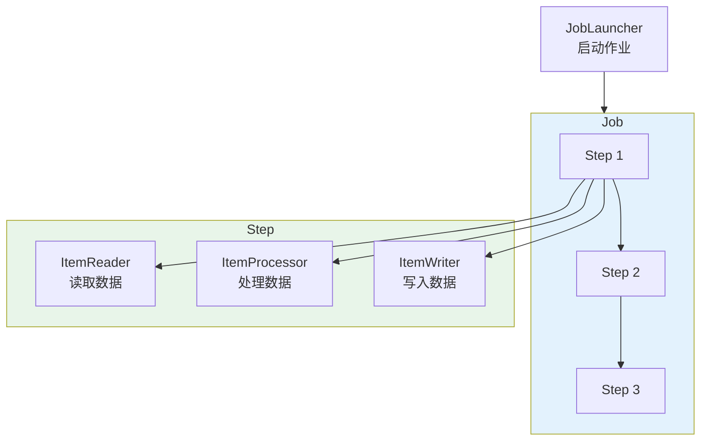
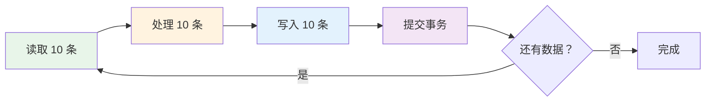

# 批处理机制与 Spring Batch 快速入门

## 课程目标

- 理解批处理的应用场景和 Spring Batch 的定位
- 掌握 Spring Batch 的核心概念（Job、Step、Chunk）
- 能够在 Spring Boot 中集成 Spring Batch
- 能够编写并运行第一个批处理任务
- 能够查看作业执行记录和状态


## 批处理概述

### 什么是批处理

**批处理（Batch Processing）** 是指在无需人工干预的情况下，自动执行一系列数据处理任务的过程。批处理通常处理**大量数据**，可以一次性完成、定时执行或按需触发。


### 批处理的典型场景

| 场景         | 说明                   | 示例                     |
| ------------ | ---------------------- | ------------------------ |
| **数据导入** | 从外部文件批量导入数据 | 从 CSV 导入图书数据      |
| **数据导出** | 批量导出数据到文件     | 导出订单数据到 Excel     |
| **数据迁移** | 从旧系统迁移到新系统   | 图书数据从旧表迁移到新表 |
| **报表生成** | 定时生成统计报表       | 每日销售报表、月度统计   |
| **数据清理** | 批量删除或归档历史数据 | 清理过期日志、归档旧订单 |
| **数据同步** | 定时同步多个数据源     | 库存数据同步             |

### 为什么需要批处理框架

如果不使用批处理框架，开发者需要自己处理：

| 问题         | 说明                     |
| ------------ | ------------------------ |
| **事务管理** | 大数据量下的事务提交策略 |
| **异常处理** | 某条数据失败时如何处理   |
| **断点续传** | 任务中断后如何恢复       |
| **性能优化** | 分批读取、批量写入       |
| **执行监控** | 记录每次执行的状态和结果 |

**Spring Batch** 正是为解决这些问题而生。

### Spring Batch 的优势

| 优势                   | 说明                                 |
| ---------------------- | ------------------------------------ |
| **标准化**             | 提供统一的批处理编程模型             |
| **健壮性**             | 内置跳过、重试、重启机制             |
| **可扩展**             | 支持多线程、分区处理                 |
| **可监控**             | 自动记录执行历史                     |
| **与 Spring 生态整合** | 无缝集成 Spring Boot、Spring Data 等 |


## Spring Batch 核心概念

### 整体架构



### 核心概念说明

| 概念              | 说明                                               |
| ----------------- | -------------------------------------------------- |
| **Job**           | 一个完整的批处理任务，可以包含多个 Step            |
| **Step**          | Job 中的一个处理步骤，通常包含读取-处理-写入的流程 |
| **ItemReader**    | 数据读取组件，从数据源读取数据                     |
| **ItemProcessor** | 数据处理组件，对读取的数据进行处理（可选）         |
| **ItemWriter**    | 数据写入组件，将处理后的数据写入目标               |
| **JobRepository** | 作业仓库，持久化作业执行信息                       |
| **JobLauncher**   | 作业启动器，负责启动 Job                           |
| **Chunk**         | 数据块，一批数据（如每次处理 10 条）               |

### Chunk 模型

**Chunk 模型** 是 Spring Batch 最常用的处理模型，它将数据分成多个小块（chunk）进行处理。



**工作流程：**
1. ItemReader 读取一条数据，放入 chunk
2. ItemProcessor 处理该数据，放回 chunk
3. 重复上述过程，直到 chunk 达到配置的大小（如 10 条）
4. ItemWriter 一次性写入这 10 条数据
5. 提交事务
6. 继续下一个 chunk

**Chunk 大小的选择：**

| Chunk 大小    | 优点                     | 缺点                         |
| ------------- | ------------------------ | ---------------------------- |
| 小（如 10）   | 内存占用少，事务提交频繁 | 提交次数多，性能略低         |
| 大（如 1000） | 提交次数少，性能高       | 内存占用大，失败时回滚数据多 |

> [!NOTE]
> 通常建议 Chunk 大小在 100-1000 之间，具体根据数据大小和内存情况调整。


## Spring Boot 集成 Spring Batch

### 1. 添加依赖

在 `pom.xml` 中添加 Spring Batch Starter：

```xml
<dependency>
    <groupId>org.springframework.boot</groupId>
    <artifactId>spring-boot-starter-batch</artifactId>
</dependency>
```

### 2. 配置数据源

Spring Batch 需要数据库来存储作业执行信息。我们使用 PostgreSQL：

```yaml
spring:
  datasource:
    driver-class-name: org.postgresql.Driver
    url: jdbc:postgresql://localhost:5432/bookdb
    username: postgres
    password: your_password
  batch:
    # 自动初始化 Spring Batch 元数据表
    jdbc:
      initialize-schema: always
    # 禁止应用启动时自动执行所有 Job
    job:
      enabled: false
```

> [!NOTE]
> `initialize-schema: always` 会自动创建 Spring Batch 的元数据表（如 `BATCH_JOB_INSTANCE`、`BATCH_JOB_EXECUTION` 等）。生产环境建议使用 `never`，通过脚本手动初始化。

### 3. 启用 Spring Batch

在主启动类上添加 `@EnableBatchProcessing` 注解：

```java
@SpringBootApplication
@EnableBatchProcessing   // 启用 Spring Batch
public class BookManagerApplication {
    public static void main(String[] args) {
        SpringApplication.run(BookManagerApplication.class, args);
    }
}
```

> [!CAUTION]
>
> 在较新的 Spring Boot 3.x 中，`@EnableBatchProcessing` 已不是必需的（自动配置）。只要类路径下存在 Spring Batch，相关的自动配置就会**默认启用**，不再需要这个注解添加之后。如果添加了这个注解，Spring Boot 的自动配置就会“退避”，导致 `spring.batch.jdbc.initialize-schema: always` 配置失效，因为它是由自动配置负责处理的。

### 4. Spring Batch 元数据表

启用后，Spring Batch 会在数据库中自动创建以下核心表：

| 表名                           | 说明                                |
| ------------------------------ | ----------------------------------- |
| `BATCH_JOB_INSTANCE`           | 作业实例（唯一标识一个 Job 的实例） |
| `BATCH_JOB_EXECUTION`          | 作业执行记录（每次运行的记录）      |
| `BATCH_JOB_EXECUTION_PARAMS`   | 作业参数                            |
| `BATCH_STEP_EXECUTION`         | 步骤执行记录                        |
| `BATCH_STEP_EXECUTION_CONTEXT` | 步骤执行上下文                      |
| `BATCH_JOB_EXECUTION_CONTEXT`  | 作业执行上下文                      |


## 第一个批处理任务：批量导入图书

需求：从内存中读取一批图书数据，写入数据库。

### 编写第一个 Job

```java
@Configuration
public class FirstBatchJobConfig {

    /**
     * ItemReader：从内存列表中读取图书数据
     */
    @Bean
    public ItemReader<Book> bookReader() {
        List<Book> books = Arrays.asList(
                new Book("Spring Boot 实战", "Craig Walls", 79.00, 10,
                        "后端开发", "978-7-115-56161-9",
                        "Spring Boot 从入门到实战，覆盖自动配置、Starter、Actuator 等核心特性"),
                new Book("Java 核心技术", "Cay S. Horstmann", 89.00, 8,
                        "编程语言", "978-7-111-54711-6",
                        "Java 领域经典教材，涵盖基础语法、集合、并发与函数式编程"),
                new Book("深入理解 Java 虚拟机", "周志明", 129.00, 5,
                        "底层原理", "978-7-111-64123-1",
                        "JVM 内存模型、垃圾回收、类加载机制与性能调优的权威解读"),
                new Book("Effective Java", "Joshua Bloch", 99.00, 6,
                        "编程实践", "978-7-111-61257-6",
                        "Java 编程最佳实践，90 条改善代码质量的经验法则"),
                new Book("Spring 源码深度解析", "郝佳", 99.00, 3,
                        "源码剖析", "978-7-115-48598-7",
                        "从源码层面剖析 Spring IoC、AOP、事务等核心模块实现")
        );
        return new ListItemReader<>(books);
    }

    /**
     * ItemProcessor：处理图书数据（此处仅打印日志）
     */
    @Bean
    public ItemProcessor<Book, Book> bookProcessor() {
        return book -> {
            System.out.println("处理图书: " + book.getTitle());
            // 可以在这里做数据转换、校验
            return book;
        };
    }

    /**
     * ItemWriter：批量写入数据库
     */
    @Bean
    public ItemWriter<Book> bookWriter(DataSource dataSource) {
        JdbcTemplate jdbcTemplate = new JdbcTemplate(dataSource);
        return items -> {
            for (Book book : items) {
                jdbcTemplate.update(
                        "INSERT INTO book (title, author, price, stock, sales, category, isbn, description, deleted, created_at, updated_at) " +
                        "VALUES (?, ?, ?, ?, ?, ?, ?, ?, ?, ?, ?)",
                        book.getTitle(),
                        book.getAuthor(),
                        book.getPrice(),
                        book.getStock(),
                        book.getSales(),
                        book.getCategory(),
                        book.getIsbn(),
                        book.getDescription(),
                        book.getDeleted(),
                        Timestamp.valueOf(LocalDateTime.now()),   // created_at
                        Timestamp.valueOf(LocalDateTime.now())    // updated_at
                );
            }
            System.out.println("写入 " + items.size() + " 条图书数据");
        };
    }

    /**
     * 定义 Step
     */
    @Bean
    public Step importBookStep(JobRepository jobRepository,
                               PlatformTransactionManager transactionManager,
                               ItemReader<Book> bookReader,
                               ItemProcessor<Book, Book> bookProcessor,
                               ItemWriter<Book> bookWriter) {
        return new StepBuilder("importBookStep", jobRepository)
                .<Book, Book>chunk(2, transactionManager)  // Chunk 大小为 2
                .reader(bookReader)
                .processor(bookProcessor)
                .writer(bookWriter)
                .build();
    }

    /**
     * 定义 Job
     */
    @Bean
    public Job importBookJob(JobRepository jobRepository, Step importBookStep) {
        return new JobBuilder("importBookJob", jobRepository)
                .start(importBookStep)
                .build();
    }
}
```

### 代码解析

| 组件               | 说明                                     |
| ------------------ | ---------------------------------------- |
| `bookReader()`     | 使用 `ListItemReader` 从内存列表读取数据 |
| `bookProcessor()`  | 简单的处理逻辑（打印图书标题）           |
| `bookWriter()`     | 使用 `JdbcTemplate` 批量写入数据库       |
| `importBookStep()` | 定义 Step，Chunk 大小为 2                |
| `importBookJob()`  | 定义 Job，包含一个 Step                  |


## 运行批处理任务

### 方式一：应用启动时自动运行

在 `application.yml` 中设置：

```yaml
spring:
  batch:
    job:
      enabled: true   # 应用启动时自动运行所有 Job
      names: importBookJob  # 指定要运行的 Job 名称
```

启动应用，控制台会输出：

```
处理图书: Spring Boot 实战
处理图书: Java 核心技术
写入 2 条图书数据
处理图书: 深入理解 Java 虚拟机
处理图书: Effective Java
写入 2 条图书数据
处理图书: Spring 源码深度解析
写入 1 条图书数据
```

### 方式二：通过 JobLauncher 手动触发

创建 Controller 手动触发 Job：

```java
@RestController
@RequestMapping("/api/batch")
public class BatchController {

    @Autowired
    private JobLauncher jobLauncher;

    @Autowired
    @Qualifier("importBookJob")
    private Job importBookJob;

    @PostMapping("/import-books")
    public Result<String> importBooks() throws Exception {
        // 使用时间戳作为参数，避免重复执行被拒绝
        JobParameters params = new JobParametersBuilder()
                .addLong("timestamp", System.currentTimeMillis())
                .toJobParameters();

        jobLauncher.run(importBookJob, params);
        return Result.success("批处理任务已启动");
    }
}
```

> [!NOTE]
> Spring Batch 默认不允许重复执行同一个 Job（相同的 Job 参数）。因此我们在参数中加入时间戳，确保每次执行都是唯一的。

### 方式三：通过命令行参数触发

```bash
java -jar book-manager.jar --spring.batch.job.names=importBookJob
```


## 查看执行记录

Spring Batch 自动将执行信息记录到数据库中，可以通过以下 SQL 查看：

```sql
-- 查看所有 Job 实例
SELECT * FROM BATCH_JOB_INSTANCE;

-- 查看 Job 执行记录
SELECT * FROM BATCH_JOB_EXECUTION;

-- 查看 Step 执行记录
SELECT * FROM BATCH_STEP_EXECUTION;
```

**关键字段说明：**

| 表                     | 字段           | 说明                                   |
| ---------------------- | -------------- | -------------------------------------- |
| `BATCH_JOB_INSTANCE`   | `JOB_NAME`     | 作业名称                               |
| `BATCH_JOB_EXECUTION`  | `STATUS`       | 执行状态（COMPLETED、FAILED、STOPPED） |
|                        | `START_TIME`   | 开始时间                               |
|                        | `END_TIME`     | 结束时间                               |
|                        | `EXIT_CODE`    | 退出码（COMPLETED、FAILED）            |
| `BATCH_STEP_EXECUTION` | `READ_COUNT`   | 读取记录数                             |
|                        | `WRITE_COUNT`  | 写入记录数                             |
|                        | `COMMIT_COUNT` | 提交次数                               |


## 注意事项

### 1. 元数据表的初始化

- 开发环境可使用 `initialize-schema: always` 自动创建
- 生产环境建议使用 `never`，通过 SQL 脚本手动初始化

### 2. Job 参数唯一性

- 相同的 Job 参数不能重复执行同一个 Job
- 如果需要重复执行，加入时间戳参数

### 3. Chunk 大小的选择

- Chunk 太小：事务提交频繁，性能低
- Chunk 太大：内存占用高，失败时回滚数据多
- 建议：100-1000，根据实际情况调整

### 4. Job 自动执行配置

- `spring.batch.job.enabled: false`：应用启动时不自动执行 Job
- 通过 `JobLauncher` 手动触发，灵活性更高

### 5. 事务管理

- Step 中的事务由 `PlatformTransactionManager` 管理
- 每个 Chunk 作为一个事务单元，全部成功才提交


## 小结

本节课我们学习了：

1. **批处理概述**：批处理的应用场景和 Spring Batch 的优势
2. **Spring Batch 核心概念**：
   - Job、Step、ItemReader、ItemProcessor、ItemWriter
   - Chunk 模型
3. **Spring Boot 集成**：依赖配置、数据源配置、元数据表初始化
4. **第一个批处理任务**：批量导入图书数据
5. **运行方式**：自动执行、JobLauncher 手动触发、命令行参数
6. **执行记录**：通过元数据表查看作业状态


## 作业

### 作业一：代码阅读——Spring Batch 组件识别

阅读以下代码，回答问题。

```java
@Bean
public Step myStep(JobRepository jobRepository,
                   PlatformTransactionManager txManager,
                   ItemReader<String> reader,
                   ItemWriter<String> writer) {
    return new StepBuilder("myStep", jobRepository)
            .<String, String>chunk(5, txManager)
            .reader(reader)
            .writer(writer)
            .build();
}

@Bean
public Job myJob(JobRepository jobRepository, Step myStep) {
    return new JobBuilder("myJob", jobRepository)
            .start(myStep)
            .build();
}
```

**问题：**
1. 这个 Step 的 Chunk 大小是多少？
2. 该 Step 使用了几次事务提交？（假设读取 12 条数据）
3. 如果第 7 条数据读取时抛出异常，前 5 条数据会写入吗？
4. Job 启动后，执行信息会记录到哪些表？

---

### 作业二：实现批量导入图书任务

在图书管理系统中完成以下任务：

1. 在 `pom.xml` 中添加 `spring-boot-starter-batch` 依赖。
2. 配置数据源和 Spring Batch 元数据初始化。
3. 创建 `BookImportBatchConfig`：
   - 使用 `ListItemReader` 提供 8 条图书数据
   - 使用 `ItemProcessor` 对数据进行处理（打印日志）
   - 使用 `JdbcTemplate` 将数据写入 `book` 表
   - Chunk 大小为 3
4. 创建 Controller 手动触发 Job。
5. 启动应用，访问接口触发 Job，观察日志和数据库结果。

---

### 作业三：查看执行记录

1. 执行作业后，使用 SQL 查询以下表，记录并分析：
   - `BATCH_JOB_INSTANCE`：有几条记录？
   - `BATCH_JOB_EXECUTION`：执行状态是什么？
   - `BATCH_STEP_EXECUTION`：读取了多少条？写入了多少条？提交了几次？
2. 尝试再次执行相同的 Job（相同参数），观察是否报错。
3. 修改 Job 参数（添加时间戳），再次执行，观察执行记录。
