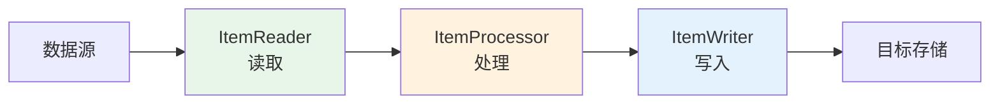
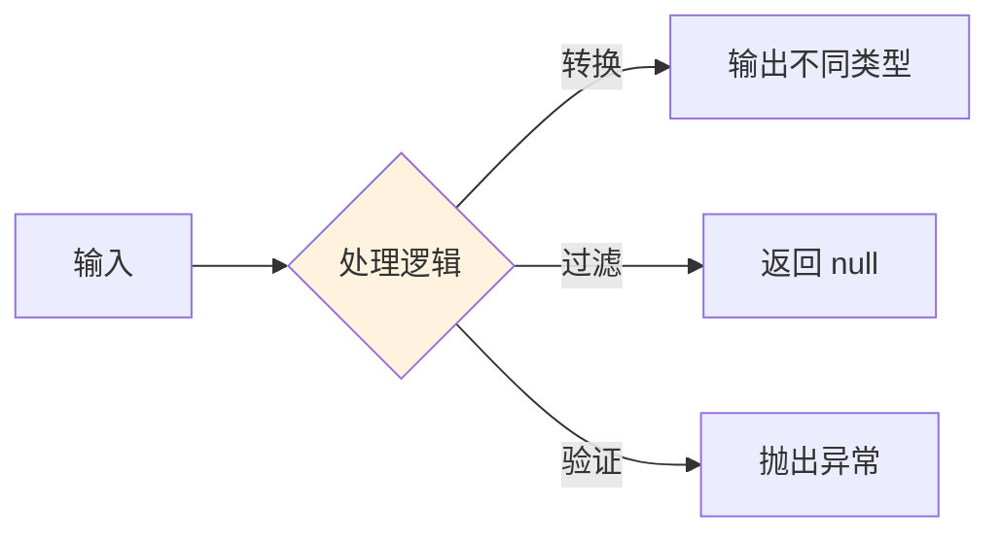
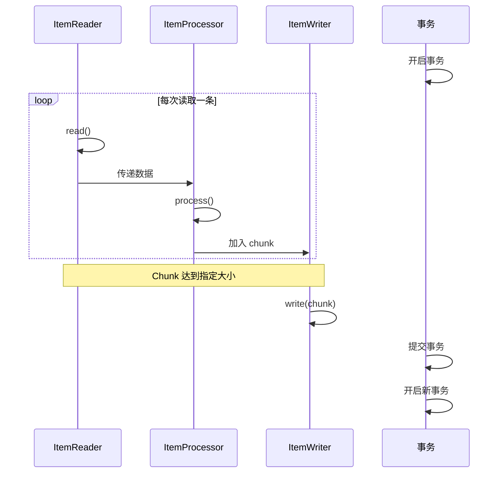

# ItemReader、Processor和Writer 实战

## 课程目标

- 掌握 ItemReader 的常用实现类及使用场景
- 掌握 ItemProcessor 的数据处理与过滤
- 掌握 ItemWriter 的常用实现类及批量写入
- 理解 Chunk 模型的执行机制
- 能够实现从 CSV 文件导入图书到数据库的完整批处理任务


## 回顾与导入

在上一讲中，我们使用 `ListItemReader` 从内存列表读取数据，完成了第一个批处理任务。但在实际项目中，数据源往往是**文件**、**数据库**或**消息队列**。



本节课将深入学习 Spring Batch 三大核心组件的常用实现，并通过**从 CSV 文件导入图书**的实战案例，掌握完整的批处理开发流程。


## ItemReader 详解

### ItemReader 接口

`ItemReader<T>` 是数据读取的顶层接口：

```java
public interface ItemReader<T> {
    // 读取下一条数据，返回 null 表示读取完毕
    T read() throws Exception, UnexpectedInputException, ParseException, NonTransientResourceException;
}
```

### 常用实现类

| 实现类                    | 说明                          | 适用场景           |
| ------------------------- | ----------------------------- | ------------------ |
| `FlatFileItemReader`      | 读取文本文件（CSV、固定长度） | 文件导入           |
| `JdbcCursorItemReader`    | 基于 JDBC 游标读取            | 大数据量数据库读取 |
| `JdbcPagingItemReader`    | 基于 JDBC 分页读取            | 大数据量分页读取   |
| `JpaPagingItemReader`     | 基于 JPA 分页读取             | JPA 项目           |
| `ListItemReader`          | 从内存列表读取                | 测试、小数据量     |
| `MultiResourceItemReader` | 读取多个文件                  | 批量文件处理       |

### FlatFileItemReader 详解

**FlatFileItemReader** 是最常用的文件读取器，适合读取 CSV、TSV 等结构化文本文件。

#### 基本配置

```java
@Bean
public FlatFileItemReader<Book> csvReader() {
    return new FlatFileItemReaderBuilder<Book>()
            .name("csvReader")
            .resource(new ClassPathResource("data/books.csv"))
            .linesToSkip(1)   // 跳过表头
            .delimited()
            .delimiter(",")
            .names("title", "author", "price", "stock")  // 列名
            .targetType(Book.class)  // 直接映射到 Book 对象
            .build();
}
```

#### 关键属性

| 属性                         | 说明                           |
| ---------------------------- | ------------------------------ |
| `resource`                   | 数据源文件                     |
| `linesToSkip`                | 跳过前 N 行（如表头）          |
| `delimited().delimiter(",")` | 分隔符                         |
| `names(...)`                 | 列名（与字段对应）             |
| `targetType(Book.class)`     | 目标类型（自动映射）           |
| `encoding("UTF-8")`          | 文件编码                       |
| `strict(true)`               | 严格模式（列数不匹配是否报错） |

#### CSV 文件示例

`src/main/resources/data/books.csv`：

```csv
title,author,price,stock
Spring Boot 实战,Craig Walls,79.00,10
Java 核心技术,Cay S. Horstmann,89.00,8
深入理解 Java 虚拟机,周志明,129.00,5
Effective Java,Joshua Bloch,99.00,6
Spring 源码深度解析,郝佳,99.00,3
```

> [!NOTE]
> `targetType(Book.class)` 会自动将列映射到 Book 对象的同名字段。如果列名与字段名不一致，需要使用 `FieldSetMapper` 自定义映射。

#### 使用 FieldSetMapper 自定义映射

当 CSV 列名与 Java 字段名不一致时，使用 `FieldSetMapper`：

```java
public class BookFieldSetMapper implements FieldSetMapper<Book> {
    @Override
    public Book mapFieldSet(FieldSet fieldSet) throws BindException {
        Book book = new Book();
        book.setTitle(fieldSet.readString(0));
        book.setAuthor(fieldSet.readString(1));
        book.setPrice(fieldSet.readDouble(2));
        book.setStock(fieldSet.readInt(3));
        return book;
    }
}
```

```java
@Bean
public FlatFileItemReader<Book> csvBookReaderWithMapper() {
    return new FlatFileItemReaderBuilder<Book>()
            .name("csvBookReaderWithMapper")
            .resource(new ClassPathResource("data/books.csv"))
            .linesToSkip(1)
            .delimited()
            .delimiter(",")
            .names("title", "author", "price", "stock")
            .fieldSetMapper(new BookFieldSetMapper()) // 使用FieldSetMapper
            .build();
}
```

### JdbcPagingItemReader 详解

**JdbcPagingItemReader** 适合从数据库分页读取大量数据。

```java
@Bean
public JdbcPagingItemReader<Book> dbBookReader(DataSource dataSource) {
    Map<String, Order> sortKeys = new HashMap<>();
    sortKeys.put("id", Order.ASCENDING);

    return new JdbcPagingItemReaderBuilder<Book>()
            .name("dbBookReader")
            .dataSource(dataSource)
            .selectClause("SELECT id, title, author, price, stock")
            .fromClause("FROM book")
            .sortKeys(sortKeys)
            .rowMapper(new BeanPropertyRowMapper<>(Book.class))
            .pageSize(10)
            .build();
}
```

> [!NOTE]
> `JdbcPagingItemReader` 使用分页查询，不会一次性加载所有数据，适合大数据量场景。而 `JdbcCursorItemReader` 使用游标，保持数据库连接。

### ItemReader 的读取结束

ItemReader 通过返回 `null` 表示读取结束。Spring Batch 会自动检测并结束当前 Step。


## ItemProcessor 详解

### ItemProcessor 接口

`ItemProcessor<I, O>` 是数据处理的接口，输入类型为 I，输出类型为 O：

```java
public interface ItemProcessor<I, O> {
    // 处理数据，返回 null 表示过滤（不写入）
    O process(I item) throws Exception;
}
```

### 三种处理逻辑



### 数据转换

将一种类型转换为另一种类型：

```java
@Bean
public ItemProcessor<BookCsv, Book> bookConverter() {
    return csv -> {
        Book book = new Book();
        book.setTitle(csv.getTitle().trim());
        book.setAuthor(csv.getAuthor().trim());
        book.setPrice(csv.getPrice());
        book.setStock(csv.getStock());
        return book;
    };
}
```

### 数据过滤

返回 `null` 表示过滤掉该条数据：

```java
@Bean
public ItemProcessor<Book, Book> validBookFilter() {
    return book -> {
        // 过滤价格小于 0 的图书
        if (book.getPrice() == null || book.getPrice() < 0) {
            System.out.println("过滤无效图书: " + book.getTitle());
            return null;
        }
        return book;
    };
}
```

### 数据校验

校验失败时抛出异常（后续课程会讲解如何跳过异常数据）：

```java
@Bean
public ItemProcessor<Book, Book> bookValidator() {
    return book -> {
        if (book.getTitle() == null || book.getTitle().isBlank()) {
            throw new IllegalArgumentException("书名不能为空");
        }
        if (book.getStock() == null || book.getStock() < 0) {
            throw new IllegalArgumentException("库存不能为负数: " + book.getTitle());
        }
        return book;
    };
}
```

### 多个 Processor 组合

Spring Batch 支持多个 Processor 通过 `CompositeItemProcessor` 串联：

```java
@Bean
public ItemProcessor<Book, Book> compositeProcessor(
        ItemProcessor<Book, Book> validBookFilter,
        ItemProcessor<Book, Book> bookValidator) {
    CompositeItemProcessor<Book, Book> processor = new CompositeItemProcessor<>();
    processor.setDelegates(Arrays.asList(validBookFilter, bookValidator));
    return processor;
}
```

> [!NOTE]
> 组合的 Processor 会按顺序执行。如果任一 Processor 返回 `null`，后续 Processor 不再执行，数据被过滤。


## ItemWriter 详解

### ItemWriter 接口

`ItemWriter<T>` 是数据写入的接口：

```java
public interface ItemWriter<T> {
    // 写入一批数据（chunk）
    void write(Chunk<? extends T> chunk) throws Exception;
}
```

### 常用实现类

| 实现类                          | 说明                   | 适用场景       |
| ------------------------------- | ---------------------- | -------------- |
| `JdbcBatchItemWriter`           | 批量写入数据库（JDBC） | 高性能批量写入 |
| `JpaItemWriter`                 | 使用 JPA 写入          | JPA 项目       |
| `FlatFileItemWriter`            | 写入文本文件           | 导出数据       |
| `CompositeItemWriter`           | 组合多个 Writer        | 写入多个目标   |
| `ClassifierCompositeItemWriter` | 按条件分类写入         | 复杂写入场景   |

### JdbcBatchItemWriter 详解

**JdbcBatchItemWriter** 是最常用的数据库写入器，支持真正的批量写入。

```java
@Bean
public JdbcBatchItemWriter<Book> bookWriterWithSetter(DataSource dataSource) {
    return new JdbcBatchItemWriterBuilder<Book>()
            .dataSource(dataSource)
            .sql("INSERT INTO book (title, author, price, stock) VALUES (?, ?, ?, ?)")
            .itemPreparedStatementSetter((book, ps) -> {
                ps.setString(1, book.getTitle());
                ps.setString(2, book.getAuthor());
                ps.setDouble(3, book.getPrice());
                ps.setInt(4, book.getStock());
            })
            .build();
}
```

#### 使用 BeanPropertyItemSqlParameterSourceProvider

如果 SQL 参数与 Java 字段名一致，可以使用 `BeanPropertyItemSqlParameterSourceProvider`：

```java
@Bean
public JdbcBatchItemWriter<Book> bookWriterWithNamedParams(DataSource dataSource) {
    return new JdbcBatchItemWriterBuilder<Book>()
            .dataSource(dataSource)
            .sql("INSERT INTO book (title, author, price, stock) " +
                 "VALUES (:title, :author, :price, :stock)")
            .itemSqlParameterSourceProvider(new BeanPropertyItemSqlParameterSourceProvider<>())
            .build();
}
```

> [!NOTE]
> 使用命名参数（`:title`）配合 `BeanPropertyItemSqlParameterSourceProvider`，代码更简洁。

### 批量写入性能对比

| Writer                     | 批量机制               | 性能 |
| -------------------------- | ---------------------- | ---- |
| 逐条 `jdbcTemplate.update` | 无批量                 | 低   |
| `JdbcBatchItemWriter`      | PreparedStatement 批量 | 高   |

> [!NOTE]
> `JdbcBatchItemWriter` 使用 JDBC 的 `addBatch()` 和 `executeBatch()`，性能远高于逐条插入。


## Chunk 模型深入

### Chunk 执行流程



### Chunk 大小的影响

| Chunk 大小 | 事务提交次数   | 内存占用 | 失败回滚数据 |
| ---------- | -------------- | -------- | ------------ |
| 1          | 每条一次       | 最小     | 1 条         |
| 10         | 每 10 条一次   | 小       | 10 条        |
| 100        | 每 100 条一次  | 中       | 100 条       |
| 1000       | 每 1000 条一次 | 大       | 1000 条      |

### Chunk 大小设置建议

| 场景                 | 建议 Chunk 大小 |
| -------------------- | --------------- |
| 内存小、数据量大     | 100-500         |
| 内存充足、数据量适中 | 500-1000        |
| 单条数据体积大       | 10-100          |
| 单条数据体积小       | 1000-5000       |

### 配置 Chunk 大小

```java
@Bean
public Step importBookStep(JobRepository jobRepository,
                           PlatformTransactionManager transactionManager,
                           ItemReader<Book> bookReader,
                           ItemProcessor<Book, Book> bookProcessor,
                           ItemWriter<Book> bookWriter) {
    return new StepBuilder("importBookStep", jobRepository)
            .<Book, Book>chunk(100, transactionManager)  // Chunk 大小 100
            .reader(bookReader)
            .processor(bookProcessor)
            .writer(bookWriter)
            .build();
}
```


## 实战：从 CSV 文件导入图书数据

### 需求

从 `books.csv` 文件读取图书数据，经过校验和转换后批量写入数据库。

### 步骤一：准备 CSV 文件

`src/main/resources/data/books.csv`：

```csv
title,author,price,stock
Spring Boot 实战,Craig Walls,79.00,10
Java 核心技术,Cay S. Horstmann,89.00,8
深入理解 Java 虚拟机,周志明,129.00,5
Effective Java,Joshua Bloch,99.00,6
Spring 源码深度解析,郝佳,99.00,3
Invalid Book,,50.00,2
Negative Price Book,Test Author,-10.00,5
零库存图书,Test Author,45.00,0
```

> [!NOTE]
> 故意包含两行无效数据（作者为空、价格为负），用于演示数据校验和过滤。

### 步骤二：创建批处理配置

```java
@Configuration
public class CsvImportJobConfig {

    /**
     * ItemReader：从 CSV 读取图书数据
     */
    @Bean
    public FlatFileItemReader<Book> csvBookReader() {
        return new FlatFileItemReaderBuilder<Book>()
                .name("csvBookReader")
                .resource(new ClassPathResource("data/books.csv"))
                .linesToSkip(1)
                .delimited()
                .delimiter(",")
                .names("title", "author", "price", "stock")
                .targetType(Book.class)
                .encoding("UTF-8")
                .build();
    }

    /**
     * ItemProcessor：数据校验 + 数据清洗
     */
    @Bean
    public ItemProcessor<Book, Book> csvBookProcessor() {
        return book -> {
            // 1. 清洗数据（去除首尾空格）
            if (book.getTitle() != null) {
                book.setTitle(book.getTitle().trim());
            }
            if (book.getAuthor() != null) {
                book.setAuthor(book.getAuthor().trim());
            }

            // 2. 过滤无效数据（返回 null 表示过滤）
            if (book.getTitle() == null || book.getTitle().isBlank()) {
                System.out.println("过滤：书名为空");
                return null;
            }
            if (book.getAuthor() == null || book.getAuthor().isBlank()) {
                System.out.println("过滤：作者为空 - " + book.getTitle());
                return null;
            }
            if (book.getPrice() == null || book.getPrice() < 0) {
                System.out.println("过滤：价格为负 - " + book.getTitle());
                return null;
            }

            // 3. 处理数据（此处仅打印日志）
            System.out.println("处理图书: " + book);
            return book;
        };
    }

    /**
     * ItemWriter：批量写入数据库
     */
    @Bean
    public JdbcBatchItemWriter<Book> csvBookWriter(DataSource dataSource) {
        return new JdbcBatchItemWriterBuilder<Book>()
                .dataSource(dataSource)
                .sql("INSERT INTO book (title, author, price, stock) " +
                     "VALUES (:title, :author, :price, :stock)")
                .beanMapped()
                .build();
    }

    /**
     * 定义 Step
     */
    @Bean
    public Step csvImportStep(JobRepository jobRepository,
                              PlatformTransactionManager transactionManager,
                              ItemReader<Book> csvBookReader,
                              ItemProcessor<Book, Book> csvBookProcessor,
                              ItemWriter<Book> csvBookWriter) {
        return new StepBuilder("csvImportStep", jobRepository)
                .<Book, Book>chunk(3, transactionManager)  // Chunk 大小 3
                .reader(csvBookReader)
                .processor(csvBookProcessor)
                .writer(csvBookWriter)
                .build();
    }

    /**
     * 定义 Job
     */
    @Bean
    public Job csvImportJob(JobRepository jobRepository, Step csvImportStep) {
        return new JobBuilder("csvImportJob", jobRepository)
                .start(csvImportStep)
                .build();
    }
}
```

> [!NOTE]
> `beanMapped()` 是 `itemSqlParameterSourceProvider(new BeanPropertyItemSqlParameterSourceProvider<>())` 的简化写法。

### 步骤三：Controller 触发

```java
@RestController
@RequestMapping("/api/batch")
public class BatchController {

    @Autowired
    private JobLauncher jobLauncher;

    @Autowired
    @Qualifier("csvImportJob")
    private Job csvImportJob;

    @PostMapping("/import-csv")
    public Result<String> importFromCsv() throws Exception {
        JobParameters params = new JobParametersBuilder()
                .addLong("timestamp", System.currentTimeMillis())
                .toJobParameters();

        jobLauncher.run(csvImportJob, params);
        return Result.success("CSV 导入任务已启动");
    }
}
```

### 步骤四：运行并观察日志

启动应用，调用接口：

```bash
curl -X POST "http://localhost:8080/api/batch/import-csv"
```

**控制台输出：**

```
处理图书: Book{title='Spring Boot 实战', author='Craig Walls', price=79.0}
处理图书: Book{title='Java 核心技术', author='Cay S. Horstmann', price=89.0}
处理图书: Book{title='深入理解 Java 虚拟机', author='周志明', price=129.0}
（写入 3 条数据）

处理图书: Book{title='Effective Java', author='Joshua Bloch', price=99.0}
处理图书: Book{title='Spring 源码深度解析', author='郝佳', price=99.0}
过滤：作者为空 - Invalid Book
（写入 2 条数据）

过滤：价格为负 - Negative Price Book
处理图书: Book{title='零库存图书', author='Test Author', price=45.0}
（写入 2 条数据）
```

**最终数据库结果：**

```sql
SELECT * FROM book;
-- Spring Boot 实战 | Craig Walls | 79.00 | 10
-- Java 核心技术 | Cay S. Horstmann | 89.00 | 8
-- 深入理解 Java 虚拟机 | 周志明 | 129.00 | 5
-- Effective Java | Joshua Bloch | 99.00 | 6
-- Spring 源码深度解析 | 郝佳 | 99.00 | 3
-- 零库存图书 | Test Author | 45.00 | 0
```

> [!NOTE]
> 无效数据被过滤，有效数据成功写入数据库。


## 注意事项

### 1. FlatFileItemReader 的编码问题

如果 CSV 文件包含中文，务必设置 `encoding("UTF-8")`，否则可能乱码。

### 2. 列名与字段名映射

- `targetType(Book.class)` 要求 CSV 列名与 Java 字段名一致
- 如果列名不同，使用 `FieldSetMapper` 自定义映射

### 3. ItemProcessor 返回 null 的含义

- 返回 `null` 表示过滤该条数据，不传递给 Writer
- 这是 Spring Batch 内置的过滤机制，无需额外配置

### 4. Chunk 大小与事务

- 每个 Chunk 作为一个事务单元，全部成功才提交
- 如果 Chunk 中某条数据失败，整个 Chunk 回滚

### 5. JdbcBatchItemWriter 的批量机制

- `JdbcBatchItemWriter` 底层使用 `PreparedStatement.addBatch()`，性能远高于逐条写入
- 命名参数（`:title`）配合 `BeanPropertyItemSqlParameterSourceProvider` 或 `beanMapped()` 使用


## 小结

本节课我们学习了：

1. **ItemReader 常用实现**：
   - `FlatFileItemReader`：读取 CSV/文本文件
   - `JdbcPagingItemReader`：分页读取数据库
   - `FieldSetMapper`：自定义列映射
2. **ItemProcessor 处理逻辑**：
   - 数据转换、数据过滤、数据校验
   - `CompositeItemProcessor` 组合多个 Processor
3. **ItemWriter 常用实现**：
   - `JdbcBatchItemWriter`：批量写入数据库
   - `FlatFileItemWriter`：写入文件
4. **Chunk 模型深入**：
   - 执行流程、事务机制
   - Chunk 大小的选择原则
5. **实战应用**：从 CSV 文件导入图书数据，包含数据清洗、过滤和批量写入


## 作业

### 作业一：代码阅读——组件识别

阅读以下代码，回答问题。

```java
@Bean
public FlatFileItemReader<Book> reader() {
    return new FlatFileItemReaderBuilder<Book>()
            .name("bookReader")
            .resource(new ClassPathResource("data/books.csv"))
            .linesToSkip(1)
            .delimited()
            .delimiter(",")
            .names("title", "author", "price", "stock")
            .targetType(Book.class)
            .build();
}

@Bean
public ItemProcessor<Book, Book> processor() {
    return book -> {
        if (book.getPrice() < 0) {
            return null;
        }
        book.setTitle(book.getTitle().toUpperCase());
        return book;
    };
}

@Bean
public Step step(JobRepository jobRepository, PlatformTransactionManager txManager,
                 ItemReader<Book> reader, ItemProcessor<Book, Book> processor,
                 ItemWriter<Book> writer) {
    return new StepBuilder("step", jobRepository)
            .<Book, Book>chunk(5, txManager)
            .reader(reader)
            .processor(processor)
            .writer(writer)
            .build();
}
```

**问题：**
1. CSV 文件的哪几列会被映射？
2. 如果某本书价格为 -10，会写入数据库吗？为什么？
3. 书名为 "java core" 会被处理成什么？
4. Chunk 大小为 5，如果读取了 12 条数据，会提交几次事务？

---

### 作业二：实现 CSV 图书导入

在图书管理系统中完成以下任务：

1. 创建 `src/main/resources/data/books.csv`，包含至少 8 条图书数据（包括 2 条无效数据）。
2. 创建 `CsvImportJobConfig`，实现：
   - 使用 `FlatFileItemReader` 读取 CSV
   - 使用 `ItemProcessor` 过滤无效数据（价格 < 0 或书名为空）
   - 使用 `JdbcBatchItemWriter` 写入数据库
   - Chunk 大小为 3
3. 创建 Controller 触发 Job。
4. 启动应用，触发 Job，验证无效数据被过滤，有效数据成功写入。

---

### 作业三：数据转换实战

在作业二的基础上，增加以下数据处理逻辑：

1. 将书名字段去掉首尾空格
2. 将作者名统一转为大写
3. 为价格字段自动添加 10% 的利润（乘以 1.1）
4. 过滤掉库存为 0 的图书

**要求：**
- 在 `ItemProcessor` 中实现上述逻辑
- 测试运行，观察处理后写入数据库的数据
