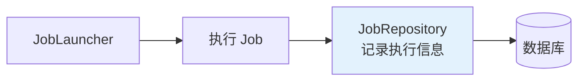
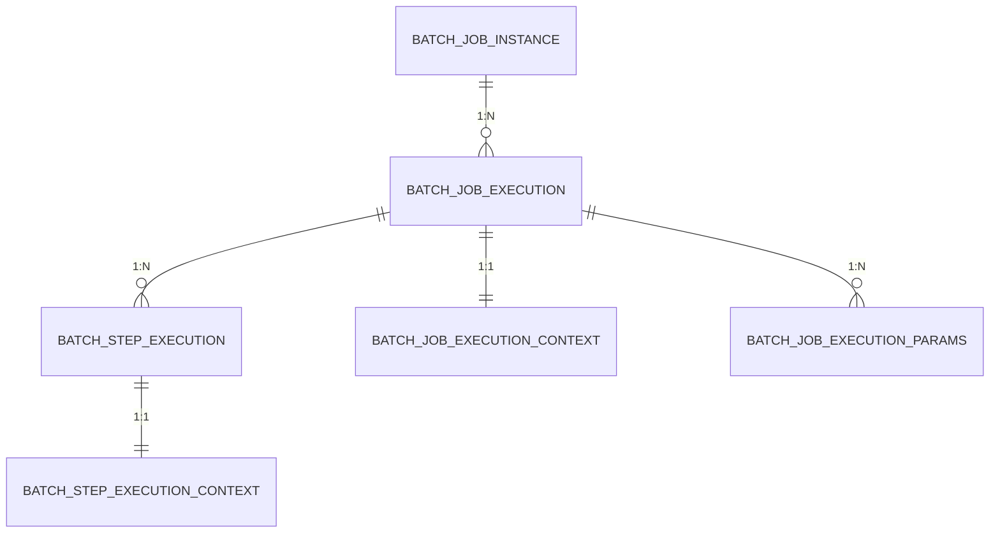

# JobRepository 与作业元数据管理

## 课程目标

- 理解 JobRepository 的作用和持久化机制
- 掌握 Spring Batch 元数据表的结构和关系
- 掌握使用 JobExplorer 查询作业执行历史
- 掌握使用 JobOperator 管理作业（启动、停止、重启）
- 能够在图书管理系统中实现作业监控接口


## 回顾与导入

在前两讲中，我们定义了 Job 和 Step，并成功运行了批处理任务。每次运行时，Spring Batch 都会自动将执行信息记录到数据库中。



这些记录包括：
- 作业是否成功
- 读取了多少条数据
- 写入多少条数据
- 执行了多长时间
- 失败原因

本节课将深入学习 JobRepository 的持久化机制，以及如何查询和管理作业执行历史。


## JobRepository 概述

### 什么是 JobRepository

**JobRepository** 是 Spring Batch 的核心组件，负责**持久化作业执行过程中的所有元数据**，包括作业实例、执行记录、步骤执行、上下文信息等。

```java
public interface JobRepository {
    // 创建作业实例
    JobInstance createJobInstance(String jobName, JobParameters jobParameters);

    // 创建作业执行
    JobExecution createJobExecution(JobInstance jobInstance, JobParameters jobParameters, JobExecution jobExecution);

    // 更新作业执行状态
    void update(JobExecution jobExecution);

    // 更新步骤执行状态
    void update(StepExecution stepExecution);

    // 添加步骤执行
    void add(StepExecution stepExecution);

    // 更新执行上下文
    void updateExecutionContext(StepExecution stepExecution);

    // 获取最近一次作业执行
    JobExecution getLastJobExecution(JobInstance jobInstance);
}
```

### JobRepository 的两种实现

| 实现类                        | 说明             | 适用场景 |
| ----------------------------- | ---------------- | -------- |
| `MapJobRepositoryFactoryBean` | 内存版，基于 Map | 测试环境 |
| `JobRepositoryFactoryBean`    | 数据库版（推荐） | 生产环境 |

> [!NOTE]
> Spring Boot 的 `spring-boot-starter-batch` 会自动配置基于数据源的 `JobRepository`，无需手动配置。

### 自动配置的 JobRepository

```yaml
spring:
  batch:
    jdbc:
      initialize-schema: always   # 自动初始化元数据表
```

当配置了数据源后，Spring Boot 会：
1. 创建 `JobRepository` Bean
2. 自动初始化元数据表
3. 将执行信息持久化到数据库

### 元数据的作用

| 作用             | 说明                           |
| ---------------- | ------------------------------ |
| **执行监控**     | 查看作业是否执行成功、耗时多久 |
| **断点续传**     | 基于历史记录，从中断点继续执行 |
| **避免重复执行** | 相同参数的作业实例只能执行一次 |
| **审计追踪**     | 记录每次执行的详细日志         |
| **性能分析**     | 分析读写数量、提交次数等       |


## 元数据表详解

### 表关系概览



### 核心表说明

| 表名                           | 说明       | 记录粒度                         |
| ------------------------------ | ---------- | -------------------------------- |
| `BATCH_JOB_INSTANCE`           | 作业实例   | 同一个作业 + 相同参数 = 一个实例 |
| `BATCH_JOB_EXECUTION`          | 作业执行   | 每次运行产生一条记录             |
| `BATCH_JOB_EXECUTION_PARAMS`   | 作业参数   | 每次执行的参数                   |
| `BATCH_JOB_EXECUTION_CONTEXT`  | 作业上下文 | 存储 Job 级别的共享数据          |
| `BATCH_STEP_EXECUTION`         | 步骤执行   | 每个 Step 的执行记录             |
| `BATCH_STEP_EXECUTION_CONTEXT` | 步骤上下文 | 存储 Step 级别的共享数据         |

### BATCH_JOB_INSTANCE（作业实例）

| 字段              | 说明                                 |
| ----------------- | ------------------------------------ |
| `JOB_INSTANCE_ID` | 主键                                 |
| `VERSION`         | 版本号                               |
| `JOB_NAME`        | 作业名称                             |
| `JOB_KEY`         | 作业参数的哈希值（用于判断是否重复） |

> [!NOTE]
> **同一个作业 + 相同的参数** = 同一个 JobInstance。Spring Batch 默认不允许同一个 JobInstance 重复执行（除非使用 `allowStartIfComplete` 或修改参数）。

### BATCH_JOB_EXECUTION（作业执行）

| 字段               | 说明                                            |
| ------------------ | ----------------------------------------------- |
| `JOB_EXECUTION_ID` | 主键                                            |
| `JOB_INSTANCE_ID`  | 外键，关联 JobInstance                          |
| `STATUS`           | 执行状态（STARTED、COMPLETED、FAILED、STOPPED） |
| `START_TIME`       | 开始时间                                        |
| `END_TIME`         | 结束时间                                        |
| `EXIT_CODE`        | 退出码                                          |
| `EXIT_MESSAGE`     | 退出信息（失败时记录异常）                      |
| `CREATE_TIME`      | 创建时间                                        |
| `LAST_UPDATED`     | 最后更新时间                                    |

### BATCH_STEP_EXECUTION（步骤执行）

| 字段                 | 说明                    |
| -------------------- | ----------------------- |
| `STEP_EXECUTION_ID`  | 主键                    |
| `STEP_NAME`          | 步骤名称                |
| `JOB_EXECUTION_ID`   | 外键，关联 JobExecution |
| `STATUS`             | 执行状态                |
| `COMMIT_COUNT`       | 提交次数                |
| `READ_COUNT`         | 读取记录数              |
| `FILTER_COUNT`       | 过滤记录数              |
| `WRITE_COUNT`        | 写入记录数              |
| `READ_SKIP_COUNT`    | 读取跳过数              |
| `WRITE_SKIP_COUNT`   | 写入跳过数              |
| `PROCESS_SKIP_COUNT` | 处理跳过数              |
| `ROLLBACK_COUNT`     | 回滚次数                |
| `START_TIME`         | 开始时间                |
| `END_TIME`           | 结束时间                |

### 查询示例

```sql
-- 1. 查看所有作业实例
SELECT JOB_INSTANCE_ID, JOB_NAME, JOB_KEY
FROM BATCH_JOB_INSTANCE
ORDER BY JOB_INSTANCE_ID DESC;

-- 2. 查看作业执行记录
SELECT JOB_EXECUTION_ID, JOB_INSTANCE_ID, STATUS, START_TIME, END_TIME, EXIT_CODE
FROM BATCH_JOB_EXECUTION
ORDER BY JOB_EXECUTION_ID DESC;

-- 3. 查看步骤执行详情
SELECT STEP_EXECUTION_ID, STEP_NAME, STATUS,
       READ_COUNT, WRITE_COUNT, COMMIT_COUNT, ROLLBACK_COUNT
FROM BATCH_STEP_EXECUTION
WHERE JOB_EXECUTION_ID = 1;

-- 4. 查看作业执行参数
SELECT JOB_EXECUTION_ID, PARAMETER_NAME, PARAMETER_VALUE
FROM BATCH_JOB_EXECUTION_PARAMS
WHERE JOB_EXECUTION_ID = 1;
```


## 使用 JobExplorer 查询作业

### 什么是 JobExplorer

**JobExplorer** 是 Spring Batch 提供的只读查询接口，用于查询作业执行历史，而不会修改任何数据。

```java
public interface JobExplorer {
    // 查询作业实例
    List<JobInstance> getJobInstances(String jobName, int start, int count);
    JobInstance getJobInstance(Long instanceId);
    List<JobInstance> findJobInstancesByJobName(String jobName, int start, int count);

    // 查询作业执行
    List<JobExecution> getJobExecutions(JobInstance jobInstance);
    JobExecution getJobExecution(Long executionId);
    Set<JobExecution> findRunningJobExecutions(String jobName);

    // 查询步骤执行
    List<StepExecution> getStepExecutions(Long jobExecutionId);
    StepExecution getStepExecution(Long jobExecutionId, Long stepExecutionId);

    // 其他
    int getJobInstanceCount(String jobName);
}
```

### 注入 JobExplorer

```java
@Service
public class JobHistoryService {

    private final JobExplorer jobExplorer;

    public JobHistoryService(JobExplorer jobExplorer) {
        this.jobExplorer = jobExplorer;
    }
}
```

### 查询作业实例

```java
/**
 * 查询指定作业的所有实例
 */
public List<JobInstance> getJobInstances(String jobName) {
    return jobExplorer.getJobInstances(jobName, 0, 100);
}

/**
 * 查询作业实例数量
 */
public Long getJobInstanceCount(String jobName) throws NoSuchJobException {
    return jobExplorer.getJobInstanceCount(jobName);
}
```

### 查询作业执行

```java
/**
 * 查询指定作业实例的所有执行记录
 */
public List<JobExecution> getJobExecutions(String jobName, Long instanceId) {
    JobInstance instance = jobExplorer.getJobInstance(instanceId);
    return jobExplorer.getJobExecutions(instance);
}

/**
 * 查询正在运行的作业
 */
public Set<JobExecution> getRunningExecutions(String jobName) {
    return jobExplorer.findRunningJobExecutions(jobName);
}
```

### 查询步骤执行

```java
/**
 * 查询指定作业执行的所有步骤
 */
public List<StepExecution> getStepExecutions(Long jobExecutionId) {
    // 1. 先从 JobExplorer 获取 JobExecution 对象
    JobExecution jobExecution = jobExplorer.getJobExecution(jobExecutionId);
    // 2. 调用 JobExecution 自身的 getStepExecutions() 方法
    return new ArrayList<>(jobExecution.getStepExecutions());
}
```


## 使用 JobOperator 管理作业

### 什么是 JobOperator

**JobOperator** 提供了对作业的**操作能力**，包括启动、停止、重启、放弃等。

```java
public interface JobOperator {
    // 启动作业
    Long start(String jobName, String parameters) throws NoSuchJobException, ...;

    // 停止作业
    boolean stop(Long executionId) throws NoSuchJobExecutionException, ...;

    // 重启失败的作业
    Long restart(Long executionId) throws ...;

    // 放弃作业
    void abandon(Long executionId) throws ...;

    // 查询正在运行的执行 ID
    Set<Long> getRunningExecutions(String jobName) throws ...;

    // 查询作业参数
    String getParameters(Long executionId) throws ...;

    // 查询作业名称
    List<String> getJobNames();

    // 查询作业实例
    List<Long> getJobInstances(String jobName, int start, int count);

    // 查询作业执行摘要
    String getSummary(Long executionId) throws ...;
}
```

### 注入 JobOperator

```java
@Service
public class JobAdminService {

    private final JobOperator jobOperator;

    public JobAdminService(JobOperator jobOperator) {
        this.jobOperator = jobOperator;
    }
}
```

### 停止作业

```java
/**
 * 停止正在运行的作业
 */
public boolean stopJob(Long executionId) {
    try {
        boolean stopped = jobOperator.stop(executionId);
        System.out.println("停止作业: " + executionId + ", 结果: " + stopped);
        return stopped;
    } catch (Exception e) {
        throw new RuntimeException("停止作业失败", e);
    }
}
```

### 重启失败的作业

```java
/**
 * 重启失败的作业（断点续传）
 */
public Long restartJob(Long executionId) {
    try {
        // 检查作业是否可重启
        JobExecution execution = jobExplorer.getJobExecution(executionId);
        if (execution.getStatus() == BatchStatus.COMPLETED) {
            throw new RuntimeException("作业已完成，无需重启");
        }
        if (execution.getStatus() == BatchStatus.STARTED) {
            throw new RuntimeException("作业正在运行，无法重启");
        }

        Long newExecutionId = jobOperator.restart(executionId);
        System.out.println("重启作业: " + executionId + " -> " + newExecutionId);
        return newExecutionId;
    } catch (Exception e) {
        throw new RuntimeException("重启作业失败", e);
    }
}
```

### 查询作业摘要

```java
/**
 * 获取作业执行摘要
 */
public String getJobSummary(Long executionId) {
    try {
        return jobOperator.getSummary(executionId);
    } catch (Exception e) {
        throw new RuntimeException("获取摘要失败", e);
    }
}
```

### 查询正在运行的作业

```java
/**
 * 查询正在运行的作业执行 ID
 */
public Set<Long> getRunningExecutions(String jobName) {
    try {
        return jobOperator.getRunningExecutions(jobName);
    } catch (Exception e) {
        throw new RuntimeException("查询运行中作业失败", e);
    }
}
```


## 实战：图书管理系统作业监控接口

### 需求

为图书管理系统提供作业监控 REST 接口，支持：
1. 查询指定作业的所有执行历史
2. 查询指定执行的步骤详情
3. 查询正在运行的作业
4. 停止正在运行的作业
5. 重启失败的作业

### 实现步骤

**步骤一：创建 VO（返回给前端的数据对象）**

```java
@Data
public class JobExecutionVO {
    private Long executionId;
    private Long instanceId;
    private String jobName;
    private String status;
    private String exitCode;
    private String exitMessage;
    private LocalDateTime startTime;
    private LocalDateTime endTime;
    private String duration;
}
```

```java
@Data
public class StepExecutionVO {
    private Long stepExecutionId;
    private String stepName;
    private String status;
    private Long readCount;
    private Long writeCount;
    private Long commitCount;
    private Long rollbackCount;
    private LocalDateTime startTime;
    private LocalDateTime endTime;
}
```

**步骤二：创建 JobHistoryService**

```java
@Service
public class JobHistoryService {

    private final JobExplorer jobExplorer;

    public JobHistoryService(JobExplorer jobExplorer) {
        this.jobExplorer = jobExplorer;
    }

    /**
     * 查询指定作业的所有执行记录
     */
    public List<JobExecutionVO> getJobExecutions(String jobName) {
        List<JobInstance> instances = jobExplorer.getJobInstances(jobName, 0, 100);
        if (instances.isEmpty()) {
            return Collections.emptyList();
        }

        return instances.stream()
                .flatMap(instance -> jobExplorer.getJobExecutions(instance).stream())
                .map(this::toVO)
                .collect(Collectors.toList());
    }

    /**
     * 查询指定执行的步骤详情
     */
    public List<StepExecutionVO> getStepExecutions(Long executionId) {
        JobExecution jobExecution = jobExplorer.getJobExecution(executionId);

        return jobExecution.getStepExecutions().stream()
                .map(this::toVO)
                .collect(Collectors.toList());
    }
    /**
     * 查询正在运行的执行 ID
     */
    public Set<Long> getRunningExecutions(String jobName) {
        return jobExplorer.findRunningJobExecutions(jobName).stream()
                .map(JobExecution::getId)
                .collect(Collectors.toSet());
    }

    /**
     * 查询指定作业的实例数量
     */
    public Long getInstanceCount(String jobName) throws NoSuchJobException {
        return jobExplorer.getJobInstanceCount(jobName);
    }

    // ========== 转换方法 ==========

    private JobExecutionVO toVO(JobExecution execution) {
        JobExecutionVO vo = new JobExecutionVO();
        vo.setExecutionId(execution.getId());
        vo.setInstanceId(execution.getJobInstance().getId());
        vo.setJobName(execution.getJobInstance().getJobName());
        vo.setStatus(execution.getStatus().name());
        vo.setExitCode(execution.getExitStatus().getExitCode());
        vo.setExitMessage(execution.getExitStatus().getExitDescription());

        execution.getStartTime();
        vo.setStartTime(LocalDateTime.from(execution.getStartTime()));
        execution.getEndTime();
        vo.setEndTime(LocalDateTime.from(execution.getEndTime()));

        // 计算耗时
        Duration duration = Duration.between(execution.getStartTime(), execution.getEndTime());
        vo.setDuration(duration.getSeconds() + "s");

        return vo;
    }

    private StepExecutionVO toVO(StepExecution stepExecution) {
        StepExecutionVO vo = new StepExecutionVO();
        vo.setStepExecutionId(stepExecution.getId());
        vo.setStepName(stepExecution.getStepName());
        vo.setStatus(stepExecution.getStatus().name());
        vo.setReadCount(stepExecution.getReadCount());
        vo.setWriteCount(stepExecution.getWriteCount());
        vo.setCommitCount(stepExecution.getCommitCount());
        vo.setRollbackCount(stepExecution.getRollbackCount());

        stepExecution.getStartTime();
        vo.setStartTime(LocalDateTime.from(stepExecution.getStartTime()));
        stepExecution.getEndTime();
        vo.setEndTime(LocalDateTime.from(stepExecution.getEndTime()));

        return vo;
    }
}
```

**步骤三：创建 JobAdminService**

```java
@Service
public class JobAdminService {

    private final JobOperator jobOperator;
    private final JobExplorer jobExplorer;

    public JobAdminService(JobOperator jobOperator, JobExplorer jobExplorer) {
        this.jobOperator = jobOperator;
        this.jobExplorer = jobExplorer;
    }

    /**
     * 停止正在运行的作业
     */
    public boolean stopJob(Long executionId) {
        try {
            return jobOperator.stop(executionId);
        } catch (Exception e) {
            throw new RuntimeException("停止作业失败: " + e.getMessage(), e);
        }
    }

    /**
     * 重启失败的作业
     */
    public Long restartJob(Long executionId) {
        JobExecution execution = jobExplorer.getJobExecution(executionId);
        if (execution.getStatus() == BatchStatus.COMPLETED) {
            throw new RuntimeException("作业已完成，无需重启");
        }
        if (execution.getStatus() == BatchStatus.STARTED) {
            throw new RuntimeException("作业正在运行，无法重启");
        }

        try {
            return jobOperator.restart(executionId);
        } catch (Exception e) {
            throw new RuntimeException("重启作业失败: " + e.getMessage(), e);
        }
    }

    /**
     * 查询正在运行的执行 ID
     */
    public Set<Long> getRunningExecutions(String jobName) {
        try {
            return jobOperator.getRunningExecutions(jobName);
        } catch (Exception e) {
            throw new RuntimeException("查询失败: " + e.getMessage(), e);
        }
    }
}
```

**步骤四：创建 Controller**

```java
@RestController
@RequestMapping("/api/batch/jobs")
public class JobMonitorController {

    private final JobHistoryService jobHistoryService;
    private final JobAdminService jobAdminService;

    public JobMonitorController(JobHistoryService jobHistoryService,
                                JobAdminService jobAdminService) {
        this.jobHistoryService = jobHistoryService;
        this.jobAdminService = jobAdminService;
    }

    /**
     * 查询指定作业的所有执行记录
     * GET /api/batch/jobs/csvImportJob/executions
     */
    @GetMapping("/{jobName}/executions")
    public Result<List<JobExecutionVO>> getExecutions(@PathVariable String jobName) {
        return Result.success(jobHistoryService.getJobExecutions(jobName));
    }

    /**
     * 查询指定执行的步骤详情
     * GET /api/batch/jobs/executions/1/steps
     */
    @GetMapping("/executions/{executionId}/steps")
    public Result<List<StepExecutionVO>> getSteps(@PathVariable Long executionId) {
        return Result.success(jobHistoryService.getStepExecutions(executionId));
    }

    /**
     * 查询正在运行的执行
     * GET /api/batch/jobs/csvImportJob/running
     */
    @GetMapping("/{jobName}/running")
    public Result<Set<Long>> getRunning(@PathVariable String jobName) {
        return Result.success(jobAdminService.getRunningExecutions(jobName));
    }

    /**
     * 查询作业实例数量
     * GET /api/batch/jobs/csvImportJob/count
     */
    @GetMapping("/{jobName}/count")
    public Result<Long> getCount(@PathVariable String jobName) {
        return Result.success(jobHistoryService.getInstanceCount(jobName));
    }

    /**
     * 停止正在运行的作业
     * POST /api/batch/jobs/executions/1/stop
     */
    @PostMapping("/executions/{executionId}/stop")
    public Result<String> stopJob(@PathVariable Long executionId) {
        boolean stopped = jobAdminService.stopJob(executionId);
        return stopped ? Result.success("作业已停止") : Result.error(400, "停止失败");
    }

    /**
     * 重启失败的作业
     * POST /api/batch/jobs/executions/1/restart
     */
    @PostMapping("/executions/{executionId}/restart")
    public Result<String> restartJob(@PathVariable Long executionId) {
        Long newExecutionId = jobAdminService.restartJob(executionId);
        return Result.success("作业已重启，新执行ID: " + newExecutionId);
    }
}
```

**步骤五：测试接口**

```bash
### 1. 触发一次 CSV 导入作业
POST http://localhost:8080/api/batch/import-csv

### 2. 查询作业执行记录
GET http://localhost:8080/api/batch/jobs/csvImportJob/executions

### 3. 查询步骤详情
GET http://localhost:8080/api/batch/jobs/executions/1/steps

### 4. 查询正在运行的作业
GET http://localhost:8080/api/batch/jobs/csvImportJob/running

### 5. 查询作业实例数量
GET http://localhost:8080/api/batch/jobs/csvImportJob/count
```

**预期响应（查询执行记录）：**

```json
{
    "code": 200,
    "message": "success",
    "data": [
        {
            "executionId": 1,
            "instanceId": 1,
            "jobName": "csvImportJob",
            "status": "COMPLETED",
            "exitCode": "COMPLETED",
            "exitMessage": "",
            "startTime": "2026-09-23T10:30:00",
            "endTime": "2026-09-23T10:30:03",
            "duration": "3s"
        }
    ]
}
```

**预期响应（查询步骤详情）：**

```json
{
    "code": 200,
    "message": "success",
    "data": [
        {
            "stepExecutionId": 1,
            "stepName": "csvImportStep",
            "status": "COMPLETED",
            "readCount": 8,
            "writeCount": 6,
            "commitCount": 3,
            "rollbackCount": 0,
            "startTime": "2026-09-23T10:30:00",
            "endTime": "2026-09-23T10:30:03"
        }
    ]
}
```

> [!NOTE]
> 观察 `readCount = 8` 和 `writeCount = 6`，说明有 2 条数据被 `ItemProcessor` 过滤掉了。


## 注意事项

### 1. 元数据表的清理

长时间运行后，元数据表会积累大量记录，建议定期清理：

```sql
-- 删除指定作业的历史记录（谨慎操作）
DELETE FROM BATCH_STEP_EXECUTION_CONTEXT WHERE STEP_EXECUTION_ID IN (
    SELECT STEP_EXECUTION_ID FROM BATCH_STEP_EXECUTION WHERE JOB_EXECUTION_ID IN (
        SELECT JOB_EXECUTION_ID FROM BATCH_JOB_EXECUTION WHERE JOB_INSTANCE_ID IN (
            SELECT JOB_INSTANCE_ID FROM BATCH_JOB_INSTANCE WHERE JOB_NAME = 'csvImportJob'
        )
    )
);
-- 依次清理其他表...
```

### 2. JobExplorer 与 JobOperator 的区别

| 组件          | 用途                         | 是否修改数据 |
| ------------- | ---------------------------- | ------------ |
| `JobExplorer` | 查询作业信息                 | 否（只读）   |
| `JobOperator` | 操作作业（启动、停止、重启） | 是           |

### 3. 重启的条件

作业重启需要满足：
- 作业状态为 `FAILED` 或 `STOPPED`
- 作业未完成
- 作业参数允许重启

### 4. 分页查询

`getJobInstances(jobName, start, count)` 支持分页：

- `start`：起始索引（从 0 开始）
- `count`：返回数量

### 5. 作业名称与实例

- 同一个作业名 + 相同参数 = 同一个 JobInstance
- 同一个作业名 + 不同参数 = 不同的 JobInstance
- 使用 `JOB_KEY`（参数哈希）区分


## 小结

本节课我们学习了：

1. **JobRepository 概述**：持久化作业执行信息
2. **元数据表详解**：
   - `BATCH_JOB_INSTANCE`：作业实例
   - `BATCH_JOB_EXECUTION`：作业执行
   - `BATCH_STEP_EXECUTION`：步骤执行
   - `BATCH_JOB_EXECUTION_PARAMS`：作业参数
3. **JobExplorer**：查询作业执行历史（只读）
4. **JobOperator**：停止、重启作业
5. **实战应用**：为图书管理系统实现作业监控接口


## 作业

### 作业一：代码阅读——元数据表结构分析

阅读以下查询结果，回答问题。

**BATCH_JOB_INSTANCE 表：**

| JOB_INSTANCE_ID | JOB_NAME     | JOB_KEY                          |
| --------------- | ------------ | -------------------------------- |
| 1               | csvImportJob | d41d8cd98f00b204e9800998ecf8427e |
| 2               | csvImportJob | 5d41402abc4b2a76b9719d911017c592 |

**BATCH_JOB_EXECUTION 表：**

| JOB_EXECUTION_ID | JOB_INSTANCE_ID | STATUS    | EXIT_CODE |
| ---------------- | --------------- | --------- | --------- |
| 1                | 1               | COMPLETED | COMPLETED |
| 2                | 1               | FAILED    | FAILED    |
| 3                | 2               | COMPLETED | COMPLETED |

**问题：**
1. `csvImportJob` 有几个 JobInstance？
2. 第 1 个 JobInstance 执行了几次？
3. 为什么同一个 JobInstance 可以有多次 Execution？
4. 第 2 次执行失败后，能否重启？

---

### 作业二：实现作业监控接口

在图书管理系统中完成以下任务：

1. 创建 `JobHistoryService`，包含：
   - `getJobExecutions(String jobName)`：查询指定作业的所有执行记录
   - `getStepExecutions(Long executionId)`：查询步骤详情
   - `getInstanceCount(String jobName)`：查询实例数量

2. 创建 `JobAdminService`，包含：
   - `stopJob(Long executionId)`：停止作业
   - `restartJob(Long executionId)`：重启作业

3. 创建 `JobMonitorController`，暴露以下接口：
   - `GET /api/batch/jobs/{jobName}/executions`
   - `GET /api/batch/jobs/executions/{executionId}/steps`
   - `GET /api/batch/jobs/{jobName}/running`
   - `POST /api/batch/jobs/executions/{executionId}/stop`
   - `POST /api/batch/jobs/executions/{executionId}/restart`

4. 测试所有接口，验证返回结果。
