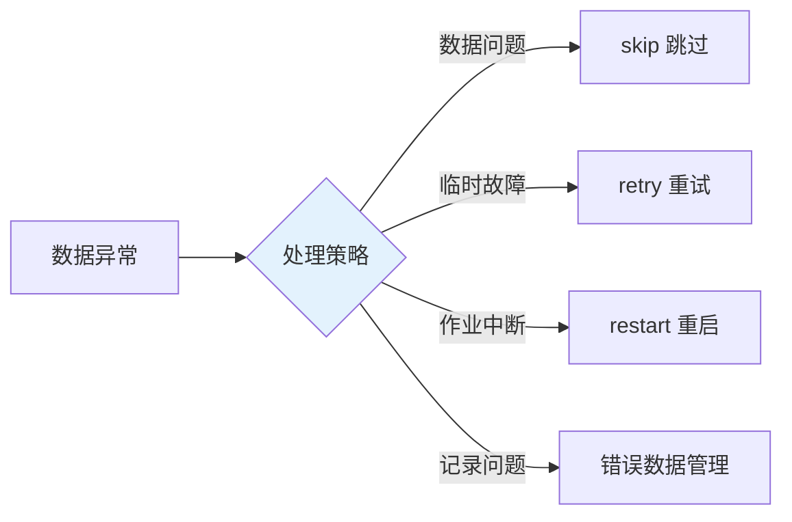
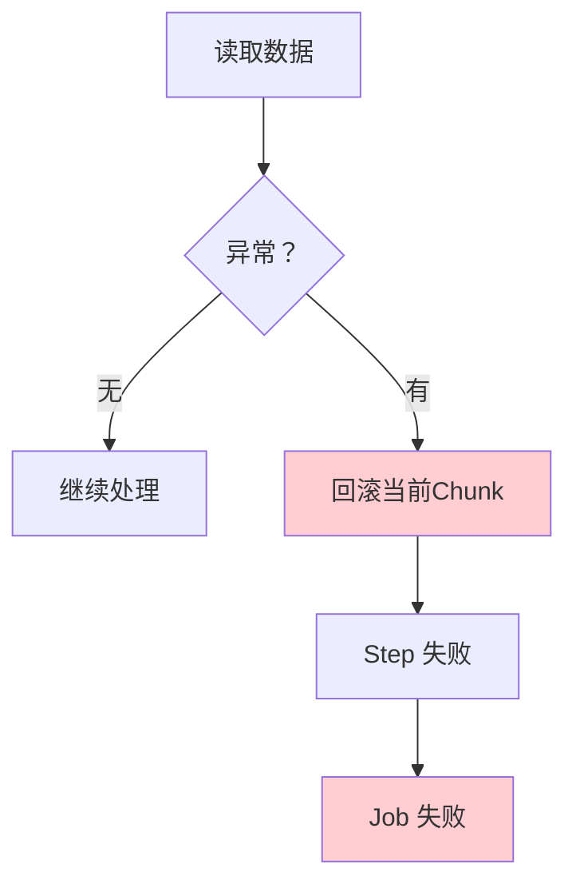
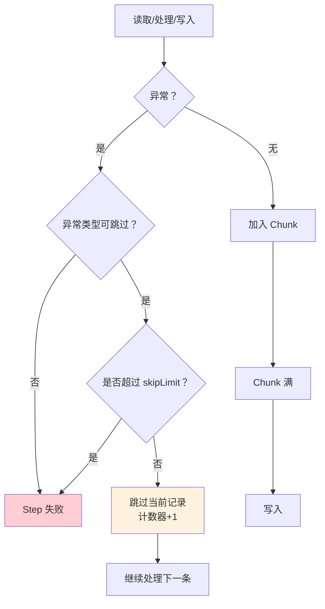
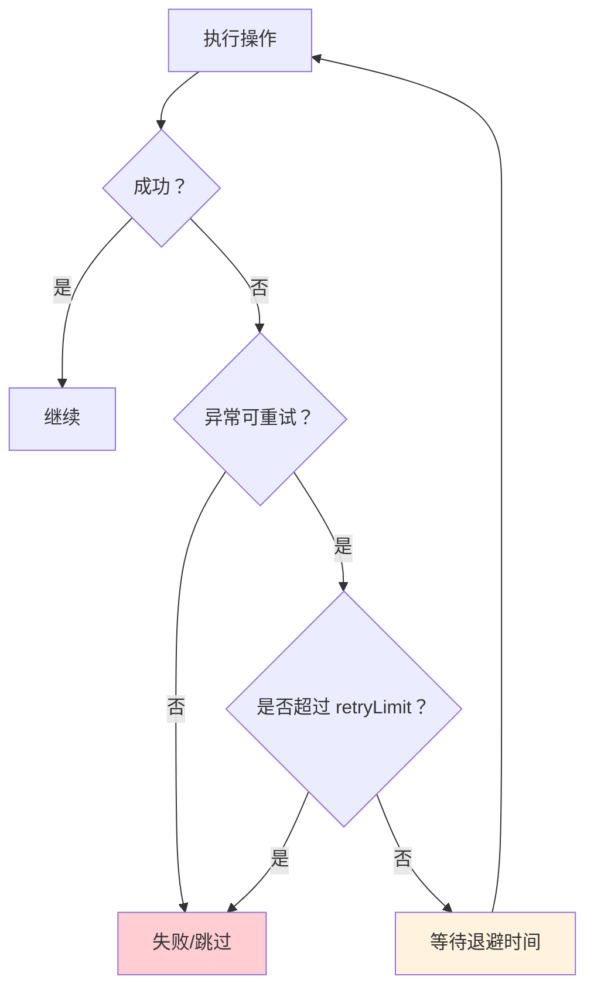
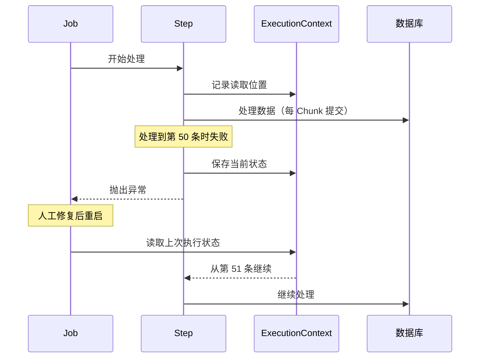
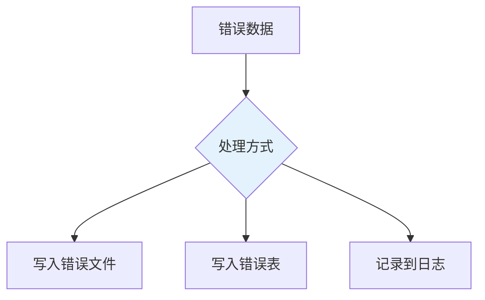

# 批处理异常处理与重启机制

## 课程目标

- 理解批处理中的异常类型和处理策略
- 掌握 skip 跳过机制（skipLimit、SkipPolicy、SkipListener）
- 掌握 retry 重试机制（retryLimit、RetryPolicy、退避策略）
- 掌握 restart 断点续传机制
- 掌握错误数据的收集与后续处理
- 能够在图书管理系统中实现健壮的批处理任务


## 回顾与导入

在 CSV 导入实战中，我们使用 `ItemProcessor` 返回 `null` 来过滤无效数据：

```java
@Bean
public ItemProcessor<Book, Book> csvBookProcessor() {
    return book -> {
        if (book.getAuthor() == null || book.getAuthor().isBlank()) {
            return null;  // 过滤
        }
        return book;
    };
}
```

但这种方式有局限：

| 局限               | 说明                               |
| ------------------ | ---------------------------------- |
| 无法记录过滤原因   | 只返回 null，不知道为何被过滤      |
| 无法处理运行时异常 | 数据库连接失败、网络超时等无法过滤 |
| 无法重试           | 临时性故障无法自动重试             |
| 无法断点续传       | 作业失败后只能从头开始             |



本节课将深入讲解 Spring Batch 的异常处理机制，帮助构建健壮的批处理任务。


## 异常处理概述

### 批处理中的异常类型

| 异常类型     | 说明           | 示例                           |
| ------------ | -------------- | ------------------------------ |
| **数据异常** | 数据本身有问题 | 格式错误、字段缺失、违反约束   |
| **临时异常** | 短时间内可恢复 | 网络抖动、数据库死锁、连接超时 |
| **致命异常** | 无法恢复       | 数据库宕机、文件不存在         |

### 对应的处理策略

| 策略        | 适用异常 | 说明                       |
| ----------- | -------- | -------------------------- |
| **skip**    | 数据异常 | 跳过有问题的记录，继续处理 |
| **retry**   | 临时异常 | 重试一定次数，成功则继续   |
| **fail**    | 致命异常 | 立即失败，等待人工干预     |
| **restart** | 各种中断 | 从上次中断点继续执行       |

### 默认行为

不配置任何策略时，Spring Batch 遇到异常会：
1. 回滚当前 Chunk 的事务
2. 标记 Step 为 `FAILED`
3. 标记 Job 为 `FAILED`
4. 结束执行




## Skip 跳过机制

### 什么是 Skip

**Skip** 允许在遇到特定异常时**跳过当前记录**，继续处理后续数据。适用于数据本身有问题的场景。

### 基本配置

使用 `faultTolerant()` 启用容错模式，通过 `skip()` 和 `skipLimit()` 配置：

```java
@Bean
public Step csvImportStep(JobRepository jobRepository,
                          PlatformTransactionManager transactionManager,
                          ItemReader<Book> csvBookReader,
                          ItemProcessor<Book, Book> csvBookProcessor,
                          ItemWriter<Book> csvBookWriter) {
    return new StepBuilder("csvImportStep", jobRepository)
            .<Book, Book>chunk(3, transactionManager)
            .reader(csvBookReader)
            .processor(csvBookProcessor)
            .writer(csvBookWriter)
            // 启用容错模式
            .faultTolerant()
            // 最多跳过 5 条
            .skipLimit(5)
            // 遇到 IllegalArgumentException 时跳过
            .skip(IllegalArgumentException.class)
            .build();
}
```

### 关键配置说明

| 配置                      | 说明                           |
| ------------------------- | ------------------------------ |
| `faultTolerant()`         | 启用容错模式（必须）           |
| `skipLimit(n)`            | 最多跳过 n 条，超过则失败      |
| `skip(Exception.class)`   | 指定跳过的异常类型             |
| `noSkip(Exception.class)` | 指定不跳过的异常（优先级更高） |

### Skip 执行流程



> [!NOTE]
> Skip 的计数器作用于整个 Step，不是单个 Chunk。如果 Step 处理 1000 条数据，`skipLimit(5)` 表示整个 Step 最多跳过 5 条。

### 自定义 SkipPolicy

当跳过条件复杂时，可以使用 `SkipPolicy`：

```java
public class BookSkipPolicy implements SkipPolicy {

    private static final int MAX_SKIP = 10;

    @Override
    public boolean shouldSkip(Throwable t, long skipCount) throws SkipLimitExceededException {
        // 超过最大跳过数，抛出异常
        if (skipCount >= MAX_SKIP) {
            throw new SkipLimitExceededException(MAX_SKIP, t);
        }

        // 数据格式错误，跳过
        if (t instanceof NumberFormatException) {
            return true;
        }

        // 数据校验失败，跳过
        if (t instanceof IllegalArgumentException) {
            return true;
        }

        // 其他异常，不跳过
        return false;
    }
}
```

配置使用：

```java
.faultTolerant()
.skipPolicy(new BookSkipPolicy())
```

### SkipListener 记录跳过的数据

`SkipListener` 用于记录被跳过的数据，便于后续处理。

```java
@Component
public class BookSkipListener implements SkipListener<Book, Book> {

    private static final Logger logger = LoggerFactory.getLogger(BookSkipListener.class);

    /**
     * 读取时跳过
     */
    @Override
    public void onSkipInRead(Throwable t) {
        logger.warn("读取时跳过: {}", t.getMessage());
    }

    /**
     * 处理时跳过
     */
    @Override
    public void onSkipInProcess(Book item, Throwable t) {
        logger.warn("处理时跳过: {}，原因: {}", item.getTitle(), t.getMessage());
        // 可以将错误数据写入错误记录表
    }

    /**
     * 写入时跳过
     */
    @Override
    public void onSkipInWrite(Book item, Throwable t) {
        logger.warn("写入时跳过: {}，原因: {}", item.getTitle(), t.getMessage());
    }
}
```

注册监听器：

```java
@Bean
public Step csvImportStep(JobRepository jobRepository,
                          PlatformTransactionManager transactionManager,
                          ItemReader<Book> csvBookReader,
                          ItemProcessor<Book, Book> csvBookProcessor,
                          ItemWriter<Book> csvBookWriter,
                          BookSkipListener bookSkipListener) {
    return new StepBuilder("csvImportStep", jobRepository)
            .<Book, Book>chunk(3, transactionManager)
            .reader(csvBookReader)
            .processor(csvBookProcessor)
            .writer(csvBookWriter)
            .faultTolerant()
            .skipLimit(5)
            .skip(IllegalArgumentException.class)
            .listener(bookSkipListener)  // 注册 SkipListener
            .build();
}
```


## Retry 重试机制

### 什么是 Retry

**Retry** 允许在遇到**临时性异常**时自动重试，如果重试成功则继续，重试失败则按配置跳过或失败。适用于网络抖动、数据库死锁等场景。

### 基本配置

```java
@Bean
public Step retryStep(JobRepository jobRepository,
                      PlatformTransactionManager transactionManager,
                      ItemReader<Book> reader,
                      ItemWriter<Book> writer) {
    return new StepBuilder("retryStep", jobRepository)
            .<Book, Book>chunk(5, transactionManager)
            .reader(reader)
            .writer(writer)
            .faultTolerant()
            // 最多重试 3 次
            .retryLimit(3)
            // 遇到 TransientDataAccessException 时重试
            .retry(TransientDataAccessException.class)
            .build();
}
```

### 关键配置说明

| 配置                       | 说明               |
| -------------------------- | ------------------ |
| `retryLimit(n)`            | 最多重试 n 次      |
| `retry(Exception.class)`   | 指定重试的异常类型 |
| `noRetry(Exception.class)` | 指定不重试的异常   |

### Retry 执行流程



### Skip 与 Retry 组合

重试失败后，可以配置跳过：

```java
.faultTolerant()
.skipLimit(5)
.skip(IllegalArgumentException.class)     // 数据错误，直接跳过
.retryLimit(3)
.retry(TransientDataAccessException.class) // 临时故障，重试 3 次
```

> [!NOTE]
> 执行顺序：**先重试，后跳过**。如果重试次数用尽仍然失败，则根据 skip 配置决定是否跳过。

### 退避策略（BackOffPolicy）

重试之间可以配置等待时间，避免立即重试造成的压力：

**固定退避（FixedBackOffPolicy）：**

```java
import org.springframework.retry.backoff.FixedBackOffPolicy;

FixedBackOffPolicy backOff = new FixedBackOffPolicy();
backOff.setBackOffPeriod(2000);  // 每次重试等待 2 秒

.faultTolerant()
.retryLimit(3)
.retry(TransientDataAccessException.class)
.backOffPolicy(backOff)
```

**指数退避（ExponentialBackOffPolicy）：**

```java
import org.springframework.retry.backoff.ExponentialBackOffPolicy;

ExponentialBackOffPolicy backOff = new ExponentialBackOffPolicy();
backOff.setInitialInterval(1000);  // 初始 1 秒
backOff.setMultiplier(2.0);        // 每次乘 2
backOff.setMaxInterval(10000);     // 最大 10 秒

.faultTolerant()
.retryLimit(3)
.retry(TransientDataAccessException.class)
.backOffPolicy(backOff)
```

**退避策略对比：**

| 策略     | 等待时间 | 适用场景     |
| -------- | -------- | ------------ |
| 无退避   | 立即重试 | 短暂抖动     |
| 固定退避 | 固定间隔 | 稳定等待     |
| 指数退避 | 逐渐增加 | 减轻下游压力 |

### RetryListener 记录重试

```java
@Component
public class BookRetryListener implements RetryListener {

    private static final Logger logger = LoggerFactory.getLogger(BookRetryListener.class);

    @Override
    public <T, E extends Throwable> boolean open(RetryContext context,
                                                  RetryCallback<T, E> callback) {
        return true;  // 返回 true 表示允许重试
    }

    @Override
    public <T, E extends Throwable> void onError(RetryContext context,
                                                  RetryCallback<T, E> callback,
                                                  Throwable throwable) {
        logger.warn("重试第 {} 次，异常: {}",
                context.getRetryCount(), throwable.getMessage());
    }

    @Override
    public <T, E extends Throwable> void close(RetryContext context,
                                               RetryCallback<T, E> callback,
                                               Throwable throwable) {
        if (throwable != null) {
            logger.error("重试结束，仍失败: {}", throwable.getMessage());
        }
    }
}
```

注册：

```java
.faultTolerant()
.retryLimit(3)
.retry(TransientDataAccessException.class)
.listener(new BookRetryListener())
```


## Restart 断点续传

### 什么是 Restart

**Restart** 允许作业失败后**从上次中断点继续执行**，而不是从头开始。Spring Batch 通过 `ExecutionContext` 保存执行状态，实现断点续传。

### Restart 的原理



### Restart 的条件

作业可以重启的前提：

| 条件             | 说明                 |
| ---------------- | -------------------- |
| 状态为 `FAILED`  | 作业失败后可以重启   |
| 状态为 `STOPPED` | 作业被停止后可以重启 |
| 不满足           | `COMPLETED`不能重启  |

### 使用 JobOperator 重启

```java
@Service
public class JobRestartService {

    private final JobOperator jobOperator;
    private final JobExplorer jobExplorer;

    public JobRestartService(JobOperator jobOperator, JobExplorer jobExplorer) {
        this.jobOperator = jobOperator;
        this.jobExplorer = jobExplorer;
    }

    /**
     * 重启失败的作业
     */
    public Long restart(Long executionId) {
        JobExecution execution = jobExplorer.getJobExecution(executionId);
        if (execution.getStatus() == BatchStatus.COMPLETED) {
            throw new RuntimeException("作业已完成，无需重启");
        }

        try {
            return jobOperator.restart(executionId);
        } catch (Exception e) {
            throw new RuntimeException("重启失败: " + e.getMessage(), e);
        }
    }
}
```

### 配置 Restart 支持

为了让 Step 支持 restart，需要使用 `startLimit` 和 `allowStartIfComplete`：

```java
@Bean
public Step csvImportStep(JobRepository jobRepository,
                          PlatformTransactionManager transactionManager,
                          ItemReader<Book> csvBookReader,
                          ItemProcessor<Book, Book> csvBookProcessor,
                          ItemWriter<Book> csvBookWriter) {
    return new StepBuilder("csvImportStep", jobRepository)
            .<Book, Book>chunk(3, transactionManager)
            .reader(csvBookReader)
            .processor(csvBookProcessor)
            .writer(csvBookWriter)
            .faultTolerant()
            .skipLimit(5)
            .skip(IllegalArgumentException.class)
            // 允许重启（最多重启 3 次）
            .startLimit(3)
            // 如果已完成，是否允许再次启动
            .allowStartIfComplete(false)
            .build();
}
```

| 配置                         | 说明                      |
| ---------------------------- | ------------------------- |
| `startLimit(n)`              | 最多启动 n 次（包含重启） |
| `allowStartIfComplete(true)` | 已完成时也允许重新执行    |

### Reader 的 Restart 支持

`FlatFileItemReader` 默认支持重启，它会记录当前读取位置，重启时从上次位置继续。但需要确保：

1. 使用同一个文件（文件内容不能变化）
2. 使用 `saveState(true)`（默认开启）

```java
@Bean
public FlatFileItemReader<Book> csvBookReader() {
    return new FlatFileItemReaderBuilder<Book>()
            .name("csvBookReader")
            .resource(new ClassPathResource("data/books.csv"))
            .linesToSkip(1)
            .delimited()
            .names("title", "author", "price", "stock")
            .targetType(Book.class)
            .saveState(true)  // 默认 true，记录读取位置
            .build();
}
```

### 禁用 Restart 的 saveState

如果每次执行都希望从头开始，可以禁用：

```java
.saveState(false)
```

> [!CAUTION]
> `saveState(false)` 会导致作业无法断点续传。仅在数据可重复处理时使用。


## 错误数据管理

### 为什么需要管理错误数据

Skip 跳过的数据需要被记录下来，以便后续人工处理。如果直接丢弃，可能导致数据丢失。

### 错误数据管理的方案



### 方案一：写入错误文件

使用 `FlatFileItemWriter` 将错误数据写入独立文件：

```java
@Component
public class ErrorBookWriter {

    private final FlatFileItemWriter<Book> errorWriter;

    public ErrorBookWriter() {
        this.errorWriter = new FlatFileItemWriterBuilder<Book>()
                .name("errorBookWriter")
                .resource(new FileSystemResource("output/error_books.csv"))
                .delimited()
                .delimiter(",")
                .names("title", "author", "price", "stock")
                .headerCallback(writer -> writer.write("title,author,price,stock,reason"))
                .build();
    }

    public void writeErrorBook(Book book, String reason) {
        // 此处简化处理，实际需要加上 reason 字段
        try {
            errorWriter.write(new Chunk<>(Collections.singletonList(book)));
        } catch (Exception e) {
            throw new RuntimeException(e);
        }
    }
}
```

在 `SkipListener` 中写入：

```java
@Component
public class ErrorBookWriterSkipListener implements SkipListener<Book, Book> {

    @Autowired
    ErrorBookWriter errorBookWriter;

    @Override
    public void onSkipInRead(Throwable t) {
        // 读取阶段跳过：此时拿不到完整的 Book 对象，只能记录异常
        // 如需记录，需手动解析 FlatFileParseException 中的原始行
    }

    @Override
    public void onSkipInProcess(Book book, Throwable t) {
        errorBookWriter.writeErrorBook(book, t.getMessage());
    }

    @Override
    public void onSkipInWrite(Book book, Throwable t) {
        errorBookWriter.writeErrorBook(book, t.getMessage());
    }
}
```

### 方案二：写入错误表

创建错误记录表：

```sql
CREATE TABLE IF NOT EXISTS book_import_error (
    id BIGSERIAL PRIMARY KEY,
    title VARCHAR(100),
    author VARCHAR(50),
    price NUMERIC(10, 2),
    stock INT,
    error_reason TEXT,
    created_at TIMESTAMP DEFAULT CURRENT_TIMESTAMP
);
```

在 `SkipListener` 中写入：

```java
@Component
public class BookSkipListener implements SkipListener<Book, Book> {

    private static final Logger logger = LoggerFactory.getLogger(BookSkipListener.class);

    private final JdbcTemplate jdbcTemplate;

    public BookSkipListener(JdbcTemplate jdbcTemplate) {
        this.jdbcTemplate = jdbcTemplate;
    }

    @Override
    public void onSkipInRead(Throwable t) {
        logger.warn("[读取跳过] {}", t.getMessage());
    }

    @Override
    public void onSkipInProcess(Book item, Throwable t) {
        logger.warn("[处理跳过] 图书: {}，原因: {}", item.getTitle(), t.getMessage());
        saveError(item, "处理失败: " + t.getMessage());
    }

    @Override
    public void onSkipInWrite(Book item, Throwable t) {
        logger.warn("[写入跳过] 图书: {}，原因: {}", item.getTitle(), t.getMessage());
        saveError(item, "写入失败: " + t.getMessage());
    }

    private void saveError(Book book, String reason) {
        try {
            String sql = "INSERT INTO book_import_error " +
                         "(title, author, price, stock, error_reason) VALUES (?, ?, ?, ?, ?)";
            jdbcTemplate.update(sql,
                    book.getTitle(), book.getAuthor(),
                    book.getPrice(), book.getStock(), reason);
        } catch (Exception e) {
            logger.error("保存错误数据失败", e);
        }
    }
}
```

### 方案三：使用 SkipPolicy 记录日志

```java
public class LoggingSkipPolicy implements SkipPolicy {

    private static final Logger logger = LoggerFactory.getLogger(LoggingSkipPolicy.class);

    @Override
    public boolean shouldSkip(Throwable t, int skipCount) {
        logger.warn("跳过第 {} 条数据，原因: {}", skipCount + 1, t.getMessage());
        return skipCount < 10;
    }
}
```


## 实战：图书管理系统健壮的 CSV 导入

### 需求

实现一个健壮的 CSV 导入任务：
1. 无效数据（作者为空、价格为负）被跳过并记录到错误表
2. 临时性数据库异常自动重试 3 次
3. 作业失败后支持断点续传
4. 记录跳过和重试的详细信息

### 完整实现

**步骤一：创建错误记录表**

已定义

**步骤二：定义 SkipListener**

已定义

**步骤三：定义 RetryListener**

已定义

**步骤四：Processor 中主动抛出异常**

```java
@Bean
public ItemProcessor<Book, Book> csvBookProcessor() {
    return book -> {
        // 清洗数据
        if (book.getTitle() != null) {
            book.setTitle(book.getTitle().trim());
        }
        if (book.getAuthor() != null) {
            book.setAuthor(book.getAuthor().trim());
        }

        // 数据校验（抛出异常，由 skip 处理）
        if (book.getTitle() == null || book.getTitle().isBlank()) {
            throw new IllegalArgumentException("书名为空");
        }
        if (book.getAuthor() == null || book.getAuthor().isBlank()) {
            throw new IllegalArgumentException("作者为空");
        }
        if (book.getPrice() == null || book.getPrice() < 0) {
            throw new IllegalArgumentException("价格为负数: " + book.getPrice());
        }
        if (book.getStock() == null || book.getStock() < 0) {
            throw new IllegalArgumentException("库存为负数: " + book.getStock());
        }

        System.out.println("处理图书: " + book);
        return book;
    };
}
```

**步骤五：完整 Step 配置**

```java
@Configuration
public class RobustCsvImportJobConfig {

    @Bean
    public FlatFileItemReader<Book> robustCsvReader() {
        return new FlatFileItemReaderBuilder<Book>()
                .name("robustCsvReader")
                .resource(new ClassPathResource("data/books.csv"))
                .linesToSkip(1)
                .delimited()
                .names("title", "author", "price", "stock")
                .targetType(Book.class)
                .encoding("UTF-8")
                .saveState(true)  // 支持断点续传
                .build();
    }

    @Bean
    public ItemProcessor<Book, Book> robustCsvProcessor() {
        return book -> {
            if (book.getTitle() != null) {
                book.setTitle(book.getTitle().trim());
            }
            if (book.getAuthor() != null) {
                book.setAuthor(book.getAuthor().trim());
            }

            if (book.getTitle() == null || book.getTitle().isBlank()) {
                throw new IllegalArgumentException("书名为空");
            }
            if (book.getAuthor() == null || book.getAuthor().isBlank()) {
                throw new IllegalArgumentException("作者为空");
            }
            if (book.getPrice() == null || book.getPrice() < 0) {
                throw new IllegalArgumentException("价格为负数");
            }
            if (book.getStock() == null || book.getStock() < 0) {
                throw new IllegalArgumentException("库存为负数");
            }

            System.out.println("处理图书: " + book);
            return book;
        };
    }

    @Bean
    public JdbcBatchItemWriter<Book> robustCsvWriter(DataSource dataSource) {
        return new JdbcBatchItemWriterBuilder<Book>()
                .dataSource(dataSource)
                .sql("INSERT INTO book (title, author, price, stock) " +
                     "VALUES (:title, :author, :price, :stock)")
                .beanMapped()
                .build();
    }

    @Bean
    public Step robustCsvImportStep(JobRepository jobRepository,
                                    PlatformTransactionManager transactionManager,
                                    ItemReader<Book> robustCsvReader,
                                    ItemProcessor<Book, Book> robustCsvProcessor,
                                    ItemWriter<Book> robustCsvWriter,
                                    BookSkipListener bookSkipListener,
                                    BookRetryListener bookRetryListener) {
        // 指数退避策略
        ExponentialBackOffPolicy backOff = new ExponentialBackOffPolicy();
        backOff.setInitialInterval(1000);
        backOff.setMultiplier(2.0);
        backOff.setMaxInterval(10000);

        return new StepBuilder("robustCsvImportStep", jobRepository)
                .<Book, Book>chunk(3, transactionManager)
                .reader(robustCsvReader)
                .processor(robustCsvProcessor)
                .writer(robustCsvWriter)
                .faultTolerant()
                // Skip 配置
                .skipLimit(10)
                .skip(IllegalArgumentException.class)
                .noSkip(NullPointerException.class)
                // Retry 配置
                .retryLimit(3)
                .retry(TransientDataAccessException.class)
                .backOffPolicy(backOff)
                // 监听器
                .listener(bookSkipListener)
                .listener(bookRetryListener)
                // 重启配置
                .startLimit(3)
                .build();
    }

    @Bean
    public Job robustCsvImportJob(JobRepository jobRepository, Step robustCsvImportStep) {
        return new JobBuilder("robustCsvImportJob", jobRepository)
                .start(robustCsvImportStep)
                .build();
    }
}
```

**步骤六：触发与测试**

```java
@PostMapping("/import-csv-robust")
public Result<String> importCsvRobust() throws Exception {
    JobParameters params = new JobParametersBuilder()
            .addLong("timestamp", System.currentTimeMillis())
            .toJobParameters();
    jobLauncher.run(robustCsvImportJob, params);
    return Result.success("健壮导入任务已启动");
}
```

**运行结果：**

```
处理图书: Book{title='Spring Boot 实战', author='Craig Walls', price=79.0}
处理图书: Book{title='Java 核心技术', author='Cay S. Horstmann', price=89.0}
处理图书: Book{title='深入理解 Java 虚拟机', author='周志明', price=129.0}
（写入 3 条数据）

处理图书: Book{title='Effective Java', author='Joshua Bloch', price=99.0}
处理图书: Book{title='Spring 源码深度解析', author='郝佳', price=99.0}
[处理跳过] 图书: Invalid Book，原因: 作者为空
（写入 2 条数据）

[处理跳过] 图书: Negative Price Book，原因: 价格为负数
处理图书: Book{title='零库存图书', author='Test Author', price=45.0}
（写入 2 条数据）
```

**验证错误数据表：**

```sql
SELECT * FROM book_import_error;
-- Invalid Book | null | 50.00 | 2 | 处理失败: 作者为空
-- Negative Price Book | Test Author | -10.00 | 5 | 处理失败: 价格为负数
```

**验证数据库：**

```sql
SELECT * FROM book;
-- Spring Boot 实战 | Craig Walls | 79.00 | 10
-- Java 核心技术 | Cay S. Horstmann | 89.00 | 8
-- 深入理解 Java 虚拟机 | 周志明 | 129.00 | 5
-- Effective Java | Joshua Bloch | 99.00 | 6
-- Spring 源码深度解析 | 郝佳 | 99.00 | 3
-- 零库存图书 | Test Author | 45.00 | 0
```


## 注意事项

### 1. skip 和 retry 的执行顺序

```
1. 尝试执行操作
2. 失败 → 判断是否可重试
3. 可重试 → 重试（最多 retryLimit 次）
4. 重试仍失败 → 判断是否可跳过
5. 可跳过 → 跳过并记录（最多 skipLimit 次）
6. 不可跳过或超过 limit → Step 失败
```

### 2. skipLimit 是累积的

`skipLimit(5)` 表示**整个 Step** 最多跳过 5 条，不是每个 Chunk。到达上限后 Step 失败。

### 3. noSkip 的优先级

`noSkip(Exception.class)` 的优先级高于 `skip()`，用于排除不希望跳过的异常：

```java
.skip(Exception.class)          // 跳过所有异常
.noSkip(NullPointerException.class)  // 但空指针不跳过
```

### 4. saveState 与 restart

- `FlatFileItemReader.saveState(true)`：支持断点续传（默认）
- 禁用后每次从头读取
- 数据库 Reader（如 JdbcPagingItemReader）默认支持 restart

### 5. restart 的限制

- `COMPLETED` 状态不能重启
- `startLimit` 限制最多启动次数
- 修改 Reader 的资源（如文件）可能导致重启失败

### 6. 错误数据的清理

错误表会逐渐积累，建议定期清理：

```sql
-- 清理 30 天前的错误记录
DELETE FROM book_import_error
WHERE created_at < CURRENT_TIMESTAMP - INTERVAL '30 days';
```


## 小结

本节课我们学习了：

1. **异常处理概述**：数据异常、临时异常、致命异常及对应策略
2. **Skip 跳过机制**：
   - `skipLimit`、`skip(Exception.class)`、`noSkip`
   - `SkipPolicy` 自定义跳过条件
   - `SkipListener` 记录被跳过的数据
3. **Retry 重试机制**：
   - `retryLimit`、`retry(Exception.class)`
   - `BackOffPolicy`（固定退避、指数退避）
   - `RetryListener` 记录重试信息
4. **Restart 断点续传**：
   - 基于 `ExecutionContext` 保存状态
   - `JobOperator.restart()`
   - `startLimit`、`allowStartIfComplete`、`saveState`
5. **错误数据管理**：
   - 写入错误表、错误文件
   - 通过 `SkipListener` 统一记录


## 作业

### 作业一：代码阅读——异常处理识别

阅读以下配置，回答问题。

```java
.faultTolerant()
.skipLimit(5)
.skip(IllegalArgumentException.class)
.noSkip(NullPointerException.class)
.retryLimit(3)
.retry(TransientDataAccessException.class)
.backOffPolicy(new FixedBackOffPolicy(2000))
.startLimit(2)
```

**问题：**
1. 如果处理过程中遇到 `IllegalArgumentException`，会发生什么？
2. 如果遇到 `NullPointerException`，会发生什么？
3. 如果遇到 `TransientDataAccessException`，Spring Batch 会如何处理？
4. `startLimit(2)` 表示什么？

---

### 作业二：实现健壮的 CSV 导入

在图书管理系统中完成以下任务：

1. 创建错误记录表 `book_import_error`。
2. 创建 `BookSkipListener`，在跳过时将错误信息写入数据库。
3. 修改 Processor，对无效数据抛出 `IllegalArgumentException`。
4. 配置 Step：
   - skipLimit 10，跳过 `IllegalArgumentException`
   - retryLimit 3，重试 `TransientDataAccessException`
   - 固定退避策略，间隔 2 秒
   - 注册 SkipListener 和 RetryListener
5. 触发作业，验证错误数据被记录到 `book_import_error` 表。
