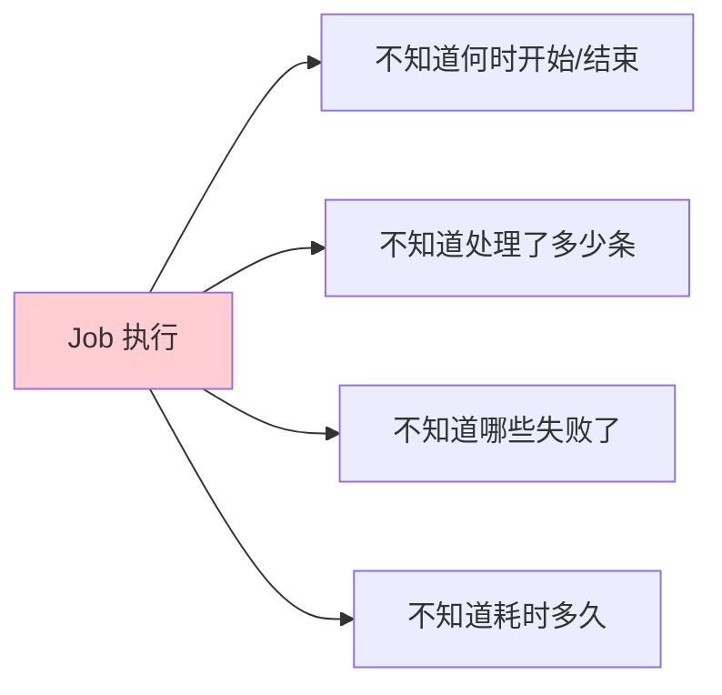
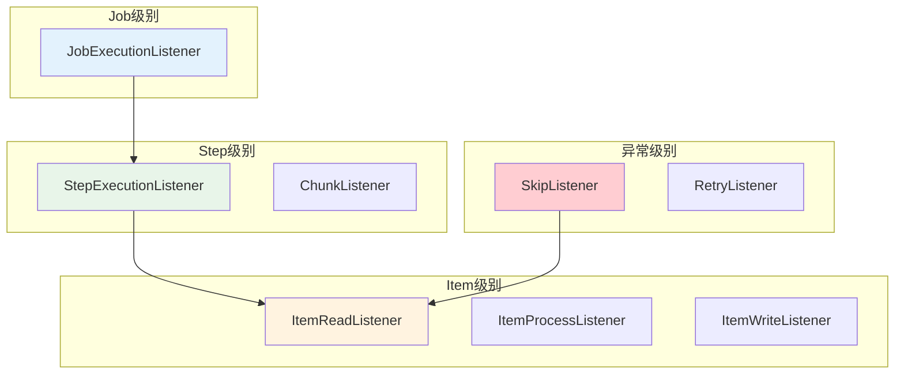
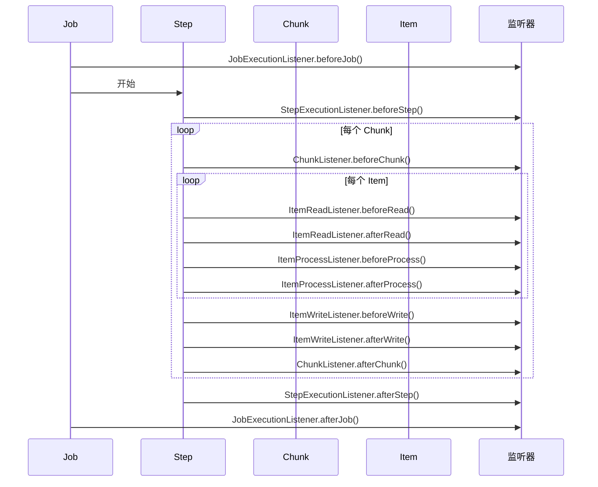

# 监听器与任务调度

## 课程目标

- 理解 Spring Batch 监听器的作用和分类
- 掌握 Job、Step、Chunk 三级监听器的使用
- 掌握 ItemRead、ItemProcess、ItemWrite、Skip 等细粒度监听器
- 掌握使用 @Scheduled 触发批处理作业
- 能够为图书管理系统实现带监听器日志的定时统计任务


## 回顾与导入

到目前为止，我们学习了 Spring Batch 的核心组件、异常处理和重启机制。但每次执行作业时，我们只能通过日志碎片或数据库表来了解执行情况：



**Spring Batch 监听器** 提供了对作业执行过程的**全方位观察**能力，可以在关键时刻插入自定义逻辑，用于：

| 场景         | 说明                       |
| ------------ | -------------------------- |
| **日志记录** | 记录作业开始、结束、耗时   |
| **性能监控** | 统计读写数量、处理速度     |
| **异常告警** | 失败时发送通知             |
| **数据审计** | 记录谁在什么时候执行了什么 |
| **定时触发** | 与调度器结合，定时执行     |

本节课将系统学习 Spring Batch 的监听器体系，并实现定时执行批处理任务。


## 监听器体系概览

### 监听器的分类

Spring Batch 提供了丰富的监听器接口，按监听粒度分为以下几类：



### 监听器对比

| 监听器                  | 作用范围 | 触发时机                                 |
| ----------------------- | -------- | ---------------------------------------- |
| `JobExecutionListener`  | Job      | 作业开始前、作业结束后                   |
| `StepExecutionListener` | Step     | 步骤开始前、步骤结束后                   |
| `ChunkListener`         | Chunk    | Chunk 开始前、Chunk 结束后、Chunk 异常时 |
| `ItemReadListener`      | Item     | 读取前、读取后、读取异常                 |
| `ItemProcessListener`   | Item     | 处理前、处理后、处理异常                 |
| `ItemWriteListener`     | Item     | 写入前、写入后、写入异常                 |
| `SkipListener`          | Item     | 跳过时（上一节已讲）                     |
| `RetryListener`         | Item     | 重试时（上一节已讲）                     |


## Job 级别监听器

### JobExecutionListener 接口

```java
public interface JobExecutionListener {
    // 作业开始前执行
    void beforeJob(JobExecution jobExecution);

    // 作业结束后执行（无论成功、失败、停止）
    void afterJob(JobExecution jobExecution);
}
```

### 实现日志监听器

```java
@Component
public class JobLoggingListener implements JobExecutionListener {

    private static final Logger logger = LoggerFactory.getLogger(JobLoggingListener.class);
    private static final DateTimeFormatter FORMATTER =
            DateTimeFormatter.ofPattern("yyyy-MM-dd HH:mm:ss");

    @Override
    public void beforeJob(JobExecution jobExecution) {
        String jobName = jobExecution.getJobInstance().getJobName();
        logger.info("========== 作业开始 ==========");
        logger.info("作业名称: {}", jobName);
        logger.info("执行ID: {}", jobExecution.getId());
        logger.info("开始时间: {}", LocalDateTime.now().format(FORMATTER));
        logger.info("作业参数: {}", jobExecution.getJobParameters());
    }

    @Override
    public void afterJob(JobExecution jobExecution) {
        String jobName = jobExecution.getJobInstance().getJobName();
        long duration = 0;

        if (jobExecution.getStartTime() != null && jobExecution.getEndTime() != null) {
            duration = Duration.between(
                    jobExecution.getStartTime(),
                    jobExecution.getEndTime()
            ).toMillis();
        }

        logger.info("========== 作业结束 ==========");
        logger.info("作业名称: {}", jobName);
        logger.info("执行状态: {}", jobExecution.getStatus());
        logger.info("退出码: {}", jobExecution.getExitStatus().getExitCode());
        logger.info("耗时: {}ms", duration);
        logger.info("结束时间: {}", LocalDateTime.now().format(FORMATTER));

        // 失败时告警
        if (jobExecution.getStatus().isUnsuccessful()) {
            logger.error("作业执行失败！失败原因: {}",
                    jobExecution.getExitStatus().getExitDescription());
            // 可以在这里发送告警邮件或通知
        }
    }
}
```

### 注册到 Job

```java
@Bean
public Job csvImportJob(JobRepository jobRepository,
                         Step importBookStep,
                         JobLoggingListener jobLoggingListener) {
    return new JobBuilder("csvImportJob", jobRepository)
            .start(importBookStep)
            .listener(jobLoggingListener)  // 注册 Job 监听器
            .build();
}
```

### 执行日志示例

```
========== 作业开始 ==========
作业名称: csvImportJob
执行ID: 1
开始时间: 2026-09-23 10:30:00
作业参数: {timestamp=1727000000000}

（作业执行中...）

========== 作业结束 ==========
作业名称: csvImportJob
执行状态: COMPLETED
退出码: COMPLETED
耗时: 3500ms
结束时间: 2026-09-23 10:30:03
```


## Step 级别监听器

### StepExecutionListener 接口

```java
public interface StepExecutionListener extends StepListener {
    // 步骤开始前执行
    void beforeStep(StepExecution stepExecution);

    // 步骤结束后执行（返回 null 表示不影响退出状态）
    ExitStatus afterStep(StepExecution stepExecution);
}
```

### 实现步骤日志监听器

```java
@Component
public class StepLoggingListener implements StepExecutionListener {

    private static final Logger logger = LoggerFactory.getLogger(StepLoggingListener.class);

    @Override
    public void beforeStep(StepExecution stepExecution) {
        logger.info("---------- 步骤开始 ----------");
        logger.info("步骤名称: {}", stepExecution.getStepName());
        logger.info("执行ID: {}", stepExecution.getJobExecutionId());
    }

    @Override
    public ExitStatus afterStep(StepExecution stepExecution) {
        logger.info("---------- 步骤结束 ----------");
        logger.info("步骤名称: {}", stepExecution.getStepName());
        logger.info("状态: {}", stepExecution.getStatus());
        logger.info("读取数量: {}", stepExecution.getReadCount());
        logger.info("过滤数量: {}", stepExecution.getFilterCount());
        logger.info("写入数量: {}", stepExecution.getWriteCount());
        logger.info("提交次数: {}", stepExecution.getCommitCount());
        logger.info("回滚次数: {}", stepExecution.getRollbackCount());
        logger.info("耗时: {}ms",
                stepExecution.getEndTime() != null && stepExecution.getStartTime() != null
                        ? java.time.Duration.between(
                                stepExecution.getStartTime(),
                                stepExecution.getEndTime()).toMillis()
                        : 0);

        // 返回 null 表示不修改退出状态
        return null;
    }
}
```

### 注册到 Step

```java
@Bean
public Step csvImportStep(JobRepository jobRepository,
                          PlatformTransactionManager transactionManager,
                          ItemReader<Book> reader,
                          ItemProcessor<Book, Book> processor,
                          ItemWriter<Book> writer,
                          StepLoggingListener stepLoggingListener) {
    return new StepBuilder("csvImportStep", jobRepository)
            .<Book, Book>chunk(3, transactionManager)
            .reader(reader)
            .processor(processor)
            .writer(writer)
            .listener(stepLoggingListener)  // 注册 Step 监听器
            .build();
}
```

### 执行日志示例

```
---------- 步骤开始 ----------
步骤名称: csvImportStep
执行ID: 1

（Chunk 处理中...）

---------- 步骤结束 ----------
步骤名称: csvImportStep
状态: COMPLETED
读取数量: 8
过滤数量: 0
写入数量: 6
提交次数: 3
回滚次数: 0
耗时: 3200ms
```


## Chunk 级别监听器

### ChunkListener 接口

```java
public interface ChunkListener extends StepListener {
    // Chunk 处理前
    void beforeChunk(ChunkContext context);

    // Chunk 处理后（事务提交后）
    void afterChunk(ChunkContext context);

    // Chunk 处理失败后
    void afterChunkError(ChunkContext context);
}
```

### 实现 Chunk 监控监听器

```java
@Component
public class ChunkLoggingListener implements ChunkListener {

    private static final Logger logger = LoggerFactory.getLogger(ChunkLoggingListener.class);

    private long chunkStartTime;

    @Override
    public void beforeChunk(ChunkContext context) {
        chunkStartTime = System.currentTimeMillis();
        logger.debug("[Chunk 开始] {}", context.getStepContext().getStepName());
    }

    @Override
    public void afterChunk(ChunkContext context) {
        long duration = System.currentTimeMillis() - chunkStartTime;
        logger.debug("[Chunk 完成] {} 耗时: {}ms",
                context.getStepContext().getStepName(), duration);
    }

    @Override
    public void afterChunkError(ChunkContext context) {
        logger.warn("[Chunk 失败] {}",
                context.getStepContext().getStepName());
    }
}
```

### 注册到 Step

```java
.listener(chunkLoggingListener)
```


## Item 级别监听器

### 三种 Item 监听器

| 监听器                | 方法                                                         | 触发时机       |
| --------------------- | ------------------------------------------------------------ | -------------- |
| `ItemReadListener`    | `beforeRead()`、`afterRead(item)`、`onReadError(ex)`         | 读取前/后/异常 |
| `ItemProcessListener` | `beforeProcess(item)`、`afterProcess(in, out)`、`onProcessError(in, ex)` | 处理前/后/异常 |
| `ItemWriteListener`   | `beforeWrite(items)`、`afterWrite(items)`、`onWriteError(ex, items)` | 写入前/后/异常 |

### 实现 Item 监控监听器

```java
@Component
public class ItemLoggingListener implements ItemReadListener<Book>,
        ItemProcessListener<Book, Book>,
        ItemWriteListener<Book> {

    private static final Logger logger = LoggerFactory.getLogger(ItemLoggingListener.class);

    // ========== 读取监听 ==========

    @Override
    public void beforeRead() {
        // 每条数据读取前执行（高频，建议只在 DEBUG 级别记录）
    }

    @Override
    public void afterRead(Book item) {
        logger.debug("[读取] {}", item.getTitle());
    }

    @Override
    public void onReadError(Exception ex) {
        logger.error("[读取异常] {}", ex.getMessage());
    }

    // ========== 处理监听 ==========

    @Override
    public void beforeProcess(Book item) {
        // 处理前
    }

    @Override
    public void afterProcess(Book item, Book result) {
        if (result == null) {
            logger.debug("[处理过滤] {}", item.getTitle());
        } else {
            logger.debug("[处理成功] {}", result.getTitle());
        }
    }

    @Override
    public void onProcessError(Book item, Exception e) {
        logger.error("[处理异常] {} - {}", item.getTitle(), e.getMessage());
    }

    // ========== 写入监听 ==========

    @Override
    public void beforeWrite(Chunk<? extends Book> items) {
        logger.debug("[写入开始] {} 条", items.size());
    }

    @Override
    public void afterWrite(Chunk<? extends Book> items) {
        logger.info("[写入完成] {} 条", items.size());
    }

    @Override
    public void onWriteError(Exception exception, Chunk<? extends Book> items) {
        logger.error("[写入异常] {} 条失败: {}", items.size(), exception.getMessage());
    }
}
```

### 注册到 Step

```java
.listener(Optional.ofNullable(itemLoggingListener)) 
```

> [!NOTE]
> Item 级别监听器的触发频率非常高（每条数据都会触发），建议只在 DEBUG 级别记录详细日志，避免影响性能。


## 实战：图书管理系统定时统计任务

### 需求

为图书管理系统实现一个定时统计任务：
1. 每天凌晨 2 点执行
2. 统计图书销量并生成报表
3. 添加监听器记录执行过程
4. 失败时发送告警

### 实现步骤

**步骤一：创建统计任务数据模型**

```java
package com.example.bookmanager.model;

@Data
public class BatchBookStatistics {
    private String category;
    private Long bookCount;
    private Long totalStock;
    private Double avgPrice;
}
```

**步骤二：创建统计任务 Job 配置**

```java
@Configuration
public class BookStatisticsJobConfig {

    /**
     * 统计结果的 RowMapper
     */
    private final RowMapper<BatchBookStatistics> statisticsRowMapper = (rs, rowNum) -> {
        BatchBookStatistics stats = new BatchBookStatistics();
        stats.setCategory(rs.getString("category"));
        stats.setBookCount(rs.getLong("book_count"));
        stats.setTotalStock(rs.getLong("total_stock"));
        stats.setAvgPrice(rs.getDouble("avg_price"));
        return stats;
    };

    /**
     * ItemReader：按分类统计图书
     */
    @Bean
    public JdbcPagingItemReader<BatchBookStatistics> statisticsReader(DataSource dataSource) {
        Map<String, Order> sortKeys = new HashMap<>();
        sortKeys.put("category", Order.ASCENDING);

        return new JdbcPagingItemReaderBuilder<BatchBookStatistics>()
                .name("statisticsReader")
                .dataSource(dataSource)
                .selectClause("SELECT category, COUNT(*) AS book_count, " +
                        "SUM(stock) AS total_stock, AVG(price) AS avg_price")
                .fromClause("FROM book")
                .groupClause("GROUP BY category")
                .sortKeys(sortKeys)
                .rowMapper(statisticsRowMapper)
                .pageSize(10)
                .build();
    }

    /**
     * ItemWriter：将统计结果写入统计表
     */
    @Bean
    public ItemWriter<BatchBookStatistics> statisticsWriter(DataSource dataSource) {
        JdbcTemplate jdbcTemplate = new JdbcTemplate(dataSource);
        return items -> {
            for (BatchBookStatistics stats : items) {
                jdbcTemplate.update(
                        "INSERT INTO book_statistics " +
                                "(category, book_count, total_stock, avg_price, stat_date) " +
                                "VALUES (?, ?, ?, ?, CURRENT_DATE)",
                        stats.getCategory(),
                        stats.getBookCount(),
                        stats.getTotalStock(),
                        stats.getAvgPrice()
                );
            }
            System.out.println("写入 " + items.size() + " 条统计数据");
        };
    }

    /**
     * 统计 Step
     */
    @Bean
    public Step statisticsStep(JobRepository jobRepository,
                               PlatformTransactionManager transactionManager,
                               ItemReader<BatchBookStatistics> statisticsReader,
                               ItemWriter<BatchBookStatistics> statisticsWriter,
                               StepLoggingListener stepLoggingListener) {
        return new StepBuilder("statisticsStep", jobRepository)
                .<BatchBookStatistics, BatchBookStatistics>chunk(5, transactionManager)
                .reader(statisticsReader)
                .writer(statisticsWriter)
                .listener(stepLoggingListener)
                .build();
    }

    /**
     * 统计 Job
     */
    @Bean
    public Job statisticsJob(JobRepository jobRepository,
                             Step statisticsStep,
                             JobLoggingListener jobLoggingListener) {
        return new JobBuilder("statisticsJob", jobRepository)
                .start(statisticsStep)
                .listener(jobLoggingListener)
                .build();
    }
}
```

**步骤三：创建统计表**

```sql
CREATE TABLE IF NOT EXISTS book_statistics (
    id BIGSERIAL PRIMARY KEY,
    category VARCHAR(20),
    book_count BIGINT,
    total_stock BIGINT,
    avg_price NUMERIC(10, 2),
    stat_date DATE,
    created_at TIMESTAMP DEFAULT CURRENT_TIMESTAMP
);
```

**步骤四：通过 @Scheduled 定时执行**

```java
@Component
public class StatisticsJobScheduler {

    private static final Logger logger = LoggerFactory.getLogger(StatisticsJobScheduler.class);

    private final JobLauncher jobLauncher;
    private final Job statisticsJob;

    public StatisticsJobScheduler(JobLauncher jobLauncher,
                                  @Qualifier("statisticsJob") Job statisticsJob) {
        this.jobLauncher = jobLauncher;
        this.statisticsJob = statisticsJob;
    }

    /**
     * 每天凌晨 2 点执行统计任务
     */
    @Scheduled(cron = "0 0 2 * * ?")
    public void runStatisticsJob() {
        logger.info("定时触发统计任务");

        try {
            JobParameters params = new JobParametersBuilder()
                    .addLong("timestamp", System.currentTimeMillis())
                    .toJobParameters();

            jobLauncher.run(statisticsJob, params);
        } catch (Exception e) {
            logger.error("统计任务执行失败", e);
            // 可以在这里发送告警
        }
    }
}
```

**步骤五：启用调度**

```java
@SpringBootApplication
@EnableScheduling   // 启用定时任务
@EnableBatchProcessing
public class BookManagerApplication {
    public static void main(String[] args) {
        SpringApplication.run(BookManagerApplication.class, args);
    }
}
```

**步骤六：手动触发接口（用于测试）**

```java
@RestController
@RequestMapping("/api/batch")
public class StatisticsBatchController {

    private final JobLauncher jobLauncher;
    private final Job statisticsJob;

    public StatisticsBatchController(JobLauncher jobLauncher,
                                     @Qualifier("statisticsJob") Job statisticsJob) {
        this.jobLauncher = jobLauncher;
        this.statisticsJob = statisticsJob;
    }

    @PostMapping("/statistics")
    public Result<String> runStatistics() throws Exception {
        JobParameters params = new JobParametersBuilder()
                .addLong("timestamp", System.currentTimeMillis())
                .toJobParameters();
        jobLauncher.run(statisticsJob, params);
        return Result.success("统计任务已启动");
    }
}
```

**步骤七：运行并观察日志**

```bash
curl -X POST "http://localhost:8080/api/batch/statistics"
```

**完整执行日志：**

```
========== 作业开始 ==========
作业名称: statisticsJob
执行ID: 1
开始时间: 2026-09-23 10:30:00
作业参数: {timestamp=1727000000000}

---------- 步骤开始 ----------
步骤名称: statisticsStep
执行ID: 1

写入 3 条统计数据
写入 2 条统计数据

---------- 步骤结束 ----------
步骤名称: statisticsStep
状态: COMPLETED
读取数量: 5
过滤数量: 0
写入数量: 5
提交次数: 2
回滚次数: 0
耗时: 1200ms

========== 作业结束 ==========
作业名称: statisticsJob
执行状态: COMPLETED
退出码: COMPLETED
耗时: 1500ms
结束时间: 2026-09-23 10:30:02
```

**查询统计结果：**

```sql
SELECT * FROM book_statistics;
-- 编程 | 3 | 23 | 99.00 | 2026-09-23
-- 小说 | 1 | 6 | 55.00 | 2026-09-23
-- 科学 | 1 | 4 | 45.00 | 2026-09-23
```


## 监听器组合实战

### 综合监听器配置

将 Job、Step、Chunk、Item 监听器整合到一个 Step 中：

```java
@Bean
public Step fullListenerStep(JobRepository jobRepository,
                                 PlatformTransactionManager transactionManager,
                                 ItemReader<BatchBookStatistics> reader,
                                 ItemWriter<BatchBookStatistics> writer,
                                 StepLoggingListener stepLoggingListener,
                                 ChunkLoggingListener chunkLoggingListener,
                                 ItemLoggingListener itemLoggingListener,
                                 BookSkipListener bookSkipListener) {
        return new StepBuilder("fullListenerStep", jobRepository)
                .<BatchBookStatistics, BatchBookStatistics>chunk(3, transactionManager)
                .reader(reader)
                .writer(writer)
                .faultTolerant()
                .skipLimit(5)
                .skip(IllegalArgumentException.class)
                // 注册所有监听器
                .listener(stepLoggingListener)
                .listener(chunkLoggingListener)
                .listener(itemLoggingListener)
                .listener(bookSkipListener)
                .build();
}
```

### 监听器执行顺序




## 注意事项

### 1. 监听器的日志级别

| 监听器       | 建议日志级别 | 原因            |
| ------------ | ------------ | --------------- |
| Job 监听器   | INFO         | 触发频率低      |
| Step 监听器  | INFO         | 触发频率低      |
| Chunk 监听器 | DEBUG        | 每个 Chunk 一次 |
| Item 监听器  | DEBUG        | 每条数据都触发  |

> [!CAUTION]
> Item 级监听器如果使用 INFO 级别，大数据量下会产生海量日志，严重影响性能。

### 2. 监听器中的异常

监听器抛出的异常会影响作业执行：
- `beforeJob`/`beforeStep` 抛出异常 → 作业/步骤不执行
- `afterJob`/`afterStep` 抛出异常 → 作业状态变为 FAILED（即使任务本身成功）

### 3. 监听器的执行顺序

- 多个相同类型的监听器按注册顺序执行
- 可以通过 `@Order` 注解控制顺序（Spring Batch 4.2+）

### 4. @Scheduled 与 Spring Batch 结合

| 注意点       | 说明                                             |
| ------------ | ------------------------------------------------ |
| **唯一参数** | 每次执行必须提供唯一的 JobParameters（如时间戳） |
| **异常处理** | 使用 try-catch 捕获异常，避免调度器中断          |
| **避免重叠** | 长任务可能导致下次调度时上次未完成               |
| **日志记录** | 记录调度触发和执行结果                           |

### 5. 避免重复执行

```java
// 错误：固定的参数会导致重复执行被拒绝
JobParameters params = new JobParametersBuilder()
        .addString("date", "2026-09-23")
        .toJobParameters();

// 正确：添加时间戳确保唯一
JobParameters params = new JobParametersBuilder()
        .addString("date", "2026-09-23")
        .addLong("timestamp", System.currentTimeMillis())
        .toJobParameters();
```

### 6. 告警通知

在 `afterJob` 中检查作业状态，失败时发送通知：

```java
@Override
public void afterJob(JobExecution jobExecution) {
    if (jobExecution.getStatus() == BatchStatus.FAILED) {
        // 发送邮件、钉钉、企业微信告警
        alertService.sendAlert(
            "批处理作业失败: " + jobExecution.getJobInstance().getJobName(),
            jobExecution.getExitStatus().getExitDescription()
        );
    }
}
```


## 小结

本节课我们学习了：

1. **监听器体系**：
   - Job 级别：JobExecutionListener
   - Step 级别：StepExecutionListener、ChunkListener
   - Item 级别：ItemReadListener、ItemProcessListener、ItemWriteListener
   - 异常级别：SkipListener、RetryListener
2. **Job 监听器**：记录作业开始/结束、耗时、状态
3. **Step 监听器**：记录步骤读写数量、提交次数
4. **Chunk 监听器**：监控每个 Chunk 的执行情况
5. **Item 监听器**：细粒度监控每条数据的读取、处理、写入
6. **任务调度**：使用 @Scheduled 定时触发批处理作业
7. **实战应用**：图书管理系统定时统计任务


## 作业

### 作业一：代码阅读——监听器识别

阅读以下代码，回答问题。

```java
@Component
public class MyJobListener implements JobExecutionListener {
    @Override
    public void beforeJob(JobExecution jobExecution) {
        System.out.println("作业开始: " + jobExecution.getJobInstance().getJobName());
    }

    @Override
    public void afterJob(JobExecution jobExecution) {
        System.out.println("作业结束: " + jobExecution.getStatus());
        if (jobExecution.getStatus() == BatchStatus.FAILED) {
            System.out.println("作业失败，发送告警");
        }
    }
}
```

**问题：**
1. 该监听器在什么时候被执行？
2. 如果作业执行失败，`afterJob` 会被执行吗？
3. 如果作业被停止（STOPPED），`afterJob` 会被执行吗？
4. 如何在 `afterJob` 中获取作业执行的耗时？

---

### 作业二：实现统计任务及监听器

在图书管理系统中完成以下任务：

1. 创建 `book_statistics` 表（分类、图书数量、总库存、平均价格、统计日期）。
2. 创建 `StatisticsJobConfig`：
   - 使用 `JdbcPagingItemReader` 按分类统计图书
   - 使用 `ItemWriter` 将统计结果写入 `book_statistics` 表
   - Chunk 大小为 5
3. 创建 `JobLoggingListener` 和 `StepLoggingListener`，记录执行日志。
4. 使用 `@Scheduled` 配置每天凌晨 2 点自动执行。
5. 提供手动触发接口，测试执行效果。

---

### 作业三：监听器综合应用

在作业二的基础上，添加以下监听器：

1. `ChunkLoggingListener`：记录每个 Chunk 的执行耗时。
2. `ItemLoggingListener`：记录每条数据的处理情况（DEBUG 级别）。
3. 在 `JobLoggingListener` 的 `afterJob` 中：
   - 如果作业失败，记录失败原因并发送告警（控制台模拟）
   - 如果作业成功，记录执行耗时和写入数量

4. 运行作业，观察完整的执行日志。
