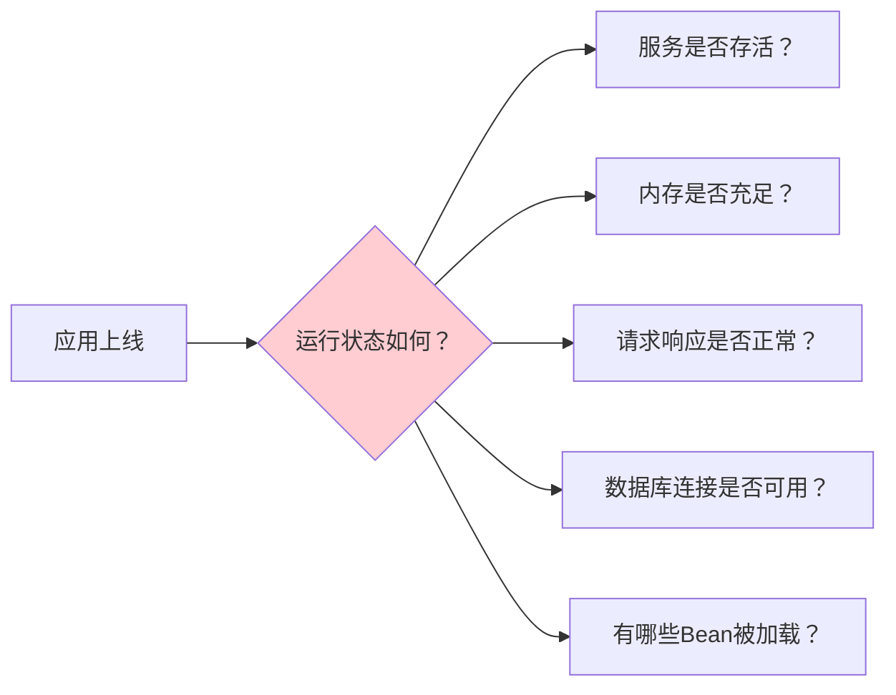
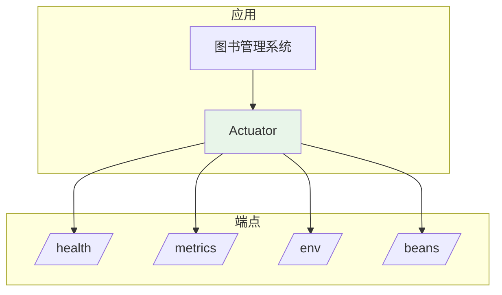

# Actuator 入门与常用端点

## 课程目标

- 理解系统监控的意义和 Spring Boot Actuator 的定位
- 掌握 Actuator 的快速集成方法
- 掌握常用监控端点的用途和访问方式
- 掌握端点的暴露规则和配置方法
- 掌握自定义 Actuator 端点路径和端口
- 了解端点安全配置的基本方法


## 系统监控概述

### 为什么需要系统监控

在应用上线后，我们需要实时了解应用的运行状态：



如果缺乏监控手段，问题往往只能等到用户反馈时才发现，排查困难、影响面大。

| 场景     | 没有监控       | 有监控             |
| -------- | -------------- | ------------------ |
| 服务宕机 | 用户反馈才知道 | 立即告警，快速定位 |
| 内存泄漏 | OOM 后才发现   | 提前发现增长趋势   |
| 慢接口   | 用户投诉后排查 | 实时查看请求耗时   |
| 配置错误 | 上线后才发现   | 查看 /env 确认配置 |

### 什么是 Spring Boot Actuator

**Spring Boot Actuator** 是 Spring Boot 提供的**生产级监控**模块，通过一组 HTTP 端点（Endpoint）暴露应用的运行信息，包括健康状态、指标数据、配置信息、Bean 列表等。



### Actuator 的核心能力

| 能力          | 说明                                       |
| ------------- | ------------------------------------------ |
| **健康检查**  | 应用及依赖组件（数据库、缓存等）的健康状态 |
| **指标监控**  | JVM、HTTP 请求、数据库连接池等指标         |
| **配置查看**  | 环境变量、配置属性、系统属性               |
| **Bean 管理** | 查看容器中所有 Bean 的信息                 |
| **请求映射**  | 查看所有 URL 与 Controller 的映射关系      |
| **日志管理**  | 动态调整日志级别                           |
| **线程快照**  | 查看线程堆栈                               |
| **堆转储**    | 下载堆内存快照                             |


## Actuator 快速集成

### 1. 添加依赖

在 `pom.xml` 中添加 Actuator Starter：

```xml
<dependency>
    <groupId>org.springframework.boot</groupId>
    <artifactId>spring-boot-starter-actuator</artifactId>
</dependency>
```

### 2. 启动应用

添加依赖后，无需任何配置即可访问默认端点：

```
http://localhost:8080/actuator
```

默认响应：

```json
{
    "_links": {
        "self": {
            "href": "http://localhost:8080/actuator",
            "templated": false
        },
        "health": {
            "href": "http://localhost:8080/actuator/health",
            "templated": false
        },
        "health-path": {
            "href": "http://localhost:8080/actuator/health/{*path}",
            "templated": true
        }
    }
}
```

> [!NOTE]
> 默认情况下，Spring Boot 只暴露 `/health` 端点（通过 HTTP）。其他端点虽然在应用内部存在，但不会被 Web 访问。需要通过配置显式暴露。

### 3. 查看健康状态

```
GET http://localhost:8080/actuator/health
```

响应：

```json
{
    "status": "UP"
}
```


## 常用端点详解

### 端点总览

Spring Boot 内置了大量端点，常用的有：

| 端点                       | 用途         | 默认暴露 |
| -------------------------- | ------------ | -------- |
| `/actuator/health`         | 健康状态     | ✅        |
| `/actuator/info`           | 应用信息     | ❌        |
| `/actuator/metrics`        | 指标数据     | ❌        |
| `/actuator/env`            | 环境属性     | ❌        |
| `/actuator/beans`          | Bean 列表    | ❌        |
| `/actuator/mappings`       | 请求映射     | ❌        |
| `/actuator/loggers`        | 日志级别管理 | ❌        |
| `/actuator/threaddump`     | 线程快照     | ❌        |
| `/actuator/heapdump`       | 堆转储       | ❌        |
| `/actuator/configprops`    | 配置属性     | ❌        |
| `/actuator/conditions`     | 自动配置条件 | ❌        |
| `/actuator/scheduledtasks` | 定时任务     | ❌        |
| `/actuator/caches`         | 缓存信息     | ❌        |

### /health —— 健康状态

用于检查应用及其依赖组件的健康状态。

```json
{
    "status": "UP",
    "components": {
        "db": {
            "status": "UP",
            "details": {
                "database": "PostgreSQL",
                "validationQuery": "isValid()"
            }
        },
        "diskSpace": {
            "status": "UP",
            "details": {
                "total": 500107862016,
                "free": 300107862016,
                "threshold": 10485760
            }
        },
        "ping": {
            "status": "UP"
        }
    }
}
```

**健康状态的可能值：**

| 状态             | 说明     |
| ---------------- | -------- |
| `UP`             | 正常     |
| `DOWN`           | 异常     |
| `OUT_OF_SERVICE` | 暂停服务 |
| `UNKNOWN`        | 未知     |

> [!NOTE]
> 默认情况下，健康检查只返回 `status`，不显示详细信息。需要在配置中开启 `show-details`。

```yaml
management:
  endpoint:
    health:
      show-details: always   # always / never / when-authorized
```

### /info —— 应用信息

展示应用的自定义信息，需要在配置中定义：

```yaml
info:
  app:
    name: 图书管理系统
    version: 1.0.0
    author: 技术团队
    description: 基于 Spring Boot 的图书管理系统
```

访问 `GET /actuator/info`：

```json
{
    "app": {
        "name": "图书管理系统",
        "version": "1.0.0",
        "author": "技术团队",
        "description": "基于 Spring Boot 的图书管理系统"
    }
}
```

默认 `info` 端点不会自动暴露，可以**通过 application.yml 配置暴露哪些端点：**

```yaml
management:
  endpoints:
    web:
      exposure:
        include: health,info,metrics,env,beans,loggers
        # 或使用 "*" 暴露所有端点
        # exclude: env,beans   # 排除特定端点
```

| 配置                   | 说明             |
| ---------------------- | ---------------- |
| `include: health,info` | 只暴露指定端点   |
| `include: "*"`         | 暴露所有端点     |
| `exclude: env,beans`   | 排除指定端点     |
| 不配置                 | 只暴露 `/health` |

> [!CAUTION]
>
> 生产环境不要使用 `include: "*"`，应根据需要暴露必要的端点，避免敏感信息泄露。

从 Spring Boot 2.6 开始，info 端点中的 env 贡献者（用于显示 info.* 属性）默认被禁用了。这意味着，即使你正确配置了 info.app.* 属性，访问 /actuator/info 也只会得到一个空的 {}。要启用它，必须在配置中添加 management.info.env.enabled=true。

```
management:
  info:
    env:
      enabled: true   # 必须开启，否则 info.* 属性不会显示
```

### /metrics —— 指标数据

展示应用运行时的各种指标。

**查看所有可用指标：**

```
GET /actuator/metrics
```

```json
{
    "names": [
        "jvm.memory.used",
        "jvm.memory.max",
        "jvm.gc.pause",
        "jvm.threads.live",
        "http.server.requests",
        "hikaricp.connections.active",
        "system.cpu.usage",
        "process.uptime"
    ]
}
```

**查看具体指标：**

```
GET /actuator/metrics/jvm.memory.used
```

```json
{
    "name": "jvm.memory.used",
    "description": "The amount of used memory",
    "baseUnit": "bytes",
    "measurements": [
        {
            "statistic": "VALUE",
            "value": 1.23456789E8
        }
    ],
    "availableTags": [
        {
            "tag": "area",
            "values": ["heap", "nonheap"]
        },
        {
            "tag": "id",
            "values": ["G1 Eden Space", "G1 Old Gen"]
        }
    ]
}
```

**按标签过滤：**

```
GET /actuator/metrics/jvm.memory.used?tag=area:heap
```

### /env —— 环境属性

展示应用的所有配置属性（包括环境变量、系统属性、配置文件等）。

```json
{
    "activeProfiles": ["dev"],
    "propertySources": [
        {
            "name": "systemProperties",
            "properties": {
                "java.version": {
                    "value": "17.0.9"
                }
            }
        },
        {
            "name": "applicationConfig: [classpath:/application.yml]",
            "properties": {
                "server.port": {
                    "value": 8080,
                    "origin": "classpath:/application.yml"
                }
            }
        }
    ]
}
```

> [!CAUTION]
> `/env` 端点可能暴露敏感信息（如数据库密码）。生产环境应限制访问权限，或使用 `management.endpoint.env.show-values=never` 隐藏值。

### /beans —— Bean 列表

展示 Spring 容器中所有 Bean 的信息。

```json
{
    "contexts": {
        "book-manager": {
            "beans": {
                "bookController": {
                    "aliases": [],
                    "scope": "singleton",
                    "type": "com.example.bookmanager.controller.BookController",
                    "resource": "file:...",
                    "dependencies": ["bookService"]
                },
                "bookService": {
                    "aliases": [],
                    "scope": "singleton",
                    "type": "com.example.bookmanager.service.impl.BookServiceImpl",
                    "dependencies": ["bookMapper"]
                }
            }
        }
    }
}
```

### /mappings —— 请求映射

展示所有 HTTP 请求与 Controller 方法的映射关系。

```json
{
    "contexts": {
        "book-manager": {
            "mappings": {
                "dispatcherServlets": {
                    "dispatcherServlet": [
                        {
                            "handler": "com.example.bookmanager.controller.BookController#getAllBooks()",
                            "predicate": "{GET [/api/books]}",
                            "details": {
                                "handlerMethod": {
                                    "className": "com.example.bookmanager.controller.BookController",
                                    "name": "getAllBooks"
                                }
                            }
                        }
                    ]
                }
            }
        }
    }
}
```

### /loggers —— 日志级别管理

**查看所有 Logger：**

```
GET /actuator/loggers
```

**查看指定 Logger：**

```
GET /actuator/loggers/com.example.bookmanager
```

```json
{
    "configuredLevel": "DEBUG",
    "effectiveLevel": "DEBUG"
}
```

**动态修改日志级别（POST）：**

```
POST /actuator/loggers/com.example.bookmanager
Content-Type: application/json

{
    "configuredLevel": "DEBUG"
}
```

> [!NOTE]
> 动态修改日志级别非常适合生产环境排查问题，无需重启应用。`configuredLevel` 设为 `null` 可恢复默认级别。

### /threaddump —— 线程快照

展示 JVM 中所有线程的堆栈信息，用于排查线程死锁、线程阻塞等问题。

```json
{
    "threads": [
        {
            "threadName": "http-nio-8080-exec-1",
            "threadId": 25,
            "blockedTime": -1,
            "blockedCount": 0,
            "waitedTime": -1,
            "waitedCount": 3,
            "lockName": null,
            "lockOwnerId": -1,
            "lockOwnerName": null,
            "inNative": false,
            "suspended": false,
            "threadState": "RUNNABLE",
            "stackTrace": [
                {
                    "classLoaderName": "app",
                    "moduleName": null,
                    "methodName": "service",
                    "fileName": "Http11Processor.java",
                    "lineNumber": 399,
                    "className": "org.apache.coyote.http11.Http11Processor"
                }
            ]
        }
    ]
}
```

### /heapdump —— 堆转储

下载堆内存快照（HProf 格式），用于离线分析内存泄漏。

```
GET /actuator/heapdump
```

浏览器会载 `heapdump.hprof` 文件，可使用 Eclipse MAT 或 VisualVM 分析。

> [!CAUTION]
>
> `/heapdump` 会生成整个堆的快照，文件可能很大（几百 MB 甚至 GB），且下载期间会暂停应用（STW）。生产环境慎用。

从 Spring Boot 3.5 开始，heapdump 端点的默认访问权限被设置为 NONE，这是一种安全改进。这意味着，仅仅“暴露”和“启用”是不够的，还必须显式配置其访问权限。

```java
management:
  endpoint:
    heapdump:
      access: unrestricted # 3.5+ 必须显式设置为 unrestricted，否则无法访问
```

### /scheduledtasks —— 定时任务

展示应用中所有 `@Scheduled` 定时任务的信息。

```json
{
    "crons": [
        {
            "runnable": {
                "target": "com.example.bookmanager.task.BookScheduledTasks.dailyReport"
            },
            "expression": "0 0 2 * * ?"
        }
    ],
    "fixedDelay": [
        {
            "runnable": {
                "target": "com.example.bookmanager.task.BookScheduledTasks.cleanCache"
            },
            "interval": 300000
        }
    ]
}
```

### /caches —— 缓存信息

展示应用中的缓存信息（需集成 Spring Cache）。

```json
{
    "cacheManagers": {
        "cacheManager": {
            "caches": {
                "books": {
                    "target": "com.github.benmanes.caffeine.cache.BoundedLocalCache"
                }
            }
        }
    }
}
```


## 端点配置

### 1. 自定义端点路径

**修改基础路径：**

```yaml
management:
  endpoints:
    web:
      base-path: /manage   # 默认 /actuator
```

修改后端点地址变为 `http://localhost:8080/manage/health`。

**修改特定端点路径：**

```yaml
management:
  endpoints:
    web:
      path-mapping:
        health: status   # 将 /health 改为 /status
```

### 2. 修改 Actuator 端口

如果不想让 Actuator 与业务共享端口，可以配置独立端口：

```yaml
management:
  server:
    port: 9090   # Actuator 独立端口
```

配置后，Actuator 端点可通过 `http://localhost:9090/actuator/health` 访问，与业务端口 8080 分开。

> [!NOTE]
> 使用独立端口时，如果配置了 `management.server.port`，还需要配置 `management.server.address` 限制访问地址（如只允许内网访问）。

### 3. 启用/禁用端点

```yaml
management:
  endpoint:
    health:
      enabled: true
    beans:
      enabled: false   # 禁用 beans 端点
```

### 4. 端点缓存

Actuator 端点默认会缓存响应，可以调整缓存时间：

```yaml
management:
  endpoint:
    health:
      cache:
        time-to-live: 5s   # 健康检查结果缓存 5 秒
```


## 实战：为图书管理系统开启监控

### 需求

为图书管理系统集成 Actuator，实现以下监控能力：
1. 暴露健康检查、指标、环境、Bean 等常用端点
2. 配置健康检查显示详细信息
3. 配置 `/info` 展示应用信息
4. 使用独立端口 9090 访问 Actuator

### 实现步骤

**步骤一：添加依赖**

```xml
<dependency>
    <groupId>org.springframework.boot</groupId>
    <artifactId>spring-boot-starter-actuator</artifactId>
</dependency>
```

**步骤二：配置 Actuator**

`application.yml`：

```yaml
# Actuator 配置
management:
  # 独立端口
  server:
    port: 9090

  endpoints:
    web:
      exposure:
        include: health,info,metrics,env,beans,mappings,loggers
      base-path: /actuator

  endpoint:
    health:
      show-details: always
      cache:
        time-to-live: 5s
	info:
    env:
      enabled: true

# 应用信息（对应 /actuator/info）
info:
  app:
    name: 图书管理系统
    version: 1.0.0
    author: 技术团队
    description: 基于 Spring Boot + PostgreSQL 的图书管理系统
    java-version: ${java.version}
```

**步骤三：启动应用并验证**

启动应用后，访问以下端点：

```bash
# 1. 查看所有端点
curl http://localhost:9090/actuator

# 2. 查看健康状态
curl http://localhost:9090/actuator/health

# 3. 查看应用信息
curl http://localhost:9090/actuator/info

# 4. 查看所有指标名称
curl http://localhost:9090/actuator/metrics

# 5. 查看 JVM 内存指标
curl "http://localhost:9090/actuator/metrics/jvm.memory.used"

# 6. 查看所有 Bean
curl http://localhost:9090/actuator/beans

# 7. 查看请求映射
curl http://localhost:9090/actuator/mappings
```

**预期响应（/actuator/health）：**

```json
{
    "status": "UP",
    "components": {
        "db": {
            "status": "UP",
            "details": {
                "database": "PostgreSQL",
                "validationQuery": "isValid()"
            }
        },
        "diskSpace": {
            "status": "UP",
            "details": {
                "total": 500107862016,
                "free": 300107862016,
                "threshold": 10485760,
                "exists": true
            }
        },
        "ping": {
            "status": "UP"
        }
    }
}
```

**预期响应（/actuator/info）：**

```json
{
    "app": {
        "name": "图书管理系统",
        "version": "1.0.0",
        "author": "技术团队",
        "description": "基于 Spring Boot + PostgreSQL 的图书管理系统",
        "java-version": "17.0.9"
    }
}
```

**步骤四：动态修改日志级别**

```bash
# 查看当前日志级别
curl http://localhost:9090/actuator/loggers/com.example.bookmanager

# 动态修改为 DEBUG 级别
curl -X POST http://localhost:9090/actuator/loggers/com.example.bookmanager \
     -H "Content-Type: application/json" \
     -d '{"configuredLevel": "DEBUG"}'
```

**验证：**

调用 `/api/books` 接口，观察控制台输出的 DEBUG 级别日志。

**步骤五：查看指标数据**

```bash
# 查看 JVM 内存使用（堆区）
curl "http://localhost:9090/actuator/metrics/jvm.memory.used?tag=area:heap"

# 查看 HTTP 请求统计
curl http://localhost:9090/actuator/metrics/http.server.requests

# 查看数据库连接池指标
curl http://localhost:9090/actuator/metrics/hikaricp.connections.active
```


## 端点安全配置

### 1. 隐藏敏感端点的值

```yaml
management:
  endpoint:
    env:
      show-values: never   # 隐藏配置值
    configprops:
      show-values: never
```

### 2. 使用独立端口 + 内网地址

```yaml
management:
  server:
    port: 9090
    address: 127.0.0.1   # 只监听本地
```

> [!NOTE]
> 生产环境建议将 Actuator 端口设为独立端口，并限制只允许内网访问，避免暴露给公网。

### 3. 自定义健康检查的安全级别

```yaml
management:
  endpoint:
    health:
      show-details: when-authorized   # 认证用户才能看到详情
      roles: ADMIN                     # 只有 ADMIN 角色能查看详情
```

### 4. 端点访问控制建议

| 端点        | 生产环境建议                     |
| ----------- | -------------------------------- |
| `/health`   | 允许访问（用于负载均衡健康检查） |
| `/info`     | 允许访问（展示应用基本信息）     |
| `/metrics`  | 仅内网访问                       |
| `/env`      | 隐藏或不暴露                     |
| `/beans`    | 隐藏或不暴露                     |
| `/heapdump` | 隐藏或不暴露                     |
| `/loggers`  | 仅内网访问                       |


## 注意事项

### 1. 不要暴露所有端点

生产环境使用 `include: health,info,metrics` 等必要端点即可，避免暴露 `env`、`beans`、`heapdump` 等敏感端点。

### 2. /env 可能泄露敏感信息

`/env` 端点可能包含数据库密码、API 密钥等。建议：
- 隐藏敏感值（`show-values: never`）
- 或不暴露 `/env` 端点

### 3. Actuator 端口独立

生产环境建议使用独立端口访问 Actuator，避免与业务流量混合。

### 4. 健康检查的性能开销

健康检查会检查数据库、磁盘等组件，频繁调用有一定开销。可以配置缓存：

```yaml
management:
  endpoint:
    health:
      cache:
        time-to-live: 5s
```

### 5. 不要禁用所有端点

如果为了安全禁用所有端点，会导致无法监控应用。建议暴露必要端点，通过安全配置保护。

### 6. 日志级别的动态修改

动态修改日志级别是临时手段，应用重启后会恢复。如果修改后忘记恢复，可能产生大量日志。


## 小结

本节课我们学习了：

1. **系统监控的意义**：实时了解应用运行状态，快速定位问题
2. **Spring Boot Actuator 集成**：添加依赖即可使用
3. **常用端点**：
   - `/health`：健康状态
   - `/info`：应用信息
   - `/metrics`：指标数据
   - `/env`：环境属性
   - `/beans`：Bean 列表
   - `/mappings`：请求映射
   - `/loggers`：日志级别管理
   - `/threaddump`：线程快照
   - `/heapdump`：堆转储
4. **端点配置**：
   - 暴露哪些端点（include/exclude）
   - 自定义端点路径
   - 独立端口配置
5. **安全配置**：限制访问权限，隐藏敏感信息
6. **实战应用**：为图书管理系统开启完整的监控能力


## 作业

### 作业一：代码阅读——端点识别

阅读以下配置，回答问题。

```yaml
management:
  server:
    port: 9090
  endpoints:
    web:
      exposure:
        include: health,info,metrics,loggers
      base-path: /manage
  endpoint:
    health:
      show-details: always
```

**问题：**
1. Actuator 端点的访问端口是多少？
2. 哪些端点被暴露？
3. 健康检查的访问路径是什么？
4. 健康检查是否会显示详细信息？
5. 如果想额外暴露 `beans` 端点，应该怎么修改？

---

### 作业二：为图书管理系统集成 Actuator

在图书管理系统中完成以下任务：

1. 添加 `spring-boot-starter-actuator` 依赖。
2. 配置 Actuator：
   - 使用独立端口 9090
   - 暴露 `health`、`info`、`metrics`、`mappings`、`loggers`
   - 健康检查显示详细信息
3. 配置 `/info` 端点，展示应用名称、版本、作者。
4. 启动应用，验证以下端点：
   - `http://localhost:9090/actuator/health`
   - `http://localhost:9090/actuator/info`
   - `http://localhost:9090/actuator/metrics`
   - `http://localhost:9090/actuator/mappings`

---

### 作业三：端点安全配置

在图书管理系统中完成以下任务：

1. 修改 `application.yml`，实现以下配置：
   - Actuator 使用独立端口 9090
   - 监听地址限制为 `127.0.0.1`（仅本地访问）
   - 隐藏 `/env` 端点的配置值（`show-values: never`）
2. 启动应用，验证：
   - 业务接口可通过 `http://localhost:8080/api/books` 访问
   - Actuator 端点可通过 `http://localhost:9090/actuator/health` 访问
   - 访问 `/actuator/env` 时，属性值不显示具体内容
3. 使用 `curl` 从其他机器（或使用不同网络接口）测试，验证 Actuator 端口无法从外部访问。
